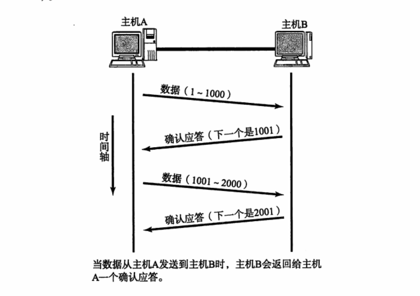

## 前提提要

首先，这个是以求职为目的整理的文档，以市面上关键问题为导向整理的，故看起来没有连贯性，如果需要深入的去了解，请参考相关网络书籍，列：《图解TCP_IP_第5版》

## 网络七层协议流程概括

网络的七层协议模型是指OSI（Open Systems Interconnection）参考模型，也被称为OSI模型。它将网络通信过程分为七个不同的层级，每个层级负责特定的功能和任务。下面是对网络的七层协议模型的详细说明：

**物理层**（Physical Layer）：

物理层是网络的最底层，负责传输比特流（bitstream）通过物理媒介，如电缆、光纤或无线信号等。

它定义了传输介质的物理特性、接口标准和电气规范。

**数据链路层**（Data Link Layer）：

数据链路层在物理层之上，负责将物理层传输的比特流组织成数据帧（Data Frame）。

它提供了可靠的数据传输，通过差错检测和纠正技术来处理传输中的错误。

**网络层**（Network Layer）：

网络层负责实现数据包在网络中的路由和转发。

它定义了IP（Internet Protocol）地址和路由选择算法，以便将数据包从源主机发送到目标主机。

**传输层**（Transport Layer）：

传输层提供端到端的通信服务，负责将数据从源端点传输到目标端点。

它使用端口号标识不同的应用程序，并提供可靠的数据传输和错误恢复，例如TCP（Transmission Control Protocol）。

**会话层**（Session Layer）：

会话层负责建立、管理和终止通信会话。

它提供了会话控制和同步功能，允许不同主机上的应用程序之间建立会话并进行数据交换。

**表示层**（Presentation Layer）：

表示层处理数据的表示和编码方式，确保不同系统之间的数据格式兼容性。

它负责数据的压缩、加密和解密，以及数据格式的转换和转码。

**应用层**（Application Layer）：

应用层是网络的最顶层，提供了面向用户的服务和应用程序。

它包括各种应用协议，如HTTP、FTP、SMTP等，用于实现不同的网络应用，例如Web浏览器、电子邮件和文件传输等。

## 利用网络七层协议的简单案列

计算机A（发送方）和计算机B（接收方）之间的数据传输过程如下：

**物理层**：

计算机A将数据转换为比特流，并通过以太网网线传输到计算机B。

物理层负责将比特流从计算机A的网卡发送到以太网上的物理媒介。

**数据链路层**：

计算机A的网卡将比特流组织成数据帧，添加数据帧头部和尾部（包括源和目标MAC地址）。

数据链路层负责将数据帧从计算机A发送到以太网。

**网络层：**

计算机A的操作系统将数据帧封装为IP数据包，添加源和目标IP地址。

网络层负责将IP数据包从计算机A发送到目标计算机B。

**传输层：**

计算机A的应用程序将数据分割为适当的数据块，并添加源和目标端口号。

传输层负责将数据块封装为传输层协议（如TCP或UDP）的数据段，以便在计算机A和计算机B之间建立可靠的数据传输连接。

**会话层、表示层和应用层：**

计算机A的应用程序在会话层、表示层和应用层中进行数据的进一步处理和封装，使其符合特定的应用协议（如HTTP、FTP等）。这些层负责将数据段封装为特定的应用层协议的数据，例如将HTTP请求封装为应用层数据。

**网络传输：**

数据沿着网络路径从计算机A发送到计算机B，经过路由器和交换机等网络设备。

在每个设备上，数据将被解析、转发和传递给下一个设备，直到到达计算机B所在的网络。

**接收和解析**：

计算机B的网卡接收到数据帧，并进行解析，提取出数据帧中的数据。

数据链路层负责将数据帧传递给计算机B的操作系统。

**数据处理和传递：**

计算机B的操作系统根据目标IP地址，将IP数据包传递给相应的应用程序。

在传输层，数据段被解析，并根据目标端口号传递给相应的应用程序。

**应用层处理：**

计算机B的应用程序接收到数据，并进行进一步处理，根据应用协议解析数据内容。

这样，数据从计算机A通过网络传输到计算机B，并在计算机B的应用层被接收和处理。整个过程涉及多个协议和网络层级的交互，确保数据的可靠传输和正确解析。

## java跟这些协议相关的框架

物理层和数据链路层：

在Java中，物理层和数据链路层通常由操作系统和网络接口卡（NIC）处理，不需要专门的框架。

网络层和传输层：

Java提供了原生的网络编程库，如Socket和ServerSocket，用于在网络层和传输层进行基本的TCP和UDP通信。

对于更高级的网络编程，可以使用基于Java NIO的框架，如Netty和Apache MINA，它们提供了高性能的异步网络通信和事件驱动编程模型。

应用层：

HTTP协议：Java中最常用的处理HTTP协议的框架是Apache HttpClient和Java内置的HttpURLConnection。另外，还有基于Netty的高性能HTTP服务器框架，如Netty和Undertow。

FTP协议：Apache Commons Net是一个流行的Java库，用于处理FTP协议的文件传输。

SMTP和POP3协议：JavaMail是一个用于发送和接收电子邮件的Java库，支持SMTP和POP3协议。

DNS协议：可以使用Java的原生网络编程库或第三方库，如dnsjava，来进行DNS查询和解析。

## 什么是Socket

在计算机网络中，Socket（套接字）是一种用于实现网络通信的编程接口或抽象概念。它提供了一种机制，使不同计算机上的进程能够通过网络进行通信。

Socket可以看作是应用程序与网络之间的接口，它允许应用程序通过发送和接收数据来实现网络通信。应用程序可以使用Socket来建立连接、发送数据、接收数据和关闭连接。

Socket通常使用TCP协议（传输控制协议）或UDP协议（用户数据报协议）进行通信。TCP提供可靠的、面向连接的通信，而UDP提供无连接的通信。

在Java中，Java提供了Socket类和ServerSocket类作为标准API，用于实现基于TCP或UDP的网络通信。使用Socket类，可以创建客户端程序，与远程服务器建立连接并进行数据交换。使用ServerSocket类，可以创建服务器程序，侦听客户端的连接请求并处理客户端的数据。

Socket类提供了一系列方法，如connect()、send()、receive()和close()等，用于建立连接、发送和接收数据以及关闭连接。通过Socket类，开发者可以实现各种网络应用，如Web浏览器、邮件客户端、聊天程序等。

总结起来，Socket是一种网络通信的编程接口，它允许应用程序在不同计算机之间通过网络进行数据交换。在Java中，Socket类和ServerSocket类提供了实现Socket接口的方法和功能，便于开发者进行网络通信的编程。

java_demo:[https://gitee.com/ForturnAcao/java_socket](https://gitee.com/ForturnAcao/java_socket)

## 什么是Netty

Netty是一个基于Java的开源网络应用框架，用于快速开发高性能的网络服务器和客户端应用程序。它提供了一种简单、高效和可扩展的方式来处理异步网络通信。

Netty的设计目标是提供可定制、可重用和可扩展的网络编程框架，以满足各种应用场景的需求。它提供了一组丰富的功能和组件，使开发人员能够轻松构建各种类型的网络应用，例如服务器、客户端、代理、协议处理器等。

Netty的主要特点包括：

异步和事件驱动：Netty基于事件驱动模型和异步I/O操作，可以实现高效的并发处理。它使用了非阻塞I/O操作和事件回调机制，提供了高性能和低延迟的网络通信。

高度可定制：Netty提供了灵活的组件和可扩展的架构，使开发人员能够根据应用程序的需求进行定制和扩展。它具有模块化的设计，可以轻松替换、组合和扩展各个组件。

协议支持：Netty支持多种常见的网络协议，如TCP、UDP、HTTP、WebSocket等。它提供了一套易于使用的API，使开发人员可以方便地构建基于这些协议的应用程序。

高性能：Netty通过使用零拷贝技术、内存池和线程池等优化策略，提供了出色的性能和可伸缩性。它使用了高效的事件循环机制，可以处理大量的并发连接。

安全性：Netty提供了对SSL/TLS的支持，可以实现安全的网络通信。它提供了一套强大的安全性特性，如加密、身份验证和访问控制等。

Netty已经成为许多大型互联网公司和开发人员的首选框架，用于构建高性能、可扩展和可靠的网络应用程序。它在网络通信领域具有广泛的应用，例如服务器、游戏服务器、消息中间件、分布式系统等。

**扩展**：

Netty是一个网络应用框架，可以用于开发各种类型的网络应用程序。它可以在不同的网络协议栈中使用，包括传输层（Transport Layer）和应用层（Application Layer）。

传输层是网络协议栈中的第四层，负责在网络中的两个主机之间提供可靠的数据传输。Netty可以在传输层中使用以下协议：

TCP（Transmission Control Protocol）：TCP是一种可靠的、面向连接的协议，用于在网络中可靠地传输数据。Netty提供了对TCP协议的支持，可以构建基于TCP的服务器和客户端应用程序。

UDP（User Datagram Protocol）：UDP是一种无连接的协议，用于在网络中快速传输数据。Netty也提供了对UDP协议的支持，可以构建基于UDP的服务器和客户端应用程序。

应用层是网络协议栈中的最高层，负责处理特定的应用协议。Netty可以在应用层中使用各种协议，包括但不限于以下几种：

HTTP（Hypertext Transfer Protocol）：HTTP是一种应用层协议，用于在客户端和服务器之间传输超文本资源。Netty提供了对HTTP协议的支持，可以构建基于HTTP的服务器和客户端应用程序。

WebSocket：WebSocket是一种在单个TCP连接上进行全双工通信的协议，通常用于实时的、双向的Web应用程序。Netty提供了对WebSocket协议的支持，可以构建基于WebSocket的服务器和客户端应用程序。

MQTT（Message Queuing Telemetry Transport）：MQTT是一种轻量级的发布/订阅消息传输协议，常用于物联网应用。Netty也提供了对MQTT协议的支持，可以构建基于MQTT的服务器和客户端应用程序。

这些只是Netty可以支持的一些网络协议，它的灵活性和可扩展性使得可以在不同的协议层中使用。具体使用哪些协议取决于开发人员的需求和应用场景。

## Netty和socket的相关性和特点

Netty和Socket是两个不同的概念，但它们之间存在一定的相关性。下面是它们的相关性和特点的说明：

Socket是一种编程接口：Socket是一种用于网络通信的编程接口，它提供了一组用于创建网络连接、发送和接收数据的方法。通过Socket编程接口，开发人员可以使用TCP或UDP协议在网络上进行数据传输。

Netty是一个网络应用框架：Netty是基于Java的开源网络应用框架，用于快速开发高性能的网络服务器和客户端应用程序。它提供了对底层网络编程的封装和抽象，简化了网络应用的开发过程。

Netty基于Socket进行网络通信：Netty使用Socket作为底层的网络通信实现。它封装了底层的Socket编程接口，并提供了一套高级的抽象和组件，使网络应用的开发更加简单、灵活和高效。

高级特性和功能：相比原始的Socket编程，Netty提供了许多高级特性和功能，包括异步和事件驱动的编程模型、高性能的IO操作、线程池管理、内存池管理、编解码器、流水线处理等。这些特性和功能使得开发人员能够更轻松地构建高性能、可扩展和可定制的网络应用。

高性能和可扩展性：Netty通过使用非阻塞IO和事件驱动模型，以及优化的网络处理机制，提供了出色的性能和可扩展性。它可以处理大量的并发连接，并具有低延迟和高吞吐量的特点。

总结起来，Socket是一种编程接口，用于进行底层的网络通信，而Netty是一个网络应用框架，基于Socket提供了更高级的抽象和功能，使网络应用的开发更加简单和高效。Netty通过封装Socket接口、提供高级特性和功能以及优化的性能，使得开发人员能够更轻松地构建高性能和可扩展的网络应用。

## 基于网络安全，相关的问答

### 我利用 java_netty发送数据到某个ip端口 如果接受端什么都不做，消息能正常发送吗，或者说发送后,接受端对这个消息会有其他处理吗？
如果使用Java Netty发送数据到某个IP端口，而接收端不做任何处理，消息仍然可以正常发送。Netty是一个异步事件驱动的网络应用程序框架，可以通过网络发送和接收数据。当发送端使用Netty发送数据时，它会尝试将数据发送到指定的IP地址和端口。

接收端不做任何处理意味着它不会对接收到的消息进行任何特殊操作或响应。在这种情况下，接收端可能会忽略这些消息，不做任何处理，并且没有其他的响应或反馈。

但是需要注意的是，即使接收端不做任何处理，数据仍然会通过网络进行传输。如果接收端的网络连接存在问题，可能会导致数据包丢失或延迟。此外，发送端可能需要等待一段时间才能确定数据是否已成功传输到接收端，因为网络通信可能会受到延迟或其他因素的影响。

总的来说，即使接收端不做任何处理，使用Java Netty发送的消息仍然可以成功发送，但不能保证接收端对这些消息会有其他处理或响应

### netty底层是使用tcp/ip，这个过程中，我是否可以根据网络层拦截这一个数据 并且篡改

在使用Netty进行TCP/IP通信时，你可以在网络层拦截数据并进行篡改。TCP/IP协议栈的网络层包括IP协议，它负责将数据包从源地址传输到目标地址。你可以使用一些网络抓包工具或编程技术来拦截传输的数据包，并对其进行修改。

一种常见的方式是使用抓包工具，如Wireshark或tcpdump，在网络上监视数据包的传输。这些工具可以捕获数据包，并显示其内容。你可以选择篡改数据包的内容，然后将修改后的数据包重新发送到目标地址。

另一种方式是使用编程技术来拦截和修改数据包。例如，你可以使用Java的Packet Capture API（Jpcap）库来拦截网络数据包，并对其进行修改。这样，你可以在接收端之前修改数据包的内容，并将修改后的数据包发送到目标地址。

无论你选择使用哪种方法，都需要注意以下几点：

拦截和篡改数据包需要在网络层进行操作，因此需要相应的权限和访问控制。

篡改数据包可能会违反网络通信的规范和安全性，因此在进行此类操作时需要谨慎，并确保符合法律和道德要求。

修改数据包可能会引入不可预测的行为和问题，因此需要进行充分的测试和验证，以确保修改后的数据包仍然能够被接收端正确处理。

请注意，这些方法都是在拦截和修改数据包的层面进行操作，并不直接涉及Netty框架本身。Netty是一个高级的网络应用程序框架，提供了简化网络编程的功能，并且它本身并没有直接提供拦截和修改数据包的功能。

### 意思就是在数据随着帧包在网络上传输，可以拦截的原理是什么呢，是服务端网络的路由器还是？

当数据通过网络传输时，它会被封装成一个一个的数据包（或帧）进行传输。在这个过程中，数据包会通过网络中的各个设备，例如路由器、交换机等，然后最终到达目标地址。

拦截数据包的原理是通过在网络中的某个位置上截获数据包，并对其进行处理。这可以在不同的设备上实现，包括服务端的网络设备（如路由器、防火墙等）或客户端的设备（如计算机上的抓包工具）。

在服务端网络中，路由器是一个常见的位置来拦截数据包。路由器根据目标IP地址将数据包从一个网络接口路由到另一个网络接口。在路由过程中，路由器可以检查数据包的内容，并根据定义的规则对其进行处理。这包括拦截数据包、修改数据包的内容、重定向数据包等。

此外，防火墙也可以用于拦截数据包。防火墙是一种网络安全设备，用于监控和控制网络流量。它可以根据预定义的规则，检查数据包的源地址、目标地址、端口号等信息，并决定是否允许通过或进行进一步处理。拦截数据包并进行篡改是防火墙的一种功能。

在客户端，你可以使用抓包工具（如Wireshark、tcpdump等）来拦截数据包。这些工具可以在计算机的网络接口上监听网络流量，并捕获传入和传出的数据包。通过这些工具，你可以看到数据包的内容，并进行修改、重发等操作。

需要注意的是，拦截和修改数据包的能力通常需要相应的权限和访问控制，以确保数据的安全和合法性。此外，拦截和修改数据包可能会违反网络通信的规范和法律要求，因此在进行此类操作时需要谨慎，并确保符合规定。

### 拦截和修改数据包的能力通常需要相应的权限和访问控制指的是什么权限

拦截和修改数据包的能力通常需要以下权限和访问控制：

网络管理员权限：拦截和修改数据包通常需要在网络设备上进行操作，例如路由器、防火墙等。这些设备通常由网络管理员管理和配置。因此，进行数据包拦截和修改需要具备相应的管理员权限，以便访问和配置这些设备。

物理访问权限：对于在网络设备上进行拦截和修改的情况，通常需要物理访问权限。这意味着你需要有权限进入设备的物理位置，并能够连接到设备的控制台或管理接口。

软件权限：如果你使用计算机上的抓包工具（如Wireshark、tcpdump等）进行数据包拦截和修改，你需要在计算机上具备相应的软件权限。这可能包括管理员权限或特定的用户权限，以便你能够运行和操作这些抓包工具。

合规性和法律要求：拦截和修改数据包可能会涉及到用户隐私、网络安全和合规性的问题。因此，在进行此类操作时，你需要确保符合适用的法律、法规和政策要求。这可能需要遵循特定的授权程序、获得用户的明确同意或满足其他合规性要求。

需要强调的是，拦截和修改数据包的能力是一项敏感的操作，并且可能会对网络通信和用户隐私产生影响。因此，进行这些操作时应该谨慎，并确保遵守适用的法规和规定。在商业环境中，这通常需要遵循组织的策略和流程，以确保合法性和合规性。

### 可不可以这样，我加入到这个服务器的局域网里面，监控相同的端口，我能不能获取到那份数据

如果你加入到服务器的局域网中，并且能够监控相同的端口，那么在一些情况下你是可以获取到传输的数据的。这取决于网络的配置和安全性措施。

如果服务器的网络配置允许在局域网内进行数据包监控，你可以使用抓包工具在局域网中监听该端口的数据流量。抓包工具可以帮助你捕获传入和传出的数据包，并显示其内容。

然而，需要注意以下几点：

网络访问权限：你需要加入服务器的局域网，并且具备相应的网络访问权限，才能够在局域网中进行数据包监控。

端口访问权限：如果服务器的端口被配置为仅允许特定的设备访问，那么你需要确保你的设备具备访问该端口的权限，才能够获取到数据。

加密和安全性措施：如果服务器的数据传输采用加密或其他安全性措施，你可能无法直接获取到明文的数据。加密的数据需要进行解密才能被理解。

合规性和法律要求：在进行数据包监控时，你需要确保遵守适用的法律、法规和政策要求。这可能涉及用户隐私和数据保护等方面的规定。

需要注意的是，数据包监控涉及到网络安全和隐私问题，因此在进行此类操作时应该谨慎，并确保符合适用的法规和规定。在商业环境中，必须遵守组织的策略和流程，并获得相关授权和许可。

## TCP和HTTP的区别和各自的优势

**TCP（传输控制协议）**和 **HTTP（超文本传输协议）**是计算机网络中的两种不同的协议，用于不同的目的。

T**CP是一种传输层协议**，负责在网络上可靠地传输数据。它**提供了端到端的连接**，**确保数据的可靠性和顺序传输**。TCP使用三次握手建立连接，通过序号和确认机制来保证数据的可靠传输，同时具备拥塞控制和流量控制的机制,是一个持久连接。**HTTP是应用层协议，建立在TCP之上**，用于在客户端和服务器之间传输超文本数据。它是一种**无状态协议**，**每个请求独立于其他请求**，**服务器不会保存客户端的状态信息**。H**TTP使用URL来指定资源的位置**，并使用请求方法（如GET、POST等）来定义对资源的操作。

### TCP和HTTP的区别和各自的优势：

层级关系：TCP位于传输层，负责数据的可靠传输；HTTP位于应用层，用于在客户端和服务器之间传输超文本数据。

功能目的：**TCP的主要目的是提供可靠的数据传输，确保数据的完整性和可靠性**；而**HTTP的主要目的是在客户端和服务器之间传输超文本数据，并定义了请求和响应的格式。**

连接和状态：T**CP提供端到端的连接，并维护连接的状态，确保数据的可靠传输**；**HTTP是无状态的，每个请求都是独立的，服务器不会保存客户端的状态信息。**

数据传输方式：**TCP提供字节流传输，将数据分割成小的数据包进行传输**；**HTTP使用请求-响应模式，客户端发送请求，服务器返回响应。**

端口号：TCP使用端口号来标识不同的应用程序或服务；HTTP使用默认端口号80进行通信。

1. TCP的优势：

可靠性：TCP提供可靠的数据传输，通过序号和确认机制确保数据的完整性和可靠性。

顺序性：TCP保证数据按照发送的顺序到达接收端。

拥塞控制：TCP具备拥塞控制机制，可以根据网络状况动态调整传输速率，避免网络拥塞。

2. HTTP的优势：

简单性：HTTP的请求和响应格式相对简单易懂，易于开发和调试。

可扩展性：HTTP支持通过头部信息扩展功能，可以满足不同应用的需求。

跨平台：HTTP是基于文本的协议，可以在不同的操作系统和平台上使用。

总结起来，TCP是一种传输层协议，提供可靠的数据传输；HTTP是一种应用层协议，用于在客户端和服务器之间传输超文本数据。TCP保证数据的可靠性和顺序性，而HTTP具备简单性和可扩展性的优势。
