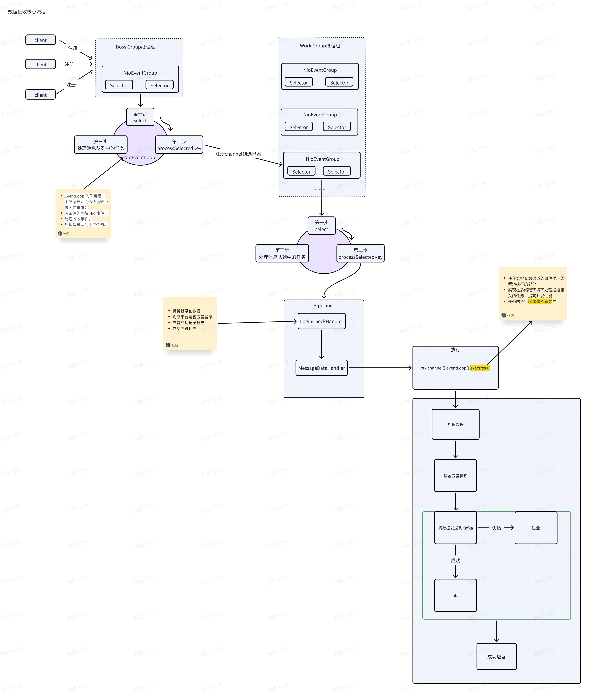

## 一，Netty的特点

- 一个高性能、异步事件驱动的NIO框架，它提供了对TCP、UDP和文件传输的支持

- 使用更高效的socket底层，对epoll空轮询引起的cpu占用飙升在内部进行了处理，避免了直接使用NIO的陷阱，简化了NIO的处理方式。

- 采用多种decoder/encoder 支持，对TCP粘包/分包进行自动化处理

- 可使用接受/处理线程池，提高连接效率，对重连、心跳检测的简单支持

- 可配置IO线程数、TCP参数， TCP接收和发送缓冲区使用直接内存代替堆内存，通过内存池的方式循环利用ByteBuf

- 通过引用计数器及时申请释放不再引用的对象，降低了GC频率

- 使用单线程串行化的方式，高效的Reactor线程模型

- 大量使用了volitale、使用了CAS和原子类、线程安全类的使用、读写锁的使用

Note:

①. NIO: 代表非阻塞I/O（Non-blocking I/O），是一种在Java中提供的I/O操作模型。它引入了一组新的Java类，如ByteBuffer、Channel和Selector，以支持高效的I/O操作,就像外卖一样，只用关心货品有没有送到，无需等待

②. TCP: 一个传输层的协议，建立可靠的连接，使得不同的网络下的服务进行可靠，有序的数据传输，并且不像应用层Http那样重

③. UDP: 是一种传输层协议，与TCP类似，用于在计算机网络上传输数据。然而，UDP与TCP在功能和特性上存在一些重要的区别（无连接性，不可靠性，无顺序，支持广播和多播，简单性）

④. epoll空轮询：在传统的NIO模型中，当没有可读或可写事件时，通常会使用轮询（polling）方式不断地查询是否有新的事件到达。这种空轮询会导致CPU资源的浪费，因为它需要不断地查询状态而没有实际的工作任务。

⑤.

1. 高并发连接：当需要处理大量并发连接时，使用线程池可以提高连接的处理效率。线程池可以有效管理和复用线程资源，避免频繁地创建和销毁线程，从而减少系统开销。

2. 长连接和连接池：在长连接的场景下，使用线程池可以避免为每个连接创建独立的线程。通过将连接的读写任务提交给线程池处理，可以充分利用线程资源，提高系统的并发能力。

3. 重连机制：在网络通信中，如果连接断开，往往需要进行重连操作以保持连接的可用性。使用线程池可以在连接断开时异步进行重连操作，而不会阻塞主线程或事件循环线程。可以通过线程池中的线程执行重连逻辑，并在重连成功后重新建立连接。

   ```java
    /**
        * 启动通道
        *
        * @param socketConf 配置
        * @param chNum      第几个通道
        * @param retryCount 重试次数
        */
       public void handleSocketConf(SocketConf socketConf, int chNum, long retryCount) throws InterruptedException {
   //        log.info("{} TCP通道,通道key:{} 通道初始化....", socketConf.getCustomer(), String.format(CACHE_KEY_FORMAT, socketConf.getId(), chNum));
           // 初始化client
           initClient(socketConf, chNum);

           // 连接
           ChannelFuture channelFuture = this.bootstrap.connect(socketConf.getHost(), socketConf.getPort());

           // 增加监听
           channelFuture.addListener((ChannelFutureListener) future -> {

               if (!future.isSuccess()) {  // 没有连接成功，进行 “重连”
                   //一直重试  -1
                   if (socketConf.getMaxRetriesNum() == -1) {
                       Thread.sleep(socketConf.getReconnectDelay() * 1000);
                       handleSocketConf(socketConf, chNum, retryCount + 1);
                       log.error("{} TCP通道,通道key:{} 连接失败正在尝试重新连接,重试次数：{}....", socketConf.getCustomer(), String.format(CACHE_KEY_FORMAT, socketConf.getId(), chNum), retryCount+2);
                   }

                   //不重试  0
                   if (socketConf.getMaxRetriesNum() == 0) {
                       log.error("{} TCP通道,通道key:{} 连接失败", socketConf.getCustomer(), String.format(CACHE_KEY_FORMAT, socketConf.getId(), chNum));

                   }

                   //不重试  重试n次
                   if (socketConf.getMaxRetriesNum() > 0) {
                       if (retryCount < socketConf.getMaxRetriesNum()) {
                           try {
                               Thread.sleep(socketConf.getReconnectDelay() * 1000);
                               handleSocketConf(socketConf, chNum, retryCount + 1);
                               log.error("{} TCP通道,通道key:{} 连接失败正在尝试重新连接,重试次数：{}....", socketConf.getCustomer(), String.format(CACHE_KEY_FORMAT, socketConf.getId(), chNum), retryCount + 1);
                           } catch (InterruptedException e) {
                               e.printStackTrace();
                               log.error("{} TCP通道,通道key:{} 连接失败正在尝试重新失败", socketConf.getCustomer(), String.format(CACHE_KEY_FORMAT, socketConf.getId(), chNum));
                           }
                       } else {
                           log.error("{} TCP通道,通道key:{} 连接失败，达到最大重试次数", socketConf.getCustomer(), String.format(CACHE_KEY_FORMAT, socketConf.getId(), chNum));
                       }
                   }

               }
           });
       }

   ```

4. 心跳检测：为了保持连接的健康状态，常常需要进行心跳检测。使用线程池可以定期发送心跳包并等待心跳响应，而不会阻塞主线程或事件循环线程。线程池中的线程可以负责心跳检测任务，并根据心跳响应判断连接的状态。

   ```java
    
         socketChannel.pipeline().addLast(new IdleStateHandler(timeout, 0, 0, TimeUnit.SECONDS));

       //这个需要服务器和客户端都触发这个
       @Override
       public void userEventTriggered(ChannelHandlerContext ctx, Object evt) throws Exception {
           if (evt instanceof IdleStateEvent) {
               IdleStateEvent event = (IdleStateEvent) evt;
               if (event.state() == IdleState.READER_IDLE) {
                   SocketConf config = ctx.channel().attr(Attributes.SOCKET_CONFIG).get();
                   config = config == null ? new SocketConf() : config;
                   Integer ch = ctx.channel().attr(Attributes.CH).get();
                   log.info("通道 {}-{}-{} 的连接超时关闭", config.getId(), config.getCustomer(), ch);
                   ctx.channel().close();
               }
           } else {
               super.userEventTriggered(ctx, evt);
           }
       }

   ```

5. 处理耗时任务：有时连接的处理可能涉及到耗时的操作，如数据的解析、计算或存储等。通过将这些耗时任务交给线程池处理，可以避免阻塞主线程或事件循环线程，确保连接的响应性和可靠性。

## 二，Netty线程模型



Netty通过**Reactor模型**基于多路复用器接收并处理用户请求，内部实现了两个线程池，boss线程池和work线程池，其中boss线程池的线程负责处理请求的accept事件，当接收到accept事件的请求时，把对应的socket封装到一个NioSocketChannel中，并交给work线程池，其中work线程池负责请求的read和write事件，由对应的Handler处理。

   ```java
   CompletableFuture.runAsync(() -> {
               // 创建两个线程组 bossGroup、workerGroup
               EventLoopGroup bossGroup = new NioEventLoopGroup();
               EventLoopGroup workerGroup = new NioEventLoopGroup();
               try {
                   // 创建服务端的启动对象，设置参数
                   ServerBootstrap bootstrap = new ServerBootstrap();
                   // 设置两个线程组 bossGroup 和 workerGroup
                   bootstrap.group(bossGroup, workerGroup)
                           // 设置服务端通道实现类型
                           .channel(NioServerSocketChannel.class)
                           // 设置线程队列得到连接个数
                           .option(ChannelOption.SO_BACKLOG, 128)
                           // 设置保持活动连接状态
                           .childOption(ChannelOption.SO_KEEPALIVE, true)
                           // 使用匿名内部类的形式初始化通道对象
                           .childHandler(new ChannelInitializer<SocketChannel>() {
                               @Override
                               protected void initChannel(SocketChannel socketChannel) throws Exception {
                                   // 给 pipeline 管道设置处理器
                                   socketChannel.pipeline().addLast(new MaserHeadDataDecoder());
                                   socketChannel.pipeline().addLast(new FlybeesByteArrayEncoder());
                                   socketChannel.pipeline().addLast(new LoginCheckHandler(username, password, identifyCode));
                                   socketChannel.pipeline().addLast(new MessageDataHandler(profile));
                               }
                           });// 给 workerGroup 的 EventLoop 对应的管道设置处理器

                   // 绑定端口号，启动服务端
                   // 异步绑定端口，返回一个ChannelFuture对象
                   ChannelFuture channelFuture = bootstrap.bind(monitorPort);

                   // 添加监听器，在绑定完成后执行相应的操作
                   channelFuture.addListener((ChannelFutureListener) future -> {
                       if (future.isSuccess()) {
                           log.info("服务端准备就绪，随时可以起飞~");
                           setChannel(channelFuture.channel());
                       } else {
                           log.error("服务端绑定端口失败", future.cause());

                       }
                   });
                   // 阻塞直到服务端关闭
                   channelFuture.channel().closeFuture().sync();

               } catch (InterruptedException e) {
                   log.error("消息接收器启动失败！");
                   throw new RuntimeException(e);
               } finally {
                   bossGroup.shutdownGracefully();
                   workerGroup.shutdownGracefully();
                   log.error("消息接收器关闭");
               }
           });

   ```

2. 单线程模型：所有I/O操作都由一个线程完成，即多路复用、事件分发和处理都是在一个Reactor线程上完成的。既要接收客户端的连接请求,向服务端发起连接，又要发送/读取请求或应答/响应消息。一个NIO 线程同时处理成百上千的链路，性能上无法支撑，速度慢，若线程进入死循环，整个程序不可用，对于高负载、大并发的应用场景不合适。

3. 多线程模型：有一个NIO 线程（Acceptor） 只负责监听服务端，接收客户端的TCP 连接请求；NIO 线程池负责网络IO 的操作，即消息的读取、解码、编码和发送；1 个NIO 线程可以同时处理N 条链路，但是1 个链路只对应1 个NIO 线程，这是为了防止发生并发操作问题。但在并发百万客户端连接或需要安全认证时，一个Acceptor 线程可能会存在性能不足问题。

4. 主从多线程模型：Acceptor 线程用于绑定监听端口，接收客户端连接，将SocketChannel 从主线程池的Reactor 线程的多路复用器上移除，重新注册到Sub 线程池的线程上，用于处理I/O 的读写等操作，从而保证mainReactor只负责接入认证、握手等操作；

## 三，TCP 粘包/拆包的原因及解决方法？

TCP是以流的方式来处理数据，一个完整的包可能会被TCP拆分成多个包进行发送，也可能把小的封装成一个大的数据包发送。

**TCP粘包/分包的原因：**

应用程序写入的字节大小大于套接字发送缓冲区的大小，会发生拆包现象，而应用程序写入数据小于套接字缓冲区大小，网卡将应用多次写入的数据发送到网络上，这将会发生粘包现象；

进行MSS大小的TCP分段，当TCP报文长度-TCP头部长度>MSS的时候将发生拆包

以太网帧的payload（净荷）大于MTU（1500字节）进行ip分片。

**解决方法：**

1. 消息定长：FixedLengthFrameDecoder类

2. 包尾增加特殊字符分割：行分隔符类：LineBasedFrameDecoder或自定义分隔符类 ：DelimiterBasedFrameDecoder

3. 将消息分为消息头和消息体：LengthFieldBasedFrameDecoder类。分为有头部的拆包与粘包、长度字段在前且有头部的拆包与粘包、多扩展头部的拆包与粘包。

下面有个案列，根据分隔符处理粘包现象

```java
/**
 * 解码器（包含特殊数据头）
 * 数据格式：2525（数据的开始，%%两个字节标识）+ vin（17个字节） + 平台车架号（17个字节） + 服务器接收时间（6个字节） + 报文数据
 *
 * @author Acho
 */
@Slf4j
public class MaserHeadDataDecoder extends ByteToMessageDecoder {

    /**
     * 前缀标识 %%
     */
    public static ByteBuf delim = Unpooled.copiedBuffer(new byte[]{(byte) 0x25, (byte) 0x25});

    /**
     * 最小包大小2 + 17 + 17 + 6 + 25（报文最小大小）
     */
    private static final int MIN_LEN = 67;

    /**
     * 最大包大小
     */
    private static final int MAX_LEN = 2048;

    @Override
    protected final void decode(ChannelHandlerContext ctx, ByteBuf in, List<Object> out) throws Exception {
        int start = indexOf(in, 0, delim);
        //跳过无效数据
        if (start > 0) {
            in.skipBytes(start);
        }
        //剩余字节数
        int len = in.readableBytes();

        //数据包数据未到齐，继续等待
        if (len < MIN_LEN) {
            return;
        }

        //数据体长度 2 + 17 + 17 + 6
        int dataLen = in.getShort(in.readerIndex() + 2 + 17 + 17 + 6 + 22);
        //数据包数据未到齐，继续等待
        if (len < MIN_LEN + dataLen) {
            //数据长度超过最大长度，说明报文有问题，跳过无效数据
            if (dataLen > MAX_LEN) {
                in.skipBytes(len);
            }
            return;
        }
        ByteBuf buf = in.readRetainedSlice(MIN_LEN + dataLen);
        byte[] bytes = ByteBufUtil.getBytes(buf);
        HexUtils.toHexString(bytes);
        buf.release();
        out.add(bytes);
    }

    /**
     * Returns the number of bytes between the readerIndex of the haystack and
     * the first needle found in the haystack.  -1 is returned if no needle is
     * found in the haystack.
     */
    public static int indexOf(ByteBuf haystack, int offset, ByteBuf needle) {
        for (int i = haystack.readerIndex() + offset; i < haystack.writerIndex(); i++) {
            int haystackIndex = i;
            int needleIndex;
            for (needleIndex = 0; needleIndex < needle.capacity(); needleIndex++) {
                if (haystack.getByte(haystackIndex) != needle.getByte(needleIndex)) {
                    break;
                } else {
                    haystackIndex++;
                    if (haystackIndex == haystack.writerIndex() &&
                        needleIndex != needle.capacity() - 1) {
                        return -1;
                    }
                }
            }

            if (needleIndex == needle.capacity()) {
                // Found the needle from the haystack!
                return i - haystack.readerIndex();
            }
        }
        return -1;
    }

}

```
## 四，Netty的零拷贝实现？

Netty的接收和发送ByteBuffer采用DIRECT BUFFERS，使用堆外直接内存进行Socket读写，不需要进行字节缓冲区的二次拷贝。堆内存多了一次内存拷贝，JVM会将堆内存Buffer拷贝一份到直接内存中，然后才写入Socket中。ByteBuffer由ChannelConfig分配，而ChannelConfig创建ByteBufAllocator默认使用Direct Buffer

   ```java
   ByteBuf byteBuf = Unpooled.buffer(1024); // 创建一个ByteBuf
   // 将数据写入ByteBuf
   byteBuf.writeBytes(data);
   channel.writeAndFlush(byteBuf);

   ```

2. 零拷贝文件传输：Netty提供了FileRegion接口，用于在网络通信中进行文件传输。FileRegion实现了零拷贝技术，直接在操作系统内核缓冲区和网络套接字之间进行数据传输，避免了数据在用户空间和内核空间之间的复制。

   ```java
   File file = new File("path/to/file");
   DefaultFileRegion fileRegion = new DefaultFileRegion(file, 0, file.length());
   channel.writeAndFlush(fileRegion);

   ```
## 五，Netty的高性能表现在哪些方面

1. **心跳**，对服务端：会定时清除闲置会话inactive(netty5)，对客户端:用来检测会话是否断开，是否重来，检测网络延迟，其中idleStateHandler类 用来检测会话状态

2. **串行无锁化设计**，即消息的处理尽可能在同一个线程内完成，期间不进行线程切换，这样就避免了多线程竞争和同步锁。表面上看，串行化设计似乎CPU利用率不高，并发程度不够。但是，通过调整NIO线程池的线程参数，可以同时启动多个串行化的线程并行运行，这种局部无锁化的串行线程设计相比一个队列-多个工作线程模型性能更优。

3. **可靠性**，链路有效性检测：链路空闲检测机制，读/写空闲超时机制；内存保护机制：通过内存池重用ByteBuf;ByteBuf的解码保护；优雅停机：不再接收新消息、退出前的预处理操作、资源的释放操作。

4. **Netty安全性**：支持的安全协议：SSL V2和V3，TLS，SSL单向认证、双向认证和第三方CA认证。

5. **高效并发编程的体现**：volatile的大量、正确使用；CAS和原子类的广泛使用；线程安全容器的使用；通过读写锁提升并发性能。IO通信性能三原则：传输（AIO）、协议（Http）、线程（主从多线程）

6. **流量整型的作用（变压器）**：防止由于上下游网元性能不均衡导致下游网元被压垮，业务流中断；防止由于通信模块接受消息过快，后端业务线程处理不及时导致撑死问题。

7. **TCP参数配置**：SO_RCVBUF和SO_SNDBUF：通常建议值为128K或者256K；SO_TCPNODELAY：NAGLE算法通过将缓冲区内的小封包自动相连，组成较大的封包，阻止大量小封包的发送阻塞网络，从而提高网络应用效率。但是对于时延敏感的应用场景需要关闭该优化算法；

8. **内存管理**：Netty通过使用内存池和内存复用的方式，对内存进行高效管理。它使用了堆外内存和直接内存，避免了数据在Java堆中的复制，减少了垃圾回收的开销，并提高了内存的利用率。

9. **零拷贝技术**：Netty利用零拷贝技术，避免了数据在内存中的复制操作，从而减少CPU和内存的开销。通过FileRegion和ByteBuf等机制，Netty实现了高效的数据传输，提高了数据传输的速度和效率。

## 六，Netty可以运用在那些领域

**游戏服务器开发**
最新的游戏服务器有部分公司可能已经开始采用netty4.x 或 netty5.x

2. 分布式进程通讯

例如: hadoop、dubbo、akka等具有分布式功能的框架，底层RPC通信都是基于netty实现的，这些框架使用的版本通常都还在用netty3.x

## 七，自己对JavaNetty的实际工作经验

**背景**

需要将本公司的车辆上报数据（新能源国标32960协议），利用TCP转发到不同第三方，数据由设备网关转发到了不同RabbitMq队列中,然后根据配置，转发这些数据

2. 功能点

   - 根据不同第三方配置，服务自动监听不同的队列，给相关第三方转发数据

   - 服务支持补偿，当第三方服务  无法建立TCP，会将相应的数据存储到磁盘，并且支持手动补偿

   - TCP通道预加载，根据不同配置服务在启动的时候，会根据这些配置提前存储到通道池中

   - TCP通道重连机制，支持配置重连时间，重连次数，是否重连

   - 服务整体采用JavaNetty框架

   - 编写解码器和编码器，确定一条完整数据，解决粘包现象

   - 通道登录校验
