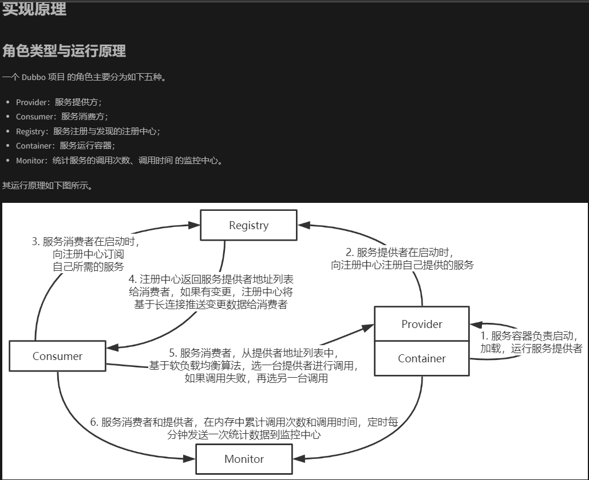

## 什么是RPC?
RPC（Remote Procedure Call）是一种计算机通信协议，它允许一个计算机程序通过网络在另一个计算机上调用远程的子程序或方法。简单来说，RPC允许应用程序在不同的计算机之间进行通信和交互。

在RPC中，客户端应用程序发出一个请求，而服务器端应用程序相应地提供服务。客户端和服务器可以运行在不同的计算机上，甚至可以使用不同的编程语言实现。RPC协议负责将调用请求和响应传输并解析，使得远程的方法调用对于客户端来说就像本地方法调用一样简单。

RPC的主要目的是隐藏网络通信的复杂性，使得应用程序可以方便地进行跨网络的通信。通过RPC，应用程序可以直接调用远程服务器上的方法，而不需要了解底层的网络细节。这使得开发分布式系统和客户端-服务器应用程序变得更加容易。

RPC的实现方式有很多，常见的有基于HTTP协议的RESTful API和基于TCP/IP协议的gRPC。这些实现方式在网络传输、序列化、服务发现等方面有所不同，开发人员可以根据具体的需求选择合适的RPC框架或协议。

## Dubbo基本原理图

## dubbo和openfegin都是当前计算机程序方法调其他计算机程序方法的能力 有什么区别？
虽然Dubbo和OpenFeign都是用于程序之间的方法调用，但它们在实现方式和使用场景上存在一些区别。

Dubbo是一个基于Java的高性能RPC（远程过程调用）框架。它提供了一整套分布式服务框架，包括服务注册与发现、负载均衡、远程调用、容错机制等。Dubbo使用自定义的协议进行通信，支持多种序列化方式，并具有强大的扩展能力。Dubbo适用于构建大规模、高性能的分布式系统，尤其在微服务架构中广泛应用。

OpenFeign则是一个声明式的HTTP客户端框架，用于简化通过HTTP调用远程服务的过程。它基于接口和注解定义，使用了Spring Cloud的集成机制，可以自动创建和管理HTTP请求。OpenFeign支持负载均衡、服务发现和断路器等功能，可以与服务注册中心集成。OpenFeign适用于构建基于HTTP的服务间通信，特别适合在云原生和微服务架构中使用。

主要的区别如下：

通信协议：Dubbo使用自定义的协议进行通信，而OpenFeign基于HTTP进行通信。

技术栈：Dubbo是一个完整的分布式服务框架，提供了服务注册与发现、负载均衡、容错等功能。OpenFeign是一个专注于HTTP调用的声明式客户端框架，通常与Spring Cloud等微服务框架集成使用。

序列化方式：Dubbo支持多种序列化方式，如Hessian、JSON等。OpenFeign通常使用JSON或其他兼容的序列化方式。

使用场景：Dubbo适用于构建大规模的、高性能的分布式系统，特别是在微服务架构中使用。OpenFeign适用于构建基于HTTP的服务通信，尤其在云原生和微服务架构中使用。

综上所述，Dubbo和OpenFeign在通信协议、技术栈、序列化方式和使用场景等方面存在一些区别。你可以根据具体的需求和场景选择适合的框架来实现程序间的方法调用。

## 可以 openfegin已经可以实现微服务直接的调用了 为什么还要使用dubbo？

OpenFeign确实可以用于微服务之间的调用，并且在Spring Cloud等微服务架构中被广泛使用。然而，使用Dubbo作为微服务框架也有一些好处，下面是一些可能的原因：

多语言支持：Dubbo支持多种编程语言，包括Java、Python、Golang等。这使得你可以使用不同的语言实现微服务，并在它们之间进行调用。OpenFeign主要基于Java，对于使用其他语言实现的微服务就不是那么友好。

高性能和低延迟：Dubbo在设计上注重性能和低延迟。它使用了高效的二进制序列化和传输协议，以及一些优化策略，如连接池、请求复用等。这使得Dubbo在处理大量请求和高并发场景下表现出色。

容错和可靠性：Dubbo提供了丰富的容错和可靠性机制，包括负载均衡、故障转移、熔断器、限流等。这些机制可以帮助你构建健壮的分布式系统，并保证在服务故障或异常情况下的稳定性。

高度可扩展：Dubbo具有良好的可扩展性，支持自定义协议、序列化方式、负载均衡策略等。你可以根据自己的需求进行扩展和定制，以满足特定的业务场景。

虽然OpenFeign在简化HTTP调用和与Spring Cloud集成方面表现出色，但如果你需要更多关注性能、多语言支持、容错和可靠性等方面的需求，Dubbo可能是一个更好的选择。最终，选择Dubbo还是OpenFeign取决于具体的业务需求、技术栈和团队的偏好。

## dubbo的协议细分 那个网络层面

Dubbo的协议在网络层面主要细分为两个层次：传输层协议和序列化协议。

传输层协议：Dubbo支持多种传输层协议，用于在服务提供者和消费者之间进行数据传输。以下是Dubbo常用的传输层协议：

Dubbo协议（默认）：Dubbo协议使用NIO（Non-blocking I/O）进行传输，基于TCP协议，提供长连接和异步传输特性，适用于低延迟、高性能的场景。

HTTP协议：Dubbo也支持使用HTTP作为传输层协议。通过HTTP协议，可以更容易地与其他基于HTTP的服务集成，但相对于Dubbo协议，可能会带来一些性能损失。

RMI协议：Dubbo还支持使用RMI（Remote Method Invocation）协议进行传输。RMI是Java提供的一种远程方法调用协议，虽然可以使用，但相对于Dubbo协议，它的性能和扩展性较差。

序列化协议：Dubbo还提供了多种序列化协议，用于将Java对象转换为字节流进行传输。以下是Dubbo常用的序列化协议：

Hessian协议（默认）：Hessian是一种二进制序列化协议，具有高效、紧凑的特点。Dubbo默认使用Hessian进行对象的序列化和反序列化。

Java原生序列化：Dubbo也支持使用Java自带的序列化机制。Java原生序列化简单易用，但通常会产生较大的序列化字节码，并且对跨语言调用不友好。

JSON协议：Dubbo还支持使用JSON（JavaScript Object Notation）进行序列化和反序列化。JSON是一种轻量级的数据交换格式，易于阅读和解析，但相对于二进制序列化，它会占用更多的网络带宽。

通过选择不同的传输层协议和序列化协议，你可以根据具体的需求和场景来优化Dubbo的性能和功能。这些协议的选择可以在Dubbo的配置中进行设置。

java项目实现：[https://gitee.com/ForturnAcao/dubbo-app](https://gitee.com/ForturnAcao/dubbo-app)
