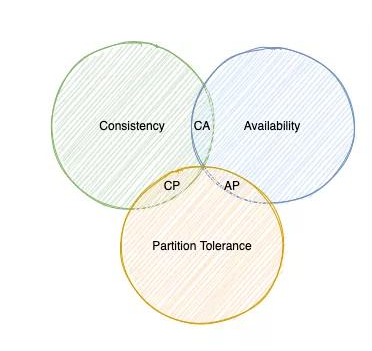

## 简介
Spring cloud 流应用程序启动器是基于 Spring Boot 的 Spring 集成应用程序，提供与外部系统的集成。Spring cloud Task，一个生命周期短暂的微服务框架，用于快速构建执行有限数据处理的应用程序

## 作用和解决的问题

Spring Cloud是基于Spring框架的一个开源项目，旨在简化构建分布式系统的开发和部署。它提供了一套工具和框架，用于处理分布式系统中的常见问题，如服务发现、负载均衡、配置管理、断路器、消息总线等。

- 服务发现和注册：Spring Cloud通过集成服务发现组件（如Netflix Eureka、Consul等），使得服务实例能够自动注册和发现，以便于在分布式环境中进行通信和协作。

- 负载均衡：Spring Cloud提供了负载均衡的能力，通过集成负载均衡器（如Netflix Ribbon）来分发请求到多个服务实例，以提高系统的可用性和性能。

- 配置管理：Spring Cloud提供了分布式配置管理的功能，通过集成配置中心（如Spring Cloud Config）来实现动态的配置管理，使得应用程序的配置可以集中管理和动态更新。

- 断路器：Spring Cloud通过集成断路器模式（如Netflix Hystrix），提供了断路器的功能，用于处理分布式系统中的故障和容错机制，防止故障的扩散并提供降级策略。

- 消息总线：Spring Cloud通过集成消息总线（如Spring Cloud Bus），提供了在分布式系统中进行消息传递和事件驱动的能力，实现了微服务之间的解耦和异步通信。

- 分布式追踪：Spring Cloud提供了分布式追踪的支持，通过集成分布式跟踪系统（如Zipkin、Sleuth），可以对分布式系统的调用进行跟踪和监控，帮助开发者快速定位和解决问题。

## 什么是微服务？

微服务架构是一种架构模式或者说是一种架构风格，它提倡将单一应用程序划分为一组小的服务，每个服务运行在其独立的自己的进程中，服务之间相互协调、互相配合，为用户提供最终价值。服务之间采用轻量级的通信机制互相沟通（通常是基于HTTP的RESTful API）,每个服务都围绕着具体的业务进行构建，并且能够被独立的构建在生产环境、类生产环境等。另外，应避免统一的、集中式的服务管理机制，对具体的一个服务而言，应根据业务上下文，选择合适的语言、工具对其进行构建，可以有一个非常轻量级的集中式管理来协调这些服务，可以使用不同的语言来编写服务，也可以使用不同的数据存储。

通俗的来讲：微服务就是一个独立的职责单一的服务应用程序。在 intellij idea 工具里面就是用maven开发的一个个独立的module，具体就是使用springboot 开发的一个小的模块，处理单一专业的业务逻辑，一个模块只做一个事情。微服务强调的是服务大小，关注的是某一个点，具体解决某一个问题/落地对应的一个服务应用，可以看做是idea 里面一个 module

## SpringCloud的优势

使用 Spring Boot 开发分布式微服务时，我们面临以下问题

- 与分布式系统相关的复杂性-这种开销包括网络问题，延迟开销，带宽问题，安全问题。

- 服务发现-服务发现工具管理群集中的流程和服务如何查找和互相交谈。它涉及一个服务目录，在该目录中注册服务，然后能够查找并连接到该目录中的服务。

- 冗余-分布式系统中的冗余问题。

- 负载平衡 --负载平衡改善跨多个计算资源的工作负荷，诸如计算机，计算机集群，网络链路，

- 中央处理单元，或磁盘驱动器的分布。

- 性能-问题 由于各种运营开销导致的性能问题。

- 部署复杂性-Devops 技能的要求。

## 微服务之间如何独立通讯的?

同步通信：dobbo通过 RPC 远程过程调用、springcloud通过 REST 接口json调用等。异步：消息队列，如： RabbitMq 、 ActiveM 、 Kafka 等消息队列。

## 什么是服务熔断？什么是服务降级？

熔断机制是应对雪崩效应的一种微服务链路保护机制。当某个微服务不可用或者响应时间太长时，会进行服务降级，进而熔断该节点微服务的调用，快速返回“错误”的响应信息。当检测到该节点微服务调用响应正常后恢复调用链路。在Spring Cloud框架里熔断机制通过Hystrix实现，Hystrix会监控微服务间调用的状况，当失败的调用到一定阈值，缺省是5秒内调用20次，如果失败，就会启动熔断机制。服务降级，一般是从整体负荷考虑。就是当某个服务熔断之后，服务器将不再被调用，此时客户端可以自己准备一个本地的fallback回调，返回一个缺省值。这样做，虽然水平下降，但好歹可用，比直接挂掉强。

## 请说说Eureka和zookeeper

### 区别

1. 当向注册中心查询服务列表时，我们可以容忍注册中心返回的是几分钟以前的信息，但不能容忍直接down掉不可用。也就是说，服务注册功能对高可用性要求比较高，但zk会出现这样一种情况，当master节点因为网络故障与其他节点失去联系时，剩余节点会重新选leader。问题在于，选取leader时间过长，30 ~ 120s，且选取期间zk集群都不可用，这样就会导致选取期间注册服务瘫痪。在云部署的环境下，因网络问题使得zk集群失去master节点是较大概率会发生的事，虽然服务能够恢复，但是漫长的选取时间导致的注册长期不可用是不能容忍的。

2. Eureka保证了可用性，Eureka各个节点是平等的，几个节点挂掉不会影响正常节点的工作，剩余的节点仍然可以提供注册和查询服务。而Eureka的客户端向某个Eureka注册或发现时发生连接失败，则会自动切换到其他节点，只要有一台Eureka还在，就能保证注册服务可用，只是查到的信息可能不是最新的。除此之外，Eureka还有自我保护机制，如果在15分钟内超过85%的节点没有正常的心跳，那么Eureka就认为客户端与注册中心发生了网络故障，此时会出现以下几种情况：

①、Eureka不在从注册列表中移除因为长时间没有收到心跳而应该过期的服务。②、Eureka仍然能够接受新服务的注册和查询请求，但是不会被同步到其他节点上（即保证当前节点仍然可用）③、当网络稳定时，当前实例新的注册信息会被同步到其他节点。因此，Eureka可以很好的应对因网络故障导致部分节点失去联系的情况，而不会像Zookeeper那样使整个微服务瘫痪

### CAP理论

「CAP定理，简单来说就是分布式系统不可能同时满足Consistency 一致性、Availability 可用性、Partition Tolerance 分区容错性三个要素」

这三个特性具体可以参考：[https://www.easemob.com/news/5999](https://www.easemob.com/news/5999)

**Consistency 一致性**

一致性的含义为，在节点的任意时刻，访问任意节点返回的数据是一致的。即Client端写入一个数据后，Server端将数据同步到整个系统，从而保证系统的数据都相同

**Availability 可用性**

可用性的含义为，集群能够对用户的请求给予响应。

**Partition Tolerance 分区容错性**

分区容错的含义为，当出现分区故障时，系统仍要对外提供服务。分布式系统中，每个服务节点都是不可靠的，当某些节点出现异常时，或者节点之间的通讯产生异常时，整个系统就产生了分区问题，分布式系统中分区问题是客观存在的。

在分布式系统中，分区容错性是客观存在的，故需要在AP和CP之间进行抉择

「当选择AP时，相当于放弃系统一致性，换取可用性」。eureka是选择了AP的系统

「当选择CP时，相当于放弃系统的可用性，换取一致性」。zookeeper是选择了CP的系统

## SpringBoot和SpringCloud的区别？

- SpringBoot专注于快速方便的开发单个个体微服务。

- SpringCloud是关注全局的微服务协调整理治理框架，它将SpringBoot开发的一个个单体微服务整合并管理起来，为各个微服务之间提供，配置管理、服务发现、断路器、路由、微代理、事件总线、全局锁、决策竞选、分布式会话等等集成服务

- SpringBoot可以离开SpringCloud独立使用开发项目， 但是SpringCloud离不开SpringBoot ，属于依赖的关系.

- SpringBoot专注于快速、方便的开发单个微服务个体，SpringCloud关注全局的服务治理框架。

- ##  负载平衡的意义什么？

在计算中，负载平衡可以改善跨计算机，计算机集群，网络链接，中央处理单元或磁盘驱动器等多种计算资源的工作负载分布。负载平衡旨在优化资源使用，最大化吞吐量，最小化响应时间并避免任何单一资源 的过载。使用多个组件进行负载平衡而不是单个组件可能会通过冗余来提高可靠性和可用性。负载平衡通常涉及专用软件或硬件，例如多层交换机或域名系统服务器进程

##  什么是Hystrix？它如何实现容错？

- Hystrix（豪猪）是一个延迟和容错库，旨在隔离远程系统，服务和第三方库的访问点，当出现故障是不可避免的故障时，停止级联故障并在复杂的分布式系统中实现弹性。

- 通常对于使用微服务架构开发的系统，涉及到许多微服务。这些微服务彼此协作。

## 什么是Hystrix断路器？我们需要它吗

由于某些原因，employee-consumer公开服务会引发异常。在这种情况下使用Hystrix我们定义了一个回退方法。如果在公开服务中发生异常，则回退方法返回一些默认值。

如果firstPage method() 中的异常继续发生，则Hystrix电路将中断，并且员工使用者将一起跳过firtsPage方法，并直接调用回退方法。 断路器的目的是给第一页方法或第一页方法可能调用的其他方法留出时间，并导致异常恢复。可能发生的情况是，在负载较小的情况下，导致异常的问题有更好的恢复机会 。

##  说说 RPC 的实现原理

首先需要有处理网络连接通讯的模块，负责连接建立、管理和消息的传输。其次需要有编 解码的模块，因为网络通讯都是传输的字节码，需要将我们使用的对象序列化和反序列 化。剩下的就是客户端和服务器端的部分，服务器端暴露要开放的服务接口，客户调用服 务接口的一个代理实现，这个代理实现负责收集数据、编码并传输给服务器然后等待结果 返回。

## eureka自我保护机制是什么?

当Eureka Server 节点在短时间内丢失了过多实例的连接时（比如网络故障或频繁启动关闭客户端）节点会进入自我保护模式，保护注册信息，不再删除注册数据，故障恢复时，自动退出自我保护模式

## 什么是Ribbon？

- ribbon是一个负载均衡客户端，可以很好的控制htt和tcp的一些行为。feign默认集成了ribbon。

## 什么是 Netflix Feign？它的优点是什么？

**Feign 是受到 Retrofit，JAXRS-2.0 和 WebSocket 启发的 java 客户端联编程序。** **Feign 的第一个目标是将约束分母的复杂性统一到 http apis，而不考虑其稳定性。** 特点：

- Feign 采用的是基于接口的注解

- Feign 整合了ribbon，具有负载均衡的能力

- 整合了Hystrix，具有熔断的能力

使用方式

- 添加pom依赖。

- 启动类添加 @EnableFeignClients

- 定义一个接口 @FeignClient(name=“xxx”) 指定调用哪个服务

## Ribbon和Feign的区别？

1. Ribbon都是调用其他服务的，但方式不同。

2. 2.启动类注解不同，Ribbon是@RibbonClient feign的是@EnableFeignClients

3. 服务指定的位置不同，Ribbon是在@RibbonClient注解上声明，Feign则是在定义抽象方法的接口中使用@FeignClient声明。

4. 调用方式不同，Ribbon需要自己构建http请求，模拟http请求
