## 如何的去定位慢查询？
### 前言

1. 聚合查询

2. 多表查询

3. 表数量过多查询

4. 深度分页查询

表象：页面访问很慢，接口压测很慢

### 方案一：

一些开源工具：

- 调试工具：Arthas

- 运维工具：Prometheus,Skywalking

### 方案二：

MySQL自带慢日志

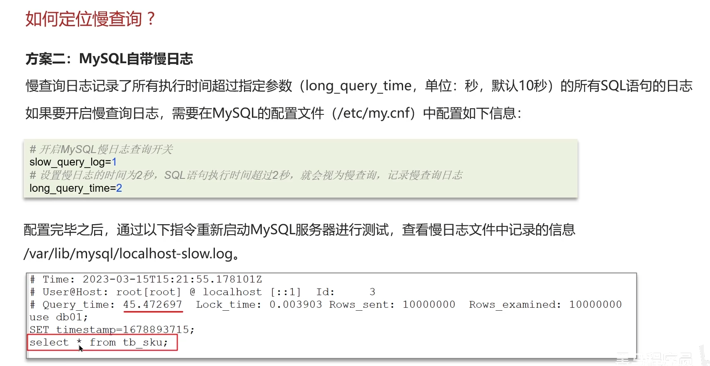

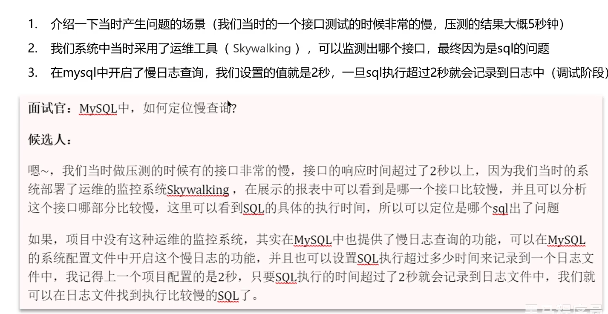

## 如何分析慢查询呢？

### 场景

1. 优化过一个这样的功能，就是页面上有个按钮，就是案件是否重复，定位这张表所有的，根据一些业务指标认定为相同的保单的需求，他需要展示库里面所有的这种保单，而且还是分页列表，最开始是表的自连接，SQL执行相当慢，最开始是数据量很少，业务没有提什么问题，后面就需要优化，后面我优化的方案是，首先问了业务能否支持T+1的延迟，然后我做了一个定时任务，或获取所有重复保单的id,然后记录到另外一张表，只有一个字段，然后案件表连上者张表

2. 连表的时候，如果两张表的字符集不一致，会使得索引失效，很影响SQL执行性能

### EXPLAN 或者 DESC 命令查看SQL执行

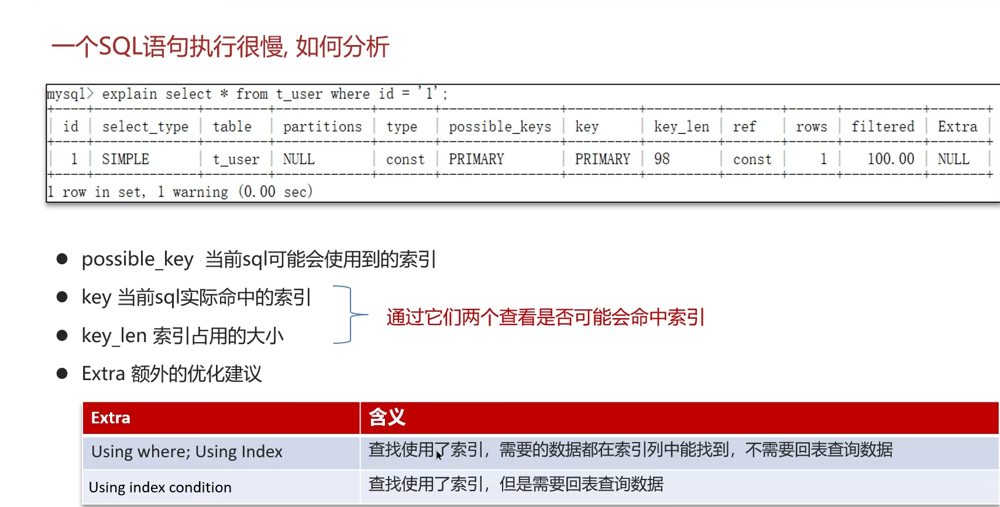

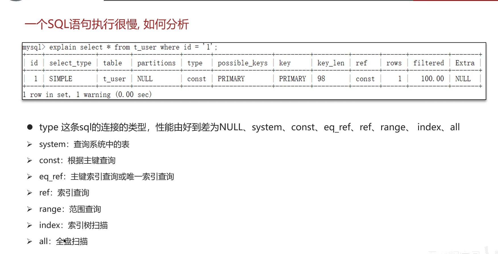

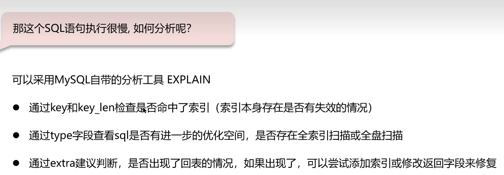

## 什么是索引

MySQL采用B+树索引模式是因为B+树具有许多优点，适合在数据库中用作索引结构。下面是B+树的原理以及MySQL索引演变的概述。

### B+TREE

**B+树的原理：**

B+树是一种自平衡的树形数据结构，用于组织和存储有序的数据。它是一个多路搜索树，每个节点可以存储多个关键字和对应的数据指针。B+树具有以下特点：

所有关键字按照顺序存储在树的叶子节点上，形成一个有序的双向链表。

内部节点存储索引信息，用于快速定位到叶子节点。

所有叶子节点通过指针连接，方便范围查找和范围扫描。

B+树的高度相对较低，减少了磁盘I/O次数，提升查询性能。

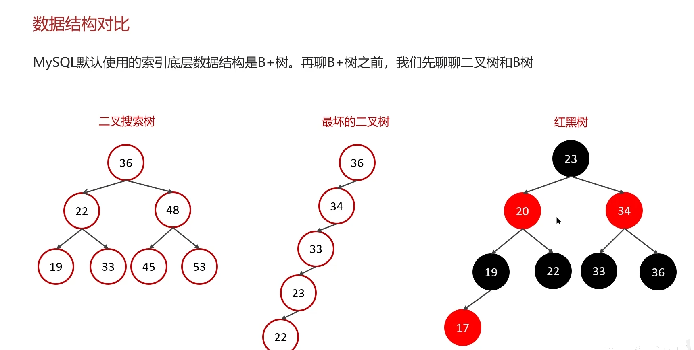

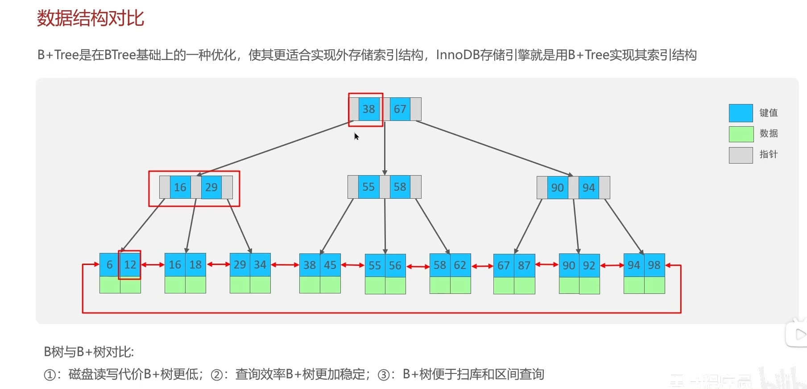

当向B+树索引中新增一条数据时，B+树的结构可能发生变化，具体取决于新增数据的排序位置。

如果新增的数据排序位置在现有的叶子节点范围内，那么只需将该数据插入到对应的叶子节点中，不会引起B+树的结构变动。新数据会在叶子节点中按照顺序插入，并与相邻的数据进行链接。

如果新增的数据排序位置在现有的叶子节点的范围之外，那么可能需要进行以下操作来调整B+树的结构：

**分裂**：如果新增数据应插入到现有叶子节点的后方，但该节点已满，那么会将该节点分裂成两个节点，并将新增数据放入合适的位置。

**上推**：如果新增数据应插入到现有叶子节点的前方，但该节点已满，那么会将该节点分裂成两个节点，并将新增数据放入合适的位置。同时，将两个新节点的最小关键字上推到父节点，并进行递归调整。

分裂和上推操作可能会导致父节点的分裂或上推，以及递归地影响更高层的节点。这样，B+树的结构将进行相应的调整，以容纳新的数据。

2. **MySQL索引的演变：**

**哈希索引**：初始阶段，MySQL使用哈希索引来加速数据查找。哈希索引采用哈希函数将关键字映射到索引位置，但它只适用于精确查找，不支持范围查询。

**二叉树索引**：为了解决哈希索引的缺点，MySQL引入了二叉树索引（如二叉搜索树）。二叉树索引在插入和查询方面表现良好，但在面临大量数据时，高度不平衡的二叉树会导致查询性能下降。

**平衡二叉树索引**：为了解决二叉树索引的不平衡问题，MySQL引入了平衡二叉树索引（如AVL树或红黑树）。平衡二叉树通过自平衡操作保持树的高度平衡，提高了查询性能。然而，平衡二叉树的节点存储的是完整的数据记录，导致每个节点只能存储较少的关键字，使得每次磁盘I/O的数据量变大。

**B+树索引**：为了减少磁盘I/O次数，MySQL引入了B+树索引。B+树的叶子节点上存储了完整的数据记录，而内部节点只存储索引信息。B+树通过在叶子节点之间建立双向链表，支持高效的范围查询和范围扫描。此外，B+树的节点可以存储更多的关键字，减少了树的高度，进一步提高了查询性能。

综上所述，MySQL在索引演变过程中从哈希索引到二叉树索引，再到平衡二叉树索引，最终采用B+树索引结构。B+树的引入解决了平衡二叉树索引在大规模数据情况下的性能问题，并提供了更高效的范围查询和范围扫描能力，使得MySQL在处理大量数据时能够保持良好的查询性能。

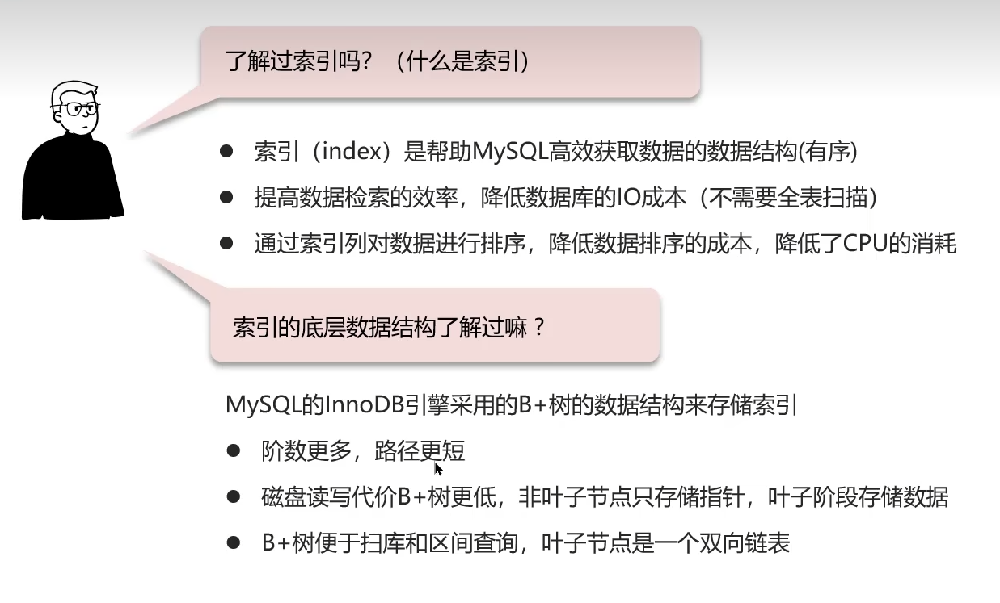

## 聚簇索引

将数据和索引放在一起，索引结构的叶子节点保存了源数据的行数，特点：必须有并且只有一个

一般就是这张表的主键，主键只能一个，如果没有主键，那么就是唯一索引

假如，既没有主键，又没有唯一索引， InnoDB会自动的生成

## 非聚簇索引（二级索引）

二级索引：将数据和索引分开，索引结构的叶子节点存储对应的主键，特点：可以存储多个

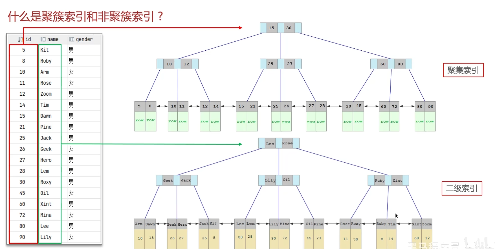

## 回表

拿着二级索引作为条件去查，去查所有符合的数据，二级索引叶子节点会存主键id,然后有了这个id再去，聚簇索引上去找，最后获取行数找到数据

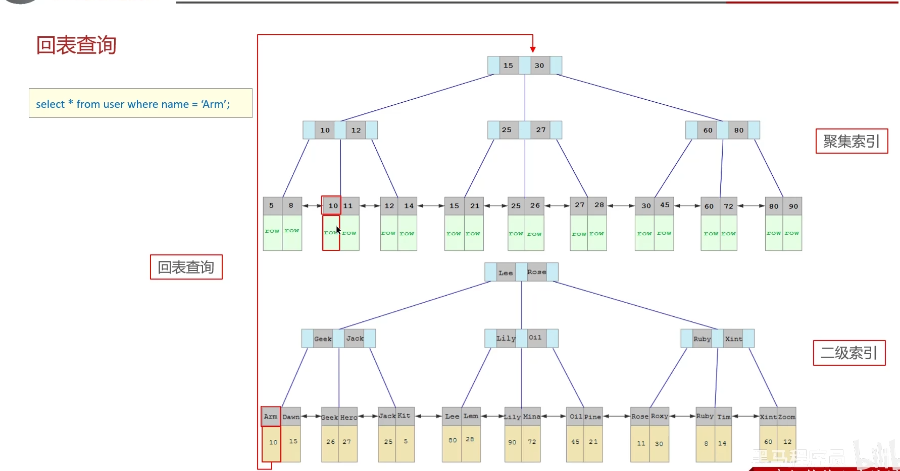

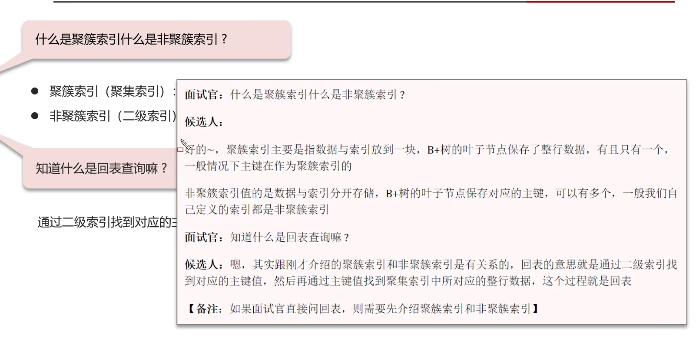

## 覆盖索引

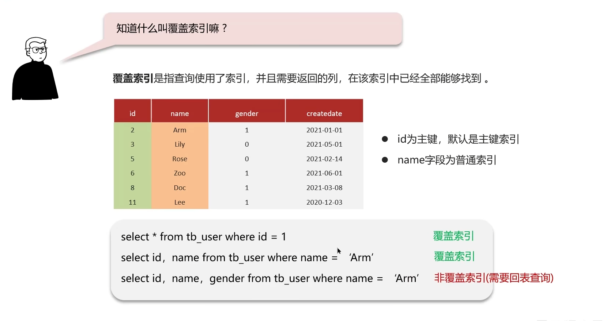

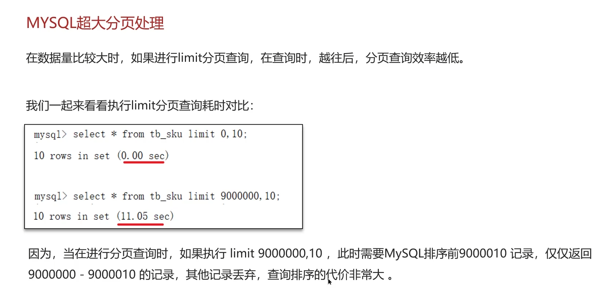

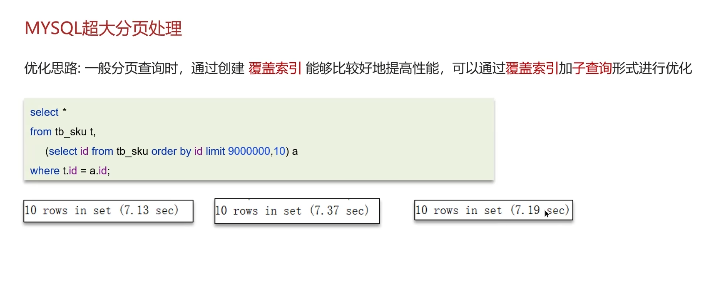

## 索引创建的原则

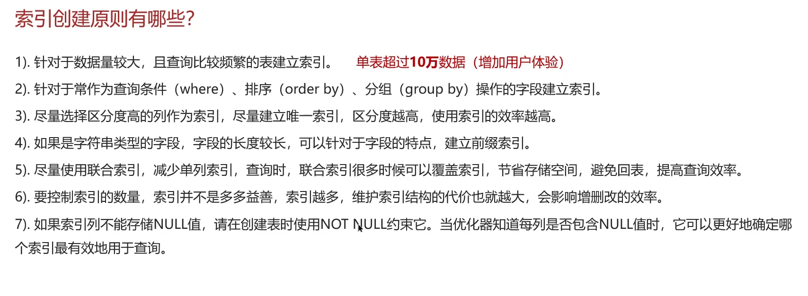

## 什么情况下索引会失效

1. in中数据太多

2. 违反了最左前缀法则

   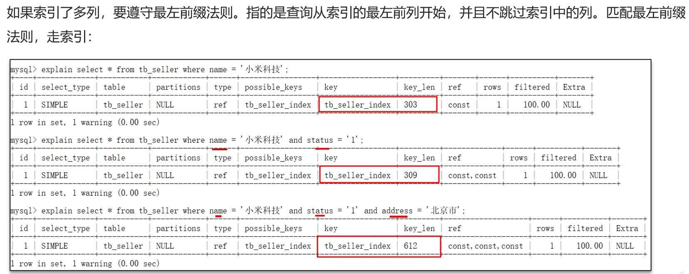

   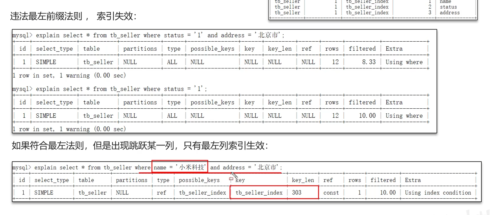

3. 范围查询右边的列，不能使用索引

   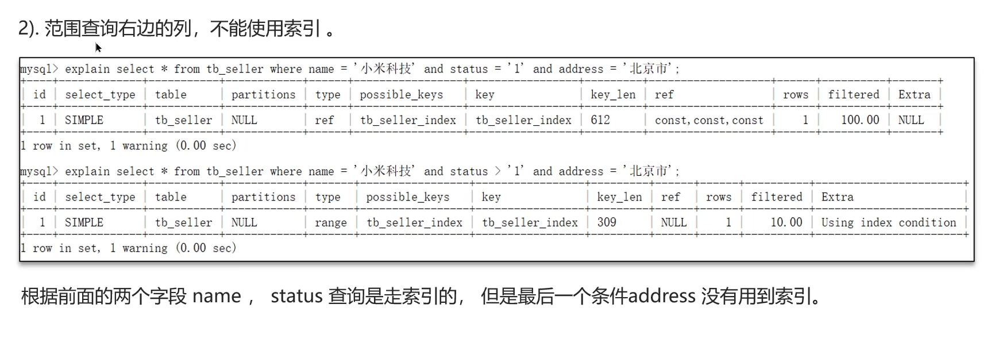

4. 索引列使用了函数运算

5. 字符串没有加单引号

   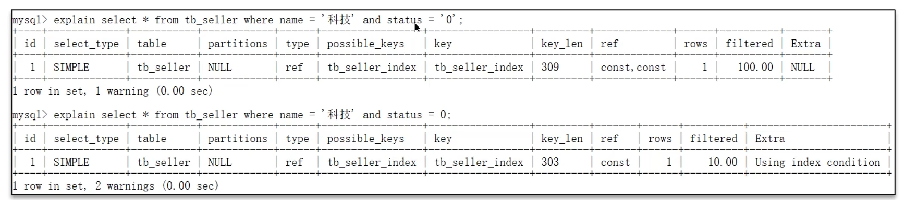

6. 以%Like开头的模糊查询，索引失效，头部模糊匹配索引会失效

## SQL优化的经验

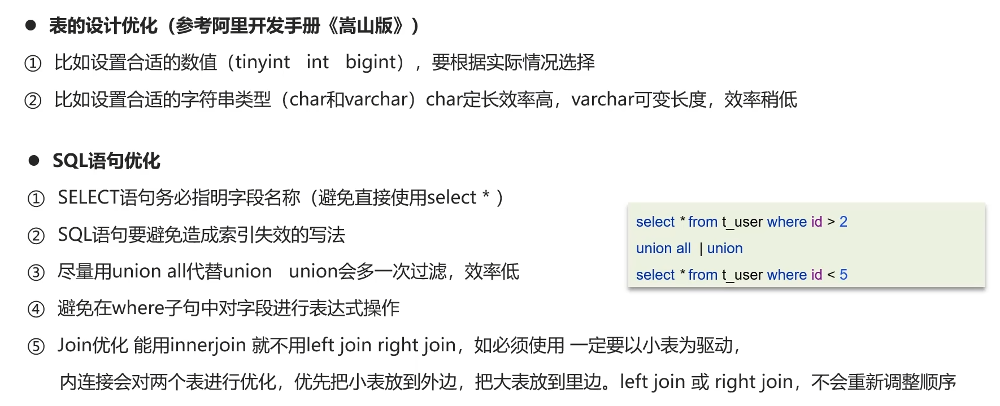

小表连大表

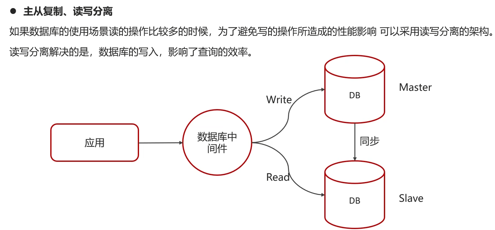

## 事务相关的问题

### 什么是事务？
事务首先他是一组操作的集合，要么同时成功，要么同时失败

### ACID

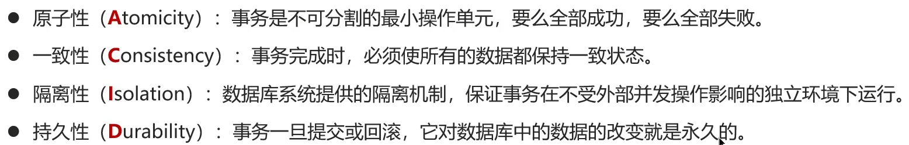

### 隔离级别

**隔离级别：读未提交，读已提交，可重复读，串行化**

   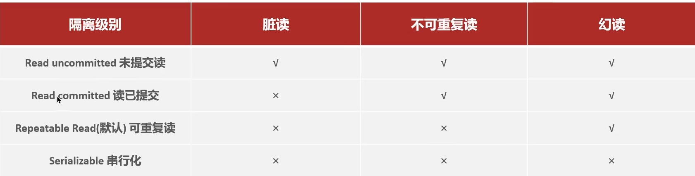

安全性越高，性能越差

2. 并发事务会有，脏读，幻读，可重复读的问题

幻读，插入发现有这条数据了

## uodo log 和 redo log的区别

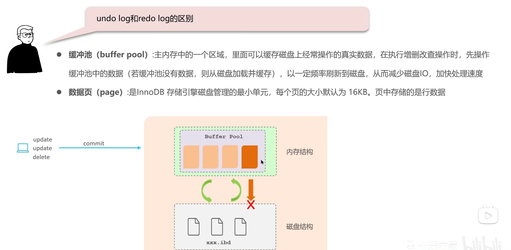

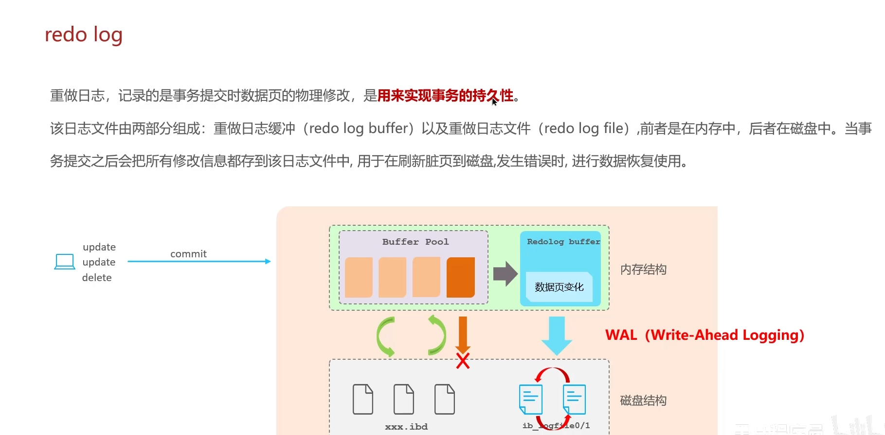

## MVCC

主要是为了解决事务的隔离性

1. 排他锁，锁行

2. 多版本并发控制

   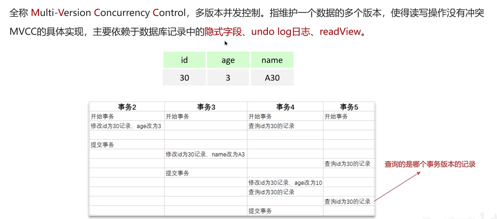

   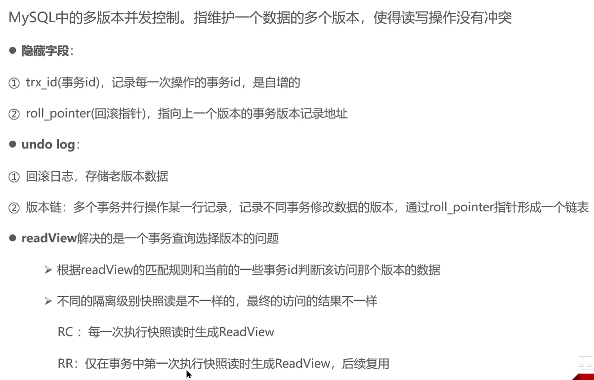

## MySQL的主从同步原理

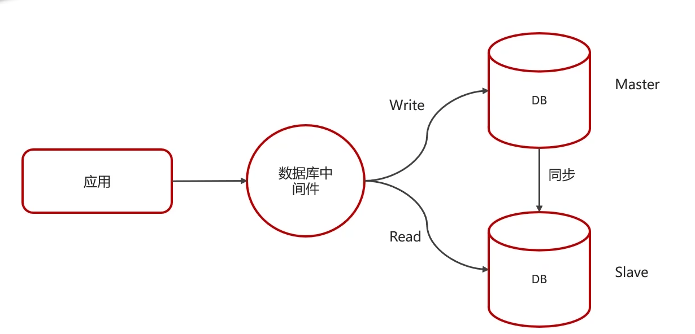

核心就是一个二进制日志，BINLOG

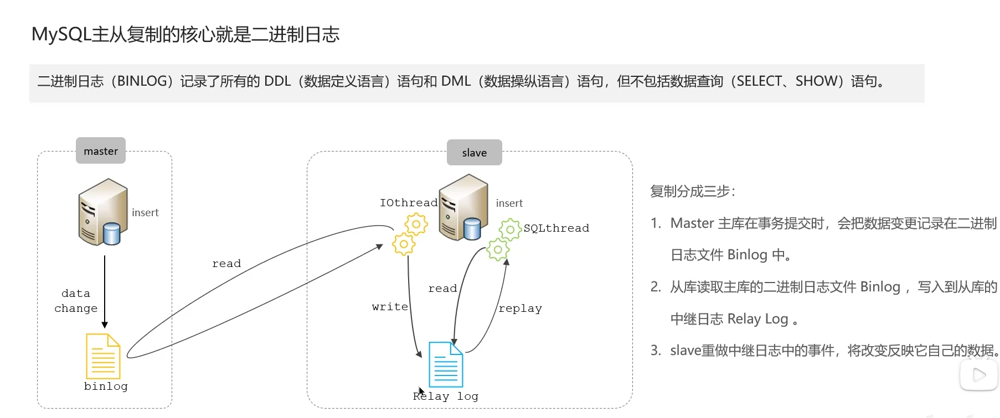

## 分库分表

### 前提

1. 单表的数据达到了1000w或者20G后

2. 优化已经解决不了问题（主从复制，索引优化，sql优化）

3. IO瓶颈，cpu瓶颈

4. 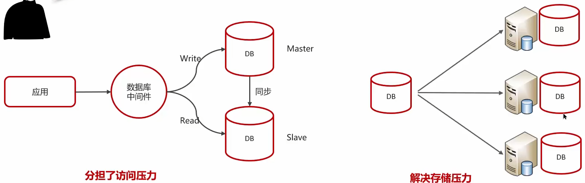

### 垂直拆分

**垂直分库：以表为依据，根据业务拆分，这种在微服务经常采用**
    1. 优点：方便监控，维护，分级管理
    2. 高并发下提高了IO的效率和连接数

2. 垂直分表：根据业务字段拆分，不同的属性字段在不同的一张表
    1. 优点：冷热数据分离，减少IO过度的争抢，两张表互不影响

### 水平拆分

水平分表：
    1. 解决了单表数据量大，产生的性能问题，减少锁表的几率

2. 水平分库：将一个库的数据分散在多个库中，比如不同大区不同库。
    1. 解决了单库数据量大，高并发性能瓶颈问题，提高了性能稳定性
    2. 疑问：查询的时候怎么知道在那个库呢？分库依据什么逻辑呢
        1. 现在依据发展规律，演变，来结束分库的依据
            1. 取模分片：意思就是根据特定的数取模来确认去哪个库，但是缺点也很明显，容易一个库非常多一个很少，就是不够平均，然后扩展性也很差
            2. 枚举分片：固定值
            3. hash范围分片
            4. string哈希
            5. 一致性hash环
            6. 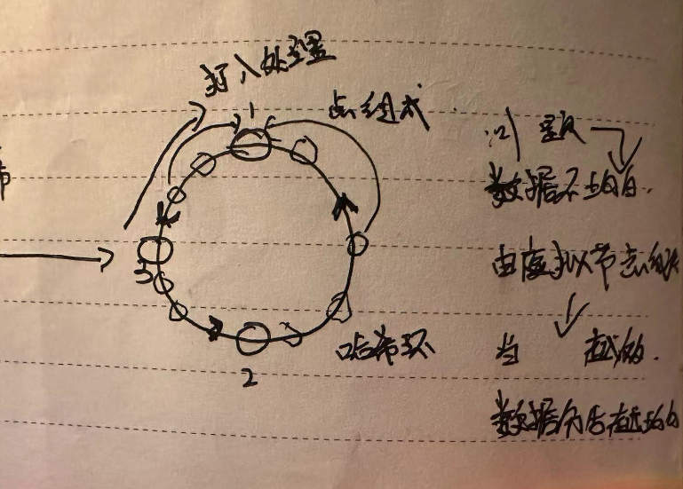
            7. 日期分片一般用于日志
        2. 这些分片方方法的优点缺点，并主要讲讲hash范围分片，string哈希，一致性hash环

这些分片方法都是在分布式系统中常见的数据分片策略。让我逐个解释它们的优点和缺点，并详细说明"hash范围分片"、"string哈希"和"一致性hash环"。

**取模分片**：

优点：简单易实现，适用于分片数量相对有限的情况。

缺点：可能导致数据分布不均匀，某些库负载过大，某些库负载过轻，不利于扩展性。

**枚举分片**：

优点：确定性高，每个键值都有固定的分片。

缺点：不适用于动态变化的数据集，扩展性差。

**hash范围分片**：

优点：将数据根据哈希值范围进行分片，可以实现较好的负载均衡。

缺点：当数据分布不均匀或新增/删除节点时，需要重新计算哈希范围，可能导致数据迁移和负载不均。

**string哈希**：

优点：将字符串键值直接哈希映射到分片，适用于字符串键值的场景。

缺点：哈希冲突可能导致数据分布不均匀，需要处理冲突情况。

**一致性hash环**：

优点：引入虚拟节点和哈希环的概念，实现动态的负载均衡和节点扩展。

缺点：虚拟节点的引入增加了计算复杂度，可能导致数据分布不均匀。

对于"hash范围分片"，它根据数据的哈希值范围进行分片，可以实现较好的负载均衡。然而，当数据分布不均匀或新增/删除节点时，需要重新计算哈希范围，可能导致数据迁移和负载不均的问题。

"string哈希"方法将字符串键值直接哈希映射到分片，适用于字符串键值的场景。它的优点是简单直接，适用于快速查找数据。然而，哈希冲突可能会导致数据分布不均匀，需要处理冲突情况。

"一致性hash环"是一种动态负载均衡的方法。它引入了虚拟节点和哈希环的概念，通过将节点和数据映射到哈希环上，实现了节点的动态扩展和负载均衡。其优点是能够自动适应节点的变化，减少数据迁移的开销。然而，引入虚拟节点增加了计算复杂度，并且可能导致数据分布不均匀的问题。

选择适当的分片方法要根据具体的场景和需求来决定。每种方法都有其优点和限制，需要综合考虑数据分布、负载均衡、扩展性、计算复杂度等方面的因素。

### 出现的问题

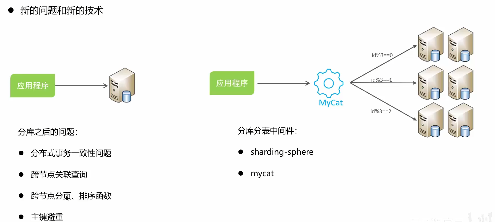

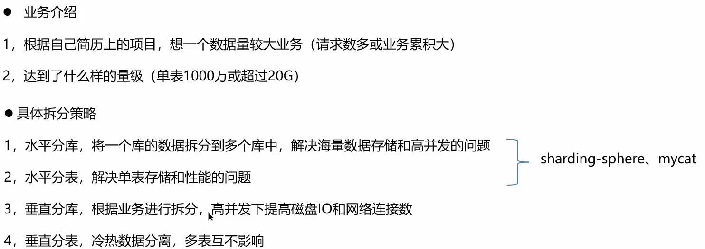
