## RabbitMQ常用的几种工作机制

**简单模式**

   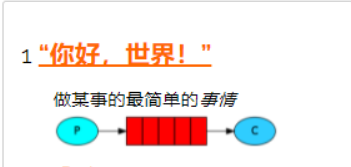

2. 工作模式

   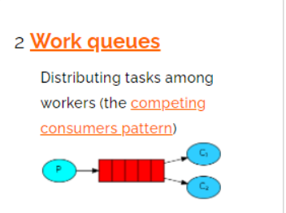

3. 发布订阅模式

   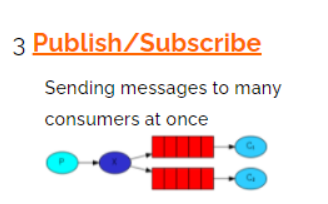

4. 路由模式

   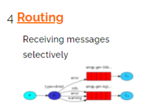

5. 主题模式

   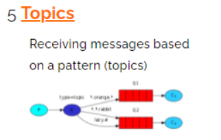

## RabbitMQ的相关概念

2007 年发布，是一个在 AMQP(高级消息队列协议)基础上完成的，可复用的企业消息系统，是当前最主流的消息中间件之一。RabbitMQ是一个由erlang开发的AMQP（Advanced Message Queue 高级消息队列协议 ）的开源实现，由于erlang 语言的高并发特性，性能较好，本质是个队列，FIFO 先入先出，里面存放的内容是message，RabbitMQ 是一个消息中间件：它接收消息并且转发，就类似于一个快递站，卖家把快递通过快递站，送到我们的手上，MQ也是这样，接收并存储消息，再转发。

## 为什么要用 MQ

- 流量消峰

- 举个例子，如果订单系统最多能处理一万次订单，这个处理能力应付正常时段的下单时绰绰有余，正常时段我们下单一秒后就能返回结果。但是在高峰期，如果有两万次下单操作系统是处理不了的，只能限制订单超过一万后不允许用户下单。使用消息队列做缓冲，我们可以取消这个限制，把一秒内下的订单分散成一段时间来处理，这时有些用户可能在下单十几秒后才能收到下单成功的操作，但是比不能下单的体验要好。

- 简单来说： 就是在访问量剧增的情况下，但是应用仍然不能停，比如“双十一”下单的人多，但是淘宝这个应用仍然要运行，所以就可以使用消息中间件采用队列的形式减少突然访问的压力

- 应用解耦

- 以电商应用为例，应用中有订单系统、库存系统、物流系统、支付系统。用户创建订单后，如果耦合调用库存系统、物流系统、支付系统，任何一个子系统出了故障，都会造成下单操作异常。当转变成基于消息队列的方式后，系统间调用的问题会减少很多，比如物流系统因为发生故障，需要几分钟来修复。在这几分钟的时间里，物流系统要处理的内存被缓存在消息队列中，用户的下单操作可以正常完成。当物流系统恢复后，继续处理订单信息即可，中间用户感受不到物流系统的故障，提升系统的可用性。

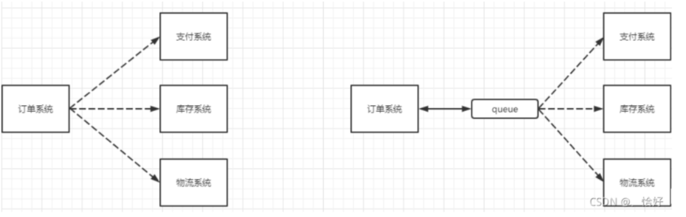

异步处理

有些服务间调用是异步的，例如 A 调用 B，B 需要花费很长时间执行，但是 A 需要知道 B 什么时候可以执行完，以前一般有两种方式，A 过一段时间去调用 B 的查询 api 查询。或者 A 提供一个 callback api， B 执行完之后调用 api 通知 A 服务。

这两种方式都不是很优雅，使用消息总线，可以很方便解决这个问题，A 调用 B 服务后，只需要监听 B 处理完成的消息，当 B 处理完成后，会发送一条消息给 MQ，MQ 会将此消息转发给 A 服务。这样 A 服务既不用循环调用 B 的查询 api，也不用提供 callback api。同样 B 服务也不用做这些操作。A 服务还能及时的得到异步处理成功的消息。

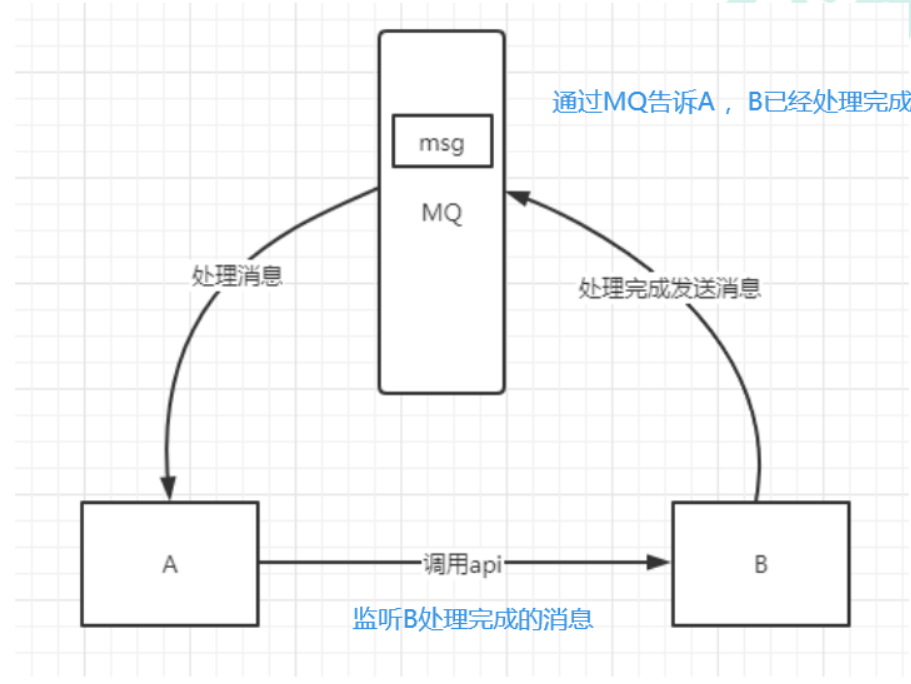

总结来说就是一下几点：

1. 削峰

2. 解耦

3. 异步

4. 限流

5. 公平

## RabbitMQ怎么保证消息不丢失

保证消息的不丢失，需要在MQ消息传递的每个阶段都要有保证

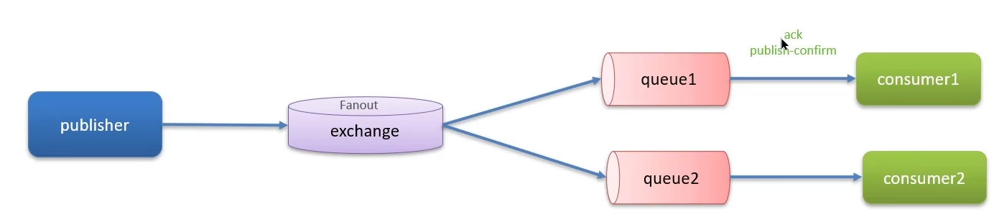

**生产者到交换机**
    1. 可靠性投递
        1. 生产者的确认机制
            1. 开启confirm  return
            2. 重试机制 setconfirmcallback(原消息，布尔，失败原因)
            3. 确认是否消息抵达交换机

2. 交换机
    1. 持久化
        1. 持久化交换机
        2. 持久化队列
        3. 持久化消息

   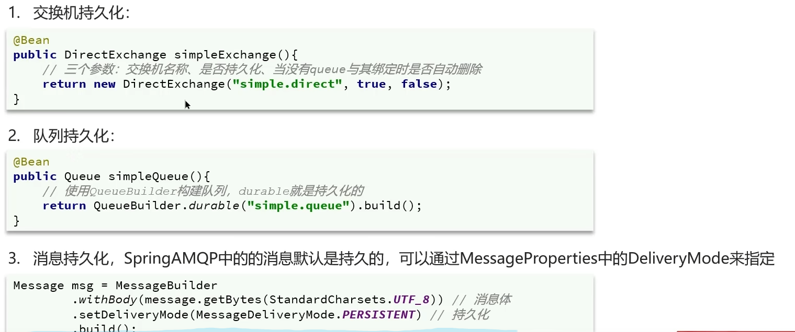

3. 交换机到消费者
    1. ack确认机制
        1. Spring AMQP允许配置三种确认机制
            1. 手动munual
            2. 自动auto
            3. 关闭none
    2. 完整实现流程，手动消费，并且处理重复消费，记录失败的消费

```java
/**
     * 处理原始保单推送消息
     */
    @SteedAmqpListener(
            bindings = @QueueBinding(value = @Queue(value = OriginalMqConstant.CLAIM_ORIGINAL_ENDORSEMENT_QUEUE),
                    key = OriginalMqConstant.CLAIM_ORIGINAL_ENDORSEMENT_ROUTINGKEY,
                    exchange = @Exchange(OriginalMqConstant.CLAIM_ORIGINAL_ENDORSEMENT_EXCHANGE)),
            containerFactory = "commonRabbitContainerFactory")
    public void consumeOriginalEndorsementPushMessage(EventMessage<List<String>> message,
                                              Channel channel,
                                              @Header(AmqpHeaders.REDELIVERED) boolean isRedelivered,
                                              @Header(AmqpHeaders.DELIVERY_TAG) long deliveryTag) {
        //获取消息
        log.info("接收源批单推送消息，消息：【{}】", message);
        List<String> endorsementNoList = message.getData();
        try {
            //执行业务逻辑
            originalInsuranceBusinessService.dealOriginalEndorsementPush(endorsementNoList);

            //确认消息
            channel.basicAck(deliveryTag, false);

            log.info("处理源批单推送资财消费成功,批单号list：【{}】", endorsementNoList);
        } catch (Exception e) {
            try {
                //判断消息是否被消费过
                if (isRedelivered) {
                    //拒绝消息,并且不放回队列,写入日志或者数据库
                    log.error("处理源批单推送资财重复消费,拒绝消息,失败的内容为: 【{}】", DstJsonUtil.toString(e.getStackTrace()));
                    channel.basicReject(deliveryTag, false);
                } else {
                    //重试一次,拒绝消息,并且放回队列
                    channel.basicReject(deliveryTag, true);
                }
            } catch (Exception e1) {
                log.error("处理源批单推送资财失败,失败的内容为:【{}】", DstJsonUtil.toString(e.getStackTrace()));
            }
        }
    }

}

```
## 重复消费问题

**前言**

当出现网络的抖动,消费者挂了，就有可能出现重复消费的问题

2. 解决方案：
    1. 每条消息设置一个唯一标识id
    2. 幂等方案（分布式锁，数据库锁（悲观锁，乐观锁））
    3. 开启手动确认，MQ有这个消息是否被消费的标识

## 死信交换机（延迟队列）

### 死信交换机

**什么情况下会成为死信**
    1. 消息都过期了还没有人消费
    2. 超过队列的大小
    3. 消息被拒绝channel.basicReject
    4. 消费者消费异常丢掉时

### 延迟队列

**场景**
    1. 超时订单
    2. 限时优惠
    3. 定时发布

2. 延迟队列 = 死信交换机 + TTL

   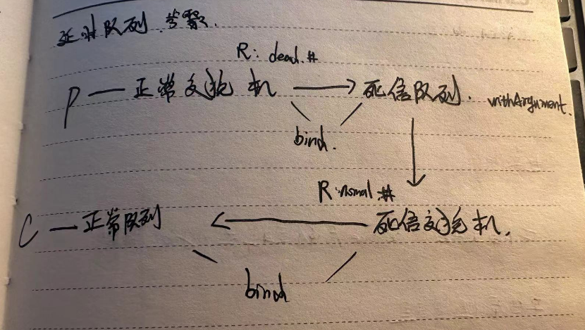

   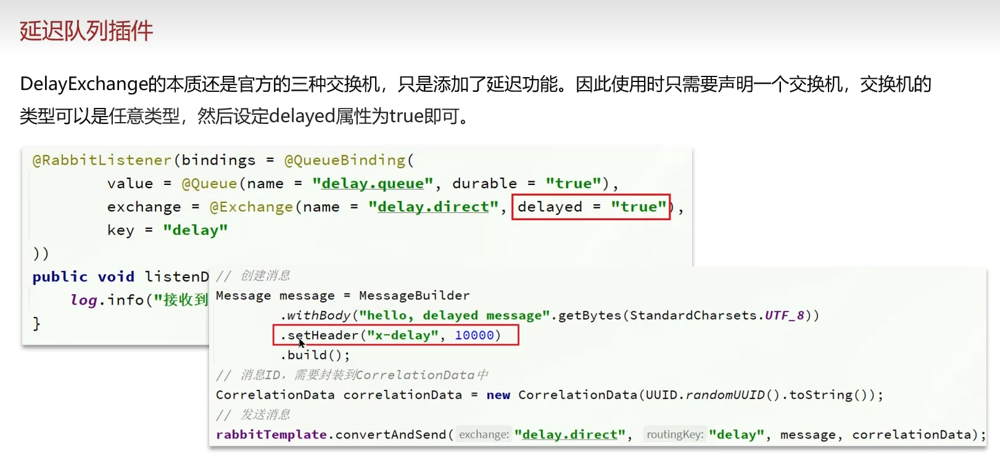

   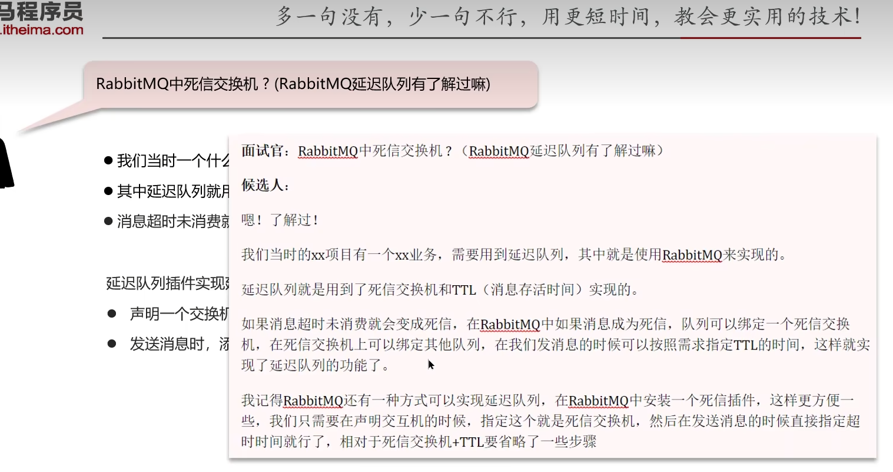

## 消息堆积怎么解决

**前言**

首先mq如果挤压了很多的消息，会导致MQ的吞吐变慢，并且有宕机的风险，我之前就在一个IOT项目遇见过，最后很无奈，丢数据了。。。

2. 解决方案
    1. 增加消费者
    2. 消费增加多线程
    3. 扩大队列容积
    4. 惰性队列

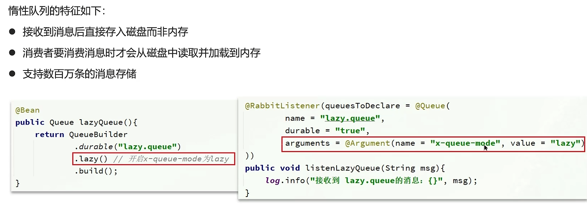
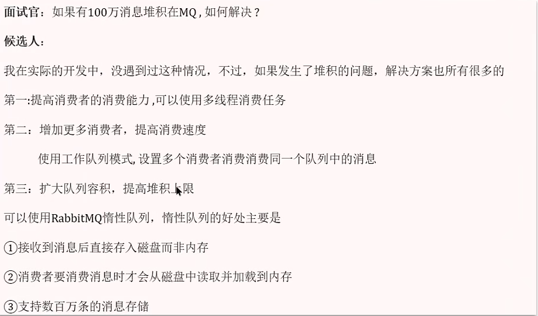

## 高可用机制

**普通集群**

   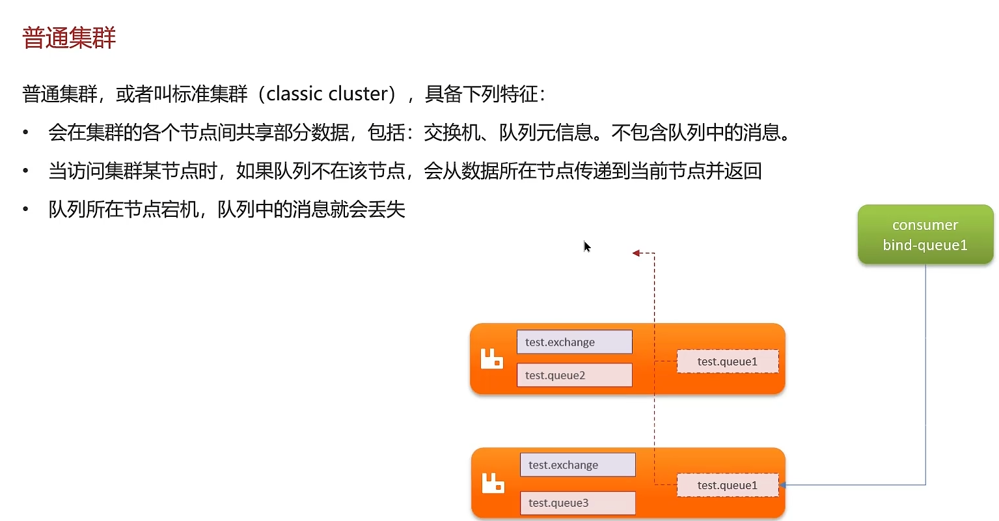

2. 镜像集群

   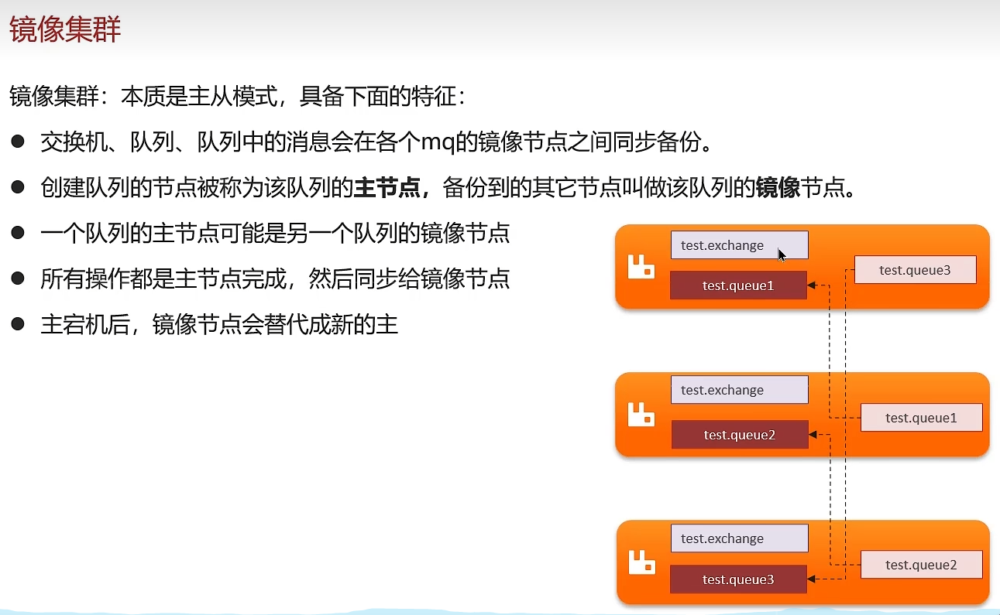

3. 仲裁队列

   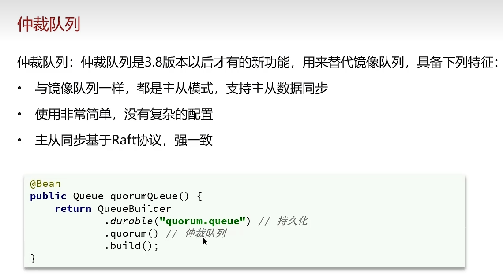

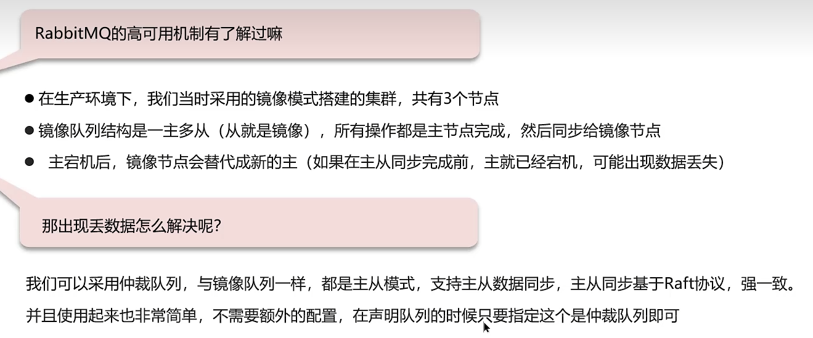9
