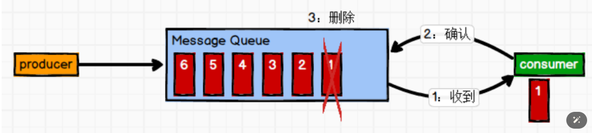
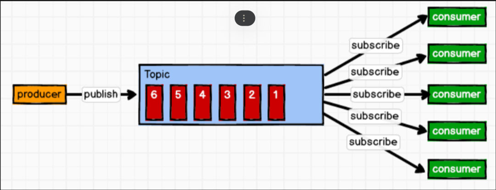
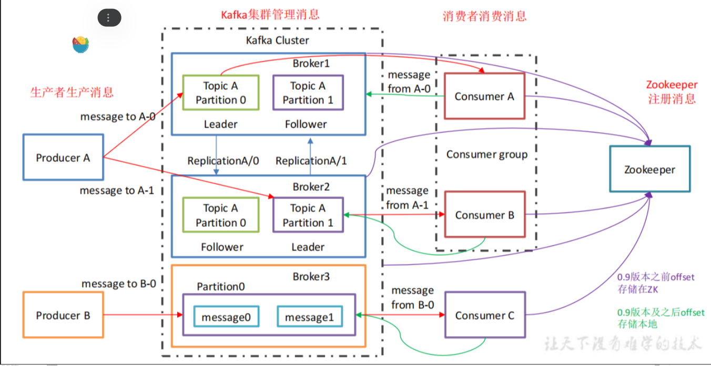
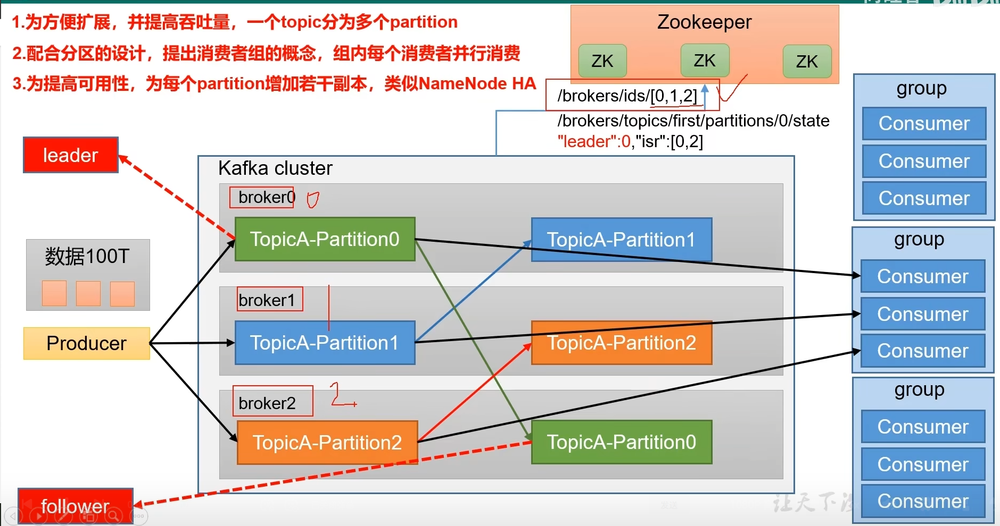
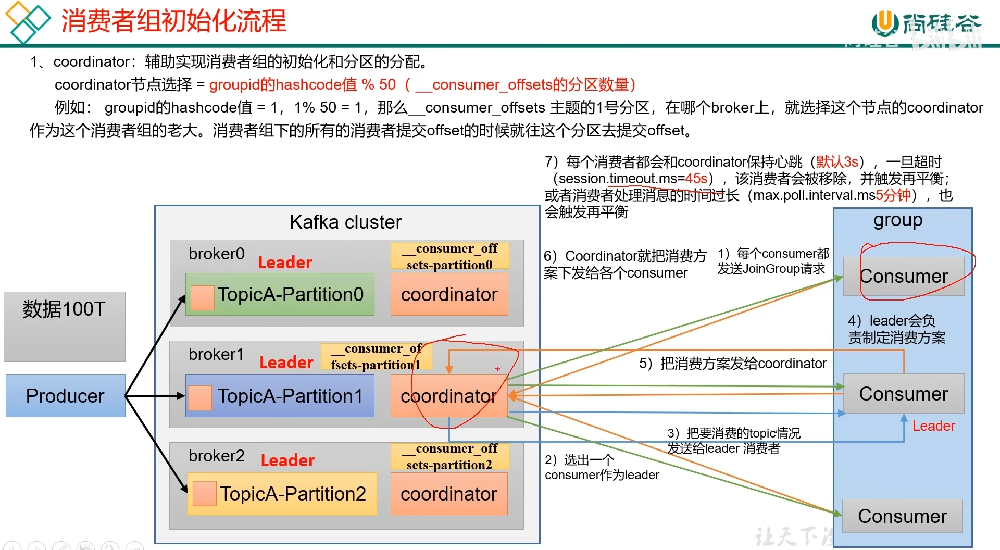
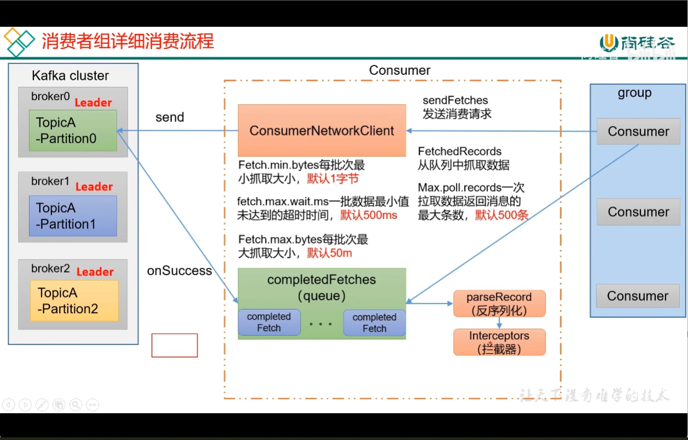
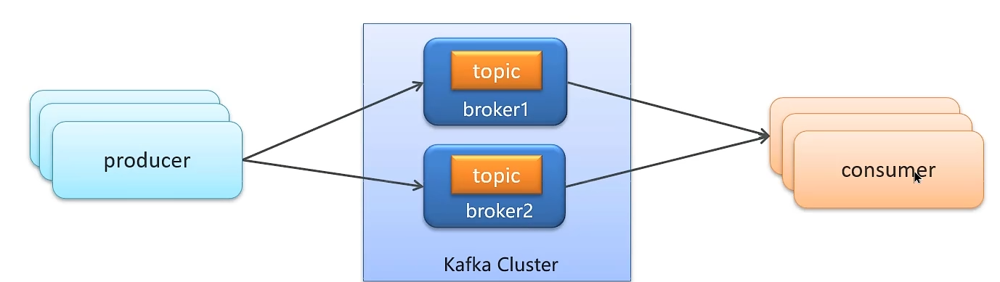
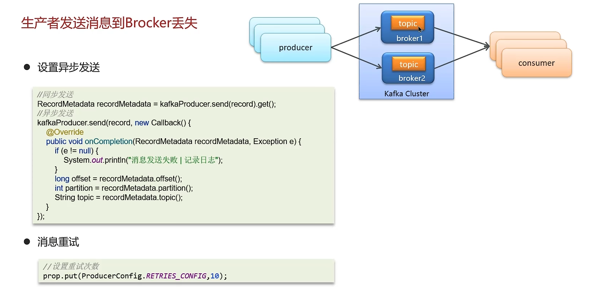
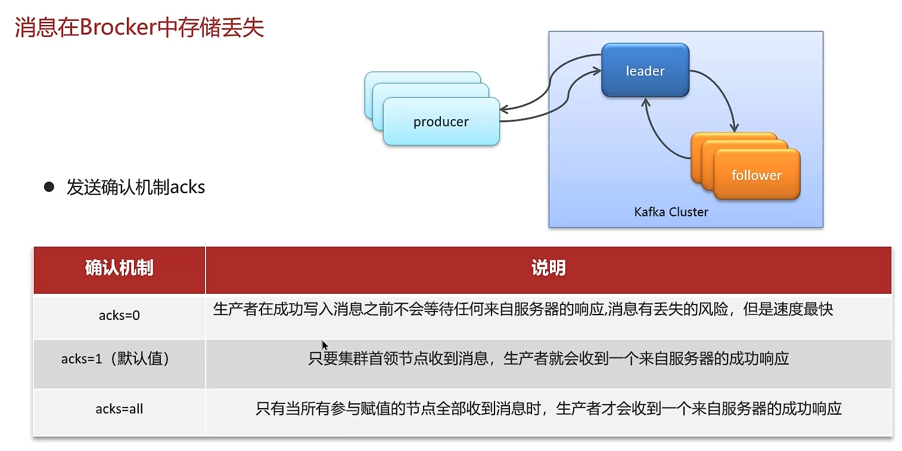
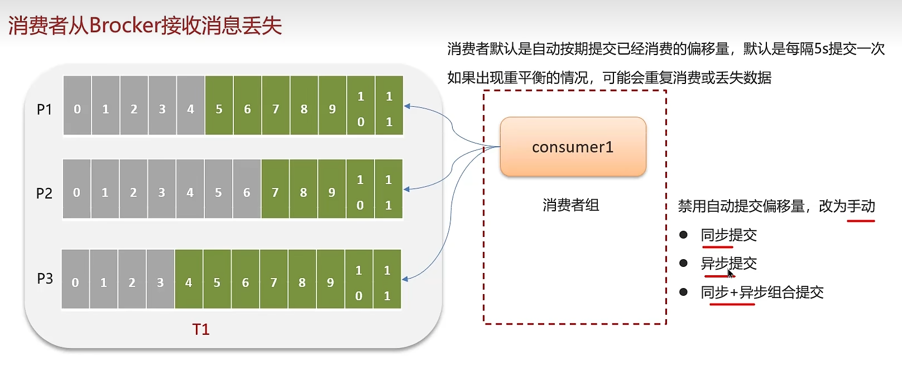

## Kafka概述
Kafka 是一个分布式的基于**发布/订阅模式**的消息队列（Message Queue），主要应用于大数据实时处理领域。

## 消息队列的两种模式

**点对点模式**

一对一，消费者主动拉取数据，消息收到后消息清除

**消息生产者生产消息发送到Queue**中，然后**消息消费者从Queue中取出并且消费消息**。消息被消费以后，**queue 中不再存储**。Queue 支持存在多个消费者，但是**对一个消息**而言，**只会有一个消费者可以消费**。

2. **发布/订阅模式**

一对多，消费者消费数据之后不会清除消。
	**消息生产者（发布）**将消息**发布到 topic**中，同时有多个消息消费者（订阅）消费该消息。和点对点方式不同，**发布**到**topic**的**消息会**被所有**订阅者消费**。**kafka就是基于这种模式**

## Kafka 基础架构

1）Producer ：消息生产者，就是向 kafka broker 发消息的客户端；

2）Consumer ：消息消费者，向 kafka broker 取消息的客户端；

3）Consumer Group （CG）：消费者组，由多个 consumer 组成。消费者组内每个消费者负责消费不同分区的数据，一个分区只能由一个组内消费者消费；消费者组之间互不影响。所有的消费者都属于某个消费者组，即消费者组是逻辑上的一个订阅者。

4）Broker ：一台 kafka 服务器就是一个 broker。一个集群由多个 broker 组成。一个 broker可以容纳多个 topic。

5）Topic ：可以理解为一个队列，生产者和消费者面向的都是一个 topic；

6）Partition：为了实现扩展性，一个非常大的 topic 可以分布到多个 broker（即服务器）上，一个 topic 可以分为多个 partition，每个 partition 是一个有序的队列；

7）Replica：副本，为保证集群中的某个节点发生故障时，该节点上的 partition 数据不丢失，且 kafka 仍然能够继续工作，kafka 提供了副本机制，一个 topic 的每个分区都有若干个副本，一个 leader 和若干个 follower。

8）leader：每个分区多个副本的“主”，生产者发送数据的对象，以及消费者消费数据的对象都是 leader。

9）follower：每个分区多个副本中的“从”，实时从 leader 中同步数据，保持和 leader 数据的同步。leader 发生故障时，某个 follower 会成为新的 follower。

去掉zookeeper是大势所趋。

Kafka，在每个分区内，消息的顺序是被保证的。也就是说，同一个分区内的消息按照发送的顺序被存储和读取。这意味着如果一个生产者按顺序发送了消息 A、B、C 到同一个分区，那么消费者从该分区读取消息时，将按照 A、B、C 的顺序接收到这些消息。

## 发送流程

## 消费流程

## Kafka如何保证消息不丢失

- 生产者发送到Brocker丢失

- 消息在Brocker中丢失

- 消费者消费Brocker丢失数据

