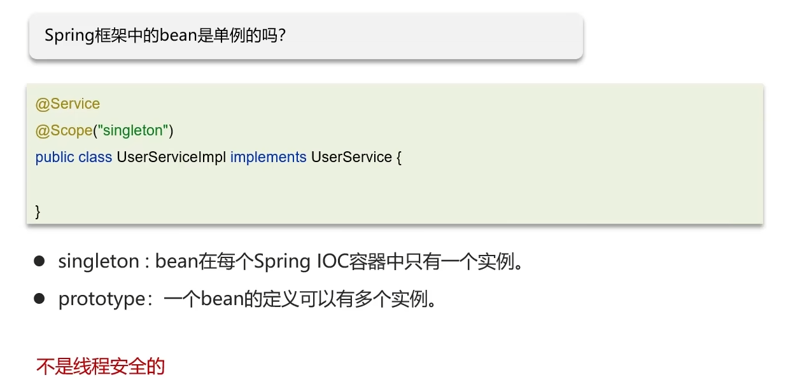
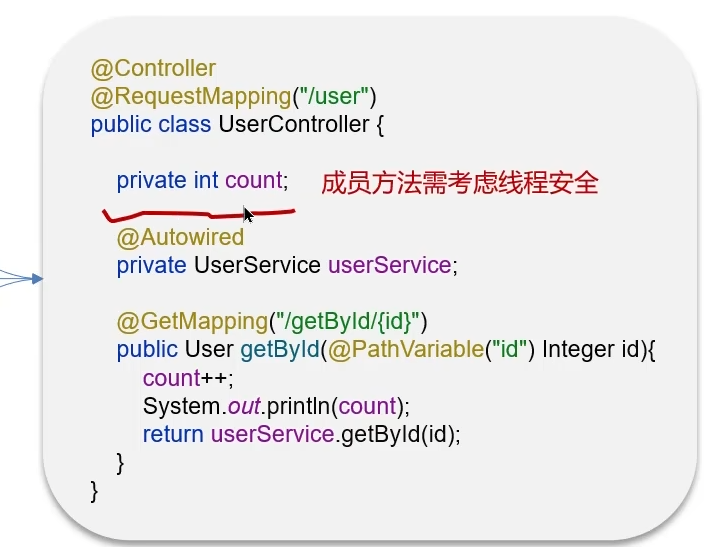
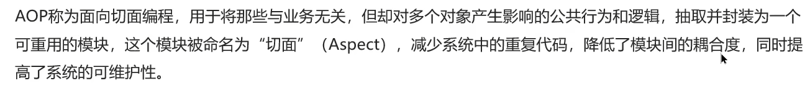
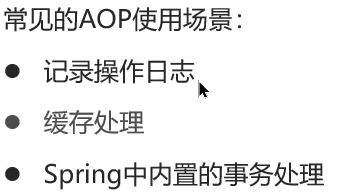
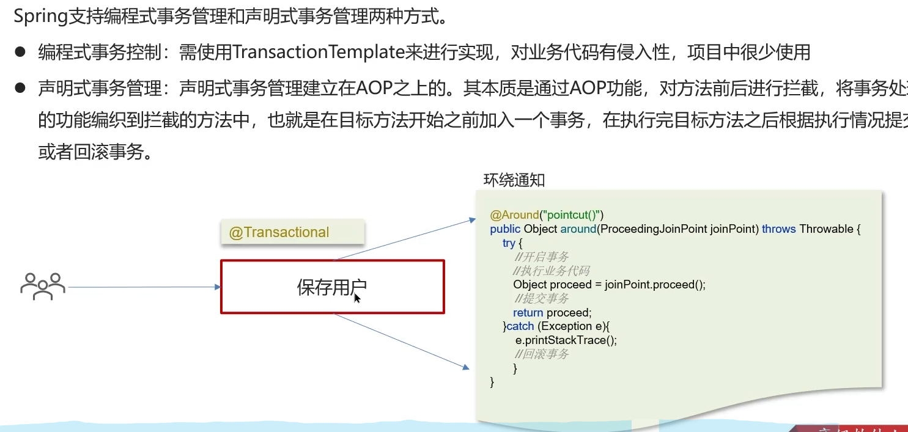
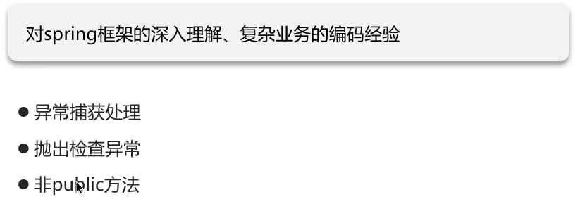

## spring 是什么
是一个轻量级的，控制反转IOC和面向切面编程的容器。

## Sping IOC

 	**控制反转（IOC）**，传统的 java 开发模式中，当需要一个对象时，我们会自己使用 new 或者 getInstance 等直接或 者间接调用构造方法创建一个对象。而在 spring 开发模式中，spring 容器使用了工厂模式为我们创建了所需要的 对象，不需要我们自己创建了，直接调用 spring 提供的对象就可以了，这是控制反转的思想。 依赖注入（DI），spring 使用 javaBean 对象的 set 方法或者带参数的构造方法为我们在创建所需对象时将其属性 自动设置所需要的值的过程，就是依赖注入的思想。

## Spring AOP

面向切面编程，不修改原有功能代码，而增强功能

 面向切面编程（AOP），在面向对象编程（oop）思想中，我们将事物纵向抽成一个个的对象。而在面向切面编程中， 我们将一个个的对象某些类似的方面横向抽成一个切面，对这个切面进行一些如权限控制、事物管理，记录日志等 公用操作处理的过程就是面向切面编程的思想。AOP 底层是动态代理，如果是接口采用 **JDK 动态代理**，如果是类 采用 **CGLIB 方式实现动态代理**。

### 为什么要用代理模式？

 **中介隔离作用：**

在某些情况下，一个客户类不想或者不能直接引用一个委托对象，而代理类对象可以在客户类和委托对象之间起到 中介的作用，其特征是代理类和委托类实现相同的接口。

**开闭原则，增加功能：**

代理类除了是客户类和委托类的中介之外，我们还可以通过给代理类增加额外的功能来扩展委托类的功能，这样做 我们只需要修改代理类而不需要再修改委托类，符合代码设计的开闭原则。代理类主要负责为委托类预处理消息、 过滤消息、把消息转发给委托类，以及事后对返回结果的处理等。代理类本身并不真正实现服务，而是同过调用委 托类的相关方法，来提供特定的服务。真正的业务功能还是由委托类来实现，但是可以在业务功能执行的前后加入 一些公共的服务。例如我们想给项目加入缓存、日志这些功能，我们就可以使用代理类来完成，而没必要修改已经 封装好的委托类。

### JDK动态代理，CGlib动态代理的优缺点

**JDK动态代理：**

 **优点**：

相对于静态代理，动态代理大大减少了开发任务，同时减少了对业务接口的依赖，降低了耦合度。

 **缺点：**

Proxy 是所有动态生成的代理的共同的父类，因此服务类必须是接口的形式，不能是普通类的形式，因为 Java 无法实现多继承。

**CGlib动态代理** :

CGLib 创建的动态代理对象比 JDK 创建的动态代理对象的性能更高，但是 CGLIB 创建代理对象时所花费的时间却 比 JDK 多得多。所以对于单例的对象，因为无需频繁创建对象，用 CGLIB 合适，反之使用 JDK 方式要更为合适一 些。同时由于 CGLib 由于是采用动态创建子类的方法，对于 final 修饰的方法无法进行代理。

## Spring框架中的bean是单列的吗



单列不是线程安全的主要原因是，成员变量需要考虑线程安全的情况



## 什么是Aop





### 操作日志

### 缓存
### 内置事务



### 实际工作中使用的场景

#### 防接口重复提交问题
redis+spring El +AOP +注解

注解类：

```java
@Target({ ElementType.METHOD})
@Retention(RetentionPolicy.RUNTIME)
@Documented
public @interface RedisLock {

    /** 缓存Key,支持SPEL表达式 **/
    String value() default "";

    String tips() default "重复请求";

    /** 过期时间(毫秒) **/
    long expire() default 3000;

    /** 最大过期时间(毫秒) **/
    long maxExpire() default 300000;

    /** 方法执行完释放 **/
    boolean quitRelease() default true;
}

```
切面类：

```java
/**
 * 分布式时锁，用于防重提交，注意：业务内部还是要进行重复校验
 配置
 @Bean
 public RedisDistributedLockAspect createRedisDistributedLockAspect(ObjectProvider<RedisTemplate> redisTemplate){
 RedisDistributedLockAspect aspect = new RedisDistributedLockAspect();
 aspect.setRedisTemplate(redisTemplate.getIfAvailable());
 return aspect;
 }
 * @date: 2019/11/8 16:35
 */
@Order(1)
@Slf4j
@Component
@Aspect
public class RedisDistributedLockAspect {
    public static final String KEY_PREFIX = "DUPLICATION_SUBMIT:";

    @Autowired
    private RedissonClient redissonClient;

    /**
     * 切点
     * @author: yuez
     * @date: 2019/11/8 16:45
     **/
    @Pointcut("@annotation(car.insurance.proxy.service.common.lock.RedisLock)")
    public void getPointcut(){}

    @Around("getPointcut()")
    public Object doBefore(ProceedingJoinPoint point) throws Throwable {
        MethodSignature signature = (MethodSignature) point.getSignature();
        Method method = signature.getMethod();
        Object result;
        if (method != null && method.isAnnotationPresent(RedisLock.class)) {
            RedisLock redisLock = method.getAnnotation(RedisLock.class);
            String lockKey = KEY_PREFIX + SpELAspectSupport.getKeyValue(point, redisLock.value());
            long expire = redisLock.expire();
            long maxExpire = redisLock.maxExpire();
            // 执行加锁
            RLock lock = redissonClient.getLock(lockKey);
            // 等待锁的时间 = 过期时间，锁自动释放时间 = 最大过期时间
            boolean acquiredLock = lock.tryLock(expire, maxExpire, TimeUnit.MILLISECONDS);
            if (acquiredLock) {
                try {
                    //执行方法
                    result = point.proceed();
                }finally {
                    // 释放锁
                    lock.unlock();
                }
            } else {
                // 锁已经被其他线程持有，表示重复消费
                // 执行重复消费的逻辑
                log.error("拦截到重复消费，重复消费方法：【{}】，重复消费key:【{}】",method,lockKey);
                return Response.error(redisLock.tips());
            }
        } else {
            result = point.proceed();
        }
        return result;
    }
}

```
#### 数据权限

切面类：

```java
/**
 * 数据权限控制切面
 *
 * @author 张朝
 */
@Slf4j
@Aspect
@Component
public class DataPermissionAspect {

    @Autowired
    private CommonDictService commonDictService;

    /**
     * 处理数据权限
     *
     * @param joinPoint                切入点
     * @param dataPermissionAnnotation 注解
     */
    @Before("@annotation(dataPermissionAnnotation)")
    public void handleDataPermission(JoinPoint joinPoint, DataPermissionAnnotation dataPermissionAnnotation) {
        Object[] args = joinPoint.getArgs();
        //管理员权限设置为空（代表全部权限）
        List<SimpleDictModel> administratorDices = commonDictService.getByType(ClaimConstant.CLAIM_DATA_PERMISSION_ADMINISTRATOR);
        if (args != null && args.length > 0) {
            // 获取要赋值的字段名和字段值
            String fieldName = dataPermissionAnnotation.fieldName();
            // 遍历参数列表，查找字段名为fieldName的字段并赋值
            for (Object arg : args) {
                assignField(arg, fieldName,administratorDices);
            }
        }
    }

    /**
     * 填充字段值
     *
     * @param object    字段
     * @param fieldName 字段名称
     * @param administratorDices 管理员字典
     */
    private void assignField(Object object, String fieldName,List<SimpleDictModel> administratorDices) {
        try {
            Field field = object.getClass().getDeclaredField(fieldName);
            field.setAccessible(true);

            //当前用户id
            String userId = DstUserUtil.getUserId().get().toString();

            List<String> administratorIds = administratorDices.stream().map(SimpleDictModel::getCode).collect(Collectors.toList());

            //是管理员设置字段为空
            if (CollectionUtils.isNotEmpty(administratorDices) && administratorIds.contains(userId)) {
                return;
            }

            //填充目标字段数据权限
            fillFieldValue(object, field, userId);
        } catch (NoSuchFieldException e) {
            throw new BusinessException("目标字段：【】,不存在!", fieldName);
        } catch (IllegalAccessException e) {
            throw new BusinessException("目标字段：【】，无法访问", fieldName);
        } catch (NumberFormatException e) {
            throw new BusinessException("目标字段类型：【】，无法被填充用户id", fieldName);
        }
    }

    /**
     * 填充目标字段
     *
     * @param field 字段对象
     */
    private void fillFieldValue(Object object, Field field, String userId) throws IllegalAccessException {
        // 根据字段类型进行相应的转换
        if (field.getType() == Long.class) {
            field.set(object, Long.parseLong(userId));
        } else if (field.getType() == Integer.class) {
            field.set(object, Integer.parseInt(userId));
        } else if (field.getType() == String.class) {
            field.set(object, userId);
        }

    }

}

```
注解类：

```java
/**
 * 数据权限注解
 * @author 张朝
 */
@Retention(RetentionPolicy.RUNTIME)
@Target(ElementType.METHOD)
public @interface DataPermissionAnnotation {

    /**
     * 权限字段名称
     */
    String fieldName() default "executorId";

}

```
#### 异常回调

切面类：

```java
/**
 * 保司回调请求切面
 * @date 2023/8/10 11:12
 */
@Slf4j
@Aspect
@Component
public class PolicyCallbackAspect {
    @Autowired
    private PolicyCallbackRecordServiceImpl policyCallbackRecordService;

    @Pointcut("execution(public * car.insurance.proxy.service.modules.openapi.insurer.controller..*.*(..)) )")
    public void controllerAspect() {
    }

    @Around("controllerAspect()")
    public Object process(ProceedingJoinPoint joinPoint) throws Throwable {
        String id = null;
        try {
            HttpServletRequest request = ((ServletRequestAttributes) RequestContextHolder.getRequestAttributes()).getRequest();
            id = DstIdUtil.stringId();
            String reqUrl = request.getRequestURL().toString();
            String reqData = postHandle(filterParamList(joinPoint));
            //异步新增请求记录
            policyCallbackRecordService.asyncAdd(id, reqUrl, reqData);
        }catch (Exception e){
            log.error("保司回调请求切面异常", e);
        }

        //处理数据
        Object result = joinPoint.proceed();

        try{
            String resData = postHandle(result);
            Response response = DstJsonUtil.toObject(resData, Response.class);
            //异步更新响应结果
            policyCallbackRecordService.asyncUpdate(id, resData, response.isSuccess());
        }catch (Exception e){
            log.error("保司回调请求切面响应异常", e);
        }
        return result;
    }

    /**
     * 返回数据
     *
     * @param retVal
     * @return
     */
    private String postHandle(Object retVal) {
        if (null == retVal) {
            return "";
        }
        return JSON.toJSONString(retVal);
    }

    /**
     * 过滤参数列表
     *
     * @param joinPoint
     * @return
     */
    private List<Object> filterParamList(ProceedingJoinPoint joinPoint) {
        List<Object> paramsList = new ArrayList<>();
        Object[] arrays = joinPoint.getArgs();
        for (int i = 0; i < arrays.length; i++) {
            if (!(arrays[i] instanceof HttpServletRequest)) {
                paramsList.add(arrays[i]);
            }
        }
        return paramsList;
    }

}

```
#### 字典翻译

注解类：

```java
package car.insurance.service.common.translation;

import java.lang.annotation.*;

/**
 * @Description: 翻译
 * @Date: 2020/7/30
 */
@Target(ElementType.FIELD)
@Retention(RetentionPolicy.RUNTIME)
@Documented
public @interface Translation {

    /**
     * 字典类型
     *
     * @return
     */
    String dictType() default "";

    /**
     * 转换类
     *
     * @return
     */
    Class convert() default Void.class;

    /**
     * 当class不可访问时是用名字做转换器
     *
     * @return
     */
    String convertName() default "";

    /**
     * 转换目标
     *
     * @return
     */
    String[] convertTo() default {};

    /**
     * 是否是一对多翻译（一个字段存多个值）
     *
     * @return
     */
    boolean isMultiple() default false;

    /**
     * 分隔符
     *
     * @return
     */
    String delimiter() default ",";
}

```
## Sping 中事务失效的场景



## Spring bean 生命周期

**（1）默认情况下，IOC容器中bean的生命周期分为五个阶段:**

⚫ 调用构造器 或者是通过工厂的方式创建 Bean 对象

⚫ 给 bean 对象的属性注入值

⚫ 调用初始化方法，进行初始化， 初始化方法是通过 init-method 来指定的.

⚫ 使用

⚫ IOC 容器关闭时， 销毁 Bean 对象.

（**2）当加入了 Bean 的后置处理器后，IOC 容器中 bean 的生命周期分为七个阶段:**

⚫ 调用构造器 或者是通过工厂的方式创建 Bean 对象

⚫ 给 bean 对象的属性注入值

⚫ 执行 Bean 后置处理器中的 postProcessBeforeInitialization

⚫ 调用初始化方法，进行初始化， 初始化方法是通过 init-method 来指定的.

⚫ 执行 Bean 的后置处理器中 postProcessAfterInitialization

⚫ 使用

 ⚫ IOC 容器关闭时， 销毁 Bean 对象

 **注入方式：**

通过 setter 方法注入

通过构造方法注入

**Bean 的作用域 总共有四种作用域:**

⚫ Singleton 单例的

⚫ Prototype 原型的

⚫ Request

⚫ Session
