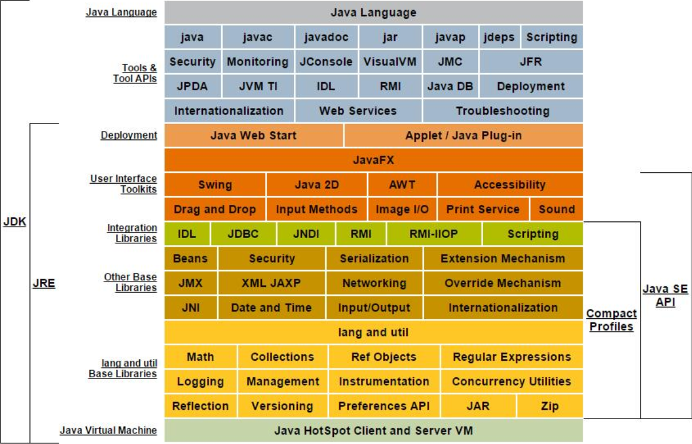
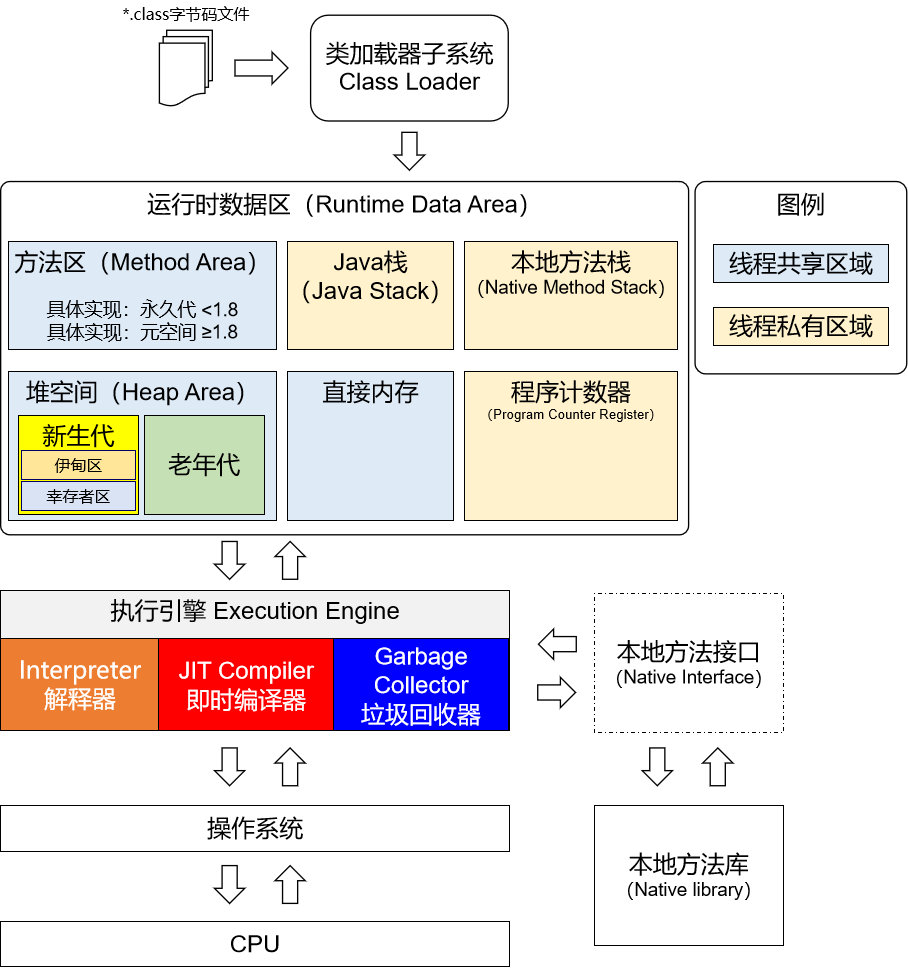

## 一、JVM的概念

- JVM：Java Virtual Machine，翻译过来是Java虚拟机

- JRE：Java Runtime Environment，翻译过来是Java运行时环境
    - JRE=JVM+Java程序运行时所需要的类库

- JDK：Java Development Kits，翻译过来是Java开发工具包
    - JDK=JRE+Java开发辅助工具



## 二、JVM的运行机制

总体机制的粗略描述：

- 第一步：使用类加载器子系统将 *.class 字节码文件加载到 JVM 的内存

- 第二步：在 JVM 的内存空间存储相关数据

- 第三步：在执行引擎中将 *.class 字节码文件翻译成 CPU 能够执行的指令

- 第四步：将指令发送给CPU执行



## 三、JVM 落地产品

#### ①Sun Classic VM
早在1996年Java1.0版本的时候，Sun公司发布了一款名为Sun Classic VM的Java虚拟机，它同时也是世界上**第一款商用**Java虚拟机，JDK1.4时完全被淘汰。

这款虚拟机内部只提供解释器。

> 目前我们使用的主流JVM中，通常既提供解释器，也提供JIT编译器。在JVM的执行引擎中，既可以使用解释器也可以使用JIT编译器，看具体场景。所以最初的JVM只有解释器是能够工作的。
只有解释器，效率较低。
JIT编译器可以对重复执行的代码进行预编译，提高执行效率。
>

要想使用JIT编译器，就需要进行外挂。而一旦外挂了JIT编译器，JIT就会接管虚拟机的执行系统。解释器就不再工作。解释器和编译器不能配合工作。

现在Hotspot内置了此虚拟机。

#### ②Exact VM

为了解决Sun Classic VM的问题，JDK1.2时，SUN提供了此虚拟机。

Exact Memory Management：准确式内存管理

- 也可以叫Non-Conservative/Accurate Memory Management

- 虚拟机可以知道内存中某个位置的数据具体是什么类型。
    - 比如一个变量的值是：0xFFE5，分辨它是一个普通整数还是一个地址值。

具备现代高性能虚拟机的雏形

- 热点探测

- 编译器与解释器混合工作模式，仅针对热点代码执行即时编译

只在Solaris（Sun公司的Unix系统）平台短暂使用，其它平台上还是Classic VM。英雄气短，最终被Hotspot虚拟机替换。

> “开始了吗？”
“已经结束了。”
>

#### ③三大商用VM之一：**Hotspot **VM

##### [1]Hotspot历史

- 最初由一家名为“Longview Technologies”的小公司设计

- 1997年，Longview Technologies被Sun收购

- 2009年，Sun公司被Oracle收购

- JDK1.3时，Hotspot VM成为默认虚拟机直到现在

##### [2]市场地位

- 目前Hotspot占有绝对的市场地位，称霸武林

- 不管是现在仍在广泛使用的JDK6，还是新锐JDK8，默认虚拟机都是Hotspot

- Sun/Oracle JDK和Open JDK的默认虚拟机

- 因此本课程中默认介绍的虚拟机都是Hotspot，相关机制也主要是指Hotspot的GC机制。（比如其它两个商用虚拟机：JRockit、J9，都没法方法区的概念）

- 从服务器、桌面应用程序到移动端、嵌入式都有应用

##### [3]名字含义

- Hotspot指的就是它的热点代码探测技术

- 通过计数器找到最具编译价值代码，触发即时编译或栈上替换

- 通过编译器与解释器协同工作，在最优化的程序响应时间与最佳执行性能中取得平衡

栈上替换：
如果一个对象确保只被一个局部变量所引用，那么JVM底层就可以把这个对象拆散，变成几个局部变量分别保存这个对象的各个属性。

栈上替换的好处：
①对象并没有被放在堆空间，而是在栈空间保存，不需要GC
②放在栈空间，有更大概率是存储在CPU的高速缓存中，进一步提升性能

逃逸分析：
如果一个对象不止被一个局部变量引用，那么就是发生了逃逸，此时不能做栈上替换；乖乖的在堆空间给对象分配存储空间。

#### ④三大商用VM之一：BEA公司的JRockit

- 专注于服务器端应用
    - 不太关注程序启动速度，内部不包含解释器，全部代码都通过JIT编译器执行。

- 大量的行业基准测试显示，JRockit是世界上最快的JVM。
    - 使用JRockit产品，客户已经体验到了显著的性能提高（一些超过了70%）和硬件成本的减少（达50%）。

- 优势：全面的Java运行时解决方案组合
    - JRockit面向延迟敏感型应用的解决方案JRockit Real Time提供毫秒或微秒级的JVM响应时间，适合财务、军事指挥、电信网络的需要
    - MissionControl服务套件，它是一组以极低的开销来监控、管理和分析生产环境中的应用程序的工具。

- 2008年，BEA被Oracle收购。

- Oracle表达了整合两大优秀虚拟机的意愿，大致在JDK8中完成。整合的方式是在Hotspot的基础上，移植JRockit的优秀特性。
其实二者架构差异很大，改动并不大。

- 高斯林：目前就职与谷歌，研究人工智能和水下机器人。

#### ⑤三大商用VM之一：IBM的J9

- 全称：IBM Technology for Java Virtual Machine，简称IT4J

- 内部代号：J9
- 市场定位与Hotspot接近，服务器端、桌面应用、嵌入式等多用途VM

- 广泛用于IBM的各种Java产品。

- 目前是有影响力的三大商用虚拟机之一，也**号称**是世界上最快的Java虚拟机。

> 这个“最快”大概率是基于在IBM自己的产品上测试的结果。
从适应性角度来说，J9也更适合和IBM公司的产品配合使用，例如：WebSphere
>
- 2017年左右，IBM发布了开源J9 VM，命名为OpenJ9，交给Eclipse基金会管理，也称为Eclipse OpenJ9

## 四、类加载器

### 1、概念

- 类加载器子系统负责从文件系统或者网络中加载*.class字节码文件

- 字节码文件开头必须有特定的文件标识
如果使用二进制文件查看工具打开Java编译得到的字节码文件，会发现，文件开头是：CA FE BA BE
它们都是十六进制数的符号。

- ClassLoader只负责字节码文件的加载，至于它是否可以运行，则由Execution Engine执行引擎决定的

- 加载的类信息存放于一块称为**方法区**的内存空间。除了类的信息外，方法区中还会存放运行时常量池信息，可能还包括字符串字面量和数字字面量（这部分常量信息是字节码文件中常量池部分的内存映射）


### 2、分类


JVM 中类加载器分为四种：前三种为虚拟机自带的加载器。

| 中文名称 | 英文名称 | 说明 | 加载范围 |

| --- | --- | --- | --- |

| 启动类加载器 | Bootstrap | C++ 语言编写，不是 ClassLoader 子类，Java 中为 null | $JAVA_HOME/jre/lib/rt.jar |

| 扩展类加载器 | Extension | sun.misc.Launcher.ExtClassLoader | $JAVA_HOME/jre/lib/*.jar -Djava.ext.dirs 参数指定目录下的 jar 包 $JAVA_HOME/jre/lib/ext/classes 目录下的 class |

| 应用类加载器 | AppClassLoader | sun.misc.Launcher.AppClassLoader | classpath中指定的 jar 包及目录中的 class 以及我们导入的第三方框架的jar包 |

| 自定义类加载器 | | 程序员自己开发一个类继承 java.lang.ClassLoader， 定制类加载方式 | |

### 3、父子关系

- 父子关系1：启动类加载器是扩展类加载器的父加载器

- 父子关系2：扩展类加载器是应用类加载器的父加载器

这里的『父子关系』并不是通过子类『继承』父类建立的——不是类型上的父子关系。
而是在子加载器中**通过parent属性**指向父加载器这样建立的——是对象之间逻辑上的父子关系。

### 4、双亲委派机制

『双亲委派机制』这个名字不能顾名思义。
在中文语境下，双亲是指父母；但是这里实际上是指『爸爸』和『爷爷』。
所以我觉得应该叫：祖孙三代，比拼啃老机制，更贴切

#### 1、机制简介


- 当我们需要加载任何一个范围内的类时，首先找到这个范围对应的类加载器

- 但是当前这个类加载器不是马上开始查找

- 当前类加载器会将任务交给上一级类加载器

- 上一级类加载器继续上交任务，一直到最顶级的启动类加载器

- 启动类加载器开始在自己负责的范围内查找

- 如果能找到，则直接开始加载

- 如果找不到，则交给下一级的类加载器继续查找

- 一直到应用程序类加载器

- 如果应用程序类加载器同样找不到要加载的类，那么会抛出ClassNotFoundException

#### 2、小结

双亲委派机制的好处：

- 避免类的重复加载：父加载器加载了一个类，就不必让子加载器再去查找了。同时也保证了在整个 JVM 范围内**全类名是类的唯一标识**。

- 安全机制：避免恶意替换 JRE 定义的核心 API。这方面还有一个名词『**沙箱安全机制**』。

## 五、本地接口 Native Interface

本地接口的作用是融合不同的编程语言为 Java 所用，它的初衷是融合 C/C程序。因为 Java 诞生的时候是 C/C 横行的时候，要想立足，必须有能力调用 C/C++。于是就在内存中专门开辟了一块区域处理标记为 native 的代码，它的具体做法是 Native Method Stack 中登记 native 方法，在Execution Engine 执行时加载 native libraies。

目前该方法使用的越来越少了，除非是与硬件有关的应用，比如通过 Java 程序驱动打印机或者 Java 系统管理生产设备，在企业级应用中已经比较少见。因为现在的异构领域间的通信很发达，比如**可以使用 Socket 通信，也可以使用 Web Service **等等，不多做介绍。

## 六、程序计数器

也叫PC寄存器（**P**rogram **C**ounter Register）。用于保存程序执行过程中，下一条即将执行的指令的地址。也就是说能够保存程序当前已经执行到的位置。这个位置由执行引擎读取下一条指令，是一个非常小的内存空间，从内存空间使用优化这个角度来看：几乎可以忽略不计。

## 七、执行引擎 Execution Engine


作用：用于执行字节码文件中的指令。

执行指令的具体技术：

- 解释执行：第一代JVM。

- 即时编译：JIT，第二代JVM。

- 自适应优化：目前Sun的Hotspot JVM采用这种技术。吸取了第一代JVM和第二代JVM的经验，在一开始的时候对代码进行解释执行， 同时使用一个后台线程监控代码的执行。如果一段代码经常被调用，那么就对这段代码进行编译，编译为本地代码，并进行执行优化。若方法不再频繁使用，则取消编译过的代码，仍对其进行解释执行。

- 芯片级直接执行：内嵌在芯片上，用本地方法执行Java字节码。

## 八、直接内存


### 1、作用

在特定场景提高性能。

### 2、应用场景

直接内存并不是虚拟机运行时数据区的一部分，也不是Java 虚拟机规范中定义的内存区域。在JDK1.4 中新加入了NIO(New Input/Output)类，引入了**一种基于通道（Channel）与缓冲区（Buffer）的 I/O 方式**，它可以使用native 函数库直接分配堆外内存，然后通过一个**存储在 Java 堆中的 DirectByteBuffer 对象作为这块内存的引用进行操作**。这样能在**一些场景中显著提高性能**，因为避免了在** Java 堆和 Native 堆中来回复制数据**。 本机直接内存的分配不会受到 Java 堆大小的限制，受到本机总内存大小限制。 配置虚拟机参数时，不要忽略直接内存防止出现 OutOfMemoryError 异常。

比如，TCP传输时，使用ByteBuffer的性能就非常好

### 3、直接内存和堆内存比较

直接内存申请空间耗费更高的性能，当频繁申请到一定量时尤为明显。**直接内存 I/O 读写的性能要优于普通的堆内存，在多次读写操作的情况下差异明显**。

## 九、堆

### 一、概述
### 1、堆空间存储结构


### 2、堆空间工作机制

- 新创建的对象会被放在Eden区

- 当Eden区中已使用的空间达到一定比例，会触发Minor GC

- 每一次在Minor GC中没有被清理掉的对象就成了幸存者

- 幸存者对象会被转移到幸存者区

- 幸存者区分成from区和to区

- from区快满的时候，会将仍然在使用的对象转移到to区

- 然后from和to这两个指针彼此交换位置

> 口诀：**复制必交换，谁空谁为to**
>
- 如果一个对象，经历15次GC仍然幸存，那么它将会被转移到老年代

- 如果幸存者区已经满了，即使某个对象尚不到15岁，仍然会被移动到老年代

- 最终效果：
    - Eden区主要是生命周期很短的对象来来往往
    - 老年代主要是生命周期很长的对象，例如：IOC容器对象、线程池对象、数据库连接池对象等等
    - 幸存者区作为二者之间的过渡地带

- 关于永久代：
    - 从理论上来说属于堆
    - 从具体实现上来说不属于堆

### 3、堆、栈、方法区之间关系


## 十、GC

为什么要有垃圾回收？
●线程私有空间：无需由系统来执行GC。因为线程结束，释放自己刚才使用的空间即可，不影响其它线程。
●线程共享空间：任何一个线程结束时，都无法确定刚才使用的空间是不是还有别的线程在使用。所以不能因为线程结束而释放空间，必须在系统层面统一垃圾回收。

GC的基本原则：
●频繁收集新生代
●较少收集老年代
●基本不动元空间

### 一、标记垃圾对象

垃圾对象的标准：不再被引用的对象。下面这两种方法都是要把这样的对象找出来。

#### 1、引用计数法（不采用）

##### ①本意

- 在对象内部记录被引用次数

- 被引用一次，计数器 + 1
- 引用解除一个，计数器 - 1
- 计数器归零则表示该对象变成垃圾

##### ②问题

**循环引用问题**，会导致计数器无法归零。

###### [1]一对多关联关系

Customer 类：

```java
public class Customer {

    private List<Order> orderList;

    public List<Order> getOrderList() {
        return orderList;
    }

    public void setOrderList(List<Order> orderList) {
        this.orderList = orderList;
    }
}

```
Order 类：

```java
public class Order {

    private Customer customer;

    public Customer getCustomer() {
        return customer;
    }

    public void setCustomer(Customer customer) {
        this.customer = customer;
    }
}

```
###### [2]SpringMVC 组件

- IOC 容器对象的接口类型：WebApplicationContext
    - WebApplicationContext 对象初始化过程中：将它自己存入 ServletContext 域
    - WebApplicationContext 对象也会把 ServletContext 存入 IOC 容器

- Servlet 上下文对象：ServletContext


#### 2、GC Roots 可达性分析

核心原理：判断一个对象，是否存在从『**堆外**』到『**堆内**』的引用。

因为我们写Java代码时，是不可能直接访问到堆内对象的，要么是通过方法里面局部变量，要么通过static修饰的常量、类变量。局部变量、类变量、常量这些都在堆外。


#### 3、GC Root 对象

GC Root 对象：就是作为根节点出发，顺着引用路径一直查找到堆空间内，找到堆空间中的对象。

- 虚拟机栈(Java Stack栈帧中的局部变量区，也叫做局部变量表)中引用的对象

- 本地方法栈（Native Method Stack）中的局部变量

- 方法区中的类变量、常量引用的对象（说白了就是用static修饰的成员变量指向的对象）

### 二、垃圾回收算法

#### 0、概述
##### ①回收范围


JVM在进行GC时，并非每次都对上面三个内存区域一起回收的，大部分时候回收的都是指新生代。

- **minor GC**：只针对新生代区域的GC，指发生在新生代的垃圾收集动作。

因为大多数Java对象存活率都不高，所以Minor GC非常频繁，一般回收速度也比较快。

- **major GC**：
    - 对老年代的垃圾回收。
    - Major GC的速度一般会比Minor GC慢10倍以上，STW的时间更长。
    - 如果Major GC后，内存还不足，就报OOM了。

- **full GC**：清理范围包括新生代、老年代和方法区，非常慢。

##### ②GC年龄

新生代的对象每经历一次GC，只要它还活着，GC年龄就会+1。当GC年龄达到15的时候，该对象就会转移到老年代。

对象在新生代的最大GC年龄可以设置：

```latex
-XX:MaxTenuringThreshold

```
从JDK8开始，64位虚拟机的最大GC年龄不能超过15。

#### 1、基本算法

##### ①引用计数法（不采用）
优点：

- 实时性较高，不需要等到内存不够时才回收

- 垃圾回收时不用挂起整个程序，不影响程序正常运行

缺点：

- 回收时不移动对象, 所以会造成内存碎片问题

- 不能解决对象间的**循环引用**问题（致命问题，一票否决）

小结：

正是由于引用计数法不能解决对象间的循环引用问题，所以事实上并没有哪一款 JVM 产品采用这个机制。

> Stop-The-World：字面意思让整个世界停止。在 GC 机制中，Stop-The-World 表示挂起整个 JVM 程序，等执行完垃圾回收之后，再继续执行 JVM 程序。Stop-The-World 通常也会简称为 STW。
>

##### ②标记清除法

它的做法是当堆中的有效内存空间被耗尽的时候，就会暂停、挂起整个程序（也被称为stop the world），然后进行两项工作，第一项则是标记，第二项则是清除。

- 标记：标记的过程其实就是，从根对象开始遍历所有的对象，然后将所有存活的对象标记为可达的对象。

- 清除：清除的过程将遍历堆中所有的对象，将没有标记的对象全部清除掉。

小结：

- 优点：实现简单

- 缺点：
    - 效率低，因为标记和清除两个动作都要遍历所有的对象
    - 垃圾收集后有可能会造成大量的内存碎片
    - 垃圾回收时会造成应用程序暂停


##### ③标记压缩法

既然叫标记压缩算法，那么它也分为两个阶段，一个是标记(mark)，一个是压缩(compact)。所谓压缩就是把存在碎片的空间连起来。

标记压缩算法是在标记清除算法的基础之上，做了优化改进的算法。和标记清除算法一样，也是从根节点开始，对对象的引用进行标记，在清理阶段，并不是简单的清理未标记的对象，而是将存活的对象移动到内存的一端，然后清理边界以外的垃圾，从而解决了碎片化的问题。

- 标记 : 标记的过程其实就是，从根对象开始遍历所有的对象，然后将所有存活的对象标记为可达的对象。

- 压缩 : 移动所有的可达对象到堆内存的同一个区域中，使他们紧凑的排列在一起，从而将所有非可达对象释放出来的空闲内存都集中在一起，通过这样的方式来达到减少内存碎片的目的。

小结

- 优点：标记压缩算法是对标记清除算法的优化，解决了碎片化的问题

- 缺点：还是效率问题，在标记清除算法上又多加了一步，效率可想而知了


##### ④复制算法

复制算法的核心就是，将原有的内存空间一分为二，每次只用其中的一块，在垃圾回收时，将正在使用的对象复制到另一个内存空间中，并依次排列，然后将该内存空间清空，交换两个内存的角色，完成垃圾的回收。

小结：

- 优点1：在垃圾多的情况下(新生代)，效率较高

- 优点2：清理后，内存无碎片

- 缺点：浪费了一半的内存空间，在存活对象较多的情况下(老年代)，效率较差。极端情况下，如果假设所有对象存活，那么需要复制全部对象且重置全部引用地址。

执行GC前：


执行标记：


执行复制：


交换指针：


#### 2、综合算法

##### ①分代算法
前面介绍了多种回收算法，每一种算法都有自己的优点也有缺点，谁都不能替代谁，所以根据垃圾回收对象的特点进行选择，才是明智的。

分代算法其实就是这样的，根据回收对象的特点进行选择。

新生代适合使用复制算法
老年代适合使用标记清除或标记压缩算法

##### ②分区算法

上面介绍的分代收集算法是将对象的生命周期按长短划分为两个部分，而分区算法则将整个堆空间划分为连续的不同小区间，每个小区间独立使用，独立回收。这样做的好处是可以控制一次回收多少个小区间。在相同条件下，堆空间越大。一次GC耗时就越长，从而产生的停顿也越长。为了更好地控制GC产生的停顿时间，将一块大的内存区域分割为多个小块，根据目标停顿时间每次合理地回收若干个小区间(而不是整个堆)，从而减少一次GC所产生的停顿。

### 三、垃圾回收器[了解]

> 垃圾回收器没有在规范中进行过多的规定，可以由不同厂商、不同版本的JVM来各自实现。
由于JDK的版本处于高速迭代过程中，因此Java发展至今已经衍生了众多的垃圾回收器产品。
从不同角度分析垃圾回收器，可以将GC分为不同的类型。
>

在JVM中，垃圾回收器可以按照并行和串行两种方式工作。

串行垃圾回收器一次只能使用一个线程进行垃圾回收，也就是在垃圾回收期间，JVM将停止应用程序的执行，直到垃圾回收完成为止。这种回收器适用于单处理器环境下或者是在较小的堆内存中使用。

并行垃圾回收器会使用多个线程来加快垃圾回收的速度。这种回收器通常比串行垃圾回收器速度更快，但需要更多的CPU和内存资源。在垃圾回收期间，应用程序可能需要被暂停，但停顿时间比串行垃圾回收器要短。

总的来说，串行垃圾回收器适用于小型应用并且操作系统资源有限的情况下，而并行垃圾回收器适用于大型应用和高性能服务器，当然这也要看具体应用场景的需求。

#### 1、串行垃圾回收器

串行：在一个线程内执行垃圾回收操作。

新生代串行回收器 SerialGC：采用复制算法实现，单线程垃圾回收，独占式垃圾回收器

老年代串行回收器 SerialOldGC：采用标记压缩算法，单线程独占式垃圾回收器

#### 2、并行垃圾回收器

并行：在多个线程中执行垃圾回收操作。

新生代 ParNew 回收器：采用复制算法实现，多线程回收器，独占式垃圾回收器。

新生代 ParallelScavengeGC 回收器：采用复制算法多线程独占式回收器

老年代 ParallelOldGC 回收器: 采用标记压缩算法，多线程独占式回收器

- CMS回收器
CMS全称 (Concurrent Mark Sweep)，是一款并发的、使用标记-清除算法的垃圾回收器。对CPU资源非常敏感。
启用CMS回收器参数 ：-XX:+UseConcMarkSweepGC。
使用场景：GC过程短暂停顿，适合对时延要求较高的服务，用户线程不允许长时间的停顿。
优点：最短回收停顿时间为目标的收集器。并发收集，低停顿。
缺点：服务长时间运行，造成严重的内存碎片化。算法实现比较复杂。

- G1回收器
G1(Garbage-First)是一款面向服务端应用的并发垃圾回收器, 主要目标用于配备多颗CPU的服务器，治理大内存。是JDK1.7提供的一个新收集器，是当今收集器技术发展的最前沿成果之一。
G1计划是并发标记-清除收集器的长期替代品。
启用G1收集器参数：-XX:+UseG1GC启用G1收集器。
G1将整个Java堆划分为多个大小相等的独立区域(Region)，虽然还保留有新生代和老年代的概念，但新生代和老年代不再是物理隔离的了, 它们都是一部分Region(不需要连续)的集合。


每块区域既有可能属于Old区、也有可能是Young区，因此不需要一次就对整个老年代/新生代回收。而是当线程并发寻找可回收的对象时，有些区块包含可回收的对象要比其他区块多很多。虽然在清理这些区块时G1仍然需要暂停应用线程，但可以用相对较少的时间优先回收垃圾较多的Region(这也是G1命名的来源)。这种方式保证了G1可以在有限的时间内获取尽可能高的收集效率。

特点：

- 一整块堆内存被分成多个独立的区域Regions

- 存活对象被拷贝到新的Survivor区

- 新生代内存由一组不连续的堆heap区组成，使得可以动态调整各个区域

- 多线程并发GC

- young GC会有STW（Stop the world）事件

#### 3、垃圾回收器对比

##### ①新生代回收器

| 名称 | 串行/并行/并发 | 回收算法 | 适用场景 | 可以与CMS配合 |

| --- | --- | --- | --- | --- |

| SerialGC | 串行 | 复制 | 单CPU | 是 |

| ParNewGC | 并行 | 复制 | 多CPU | 是 |

| ParallelScavengeGC | 并行 | 复制 | 多CPU且关注吞吐量 | 否 |

###### [1]SerialGC

SerialGC是JVM中最基本的垃圾回收器，也是串行垃圾回收器的一种实现。SerialGC在进行垃圾回收时只会使用一个线程，因此它的回收效率不高，但可以保证垃圾回收过程不会影响应用程序的并发执行。

SerialGC主要用于小型应用程序或者只使用单核CPU的环境下，它的优点是实现简单、消耗内存较少，缺点是效率较低，在大型应用程序或需要高性能的环境中表现不佳。在JDK9之前，它是默认的垃圾回收器。但在JDK9以后，G1成为了默认垃圾回收器。

由于SerialGC无法满足大型应用程序的需求，因此在多核CPU环境下，通常会采用并发垃圾回收器或者并行垃圾回收器来提高垃圾回收效率。

###### [2]ParNewGC

ParNewGC是JVM中支持多线程并行垃圾回收的垃圾回收器之一，它可以与CMS（Concurrent Mark Sweep）垃圾回收器配合使用，提高垃圾回收效率。

与SerialGC不同，ParNewGC可以使用多个线程来并发执行垃圾回收，从而充分利用多核CPU的优势。同时，ParNewGC还具有一定的并发能力，可以允许应用程序在垃圾回收过程中继续执行。

ParNewGC主要用于需要高性能的大型Java应用程序中，它的优点是能够充分利用CPU资源，加速垃圾回收过程，缺点是可能会增加一定的内存消耗，因为需要使用多个线程来执行垃圾回收。

需要注意的是，ParNewGC只能与CMS垃圾回收器结合使用，由于CMS垃圾回收器会解决的问题，ParNewGC并不能完全解决，因此在使用时需要进行适当的配置和调优。

###### [3]ParallelScavengeGC

ParallelScavengeGC是Java Virtual Machine (JVM) 默认的垃圾回收器之一，它属于并行垃圾回收器的一种。它的主要特点是在垃圾回收处理期间，会同时通过多个线程来处理垃圾回收，从而提高回收效率。

ParallelScavengeGC是一个适用于多核处理器的垃圾回收器，在大量并发系统中得到了广泛的应用。ParallelScavengeGC的主要任务是尽可能地减少应用程序的停顿时间，并且尽可能地提高垃圾回收的效率，对于需要高吞吐量的应用程序而言是一个非常好的选择。

ParallelScavengeGC将整个堆内存分成多个大小相等的区域（即各个Eden区和Survivor区），各个区域之间是等大小的，它通过多个线程同时回收各个区域中的垃圾，从而保证了垃圾回收的高速执行。同时，它还使用了一种“分代”概念，将堆内存划分为年轻代和老年代，以便更好地处理这些区域内不同生命周期的对象。

总之，ParallelScavengeGC是一种高吞吐量、低延迟的垃圾回收器，它适用于需要快速处理大量垃圾的并发应用程序，同时还能够提高Java程序的性能和可扩展性。

##### ②老年代回收器

| 名称 | 串行/并行/并发 | 回收算法 | 适用场景 |

| --- | --- | --- | --- |

| SerialOldGC | 串行 | 标记压缩 | 单CPU |

| ParNewOldGC | 并行 | 标记压缩 | 多CPU |

| CMS | 并发，几乎不会暂停用户线程 | 标记清除 | 多CPU且与用户线程共存 |

###### [1]SerialOldGC

Serial Old GC是Java虚拟机中的一个垃圾回收器，主要用于回收Java堆中的老年代空间。与其配对使用的新生代垃圾回收器是Serial GC，两者共同组成了Java虚拟机中的默认垃圾回收器组合。

Serial Old GC采用的是“标记-整理”（Mark-Compact）的算法，它首先标记需要回收的内存块，然后将所有存活的对象向一端移动，最终在堆的另一端清理出空闲空间。由于Serial Old GC是串行回收器，因此它只能使用单个线程进行垃圾回收操作。

Serial Old GC的优点是简单可靠，由于采用串行回收的方式，可以消除线程同步的开销和复杂度，因此在小型应用程序和较老的硬件上性能表现较好。然而，由于其无法并发执行，因此在大型应用程序和现代硬件上的性能表现较为糟糕，会导致较长的应用程序暂停时间。

总的来说，Serial Old GC是一种适用于小型Java应用程序和较老硬件的垃圾回收器，在性能表现方面有一定局限性。

###### [2]ParNewOldGC

ParNewOldGC是Java虚拟机中的一种垃圾回收器组合，由ParNew GC和CMS GC两部分组成。

ParNew GC是一个多线程的垃圾回收器，主要用于回收Java堆中的新生代空间。它采用的是“标记-复制”（Mark-Copy）算法，首先标记需要回收的内存块，然后将存活的对象复制到另外一个空间中，并清理原有内存空间。由于ParNew GC是多线程回收器，可以并行执行垃圾回收操作，因此它能够充分利用多处理器系统和多核心CPU的优势，提高垃圾回收的效率。

CMS GC（Concurrent Mark Sweep GC）是一种并发的垃圾回收器，主要用于回收Java堆中的老年代空间。它采用“标记-清除”（Mark-Sweep）的算法，因此它能够在应用程序运行的同时执行垃圾回收操作，减少应用程序暂停的时间。不过，CMS GC回收老年代内存需要牺牲部分应用程序运行时间，因为它需要暂停应用程序执行一段时间来完成标记和清理操作。

ParNewOldGC将ParNew GC和CMS GC组合起来，可以充分利用多线程和并发执行的优势，减少Java堆内存回收过程中的延迟时间和应用程序暂停时间，同时保证系统吞吐量和性能。它适用于多核心CPU和高并发场景下的Java应用程序。

###### [3]Concurrent Mark Sweep（CMS）

Concurrent Mark Sweep（CMS）是一种针对大型Java应用程序的垃圾回收器。它使用多个线程来在垃圾回收过程中并发执行标记和清除操作，从而最大程度地减少应用程序的停顿时间。

CMS垃圾回收器采用了一种“标记-清除”（Mark-Sweep）的算法，它通过标记需要回收的内存块，并在回收时进行清除操作。CMS垃圾回收器在标记和清除操作中采用了一些优化措施，例如：使用“写屏障”和“增量标记”等技术来避免在标记和清除过程中出现大量的停顿时间。

由于CMS垃圾回收器是一种并发垃圾回收器，因此它可以在应用程序运行过程中进行垃圾回收操作，大大减少了应用程序的停顿时间。但是，CMS垃圾回收器也存在一些缺点，例如：由于在并发垃圾回收过程中需要保证内存一致性，它可能会导致一些内存资源的浪费和系统的性能下降。

总的来说，CMS垃圾回收器主要适用于大型Java应用程序，它可以通过优化标记和清除过程、减少停顿时间等方式提高系统的性能和吞吐量。

#### 4、查看当前JVM的垃圾回收器

可以通过以下方式查看当前JVM使用的具体是什么垃圾回收器：

1.在Java程序启动时添加以下JVM参数，可以在控制台输出JVM的GC信息：

```latex
-XX:+PrintGC

```
2.该参数只会输出简单的GC日志信息，如果需要输出详细的日志信息，可以使用以下JVM参数：

```latex
-XX:+PrintGCDetails

```
3.在输出的日志信息中查找以下关键字，即可确定当前JVM使用的具体垃圾回收器：

- `PSYoungGen` 和 `ParNew` 表示使用的是Parallel Scavenge收集器

- `PSOldGen` 和 `ConcurrentMarkSweep` 表示使用的是Parallel Old收集器

- `G1 Young Generation` 和 `G1 Old Generation` 表示使用的是Garbage-First收集器

例如，在输出的日志信息中可以看到以下内容，说明当前JVM使用的是Parallel Old收集器：

```latex
[Full GC (Ergonomics) [PSYoungGen: 128K->0K(8192K)] [ParOldGen: 0K->14041K(17408K)] 128K->14041K(25600K), [Metaspace: 2577K->2577K(1056768K)], 0.0129332 secs] [Times: user=0.03 sys=0.00, real=0.01 secs]

```
#### 5、修改当前JVM垃圾回收器

可以通过以下方式修改JVM当前使用的垃圾回收器：

1.查看当前JVM的默认垃圾回收器：

使用以下命令，查看当前JVM默认使用的垃圾回收器：

```latex
java -XX:+PrintCommandLineFlags -version

```
2.指定JVM使用的垃圾回收器：

可以使用以下命令，指定JVM使用的垃圾回收器：

- 并行垃圾回收器（Parallel Garbage Collector）：

```latex
java -XX:+UseParallelGC 类名

```

- 并发标记清除垃圾回收器（Concurrent Mark and Sweep Garbage Collector）：

```latex
java -XX:+UseConcMarkSweepGC 类名

```

- Serial垃圾回收器（适用于小型应用）：

```latex
java -XX:+UseSerialGC 类名

```

- G1垃圾回收器：

```latex
java -XX:+UseG1GC 类名

```
以上命令在启动Java程序时添加即可。

注意：修改JVM垃圾回收器需要观察程序运行情况，选择合适的垃圾回收器，不同垃圾回收器在不同场景下有不同的优缺点，需要根据实际情况选择。

### 四、finalize机制

#### 1、总体介绍
java.lang.Object 类中有一个方法：

```java
protected void finalize() throws Throwable { }

```
方法体内是空的，说明如果子类不重写这个方法，那么不执行任何逻辑。


- 在执行 GC 操作前，调用 finalize() 方法的是 Finalizer 线程，这个线程优先级很低。

- 在对象的整个生命周期过程中，finalize() 方法只会被调用一次。

#### 2、代码验证

```java
public class FinalizeTest {

    // 静态变量
    public static FinalizeTest testObj;

    @Override
    protected void finalize() throws Throwable {
        // 重写 finalize() 方法
        System.out.println(Thread.currentThread().getName() + " is working");

        // 给待回收的对象（this）重新建立引用
        testObj = this;
    }

    public static void main(String[] args) {

        // 1、创建 FinalizeTest 对象
        FinalizeTest testObj = new FinalizeTest();

        // 2、取消引用
        testObj = null;

        // 3、执行 GC 操作
        System.gc();

        // ※ 让主线程等待一会儿，以便调用 finalize() 的线程能够执行
        try { TimeUnit.SECONDS.sleep(3);} catch (InterruptedException e) {}

        // 4、判断待回收的对象是否存在
        if (FinalizeTest.testObj == null) {
            System.out.println("待回收的对象没有获救，还是要被 GC 清理");
        } else {
            System.out.println("待回收的对象被成功解救");
        }

        // 5、再次取消引用
        FinalizeTest.testObj = null;

        // 6、再次执行 GC 操作
        System.gc();

        // 7、判断待回收的对象是否存在
        if (FinalizeTest.testObj == null) {
            System.out.println("待回收的对象没有获救，还是要被 GC 清理");
        } else {
            System.out.println("待回收的对象被成功解救");
        }
    }

}

```
执行效果：

> Finalizer is working
待回收的对象被成功解救
待回收的对象没有获救，还是要被 GC 清理
>

### 五、相关GC含义

#### Monir gc
Minor GC（Minor Garbage Collection）是指对年轻代进行垃圾回收的过程。年轻代由Eden区和两个Survivor区（通常是From和To）组成。在进行Minor GC时，主要针对年轻代进行回收，以清理掉不再被引用的对象，并将存活的对象移动到Survivor区或晋升到老年代。

Minor GC的触发条件通常包括以下情况：

Eden区满：当Eden区中的对象无法容纳新的对象时，会触发Minor GC。在Minor GC过程中，会清理掉Eden区中不再被引用的对象，并将存活的对象复制到空闲的Survivor区。

Survivor区不足：当Survivor区无法容纳从Eden区复制过来的存活对象时，会触发Minor GC。在Minor GC过程中，会清理掉不再被引用的对象，并将存活的对象移动到另一个Survivor区。

对象晋升：当对象在Survivor区中经历了一定次数的存活（通常是达到一定年龄阈值），会晋升到老年代。在晋升之前，会进行Minor GC来清理年轻代中的无用对象，并为新对象腾出空间。需要注意的是，Minor GC通常是比较频繁且快速的垃圾回收过程，不会涉及到整个Java堆的回收。

相比之下，Major GC（或Full GC）是对整个堆进行的垃圾回收，包括年轻代和老年代。Major GC的触发条件和回收范围更为复杂和广泛。通过合理的内存管理和调优，可以减少Minor GC的频率和影响，提高应用程序的性能。

#### Major gc

在Java虚拟机（JVM）的垃圾回收机制中，Major GC（Major Garbage Collection）是指对老年代进行垃圾回收的过程。Major GC通常会涉及整个堆的回收，包括老年代和年轻代的回收。

Major GC触发的条件通常包括以下情况：

1. 老年代空间不足：

当老年代中的对象无法再次晋升或无法容纳新的大对象时，会触发Major GC。这可能是由于年轻代对象的晋升、大对象的直接分配或其他操作导致的。

2. 永久代（Permanent Generation）或元空间（Metaspace）空间不足：

永久代（在Java 7及之前的版本中）和元空间（在Java 8及之后的版本中）用于存储类的元数据信息。当加载的类数量过多，或者动态生成的类过多，导致永久代或元空间使用过高时，会触发Major GC。

3. 显式调用System.gc()方法或Runtime.getRuntime().gc()方法：

尽管这只是一个建议，具体是否执行取决于JVM的策略。在某些情况下，会触发Major GC。需要注意的是，Major GC是一种较为耗时的操作，会触发停顿（Stop-the-World）现象，即在垃圾回收过程中应用程序的执行会暂停。

因此，合理的内存管理和调优可以减少Major GC的频率和影响，提高应用程序的性能。需要指出的是，不同的JVM实现和垃圾回收器可能会有不同的策略和规则来决定何时触发Major GC。因此，具体的触发条件可能会因JVM版本、垃圾回收器以及应用程序的特性而有所不同。

#### Full gc

Full GC（Full Garbage Collection）是指对整个Java堆进行垃圾回收的过程，包括年轻代和老年代的回收。相比于Minor GC（或称Young GC），Full GC的触发条件较为复杂，通常包括以下情况：

1. 当年轻代无法容纳新的对象时，会触发Minor GC。如果在Minor GC过程中存活的对象无法放入Survivor区域，或者Survivor区已满，那么这些对象将直接晋升到老年代。

2. 当老年代空间不足时，就会触发Full GC。显式调用System.gc()方法或Runtime.getRuntime().gc()方法，建议调用垃圾回收器进行回收。尽管这只是一个建议，具体是否执行取决于JVM的策略。

3. 永久代（Permanent Generation）或元空间（Metaspace）空间不足。永久代（在Java 7及之前的版本中）和元空间（在Java 8及之后的版本中）用于存储类的元数据信息，如类名、方法信息等。当加载的类数量过多，或者动态生成的类过多，导致永久代或元空间使用过高时，会触发Full GC。

4. 大对象的分配。如果需要分配的大对象无法找到足够的连续空间，就会触发Full GC。大对象的定义和阈值因JVM版本而异。空间分配担保失败。在进行Minor GC前，JVM会先检查老年代的剩余空间是否足够存放新的对象以及存活的对象晋升。如果不足以容纳，那么会进行一次Full GC。需要注意的是，Full GC是一种较为耗时的操作，会触发停顿（Stop-the-World）现象，即在垃圾回收过程中应用程序的执行会暂停。

因此，合理的内存管理和调优可以减少Full GC的频率和影响，提高应用程序的性能。

#### Major GC和Full GC的区别

Major GC（Major Garbage Collection）和Full GC（Full Garbage Collection）是两个相关但不完全相同的概念。Major GC是指对老年代进行垃圾回收的过程。在进行Major GC时，通常只回收老年代中的对象，不一定需要同时回收年轻代。

Major GC的目标是回收老年代中的无用对象，以释放内存空间，并为新的对象分配更多的空间。Full GC是指对整个Java堆进行垃圾回收的过程，包括年轻代和老年代的回收。

在进行Full GC时，会同时回收年轻代和老年代中的对象，以清理出全部的无用对象，并释放内存空间。因此，可以说Major GC是Full GC的一部分。

当进行Full GC时，如果只有老年代中存在需要回收的对象，那么可以将其称为Major GC。而如果同时需要回收年轻代和老年代中的对象，那么就是完整的Full GC。

需要注意的是，Full GC是一种较为耗时的操作，通常会触发停顿（Stop-the-World）现象，即在垃圾回收过程中应用程序的执行会暂停。而Major GC可能只涉及到老年代的回收，因此其停顿时间相对较短。

总结来说，Major GC是对老年代进行的垃圾回收，而Full GC是对整个Java堆进行的垃圾回收，包括年轻代和老年代。
