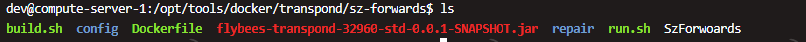

## 查看命令

| 命令 | 解释 |

| --- | :---: |

| docker ps | 查看正在运行的容器 |

| docker ps -a | 查看所有已经创建的容器 |

| docker images | 列出镜像列表 |

| docker container ls | 效果同ps命令(加-a效果同) |

### docker ps 详细参数

```plain
-a :显示所有的容器，包括未运行的。

-f :根据条件过滤显示的内容。

--format :指定返回值的模板文件。

-l :显示最近创建的容器。

-n :列出最近创建的n个容器。

--no-trunc :不截断输出。

-q :静默模式，只显示容器编号。

-s :显示总的文件大小。

```
### docker images 详细参数

```plain
-a :列出本地所有的镜像（含中间映像层，默认情况下，过滤掉中间映像层）；

--digests :显示镜像的摘要信息；

-f :显示满足条件的镜像；

--format :指定返回值的模板文件；

--no-trunc :显示完整的镜像信息；

-q :只显示镜像ID。

```
### docker rm 详细参数

```plain
-f :强制删除一个运行中的容器

-l :移除容器间的网络连接，而非容器本身

-v :-v 删除与容器关联的卷

```
### docker rmi 详细参数

```plain
-f :强制删除；

--no-prune :不移除该镜像的过程镜像，默认移除；

```
### docker logs 详细参数

```plain
-f : 跟踪日志输出

--since :显示某个开始时间的所有日志

-t : 显示时间戳

--tail :仅列出最新N条容器日志

```
eg：查看容器mynginx从2016年7月1日后的最新10条日志。

docker logs --since="2016-07-01" --tail=10 mynginx

## 宿-主操作

| 命令 | 解释 |

| --- | :---: |

| docker cp | 容器与主机之间的数据拷贝 |

### docker cp 实例

```plain
docker cp  nginx:/www /tmp/    #将nginx容器的/www 拷贝到本地/tmp下

```
## 生命周期

| 命令 | 解释 |

| --- | :---: |

| docker start | 启动容器 |

| docker stop | 停止容器 |

| docker restart | 重启容器 |

| docker exec | 在运行的容器中执行命令 |

| docker run | 创建一个新的容器并运行一个命令 |

### docker exec 详细参数

```plain
-d :分离模式: 在后台运行

-i :即使没有附加也保持STDIN 打开

-t :分配一个伪终端

#实例
docker exec -it nginx /bin/bash

```
### docker run 详细参数

```plain
-i, --interactive=false   打开STDIN，用于控制台交互
-t, --tty=false            分配tty设备，该可以支持终端登录，默认为false
-d, --detach=false         指定容器运行于前台还是后台，默认为false
-u, --user=""              指定容器的用户
-a, --attach=[]            登录容器（必须是以docker run -d启动的容器）
-w, --workdir=""           指定容器的工作目录
-c, --cpu-shares=0        设置容器CPU权重，在CPU共享场景使用
-e, --env=[]               指定环境变量，容器中可以使用该环境变量
-m, --memory=""            指定容器的内存上限
-P, --publish-all=false    指定容器暴露的端口
-p, --publish=[]           指定容器暴露的端口
-h, --hostname=""          指定容器的主机名
-v, --volume=[]            给容器挂载存储卷，挂载到容器的某个目录    顺序：主机：容器
--volumes-from=[]          给容器挂载其他容器上的卷，挂载到容器的某个目录
--cap-add=[]               添加权限，权限清单详见：http://linux.die.net/man/7/capabilities
--cap-drop=[]              删除权限，权限清单详见：http://linux.die.net/man/7/capabilities
--cidfile=""               运行容器后，在指定文件中写入容器PID值，一种典型的监控系统用法
--cpuset=""                设置容器可以使用哪些CPU，此参数可以用来容器独占CPU
--device=[]                添加主机设备给容器，相当于设备直通
--dns=[]                   指定容器的dns服务器
--dns-search=[]            指定容器的dns搜索域名，写入到容器的/etc/resolv.conf文件
--entrypoint=""            覆盖image的入口点
--env-file=[]              指定环境变量文件，文件格式为每行一个环境变量
--expose=[]                指定容器暴露的端口，即修改镜像的暴露端口
--link=[]                  指定容器间的关联，使用其他容器的IP、env等信息
--lxc-conf=[]              指定容器的配置文件，只有在指定--exec-driver=lxc时使用
--name=""                  指定容器名字，后续可以通过名字进行容器管理，links特性需要使用名字
--net="bridge"             容器网络设置:
                            bridge 使用docker daemon指定的网桥
                            host    //容器使用主机的网络
                            container:NAME_or_ID  >//使用其他容器的网路，共享IP和PORT等网络资源
                            none 容器使用自己的网络（类似--net=bridge），但是不进行配置
--privileged=false         指定容器是否为特权容器，特权容器拥有所有的capabilities
--restart="no"             指定容器停止后的重启策略:
                            no：容器退出时不重启
                            on-failure：容器故障退出（返回值非零）时重启
                            always：容器退出时总是重启
--rm=false                 指定容器停止后自动删除容器(不支持以docker run -d启动的容器)
--sig-proxy=true           设置由代理接受并处理信号，但是SIGCHLD、SIGSTOP和SIGKILL不能被代理

```
## 镜像仓库

| 命令 | 解释 |

| --- | :---: |

| docker pull | 拉取镜像 |

| docker search | 从Docker Hub查找镜像 |

## docker环境信息

| 命令 | 解释 |

| --- | :---: |

| docker info | 查看docker系统信息 |

| docker version | 显示 Docker 版本信息 |

## docker + shell  部署

### **查询容器ip**

```shell
docker ps -q | xargs -n 1 docker inspect --format '{{range .NetworkSettings.Networks}}{{.IPAddress}}{{end}} {{ .Name }}' | sed 's/ \// /'

```


build.sh 文件命令

```shell
name=flybees-transpond-sz-forwards-prod
echo $name
docker stop $name
docker rm $name
docker rmi flybees/$name:0.0.1
#docker build -t $name .
docker build -t flybees/$name:0.0.1 . -f ./Dockerfile
./run.sh
docker ps
docker logs -f $name --tail 100

```
DockerFile 容器卷

```dockerfile
FROM openjdk:8-jdk-alpine
#ADD config /config
RUN echo "Asia/Shanghai" > /etc/timezone
VOLUME /tmp
COPY *.jar /flybees_transpond_sz-forwards.jar
ENTRYPOINT ["java","-Djava.security.egd=file:/dev/./urandom","-jar","/flybees_transpond_sz-forwards.jar","--spring.profiles.active=sz-forwards-prod"]

```
run.sh 文件命令

```shell
name=flybees-transpond-sz-forwards-prod
echo $name

docker run --log-opt max-size=100m --log-opt max-file=3 \
        -it --net flybees -d \
        -v /etc/localtime:/etc/localtime \
    -p 10004:10004 \
        -v /opt/tools/docker/transpond/sz-forwards/config:/config \
        -v /var/transpond/logs/sz-forwards:/tmp \
        -v /var/transpond/logs/sz-forwards/logs:/var/logs \
    -v /opt/tools/docker/transpond/sz-forwards/repair:/temporary \
        --restart=always --name $name flybees/$name:0.0.1

```
