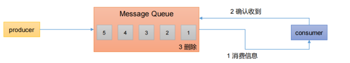
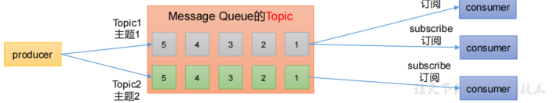
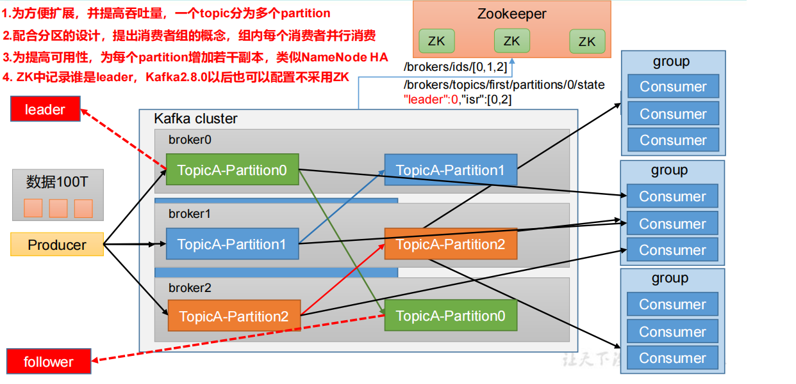

## 一，定义

- Kafka传统定义：Kafka是一个分布式的基于发布/订阅模式的消息队列（MessageQueue），主要应用于大数据实时处理领域。
发布/订阅：消息的发布者不会将消息直接发送给特定的订阅者，而是将发布的消息分为不同的类别，订阅者只接收感兴趣的消息

- Kafka最新定义 ： Kafka是 一个开源的分布式事件流平台（Event StreamingPlatform），被数千家公司用于高性能数据管道、流分析、数据集成和关键任务应用。

## 二， 消息队列的两种模式

### 点对点模式
消费者主动拉取数据，消息收到后清除消息

### 发布/订阅模式

可以有多个消费主题(浏览、点赞、收藏、评论等)消费者消费数据之后，不删除数据每个消费者相互独立，都可以消费到数据

## 三，kafka基础架构

Producer：消息生产者，就是向 Kafka broker 发消息的客户端。
Consumer：消息消费者，向 Kafka broker 取消息的客户端。
Consumer Group（CG）：消费者组，由多个 consumer 组成。消费者组内每个消费者负责消费不同分区的数据，一个分区只能由一个组内消费者消费；消费者组之间互不影响。所有的消费者都属于某个消费者组，即消费者组是逻辑上的一个订阅者。
Broker：一台 Kafka 服务器就是一个 broker。一个集群由多个 broker 组成。一个broker 可以容纳多个 topic。
Topic：可以理解为一个队列，生产者和消费者面向的都是一个 topic。
Partition：为了实现扩展性，一个非常大的 topic 可以分布到多个 broker（即服务器）上，一个 topic 可以分为多个 partition，每个 partition 是一个有序的队列。
Replica：副本。一个 topic 的每个分区都有若干个副本，一个 Leader 和若干个Follower。
Leader：每个分区多个副本的“主”，生产者发送数据的对象，以及消费者消费数据的对象都是 Leader。
Follower：每个分区多个副本中的“从”，实时从 Leader 中同步数据，保持和Leader 数据的同步。Leader 发生故障时，某个 Follower 会成为新的 Leader。

## 四，为什么kafka性能非常高？

**使用到零拷贝技术属于linux操作系统内核自带**

而使用零拷贝技术时，数据可以直接从源缓冲区传输到目标缓冲区，而无需进行中间的数据复制。在这种情况下，操作系统或网络协议栈能够直接访问源缓冲区和目标缓冲区，将数据从源复制到目标，而无需额外的数据复制操作。

2. 顺序读写

Kafka使用了高性能的消息存储机制。它将消息持久化到磁盘上的顺序文件中，而不是每条消息都进行随机写入。这种顺序写入的方式可以提供更高的磁盘写入吞吐量，减少磁盘寻址时间，从而提高性能。

3. 分区模型架构

Kafka采用分布式架构设计，可以在多个服务器上分布数据和负载。这使得Kafka能够水平扩展，通过增加更多的节点来提高吞吐量和容量。

4. 生产者投递消息批量投递模型

Kafka支持批量处理消息，允许生产者将多条消息一次性发送给Kafka代理。这种批量处理方式可以减少网络开销和请求次数，提高吞吐量。

5. 消息压缩
