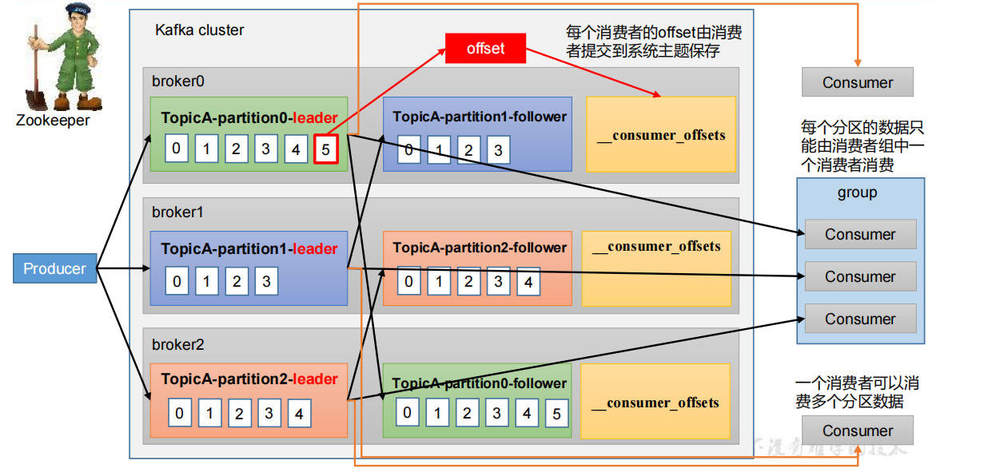
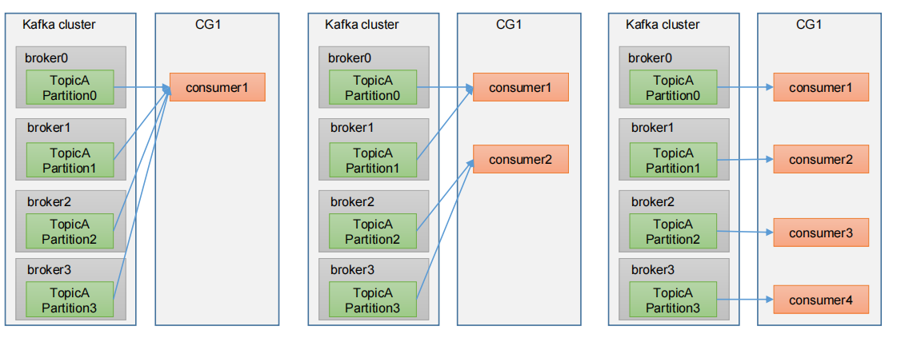
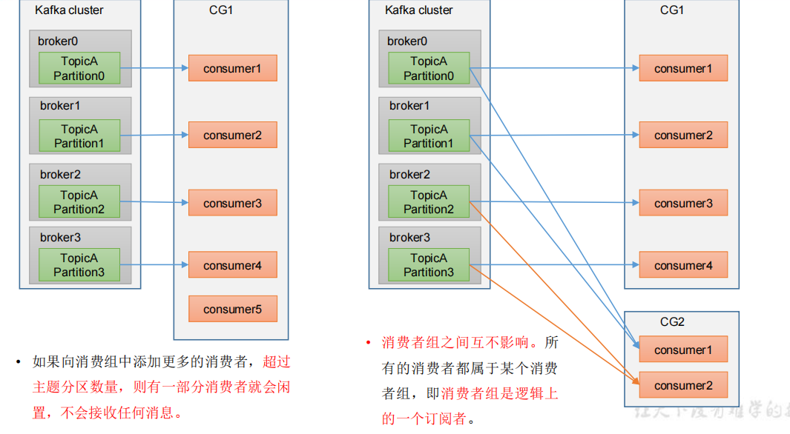
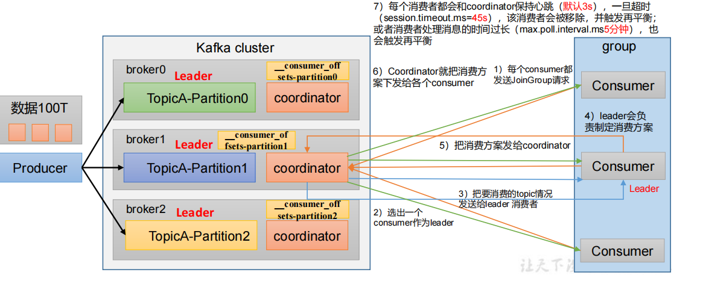
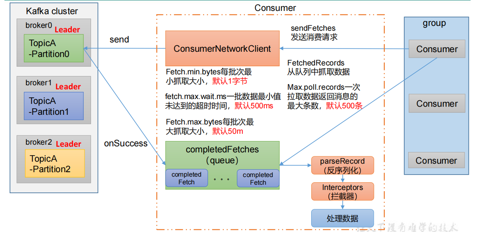

## 一，总体流程

生产者向每一个分区的Leader发送数据，follower主动跟Leader同步数据，消费者消费topic中的数据，offset用于记录消费的位置，每个消费者的offset由消费者提交到系统主题进行保存。

### 1. 消费原理

Consumer Group（CG）：消费者组，由多个consumer组成。形成一个消费者组的条件，是所有消费者的groupid相同。

- 消费者组内每个消费者负责消费不同分区的数据，一个分区只能由一个组内消费者消费，同一个分区的数据不能由消费者组中两个及两个以上的消费者进行消费。

- 消费者组之间互不影响。所有的消费者都属于某个消费者组，即消费者组是逻辑上的一个订阅者。

### 2.消费者组初始化流程

- coordinator：辅助实现消费者组的初始化和分区的分配。

coordinator节点选择 = groupid的hashcode值 % 50（ __consumer_offsets的分区数量）

例如： groupid的hashcode值 = 1，1% 50 = 1，那么__consumer_offsets 主题的1号分区，在哪个broker上，就选择这个节点的coordinator

1. 所有的消费者下向coordinate发送joinGroup请求，由于同一个消费者组中的组id相同所以会发给同一个coordinate

2. coordinate从消费者组中随机选择一个consumer作为Leader

3. coordinate吧要消费的topic情况发送给leader消费者

4. leader负责指定消费方案

5. leader将消费方案发送给coordinate

6. coordinate将消费方案发送给各个consumer

7. 每个消费者都会和coordinator保持心跳（默认3s），一旦超时（session.timeout.ms=45s），该消费者会被移除，并触发再平衡；或者消费者处理消息的时间过长（max.poll.interval.ms5分钟），也会触发再平衡

### 3.消费者组详细消费流程

1. 创建一个消费者网络连接客户端(ConsumerNetworkClient),主要用于与kafka集群进行交互

2. consumer向ConsumerNetworkClient发送sendFetches方法，用于抓取数据初始化

3. ConsumerNetworkClient发送send方法发送请求，通过onSuccess方法回调，获取对应的结果

4. 达到拉取数据的最大条数后通过反序列化器、拦截器、处理器将数据发生给消费者组

### 4.生产经验——分区的分配以及再平衡

一个consumer group中有多个consumer组成，一个 topic有多个partition组成，现在的问题是，到底由哪个consumer来消费哪个partition的数据。

Kafka有四种主流的分区分配策略： Range、RoundRobin、Sticky、CooperativeSticky。可以通过配置参数partition.assignment.strategy，修改分区的分配策略。默认策略是Range + CooperativeSticky。Kafka可以同时使用多个分区分配策略。

| 参数名称 | 描述 |

| --- | --- |

| heartbeat.interval.ms | Kafka 消费者和 coordinator 之间的心跳时间，默认为 3 秒。该值必须小于 session.timeout.ms，并且不应高于 session.timeout.ms 的 1/3。 |

| session.timeout.ms | Kafka 消费者和 coordinator 之间的连接超时时间，默认为 45 秒。超过该值，该消费者将被移除，消费者组将执行再平衡操作。 |

| max.poll.interval.ms | 消费者处理消息的最大时长，默认为 5 分钟。超过该值，该消费者将被移除，消费者组将执行再平衡操作。 |

| partition.assignment.strategy | 消费者分区分配策略，默认策略为 Range + CooperativeSticky。Kafka 可以同时使用多个分区分配策略。可选的策略包括：Range、RoundRobin、Sticky、CooperativeSticky。 |
- Range：通过 partitions数/consumer数 来决定每个消费者应该消费几个分区。如果除不尽，那么前面几个消费者将会多消费 1 个分区。

- RoundRobin: RoundRobin 轮询分区策略，是把所有的 partition 和所有consumer 都列出来，然后按照 hashcode 进行排序，最后通过轮询算法来分配 partition 给到各个消费者。

- Sticky: 可以理解为分配的结果带有“粘性的”。即在执行一次新的分配之前，考虑上一次分配的结果，尽量少的调整分配的变动，可以节省大量的开销。粘性分区是 Kafka 从 0.11.x 版本开始引入这种分配策略，首先会尽量均衡的放置分区到消费者上面，在出现同一消费者组内消费者出现问题的时候，会尽量保持原有分配的分区不变化。
