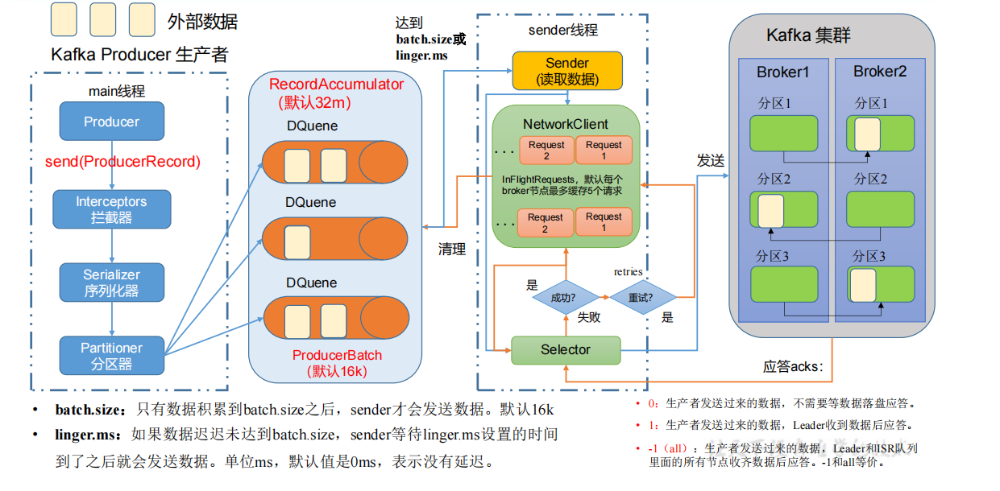
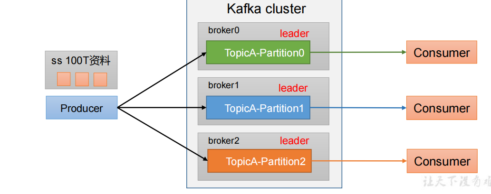
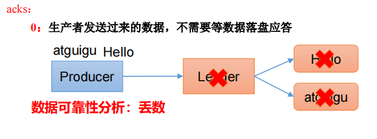
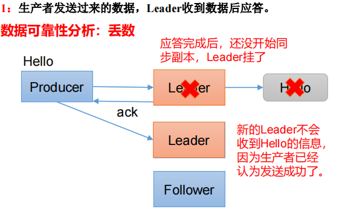
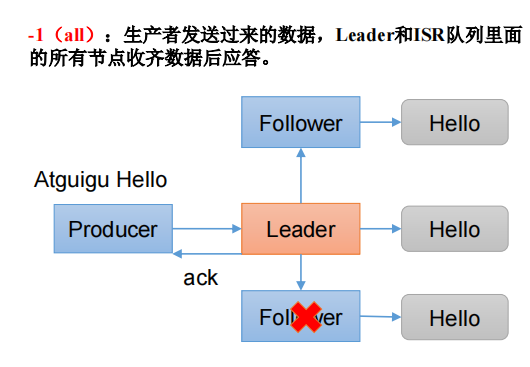
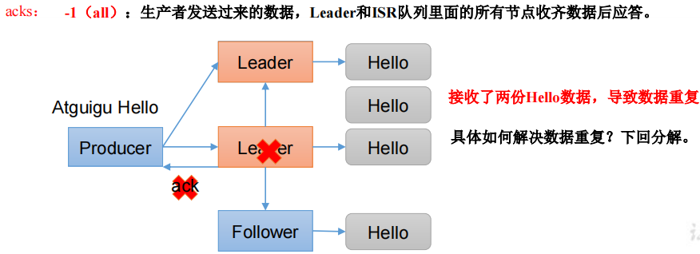
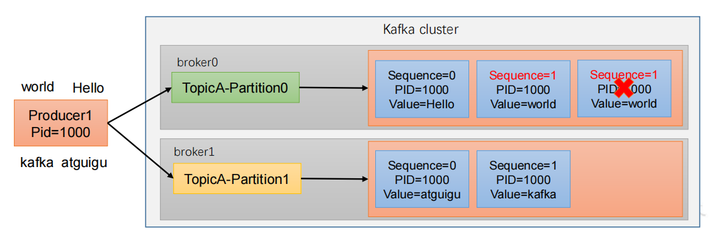
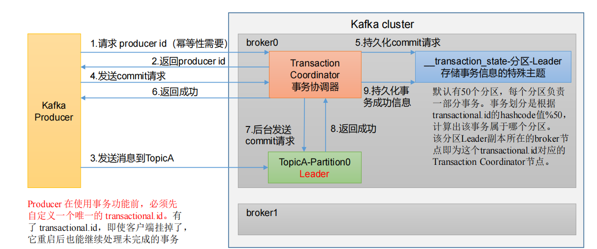
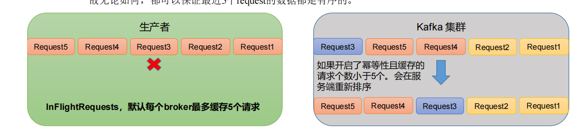

## 一，生产者发送流程


## 二，发送原理

在消息发送的过程中，涉及到了两个线程——main 线程和 Sender 线程。在 main 线程中创建了一个双端队列 RecordAccumulator。main 线程将消息发送给 RecordAccumulator，Sender 线程不断从 RecordAccumulator 中拉取消息发送到 Kafka Broker。生产过程由两个线程协调运行，分别为主线程和sender线程（发送线程）。

主线程中，由KafkaProducer创建消息，然后通过可能的拦截器、序列化器和分区器的作用，缓存消息到消息加载器（RecordAccumulator，也称为消息收集器）中的缓存队列，这个队列默认32M。当满足以下两个条件的任意一个

条件一：消息累计达到batch.size，默认是16kb。

条件二：等待时间达到linger.ms，默认是0毫秒。

所以在默认情况下，由于等待时间是0毫秒，所以只要消息来一条就会发送一条。Sender线程负责从消息加载器（RecordAccumulator）中获取消息并将其发送到Kafka中。

三，异步发送

1. 普通的异步发送

**需求：创建 Kafka 生产者，采用异步的方式发送到 Kafka Broker，没有回调**

```java
public static void main(String[] args) {
    // 0配置
    Properties properties = new Properties();
    properties.put(ProducerConfig.BOOTSTRAP_SERVERS_CONFIG, "192.168.44.211:9092");
    //序列化
    properties.put(ProducerConfig.KEY_SERIALIZER_CLASS_CONFIG, StringSerializer.class.getName());
    properties.put(ProducerConfig.VALUE_SERIALIZER_CLASS_CONFIG, StringSerializer.class.getName());
    //1.创建kafka的生产者
    KafkaProducer<String, String> kafkaProducer = new KafkaProducer<>(properties);
    //2.发送数据
    for (int i = 0; i < 5; i++) {
        kafkaProducer.send(new ProducerRecord<>("first", "kafka" + i));
        System.out.println(i);
    }
    //3.关闭资源
    kafkaProducer.close();
}

```

2. 待回调的异步发送

**回调函数会在 producer 收到 ack 时调用，为异步调用，该方法有两个参数，分别是元数据信息（RecordMetadata）和异常信息（Exception），如果 Exception 为 null，说明消息发送成功，如果 Exception 不为 null，说明消息发送失败。**

```java
    public static void main(String[] args) {
        // 0配置
        Properties properties = new Properties();
        properties.put(ProducerConfig.BOOTSTRAP_SERVERS_CONFIG, "192.168.44.211:9092");
        properties.put(ProducerConfig.KEY_SERIALIZER_CLASS_CONFIG, StringSerializer.class.getName());
        properties.put(ProducerConfig.VALUE_SERIALIZER_CLASS_CONFIG, StringSerializer.class.getName());
        //1.创建kafka的生产者
        KafkaProducer<String, String> kafkaProducer = new KafkaProducer<>(properties);
        //2.发送数据
        for (int i = 0; i < 5; i++) {
            kafkaProducer.send(new ProducerRecord<>("first", "kafka" + i), new Callback() {
                @Override
                public void onCompletion(RecordMetadata recordMetadata, Exception e) {
                    if(e == null){
                        System.out.println("主题:"+recordMetadata.topic()+"分区:"+recordMetadata.partition());
                    }else {
                        e.printStackTrace();
                    }
                }
            });
            System.out.println(i);
        }
        //3.关闭资源
        kafkaProducer.close();
    }

```
## 三，生产者分区

1. 便于合理使用存储资源，每个Partition在一个Broker上存储，可以把海量的数据按照分区切割成一块一块数据存储在多台Broker上。合理控制分区的任务，可以实现负载均衡的效果。

2. 提高并行度，生产者可以以分区为单位发送数据；消费者可以以分区为单位进行消费数据。



### 1，分区策略

- 指明partition的情况下，直接将指明的值作为partition值；例如partition=0，所有数据写入分区0
- 没有指明partition值但有key的情况下，将key的hash值与topic的partition数进行取余得到partition值；

例如：key1的hash值=5， key2的hash值=6 ，topic的partition数=2，那么key1 对应的value1写入1号分区，key2对应的value2写入0号分区。

- 既没有partition值又没有key值的情况下，Kafka采用Sticky Partition（黏性分区器），会随机选择一个分区，并尽可能一直使用该分区，待该分区的batch已满或者已完成，Kafka再随机一个分区进行使用（和上一次的分区不同）。

例如：第一次随机选择0号分区，等0号分区当前批次满了（默认16k）或者linger.ms设置的时间到， Kafka再随机一个分区进行使用（如果还是0会继续随机）。

同一个业务数据放在同一个分区，可以指定相同的分区或者不指定分区key相同

### 2，自定义分区器

1. 需求
例如我们实现一个分区器实现，发送过来的数据中如果包含 kafka，就发往 0 号分区，不包含 kafka，就发往 1 号分区。

2. 实现步骤
（1)定义类实现 Partitioner 接口。
（2）重写 partition()方法。

```java
public class MyPartitioner implements Partitioner {

    /**
     * 返回信息对应的分区
     * @param topic 主题
     * @param key 消息的 key
     * @param keyBytes 消息的 key 序列化后的字节数组
     * @param value 消息的 value
     * @param valueBytes 消息的 value 序列化后的字节数组
     * @param cluster 集群元数据可以查看分区信息
     * @return
     */
    @Override
    public int partition(String topic, Object key, byte[] keyBytes, Object value, byte[] valueBytes, Cluster cluster) {
        //获取数据

        String s = value.toString();
        int partition;
        if(s.contains("kafka")){
            partition = 1;
        }else {
            partition = 0;
        }
        return partition;
    }

    //关闭资源
    @Override
    public void close() {

    }
    //配置方法
    @Override
    public void configure(Map<String, ?> configs) {

    }
}

```
## 四，Kafka如何保证消息顺序消费一致性问题

- 消息顺序一致性产生的背景：

在kafka中我们会对mq实现分区、多个消费者集群消费消息，生产者投递的消息会给多个不同的消费者分摊消费消息，无法保证每个消息执行的先后顺序问题。

- 解决消息顺序一致性问题核心思想：就是**生产者投递消息，一定要存放在同一个分区中，最终被同一个消费者消费消息。**
- 既能够保证消息顺序一致性的问题，有能够提高效率，在kafka中就存在分区的架构模型实现一个消费者对应一个分区消费消息。

- 怎么样可以保证消息顺序消费并且效率还能提高呢
    1. 增加多个不同的Partition分区 实现一个消费者对应一个Partition分区
    2. 绝大多数的项目使用到mq时候，是不需要保证消息顺序一致性问题。

## 五，数据可靠性

1. ack原理







如果现在有个Fllower节点一一直无法同步，导致确认消息一直不返回，怎么办？

1. **ISR(****in-sync replica set****)	：**

Leader维护了一个动态的in-sync replica set（ISR），意为和Leader保持同步的Follower+Leader集合(leader：0，isr:0,1,2)。

如果Follower长时间未向Leader发送通信请求或同步数据， 则该Follower将被踢出ISR。该时间阈值由replica.lag.time.max.ms数设定，默认30s。例如2超时，(leader:0,isr:0,1)。

这样就不用等长期联系不上或者已经故障的节点。

2. **数据可靠性分析**

如果分区副本设置为1个，或者ISR里应答的最小副本数量（ min.insync.replicas 默认为1）设置为-1，和ack=1的效果是一样的，仍然有丢数的风险（leader：0，isr:0）。

数据完全可靠条件 = ACK级别设置为-1 + 分区副本大于等于2 + ISR里应答的最小副本数量大于等于2

数

3. **可靠性总结：**

acks=0，生产者发送过来数据就不管了，可靠性差，效率高；

acks=1，生产者发送过来数据Leader应答，可靠性中等，效率中等；

acks=-1，生产者发送过来数据Leader和ISR队列里面所有Follwer应答，可靠性高，效率低；

在生产环境中，acks=0很少使用；acks=1，一般用于传输普通日志，允许丢个别数据；acks=-1，一般用于传输和钱相关的数据，对可靠性要求比较高的场景。



4. 数据重复的原因

Kafka生产者生产消息到partition，如果直接发送消息，kafka会将消息保存到分区中，但Kafka会返回一个ack给生产者，表示当前操作是否成功，是否已经保存了这条消息。如果ack响应的过程失败了，此时生产者会重试，继续发送没有发送成功的消息，Kafka又会保存一条一模一样的消息

- 至少一次（At Least Once）= ACK级别设置为-1 + 分区副本大于等于2 + ISR里应答的最小副本数量大于等于2
- 最多一次（At Most Once）= ACK级别设置为

At Least Once可以保证数据不丢失，但是不能保证数据不重复；

At Most Once可以保证数据不重复，但是不能保证数据不丢失。

- 精确一次（Exactly Once）：对于一些非常重要的信息，比如和钱相关的数据，要求数据既不能重复也不丢失。

## 六，幂等性

- 幂等性就是指Producer不论向Broker发送多少次重复数据，Broker端都只会持久化一条，保证了不重复。

- 精确一次（Exactly Once） = 幂等性 + 至少一次（ ack=-1 + 分区副本数>=2 + ISR最小副本数量>=2） 。

- 重复数据的判断标准：具有<PID, Partition, SeqNumber>相同主键的消息提交时，Broker只会持久化一条。其中PID是Kafka每次重启都会分配一个新的；Partition 表示分区号；Sequence Number是单调自增的。

- 所以幂等性只能保证的是在单分区单会话内不重复。



## 七，生产者事务



```java
    public static void main(String[] args) {
        // 0配置
        Properties properties = new Properties();
        properties.put(ProducerConfig.BOOTSTRAP_SERVERS_CONFIG, "192.168.44.211:9092");
        properties.put(ProducerConfig.KEY_SERIALIZER_CLASS_CONFIG, StringSerializer.class.getName());
        properties.put(ProducerConfig.VALUE_SERIALIZER_CLASS_CONFIG, StringSerializer.class.getName());

        //指定事务id
        properties.put(ProducerConfig.TRANSACTIONAL_ID_CONFIG,"tranactional_id_01");
        //1.创建kafka的生产者
        KafkaProducer<String, String> kafkaProducer = new KafkaProducer<>(properties);
        //初始化事务
        kafkaProducer.initTransactions();
        //开始事务
        kafkaProducer.beginTransaction();
        try {
            //2.发送数据
            for (int i = 0; i < 5; i++) {
                kafkaProducer.send(new ProducerRecord<>("first", "kafka" + i));
                System.out.println(i);
            }
            
            //提交事务
            kafkaProducer.commitTransaction();
        }catch (Exception e){
            //放弃十四五 类似与回滚
            kafkaProducer.abortTransaction();
        }finally {
            //3.关闭资源
            kafkaProducer.close();
        }
    }

```
## 八，数据乱序

1. kafka在1.x版本之前保证数据单分区有序，条件如下：

max.in.flight.requests.per.connection=1（不需要考虑是否开启幂等性）。

2. kafka在1.x及以后版本保证数据单分区有序，条件如下：

- 未开启幂等性

max.in.flight.requests.per.connection需要设置为1。

- 开启幂等性

max.in.flight.requests.per.connection需要设置小于等于5

原因说明：因为在kafka1.x以后，启用幂等后，kafka服务端会缓存producer发来的最近5个request的元数据，

故无论如何，都可以保证最近5个request的数据都是有序的。


