## 一. 概述
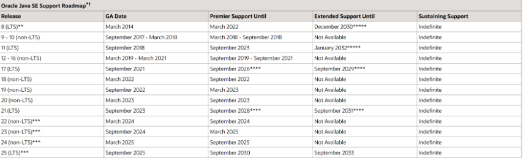

从上图可以很清晰得可以看出，JDK7,JDK8,JDK11,JDK17,JDK21是长期维护的版本。从目前来看，JDK8到2023年已经有将近10年的历史了，大多数依据JDK8的相关技术内容已经很成熟了，但是大家也看到，JDK在不断地迭代，JDK有很多的新特性，而且能够对开发及系统性能有很大帮助。所以现在很多公司在建新系统的时候，在考虑新的JDK。再加上重要的一点是新的spring boot3及对应的spring cloud 2022.X及以上版本，最低支持的JDK也需要JDK17了。所以要想跟上技术迭代，还需我们自己对于JDK进行了解，然后根据自己的实际选择相应的版本。

## 二. JAVA8新特性

### (一).Lambda表达式
其他语言都已陆续推出Lambda 表达式，java也不落后。Lambda 表达式简单来讲是一个匿名函数，Java 8 允许将函数作为参数传递到方法之中。

它是 Java 8 发布的最为重要的新特性之一，跟上了目前语言发展的趋势，是继泛型（Generics）和注解（Annotation）以来最大的突破。

采用 Lambda 表达式可以大幅简化代码的编写，开发人员在熟练之后，可以很简单的书写相关的功能，并且提升了相应的效率，这就是函数式编程。

### (二).Stream流

Stream流计算是一个跟当前很贴合的，随着计算能力提升及数据量的增加，这个是有必要的。有鉴于此，Java 新增了 java.util.stream 包，它和以前的流十分类似。以前我们最常接触到的是资源流，例如 java.io.FileInputStream，它通过流的方式把文件从一个地方输入到另一个地方，与文件内容无关，只是一种内容搬运工作，不涉及任何 CRUD 操作。

java8的两种流类型：

1. stream 串行流

2. parallelStream 并行流

Stream 的源数据来于 Collection、Arrays 等类型，因为它的方法参数都是函数式接口类型，所以通常和 Lambda 表达式一起使用。

Stream 不存储数据，也不改变源数据，但它提供了对集合数据进行检索和逻辑处理的功能，包括筛选、排序、统计、计数等。可以形象地将其比作 SQL 语句。

### (三).Optional

主要用来处理传入的数据的空指针NullPointerException问题。

假设有一个 Person 类，里面有个属性 Hobby，需求要获取Hobby的 scope。

```java
class Person {
 
   private Hobby hobby;
 
}
 
class Hobby {
 
   private String scope;
 
}

```
我们以前这样写：

```java
Person  person = buildPerson();
 
if (person != null) {
 
   Hobby hobby = person.getHobby();
 
   if (hobby != null) {
 
      String scope = hobby.getScope();
 
      System.out.println(scope);
 
   }
}

```
用了Optional ：

```java
Optional.ofNullable(person)
.map(p -> p.getHobby())
.map(h -> h.getScope())
.ifPresent(scope ->System.out.println(scope));

```
### (四).Interface

Interface 的初始设计目的是面向抽象，提高可扩展性。但这也带来了一个不足之处，即当 Interface 进行修改时，实现它的类也必须相应地进行修改。

为了解决 Interface 修改与现有实现不兼容的问题，现在可以使用 default 或 static 关键词修饰 interface 的方法，这样就可以给方法提供一个默认实现，而实现类无需重写此方法。

一个 Interface 中可以有多个方法被这两种关键词所修饰。二者的区别在于，default 方法是普通实例方法，可以使用 this 关键词调用，可以被子类继承和重写；而 static 方法与一般类的静态方法类似，无法被子类继承，只能通过 Interface 调用。

如果有一个类既实现了 2个接口，都有相同名称的方法，并且两个接口没有继承关系的话，这时就必须重写同名方法()。不然的话，编译的时候就会报错。

```java
public interface InterfacePerson {
    static void staticInterfacePerson() {
        System.out.println("InterfacePerson 的 静态 staticInterfacePerson");
    }
 
    static void staticInterfacePerson2() {
        System.out.println("InterfacePerson 的 静态 staticInterfacePerson2");
 
    }
 
    default void defaultInterfacePerson() {
        System.out.println("InterfacePerson 的 默认 defaultInterfacePerson");
 
    }
 
    default void defaultInterfacePerson2() {
        System.out.println("InterfacePerson 的 默认 defaultInterfacePerson2");
    }
}

```
```java
public interface InterfacePerson2 {
    static void staticInterfacePerson() {
        System.out.println("InterfacePerson2 的 静态 staticInterfacePerson");
    }
 
 
    default void defaultInterfacePerson() {
        System.out.println("InterfacePerson2 的 默认 defaultInterfacePerson");
    }
 
}

```
```java
public class Person implements InterfacePerson, InterfacePerson2 {
 
 
}

```
java9增加了私有方法

以下是JDK17的时候接口的写法，接口是越来越强大的，以下编译报错的都是不支持的。

### (五).函数式接口

**定义**：有且只有一个抽象方法，但可以有多个非抽象方法的接口。

在 java 8 中专门有一个包放函数式接口java.util.function，该包下的所有接口都有 @FunctionalInterface 注解，提供函数式编程。

### (六).Data-Time API

这是对java.util.Date强有力的补充，解决了 Date 类的大部分痛点：

1. **非线程安全**

2. **时区处理麻烦**

3. **各种格式化、和时间计算繁琐**

4. **设计有缺陷，Date 类同时包含日期和时间；还有一个 java.sql.Date，容易混淆。**

## 三. JAVA9新特性

**前言**

JDK9提供了超过150项新功能特性，包括倍受期待的模块化系统，可交互的REPL工具：jshell，JDK编译工具，Java公共API和私有代码，以及安全增强、扩展提升、性能管理改善等。可以说Java9是一个庞大的系统工程，完全做了一个整体的改变。

具体来讲：

- JDK和JRE的改变

- 模块化系统

- JShell命令

- 多版本兼容jar包

- 接口的私有方法

- 砖石操作符的使用升级

- try语句

- 下划线使用限制

- String储存结构变更

- 便利的集合特性：of()

- 增强的Stream API

- 多分辨率图像API

- 全新的HTTP客户端API

- Deprecated的相关API

- 智能Java编译工具

- 统一的JVM日志系统

- javadoc的HTML5支持

- javascript引擎升级：Nashorn

- Java的动态编译器

### (一). JDK和JRE的改变

#### 1、JDK8的目录结构
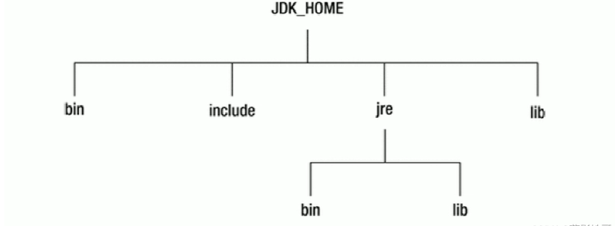

#### 2、JDK9的目录结构

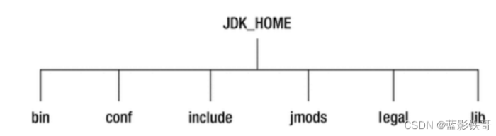
说明：

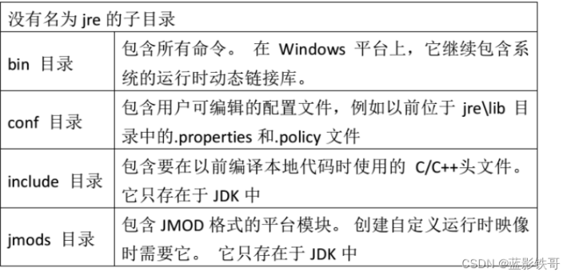
这个新特性只要了解下就可以了，这个目录结构是方便为了接下来新特性做保证。jdk8和jdk9的安装还是会额外安装一次jre。

### (二). 模块化系统

#### 1、产生背景
众所周知，Java 已经发展超过 20 年(95 年最初发布)，Java 和相关生态在不断丰富的同时也越来越暴露出一些问题：

1. Java 运行环境的膨胀和臃肿。每次 JVM 启动的时候，至少会有 30～60MB 的内存加载，主要原因是 JVM 需要加载 rt.jar，不管其中的类是否被classloader 加载，第一步 整个 jar 都会被 JVM 加载到内存当中去(而模块化可以根据模块的需要加载程序运行需要的 Class)

2. 当代码库越来越大，创建复杂，盘根错节的「面条式代码」的几率呈指数级的增长。不同版本的 类库交叉依赖 导致让人头疼的问题，这些都 阻碍了 Java 开发和运行效率的提升

3. 很难真正地对代码进行封装，而系统并没有对不同部分(也就是 JAR 文件)之间的依赖关系有个明确的概念。每一个公共类都可以被类路径之下任何其它的公共类所访问到，这样就会导致无意中使用了并不想被公开访问的 API

4. 类路径本身也存在问题: 你怎么知晓所有需要的 JAR 都已经有了，或者是不是会有重复的项呢

5. 同时，由于 兼容性等各方面的掣肘，对 Java 进行大刀阔斧的革新越来越困难，Jigsaw 从 Java 7 阶段就开始筹备，Java 8 阶段进行了大量工作，终于在 Java 9 里落地，一种千呼万唤始出来的意味。

6. Jigsaw 项目(后期更名为 Modularity)的工作量和难度大大超出了初始规划。JSR 376 Java 平台模块化系统(JPMS，Java Platform Module System)作为 Jigsaw 项目的核心，其主体部分被分解成 6 个 JEP(JDK Enhancement Proposals)。

7. 作为 Java 9 平台 最大的一个特性，随着 Java 平台模块化系统的落地，开发人员无需再为不断膨胀的 Java 平台苦恼，例如，您可以 使用 jlink 工具，根据需要定制运行时环境。这对于拥有大量镜像的容器应用场景或复杂依赖关系的大型应用等，都具有非常重要的意义。

8. 本质上讲，模块(module)的概念，其实就是 package 外再裹一层，也就是说，用模块来管理各个 package，通过声明某个 package 暴露，不声明默认就是隐藏。因此，模块化使得代码组织上 更安全，因为它可以指定哪些部分可以暴露，哪些部分隐藏。

#### 2、设计理念

模块独立、化繁为简。

模块化(以 Java 平台模块系统的形式)将 JDK 分成一组模块，可以在编译时，运行时或者构建时进行组合。

#### 3、实现目标

- 主要目的在于减少内存的开销

- 只须必要模块，而非全部 JDK 模块，可 简化各种类库和大型应用的开发和维护

- 改进 Java SE 平台，使其可以 适应不同大小的计算设备

- 改进其安全性，可维护性，提高性能

### (三). JShell命令

#### 1、产生背景
像 Python 和 Scala 之类的语言早就有交互式编程环境 REPL(read - evaluate - print - loop)了，以交互式的方式对语句和表达式进行求值。开发者只需要输入一些代码，就可以在编译前获得对程序的反馈。而 之前的 Java 版本要想执行代码，必须创建文件、声明类、提供测试方法方可实现。

#### 2、设计理念

即写即得、快速运行

#### 3、实现目标

Java 9 中终于拥有了 REPL 工具：JShell。利用 JShell 在没有创建类的情况下直接声明变量，计算表达式，执行语句。即开发时可以在命令行里直接运行 Java 的代码，而无需创建 Java 文件，无需跟人解释 public static void main(String[] args) 这句话。

● JShell 也可以从 文件中加载语句 或者将语句保存到文件中。

● JShell 也可以是 Tab 键进行自动补全 和 自动添加分号。

#### 4、使用案例

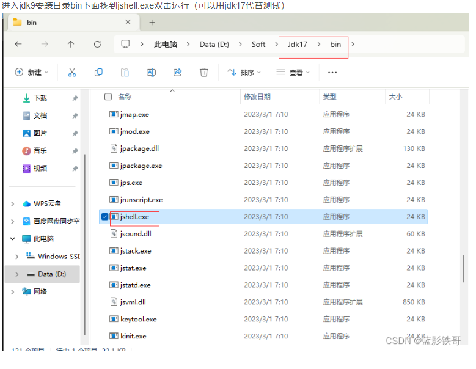

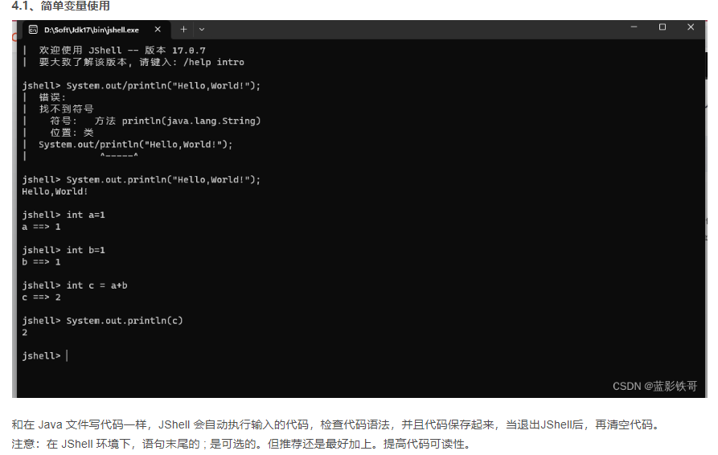

### (四).多版本兼容jar包

当一个新版本的 Java 出现的时候，你的库用户要花费数年时间才会切换到这个新的版本。这就意味着 库得去向后兼容你想要支持的最老的 Java 版本(许多情况下就是 Java 6 或者 Java7) 。这实际上意味着未来的很长一段时间，你都不能在库中运用 Java 9 所提供的新特性。幸运的是，多版本兼容 jar 功能能让你创建仅在特定版本的 Java 环境中运行库程序选择使用的 Class 版本。

#### 1、简单例子

比如一个第三方项目hello.jar，这个项目使用了java8类库中的一个类，假设这个类有打印输出，打印输出java8，在java9时，这个类更新了，打印输出java9。

当我们自己开发环境是jdk8的时候，引入这个第三方hello.jar包，打印输出就是java8。

当我们自己开发环境是jdk9的时候，引入这个第三方hello.jar包，打印输出就是java9。

#### 2、本质原因

jdk9以后支持了多版本兼容jar包，其实就是打包出来的hello.jar包多了一些类文件，比如jdk类库中的类A，默认打包后，只有一个类A.class，但在多版本兼容方式jdk9版本打包后，就会有两个类A.class，一个类A是默认的，对应jdk8版本的，另一个类A是jdk9版本的。以此类推，如果是多版本兼容方式jdk10版本打包后，就会有三个类A，分别是jdk8版本的类A.calss、jdk9版本的类A.calss、jdk10版本的类A.calss，在不同开发环境下运行，功能可能不一样。

### (五). 语法改进-接口的私有方法

Java 8 中规定接口中的方法除了抽象方法之外，还可以定义静态方法和默认的方法。一定程度上，扩展了接口的功能，此时的接口更像是一个抽象类。

在 Java 9 中，接口更加的灵活和强大，连方法的访问权限修饰符都可以声明为 private 的了，此时方法将不会成为你对外暴露的 API 的一部分。

```java
public interface ToolProvider {

    /**
     * JDK7 只能声明全局常量（public static final）和抽象方法（public abstract）
     */
    void method1();

    /**
     * JDk8 静态方法
     */
    static void method2(){
        System.out.println("method2");
    }

    /**
     * JDK8 接口中可以定义默认方法，可以实现接口的默认行为，也可以被具体实现类实现
     */
    default void method3(){
        System.out.println("method3");
    }

    /**
     *JDK9 接口中可以定义私有方法，只能在接口内部使用
     */
    private void method4() {
        System.out.println("method4");
    }

}

```
### (六). 语法改进-钻石操作符Diamond Operator使用升级

#### 1、使用说明
List<String>中的<>这个符号就是砖石操作符，其实就是表示泛型的操作符。

```java
private List<String> flattenStrings1(List<String>... lists) {
        Set<String> set1 = new HashSet<>();// 编译不报错，类型推断
        Set<String> set2 = new HashSet<String>(){};// 编译不报错，这边其实是想写匿名内部类
        Set<String> set3 = new HashSet<>(){};// 编译报错，这边其实是想写匿名内部类，如果在jdk8不单独声明泛型中的类型，就会报错，而在jdk9中新增了这项功能
        for (List<String> list : lists) {
            set1.addAll(list);
        }
        return new ArrayList<>(set1);
    }

    private List<String> flattenStrings2(List<String>... lists) {
        Set<String> set = new HashSet<>(){
            // 创建一个继承于HashSet的匿名子类对象
            // 可以覆写一些HashSet的方法
        };
        for (List<String> list : lists) {
            set.addAll(list);
        }
        return new ArrayList<>(set);
    }

    public static void main(String[] args) {
        // jdk8版本写法
        InputStreamReader reader1 = null;
        try {
            reader1 = new InputStreamReader(System.in);
            reader1.read();// 读取数据
        } catch (IOException e) {
            throw new RuntimeException(e);
        } finally {
            // 资源关闭操作
            if (reader1 != null) {
                try {
                    reader1.close();
                } catch (IOException e) {
                    throw new RuntimeException(e);
                }
            }
        }
        // jdk8升级写法，要求资源对象的实例化必须放在try的一对()内完成，会主动关闭资源。
        try (InputStreamReader reader2 = new InputStreamReader(System.in); OutputStreamWriter writer2 = new OutputStreamWriter(System.out)) {
            reader2.read();// 读取数据
        } catch (IOException e) {
            throw new RuntimeException(e);
        }
        // jdk9中，可以在try()中调用已经实例化的资源对象，会主动关闭资源。
        InputStreamReader reader3 = new InputStreamReader(System.in);// 此时的reader3是个final的，因为try里面关闭的是它，不能再赋值修改了。
        OutputStreamWriter writer3 = new OutputStreamWriter(System.out);
        try (reader3; writer3) {
            reader3.read();// 读取数据
        } catch (IOException e) {
            throw new RuntimeException(e);
        }
    }

```
### (七). String存储结构变更

#### 1、产生背景
String 类的jdk8实现将字符存储在字符数组cahr[]中，每个字符使用两个字节(16 位)。目前从许多不同的应用程序中收集的数据表明字符串是堆使用的主要组成部分，而且最重要的是对象仅包含拉丁字母 。这样的字符只需要一个字节的存储空间，因此只占内部字符数组空间的一半，许多这样的字符串对象将被闲置，空间被浪费。

jdk9建议更改 String 类的内部表示形式从 UTF-16 字符数组到字节数组再加上编码标志领域新的字符串类将存储编码为 ISO-8859-1 / 拉丁语-1(每个字符一个字节)，或作为 UTF-16(两个字节每个字符)，基于字符串的内容。编码标志将指示使用哪种编码。

结论：String 再也不用 char[] 来存储，改成了 byte[] 加上编码标记，节约了一些空间。

jdk8的String部分代码截图：

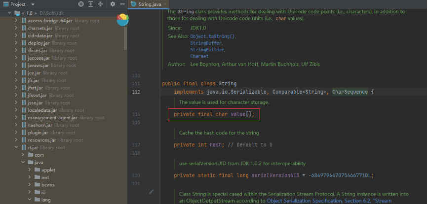

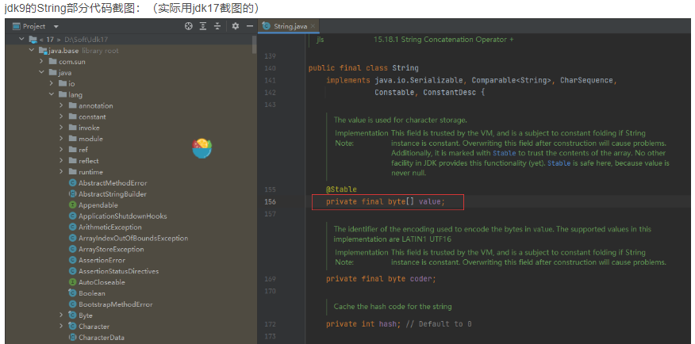

#### 2、拓展StringBuffer和StringBuilder

同样的，StringBuffer和StringBuilder也变化为了byte[]

String：不可变的字符序列，新的字符串会重新开辟内存空间；

StringBuffer：可变的字符序列，线程安全的，效率低；

StringBuilder：可变的字符序列，线程不安全的，效率高；

以上3个类在从cahr[]变为byte[]以后，开发者使用感受不到任何变化。

### (八)、便利的集合特性：of()

#### 1、产生背景
jdk8中要创建一个只读不可改变的集合，必须构造和分配它，然后添加元素，最后包装成一个不可修改的集合。
比如：

```java
public static void main(String[] args) {
    // 创建一个只读特点的集合
    List<String> list = new ArrayList<>();
    list.add("张三");
    list.add("李四");
    // 调用Collections中的方法，将list变为只读的
    List<String> listNew = Collections.unmodifiableList(list);
    listNew.add("王五");// 只读的再去增加就会报异常  java.lang.UnsupportedOperationException
    listNew.forEach(System.out::println);

}

```
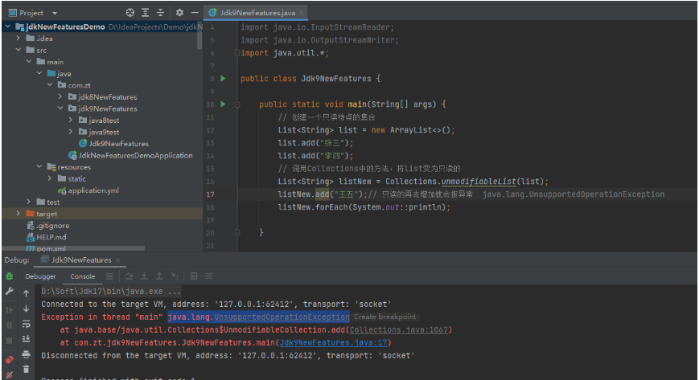

利用Collections中方法优化：

```java
// 创建只读list
List<Integer> list = Collections.unmodifiableList(Arrays.asList(1, 2, 3));
// 创建只读set
Set<Integer> set = Collections.unmodifiableSet(new HashSet<>(Arrays.asList(1, 2, 3)));
// 创建只读Map
Map<String, String> map = Collections.unmodifiableMap(new HashMap<String, String>() {
    {
        put("k1", "v1");
        put("k2", "v2");
    }
});

```
jdk9中引入了新方法，使得类似事情更容易表达。

#### 2、使用案例

jdk9中给各个集合引入了 of() 静态方法，该方法代替 Collections.unmodifiableXXX 创建出 只读、不可改变 的集合。

```java
    // jdk9中，创建一个只读特点的集合
    // 创建只读list
    List<Integer> list = List.of(1, 2, 3);
    // 创建只读set
    Set<Integer> set = Set.of(1, 2, 3);
    // 创建只读Map（方式一）
    Map<String, String> map1 = Map.of("k1", "v1", "k2", "v2");
    // 创建只读Map（方式二）
    Map<String, String> map2 = Map.ofEntries(Map.entry("k1", "v1"), Map.entry("k2", "v2"));

```
### (九)、增强的Stream API

#### 1、产生背景
Java 的 Steam API 是 Java 标准库最好的改进之一，让开发者能够快速运算，从而能够有效的利用数据并行计算。jdk8 提供的 Steam 能够利用多核架构实现声明式的数据处理。

在 jdk9中，Stream API 变得更好，Stream 接口中添加了 4 个新的方法：dropWhile、takeWhile、ofNullable，还有个 iterate 方法的新重载方法，可以让你提供一个 Predicate(判断条件)来指定什么时候结束迭代。

除了对 Stream 本身的扩展，Optional 和 Stream 之间的结合也得到了改进。现在可以通过 Optional 的新方法 stream() 将一个 Optional 对象转换为一个(可能是空的)Stream 对象。

#### 2、使用案例

```java
// jdk9新增 Stream API
// takeWhile()  用于从 Stream 中获取一部分数据，接收一个 Predicate 来进行选择。在有序的 Stream 中，takeWhile 返回从开头开始的尽量多的元素。
List<Integer> list = Arrays.asList(45, 49, 80, 110, 23, 54, 33);
list.stream().takeWhile(x -> x < 50).forEach(System.out::println);// 45  49
// 备注：到80的时候就不满足了，不管后面的元素是否满足，都不会取了，和filter过滤是不一样的。
list.stream().filter(x -> x < 50).forEach(System.out::println);// 45  49  23  33

// dropWhile()  行为与 takeWhile 相反，返回剩余的元素。
list.stream().dropWhile(x -> x < 50).forEach(System.out::println);// 80  110  23  54  33

// ofNullable()  jdk8 中 Stream 不能完全为 null，否则会报空指针异常。而 jdk9 中的 ofNullable 方法允许我们创建一个单元素 Stream，可以包含一个非空元素，也可以创建一个空 Stream。
Stream<Integer> stream1 = Stream.of(1, 2, 3, null);// jdk8中多个元素中可以有一个是null编译不会报错
System.out.println(stream1.count());// 4

//Stream<Integer> stream2 = Stream.of(null);// jdk8中单元素为null编译报错，报空指针异常
//System.out.println(stream2.count());// 上面一句就报错了

Stream<Integer> stream3 = Stream.ofNullable(1);// jdk9中新增的ofNullable方法，只能创建一个单元素的Stream
System.out.println(stream3.count());// 1

Stream<Integer> stream4 = Stream.ofNullable(null);// jdk9中新增的ofNullable方法可以存放为null单元素
System.out.println(stream4.count());// 0

// iterator()重载方法
// jdk8的时候iterator()方法
//Stream.iterate(0, x -> x + 1).forEach(System.out::println);// 从0开始，一直往下执行，所以一般要和limit配合限制一下
Stream.iterate(0, x -> x + 1).limit(2).forEach(System.out::println);// 0  1
// jdk9新增了iterator()重载方法，增加了一个判断条件参数，就不用用limit来限制了
Stream.iterate(0, x -> x < 2, x -> x + 1).forEach(System.out::println);// 0  1

// Optional 类中 新增了stream() 的使用
List<Integer> list2 = Arrays.asList(1, 2, 3);
Optional<List<Integer>> optional = Optional.ofNullable(list2);
Stream<List<Integer>> stream21 = optional.stream();// 注意流的元素是List<Integer> ， 不是Integer，所以元素数量只有一个 [1, 2, 3]
stream21.forEach(System.out::println);// [1, 2, 3]
Stream<Integer> stream22 = optional.stream().flatMap(x -> x.stream());
stream22.forEach(System.out::println);// 1  2  3

```
#### (十). Java的动态编译器

#### 1、产生背景
Oracle 一直在努力提高 Java 启动和运行时性能，希望其能够在更广泛的场景达到或接近本地语言的性能。但是，直到今天，谈到 Java，很多 C/C++ 开发者还是会不屑地评价为 启动慢，吃内存。

简单说，这主要是因为 Java 编译产生的类文件是 Java 虚拟机可以理解的二进制代码，而不是真正的可执行的本地代码，需要 Java 虚拟机 进行解释和编译，这带来了额外的开销。

#### 2、使用说明

JIT(Just-in-time)编译器可以在运行时将热点编译成本地代码，速度很快。但是 Java 项目现在变得很大很复杂，因此 JIT 编译器需要 花费较长时间才能热身完，而且有些 Java 方法还没法编译，性能方面也会下降。AOT 编译就是为了解决这些问题而生的。

在 JDK 9 中，虽然仍处于试验阶段，但这个功能使得 Java 应用在被虚拟机启动之前能够先将 Java 类编译为原生代码。此功能旨在改进小型和大型应用程序的启动时间，同时对峰值性能的影响很小。

但是 Java 技术供应商 Excelsior 的营销总监 Dmitry Leskov 担心 AOT 编译技术不够成熟，希望 Oracle 能够 等到 Java 10 时有个更稳定版本才发布。

另外 JVMCI(JEP 243：Java-Level JVM Compiler Interface)等特性，对于整个编程语言的发展，可能都具有非常重要的意义，虽然未必引起了广泛关注。目前 Graal Core API 已经被集成进入 Java 9，虽然还只是初始一小步，但是完全用 Java 语言来实现的可靠的、高性能的动态编译器，似乎不再是遥不可及，这是 Java 虚拟机开发工程师的福音。

与此同时，随着 Truffle 框架和 Substrate VM 的发展，已经让个别信心满满的工程师高呼 One VM to Rule Them All!， 也许就在不远的将来 Ploygot 以一种另类的方式成为现实。

### （十一）.G1 成为默认垃圾回收器

在 Java 8 中，默认使用的垃圾回收器为 Parallel Scavenge（新生代）+Parallel Old（老年代）。但到了 Java 9，CMS 垃圾回收器被弃用，取而代之的是 G1（Garbage-First Garbage Collector），成为新的默认垃圾回收器。

实际上，G1 垃圾回收器在 Java 7 中就已经被引入，而经过两个版本的表现表现优异后，它于 Java 9 成为了默认的垃圾回收器。

## 四. JAVA10新特性

### (一).局部类型判断
JEP 286 提案让 Java 增加了局部类型推断（Local-Variable Type Inference）功能，这让 Java 可以像 Js 里的 var 或者其他语言的 auto 一样可以自动推断数据类型。这其实只是一个新的语法糖，底层并没有变化，在编译时就已经把 var 转化成具体的数据类型了，但是这样可以减少代码的编写。

你可以像下面这样使用 var 语法。

```java
var hashMap = new HashMap<String, String>();
hashMap.put("微信","wlw");
var string = "hello java 10";
var stream = Stream.of(1, 2, 3, 4);
var list = new ArrayList<String>();

```
如果你反编译编译后的这段代码，你会发现还是熟悉的代码片段。

```java
HashMap<String, String> hashMap = new HashMap();
hashMap.put("微信", "wlw");
String string = "hello java 10";
Stream<Integer> stream = Stream.of(1, 2, 3, 4);
ArrayList<String> list = new ArrayList();

```
`var` 看似好用，其实也有很多限制，官方介绍了 `var` 只能用于下面的几种情况。

1. 仅限带有初始化的程序的局部变量。

2. `for` 循环或者`增强for` 循环中。

3. `for` 循环中的声明。

下面演示三种使用情况。

```java
public static void testVar() {
    // 情况1，没有初始化会报错
    // var list;
    var list = List.of(1, 2, 3, 4);
  
    // 情况2
    for (var integer : list) {
        System.out.println(integer);
    }
  
    // 情况3
    for (var i = 0; i < list.size(); i++) {
        System.out.println(list.get(i));
    }
}

```
### (二).基于 Java 的 JIT 编译器（实验性）

这个功能让基于 Java 开发的 JIT 编译器 Graal 结合 Java 10 用在 Linux /x64 平台上，这是一个实验性的 JIT 编译器，有人说这也是 Java 10 中最具有未来感的引入。Graal 其实在 Java 9 中就已经引入了，它带来了 Java 中的 AOT （Ahead Of Time）编译，还支持多种语言，如 Js、Python、Ruby、R、以及其他基于 JVM （如 Java、Kotlin）的和基于 LLVM （如 C、C++）的语言。

想切换到 Graal 可以使用下面的 jvm 参数。

```shell
-XX:+UnlockExperimentalVMOptions -XX:+UseJVMCICompiler

```
这里面有一点我觉得很有意思，看这个图。

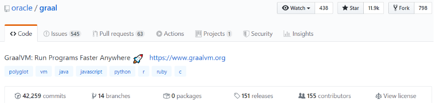

这就很有意思了，Graal 是 Java 语言编写的，用 Java 编写的编译器，然后用来将 Java 字节码编译机器代码。

Graal 官网：[https://www.graalvm.org/(opens](https://www.graalvm.org/(opens) new window)

### (三). 类数据共享

JVM 启动时有一步是需要在内存中加载类，而如果有多个 jar，加载第一个 jar 的速度是最慢的。这就延长了程序的启动时间，为了减少这个时间，Java 10 引入了应用程序类数据共享（CDS）机制，它可以把你想共享的类共享在程序之间，使不同的 Java 进程之间共享这个类来减少这个类占用的空间以及加载速度。

### (四).G1 并行全 GC

早在 Java 9 时就已经引入了 G1 垃圾收集器，G1 的优点很多。而在 Java 10 中还是做了小小调整，当 G1 的并发收集线程不能快速的完成全 GC 时，就会自动切换到并行收集，这可以减少在最坏情况下的 GC 速度。

### (五)、Unicode 语言标签扩展

这个提案让 JDK 实现了最新的 LDML 规范 (opens new window)中指定的更多的扩展。

主要增加了下面几个扩展方法。

java.time.temporal.WeekFields::of

java.util.Calendar::{getFirstDayOfWeek,getMinimalDaysInWeek}

java.util.Currency::getInstance

java.util.Locale::getDisplayName

java.util.spi.LocaleNameProvider

java.text.DateFormat::get*Instance

java.text.DateFormatSymbols::getInstance

java.text.DecimalFormatSymbols::getInstance

java.text.NumberFormat::get*Instance

java.time.format.DateTimeFormatter::localizedBy

java.time.format.DateTimeFormatterBuilder::getLocalizedDateTimePattern

java.time.format.DecimalStyle::of

尝试一下。

```java
Currency chinaCurrency = Currency.getInstance(Locale.CHINA);
Currency usCurrency = Currency.getInstance(Locale.US);
System.out.println("本地货币：" + chinaCurrency);
System.out.println("US.货币：" + usCurrency);

String displayName = Locale.getDefault().getDisplayName();
String displayLanguage = Locale.getDefault().getDisplayLanguage();
String displayCountry = Locale.getDefault().getDisplayCountry();
System.out.println("本地名称：" + displayName);
System.out.println("本地语言：" + displayLanguage);
System.out.println("本地国家：" + displayCountry);
int firstDayOfWeek = Calendar.getInstance().getFirstDayOfWeek();
System.out.println("本地每周第一天：" + firstDayOfWeek);

```
输出结果。

本地货币：CNY

US.货币：USD

本地名称：中文 (中国)

本地语言：中文

本地国家：中国

本地每周第一天：1

### (六).API 更新

Java 10 删除了部分 API，也增加了一些实用方法。比如可以通过 Collection.copyOf 复制得到一个不可改变集合，即使原来的集合元素发生了变化也不会有影响。

```java
var list = new ArrayList<String>();
list.add("wechat");
list.add("wlw");
List<String> copyList = List.copyOf(list);
list.add("test");
System.out.println(copyList);
// result
// [wechat, wn8398]

```
也为 Optional 增加了一个新的方法 orElseThrow。调用这个方法也可以获取到 optional 中的 value , 但是如果 value 为 null ，就会抛出异常。

另外在 Stream 最后收集数据的时候，Collectors 可以直接指定收集的集合为不可变集合，像下面这样。

list.stream().collect(Collectors.toUnmodifiableList());

list.stream().collect(Collectors.toUnmodifiableSet());

### (七)、其他更新

Java 10 的更新内容不止这些，上面只是列举了常用的以及比较有意思的新特性。还有部分更新如：

JEP 312：Thread-Local Handshakes，JVM 内部功能，可以提高 JVM 性能。

JEP 313：删除了 javah 工具，说是删除，其实功能已经包含在 Java 8 中的 javac 里。

JEP 316：让 JVM 可以在备用的存储设备（如 NV-DIMM）上分配堆内存，而不用更改程序代码。

JEP 319：在 JDK 中提供一组默认的根证书颁发机构（CA）证书。

## 五. JAVA11新特性

#### HTTP Client 标准化
Java 11 标准化了 Java 9 中引入的 Http Client API，并在 Java 10 中进行了更新。在前两个版本中对 Http Client 进行孵化的同时，该 API 几乎被完全重写，并且现在已经完全支持异步非阻塞。

此外，Java 11 中，Http Client 的包名已由 jdk.incubator.http 更改为 java.net.http。该 API 通过 CompleteableFuture 提供了非阻塞请求和响应语义。使用起来也非常简单，例如：

```java
var request = HttpRequest.newBuilder()
 
    .uri(URI.create("https://javastack.cn"))
 
    .GET()
 
    .build();var client = HttpClient.newHttpClient();
 
// 同步
HttpResponse<String> response = client.send(request, HttpResponse.BodyHandlers.ofString());System.out.println(response.body());
// 异步

client.sendAsync(request, HttpResponse.BodyHandlers.ofString())
 
    .thenApply(HttpResponse::body)
 
    .thenAccept(System.out::println);

```
#### 启动单文件源代码程序

这意味着我们可以运行单一文件的 Java 源代码。此功能允许使用 Java 解释器直接执行 Java 源代码。源代码在内存中编译，然后由解释器执行，不需要在磁盘上生成 .class 文件了。唯一的约束在于所有相关的类必须定义在同一个 Java 文件中。

对于 Java 初学者并希望尝试简单程序的人特别有用，并且能和 jshell 一起使用。一定能程度上增强了使用 Java 来写脚本程序的能力。

#### 新的垃圾回收器 Epsilon

一个完全消极的 GC 实现，分配有限的内存资源，最大限度的降低内存占用和内存吞吐延迟时间

#### 低开销的 Heap Profiling

Java 11 中提供一种低开销的 Java 堆分配采样方法，能够得到堆分配的 Java 对象信息，并且能够通过 JVMTI 访问堆信息

#### 飞行记录器(Java Flight Recorder)

飞行记录器之前是商业版 JDK 的一项分析工具，但在 Java 11 中，其代码被包含到公开代码库中，这样所有人都能使用该功能了。

6. String 增强

Java 11 增加了一系列的字符串处理方法：

```java
//判断字符串是否为空
System.out.println(" ".isBlank());
// 去除字符串首尾空格
System.out.println("结果:"+" 去除字符串首尾空格 ".strip()+"结束");
// 去除字符串首部空格
System.out.println("结果:"+"去除字符串首部空格 ".stripLeading()+"结束");
// 去除字符串尾部空格
System.out.println("结果:"+" 去除字符串尾部空格 ".stripTrailing()+"结束");
// 重复字符串多少次
System.out.println(" 重复字符串多少次 ".repeat(2));
// 返回由行终止符分隔次数。
System.out.println("A\nB\nC".lines().count());
// 返回由行终止符分隔的字符串集合。
System.out.println("A\nB\nC".lines().collect(Collectors.toList()));

```
#### Optional 增强

新增了empty()方法来判断指定的 Optional 对象是否为空。

```java
var obj= Optional.empty();
 
//判断指定的 Optional 对象是否为空
 
System.out.println(obj.isEmpty());

```
#### Lambda 参数的局部变量语法

从 Java 10 开始，便引入了局部变量类型推断这一关键特性。类型推断允许使用关键字 var 作为局部变量的类型而不是实际类型，编译器根据分配给变量的值推断出类型。

Java 10 中对 var 关键字存在几个限制

- 只能用于局部变量上

- 声明时必须初始化

- 不能用作方法参数

- 不能在 Lambda 表达式中使用

Java11 开始允许开发者在 Lambda 表达式中使用 var 进行参数声明。

```java
// 下面两者是等价的

Consumer<String> consumer = (var c) -> System.out.println(c);
 
Consumer<String> consumer = (String c) -> System.out.println(c);

```
## 六. JAVA12新特性

#### 数字格式化工具类
NumberFormat 新增了对复杂的数字进行格式化的支持

```java
NumberFormat fmtShort = NumberFormat.getCompactNumberInstance(Locale.CHINESE, NumberFormat.Style.SHORT);
String resultShort = fmtShort.format(10000000);
System.out.println(resultShort);

NumberFormat fmt2Short = NumberFormat.getCompactNumberInstance(Locale.US, NumberFormat.Style.SHORT);
String result2Short = fmt2Short.format(10000000);
System.out.println(result2Short);

NumberFormat fmtLong = NumberFormat.getCompactNumberInstance(Locale.CHINESE, NumberFormat.Style.LONG);
String resultLong = fmtLong.format(10000000);
System.out.println(resultLong);

NumberFormat fmt2Long = NumberFormat.getCompactNumberInstance(Locale.US, NumberFormat.Style.LONG);
String result2Long = fmt2Long.format(10000000);
System.out.println(result2Long);

```
输出:


#### Shenandoah GC

Redhat 主导开发的 Pauseless GC 实现，主要目标是 99.9% 的暂停小于 10ms，暂停与堆大小无关等

和 Java11 开源的 ZGC 相比（需要升级到 JDK11 才能使用），Shenandoah GC 有稳定的 JDK8u 版本，在 Java8 占据主要市场份额的今天有更大的可落地性。

#### String 增强

Java 11 增加了两个的字符串处理方法

indent() 方法可以实现字符串缩进。

   ```java
    public String indent(int n) {
           if (isEmpty()) {
               return "";
           }
           Stream<String> stream = lines();
           if (n > 0) {
               final String spaces = " ".repeat(n);
               stream = stream.map(s -> spaces + s);
           } else if (n == Integer.MIN_VALUE) {
               stream = stream.map(s -> s.stripLeading());
           } else if (n < 0) {
               stream = stream.map(s -> s.substring(Math.min(-n, s.indexOfNonWhitespace())));
           }
           return stream.collect(Collectors.joining("\n", "", "\n"));
       }

   ```
2. transform() 方法可以用来转变指定字符串。

   ```java
       public <R> R transform(Function<? super String, ? extends R> f) {
           return f.apply(this);
       }

   ```
如以下所示。

```java
 //indent() 方法可以实现字符串缩进。
        String text = "缩进";
        // 缩进 4 格
        text = text.indent(4);
        System.out.println(text);
        //transform() 增加的直接使用的方法函数式编程方法。
        String result = "源数据".transform(input -> input + " 增加");
        System.out.println(result);

```
#### Files 增强（文件比较）

Java 12 添加了以下方法来比较两个文件：

public static long mismatch(Path path, Path path2) throws IOException

mismatch() 方法用于比较两个文件，并返回第一个不匹配字符的位置，如果文件相同则返回 -1L。

#### G1 收集器优化

Java12 为默认的垃圾收集器 G1 带来了两项更新:

可中止的混合收集集合 ：JEP344 的实现，为了达到用户提供的停顿时间目标，JEP 344 通过把要被回收的区域集（混合收集集合）拆分为强制和可选部分，使 G1 垃圾回收器能中止垃圾回收过程。 G1 可以中止可选部分的回收以达到停顿时间目标

及时返回未使用的已分配内存 ：JEP346 的实现，增强 G1 GC，以便在空闲时自动将 Java 堆内存返回给操作系统

## 七. JAVA13新特性

#### 增强 ZGC(释放未使用内存)
在 Java 11 中是实验性的引入的**ZGC** 在实际的使用中存在未能主动将未使用的内存释放给操作系统的问题。

ZGC 堆由一组称为 ZPages 的堆区域组成。在 GC 周期中清空 ZPages 区域时，它们将被释放并返回到页面缓存 ZPageCache 中，此缓存中的 ZPages 按最近最少使用（LRU）的顺序，并按照大小进行组织。

在 Java 13 中，**ZGC 将向操作系统返回被标识为长时间未使用的页面，这样它们将可以被其他进程重用**。

#### SocketAPI 重构

Java Socket API 终于迎来了重大更新！

Java 13 将 Socket API 的底层进行了重写， NioSocketImpl 是对 PlainSocketImpl 的直接替代，它使用 java.util.concurrent 包下的锁而不是同步方法。如果要使用旧实现，请使用 -Djdk.net.usePlainSocketImpl=true。

并且，在 Java 13 中是默认使用新的 Socket 实现。

public final class NioSocketImpl extends SocketImpl implements PlatformSocketImpl {}

#### FileSystems

FileSystems 类中添加了以下三种新方法，以便更容易地使用将文件内容视为文件系统的文件系统提供程序：

newFileSystem(Path)

newFileSystem(Path, Map<String, ?>)

newFileSystem(Path, Map<String, ?>, ClassLoader)

#### 动态 CDS 存档

Java 13 中对 Java 10 中引入的应用程序类数据共享(AppCDS)进行了进一步的简化、改进和扩展，即：允许在 Java 应用程序执行结束时动态进行类归档，具体能够被归档的类包括所有已被加载，但不属于默认基层 CDS 的应用程序类和引用类库中的类。

这提高了应用程序类数据共享（AppCDSopen in new window）的可用性。无需用户进行试运行来为每个应用程序创建类列表。

$ java -XX:ArchiveClassesAtExit=my_app_cds.jsa -cp my_app.jar

$ java -XX:SharedArchiveFile=my_app_cds.jsa -cp my_app.jar

## 八. JAVA14新特性

#### 空指针异常精准提示
通过 JVM 参数中添加-XX:+ShowCodeDetailsInExceptionMessages，可以在空指针异常中获取更为详细的调用信息，更快的定位和解决问题。

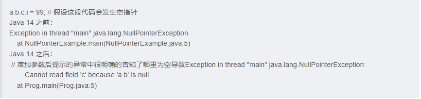

#### switch 的增强(转正)

Java12 引入的 switch（预览特性）在 Java14 变为正式版本，不需要增加参数来启用，直接在 JDK14 中就能使用。

Java12 为 switch 表达式引入了类似 lambda 语法条件匹配成功后的执行块，不需要多写 break ，Java13 提供了 yield 来在 block 中返回值。

#### ZGC支持

从 Java11 引入的 ZGC 作为继 G1 过后的下一代 GC 算法，从支持 Linux 平台到 Java14 开始支持 MacOS 和 Window

#### 移除 CMS

移除了 CMS(Concurrent Mark Sweep) 垃圾收集器

#### 新增了 jpackage 工具

jpackage 工具，标配将应用打成 jar 包外，还支持不同平台的特性包，比如 linux 下的deb和rpm，window 平台下的msi和exe

## 九. JAVA15新特性

#### 隐藏类(Hidden Classes)
隐藏类是为框架（frameworks）所设计的，隐藏类不能直接被其他类的字节码使用，只能在运行时生成类并通过反射间接使用它们。

#### TreeMap增强

TreeMap 新引入了下面这些方法：

- putIfAbsent()

- computeIfAbsent()

- computeIfPresent()

- compute()

- merge()

#### ZGC

Java11 的时候 ，ZGC 还在试验阶段。

当时，ZGC 的出现让众多 Java 开发者看到了垃圾回收器的另外一种可能，因此备受关注。

经过多个版本的迭代，不断的完善和修复问题，ZGC 在 Java 15 已经可以正式使用了！

不过，默认的垃圾回收器依然是 G1。你可以通过下面的参数启动 ZGC：

$ java -XX:+UseZGC className

#### 文本块

在 Java 15 ，文本块是正式的功能特性了。

#### 禁用和废弃偏向锁（Biased Locking）

偏向锁的引入增加了 JVM 的复杂性大于其带来的性能提升。不过，你仍然可以使用 -XX:+UseBiasedLocking 启用偏向锁定，但它会提示 这是一个已弃用的 API。

## 十. JAVA17新特性

Java 17 将是继 Java 8 以来最重要的长期支持（LTS）版本，是 Java 社区八年努力的成果。Spring 6.x 和 Spring Boot 3.x ,Spring Cloud 2022.X最低支持的就是 Java 17。

#### 知识体系

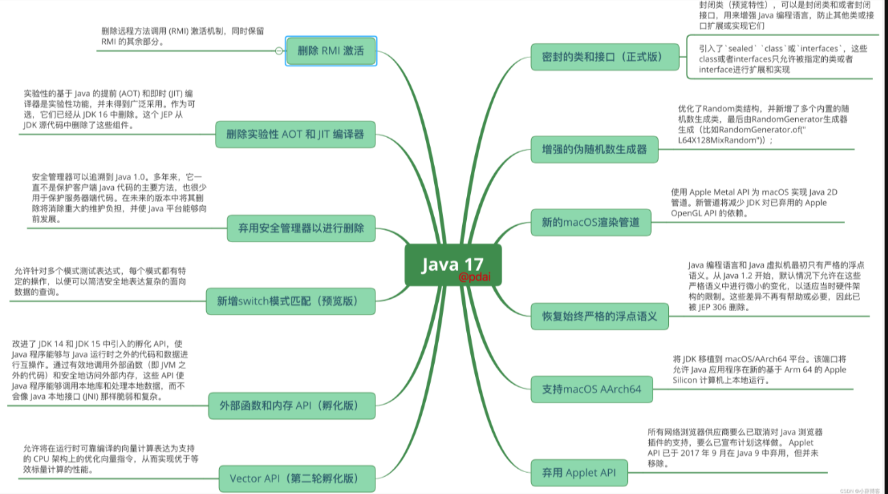

#### 语言特性增强

##### 密封的类和接口（正式版）
**封闭类**可以是封闭类和或者封闭接口，用来增强 Java 编程语言，**防止其他类或接口扩展或实现它们**。这个特性由Java 15的预览版本晋升为正式版本。

- 密封的类和接口解释和应用

因为我们引入了sealed class或interfaces，这些class或者interfaces只允许被指定的类或者interface进行扩展和实现。

使用修饰符sealed，您可以将一个类声明为密封类。密封的类使用reserved关键字permits列出可以直接扩展它的类。子类可以是最终的，非密封的或密封的。

```java
public class Person { } //人
 
class Teacher extends Person { }//教师
 
class Worker extends Person { }  //工人
 
class Student extends Person{ } //学生

```
但是我们现在要限制 Person类 只能被这三个类继承，不能被其他类继承，需要这么做。

```java
// 添加sealed修饰符，permits后面跟上只能被继承的子类名称
public sealed class Person permits Teacher, Worker, Student{ } //人
 
// 子类可以被修饰为 final
final class Teacher extends Person { }//教师
 
// 子类可以被修饰为 non-sealed，此时 Worker类就成了普通类，谁都可以继承它
non-sealed class Worker extends Person { }  //工人
// 任何类都可以继承Worker
class AnyClass extends Worker{}
 
//子类可以被修饰为 sealed,同上
sealed class Student extends Person permits MiddleSchoolStudent,GraduateStudent{ } //学生
 
 
final class MiddleSchoolStudent extends Student { }  //中学生
 
final class GraduateStudent extends Student { }  //研究生

```
#### Switch

使用 switch 表达式和语句的模式匹配以及对模式语言的扩展来增强 Java 编程语言。这个新特性允许使用新的模式，包括类型模式和守卫模式。类型模式能够在switch表达式中使用instanceof，守卫模式能够使用布尔表达式。

##### 类型模式匹配

JDK16 instanceof 模式匹配

```java
if (obj instanceof String s) {
   // 直接使用 s拼接字符串
 
   s += "heihei";
} else if (obj instanceof Integer i){
   // 直接使用i进行整型逻辑运算
   i += 1;
}

```
JDK17 switch 可直接用 instanceof 模式匹配选择（需要提前考虑 null 判断）

```java
Object o;
switch (o) {
    case null      -> System.out.println("首先判断对象是否为空，走空指针逻辑等后续逻辑");
    case String s  -> System.out.println("判断是否为字符串，s:" + s);
    case record p  -> System.out.println("判断是否为Record类型: " + p.toString());
    case int[] arr -> System.out.println("判断是否为数组，展示int数组的长度" + ia.length);
    case Integer i -> System.out.println("判断是否为Intger对象,i:" + i);
    case Student s   -> System.out.println("判断是否为具体学生对象，student:" + s.toString());
    case UserCommonService -> System.out.println("判断是否为普通用户实现类，然后走普通用户逻辑");
    case UserVipService    -> System.out.println("判断是否为vip用户实现类，然后走vip用户逻辑");
    default   -> System.out.println("Something else");
}

```
##### 守卫模式

```java
Object obj = "test";
switch (obj) {
    case String s && s.length() > 0 -> s;
    default -> "";
 
}

```
将冒号（:）替换为箭头（->），并且switch表达式默认不会失败，所以不需要break。

#### 文本块

```java
private void highVersion() {
    String text = """
            {
              "name": "小黑说Java",
              "age": 18,
              "address": "北京市西城区"
            }
            """;
    System.out.println(text);
}

```
#### 增强的伪随机数生成器

JDK 17 之前，我们可以借助 Random、ThreadLocalRandom和SplittableRandom来生成随机数。不过，这 3 个类都各有缺陷，且缺少常见的伪随机算法支持。

伪随机数生成器（pseudorandom number generator，PRNG），又称为确定性随机位生成器（deterministic random bit generator，DRBG），是用来生成接近于绝对随机数序列的数字序列的算法。一般来说，PRNG 会依赖于一个初始值，也称为种子，来生成对应的伪随机数序列。只要种子确定了，PRNG 所生成的随机数就是完全确定的，因此其生成的随机数序列并不是真正随机的。

```java
//通过 RandomGeneratorFactory.of(“随机数生成算法”) 方法获得生成器
RandomGeneratorFactory<RandomGenerator> l128X256MixRandom = RandomGeneratorFactory.of("L128X256MixRandom");
// 使用时间戳作为随机数种子
RandomGenerator randomGenerator = l128X256MixRandom.create(System.currentTimeMillis());
// 生成0-9随机数
System.out.println(randomGenerator.nextInt(10));

```
#### 删除实验性的 AOT 和 JIT 编译器

Java 17，删除实验性的提前 (AOT) 和即时 (JIT) 编译器，因为该编译器自推出以来很少使用，维护它所需的工作量很大。保留实验性的 Java 级 JVM 编译器接口 (JVMCI)，以便开发人员可以继续使用外部构建的编译器版本进行 JIT 编译。

#### 弃用安全管理器和Applet API以进行删除

安全管理器可追溯到 Java 1.0，多年来，它一直不是保护客户端 Java 代码的主要方法，也很少用于保护服务器端代码。为了推动 Java 向前发展，Java 17 弃用安全管理器，以便与旧版 Applet API ( JEP 398open in new window ) 一起移除。

Applet API 用于编写在 Web 浏览器端运行的 Java 小程序，很多年前就已经被淘汰了，已经没有理由使用了。

#### 特定于上下文的反序列化过滤器

允许应用程序使用 JVM 范围的过滤器工厂配置特定于上下文和动态选择的反序列化过滤器，该工厂用于为每个反序列化操作选择一个过滤器。

不可信数据的反序列化是一项具有内在风险的操作，因为在许多情况下传入数据流的内容是通过未知或未经身份验证的客户端获取的。

防止序列化攻击的关键是禁止任意类的实例被反序列化，从而直接或间接地阻止其方法的执行。

攻击者可以通过仔细构造流来运行任何恶意的类中的代码。如果对象构造涉及更改状态或触发其他操作的副作用，则应用程序对象、库对象和 Java 运行时的完整性可能会受到损害。

#### 对 NullPointerExceptions的优化

之前输出将显示NullPointerException发生的行号，但不知道哪个方法调用时产生的null，必须通过调试的方式找到。

```java
Exception in thread "main" java.lang.NullPointerException
        at com.heiz.java17.HelpfulNullPointerExceptionsDemo.main(HelpfulNullPointerExceptionsDemo.java:13)

```
在Java 17中，则会准确显示发生NPE的精确位置。

```java
Exception in thread "main" java.lang.NullPointerException: Cannot invoke "com.heiz.java17.Address.getCity()" because the return value of "com.heiz.java17.Person.getAddress()" is null
		at com.heiz.java17.HelpfulNullPointerExceptionsDemo.main(HelpfulNullPointerExceptionsDemo.java:13)

```
#### 增加Stream.toList()方法

如果需要将Stream转换成List,需要通过调用collect方法使用Collectors.toList()，代码非常冗长。

```java
private static void oldStyle() {
    Stream<String> stringStream = Stream.of("a", "b", "c");
    List<String> stringList =  stringStream.collect(Collectors.toList());
    for(String s : stringList) {
        System.out.println(s);
    }
}

```
在Java 17中将会变得简单，可以直接调用toList()。

```java
private static void streamToList() {
    Stream<String> stringStream = Stream.of("a", "b", "c");
    List<String> stringList =  stringStream.toList();
    for(String s : stringList) {
        System.out.println(s);
    }
}

```
10. 本地变量类型推断

之前我们想定义定义局部变量时。我们需要在赋值的左侧提供显式类型，并在赋值的右边提供实现类型：

```java
MyObject value = new MyObject();

```
在Java 10中，提供了本地变量类型推断的功能，可以通过var声明变量：

```java
var value = new MyObject();

```
#### Records

Java 14 中便包含了一个新特性：EP 359: Records

Records的目标是扩展Java语言语法，Records为声明类提供了一种紧凑的语法，用于创建一种类中是“字段，只是字段，除了字段什么都没有”的类。

通过对类做这样的声明，编译器可以通过自动创建所有方法并让所有字段参与hashCode()等方法。

record Person (String firstName, String lastName) {}

record 解决了使用类作为数据包装器的一个常见问题。纯数据类从几行代码显著地简化为一行代码。

## 十一. JAVA21新特性

[https://www.cnblogs.com/zysicyj/p/17722924.html](https://www.cnblogs.com/zysicyj/p/17722924.html)
