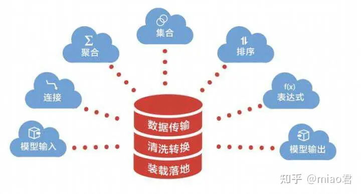
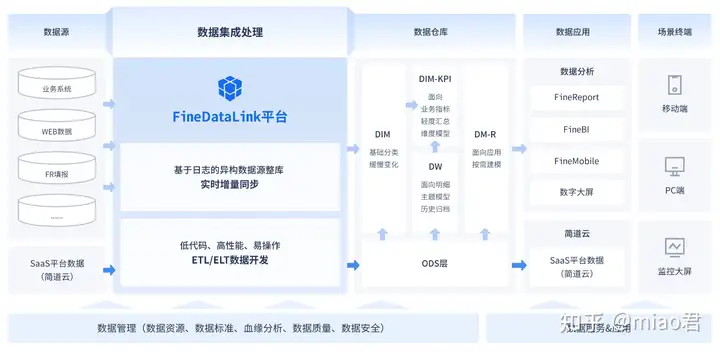
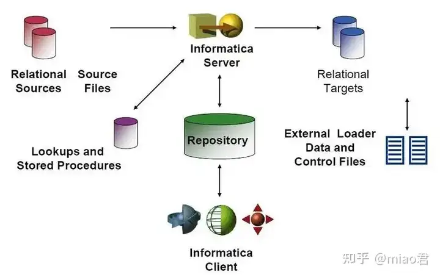
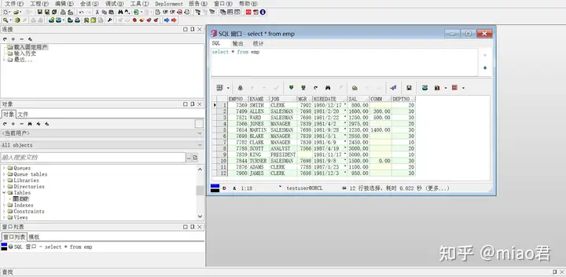
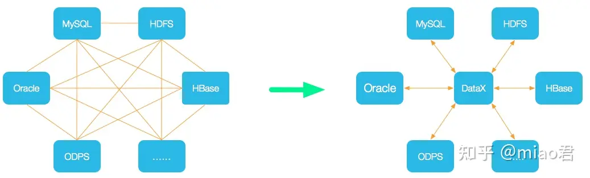

## 一、ETL是什么？
**ETL，就是Extract（提取）、Transform（转换）、Load（加载）的缩写，可以是数据仓库建设过程中不可或缺的一环。**

如果要简单理解的话，ETL就是从各种数据源（如数据库、文件、Web服务等）中提取所需数据，按照业务规则对数据进行清洗、转换、整合，最终加载到目标数据库（如数据仓库、数据湖等）中，以供后续的数据分析和业务应用。

下面，我就详解一下**这三个核心关键环节:**

1. **Extract（提取）：**这是ETL过程的第一步，目的是从各种异构数据源中捕获所需的数据。数据源可能包括[关系型数据库](https://zhida.zhihu.com/search?q=%E5%85%B3%E7%B3%BB%E5%9E%8B%E6%95%B0%E6%8D%AE%E5%BA%93)、NoSQL数据库、日志文件、社交媒体数据等。大家在提取时，一定要考虑数据的时效性、完整性以及安全性。

2. **Transform（转换）：**转换是ETL的核心环节，涉及数据的清洗（如去除重复记录、处理缺失值）、转换（如数据格式转换、字段映射、数据聚合）、丰富（如添加衍生字段、关联外部数据）等操作。这一步骤旨在将原始数据转化为符合业务分析需求的标准格式。

3. **Load（加载）：**加载是将转换后的数据导入到目标数据库中的过程。根据业务需求，可以选择批量加载或实时加载。加载过程中同样需要确保数据的准确性、一致性和完整性，同时也要考虑性能的优化。

## 二、ETL工具推荐

面对市场上琳琅满目的ETL工具，选择一款适合自己企业需求的工具至关重要。以下推荐几款主流的ETL工具，都是我亲自试用过的，总结了一些特点和使用体验，供大家参考。

### 1. FineDataLink

**产品特点:**

一站式数据集成平台，支持从多种数据源（关系型、非关系型、接口、文件等）快速连接和融合数据。数据处理时效高，能满足实时和离线数据处理的需求。

**优点：**
- **低代码：**提供低代码开发环境，开发成本低。

- **时效性高：**零侵入式实时同步功能，能实现多表/整库数据的及时同步。

- **数据开发能力强大：**配备ELT、ETL双核引擎，能根据不同需求进行灵活的数据开发，支持定制化解决方案，可以满足绝大多数企业的需求。

- **智能运维：**内置SparkSQL，支持调用SHELL脚本等，具备强大的平台拓展能力。

**缺点：**

相比较国外大型成熟的ETL工具，FineDataLink的维护和升级还需要投入更多资源和精力。

### 2. Informatica PowerCenter

**产品特点：**

具有高度可扩展性，能够处理海量数据，并随企业数据量增长而扩展。提供用户友好的设计环境，简化ETL流程的开发和维护。

**优点：**
- 功能全面，内置多种数据转换逻辑，满足复杂数据处理需求。

- 高度集成化，减少手动编码工作。

- 易于维护和升级，支持企业长期的数据集成策略。

**缺点：**
- 成本较高，需要企业投入较多预算。

- 技术门槛较高，需要专业的技术团队进行部署和维护。

### 3. Talend Open Studio for Data Integration

**产品特点：**

提供开源的解决方案，降低企业初期投入成本。支持自定义开发，适应不同业务场景需求。

**优点：**
- 成本低廉，适合预算有限的企业。

- 社区活跃，拥有丰富的资源和支持。

- 易于学习和上手，降低技术团队的学习成本。

- 代码生成功能：将ETL作业转换为Java代码，便于版本控制和系统集成。

**缺点：**

相较于商业软件，在性能和稳定性上有所欠缺。在大规模数据处理时，需要额外优化和调整。

### 4. Apache NiFi

**产品特点：**

基于Web的图形化界面，用户友好，便于实时监控和管理数据流。特别适用于高频数据流场景。

**优点：**
- 实时性强，满足对数据处理速度要求高的场景。

- 支持数据流的可视化监控，提高数据处理的透明度。

- 数据自动路由：智能调度数据流向，减少人工干预。

**缺点：**
- 在复杂数据处理逻辑上不如其他工具灵活。

- 依赖于Web环境，会受到网络稳定性的影响。

### 5. Microsoft SSIS (SQL Server Integration Services)

**产品特点：**

微软公司推出的ETL工具，可以与SQL Server无缝集成。

**优点：**
- 无缝集成到SQL Server环境中，优化数据转换和集成，适合已在使用SQL Server的企业。

- 丰富组件库：提供控制流和数据流组件，满足多种数据处理需求。

**缺点：**

依赖于SQL Server环境，限制了与其他数据库系统的兼容性。在处理非SQL Server数据源时需要额外的工作或集成其他工具。

### 6. Datastage

**产品特点：**

专业的ETL工具，被IBM收购，包含数据质量分析、数据血缘分析、业务元数据管理等功能。

**优点：**

产品功能全面，数据处理能力强大，适合大型企业和复杂的数据集成需求。

**缺点：**

价格不菲，产品使用难度大，国内用户较少，本地化部署存在较大困难。

### 7. ODI (Oracle Data Integrator)

**产品特点：**

Oracle数据库厂商提供的工具，与Oracle数据库深度耦合，同时针对Oracle数据库进行了深度优化，确保数据处理的最高效率和稳定性。

**优点：**
- 深度集成Oracle技术栈：与Oracle数据库、[中间件](https://zhida.zhihu.com/search?q=%E4%B8%AD%E9%97%B4%E4%BB%B6)等无缝集成，优化数据处理性能。

- 提供预定义的数据转换逻辑，加速了ETL开发进程。采用ELT架构，可以先传输后转换。

**缺点：**
- 局限性强，Web集成功能弱，运行监控能力差，技术支持获取难。

### 8. Kettle

**产品特点：**

业界有名的开源ETL工具。数据转换能力灵活，支持复杂的数据清洗和转换逻辑。

**优点：**
- 可在多种操作系统上运行，支持多种数据库和文件格式。

- 有活跃的[开源社区](https://zhida.zhihu.com/search?q=%E5%BC%80%E6%BA%90%E7%A4%BE%E5%8C%BA)，产品功能可以不断迭代。

- 开源版本免费，适合个人试用或是预算低的企业。

**缺点：**
- 社区版功能不够完善。

### 9. Datax

**优点：**
- 高性能数据传输：针对大数据环境设计，支持高并发、高吞吐量的数据传输任务，特别是Hadoop、Spark等大数据平台的数据传输和同步任务。

- 插件化架构：支持通过插件扩展数据源和数据处理逻辑，灵活应对不同场景。

**缺点：**

缺乏可视化开发界面，需编写Java代码，数据清洗转换能力弱。

### 10. Restcloud

**优点：**
- [云原生](https://zhida.zhihu.com/search?q=%E4%BA%91%E5%8E%9F%E7%94%9F)支持：基于B/S架构，支持云端部署，方便远程协作和集中管理。

- 智能监控：提供实时数据处理监控和报警功能，确保数据处理的稳定性和安全性。

- 本土化优势：作为国产ETL工具，更贴合国内企业的数据处理需求和业务场景。

**缺点：**

推出时间较短，技术支持主要通过社区获取，对于缺乏专业技术团队的企业来说，在产品部署上会存在较大困难。

### 11. Canal

#### 特点：

- **实时捕获数据变更**：通过解析 MySQL 的 binlog，模拟 MySQL 从库，实时捕获数据库的变化（如插入、更新、删除）。

- **轻量级**：不需要在 MySQL 端做复杂的配置，只需开启 binlog 日志功能即可。

- **支持多种目标系统**：除了 Redis，还支持将数据同步到 Kafka、ElasticSearch 等其他系统。

#### 优点：

- **适合实时同步**：能够快速捕获 MySQL 数据库的变化，并将这些变化同步到 Redis，适合需要低延迟同步的场景。

- **支持大规模数据同步**：轻量级且高效，适合处理大规模数据的实时同步。

- **易于集成**：与 Redis 和其他数据存储系统的集成非常灵活，方便扩展。

#### 缺点：

- **仅支持增量同步**：Canal 主要通过 binlog 捕获增量数据，适合实时同步，但不适用于全量数据同步场景。

- **仅适用于 MySQL 系列数据库**：虽然其功能非常强大，但 Canal 仅支持 MySQL、MariaDB，不支持其他数据库。

#### 适用场景：

- **实时性要求高**：适合那些需要实时获取 MySQL 数据变化，并同步到 Redis 的场景，比如电商平台、金融数据监控等。

**【选择建议】**

在选择ETL工具时，企业应考虑自身的业务需求、技术栈、预算以及未来的可扩展性。

综合而言，**FinedataLink集成能力灵活，性价比高，适合国内企业做数据处理和转换；对于大型企业来说，Informatica PowerCenter提供了强大的企业级解决方案，可以实现大规模数据源的集成；对于预算有限的企业来说，Talend或Apache NiFi则是不错的选择。此外，如果企业已经在使用Microsoft SQL Server，那么SSIS无疑是一个性价比更高的选择。**

总之，ETL作为[数据预处理](https://zhida.zhihu.com/search?q=%E6%95%B0%E6%8D%AE%E9%A2%84%E5%A4%84%E7%90%86)的核心技术，对企业实现数字化转型至关重要。企业在处理海量数据时，要根据自身情况来选择最为合适的工具，从而更好地进行数据分析和业务洞察。
