## 概述
在阿里孕育 RocketMQ 的雏形时期，我们将其用于异步通信、搜索、社交网络活动流、数据管道，贸易流程中。随着我们的贸易业务吞吐量的上升，源自我们的消息传递集群的压力也变得紧迫。

根据我们的研究，随着队列和虚拟主题使用的增加，ActiveMQ IO模块达到了一个瓶颈。我们尽力通过节流、断路器或降级来解决这个问题，但效果并不理想。于是我们尝试了流行的消息传递解决方案Kafka。不幸的是，Kafka不能满足我们的要求，其尤其表现在低延迟和高可靠性方面，详见下文。在这种情况下，我们决定发明一个新的消息传递引擎来处理更广泛的消息用例，覆盖从传统的pub/sub场景到高容量的实时零误差的交易系统。

Apache RocketMQ 自诞生以来，因其架构简单、业务功能丰富、具备极强可扩展性等特点被众多企业开发者以及云厂商广泛采用。历经十余年的大规模场景打磨，RocketMQ 已经成为业内共识的金融级可靠业务消息首选方案，被广泛应用于互联网、大数据、移动互联网、物联网等领域的业务场景。

## RocketMQ组成

RocketMQ消息的存储是由ConsumeQueue和CommitLog配合完成 的，消息真正的物理存储文件是CommitLog，ConsumeQueue是消息的逻辑队列，类似数据库的索引文件，存储的是指向物理存储的地址。每 个Topic下的每个Message Queue都有一个对应的ConsumeQueue文件。

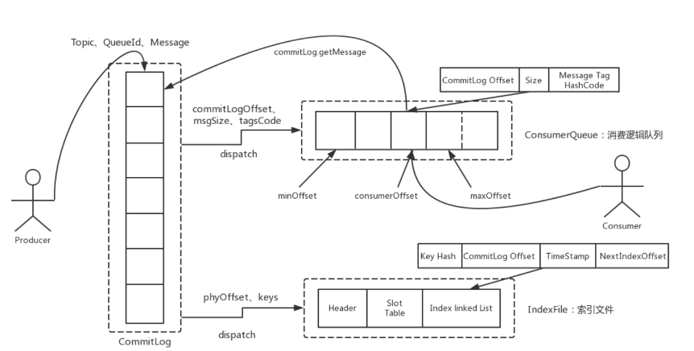

1. CommitLog：存储消息的元数据。

2. ConsumerQueue：存储消息在CommitLog的索引。

3. IndexFile：为了消息查询提供了一种通过key或时间区间来查询消息的方法，这种通过IndexFile来查找消息的方法不影响发送与消费消息的主流程。

## RocketMQ由哪些角色组成，每个角色作用和特点是什么？

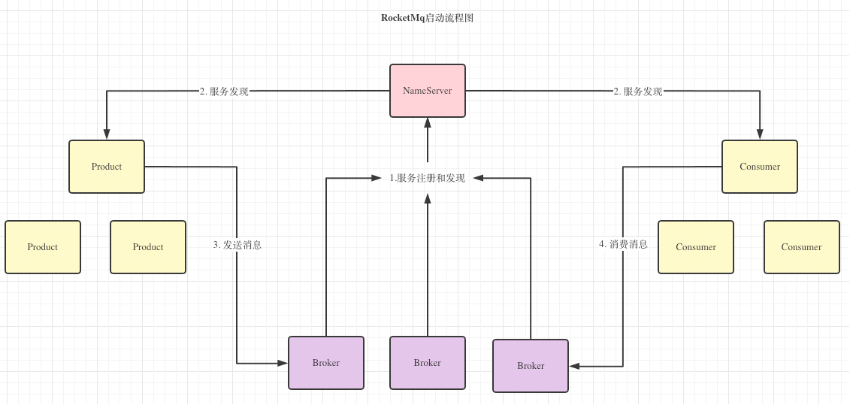

主要的运转流程如下：

1. NameServer 启动，Broker进行服务注册，NameServer需要注册所有的Broker。

2. 服务发现，连接所有的生产者和消费者，并且定时进行心跳包发送。

3. 生产者发送消息之前从NameServer获取Broker的注册列表，根据负载均衡算法选出其中一台Broker进行消息推送。

4. Namever 和Broker 保持长连接，同时每30S进行一次心跳检测，如果检测到超过 120S 没有响应（心跳检测机制），从路由表将其删除。

5. 消费者订阅某个主题前，需要先从NameSever 查找对应的Broker列表（或者某个集群），从Broker当中订阅消息进行消费，同时由Broker指定订阅规则。

**topic有多个MessageQueue组成**

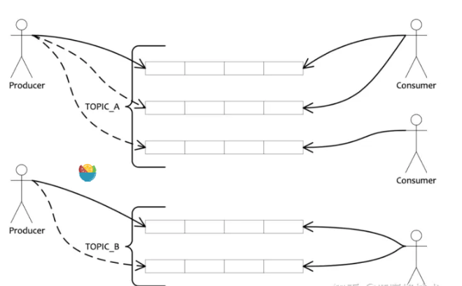

- RocketMQ主要由Producer、Broker、Consumer三部分组成，其中Producer负责生产消息，Consumer负责消费消息，Broker负责存储消息。

- Broker在实际部署过程中对应一台服务器，每个Broker可以存储多个Topic的消息，每个Topic的消息也可以分片存储于不同的Broker。

- MessageQueue队列，消息放在队列里面存储消息的物理实体，一个topic可以包含多个queue，每个queue中存的是该topic的消息一个分区（queue），只能有一个comsumer；一个comsumer可以消费多个分区。Topic可以配置MessageQueue的个数和消费者个数来提高消费能力，1个Topic默认4个MessageQueue。

## RocketMQ功能介绍

### 同步发送消息
同步发送消息是指，Producer发出⼀条消息后，会在收到MQ返回的ACK之后才发下⼀条消息。该方式的消息可靠性最高，但消息发送效率太低，因为需要同步刷盘，等待ACK的回应。

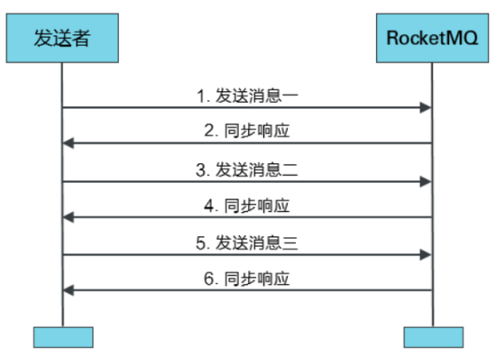

```java
public class SyncProducer {
    public static void main(String[] args) throws Exception {
        DefaultMQProducer producer = new DefaultMQProducer("producer_A");
        // NameServer
        producer.setNamesrvAddr("localhost:9876");
        // 设置当发送失败时重试发送的次数，默认是2次
        producer.setRetryTimesWhenSendFailed(3);
        // 设置发送超时时间，默认3秒
        producer.setSendMsgTimeout(5000);
        // 开启生产者
        producer.start();
        // 模拟发送100条消息
        for (int i = 0; i < 100; i++) {
            byte[] bytes = ("hi " + i).getBytes();
            Message msg = new Message("topic_A", "tag_A", bytes);
            // 为消息指定key
            msg.setKeys("key-" + i);
            // 发送消息
            SendResult sendResult = producer.send(msg);
            System.out.println(sendResult);
        }
        // 关闭生产者
        producer.shutdown();
    }
}
 
public class Consumer {
    public static void main(String[] args) throws Exception {
        // 定义一个push消费者
        DefaultMQPushConsumer consumer = new DefaultMQPushConsumer();
        // NameServer
        consumer.setNamesrvAddr("localhost:9876");
        // 指定从第一条消息开始消费
        consumer.setConsumeFromWhere(ConsumeFromWhere.CONSUME_FROM_FIRST_OFFSET);
        // 指定消费topic与tag
        consumer.subscribe("topic_A", "*");
        // 指定采用广播模式进行消费，默认为集群模式
        consumer.setMessageModel(MessageModel.BROADCASTING);
        // 注册消息监听器
        consumer.registerMessageListener(new MessageListenerConcurrently() {
            // 一旦broker中有了其订阅的消息就会触发该方法的执行，其返回值为当前consumer消费的状态
            @Override
            public ConsumeConcurrentlyStatus consumeMessage(List<MessageExt> list, 
ConsumeConcurrentlyContext context) {
                for (MessageExt msg : list) {
                    System.out.println(msg);
                }
                return ConsumeConcurrentlyStatus.CONSUME_SUCCESS;
            }
        });
        // 开启消费者消费
        consumer.start();
        System.out.println("Consumer Started");
    }
}

```
### 异步发送消息

异步发送消息是指，Producer发出消息后无需等待MQ返回ACK，直接发送下⼀条消息。该方式的消息可靠性可以得到保障，消息发送效率也可以（异步刷盘）。

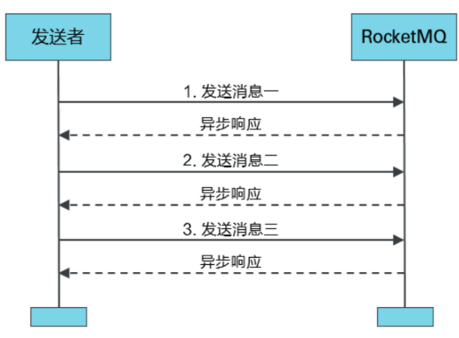

```java
public class AsyncProducer {
    public static void main(String[] args) throws Exception {
        DefaultMQProducer producer = new DefaultMQProducer("producer_A");
        // NameServer
        producer.setNamesrvAddr("localhost:9876");
        // 指定异步发送失败后不进行重试发送
        producer.setRetryTimesWhenSendAsyncFailed(0);
        // 指定新创建的Topic的Queue数量为2，默认为4
        producer.setDefaultTopicQueueNums(2);
        // 开启生产者
        producer.start();
        // 模拟发送100条消息
        for (int i = 0; i < 100; i++) {
            byte[] bytes = ("hi " + i).getBytes();
            try {
                Message msg = new Message("topic_A", "tag_A", bytes);
                // 异步发送，指定回调
                producer.send(msg, new SendCallback() {
                    @Override
                    public void onSuccess(SendResult sendResult) {
                        System.out.println(sendResult);
                    }
 
                    @Override
                    public void onException(Throwable throwable) {
                        throwable.printStackTrace();
                    }
                });
            } catch (Exception e) {
                e.printStackTrace();
            }
        }
        // 异步发送，如果不执行sleep，则消息在发送之前，producer已经关闭，就会报错
        TimeUnit.SECONDS.sleep(3);
        // 关闭生产者
        producer.shutdown();
    }
}

```
### 单向发送消息

单向发送消息是指，Producer仅负责发送消息，不等待、不处理MQ的ACK。该发送方式时MQ也不返回ACK。该方式的消息发送效率最高，但消息可靠性较差。

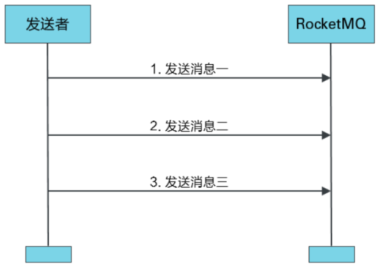

```java
public class OneWayProducer {
    public static void main(String[] args) throws Exception {
        DefaultMQProducer producer = new DefaultMQProducer("producer_A");
        // NameServer
        producer.setNamesrvAddr("localhost:9876");
        // 开启生产者
        producer.start();
        for (int i = 0; i < 100; i++) {
            byte[] bytes = ("hi " + i).getBytes();
            Message msg = new Message("topic_A", "tag_A", bytes);
            // 单向发送
            producer.sendOneway(msg);
        }
        // 关闭生产者
        producer.shutdown();
    }
}

```
### 事务消息

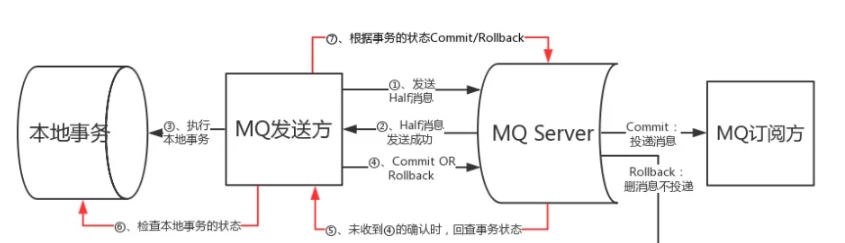

我们可以看到，事务消息主要分为两个流程：

**(1)、正常事务消息的发送及提交**

生产者发送half消息到Broker服务端（半消息）；

半消息是一种特殊的消息类型，该状态的消息暂时不能被Consumer消费。当一条事务消息被成功投递到	Broker上，但是Broker并没有接收到Producer发出的二次确认时，该事务消息就处于"暂时不可被消费"状态，该状态的事务消息被称为半消息。

2. Broker服务端将消息持久化之后，给生产者响应消息写入结果（ACK响应）；

3. 生产者根据发送结果执行本地事务逻辑（如果写入失败，此时half消息对业务不可见，本地逻辑不执行）；

4. 生产者根据本地事务执行结果向Broker服务端提交二次确认（Commit 或是 Rollback），Broker服务端收到 Commit 状态则将半事务消息标记为可投递，订阅方最终将收到该消息；Broker服务端收到 Rollback 状态则删除半事务消息，订阅方将不会接收该消息；

保证消息持久化到RocketMQ，生产根据发送结果执行完成后续逻辑

**(2)、事务消息的补偿流程**

a、在网络闪断或者是应用重启的情况下，可能导致生产者发送的二次确认消息未能到达Broker服务端，经过固定时间后，Broker服务端将会对没有Commit/Rollback的事务消息（pending状态的消息）进行“回查”；

b、生产者收到回查消息后，检查回查消息对应的本地事务执行的最终结果；

c、生产者根据本地事务状态，再次提交二次确认给Broker，然后Broker重新对半事务消息Commit或者Rollback；

其中，补偿阶段用于解决消息Commit或者Rollback发生超时或者失败的情况。

**事务消息共有三种状态，提交状态、回滚状态、中间状态：**

TransactionStatus.CommitTransaction：提交事务，它允许消费者消费此消息。

TransactionStatus.RollbackTransaction：回滚事务，它代表该消息将被删除，不允许被消费。

TransactionStatus.Unknown：中间状态，它代表需要回查本地事务状态来决定是提交还是回滚事务。

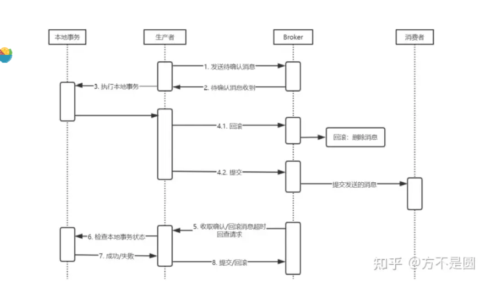

代码实现详细见：[RocketMQ事务消息原理_51CTO博客_rocketmq 事务消息](https://blog.51cto.com/u_15973676/6320008)，[RocketMQ事务消息原理与使用详解_java_脚本之家](https://www.jb51.net/article/275141.htm)

### 顺序消息

顺序消息指的是，严格按照消息的发送顺序进行消费的消息([FIFO](https://blog.csdn.net/qq_74415153/article/details/135211801))。默认情况下生产者会把消息以Round Robin轮询方式发送到不同的Queue分区队列；而消费消息时会从多个Queue上拉取消息，这种情况下的发送和消费是不能保证顺序的。如果将消息仅发送到同一个Queue中，消费时也只从这个Queue上拉取消息，就严格保证了消息的顺序性。

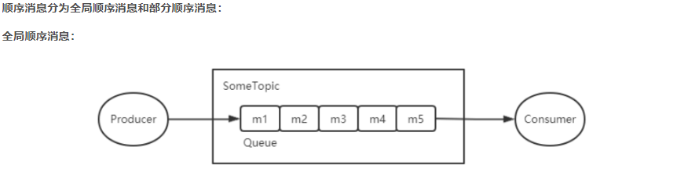

当发送和消费参与的Queue只有一个时所保证的有序是整个[Topic](https://rocketmq.apache.org/zh/docs/domainModel/02topic)中消息的顺序， 称为全局有序。

在创建Topic时指定Queue的数量。有三种指定方式

1、在代码中创建Producer时，可以指定其自动创建的Topic的Queue数量。

2、在RocketMQ可视化控制台中手动创建Topic时指定Queue数量。

3、使用mqadmin命令手动创建Topic时指定Queue数量。

在RocketMQ中，如果使消息全局有序，为Topic设置一个消息队列，使用一个生产者单线程发送数据，消费者端也使用单线程进行消费，从而保证消息的全局有序，但是这种方式，没有并发的且效率低，一般不使用。

### 延迟消息

定时消息（延迟队列）是指消息发送到broker后，不会立即被消费，等待特定时间投递给真正的 topic。 broker有配置项messageDelayLevel，默认值为“1s 5s 10s 30s 1m 2m 3m 4m 5m 6m 7m 8m 9m 10m 20m 30m 1h 2h”，18个level。可以配置自定义messageDelayLevel。

level有以下三种情况：

- level == 0，消息为非延迟消息

- 1<=level<=maxLevel，消息延迟特定时间，例如level==1，延迟1s

- level > maxLevel，则level== maxLevel，例如level==20，延迟2h

发消息时，设置delayLevel等级即可： msg.setDelayLevel(level)。

### 刷盘机制

RocketMQ 的所有消息都是持久化的，先写入系统[ PageCache](https://blog.csdn.net/u012489236/article/details/115574725)，然后刷盘，可以保证内存与磁盘 都有一份数据， 访问时，直接从内存读取。消息在通过Producer写入RocketMQ的时候，有两种写磁盘方式，分布式同步刷盘和异步刷盘。

**同步刷盘**

在消息达到Broker的内存之后，必须刷到commitLog日志文件中才算成功，然后返回Producer数据已经发送成功。

2. **异步刷盘**

异步刷盘是指消息达到Broker内存后就返回Producer数据已经发送成功，会唤醒一个线程去将数据持久化到CommitLog日志文件中。

3. **优缺点分析**

同步刷盘保证了消息不丢失，但是响应时间相对异步刷盘要多出10%左右，适用于对消息可靠性要求比较高的场景。异步刷盘的吞吐量比较高，RT小，但是如果broker断电了内存中的部分数据会丢失，适用于对吞吐量要求比较高的场景。

### 消息重试

**顺序消息的重试**

对于顺序消息，当消费者消费消息失败后，消息队列 RocketMQ 会自动不断进行消息重试（每次间隔时间为 1 秒），这时，应用会出现消息消费被阻塞的情况。因此，在使用顺序消息时，务必保证应用能够及时监控并处理消费失败的情况，避免阻塞现象的发生。

**无序消息的重试**

对于无序消息（普通、定时、延时、事务消息），当消费者消费消息失败时，您可以通过设置返回 状态达到消息重试的结果。无序消息的重试只针对集群消费方式生效；广播方式不提供失败重试特性，即消费失败后，失败消 息不再重试，继续消费新的消息。

消息队列 RocketMQ 默认允许每条消息最多重试 16 次，每次重试的间隔时间如下：

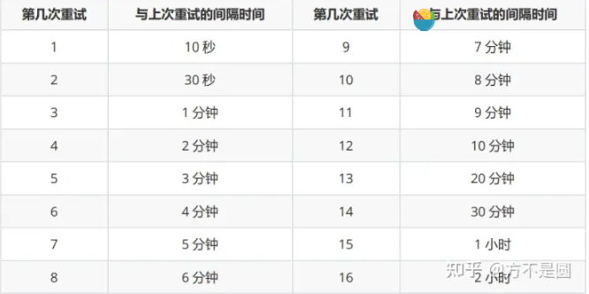

如果消息重试 16 次后仍然失败，消息将不再投递。

注意：

1） 消息最大重试次数的设置对相同 Group ID 下的所有 Consumer 实例有效。

2） 如果只对相同 Group ID 下两个 Consumer 实例中的其中一个设置了 MaxReconsumeTimes，那么该配置对两个 Consumer 实例均生效。

3） 配置采用覆盖的方式生效，即最后启动的 Consumer 实例会覆盖之前的启动实例的配置

### 死信队列

RocketMQ中消息重试超过一定次数后（默认16次）就会被放到死信队列中，在消息队列 RocketMQ 中，这种正常情况下无法被消费的消息称为死信消息（Dead-Letter Message），存储死信 消息的特殊队列称为死信队列（Dead-Letter Queue）。

可视化工具：rocketmq-console下载地址：

[https://github.com/apache/rocketmq-externals/archive/rocketmq-console-1.0.0.zip](https://github.com/apache/rocketmq-externals/archive/rocketmq-console-1.0.0.zip)

死信消息特性：

1） 不会再被消费者正常消费。

2） 有效期与正常消息相同，均为 3 天，3 天后会被自动删除。因此，请在死信消息产生后的 3 天内及时处理。

死信队列特征：

1） 一个死信队列对应一个 Group ID， 而不是对应单个消费者实例。

2） 如果一个 Group ID 未产生死信消息，消息队列 RocketMQ 不会为其创建相应的死信队列。

3） 一个死信队列包含了对应 Group ID 产生的所有死信消息，不论该消息属于哪个 Topic。

一条消息进入死信队列，意味着某些因素导致消费者无法正常消费该消息，因此，通常需要您对其进行特殊处理。排查可疑因素并解决问题后，可以在消息队列 RocketMQ 控制台重新发送该消息，让消费者重新消费一次。

### 消息查询及优先级

消息查询

RocketMQ支持按照下面两种维度（“按照Message Id查询消息”、“按照Message Key查询消息”）进行消息查询。

按照MessageId查询消息：MsgId 总共 16 字节，包含消息存储主机地址（ip/port），消息 Commit Log offset。

按照Message Key查询消息：主要是基于RocketMQ的IndexFile索引文件来实现的。

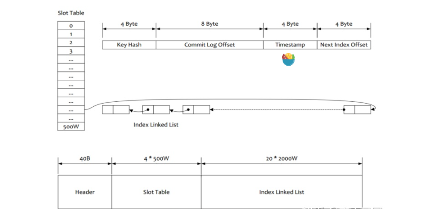

## 集群

## 实际问题
### 消息堆积问题

确认消息堆积的原因：

是否是消息消费失败重试导致？

顺序消息在消费失败后会一直重试，务必保证应用能够及时监控并处理消费失败的情况。

普通消息在消费失败后，每隔1s重试一次。

是否是处理复杂业务性能问题导致？

优化业务，提高业务处理能力。

queue扩容，消费端扩容。

**发现消息堆积后首先要处理堆积的消息：**

这时候就得想办法赶紧把积压的消息消费完，就得考虑提高消费能力，一般有两种办法：

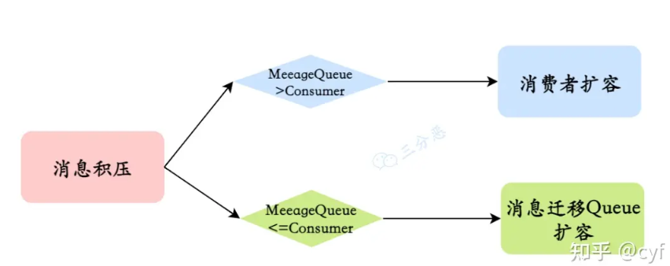

**消费者扩容**：如果当前Topic的Message Queue的数量大于消费者数量，就可以对消费者进行扩容，增加消费者，来提高消费能力，尽快把积压的消息消费玩。（一个Topic默认有4个Queue）

**消息迁移Queue扩容**：如果当前Topic的Message Queue的数量小于或者等于消费者数量，这种情况，再扩容消费者就没什么用，就得考虑扩容Message Queue。可以新建一个临时的Topic，临时的Topic多设置一些Message Queue，然后先用一些消费者把消费的数据丢到临时的Topic，因为不用业务处理，只是转发一下消息，还是很快的。接下来用扩容的消费者去消费新的Topic里的数据，消费完了之后，恢复原状。

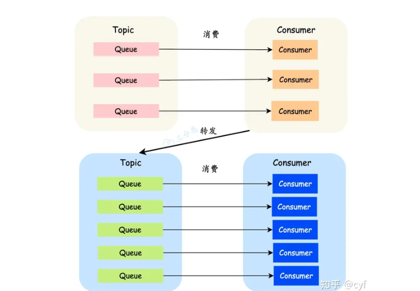

### 消息的可用性

这个问题的另一种问法：如何保证消息不丢失? 从Producer，Consumer和Broker三个方面来回答。

**从Producer角度分析，如何确保消息成功发送到了Broker？**

1、可以采用同步发送，即发送一条数据等到接受者返回响应之后再发送下一个数据包。如果返回响应OK，表示消息成功发送到了broker，状态超时或者失败都会触发二次重试。

2、可以采用分布式事务消息的投递方式。

3、如果一条消息发送之后超时，也可以通过查询日志的API，来检查是否在Broker存储成功。

总的来说，Producer还是采用同步发送来保证的。

**从Broker角度分析，如何确保消息持久化?**

1、消息只要持久化到CommitLog（日志文件）中，即使Broker宕机，未消费的消息也能重新恢复再消费。

2、Broker的刷盘机制：同步刷盘和异步刷盘，不管哪种刷盘都可以保证消息一定存储在pagecache中（内存中），但是同步刷盘更可靠，它是Producer发送消息后等数据持久化到磁盘之后再返回响应给Producer。

3、Broker支持多Master多Slave同步双写和多Master多Slave异步复制模式，消息都是发送给Master主机，但是消费既可以从Master消费，也可以从Slave消费。同步双写模式可以保证即使Master宕机，消息肯定在Slave中有备份，保证了消息不会丢失。

**从Consumer角度分析，如何保证消息被成功消费？**

Consumer自身维护了个持久化的offset（对应Message Queue里的min offset），用来标记已经成功消费且已经成功发回Broker的消息下标。如果Consumer消费失败，它会向Broker发回消费失败的状态，发回成功才会更新自己的offset。如果发回给broker时broker挂掉了，Consumer会定时重试，如果Consumer和Broker一起挂掉了，消息还在Broker端存储着，Consumer端的offset也是持久化的，重启之后继续拉取offset之前的消息进行消费。

### 消息重复问题

RocketMQ并没有对消息重复问题做什么策略处理，需要用户在业务上做幂等。

消息队列 RocketMQ 消费者在接收到消息以后，有必要根据业务上的唯一 Key 对消息做幂等处理的必要性。

消息幂等的必要性

在互联网应用中，尤其在网络不稳定的情况下，消息队列 RocketMQ 的消息有可能会出现重复，这个重复简单可以概括为以下情况：

A、发送时消息重复

当一条消息已被成功发送到服务端并完成持久化，此时出现了网络闪断或者客户端宕机，导致服务端对客户端应答失败。 如果此时生产者意识到消息发送失败并尝试再次发送消息，消费者后续会收到两条内容相同并且 Message ID 也相同的消息。

B、消费时消息重复

消息消费的场景下，消息已投递到消费者并完成业务处理，当客户端给服务端反馈应答的时候网络闪断。 为了保证消息至少被消费一次，消息队列 RocketMQ 的服务端将在网络恢复后再次尝试投递之前已被处理过的消息，消费者后续会收到两条内容相同并且 Message ID 也相同的消息。

C、负载均衡时消息重复（包括但不限于网络抖动、Broker 重启以及订阅方应用重启）

当消息队列 RocketMQ 的 Broker 或客户端重启、扩容或缩容时，会触发 Rebalance，此时消费者可能会收到重复消息。

处理方式：消费端做幂等。

### 消息清理机制

RocketMQ Broker 中的消息被消费后会立即删除吗？

不会，每条消息都会持久化到 CommitLog 中，每个 Consumer 连接到 Broker 后会维持消费进度信息，当有消息消费后只是当前Consumer 的消费进度（CommitLog 的 offset）更新了。

当然也可以配置消息被消费后是否立即删除。当消费者成功消费一条消息，并完成确认后，Broker会将这条消息的状态更新为已消费，并根据配置的策略来决定是否立即删除这条消息。

RocketMQ支持两种消息删除策略：

立即删除：当Broker接到消费者的确认消息时，立刻删除该消息。这种删除策略可以在Broker的配置文件中设置，但是一旦设置为立即删除，就无法保证消息的可靠性。

延迟删除（默认删除策略）：当Broker接到消费者的确认消息时，将该消息的状态标记为"已消费"，但并未立即删除，而是将该消息的删除时间延迟到一定的时间之后，再进行删除。这种删除策略可以使消息在删除前保留一段时间，以便于后续的重试或者其他操作。

未消费的消息是否会被删除？

无论消息是否被消费，RocketMQ的消息保留时间默认为48小时，且不支持修改。RocketMQ消息存储在CommitLog文件中，CommitLog文件大小为1GB，当一个CommitLog文件写满后，会生成一个新的CommitLog文件。RocketMQ删除消息是删除CommitLog文件，而不是删除一条消息。CommitLog文件为顺序写入，当最后写入的一条消息过期时，表示CommitLog文件过期。满足如下任意一个条件，CommitLog文件将会被清理：

每天凌晨4点会清理过期的文件，部分老实例由于未设置时区，清理时间为每天中午12点。

磁盘占中率达到过期清理警戒线70%时，会立刻清理过期的文件。

磁盘占用到达清理警戒线（85%）后，会按照清理规则清理文件，无论是否过期，按照最老的文件开始清理。

磁盘占用达到系统危险警戒线（90%）后，broker会拒绝写入
