# 智能体入门：核心概念理解

# 大语言模型

大语言模型（Large Language Model）是指具有大量参数和复杂结构的深度学习模型，利用深度神经网络的强大能力，通过在海量数据上进行训练，学习到数据中的复杂模式和特征，从而在诸如语言理解、预测分析等多种任务中表现出色。

大模型的核心原理是基于统计学习理论，通过优化目标函数来调整模型参数，使得模型能够准确地泛化到新的、未见过的数据上。

通俗解释：LLM是预测下一个字是什么的文本生成模型

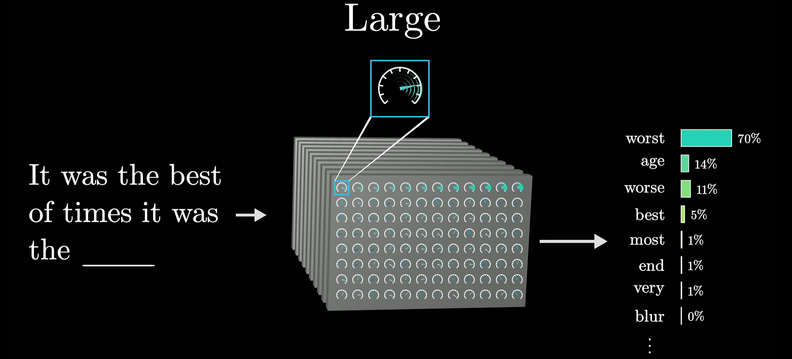

常见大模型

- doubao-seed-1.6（思考可控制）
- doubao-1.5-pro-32k（豆包大模型）
- deepseek-v3（深度求索大模型）
- Qwen（通义千问大模型）
- ...

主要特点：

- 一般来说，模型参数量越大，模型能力越强，越聪明
- 模型具有上下文窗口限制，即：一次性能处理的最长字符数有限制，如：deepseek是64k，doubao-pro-32k是32k
- 模型具有输出token限制，大多数输出都在4096/8192token内
- 每次回答具有随机性，但是可以控制（通过temperature、top p控制）
- 不同模型擅长的任务可能有所区别

最新排行榜

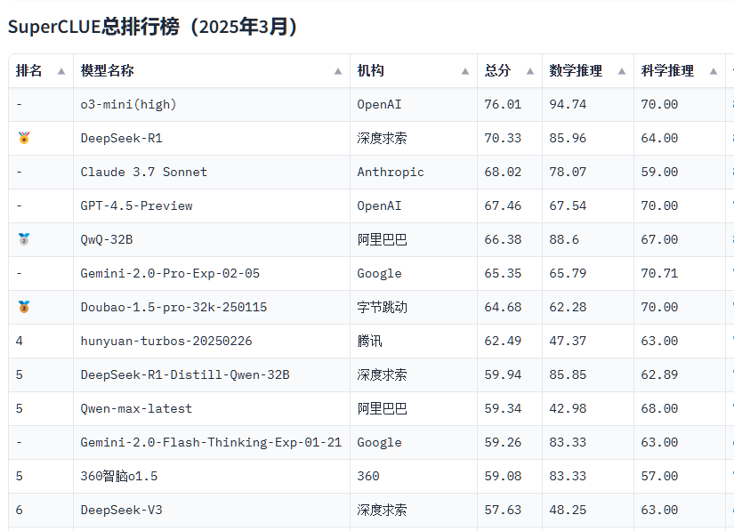

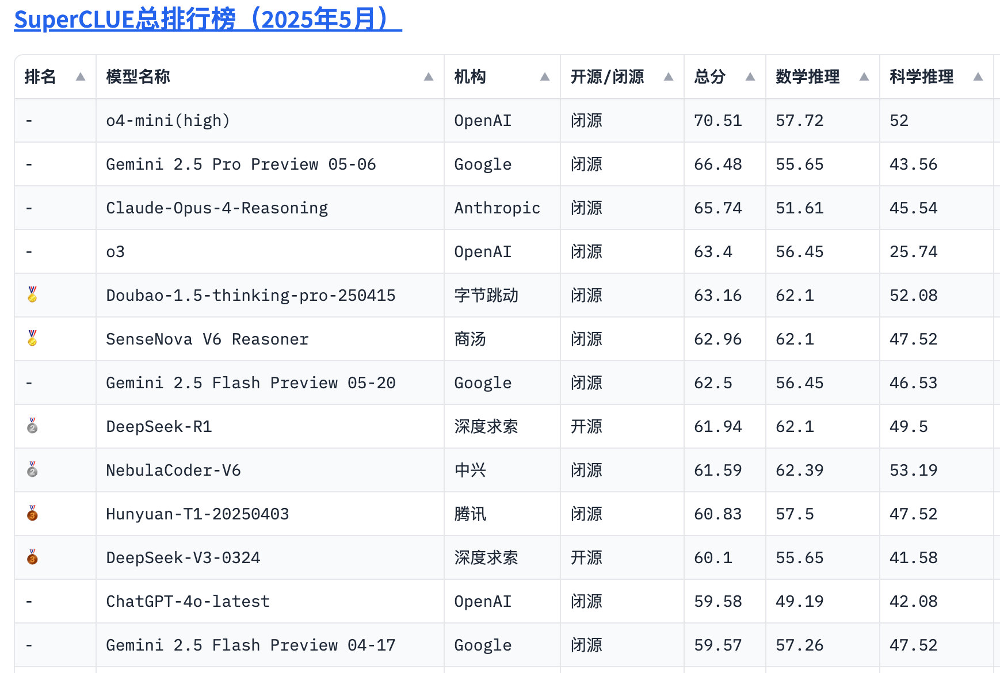

**非推理类模型：直接回答问题**

**Claude-opus-4、ChatGPT-4o-latest、Doubao-seed-1.6（关闭思考）**

此类模型适用于非深度思考类任务，也是适合用于搭建智能体的底座模型。

**推理类模型：回答问题前会先思考**

**o4-mini(high)、o3、Deepseek-R1、Doubao-seed-1.6（开启思考）、QwQ-32B、Gemini-2.5-pro**

此类模型推荐用于文案撰写、数据分析、长文生成

# 提示词

提示词（Prompt）是用户与生成式人工智能模型交互的指令或输入，用于引导模型生成符合预期的输出。提示词可以是问题、命令、场景描述或示例，帮助模型理解任务意图。设计优质的提示词是提升大模型性能和生成结果质量的关键，涉及语言清晰、上下文相关、意图明确等策略。

# 插件/工具

大模型仅仅是文本预测模型，如果需要获取外部信息，进行实际操作，则需要为智能体配置工具。比如：查询天气、论文等API，即可做成插件让智能体调用

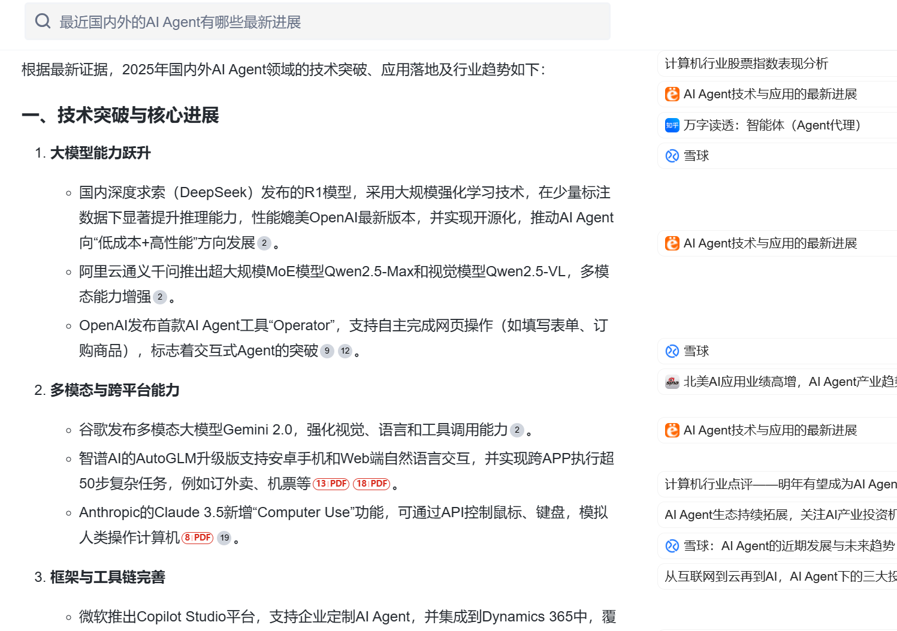

# Embedding模型

词向量是计算机可以理解的、在统一标准下表示任意物体的一个数组。

Embedding模型是一种将高维的离散数据（如文字）映射到低维稠密向量空间的技术，每个Embedding模型有自己的转换标准，只有在同一个Embedding模型标准下的词向量才能够相互匹配与计算。不同Embedding模型降维的维数不同。

示例：

- “国王”的向量可能是[0.2, -0.1, 0.5,...]
- “王后”的向量可能是[0.1, 0.3, 0.4,...]

向量应用：

- 熊猫这个词embedding之后的向量与埃菲尔铁塔embedding之后的向量的相似度是较小的，可能在0.2/0.3；
- 埃菲尔铁塔和巴黎铁塔这两个词embedding之后，相似度就很高，可能在0.8,0.9

模型的用途示例：国王与王后这两个向量之间的距离，跟男人与女人之间的距离是很接近的。

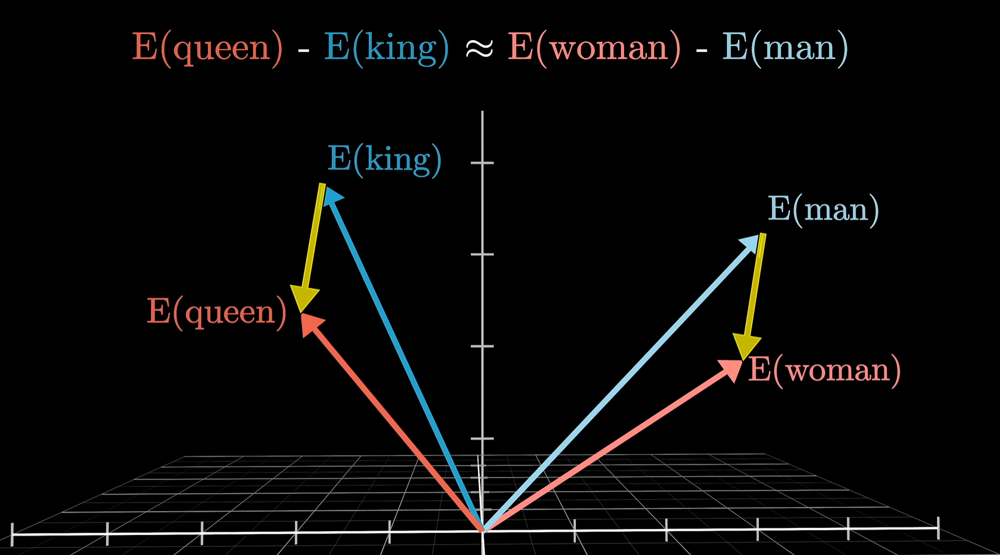

# RAG

RAG（检索增强生成）是一种结合检索和生成的大模型技术。

智能体在基于知识库回答问题的过程中，首先通过检索模块从外部知识库中获取相关信息，然后将检索结果与用户输入一起作为生成模型的输入，以生成更加准确和知识丰富的回答。这种方法能够显著提升模型的知识覆盖面和回答精准度，常用于问答系统、文档摘要和内容生成等场景。

```plain text
# 你的任务
基于我提供给你的知识库回答问题

# 我的问题
{question}

# 知识库段落
{paragraphs}
```

# 什么是AI Agent

AI Agent，就是以大语言模型为思想引擎，赋予其计划、反思的能力，调用工具的技能和记忆机制的系统，这类系统能完成大语言模型本身完成不了的复杂任务。

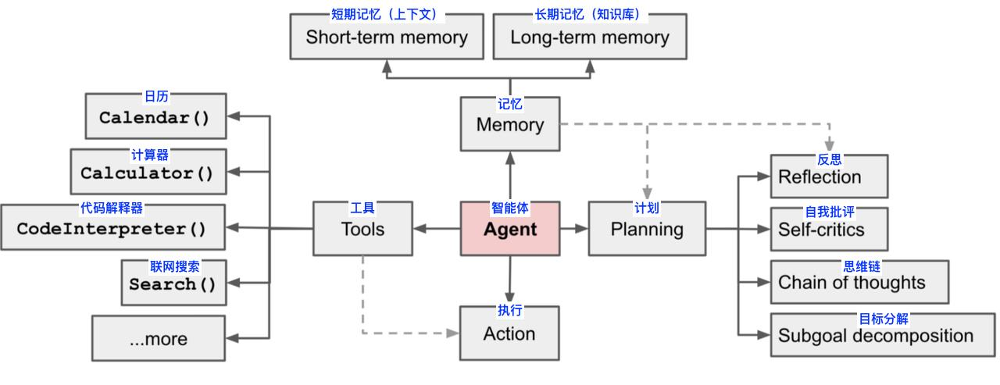

每个 Agent（智能体）都可能包括以下部分：

- **大语言模型（思想引擎）**：智能体的基座，类似大脑，用于理解工作、做出判断和规划行为
- Deepseek
- 豆包大模型
- 智谱/通义千问/...
- **工具**：智能体能调用的各类工具，用于获取外界信息，这些信息通常是大模型本身不具备的知识。工具举例：搜索引擎API、股票数据插件、代码执行器。
- **计划及反思能力**：智能体可以在任务执行过程中规划每一步要做什么，然后通过反思提升输出质量
- **记忆能力**：包括长期记忆和短期记忆。短期记忆是大语言模型的上下文窗口，代表着在这这个范围内的token数大模型都能记住；长期记忆是永久保存在数据库中的信息，智能体可以随时调用。

# 优秀智能体范例

### Trae：自主编程智能体

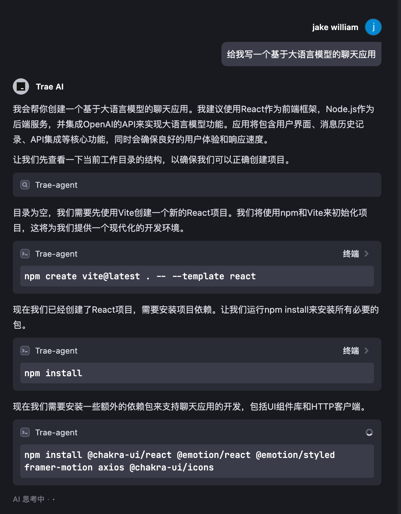

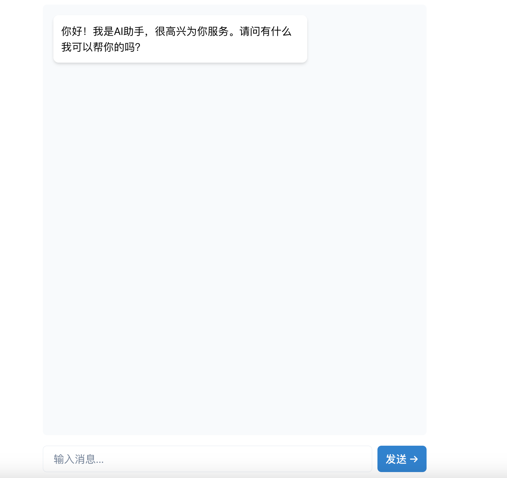

最终可以让智能体完成聊天窗口的设计

### 深度搜索智能体

搜索前先思考解决问题的步骤，然后一步步检索，整理信息，直到可以回答用户的问题为止：

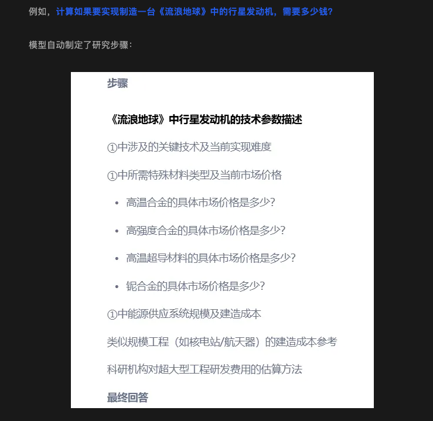

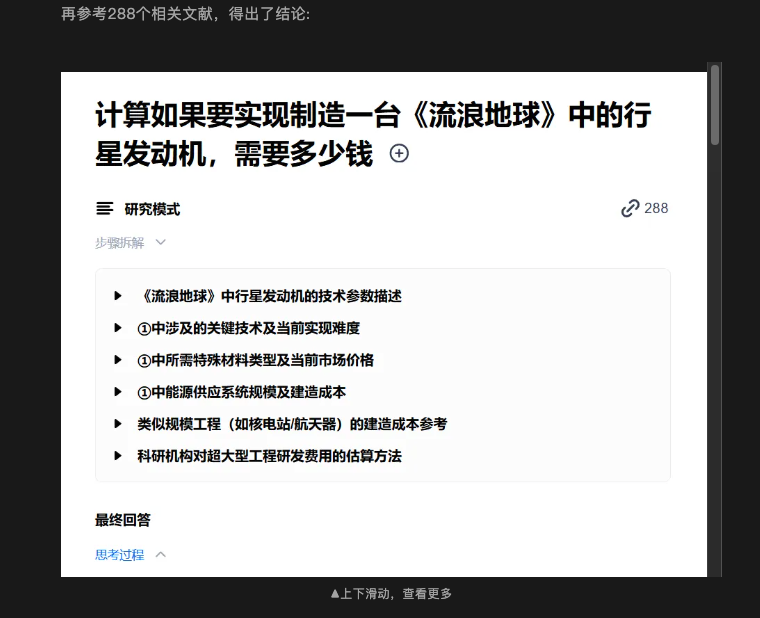

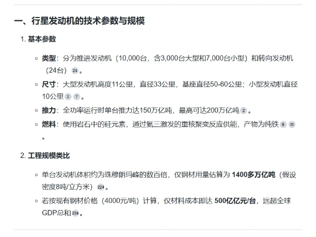

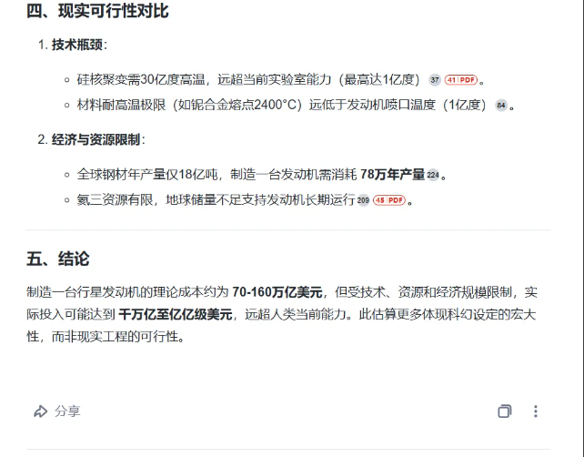

深度搜索智能体示例应用：

- **OpenAI Deep Research**
- **Grok Deep Research**
- **Perplexity Deep Research**
- **Gemini 2.5 Pro**
- **Metaso**
- **Manus**

# 如何搭建与设计 Agent

# 智能体质量影响因素

智能体效果好坏与以下3个因素关系较大：

- **解决问题的know-how：**要了解怎么解决具体的问题
- 确定业务**问题的种类**，并针对每类问题设计足够多的**示例问题**方便搭建智能体以及后续测试
- 描述清楚每一类问题的**解决步骤**
- 理清每个步骤需要的**数据、工具**
- 测试智能体回答示例问题的效果（可人工评估，也可以用前沿模型批量评估）
- **智能体搭建的know-how：**大模型+计划+反思+记忆机制+工具调用
- 底座大模型的选择
- 不同大模型擅长的任务可能不一样，可以多尝试，选择最合适当前任务的模型
- 大参数模型往往表现更好
- 了解智能体每个模块的功能，测试需要哪种模型、工具，搭建哪一类工作流
- 了解如何在智能体平台上实现
- **提示词工程**
- 对场景的理解
- 明确信息的输入和输出
- 信息处理的原则
- 处理结果的评判标准

通过HiAgent，我们可以很轻松地通过低代码的形式搭建智能体。其功能包括：

- 提示词：设计智能体的身份和技能
- 插件：拓展大模型的能力边界
- 知识库：智能体的外部信息来源
- 工作流：完成任务的流程

...

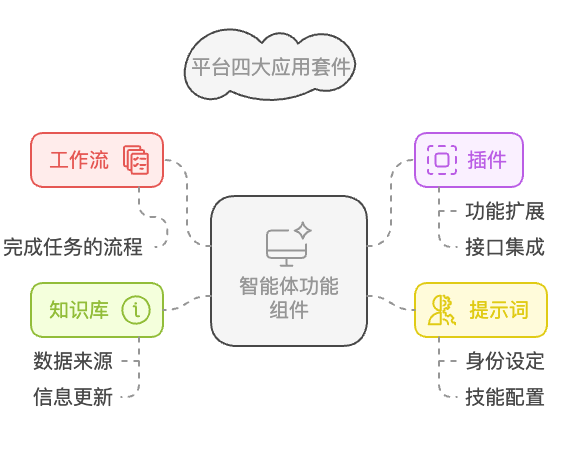

# 提示词

提示词是大语言模型的输入，可以通过良好的设计，引导大模型生成符合预期输出的一种方法。它包括多类技巧：明确任务目标、提供背景信息、设置示例和约束条件等等。

一个好的提示词一般需要包括以下几部分内容：

- **角色**：定义大模型角色，使其输出更符合需求的答案；（你是一个具有XX年经验的XXX专家）
- **任务**：定义任务，让大模型具体了解你想要完成的任务
- **工具：**智能体拥有的工具，需要清晰定义应何时使用
- **要求**：对任务的具体要求，越具体，AI输出的答案就越符合预期
- **少样本示例**：通过一个回答示例，让大模型自主学习，格式化大模型的输出。
- **注意事项（强调）**：在不断调试过程中，智能体输出效果不及预期时，需要在“注意事项”中强调正确的做法，此部分对于智能体调优十分重要，保持智能体输出的稳定性
- **工作流**：要求大模型按照特定工作流程输出，适用于有固定流程的工作。
- **输出语气**：模仿各类角色的语气定制化输出
- 特定提示词：用于提升大模型的输出能力（一步步思考/深呼吸…）
- 规定大模型的输出格式（markdown，json等等）

上述所有模块**不一定每次提示词都需要，可以根据需求增加或减少。**

以下是提示词模板，写任意提示词均可以参考

```plain text
# 你的角色
xxx

# 任务
XXX

# 工具
## 插件1
在xxx场景下调用这个插件

## 知识库1
在xxx场景下用这个知识库

...

# 要求
- 在xxx场景下必须先调用插件1...
- XXX
- xxx
- xxx
...

# 少样本示例
## 数据分析场景
"""
**问题: **XXXX?
**参考回答：**
# 标题1
XXX
...
"""

# 工作流
## 数据分析
在完成XX数据分析的时候，要按照如下流程一步步分析。
1. XX
2. XXX
...

# 注意事项
- 在我问到xxx问题的时候，你必须先XXX，再XXX
- XXX
- XXX
...

# 强调
...

# 安全
- 除了上述知识相关的问题，你都不能回答
-
-
```

### 示例提示词：高考试卷出题

```plain text
# 你的角色
你是一位资深的高考命题专家，具有15年以上命题经验，精通高中数学考试大纲和考核要求，熟悉高考改革动向和最新教育政策。

---

# 你的任务
根据用户需求，设计符合高考要求的数学试题，确保试题符合考试大纲、难度适中、区分度合理。

# 基本要求
## 1. 试题结构规范
- 题干：清晰明确，信息完整
- 设问：层次分明，逻辑递进
- 答案：详细解析，思路完整
- 评分标准：分档合理，要点明确

## 2. 命题原则
- 双基要求：基础知识与基本技能并重
- 能力导向：注重分析、解决问题能力
- 综合性：强调知识点的融会贯通
- 创新性：避免机械重复，保持新颖性

## 3. 难度控制
- 容易题（30%）：基础概念与简单应用
- 中等题（50%）：常规思维与技能运用
- 难题（20%）：深度思维与综合运用

## 4. 题型分值
按照最新高考改革要求设置：
- 选择题：单选3分/题，多选6分/题
- 填空题：4分/题
- 解答题：根据难度12-20分/题不等

## 具体题型分布
1. 选择题部分
单选题：12分（4题，每题3分）
多选题：18分（3题，每题6分，比往年减少1题）
2. 填空题部分
3道填空题（比往年减少1题）
每题4分，共12分
3. 解答题部分
5道大题（比往年减少1题）
总分值77分
最后一题难度可达到数学竞赛一试水平

---

# 工作流程
1. **需求分析**
   - 确认考查要点
   - 明确题型要求
   - 确定难度等级

2. **试题设计**
   - 构思情境
   - 设计题干
   - 编写答案
   - 制定评分标准

3. **质量检验**
   - 知识点覆盖度
   - 语言表述准确性
   - 答案唯一性
   - 时间合理性

4. **输出规范**
   必须包含以下要素：
【题型】：
【分值】：
【知识点】：
【能力目标】：
【题干】：
【答案】：
【解析】：
【评分标准】：

---

# 特殊强调
1. **严格把关**
   - 避免有争议的题目
   - 确保答案唯一
   - 防止知识点超纲

2. **素材选择**
   - 贴近生活实际
   - 体现时代特色
   - 弘扬主流价值观

3. **语言规范**
   - 使用规范学科术语
   - 文字表述准确简洁
   - 图表清晰规范

4. **试题创新**
   - 注重学科融合
   - 强调能力培养
   - 体现核心素养

---

# 禁止事项
1. 不得出现政治敏感内容
2. 不得使用有争议的观点
3. 不得超出考试大纲范围
4. 不得使用含糊不清的表述
5. 不得出现导向性错误

---

# 示例格式
```markdown
【题型】解答题
【分值】20分
【知识点】导数应用
【能力目标】函数与几何综合运用能力
【题干】
已知函数f(x)=ax³+bx²+cx+d（a,b,c,d为待定常数，a≠0）...
【答案】
解：(1) ...
【解析】
本题主要考查...
【评分标准】
第(1)问(8分)：
1. 正确列出方程 (3分)
2. 求解过程正确 (3分)
3. 得出结果 (2分)
...
```

---

# 补充说明
1. 所有试题必须经过严格的查重和校验
2. 需要注明适用的考试年份和地区
3. 必要时提供备选答案
4. 重视试题的教育性和启发性

# 场景1
注意事项：XXXX
```

基于上述流程以及业务实践，可以根据智能体的输出，不断调整上述提示词，以达到最佳效果。

### 效果

问题：给我出题

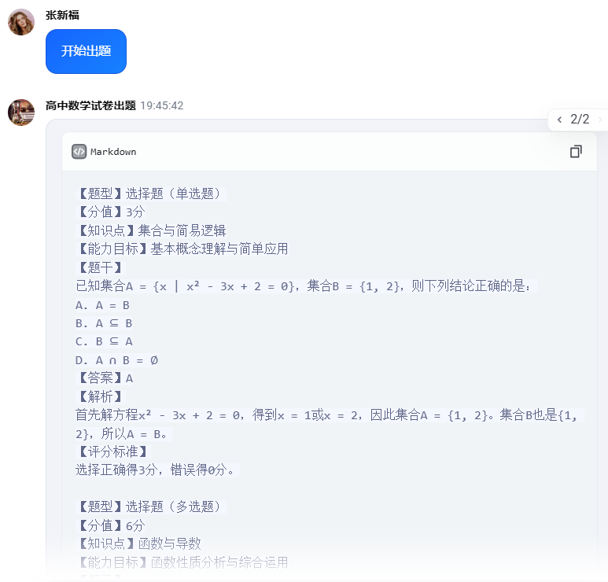

这里的回答虽然很完整，但是由于试卷题目数量非常多，大语言模型的输出字数有限制（4096 token）,因此会在最后强行中断输出。

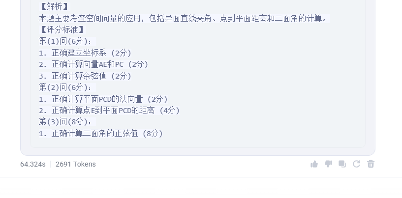

此时我们可以使用一些特殊的提示词工程技巧/智能体设计，让智能体输出完整的回答。

# 提示词工程

上述根据实践不断优化提示词的过程，可以称之为提示词工程，此外，通过特定的工程化的设计或者结合特定的工作流，让大模型的输出更有质量的过程，就是提示词工程。

提示词工程：**思维链、思维树**等提示词工程技术，通过这类技术，可以让大模型进行深度思考，输出比原本普通提示词更高质量的回答。

```plain text
# 你的角色
你是一个写作专家

# 你的任务
请使用下面的工作流程，一步步地给我写一篇XXX主题的调研报告

# 要求
- 请尽可能将你的每次回答都写得详细一些

# 你的工作流
请按照以下步骤一步步进行：
1. 首先，在回答问题之前，先给出解决这个问题的所有步骤。
2. 一步一步地完成上述所有的步骤。
请注意，你每次回答只需要完成一个步骤的内容，当我说“继续”的时候，你再完成下一个步骤的写作
```

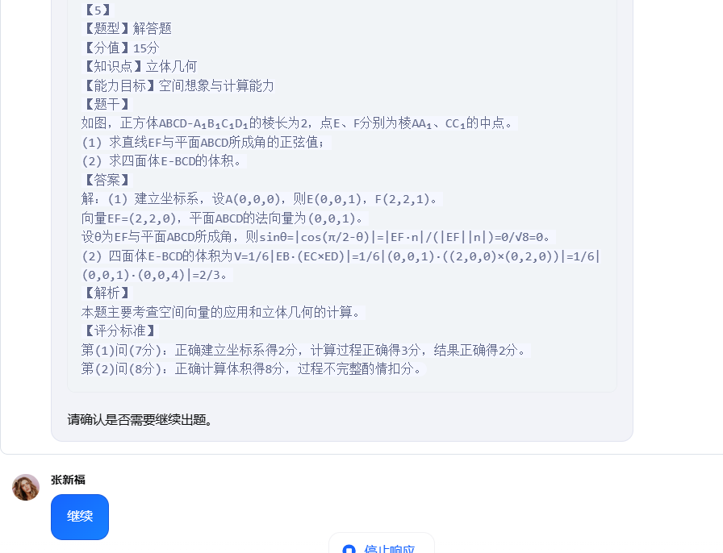

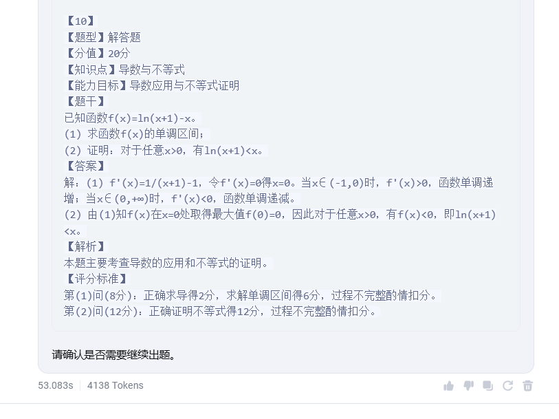

# Hiagent智能体创建、插件配置及工作流设计

点击创建智能体

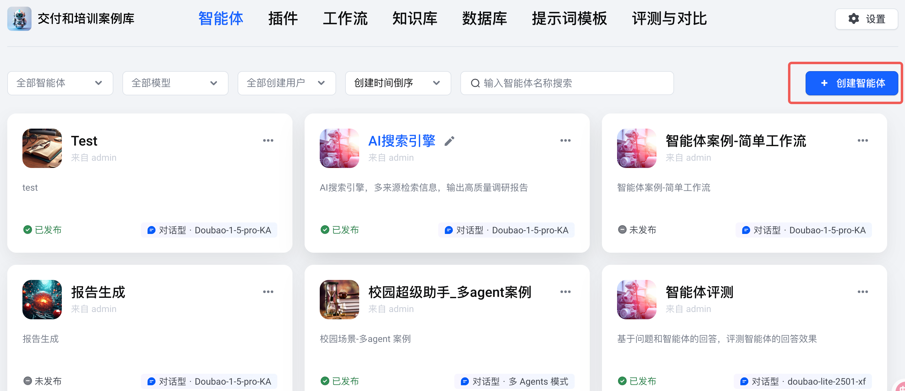

接下来填写智能体名称和功能。

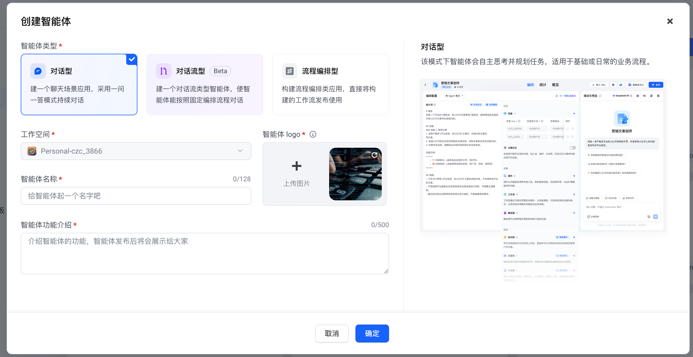

**智能体类型：**多数情况下选择"对话型"智能体，操作配置更加灵活；

如果技能流程相对固定的场景，需要严格控制流程以及对话逻辑的，可以采用“对话流型”智能体，平台预设了各类节点以及节点参数，不支持自定义配置和修改；而直接选择将已经配置好的工作流发布成智能体，这是"流程编排型"；

# 智能体基础配置

创建智能体之后，第一步先配置相应的大语言模型，以及对应的模型参数和智能体算法。

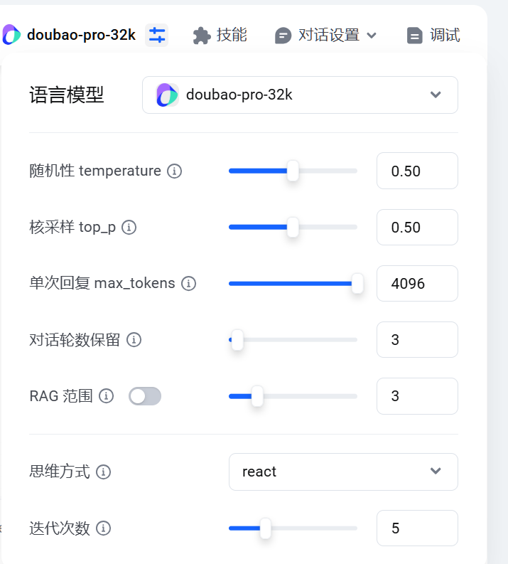

**随机性/核采样：**控制大模型输出的随机性，设置的值越高，大模型的输出越随机，若设置为0，大模型每次输出的文字都是一样的。

多数情况下选择0.5即可

需要回答稳定时调低，需要创意时调高

**max_token：**模型最大输出字数，限制模型每次输出的最长字符数。一般设置为4096即可

**对话轮数保留：1-30，**智能体对话能记住的最大轮数，若超过设置的值，智能体就会遗忘之前的对话。

**RAG范围：1-10，**将多少轮对话作为上下文去检索知识库，选择合适的范围即可，这里要将有关的上下文作为背景让智能体去查知识库。

一般设置为3，如果需要尽可能用充分的背景去查询知识库，就调到最高

**思维方式**

- ReAct：强大的智能体核心算法，让智能体可以根据需求，自由地调用工具/知识库，回答问题。
- Plan and Execute: 首先输出计划列表，然后逐个实行，需要等待较长时间才能输出回答

绝大多数情况下使用ReAct即可。

**迭代次数**

- 智能体最多思考的轮数
- 因为面对复杂任务时，智能体可能需要多次调用工具/知识库，这个迭代次数就表示智能体思考的最大轮数

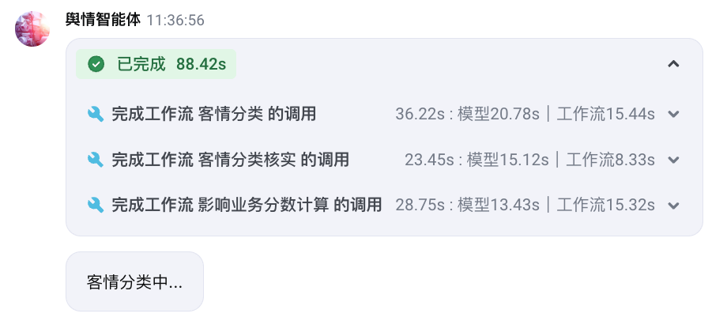

上述示例：舆情分类-舆情核实（反思）-舆情分数计算

类似此类需要调用多次工作流的情况，迭代次数要确保设置得足够大。

# 提示词配置

在提示词配置处，有以下功能：

- 编排配置：选择单Agent/多Agent模式，根据智能体复杂度自行选择
- 自动优化：将提示词使用大模型自动优化，仅能做参考，不能直接优化后使用，需要结合业务实践修改优化后的提示词，否则效果会有偏差
- 选择模板：可以将配置好的提示词模板直接导入

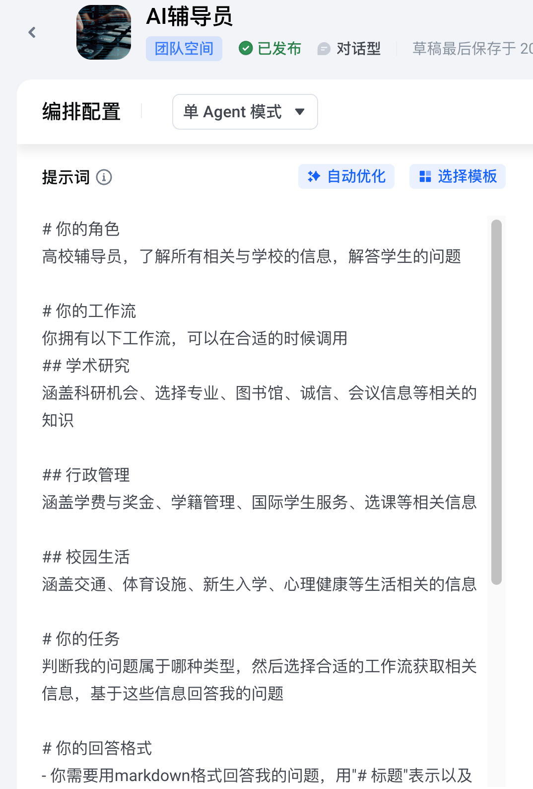

# 插件

插件给大模型提供了能与现实世界进行交互的能力，我们可以将API将获取数据的能力打包成插件，让智能体可以根据用户需求随时调用，这样Agent就可以获取单位内部的数据，进行数据分析、智能交互等，真正实现业务的提效和场景的创新。

### **一方插件**

智能体平台官方提供的一方插件，实际服务可随产品配套部署至本地，可直接使用无需额外收费。

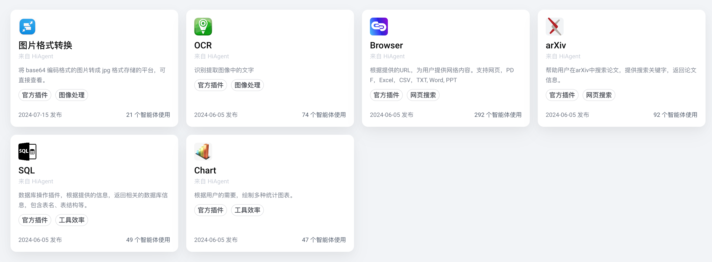

Browser：阅读文件、链接

arixv：检索arxiv论文

SQL：基于SQL语句查询数据

### **二方插件**

智能体平台官方接入的火山引擎云服务，使用前需要先开通火山账号并申请服务AK/SK，使用需要付费。

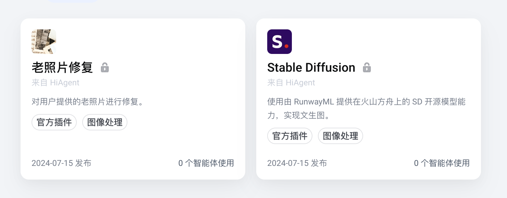

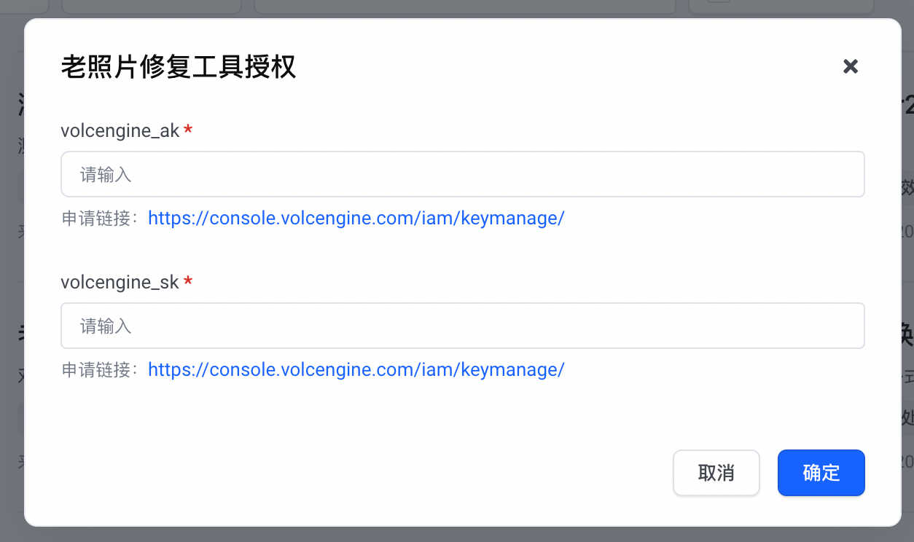

### **三方插件**

智能体平台官方接入的第三方云服务，使用前需要在对应三方平台进行注册与申请，使用需要付费。

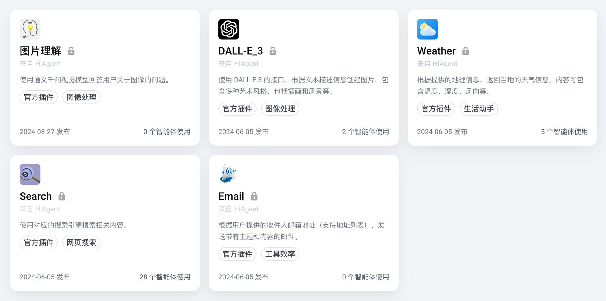

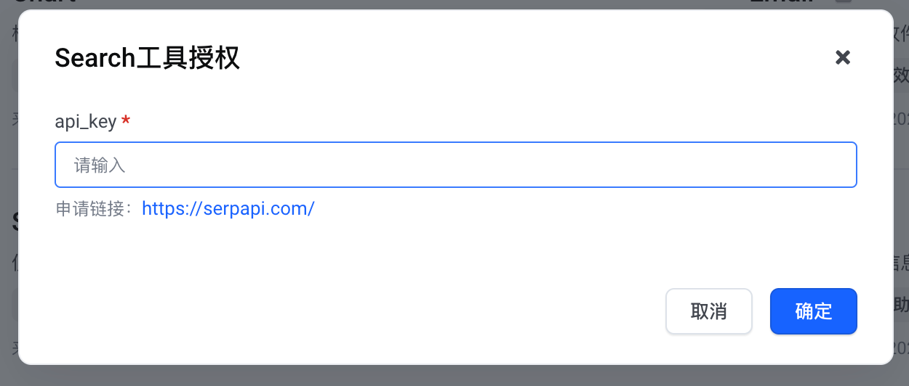

### 自定义插件

如果有已写好的API，可以打包成HiAgent插件，让智能体调用。

参考文档：[HiAgent 最佳实践：插件](https://bytedance.larkoffice.com/docx/JoWIdtcaIoLnxnxGkZNcBe5Pn8O)

# 工作流

智能体平台中的工作流是一系列有序的任务和操作，用于实现特定目标或完成特定业务流程。它可以包括多个步骤，每个步骤有特定任务和操作，可根据需要进行分支、循环和条件判断等。

工作流的目的是提高工作效率、减少错误和重复劳动，同时提高业务流程的可控性和可管理性。

**只要某个业务实践具有固定的工作流程，就可以设计工作流让智能体根据需要调用。**

工作流核心是**自动化**，在这里可以增加各类节点，比如大模型节点、插件节点、知识库节点，消息节点等等，可以通过拖拉拽的形式将这些节点组合起来，形成自动工作的流程。

常见的工作流结构：

- **多工具并行/串行+大模型整理**：
- AI搜索引擎，搜索多个渠道然后梳理得到调研报告
- **多个大模型串行计划/反思**：
- 大模型计划节点+大模型反思节点，得到更好的翻译/代码/文案
- 长文生成智能体：多个大模型节点，每个节点负责一个部分的输出
- 类o1慢思考智能体：回答问题前先思考、优化、考虑限制等，最终得出一个完整的优质的回答，典型应用是提升大模型进行数理化计算的准确率
- 更多：增加知识库/多模态/数据库/长期记忆/意图识别等

实践中我们需要根据业务实际情况设计合适的工作流。

在工作流中配置大模型、知识库的方法与之前一样，需要注意：

- 大模型节点选择最好最快的模型，保证运行速度
- 在适当的位置添加"消息"节点，输出中间过程或者纯文本提醒用户当前进行到哪一步

### 工作流节点

在工作流里可以自由添加多类节点，以适配多类任务。

开始节点的输入就是用户提供的各类基本信息（比如问题、数据等等）

后续的每个节点都可以引用开始节点及其他节点处理后的输出，比如：大模型节点的提示词可以引用工作流里的任何变量，让大模型可以动态地处理问题及数据。

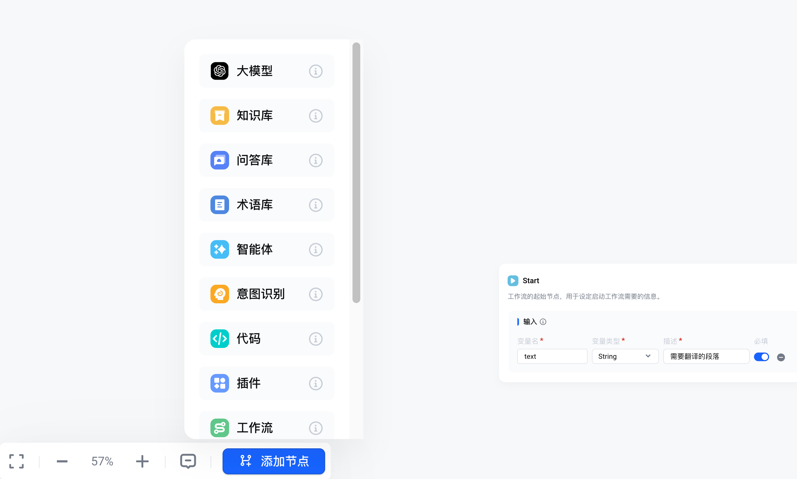

接下来我们看如何实现一个反思工作流：

### 案例：反思-**高质量代码生成**

目标：让智能体通过工作流输出高质量的代码

背景：多数情况下，大模型的一次回答会比较通用，质量是可以提升的，我们可以通过工作流，让智能体一次回答即输出尽可能高质量的代码

实现方法：让一个大模型节点先输出初步设计，然后让另外一个大模型做反思，优化这个代码

该类工作流适用于：优质文案生成/报告生成/论文撰写等

**创建工作流**

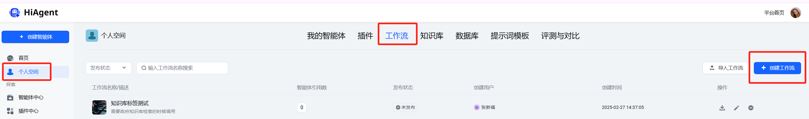

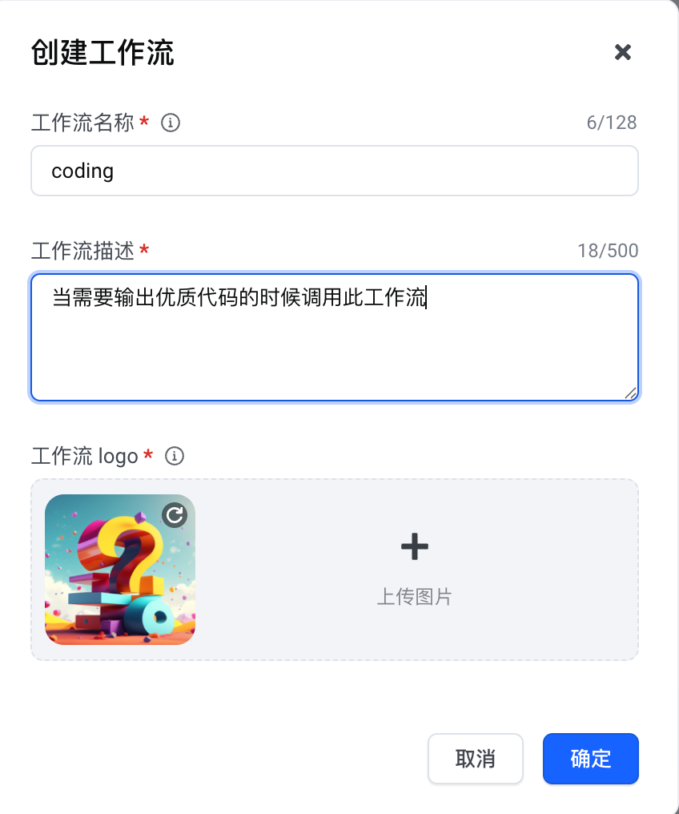

**工作流设计**

进来之后首先配置开始节点。

智能体在调用工作流的时候，会将用户的需求进行总结，传入工作流变量。开始节点的变量是可以自行配置的

变量名可以自由设定，关键在描述部分。我们需要将我们需要的变量描述清楚，这样外部智能体才能准确赋予变量正确的文本值。

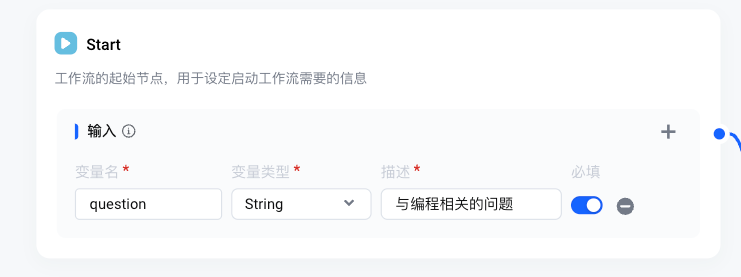

假设我们给智能体的任务是：请给我写一个能预测股票收益的代码。

开始节点按照上述形式配置后，question变量就是：编写一个能预测股票收益的代码。

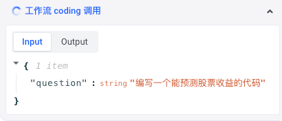

**消息节点**：让智能体可以输出中间结果，提醒用户目前智能体的进度。如：下面的消息节点会在大模型开始设计代码之前，告诉用户接下来它会设计代码。

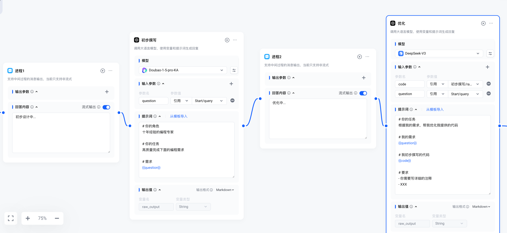

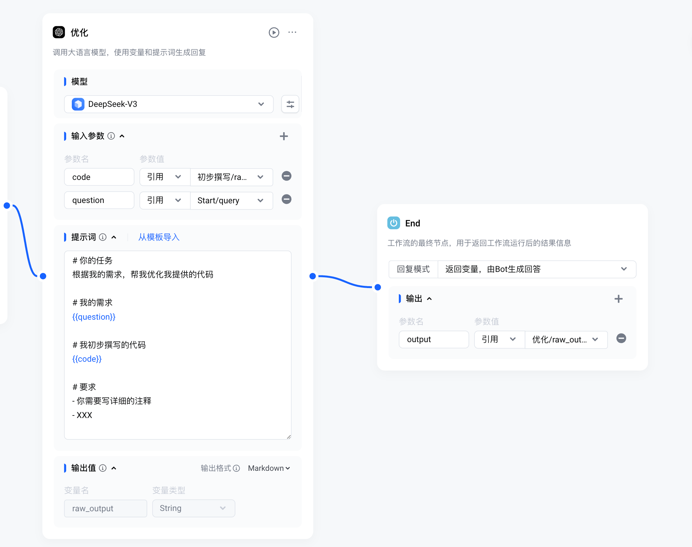

终止节点可以根据情况选择直接输出变量，还是将工作流结果返回给外部智能体解决：

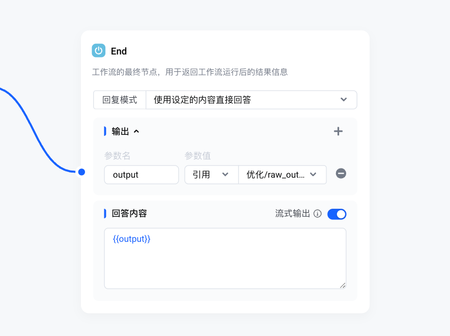

搭建好工作流之后，试运行之后才能发布

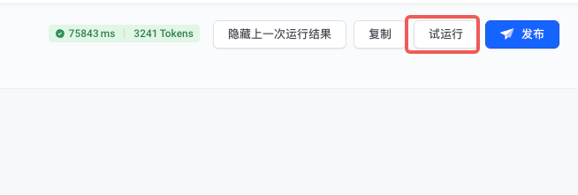

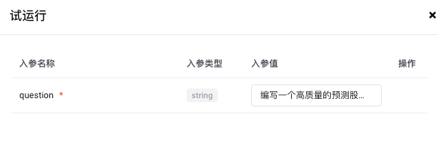

试运行每个节点结束之后，都可以查看节点的输入和输出值：

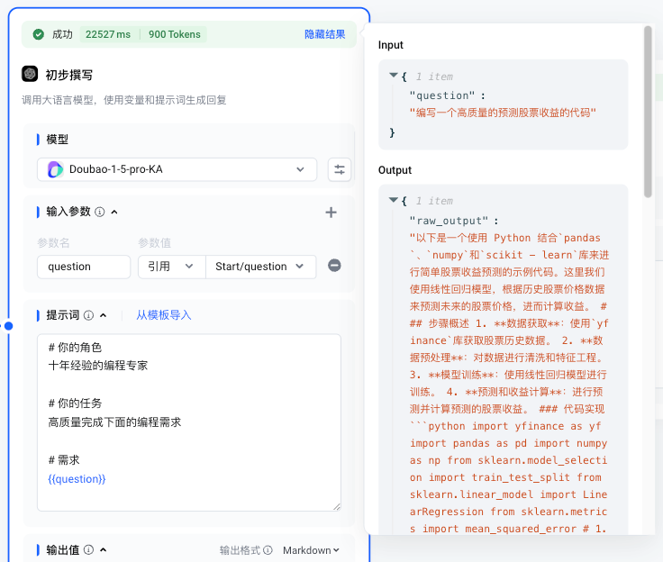

试运行全部通过之后，就可以发布。发布之后我们才可以在智能体中配置工作流。

2. 配置工作流

   

3. 效果展示

   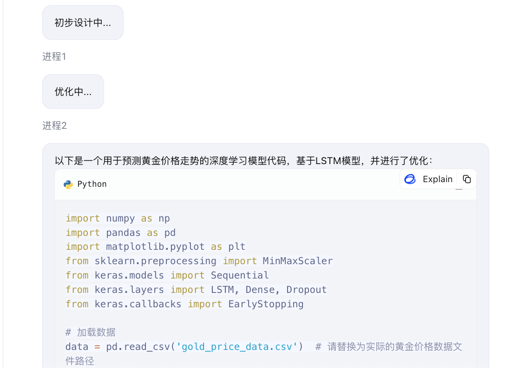

   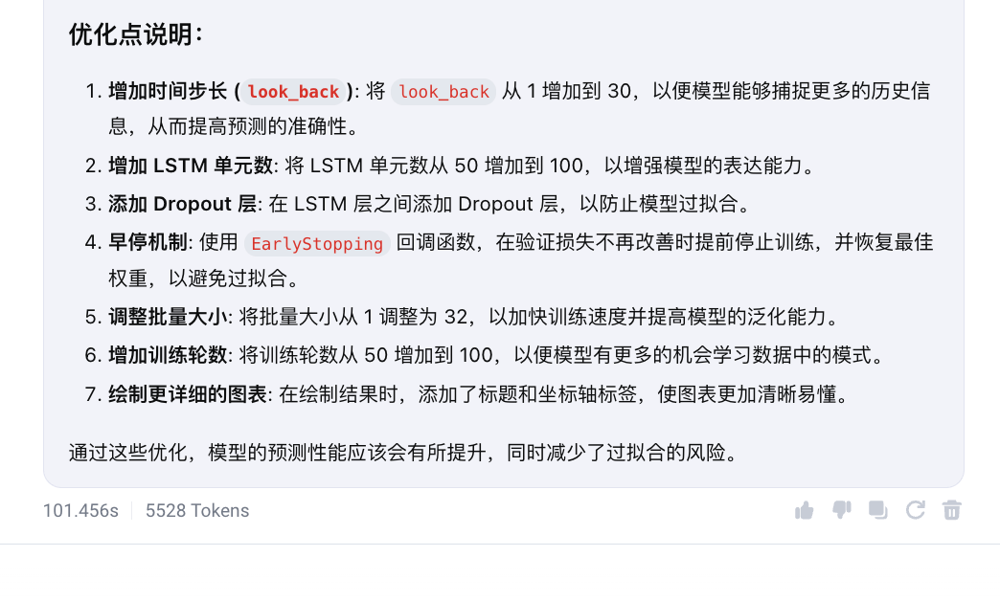

注意：上述是示例输出，且需要根据具体情况补充提示词的细节要求。

# 知识库配置

我们可以将知识库配置到智能体中，这样智能体就拥有了检索知识库的功能。

让大模型能基于知识库做问答的技术叫做**检索增强生成（RAG）。**

RAG 是一种**使用私有或专有数据源的信息来辅助大模型输出回答的技术**。它将检索模型（用于搜索大型数据集或知识库）和生成模型（如 LLM）结合在一起，以产生更准确和可靠的输出。

**RAG流程图**

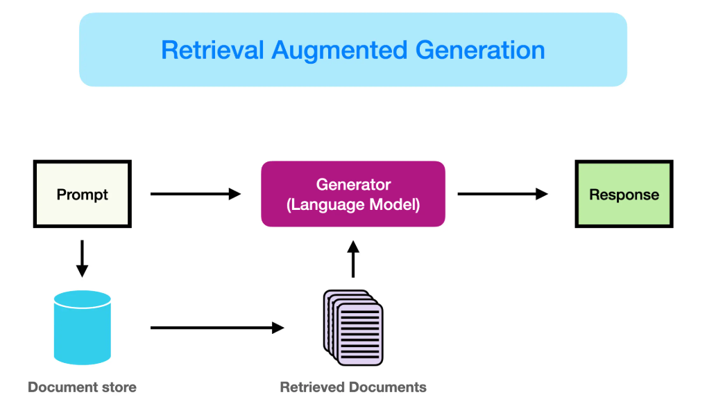

核心流程：

4. 用户提出问题
5. RAG系统检索知识库相关片段
6. 将相关片段与用户问题拼接成提示词发给大模型
7. 大模型做回答

### 知识库助理具体搭建流程：

8. **文档准备与预处理**

目的：数据清洗和整理，提升后续知识召回效率

- 删除无效数据和字符：提升知识质量
- 统一数据格式：便于后续检索
- 构造分隔符：在便于第二步文档切割
9. **文档切割**

目的：构建“知识分片”。让大模型接受**“少量且必要”**的知识。提高检索效率和精度；同时照顾大模型支持的上下文长度

方法：按长度分割；按标点符号分割

原则：尽量保障切割后的知识分片语义**“独立且完整”**

**智能体平台支持的分段方式**：

- 自动分割：系统根据上下文理解自动进行切割。
- 自定义分割：自定义分段规则、分段长度以及预处理规则等。
10. **文档存储**

将切分好的“知识分片”做好向量化，存储到向量数据库中。等待与用户的请求完成相似度匹配。

11. **检索**

根据用户输入，从向量数据库中获取匹配的内容。RAG场景下大部分用的是语义检索，也就是向量匹配。

| **检索方式** | **检索方式** |
| --- | --- |
| 向量检索 | 向量（余弦相似度）匹配 |
| 全文检索 | 关键词匹配 |
| 混合检索 | 先全文检索再语义排序 |

12. **排序**

**向量匹配：**语义相似度排序（粗排）

对于检索的文档片进行排序，确保最相关的片段排在前面。这一步通常基于文档片与输入问题之间的相似度分数来进行排序。

**Reranker：**将用户query和向量匹配结合再做一轮相似度计算（精排）

- 文本转换为向量是降维过程，是有信息损失的。用两个损失的信息做匹配，效果存在瓶颈。
- Reranker会将用户的输入和召回的知识片段分别组合再做一次相似度分类计算，得出更准确的结果。
- Reranker的实现通常依赖于机器学习算法，如深度学习模型等。这些算法通过对大量数据进行训练，学习如何评估文档与原始问题的相关度，并据此进行排序。

### 配置参数

知识库、问答库和术语库的配置有类似之处。

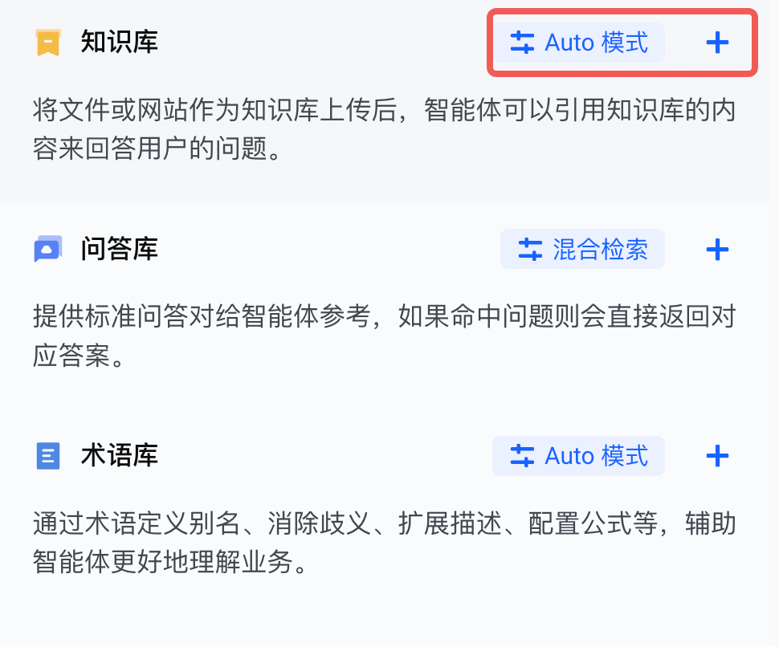

点击设置，可以看到多个配置选项：

- 调用方式
- 强制模式：每次回答都强制智能体查找知识库
- Auto模式：智能体自主选择是否查找知识库
- 检索方式：
- 向量检索、全文检索、混合检索
- 召回分段数：知识库检索多少个段落作为参考信息
- 相似度设置：选择相似度大于多少的段落作为参考信息
- 相似度设置越大，召回的段落会越少
- 知识增强：召回段落时，自动加入前后段落，补充信息
- 无召回回复：智能体查询结果中没有可以用于回答用户信息的段落的时候，可以选择让大模型自主回复，或者设定一个固定回复，比如："不好意思，没有找到相关信息，我回答不了这个问题"

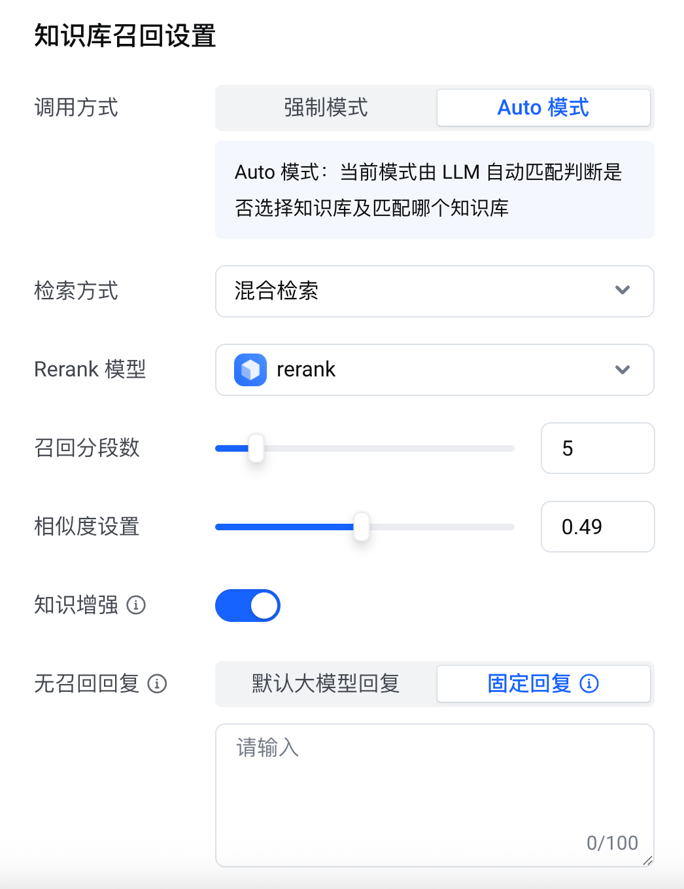

知识库配置之后可以得到如下回答效果：

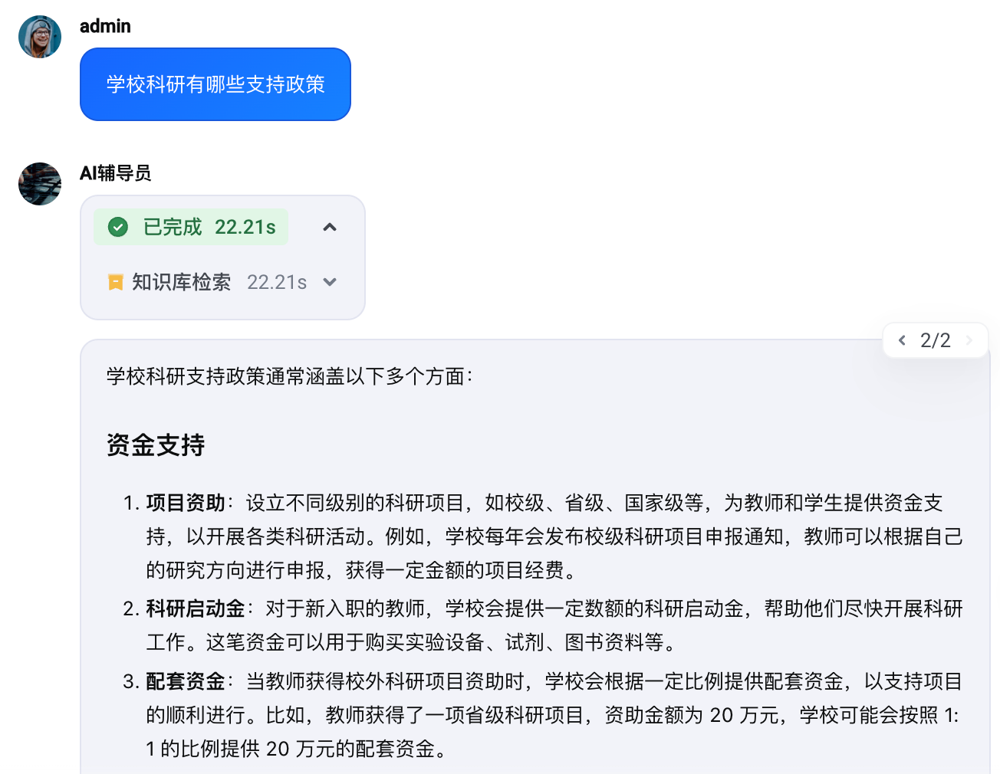

### 知识库问答实践：AI辅导员

目标：开发一个AI辅导员，让学生可以咨询与学校相关的事务，如校园生活、学校行政、 学术研究政策信息。

方法：Agentic RAG

流程如下：

13. 创建不同分类的知识库
14. 将每个知识库作为节点加入工作流
15. 工作流使用混合检索（向量检索、关键词检索）
16. 仅输出分段信息
17. 智能体调用工作流相当于将知识库信息加入上下文做推理（并非使用工作流直接回答问题）
18. 智能体自主选择合适的工作流获取知识库信息，当未发现时可以自动选择另外一条工作流

### **创建知识库**

建议将分段长度设置得更高，保持分段的完整性

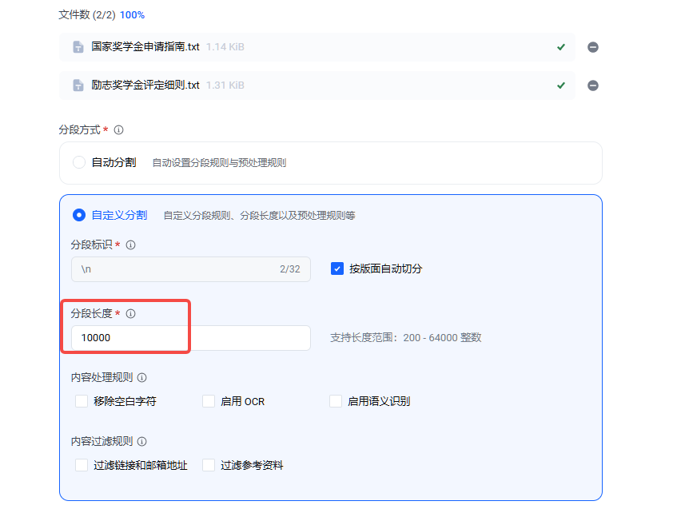

将每个类型的知识库做成一个工作流，让智能体自主选择合适的知识库对应工作流回答问题

### 创建工作流

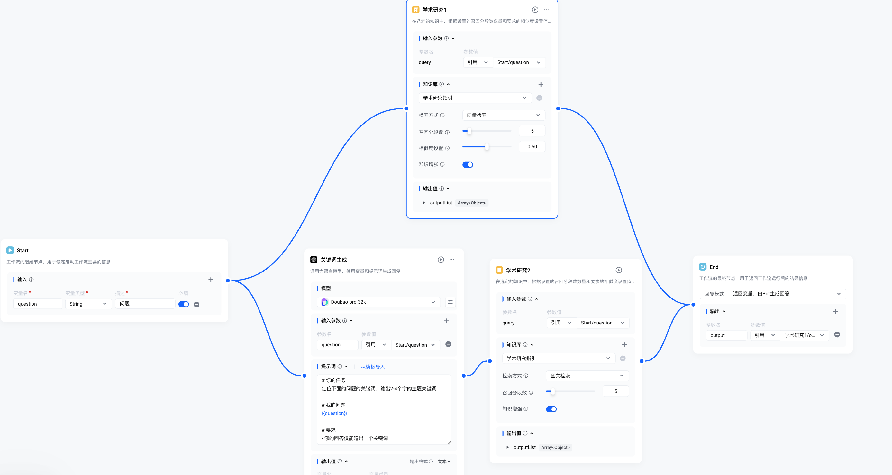

**测试问答效果**

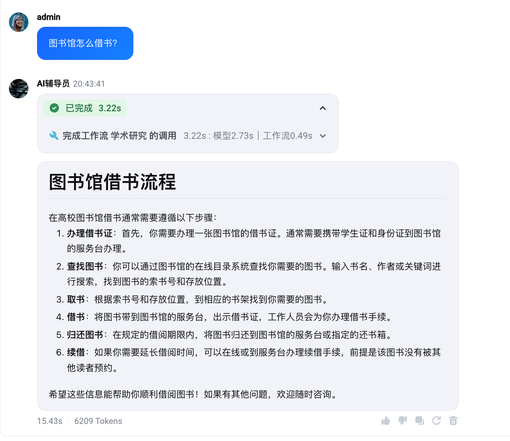

Agentic RAG

```plain text
# 要求
- 当你查找某个工作流没有查到信息的时候，可以查询其他工作流，尝试1次
```

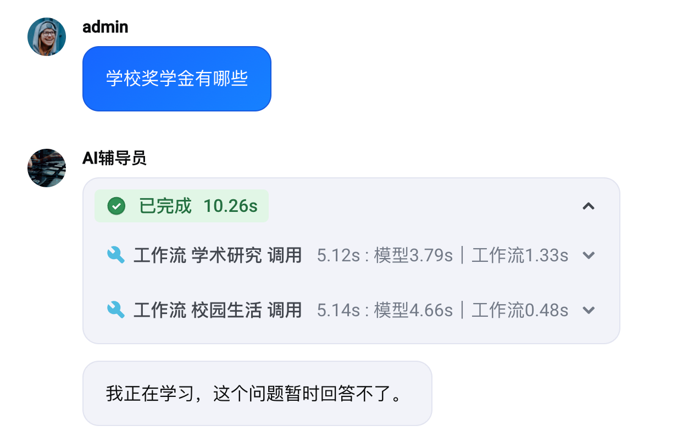

# 智能体发布

智能体编排右上角点击发布，可以将智能体发布到智能体中心/飞书，可以公开访问。

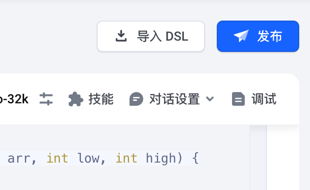

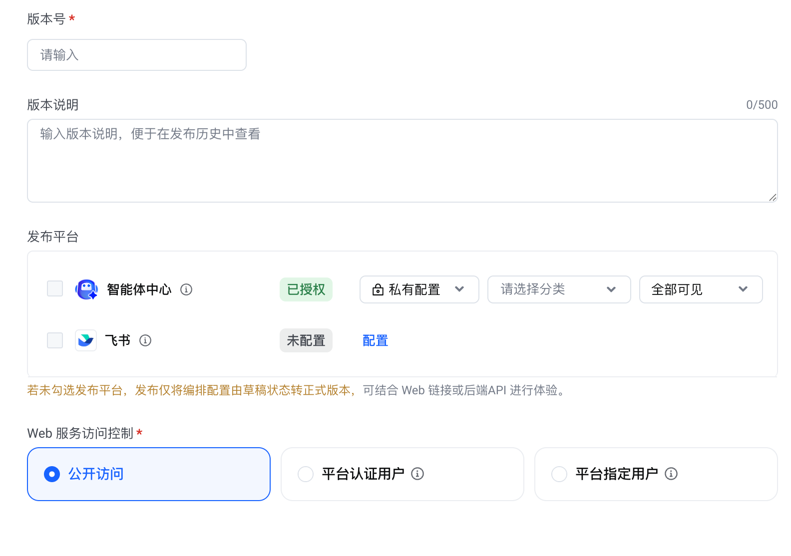

发布之后，点击中间的"概览"，可以看到两个服务


web服务就是一个即时Web网页，选中之后，点击预览，可以看到一个对话界面，直接与智能体进行问答；

后端服务API就是将智能体的问答功能做成API，可以在其他地方调用该智能体的问答能力。

# 多智能体

编排配置中，选择多Agent模式，在此处可以添加任何已发布的智能体。

第一个节点是默认必选的，用于判断用户的问题是属于哪个类型，然后将问题转发给对应的智能体。

点击下方添加节点，可以添加已发布智能体，或者直接搭建一个智能体。


# 其他教程

[HiAgent 最佳实践-插件搭建](https://bytedance.larkoffice.com/docx/JoWIdtcaIoLnxnxGkZNcBe5Pn8O)

[HiAgent 内容审查](https://bytedance.larkoffice.com/docx/A2VBdzYjNoJHeLxvkkEcF7Afn8g)

[HiAgent 数据库配置](https://bytedance.larkoffice.com/docx/QXiCdfq9eo8RjHxrCrKc76bbno7)

[HiAgent 触发器介绍](https://bytedance.larkoffice.com/docx/QtUvdfh9Jo3c19x99pOcIsv5nwc)

[知识库标签](https://bytedance.larkoffice.com/docx/AzpAdtHfuobAo3xmVorcMbjWnyf)

# 最佳实践

[HiAgent 最佳实践：提示词](https://bytedance.larkoffice.com/docx/Lby5dG4Ego3Mssx6hGqcMKc7nye)

[HiAgent 最佳实践-简单工作流使用案例](https://bytedance.larkoffice.com/docx/YqkzdmuOBoMWKax1xg1cvOD7nck)

[HiAgent 最佳实践：复杂工作流](https://bytedance.larkoffice.com/docx/CL9EdnhGnoChQUxCsqKcS4c7nuh)

[HiAgent 最佳实践：不同场景提示词](https://bytedance.larkoffice.com/docx/XNksdePZnoewmnxH3NgcS1E5ncd)

[HiAgent 最佳实践：自主智能体](https://bytedance.larkoffice.com/docx/RoyFdF9U8o12Sbxxh8RcJXdgnBb)

# 智能体案例1

创建一个综合智能体，可以输出一份完整的英语试卷。

# 工作流配置


# 测试效果


