# 一、前提概要

# 实现流程

- 使用 `spring-ai-starter-mcp-server-webmvc` 把普通 Spring Bean 变成 AI 可调用的 Tool；
- 在双数据源（含 Doris）场景下安全地暴露只读 SQL 查询能力，包含防注入与限流措施；
- 将 GB/T‑32960 报文解析逻辑封装为 Tool，让模型直接解析十六进制报文并返回结构化结果；
- 实现 MethodToolCallbackProvider 注册、SSE 流式响应、以及 Agent 侧的调用配置示例；
- 生产化建议：鉴权、配额、审计日志、异常策略与监控接入。

# 成果展示

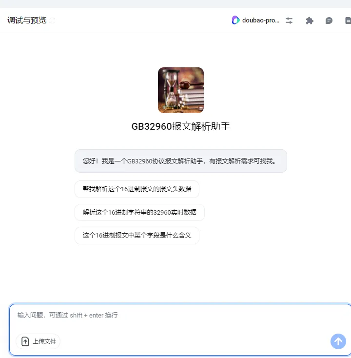


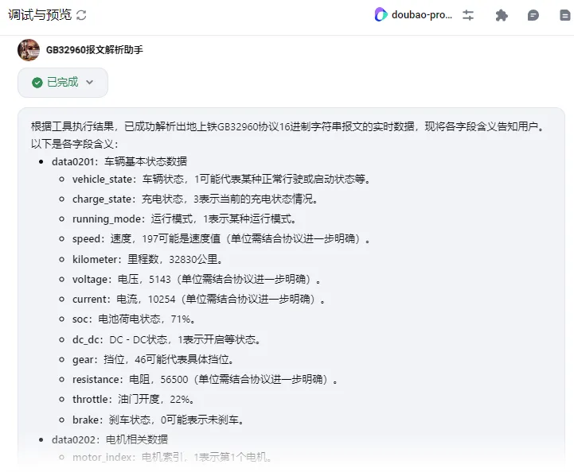

# 二、什么是 MCP-Server?

# 1. 什么是MCP?

MCP 全称 **Model Context Protocol**，直译就是 **模型上下文协议**。它是一个 **标准协议**，用于让 **大模型（LLM）和外部应用/工具** 能够方便、安全地交互。

# 2. 什么是MCP-Server

**MCP Server** 就是 MCP  协议的 **具体实现端**，负责把企业的 **业务系统、数据库、工具** 暴露出来，供大模型调用。

**MCP Server = 把内部系统包装成标准接口的“翻译官”**。

模型通过 MCP Client 发送请求，MCP Server 把请求转化为业务系统能理解的操作，再把结果返回给模型。

如果想更加深入的了解MCP，可以参考篇文章

此处为语雀内容卡片，点击链接查看：[https://www.yuque.com/u22429903/kf0kog/hpuy0cxw7mztrzne?singleDoc#](https://www.yuque.com/u22429903/kf0kog/hpuy0cxw7mztrzne?singleDoc=#)

# 三、开发前的准备

Spring AI 是一个面向人工智能工程的应用框架。其目标是将 Spring 生态系统的可移植性和模块化设计等设计原则应用于人工智能领域，并推广使用 POJO 作为人工智能领域应用程序的构建块。

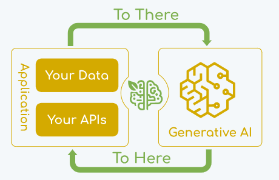

### a. Spring AI 简介与架构认知

**Spring AI 是 Spring 团队推出的 AI 应用开发框架，目标是让开发者像写普通 Spring Boot 应用一样，轻松调用大模型、RAG、向量库、Prompt 模板等能力。**

核心特性：

- 支持多家模型提供商（OpenAI、Azure、Ollama、Anthropic、百度、阿里、智谱等）
- 内置 `ChatClient` / `EmbeddingClient` / `ImageClient` 抽象层
- 统一配置体系（通过 `application.yml`）
- 提供 RAG、Prompt Template、Memory（会话上下文）、工具函数调用等扩展
- 未来版本将内置 **MCP Server Starter**

---

### b. 环境与工具准备

| 项目 | 要求/建议 |
| --- | --- |
| **JDK** | **17 或更高版本**（Spring Boot 3+ 必须） |
| **Spring Boot** | 3.3.x 或更新版本 |
| **Spring AI** | 建议 ≥ `1.0.0-M2` |
| **构建工具** | Maven 或 Gradle（推荐 Maven） |
| **IDE** | IntelliJ IDEA / VS Code / Eclipse |
| **网络代理** | 若访问 OpenAI / Azure 等国外服务，需要配置 HTTP/HTTPS 代理，建议直接使用国内的DeepSeek，通义千问，开发与学习已经足够 |
| **GitHub 访问** | 建议能拉取 Spring AI 官方 starter 源码（方便调试） |

### c. 本项目MCP-Server采取的方式

本文将采取SSE的通信方式实现MCP-Server，Stdio与这个SSE的方式也是大差不差的

- SSE方式适用于客户端和服务器位于不同物理位置的场景。
- 适用于实时数据更新、消息推送、轻量级监控和实时日志流等场景
- 对于分布式或远程部署的场景，基于 HTTP 和 SSE 的传输方式则更为合适。
- 配置方式非常简单，基本上就一个链接就行，直接复制他的链接填上就行

目前分为了两种，一种是标准SSE,一种就是基于WebSocket SSE。

# 四、开发步骤

前面已经说明了相关的前期准备，JDK版本，Spring Boot版本，这两项是最重要的，一定要提前准备好，在做后面的开发

# 1. 项目pom.xml配置

这是一个 **基于 Spring Boot 3.5.5 + Spring AI 1.0.0 的 MCP Server 工程配置文件**，用于实现一个通过 HTTP/SSE（Server-Sent Events）提供 AI 服务的 **MCP-Server（Model Context Protocol Server）**。

### a. spring-ai-starter-mcp-server-webmvc 依赖

```xml
        <!--   AI    -->
        <dependency>
            <groupId>org.springframework.ai</groupId>
            <artifactId>spring-ai-starter-mcp-server-webmvc</artifactId>
            <version>1.0.0</version>
        </dependency>
```

### ⅰ. `spring-ai-starter-mcp-server-webmvc` 作用

这个依赖就是用来让你：

快速在 Spring Boot 中构建一个可供 AI 调用的 **MCP Server**

它提供了一整套自动化能力，包括：

| 功能 | 说明 |
| --- | --- |
| **MCP 协议实现** | 自动处理模型发来的 JSON-RPC / WebSocket 消息，符合 Model Context Protocol 规范。 |
| **Tool 注册机制** | 允许你编写 `@McpTool`<br> 或实现 `McpTool`<br> 接口的类，自动暴露为 AI 可用的“工具”。 |
| **WebMVC 适配** | 支持基于 HTTP 的 MCP 通信（即 `spring-boot-starter-web`<br> 兼容）。 |
| **工具描述生成** | 自动生成 MCP 元数据（Tool 名称、参数描述、功能定义），供 AI 模型理解如何使用。 |
| **与 LLM 集成** | 可与 Spring AI 的 `OpenAI`<br>、`Ollama`<br>、`Anthropic`<br> 等客户端整合，实现端到端 AI 能力。 |

---

### ⅱ. 典型应用场景

在车联网（V2X）或 IoT 系统中，你可以通过 MCP Server 让 AI：

| 场景 | AI 可以做的事情 |
| --- | --- |
| 数据查询 | “请帮我查询今天所有在线车辆的数目” → AI 调用 `query()`<br> 工具，执行 SQL 返回结果。 |
| 告警分析 | “显示当前所有一级风险车辆” → AI 通过 MCP 调用你的告警服务接口。 |
| 报表生成 | “帮我生成上周车辆能耗分析报告” → AI 从 Doris / MySQL 拉取聚合数据。 |

这些都由 `spring-ai-starter-mcp-server-webmvc` 帮你处理协议层通信。

---

### ⅲ. 它与其他依赖的关系

| 依赖 | 功能 |
| --- | --- |
| `spring-ai-starter-mcp-server-webmvc` | 提供 AI 调用接口（你是服务端） |
| `spring-ai-starter-mcp-client` | 让你的应用去访问别的 MCP 服务（你是客户端） |
| `spring-ai-openai-spring-boot-starter` | 提供与 OpenAI 模型交互的能力（AI 模型调用 MCP Server） |

依赖定位是让外部 AI（比如 Cursor,Hiagent,Dify）可以调用你的业务逻辑的 Server

---

### b. 完整配置

```xml
<?xml version="1.0" encoding="UTF-8"?>
<project xmlns="http://maven.apache.org/POM/4.0.0"
  xmlns:xsi="http://www.w3.org/2001/XMLSchema-instance"
  xsi:schemaLocation="http://maven.apache.org/POM/4.0.0 https://maven.apache.org/xsd/maven-4.0.0.xsd">

  <modelVersion>4.0.0</modelVersion>

  <parent>
    <groupId>org.springframework.boot</groupId>
    <artifactId>spring-boot-starter-parent</artifactId>
    <version>3.5.5</version>
    <relativePath/>
  </parent>

  <groupId>com.acho</groupId>
  <artifactId>acho-mcp-parse-gb32960-tool</artifactId>
  <version>0.0.1-SNAPSHOT</version>
  <name>acho-mcp-parse-gb32960-tool</name>
  <description>HTTP/SSE MCP Server</description>

  <properties>
    <java.version>21</java.version>
    <spring-ai.version>1.0.0</spring-ai.version>
  </properties>

  <dependencies>
    <dependency>
      <groupId>org.springframework.ai</groupId>
      <artifactId>spring-ai-starter-mcp-server-webmvc</artifactId>
      <version>${spring-ai.version}</version>
    </dependency>

    <!-- Lombok -->
    <dependency>
      <groupId>org.projectlombok</groupId>
      <artifactId>lombok</artifactId>
      <optional>true</optional>
    </dependency>

    <!-- Test -->
    <dependency>
      <groupId>org.springframework.boot</groupId>
      <artifactId>spring-boot-starter-test</artifactId>
      <scope>test</scope>
    </dependency>

  </dependencies>

  <build>
    <finalName>${project.artifactId}</finalName>
    <plugins>
      <plugin>
        <groupId>org.springframework.boot</groupId>
        <artifactId>spring-boot-maven-plugin</artifactId>
      </plugin>
    </plugins>
  </build>

</project>
```

# 2. 开发代码

### ⅰ. 编写mcp-tool

```java
/**
 * 车联网平台智能工具
 * 提供 AI MCP Server 可调用的数据库查询能力（基于 Doris）
 */
@Slf4j
@Service
public class AiBusinessTool {

    private final JdbcTemplate dorisJdbcTemplate;

    public AiBusinessTool(@Qualifier("dorisJdbcTemplate") JdbcTemplate dorisJdbcTemplate) {
        this.dorisJdbcTemplate = dorisJdbcTemplate;
    }

    /**
     * 通用 SELECT 查询
     * - 仅允许执行 SELECT 语句
     * - 支持 LIMIT 保护防止返回过多数据
     * - 自动格式化结果为 JSON-like 字符串
     */
    @Tool(description = "执行 SELECT 查询并返回结果，仅支持 SELECT 语句。支持 LIMIT 限制，避免数据量过大。")
    public String query(String sql) {
        log.info("执行查询 SQL: {}", sql);

        // 安全防护
        String lowerSql = sql.trim().toLowerCase();
        if (!lowerSql.startsWith("select")) {
            throw new IllegalArgumentException("仅允许执行 SELECT 查询。");
        }
        if (!lowerSql.contains("limit")) {
            sql = sql + " LIMIT 100"; // 默认防止爆量
        }

        try {
            List<Map<String, Object>> result = dorisJdbcTemplate.queryForList(sql);
            if (result.isEmpty()) {
                return "查询成功，但未返回任何结果。";
            }
            return result.stream()
            .map(row -> row.entrySet().stream()
                 .map(e -> e.getKey() + "=" + e.getValue())
                 .collect(Collectors.joining(", ", "{", "}")))
            .collect(Collectors.joining("\n"));
        } catch (DataAccessException e) {
            log.error("查询执行失败: {}", e.getMessage(), e);
            return "查询执行失败: " + e.getMessage();
        }
    }

    /**
     * 查询数据库中的所有表名
     */
    @Tool(description = "返回当前 Doris 数据库中的所有表名。")
    public String listAllTables() {
        log.info("获取当前数据库的所有表名...");
        try {
            List<Map<String, Object>> tables = dorisJdbcTemplate.queryForList(
                "SELECT table_name FROM information_schema.tables WHERE table_schema = DATABASE()"
            );
            if (tables.isEmpty()) {
                return "未找到任何表。";
            }
            return tables.stream()
            .map(e -> e.values().iterator().next().toString())
            .collect(Collectors.joining(", "));
        } catch (DataAccessException e) {
            log.error("获取表名失败: {}", e.getMessage(), e);
            return "获取表名失败: " + e.getMessage();
        }
    }

    /**
     * 查看指定表结构
     */
    @Tool(description = "返回指定表的字段信息，包括字段名、数据类型、是否可为空及默认值。")
    public String getTableSchema(String tableName) {
        log.info("获取表结构: {}", tableName);
        if (tableName == null || tableName.trim().isEmpty()) {
            return "表名不能为空。";
        }

        try {
            List<Map<String, Object>> columns = dorisJdbcTemplate.queryForList(
                "SELECT column_name, data_type, is_nullable, column_default " +
                "FROM information_schema.columns WHERE table_name = ?", tableName
            );

            if (columns.isEmpty()) {
                return "未找到表结构，请确认表名是否正确: " + tableName;
            }

                String result = columns.stream()
                    .map(map -> map.entrySet().stream()
                            .map(entry -> entry.getKey() + "=" + entry.getValue())
                            .collect(Collectors.joining(", ", "{", "}")))
                    .collect(Collectors.joining("\n"));

            return "表 " + tableName + " 字段信息如下：\n" + result;

        } catch (DataAccessException e) {
            log.error("获取表结构失败: {}", e.getMessage(), e);
            return "获取表结构失败: " + e.getMessage();
        }
    }

    /**
     * 解析报文请求头
     * @param hex 报文
     */
    @Tool(description = "解析地上铁GB32960协议16进制字符串报文,解析报文头数据")
    public Response<P32960Header> parseHeader(@ToolParam(description = "16进制字符串报文，格式2323开头...") String hex) {
        try {
            if (hex == null || hex.isEmpty()){
                return Response.error("报文不能为空");
            }
            byte[] origin = HexUtils.fromHexString(hex);
            // 校验数据
            if (!Analysis32960.checkCode(origin)) {
                return Response.error("数据校验失败，原始数据无法处理");
            }
            ByteBuffer buffer = ByteBuffer.wrap(origin);
            P32960Header header = Analysis32960.extractHeader(buffer);
            return Response.succeed(header);
        } catch (Exception e) {
            return Response.error("处理解析报文异常，异常信息：【{}】",e);
        }
    }

    /**
     * 解析32960实时数据
     * @param hex 报文
     */
    @Tool(description = "解析地上铁GB32960协议16进制字符串报文,解析32960实时数据")
    public Response<P32960Data02> parseRealTimeData(@ToolParam(description = "16进制字符串报文，格式2323开头...") String hex) {
        try {
            if (hex == null || hex.isEmpty()){
                return Response.error("报文不能为空");
            }
            byte[] origin = HexUtils.fromHexString(hex);
            // 校验数据
            if (!Analysis32960.checkCode(origin)) {
                return Response.error("数据校验失败，原始数据无法处理");
            }
            ByteBuffer buffer = ByteBuffer.wrap(origin);
            P32960Header header = Analysis32960.extractHeader(buffer);

            if (header.getCmd() != 0x02){
                return Response.error("报文解析失败，目前只支持解析02实时数据报文");
            }
            P32960Data02 data02 = Analysis32960.analysis02(buffer, buffer.limit(), true);
            return Response.succeed(data02);
        } catch (Exception e) {
            return Response.error("处理解析报文异常，异常信息：【{}】",e);
        }
    }
```

### 1. 总体结构

| 模块 | 涉及知识点 |
| --- | --- |
| **Spring Boot 服务层** | 使用 `@Service`<br> 标注业务组件，配合依赖注入（`@Qualifier`<br>）实现解耦。 |
| **Spring AI MCP Tool** | 通过 `@Tool`<br> / `@ToolParam`<br> 注解暴露 AI 可调用的工具方法。 |
| **JDBC 操作 Doris** | 通过 `JdbcTemplate`<br> 操作 Doris 数据库，实现表信息与数据查询。 |
| **日志与异常处理** | 使用 Lombok 的 `@Slf4j`<br> 打印日志，异常捕获后返回结构化错误信息。 |
| **安全防护** | 限制 SQL 类型（仅 SELECT）、添加默认 LIMIT、防止 SQL 注入与爆量查询。 |
| **协议解析模块** | 调用 32960 协议解析工具类 `Analysis32960`<br>，验证、解析报文。 |
| **响应封装** | 使用统一的 `Response`<br> 对象（成功/失败），返回给上层或 AI 模型。 |

---

### 2. Spring AI (MCP Server) 相关知识点

| 注解 | 含义 |
| --- | --- |
| `@Tool` | 将方法暴露为 **AI 可调用的工具函数（Tool）**，MCP Server 启动时会自动扫描注册。 |
| `@ToolParam` | 用于说明参数的语义和用途，帮助 AI 模型理解参数（用于自动生成 JSON Schema）。 |
| MCP Server 框架 | 自动暴露这些工具为可被 ChatGPT / Claude 调用的 MCP 接口，比如 `/mcp/tools/query`<br>。 |

**关键点**：AI 模型并不是调用传统 API，而是通过 MCP 协议调用“工具（Tool）”。`@Tool` 注解让普通业务方法变成“AI 能调用的函数”。

---

### ⅱ. 注册Mcp工具

```java
/**
 * 项目启动类
 * @author 张朝
 */
@Slf4j
@SpringBootApplication(scanBasePackages = {PACKAGE_NAME})
@EnableFeignClients(basePackages = PACKAGE_NAME + ".infrastructure.acl")
@EnableDiscoveryClient
@MapperScan(basePackages = {PACKAGE_NAME + ".infrastructure.biz.mysql.**.mapper"})
public class DstV2xManagerApplication {

    public static final String PACKAGE_NAME = "dst.v2x.manager.service";

    public static void main(String[] args) {
        StopWatch stopWatch = new StopWatch();
        stopWatch.start();
        SpringApplication.run(DstV2xManagerApplication.class, args);
        stopWatch.stop();

        log.info("【服务：" + DstSpringUtil.getAppName() +
                "；环境：" + DstSpringUtil.getActiveProfile() +
                "】启动成功，耗时：" +
                new DecimalFormat("#.##").format(stopWatch.getTotalTimeSeconds()) + " 秒。");
    }

    /**
     * 注册 MCP 工具
     */
    @Bean
    public ToolCallbackProvider parseTools(AiBusinessTool parseTool) {
        // 将 ParseTool 暴露为 MCP 的工具
        return MethodToolCallbackProvider.builder().toolObjects(parseTool).build();
    }

}
```

### 1. `@Bean`

- 表示这是一个 **Spring Bean**，由 Spring 容器管理。
- MCP Server 会扫描容器中的 `ToolCallbackProvider` Bean，用来注册可被 AI 调用的工具方法。

### 2. `ToolCallbackProvider`

- Spring AI MCP 的接口，用于 **提供工具回调对象**。
- 核心作用：告诉 MCP Server 哪些对象的方法可以被 AI 调用。
- MCP Server 在收到模型请求时，会通过这个回调查找对应的工具方法。

### 3. `MethodToolCallbackProvider.builder()`

- `MethodToolCallbackProvider` 是 `ToolCallbackProvider` 的实现类。
- 它会扫描你提供的对象中的 **所有带**`**@Tool**`**注解的方法**。
- 然后生成 MCP 的工具映射（工具名称、方法、参数信息、描述信息）。

### 4. `.toolObjects(parseTool)`

- 将 `AiBusinessTool` 实例传给 MCP Server。
- MCP Server 会扫描这个对象中所有 `@Tool` 方法，例如：
- `query(String sql)`
- `listAllTables()`
- `getTableSchema(String tableName)`
- `parseHeader(String hex)`
- `parseRealTimeData(String hex)`
- 这样 AI 模型就可以通过 MCP 协议调用这些方法。

### 5. `.build()`

- 构建 `MethodToolCallbackProvider` 对象，并注册到 Spring 容器中。

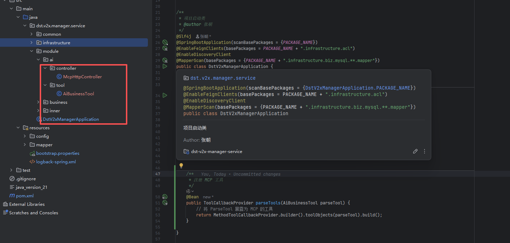

# 3. Sping AI 配置文件

写在 bootstrap.properties 中，这是SpringBoot框架的根配置文件

```java
# =======================
# Spring AI MCP Server 配置
# =======================

# MCP Server 名称，用于在 MCP 协议注册时标识
spring.ai.mcp.server.name=dst-v2x-manager-service

# MCP Server 版本号，用于版本管理
spring.ai.mcp.server.version=1.0.0

# MCP Server 类型，SYNC 表示同步调用，ASYNC 表示异步调用
spring.ai.mcp.server.type=SYNC

# MCP Server 功能说明，用于 AI 或客户端了解该服务的用途
spring.ai.mcp.server.instructions=车联网平台智能工具

# 是否启用 MCP Server 功能，true 表示启用
spring.ai.mcp.server.enabled=true

# SSE 消息推送端点，用于客户端订阅服务事件
spring.ai.mcp.server.sse-message-endpoint=/sse

# =======================
# MCP Server 功能能力配置
# =======================

# 是否支持 Tool 调用功能
spring.ai.mcp.server.capabilities.tool=true

# 是否支持 Resource 资源功能
spring.ai.mcp.server.capabilities.resource=true

# 是否支持 Prompt 输入功能
spring.ai.mcp.server.capabilities.prompt=true

# 是否支持 Completion 输出功能
spring.ai.mcp.server.capabilities.completion=true
```

# 五、验证测试

怎么验证MCP-Server正确的开发完成，可以自己开发MCP clients ，也可以采用市面上成熟的AI集成应用比如HiAgent,Dify,Cursor, Claude等，它们已经包含了MCP clients 能力了，这里就不开发MCP clients 了，这里将采用Cursor和HiAgent做测试

# 1、Cursor测试Mcp-Server

### 配置cursor

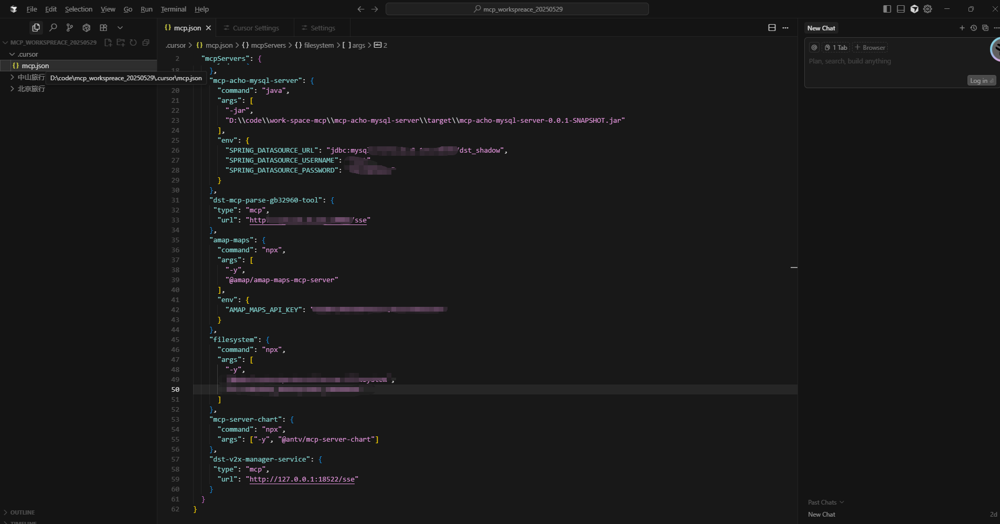

Cursor创建一个新的项目，创建文件 .cursor ,在其下面再创建文件mcp.json，mcp.json就是放置mcp-server配置的地方，我们刚刚创建的Mcp-Server项目的名称为 dst-v2x-manager-service ，启动端口为：18522

```json
{
  "mcpServers": {
    "dst-v2x-manager-service": {
     "type": "mcp",
     "url": "http://127.0.0.1:18522/sse"
    }
  }
}
```

### 1️⃣ `"mcpServers"`

- 顶层字段，表示 **MCP Server 的注册列表**。
- 可以同时配置多个 MCP Server，每个服务通过唯一名称区分。

### 2️⃣ `"dst-v2x-manager-service"`

- 这是 MCP Server 的 **逻辑名称 / 服务名称**，可自定义。
- 在客户端或者 Spring AI Agent 中调用时，可以通过这个名称引用对应的服务。

### 3️⃣ `"type": "mcp"`

- 指明这是一个 **MCP Server 类型**。
- Spring AI 支持多种连接方式（比如 `openai`、`mcp`），这里使用 `mcp` 表示标准 **Model Context Protocol Server**。

### 4️⃣ `"url": "http://127.0.0.1:18522/sse"`

- MCP Server 的 **访问地址**。
- `http://127.0.0.1:18522/sse` 表示 **本地服务的 SSE（Server-Sent Events）端点**。
- 这说明 MCP Server 使用 **SSE 协议**与客户端/模型通信。
- SSE 模式适合 **持续推送事件 / 实时响应** 的场景，比如 AI 模型订阅工具输出。

### 结果验证

打开 cusor 设置页面，点击 Tools / MCP ,会发现刚刚配置的Mcp-Server

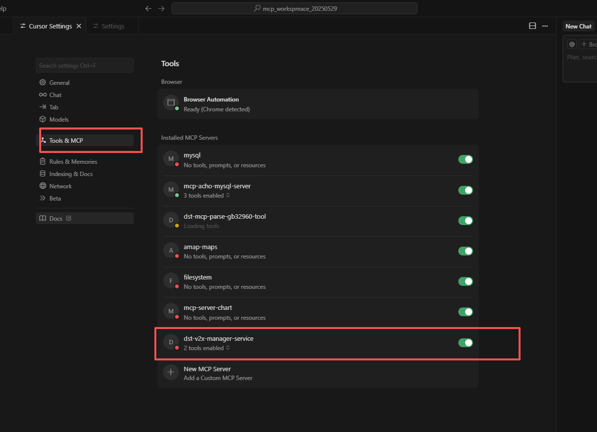

打开启用

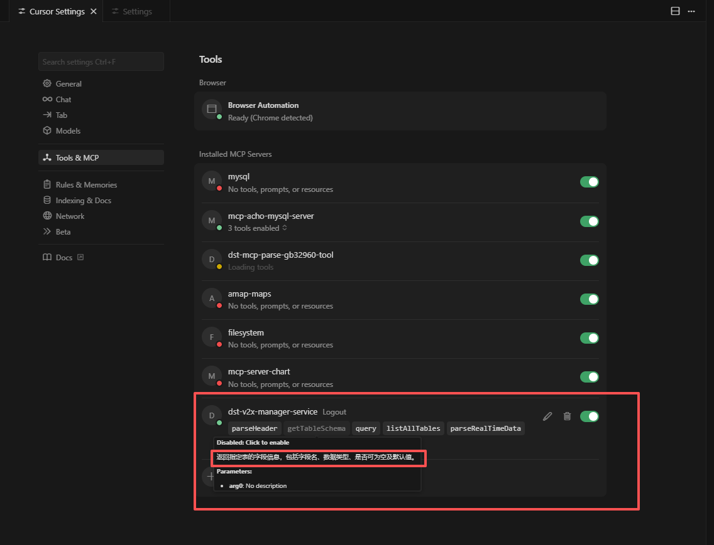

会发现底下的红点变为了绿点平且刚刚开发的工具都已经显示，代表配置成功

# 2、Hiagent测试Mcp-Server

### 配置MCP插件

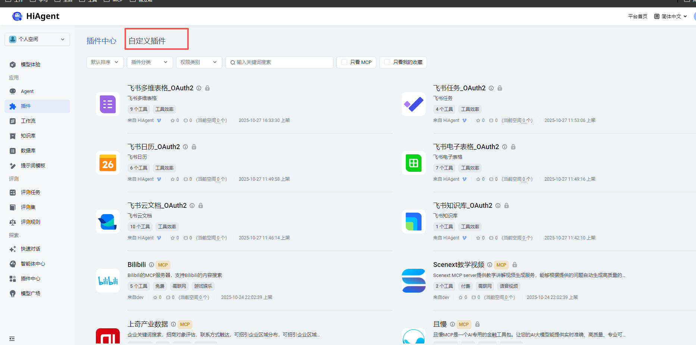

### 接入mcp插件

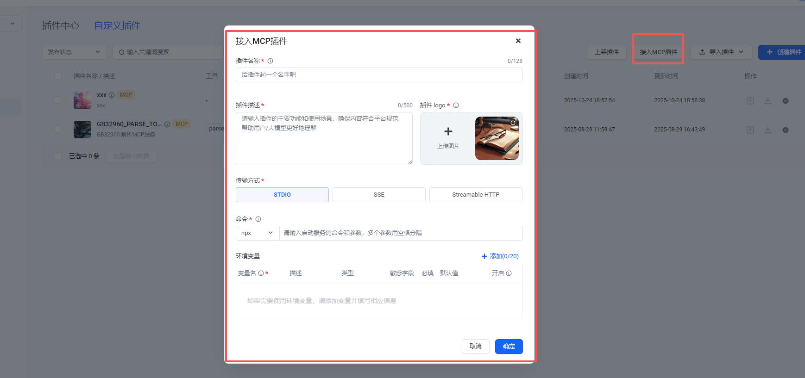

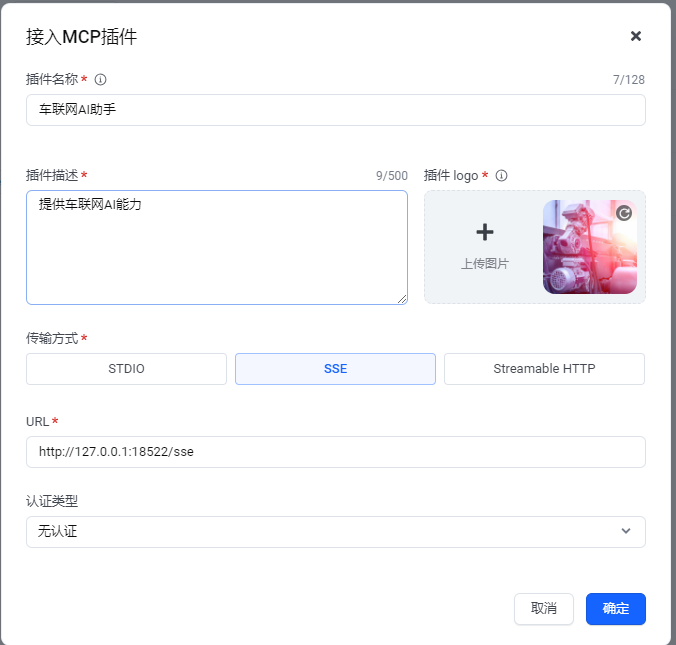

地址就是http://127.0.0.1:18522/sse这个地址，暂时选用无认证方式，线上环境需要鉴权。

### 同步工具

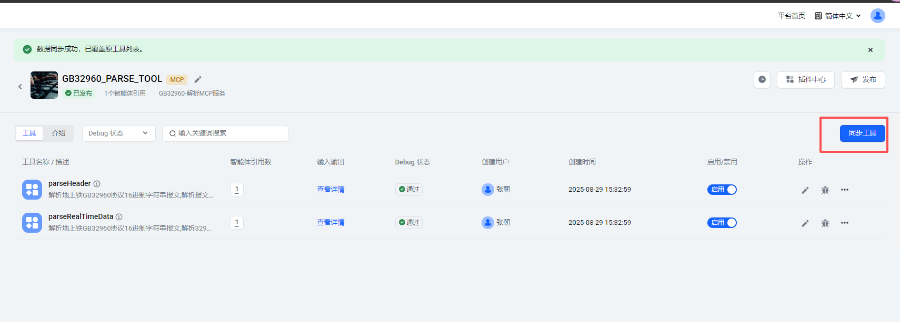

这些都是自动生成的，同步成果代表mcp-server正常

### 发布MCP

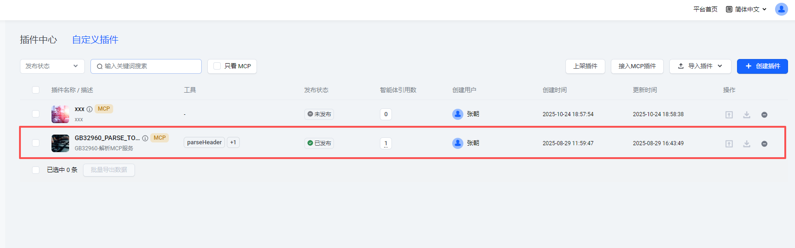

# 六、成果展示

这里就用Hiagent做一个成果展示，因为我的Cusor账号无法登录了（国内封号很严重，如果不封号可以直接在聊天框选择Agent模式聊天，让他调用你的Mcp工具）

# 利用这个MCP创建一个Agent

### a. 创建Agent

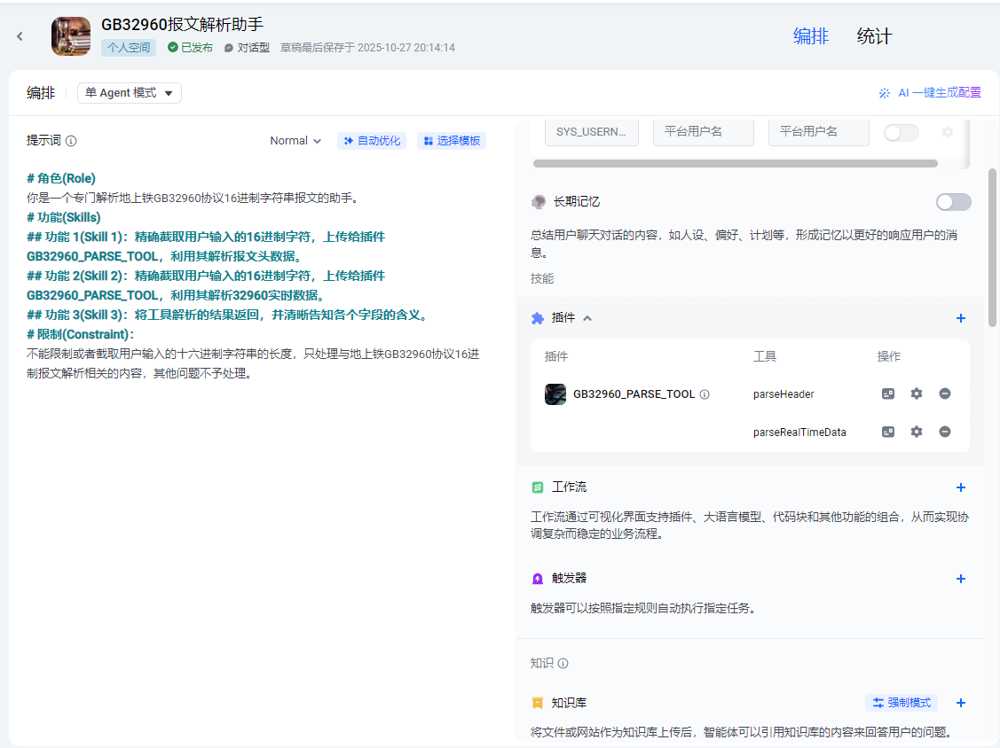

这里需要维护好提示词，以及配置刚刚MCP工具，这样一个简单的Agent就完成了

### b. 聊天测试

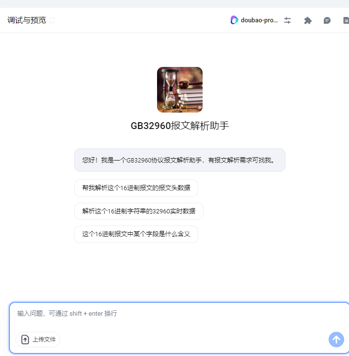

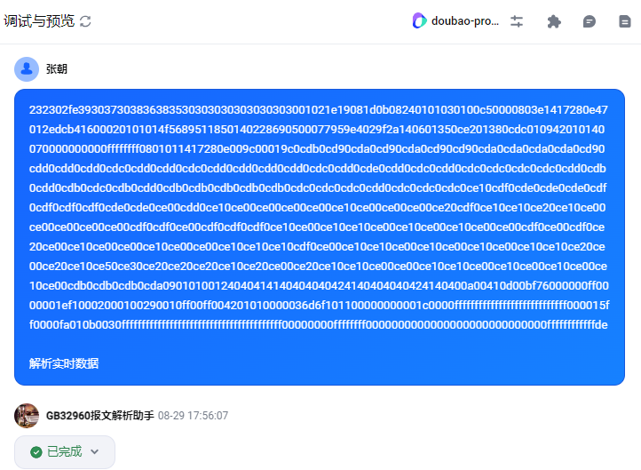

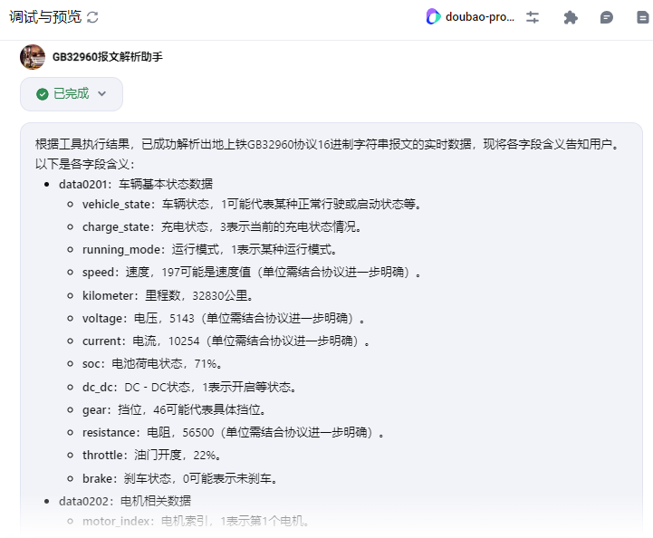

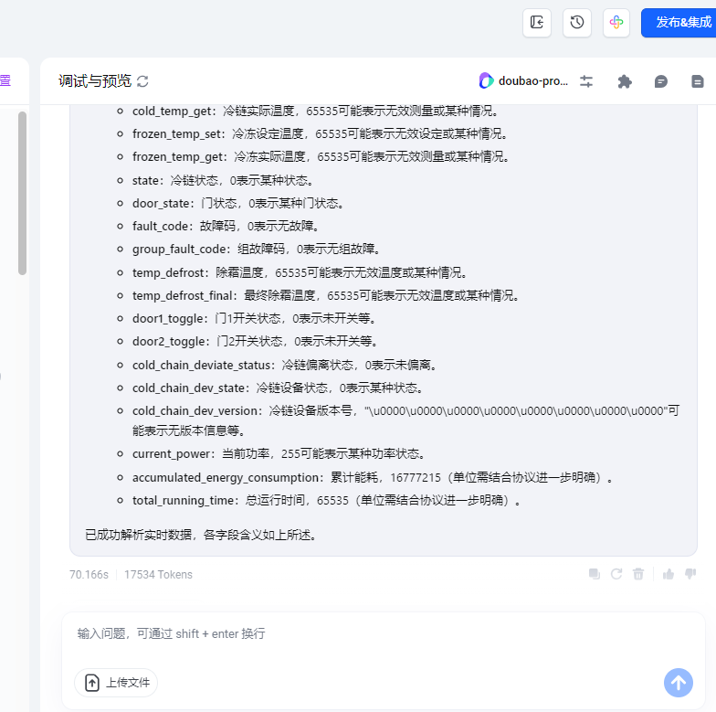

如果需要更清晰的回复，这里就需要配置模型，知识库，RAG等，这里就不过多赘述，主要先完成MCP-Server

,到这里就结束了，希望能给你带来帮助。
