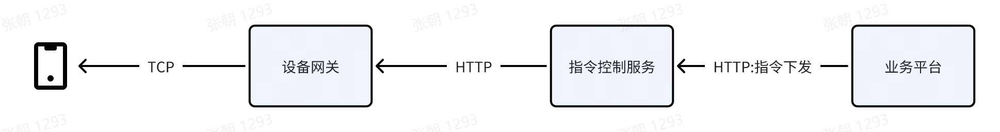
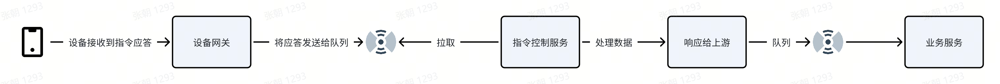
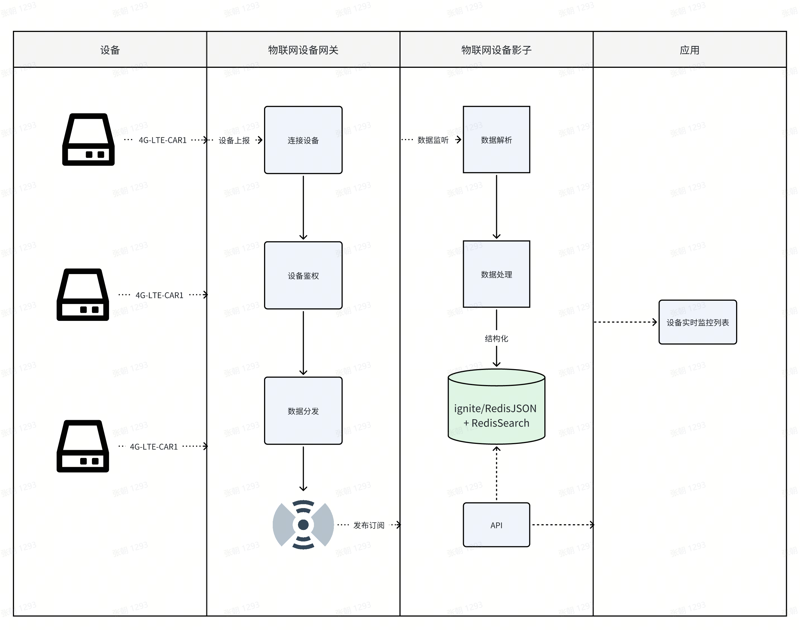
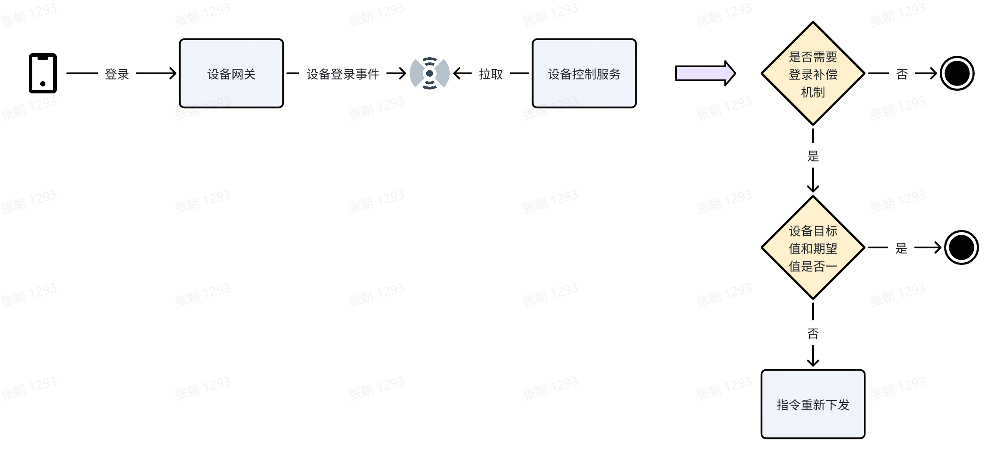
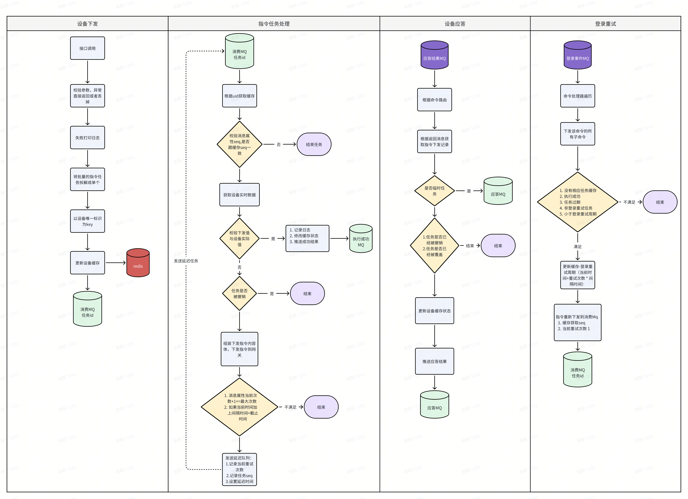
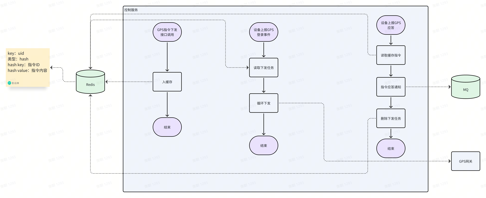

设备指令控制服务提供了一个中心化的平台，通过这个平台可以向各种设备发送控制指令。这种中心化控制方式使得管理变得更加高效和一致。

### 1. **需求分析**
首先，系统的功能需求，包括：

+ **指令发送**：如何将指令发送到设备。

<!-- 这是一张图片，ocr 内容为： -->


+ **指令接收和处理**：如何接收设备的反馈和状态信息。

<!-- 这是一张图片，ocr 内容为： -->


+ **设备状态管理**：

设备影子服务，会记录所有设备的实时状态

<!-- 这是一张图片，ocr 内容为： -->


+ **异常处理和重试机制**：如何处理失败的指令和重试策略。

  **重试机制**

    - 登录重试

<!-- 这是一张图片，ocr 内容为： -->


    - 配置重试

  指令下发，没有执行成功时，会根据配置重试间隔次数，间隔时间，放入延迟队列中，进行重试

### 2. **功能模块**
设计系统架构时，考虑有以下组件：

#### **2.1. 设备指令下发**
##### （一）**指令发起流程图**
<!-- 这是一张图片，ocr 内容为： -->


##### （二） **指令下发**
1. 上游根据约定参数，将指令投递到MQ/接口中 （一次下发设备最多不能超过200）
2. 将批量指令拆解成单个任务，任务表中：设备号，指令类型，子命令类型为一个唯一键，同一个设备同一类型命令，任务表只会记录一条最新的任务
3. 新增或者更新该设备该指令类型的期望值
4. 将任务投递到MQ -初始任务状态为 待下发

```java
/**
 * 锁车指令设置
 *
 * @param req 请求参数
 */
public void execute(LockInnerApiReq req) {
// 组装数据
List<TerminalDesireLock> terminalDesires = new ArrayList<>();

req.getDetails().forEach(detail -> {
    // 创建对象
    TerminalDesireLock desireCommon = new TerminalDesireLock();
    terminalDesireCommonService.fillCommonFields(desireCommon, detail);
    terminalDesireCommonService.fillCommonFields(desireCommon, req);
    desireCommon.setParam(req.getParam());
    terminalDesires.add(desireCommon);
});

// 更新缓存
lockCacheService.updateBatch(terminalDesires);

// 事务提交发送指令
// 发送指令
for (TerminalDesireLock terminalDesireLock : terminalDesires) {
    // 设置消息属性
    try {
        terminalDesireProducer.sendDelayTask(terminalDesireLock.getUid(), TerminalDesireConstant.TERMINAL_DESIRE_LOCK_TAG, terminalDesireLock.getSeq(), 0, 0);
    } catch (Exception e) {
        log.error("发送锁车指令到MQ异常", e);
    }
}
}
```

##### （三）**消费任务****MQ**
1. 校验该任务id是否存在，状态是否为待下发
2. 处理指令任务，根据不同的指令类型，路由不同的处理器处理
3. 校验该指令类型期望值表的这个设备是否和设备目标值状态一致，一致修改任务状态为执行成功，结束任务
4. 指令下发给网关，记录指令下发日志
5. 如果任务来源为（定时重试）需修改任务的重试字段 重试次数和下一次重试时间

```java
/**
 * 消息监听
 *
 */
@Override
public void onMessage(MessageExt message) {
String uid = new String(message.getBody());
log.info("收到锁车任务消息,设备唯一标识：【{}】", uid);

// 从缓存中获取任务
TerminalDesireLock task = lockCacheService.loadCache(uid);

// 获取该消息属性
Map<String, String> properties = message.getProperties();
String seq = properties.get(RetryConstant.SEQ);
Integer currentRetryCount = Integer.valueOf(properties.get(RetryConstant.RETRY_COUNT_FILED));

// 校验seq
if (!task.getSeq().equals(seq)) {
    log.warn("任务seq不一致,消息seq:【{}】,任务seq:【{}】", seq, task.getSeq());
    return;
}

// 处理指令
terminalDesireLockBusinessService.processCommand(task, currentRetryCount);

}

/**
 * 处理指令
 * 注意：1.判断锁车结果是否执行成功时，利用锁车状态判断
 * 2.锁车标志结果锁车指令下发去重
 *
 * @param task              指令任务
 * @param currentRetryCount 当前重试次数
 */
public void processCommand(TerminalDesireLock task, Integer currentRetryCount) {
    try {
        // 获取设备实时数据
        TboxRealtimeDataDTO data = shadowServerApiService.findByDevCode(task.getUid());
        P32960Data020A data020A = terminalDesireCommonService.getRealTimeData020A(data);
        // 获取锁车状态
        Integer lockState = getLockState(data020A);
        // 校验是否需要下发指令
        if (!isSet(lockState, task.getParam())) {
            // 修改任务状态
            task.setProcessStatus(TerminalDesireConstant.TERMINAL_DESIRE_PROCESS_STATUS_PROCESS_SUCCESS);
            // 记录日志
            terminalDesireLogService.saveTerminalDesireLog(task, CmdTypeEnum.CMD_84.val(), null, DstJsonUtil.toString(task), "指令参数与设备实时数据一致,不需要下发指令，执行成功");

            // 修改缓存状态
            lockCacheService.updateBatch(Collections.singletonList(task));

            // 推送成功结果
            terminalDesireProducer.sendSuccessCommandTask(task, TerminalDesireConstant.TERMINAL_DESIRE_LOCK_TAG);

            return;
        }

        // 锁车标志和指令参数一致，不需要下发指令，减少冗余下发
        Integer lockFlag = getLockFlag(data020A);
        if (!isSet(lockFlag, task.getParam())) {
            log.warn("锁车标志和指令参数一致,不需要下发指令,设备唯一标识：【{}】,锁车标志：【{}】,期望值指令参数：【{}】", task.getUid(), lockFlag, task.getParam());
            // 记录日志
            terminalDesireLogService.saveTerminalDesireLog(task, CmdTypeEnum.CMD_84.val(), null, DstJsonUtil.toString(task), "锁车标志和指令参数一致,不下发指令");
            return;
        }

    } catch (Exception e) {
        log.error("{}校验是否需要下发指令异常,设备唯一标识：【{}】,异常信息：{}", LOG_MARK, task.getUid(), e.getMessage());
        log.error(e.getMessage(), e);
        return;
    }

    // 下发指令
    processDesireForSucceed(task, LOG_MARK, currentRetryCount, TerminalDesireConstant.TERMINAL_DESIRE_LOCK_TAG, this::handCommand);
}
```

##### （四）**登录重试**
1. 命令处理器遍历
2. 下发该设备的所有未完成，未过期的命令
3. 更新缓存-登录重试周期（当前时间+重试次数 * 间隔时间）
4. 指令重新下发到消费任务MQ

```java
package com.dst.iot.control.service.module.business.command.handler;

import com.dst.iot.control.service.infrastructure.biz.common.BaseContext;
import com.dst.iot.control.service.infrastructure.mq.dto.DeviceAnswerListenerDTO;

/**
 * 指令处理器基类
 */
public interface GBT32960BaseHandler<T extends BaseContext> extends BaseHandler{

    /**
     * 指令类型
     */
    boolean support(Integer cmdType);

    /**
     * 处理指令应答
     *
     * @param response 指令应答
     * @throws Exception 异常
     */
    void processAnswer(DeviceAnswerListenerDTO response) throws Exception;

    /**
     * 解析指令上下文
     *
     * @param context 指令上下文str
     */
    T parseContext(String context);

    /**
     * 确认指令应答
     *
     * @param listenerDTO 指令应答DTO
     * @param context     指令上下文
     */
    void onAck(DeviceAnswerListenerDTO listenerDTO, T context);

    /**
     * 登录重试
     *
     * @param uid 设备唯一标识
     */
    void loginRetry(String uid);

}
```

```java
/**
 * 登录重试
 *
 * @param uid 设备唯一标识
 */
@Override
public void loginRetry(String uid) {
// 获取缓存
TerminalDesireLock cache = lockCacheService.loadCache(uid);

// 登录校验
if (!loginCheck(cache)) {
    return;
}

// 设置登录重试周期
cache.setLoginRetryCycle(calculateLoginRetryCycle(cache));

// 更新缓存
lockCacheService.updateBatch(Collections.singletonList(cache));

// 处理指令
terminalDesireLockBusinessService.processCommand(cache, 0);

}
```

##### （五）**设备应答**
 设备收到命令会有回调

1. 网关收到设备回调后，将回调结果发送到MQ
2. 指令控制服务消费这个回调结果
3. 修改日志状态
4. 将结果发送给设备响应结果MQ中给上游消费

```java
/**
 * 处理指令
 *
 * @param response 指令应答
 */
@Override
public void processAnswer(DeviceAnswerListenerDTO response) {
Cmd84Context context = this.parseContext(response.getContext());
if (context == null) {
    log.warn("解析指令上下文信息失败：{}", response.getContext());
    return;
}

// 保存指令日志
boolean success = response.isSuccess();
String msg = success ? "锁车收到指令成功应答" : "锁车收到指令失败应答";
terminalDesireLogService.saveTerminalDesireLog(response.getUid(), context.getSeq(), CmdTypeEnum.CMD_84.val(), null, msg);

// 处理指令回调
this.onAck(response, context);

}
```

##### （六）**指令****下发格式-对象**
  定义指令的格式和协议。

1. 接口/mq参数

```java
/**
 * 指令下发参数
 *
 */
@Data
public class CommandInnerApiRes {

    /**
     * 指令类型  参数设置：0x81  OTA应答:0x82  锁车:0x84   切换锁车版本:0x85
     */
    private String cmdKey;

    /**
     * 子命令  todo 统一双方约定
     */
    private String subCmdKey;

    /**
     * 指令内容 Json格式
     */
    private String cmdParam;

    /**
     * 最大重试次数  -1：不限次数 0：不重试  其他：重试次数
     */
    private String maxRetry;

    /**
     * 指令重试间隔 单位：分钟
     */
    private Integer retryInterval;

    /**
     * 指令超时时间 单位：分钟
     */
    private String timeout;

    /**
     * 是否登入重试
     */
    protected Boolean isLoginRetry;

    /**
     * 指令详情列表
     */
    private List<CommandInnerApiDetailRes> details;

}

/**
 * 指令详情
 */
@Data
public class CommandInnerApiDetailRes {

    /**
     * 可能是子任务id
     */
    private String  taskID;

    /**
     * 车架号 or  设备号
     */
    private String devCode;

}
```

1. **指令****下发格式-json**

```json
{
  "cmdType": 0x81,
  "cmdId": 1,
  "cmdArgs": {
    "dual_channel_endpoint":'127.0.0.1:12345',
    "dual_channel_state":'1',
    "dual_channel_flag":'1',
  },
  "payload":"根据协议组成16进制报文"
  "maxRetry": 3,
  "retryInterval": 60,
  "timeout": 600,
  "isLoginRetry": 1,
  "isCancel": 0,
  "details": [
    {
      "seq":1,
      "uid":'唯一识别码（设备号 or 车架号）'
    },
    { 
      "seq":1,
      "uid":'唯一识别码（设备号 or 车架号）'}
  ]
}
```

1. 指令类型映射关系

```java
/**
 * 命令枚举类
 */
public enum CmdTypeEnum {
    /**
     * 参数查询
     */
    CMD_80(0x80),

    /**
     * 控制命令（国标 + 自定义）
     */
    CMD_82(0x82),

    /**
     * 锁车
     */
    CMD_84(0x84),
    /**
     * 切换锁车版本
     */
    CMD_85(0x85),
    /**
     * 参数设置
     */
    CMD_81(0x81),

    /**
     * 保养提示
     */
    CMD_88(0x88),

    /**
     * 缴费提示
     */
    CMD_89(0x89),

    /**
     * 年审提示
     */
    CMD_8A(0x8A),

    /**
     * 清除车型配置
     */
    CMD_8C(0x8C),

    /**
     * 冷藏车
     */
    CMD_8D(0x8D),

    /**
     * Aebs
     */
    CMD_8E(0x8E),
    ;
    private final int val;

    CmdTypeEnum(int val) {
        this.val = val;
    }

    public int val() {
        return this.val;
    }

    public static CmdTypeEnum valueOf(int val) {
        for (CmdTypeEnum cmd : values()) {
            if (cmd.val == val) {
                return cmd;
            }
        }
        return null;
    }
}
```

```java
/**
 * 命令枚举类
 */
public enum Cmd82TypeEnum {
    /**
     * 国标控制命令
     */
    CMD_GB_82(0x8202),

    /**
     * 远程升级
     */
    CMD_82_01(0x8201),
    /**
     * Can采集
     */
    CMD_82_90(0x8290),
    /**
     * GPS定位模式设置
     */
    CMD_82_91(0x8291),
    /**
     * 远程DBC升级
     */
    CMD_82_92(0x8292),
    /**
     * 远程FCM升级
     */
    CMD_82_93_01(0x829301),
    /**
     * 远程FRM升级
     */
    CMD_82_93_02(0x829302),

    /**
     * 远程FCM强制升级
     */
    CMD_82_94_01(0x829401),

    /**
     * 远程FRM强制升级
     */
    CMD_82_94_02(0x829402),
    ;
    private final int val;

    Cmd82TypeEnum(int val) {
        this.val = val;
    }

    public int val() {
        return this.val;
    }

    public static Cmd82TypeEnum valueOf(int val) {
        for (Cmd82TypeEnum cmd : values()) {
            if (cmd.val == val) {
                return cmd;
            }
        }
        return null;
    }
}
```

#### **2.2. 消息队列**
使用消息队列（RocketMQ）来解耦指令发送和接收部分：

##### （一）RocketMQ和RabbitMQ的比较（主要在性能方面）：
1. RabbitMQ 在处理吞吐量方面通常不及 RocketMQ。虽然它可以处理较高的消息吞吐量，但在极端负载下可能会遇到性能瓶颈。RabbitMQ 的吞吐量受到队列管理、路由功能以及消息确认机制的影响。
2. RabbitMQ 的消息确认机制确保了消息的可靠传递，但这种机制在高负载情况下会增加延迟和开销，从而影响整体性能
3. RocketMQ 设计时考虑了极高的吞吐量需求，适合处理每秒百万级别的消息。它能够高效地支持大规模并发的消息生产和消费。

  RocketMQ相较于 RabbitMQ 目前发现缺点就是：RocketMQ 的Web管理界面没有 RabbitMQ强大

  总结：

    因为 **RocketMQ** 在性能上表现突出，特别是在高吞吐量和顺序消息处理方面。它能够处理大规模并发的消息传递，适合对性能有严格要求的应用场景，故选择为该系统的消息队列。

##### （二）消息队列类别
###### 指令下发MQ
  功能：上游指令下发的MQ 模式：集群消费模式（Cluster Mode）

  数据格式：

```json
{
  "cmdType": 0x81,
  "cmdId": 1,
  "cmdArgs": {
    "dual_channel_endpoint":'127.0.0.1:12345',
    "dual_channel_state":'1',
    "dual_channel_flag":'1',
  },
  "payload":"根据协议组成16进制报文"
  "maxRetry": 3,
  "retryInterval": 60,
  "timeout": 600,
  "isLoginRetry": 1,
  "isCancel": 0,
  "details": [
    {
      "seq":1,
      "uid":'唯一识别码（设备号 or 车架号）'
    },
    { 
      "seq":1,
      "uid":'唯一识别码（设备号 or 车架号）'}
  ]
}
```

###### 指令任务消费MQ
功能：处理指令任务的

模式：集群消费模式

数据格式：

```json
{
  "taskId": 1,
}
```

###### 登录事件MQ
 功能：设备登录上线事件处理

 模式：集群消费模式（Cluster Mode）

 数据格式：

```json
{
  "vin": 1,
  "devCode": 1,
}
```

###### 设备响应MQ
  功能：设备收到指令响应MQ

 模式：集群消费模式（Cluster Mode）

  过滤：<font style="color:rgb(216,57,49);">不同的指令响应不同的TAG，及不同的数据格式 | TODO:需要与网关层确认</font>

  数据格式：

```json
{
  "vin": 1,
  "devCode": 1,
}
```

#### **2.3. 数据存储**
##### (一) **设备期望值存储**
选择Redis做为，记录设备最新期望值数据的存储中间件

1. 批次操作，采用Redis的pipelined，减少访问Redis服务端次数

```java
/**
 * 批量更新接口
 *
 * @param formatKey redis key
 * @param entryList 数据
 */
public void updateBatch(List<? extends TerminalDesireCommon> entryList, String formatKey) {
    // 使用管道进行批量更新
    stringRedisTemplate.executePipelined(new SessionCallback<>() {
        @Override
        public <K, V> Object execute(@NotNull RedisOperations<K, V> redisOperations) throws DataAccessException {
            StringRedisTemplate stringRedisTemplate = (StringRedisTemplate) redisOperations;
            for (TerminalDesireCommon terminalDesire : entryList) {
                stringRedisTemplate.opsForValue().set(RedisConstants.getFormatCacheKey(terminalDesire.getUid(), formatKey), DstJsonUtil.toString(terminalDesire));
            }
            return null;
        }
    });
}
```

1. Redis的存储结构为String(key,json)

```java
/**
 * 终端期望状态通用实体类
 */
@Data
public class TerminalDesireCommon implements Serializable {

    @Serial
    private static final long serialVersionUID = 1L;

    /**
     * 主键ID
     */
    @TableId("id")
    private String id;

    /**
     * 唯一识别码(设备号 or 车架号)
     */
    private String uid;

    /**
     * 是否临时
     */
    private Boolean isTem;

    /**
     * 指令序列号
     */
    private String seq;

    /**
     * 最大重试次数  -1：不限次数 0：不重试  其他：重试次数
     */
    private Integer maxRetry;

    /**
     * 指令重试间隔 单位：分钟
     */
    private Integer retryInterval;

    /**
     * 指令截至时间
     */
    private Date deadline;

    /**
     * 是否登入重试 0：不重试 1：重试
     */
    private Integer isLoginRetry;

    /**
     * 执行状态（10：待发送  30：已应答  40：发送成功  50：发送失败  60：执行成功）
     */
    private Integer processStatus;

    /**
     * 是否取消指令 0：不取消 1：取消
     */
    private Integer isCancel;

    /**
     * 指令发送时间
     */
    @JsonFormat(pattern = "yyyy-MM-dd HH:mm:ss", timezone = "GMT+8")
    @DateTimeFormat(pattern = "yyyy-MM-dd HH:mm:ss")
    private Date commandTime;

    /**
     * 创建时间
     **/
    @JsonFormat(pattern = "yyyy-MM-dd HH:mm:ss", timezone = "GMT+8")
    @DateTimeFormat(pattern = "yyyy-MM-dd HH:mm:ss")
    private Date createTime;

    /**
     * 更新时间
     **/
    @JsonFormat(pattern = "yyyy-MM-dd HH:mm:ss", timezone = "GMT+8")
    @DateTimeFormat(pattern = "yyyy-MM-dd HH:mm:ss")
    private Date modifyTime;

    /**
     * 操作用户
     */
    private String userName;

    /**
     * 登录重试周期
     */
    @TableField(exist = false)
    private Date loginRetryCycle;

}
```

##### (二) **设备状态**
<!-- 这是一张图片，ocr 内容为： -->


##### (三) **指令下发历史**
采用Mysql,记录指令下发日志（<font style="background-color:rgb(247,105,100);">后续利用logstash传输到车联网新平台的日志系统</font>）

```sql
-- 日志数据表
CREATE TABLE `tbl_terminal_desire_log` (
  `id` varchar(20) NOT NULL COMMENT '主键id',
  `uid` varchar(20) NOT NULL COMMENT '唯一识别码(设备号 or 车架号)',
  `seq` varchar(20) NOT NULL COMMENT '命令标识码',
  `cmd_type` int NOT NULL COMMENT '命令类型',
  `cmd_id` int DEFAULT NULL COMMENT '命令id',
  `cmd_args` text COMMENT '指令参数',
  `content` text COMMENT '内容',
  `create_time` datetime NOT NULL COMMENT '创建时间',
  `modify_time` datetime NOT NULL COMMENT '更新时间',
  PRIMARY KEY (`id`)
) ENGINE=InnoDB DEFAULT CHARSET=utf8mb4 COLLATE=utf8mb4_0900_ai_ci COMMENT='终端设备期望日志表';
```

#### 2.4 GPS指令下发流程
<!-- 这是一张图片，ocr 内容为： -->


#### 2.5 指令回调
##### (一) **设备应答回调**
<font style="color:rgb(143,149,158);">Rocket MQ </font><font style="color:rgb(143,149,158);">队列：dst_command_device_answer_result_topic </font><font style="color:rgb(143,149,158);">tag:</font>

```java
/**
 * 主链路 rocketmq tag
 */
public static final String TERMINAL_DESIRE_PRIMARY_LINK_TAG = "terminal_desire_primary_link_tag";

/**
 * 双链路 rocketmq tag
 */
public static final String TERMINAL_DESIRE_MULTI_LINK_TAG = "terminal_desire_multi_link_tag";
/**
 * 锁车 rocketmq tag
 */
public static final String TERMINAL_DESIRE_LOCK_TAG = "terminal_desire_lock_tag";

/**
 * 锁车版本 rocketmq tag
 */
public static final String TERMINAL_DESIRE_LOCK_TAG_VERSION = "terminal_desire_lock_version_tag";

/**
 * 缴费到期 rocketmq tag
 */
public static final String TERMINAL_DESIRE_PAYMENT_TAG = "terminal_desire_payment_tag";

/**
 * 保养到期 rocketmq tag
 */
public static final String TERMINAL_DESIRE_MAINTENANCE_TAG = "terminal_desire_maintenance_tag";

/**
 * 年审到期 rocketmq tag
 */
public static final String TERMINAL_DESIRE_ANNUAL_REVIEW_EXPIRE_TAG = "terminal_desire_annual_review_expire_tag";

/**
 * 冷藏厢 rocketmq tag
 */
public static final String TERMINAL_DESIRE_RT_TAG = "terminal_desire_rt_tag";

/**
 * aebs rocketmq tag
 */
public static final String TERMINAL_DESIRE_AEBS_TAG = "terminal_desire_aebs_tag";

/**
 * gps定位模式设置 rocketmq tag
 */
public static final String TERMINAL_DESIRE_GPS_SET_TAG = "terminal_desire_gps_set_tag";

/**
 * ota 远程升级指令 默认升级升级指令 tag
 */
public static final String TERMINAL_DESIRE_OTA_TAG = "terminal_desire_ota_tag";

/**
 * ota fcm 默认升级升级指令 tag
 */
public static final String TERMINAL_DESIRE_OTA_FCM_DEFAULT_TAG = "terminal_desire_ota_fcm_default_tag";

/**
 * ota fcm 强制升级升级指令 tag
 */
public static final String TERMINAL_DESIRE_OTA_FCM_FORCE_TAG = "terminal_desire_ota_fcm_force_tag";

/**
 * ota fcm 默认升级升级指令 tag
 */
public static final String TERMINAL_DESIRE_OTA_FRM_DEFAULT_TAG = "terminal_desire_ota_frm_default_tag";

/**
 * ota frm 强制升级升级指令 tag
 */
public static final String TERMINAL_DESIRE_OTA_FRM_FORCE_TAG = "terminal_desire_ota_frm_force_tag";

/**
 * Can报文采集 默认升级升级指令 tag
 */
public static final String TERMINAL_DESIRE_CAN_ISSUE_TAG = "terminal_desire_can_issue_tag";

/**
 * 参数查询指令 tag
 */
public static final String TERMINAL_DESIRE_PARAM_QUERY_TAG = "terminal_desire_param_query_tag";

/**
 * 国标终端控制指令 tag
 */
public static final String TERMINAL_DESIRE_GB_CONTROL_TAG = "terminal_desire_gb_control_tag";

/**
 * 清除车型配置终端控制指令 tag
 */
public static final String TERMINAL_DESIRE_CLEAR_CAR_MODE_TAG = "terminal_desire_clear_car_mode_tag";
```

##### (二) **设备执行成功回调**
<font style="color:rgb(143,149,158);">topic:dst_command_success_task_topic</font>`<font style="color:rgb(216,57,49);">注意：目前冷藏厢控制指令，Aebs控制指令，主链路，can报文采集，参数查询，国标参数设置，国标终端控制，清除车型配置。没有执行成功应答，设备应答就是流程的终态</font>`

```java
/**
 * 主链路 rocketmq tag
 */
public static final String TERMINAL_DESIRE_PRIMARY_LINK_TAG = "terminal_desire_primary_link_tag";

/**
 * 双链路 rocketmq tag
 */
public static final String TERMINAL_DESIRE_MULTI_LINK_TAG = "terminal_desire_multi_link_tag";
/**
 * 锁车 rocketmq tag
 */
public static final String TERMINAL_DESIRE_LOCK_TAG = "terminal_desire_lock_tag";

/**
 * 锁车版本 rocketmq tag
 */
public static final String TERMINAL_DESIRE_LOCK_TAG_VERSION = "terminal_desire_lock_version_tag";

/**
 * 缴费到期 rocketmq tag
 */
public static final String TERMINAL_DESIRE_PAYMENT_TAG = "terminal_desire_payment_tag";

/**
 * 保养到期 rocketmq tag
 */
public static final String TERMINAL_DESIRE_MAINTENANCE_TAG = "terminal_desire_maintenance_tag";

/**
 * 年审到期 rocketmq tag
 */
public static final String TERMINAL_DESIRE_ANNUAL_REVIEW_EXPIRE_TAG = "terminal_desire_annual_review_expire_tag";

/**
 * gps定位模式设置 rocketmq tag
 */
public static final String TERMINAL_DESIRE_GPS_SET_TAG = "terminal_desire_gps_set_tag";

/**
 * ota 远程升级指令 默认升级升级指令 tag
 */
public static final String TERMINAL_DESIRE_OTA_TAG = "terminal_desire_ota_tag";
/**
 *ota 远程升级指令 consumer
 */
public static final String TERMINAL_DESIRE_OTA_CONSUMER = "terminal_desire_ota_consumer";

/**
 * ota fcm 默认升级升级指令 tag
 */
public static final String TERMINAL_DESIRE_OTA_FCM_DEFAULT_TAG = "terminal_desire_ota_fcm_default_tag";

/**
 * ota fcm 默认升级升级指令 tag
 */
public static final String TERMINAL_DESIRE_OTA_FCM_FORCE_TAG = "terminal_desire_ota_fcm_force_tag";

/**
 * ota fcm 默认升级升级指令 tag
 */
public static final String TERMINAL_DESIRE_OTA_FRM_DEFAULT_TAG = "terminal_desire_ota_frm_default_tag";

/**
 * ota frm 默认升级升级指令 tag
 */
public static final String TERMINAL_DESIRE_OTA_FRM_FORCE_TAG = "terminal_desire_ota_frm_force_tag";

/**
 * Can报文采集 默认升级升级指令 tag
 */
public static final String TERMINAL_DESIRE_CAN_ISSUE_TAG = "terminal_desire_can_issue_tag";

/**
 * 参数查询 tag
 */
public static final String TERMINAL_DESIRE_PARAM_QUERY_TAG = "terminal_desire_param_query_tag";

/**
 * 国标参数设置 tag
 */
public static final String TERMINAL_DESIRE_GB_PARAM_SET_TAG = "terminal_desire_gb_param_set_tag";

/**
 * 国标终端控制指令 tag
 */
public static final String TERMINAL_DESIRE_GB_CONTROL_TAG = "terminal_desire_gb_control_tag";

/**
 * 清除车型配置终端控制指令 tag
 */
public static final String TERMINAL_DESIRE_CLEAR_CAR_MODE_TAG = "terminal_desire_clear_car_mode_tag";
```
