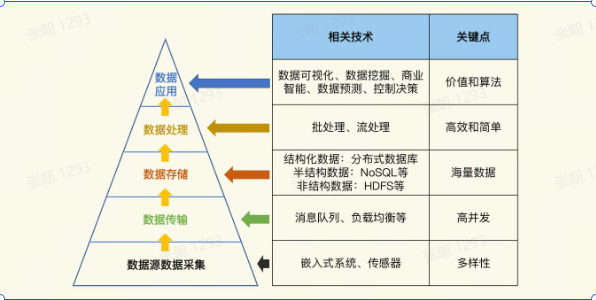
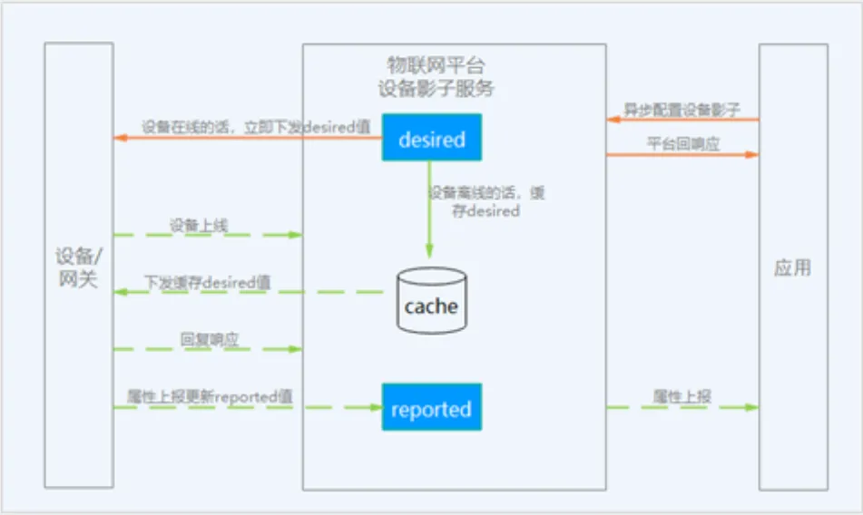
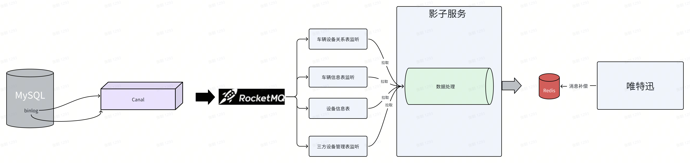
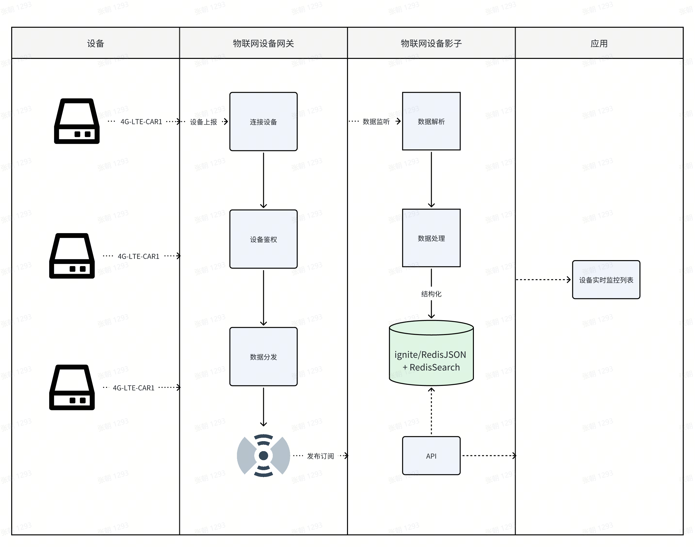
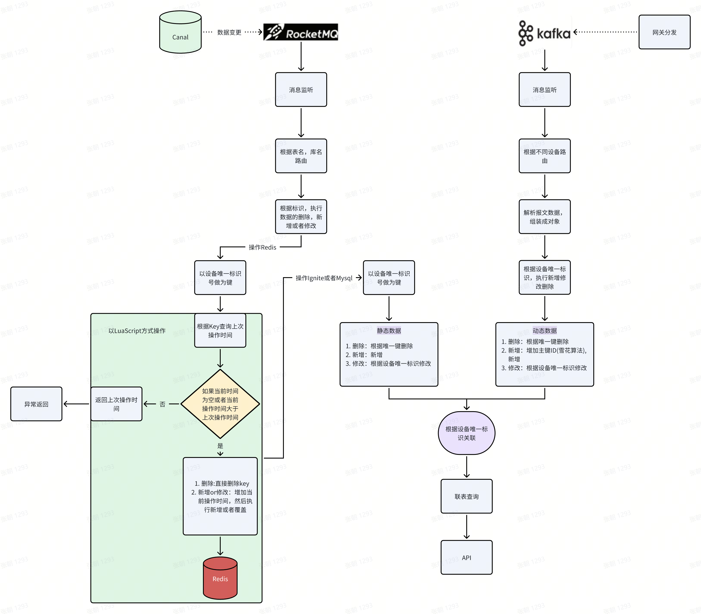
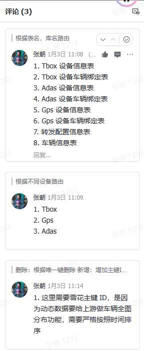

# 一. 概述
<!-- 这是一张图片，ocr 内容为： -->


物联网平台支持创建设备的“影子”。设备影子是一个JSON文件. 用于存储设备的在线状态、设备最近一次上报的设备属性值、应用服务器期望下发的配置。每个设备有且只有一个设备影子. 设备可以获取和设置设备影子以此来同步设备属性值. 这个同步可以是影子同步给设备. 也可以是设备同步给影子。

设备影子上有desired区和reported区。

+ desired区用于存储对设备属性的配置. 即期望值。当需要修改设备的服务属性值时. 可修改设备影子的desired区的属性值. 设备在线时. desired属性值立即同步到设备。如果设备不在线. 待设备上线或上报数据时. desired属性值同步到设备。
+ reported区用于存储设备最新上报的设备属性值. 即上报值。当设备上报数据时. 平台刷新reported区属性值为设备上报的设备属性值

<!-- 这是一张图片，ocr 内容为： -->


# 二. 功能模块
## （一）, 档案数据
作用：

+ 提供给网关做鉴权校验
+ 有需求需要档案数据和实时数据以列表分页形式返回
+ 提供给网关做消息分发

  数据来源：唯特迅 MySQL 数据库

  方案设计：利用ETL工具（为了减少相关服务间频繁调用. 松耦合）. 监听数据库变更. 同时回调到相应的消息中间件

<!-- 这是一张图片，ocr 内容为： -->


ETL工具选择：Canal

  **Canal**：

+ **背景**：Canal 是阿里巴巴开源的一个基于 MySQL 二进制日志（Binlog）解析的实时数据同步工具。它主要用于捕获 MySQL 的数据变更. 支持类似数据库主从复制的机制。
+ **主要功能**：Canal 的核心是**Change Data Capture（CDC）**. 能够实时捕捉 MySQL 表的增、删、改操作. 并将变更的数据以日志的形式发送给消费者。Canal 常与 Kafka 等消息中间件结合. 进行实时数据流的处理。
+ **场景**：Canal 适用于需要从 MySQL 捕获实时数据变更的场景. 例如实时同步、数据库迁移、数据流处理等。
+ **实时数据同步**：适用于 MySQL 数据库的表变更监控和实时同步到其他系统（如 Kafka、Elasticsearch、HBase 等）。
+ **数据流处理**：当你需要将 MySQL 中的变动数据流式地传输到消息队列、NoSQL 数据库或流式处理系统时. Canal 是很好的选择。
+ **数据一致性要求高的场景**：因为 Canal 可以直接读取 Binlog. 它能够保证数据的强一致性. 非常适合用于主从复制、数据库迁移等需要高一致性和实时性的场景。

  综上. Canal 很适合当下实时性要求较高的场景. 并且 Kafka . RocketMq 环境已有搭建. 同时配置简单. 维护成本低等。

  **Canal相关配置**：

```properties
# tcp, kafka, rocketMQ, rabbitMQ, pulsarMQ
canal.serverMode = rocketMQ

##################################################
#########                     RocketMQ             #############
##################################################

rocketmq.producer.group = test
rocketmq.enable.message.trace = false
rocketmq.customized.trace.topic =
rocketmq.namespace = archives
rocketmq.namesrv.addr = 127.0.0.1:9876
# 这个配置项表示当消息发送失败时. 允许的重试次数。在这里设置为 0. 表示消息发送失败后不进行重试。
rocketmq.retry.times.when.send.failed = 3
# VIP 通道是 RocketMQ 的一种高可用通道机制。
rocketmq.vip.channel.enabled = false
# 消息标签用于对消息进行分类或者过滤
rocketmq.tag = archives
```

### （1）. 车辆设备绑定关系
   存储为Redis. 

  键=tbox:bind:设备号. 类型=hash

| **key** | **value** | **备注** |
| --- | --- | --- |
| vin | Lxxxxxxx1 | 车架号 |

  键=car:bind:车架号. 类型=hash

| **<font style="color:rgb(0, 0, 0);">key</font>** | **<font style="color:rgb(0, 0, 0);">value</font>** | **<font style="color:rgb(0, 0, 0);">备注</font>** |
| --- | --- | --- |
| <font style="color:rgb(0, 0, 0);">deviceNo</font> | <font style="color:rgb(0, 0, 0);">90000..1</font> | <font style="color:rgb(0, 0, 0);">设备号</font> |

### （2）. 设备档案-TBOX
    存储为Redis. 后续云林定义

    键=tbox:info:识别码. 类型=hash

| **key** | **value** | **是否必填** | **备注** |
| --- | --- | --- | --- |
| logSwitch | TRUE | 是 | 日志开关，true打开;false关闭 |

### （3）. 车辆档案
  存储为Redis. 后续云林定义

    键=car:info:车架号. 类型=hash

| **<font style="color:rgb(0, 0, 0);">key</font>** | **<font style="color:rgb(0, 0, 0);">value</font>** | **<font style="color:rgb(0, 0, 0);">备注</font>** |
| --- | --- | --- |
| <font style="color:rgb(0, 0, 0);">logSwitch</font> | <font style="color:rgb(0, 0, 0);">TRUE</font> | <font style="color:rgb(0, 0, 0);">日志开关，true打开;false关闭</font> |

### （4）. 三方平台档案
  存储为Redis. 后续云林定义

    键=platform:info:平台登录名. 类型=hash

| **<font style="color:rgb(0, 0, 0);">key</font>** | **<font style="color:rgb(0, 0, 0);">value</font>** | **<font style="color:rgb(0, 0, 0);">备注</font>** |
| --- | --- | --- |
| <font style="color:rgb(0, 0, 0);">logSwitch</font> | <font style="color:rgb(0, 0, 0);">TRUE</font> | <font style="color:rgb(0, 0, 0);">日志开关，true打开;false关闭</font> |
| <font style="color:rgb(0, 0, 0);">password</font> | <font style="color:rgb(0, 0, 0);">????</font> | <font style="color:rgb(0, 0, 0);">密码,需要MD5加密存储，示例：DigestUtils.md5DigestAsHex(req.getPassword().getBytes())</font> |

### （5）. 配置档案数据
  暂定存数据表 定时每3分钟从redis读取变更标记. 如果有变更从数据表加载配置至本地内存（配置信息通过web页面新增或编辑. 编辑完成后点击按钮调用配置更新接口. 修改redis标记）

| <font style="color:rgb(0, 0, 0);">指令ID</font> | <font style="color:rgb(0, 0, 0);">是否写Kafka</font> | <font style="color:rgb(0, 0, 0);">是否下行指令应答</font> | <font style="color:rgb(0, 0, 0);">回调地址(回调接口在控制服务实现)</font> | <font style="color:rgb(0, 0, 0);">指令说明</font> |
| --- | :--- | :--- | :--- | --- |
| <font style="color:rgb(0, 0, 0);">0x02</font> | <font style="color:rgb(0, 0, 0);">是</font> | <font style="color:rgb(0, 0, 0);">否</font> | | <font style="color:rgb(0, 0, 0);">实时信息上报</font> |
| <font style="color:rgb(0, 0, 0);">0x03</font> | <font style="color:rgb(0, 0, 0);">是</font> | <font style="color:rgb(0, 0, 0);">否</font> | | <font style="color:rgb(0, 0, 0);">补发信息上报</font> |
| <font style="color:rgb(0, 0, 0);">0x04</font> | <font style="color:rgb(0, 0, 0);">否</font> | <font style="color:rgb(0, 0, 0);">否</font> | | <font style="color:rgb(0, 0, 0);">车辆登出</font> |
| <font style="color:rgb(0, 0, 0);">0x07</font> | <font style="color:rgb(0, 0, 0);">否</font> | <font style="color:rgb(0, 0, 0);">否</font> | | <font style="color:rgb(0, 0, 0);">心跳</font> |
| <font style="color:rgb(0, 0, 0);">0x08</font> | <font style="color:rgb(0, 0, 0);">否</font> | <font style="color:rgb(0, 0, 0);">否</font> | <font style="color:rgb(0, 0, 0);">get_time</font> | <font style="color:rgb(0, 0, 0);">终端校时</font> |
| <font style="color:rgb(0, 0, 0);">0x0B</font> | <font style="color:rgb(0, 0, 0);">是</font> | <font style="color:rgb(0, 0, 0);">否</font> | | <font style="color:rgb(0, 0, 0);">VIN 信息上传</font> |
| <font style="color:rgb(0, 0, 0);">0x0C</font> | <font style="color:rgb(0, 0, 0);">是</font> | <font style="color:rgb(0, 0, 0);">否</font> | | <font style="color:rgb(0, 0, 0);">电量信息上传</font> |
| <font style="color:rgb(0, 0, 0);">0x0D</font> | <font style="color:rgb(0, 0, 0);">是</font> | <font style="color:rgb(0, 0, 0);">否</font> | | <font style="color:rgb(0, 0, 0);">开关门信息上报</font> |
| <font style="color:rgb(0, 0, 0);">0x0E</font> | <font style="color:rgb(0, 0, 0);">否</font> | <font style="color:rgb(0, 0, 0);">否</font> | <font style="color:rgb(0, 0, 0);">vin_get</font> | <font style="color:rgb(0, 0, 0);">VIN 数据请求</font> |
| <font style="color:rgb(0, 0, 0);">0x0F</font> | <font style="color:rgb(0, 0, 0);">是</font> | <font style="color:rgb(0, 0, 0);">否</font> | | <font style="color:rgb(0, 0, 0);">DBC 配置文件下载结果上报</font> |
| <font style="color:rgb(0, 0, 0);">0x10</font> | <font style="color:rgb(0, 0, 0);">是</font> | <font style="color:rgb(0, 0, 0);">否</font> | | <font style="color:rgb(0, 0, 0);">模型数据上传</font> |
| <font style="color:rgb(0, 0, 0);">0x11</font> | <font style="color:rgb(0, 0, 0);">是</font> | <font style="color:rgb(0, 0, 0);">否</font> | | <font style="color:rgb(0, 0, 0);">模型数据补传</font> |
| <font style="color:rgb(0, 0, 0);">0x12</font> | <font style="color:rgb(0, 0, 0);">是</font> | <font style="color:rgb(0, 0, 0);">否</font> | | <font style="color:rgb(0, 0, 0);">AEBS 报警信息上传</font> |
| <font style="color:rgb(0, 0, 0);">0x13</font> | <font style="color:rgb(0, 0, 0);">是</font> | <font style="color:rgb(0, 0, 0);">否</font> | | <font style="color:rgb(0, 0, 0);">FCM/FRM升级包下载结果上报</font> |
| <font style="color:rgb(0, 0, 0);">0x14</font> | <font style="color:rgb(0, 0, 0);">是</font> | <font style="color:rgb(0, 0, 0);">否</font> | | <font style="color:rgb(0, 0, 0);">AEBS报警数据补传</font> |
| <font style="color:rgb(0, 0, 0);">0x80</font> | <font style="color:rgb(0, 0, 0);">是</font> | <font style="color:rgb(0, 0, 0);">是</font> | | <font style="color:rgb(0, 0, 0);">查询命令应答</font> |
| <font style="color:rgb(0, 0, 0);">0x81</font> | <font style="color:rgb(0, 0, 0);">是</font> | <font style="color:rgb(0, 0, 0);">是</font> | | <font style="color:rgb(0, 0, 0);">设置命令应答</font> |
| <font style="color:rgb(0, 0, 0);">0x82</font> | <font style="color:rgb(0, 0, 0);">是</font> | <font style="color:rgb(0, 0, 0);">是</font> | | <font style="color:rgb(0, 0, 0);">控制指令应答</font> |
| <font style="color:rgb(0, 0, 0);">0x84</font> | <font style="color:rgb(0, 0, 0);">是</font> | <font style="color:rgb(0, 0, 0);">是</font> | | <font style="color:rgb(0, 0, 0);">锁车控制应答</font> |
| <font style="color:rgb(0, 0, 0);">0x85</font> | <font style="color:rgb(0, 0, 0);">是</font> | <font style="color:rgb(0, 0, 0);">是</font> | | <font style="color:rgb(0, 0, 0);">程序版本切换控制</font> |
| <font style="color:rgb(0, 0, 0);">0x86</font> | <font style="color:rgb(0, 0, 0);">是</font> | <font style="color:rgb(0, 0, 0);">是</font> | | <font style="color:rgb(0, 0, 0);">绑定控制应答</font> |
| <font style="color:rgb(0, 0, 0);">0x87</font> | <font style="color:rgb(0, 0, 0);">是</font> | <font style="color:rgb(0, 0, 0);">是</font> | | <font style="color:rgb(0, 0, 0);">开门应答</font> |
| <font style="color:rgb(0, 0, 0);">0x88</font> | <font style="color:rgb(0, 0, 0);">是</font> | <font style="color:rgb(0, 0, 0);">是</font> | | <font style="color:rgb(0, 0, 0);">保养提示应答</font> |
| <font style="color:rgb(0, 0, 0);">0x89</font> | <font style="color:rgb(0, 0, 0);">是</font> | <font style="color:rgb(0, 0, 0);">是</font> | | <font style="color:rgb(0, 0, 0);">缴费提示应答</font> |
| <font style="color:rgb(0, 0, 0);">0x8A</font> | <font style="color:rgb(0, 0, 0);">是</font> | <font style="color:rgb(0, 0, 0);">是</font> | | <font style="color:rgb(0, 0, 0);">年审提示应答</font> |
| <font style="color:rgb(0, 0, 0);">0x8B</font> | <font style="color:rgb(0, 0, 0);">是</font> | <font style="color:rgb(0, 0, 0);">是</font> | | <font style="color:rgb(0, 0, 0);">动力电池保养维护应答</font> |
| <font style="color:rgb(0, 0, 0);">0x8C</font> | <font style="color:rgb(0, 0, 0);">是</font> | <font style="color:rgb(0, 0, 0);">是</font> | | <font style="color:rgb(0, 0, 0);">车型配置清除指令应答</font> |
| <font style="color:rgb(0, 0, 0);">0x8D</font> | <font style="color:rgb(0, 0, 0);">是</font> | <font style="color:rgb(0, 0, 0);">是</font> | | <font style="color:rgb(0, 0, 0);">冷藏车远程控制指令应答</font> |
| <font style="color:rgb(0, 0, 0);">0x8E</font> | <font style="color:rgb(0, 0, 0);">是</font> | <font style="color:rgb(0, 0, 0);">是</font> | | <font style="color:rgb(0, 0, 0);">AEBS 远程控制指令应答</font> |
| <font style="color:rgb(0, 0, 0);">0x8F</font> | <font style="color:rgb(0, 0, 0);">是</font> | <font style="color:rgb(0, 0, 0);">是</font> | | <font style="color:rgb(0, 0, 0);">自动补电参数配置/查询指令应答</font> |
| <font style="color:rgb(0, 0, 0);">0x90</font> | <font style="color:rgb(0, 0, 0);">是</font> | <font style="color:rgb(0, 0, 0);">是</font> | | <font style="color:rgb(0, 0, 0);">远程寻车应答</font> |
| <font style="color:rgb(0, 0, 0);">0x91</font> | <font style="color:rgb(0, 0, 0);">是</font> | <font style="color:rgb(0, 0, 0);">是</font> | | <font style="color:rgb(0, 0, 0);">V2V功能开启/关闭应答</font> |

   

## （二）, 设备当前属性值（reported）
### (1) . 实时数据流程图
<!-- 这是一张图片，ocr 内容为： -->


### (2) . 中间件的选择
#### 消息中间件 -Kafka
  **高吞吐量**：能处理大量数据. 每秒可处理数百万条消息。

  **低延迟**：支持实时流处理. 通常在毫秒级延迟。

  **可扩展性强**：分布式架构. 支持水平扩展. 随着需求增长可增加节点和分区。

  **持久化与可靠性**：消息持久化到磁盘. 提供数据备份和容错. 防止数据丢失。

  **容错性好**：副本机制确保高可用性. 节点故障时自动恢复。

  **灵活的发布-订阅模型**：支持多消费者并发处理. 同一主题可被多个订阅者消费。

  **丰富生态系统**：有 Kafka Connect、Kafka Streams、KSQL 等工具支持集成和流处理。

#### reported数据存储方案 - ignite/RedisJSON + RedisSearch
+ **RedisJSON + RedisSearch**：
    - 适用于**高频读写**和需要**快速响应**的场景. 尤其是设备状态的实时更新、模糊查询、简单的分页查询等需求。它的优势在于**极高的内存操作速度**和强大的**搜索能力**. 同时提供灵活的 JSON 存储格式。
    - **缺点**：主要是内存占用较大. 复杂查询功能较弱。如果数据量持续增长或对持久化和复杂查询要求较高. 可能会遇到瓶颈。
+ **Apache Ignite**：
    - 适用于需要**分布式存储与计算**、**高一致性**和**复杂查询**的场景. 尤其是涉及到大规模设备数据管理、复杂业务逻辑和跨表查询的场合。它提供了强大的 SQL 支持和事务管理能力。
    - **缺点**：相较于 Redis. 在极端高频写入和简单查询场景下. 读写性能可能不如 Redis。

    如果你的系统需求集中在**实时性和高频状态更新**. 并且数据量不算巨大. 选择 **RedisJSON + RedisSearch** 是非常合适的。如果系统需要更强大的**分布式扩展能力**、**持久化支持**和**复杂查询功能**. 那么 **Apache Ignite** 是更好的选择。

    - **吞吐量测试**： 在某些测试中，Apache Ignite 集群的吞吐量可以达到每秒 **几百万次** 请求（具体取决于集群配置和硬件性能）。例如，使用 Ignite 作为分布式缓存时，它的吞吐量可以超过每秒 100 万次请求。
    - **并发支持测试**： 根据官方文档和社区用户的反馈，Apache Ignite 在大规模集群中可以轻松处理 **数十万到百万级** 并发请求，甚至在 100 个节点的集群中，也能稳定处理百万级并发请求。
    - **SQL 查询并发**： Apache Ignite 也支持分布式 SQL 查询，这使得它可以同时处理大量的 SQL 查询请求。在高并发的 SQL 查询场景下，性能的瓶颈通常不在于 Ignite，而是在于如何合理地设计索引、查询优化和事务控制

### (3). Tbox设备存储结构定义
  采用 **Apache Ignite**做为存储中间件，利用他支持高频接入，及查询，同时还支持SQL语法查询的能力，将设备实时数据和静态数据联合，提供更丰富更灵活的查询能力

**tbox设备绑定关系静态数据表**

   ```plsql
   create table DST_TBOX_CAR_DEVICE_STATIC
   (
       DEV_CODE VARCHAR(20) not null,
       VIN_CODE varchar(20),
       PRIMARY KEY (DEV_CODE)
   );
   ```

**tbox设备信息静态数据表**

   ```plsql
   create table DST_TBOX_DEVICE_INFO_STATIC
   (
     DEV_CODE         VARCHAR(20) not null,
     ORG_ID           BIGINT(0),
     BRAND_ID         INTEGER,
     TYPE_ID          INTEGER,
     PRODUCT_DATE     DATE(0),
     PROTOCOL_VERSION VARCHAR(20),
     BIND_STATUS      INTEGER,
     ICCID            VARCHAR(20),
     CREATOR_ID       BIGINT(0),
     CREATOR_NAME     VARCHAR(50),
     CREATE_TIME      BIGINT(0),
     MODIFIER_ID      BIGINT(0),
     MODIFIER_NAME    VARCHAR(50),
     MODIFY_TIME      BIGINT(0),
     RECV_TIME        BIGINT(0),
     PRIMARY KEY (DEV_CODE)
   );
   ```

**tbox设备信息动态数据表**

   ```plsql
   create table DST_TBOX_DEVICE_INFO_DYNAMIC
   (
     PRIMARY_ID        BIGINT not null,
     DEV_CODE          VARCHAR(20) not null,
     DATA_VIN_CODE     VARCHAR(20),
     PLATFORM_VIN_CODE  VARCHAR(20),
     FIRMWARE_VERSION  VARCHAR(20),
     SERVER_TIME       BIGINT(0),
     DATA_TIME         BIGINT(0),
     VEHICLE_STATUS    INTEGER,
     CHARGE_STATUS     INTEGER,
     TOTAL_MILEAGE     BIGINT(0),
     SPEED             INTEGER,
     ELECTRIC_QUANTITY INTEGER,
     TOTAL_VOLTAGE     INTEGER,
     TOTAL_CURRENT     INTEGER,
     TBOX_STATUS       INTEGER,
     NETWORK_SIGNAL    INTEGER,
     LATITUDE          BIGINT(0),
     LONGITUDE         BIGINT(0),
     DATA_HEX          VARCHAR(5000),
     PRIMARY KEY (DEV_CODE)
   );
   ```

### (4). Adas设备存储结构定义
**adas设备绑定关系静态数据表**

   ```plsql
   create table DST_ADAS_CAR_DEVICE_STATIC
   (
     DEV_CODE VARCHAR(20) not null,
     VIN_CODE varchar(20),
     PRIMARY KEY (DEV_CODE)
   );
   ```

**adas设备关系静态数据表**

   ```plsql
   -- adas设备关系静态数据表
   create table DST_ADAS_DEVICE_INFO_STATIC
   (
     DEV_CODE         VARCHAR(20) not null,
     ORG_ID           BIGINT(0),
     BRAND_ID         INTEGER,
     TYPE_ID          INTEGER,
     ICCID            VARCHAR(20),
     PRODUCT_DATE     DATE(0),
     PROTOCOL_VERSION VARCHAR(20),
     CREATOR_ID       BIGINT(0),
     CREATOR_NAME     VARCHAR(50),
     CREATE_TIME      BIGINT(0),
     MODIFIER_ID      BIGINT(0),
     MODIFIER_NAME    VARCHAR(50),
     MODIFY_TIME      BIGINT(0),
     RECV_TIME        BIGINT(0),
     PRIMARY KEY (DEV_CODE)
   );
   ```

**adas设备动态数据**

   ```plsql
   -- adas设备关系静态数据表
   create table DST_ADAS_DEVICE_INFO_DYNAMIC
   (
     DEV_CODE               VARCHAR(20) not null,
     DATA_VIN_CODE          varchar(20),
     firmware_VERSION       VARCHAR(20),
     SERVER_TIME            BIGINT(0),
     DATA_TIME              BIGINT(0),
     dms_Connection_Status  INTEGER,
     adas_Connection_Status INTEGER,
     s4g_Signal_Strength    INTEGER,
     gps_Signal_Status      INTEGER,
     DATA_HEX               VARCHAR(5000),
     PRIMARY KEY (DEV_CODE)
   );
   ```

### (5). gps设备存储结构定义
gps每台设备上报数据很少，采用Mysql8做为存储

```sql
-- gps历史数据表
CREATE TABLE `tbl_gps_history_data` (
  `id` varchar(32) NOT NULL COMMENT '主键ID',
  `dev_code` varchar(20)  DEFAULT NULL COMMENT '设备编号',
  `cmd` int DEFAULT NULL COMMENT '命令标识',
  `data_vin_code` varchar(32)  DEFAULT NULL COMMENT '数据上报VIN码',
  `hex_data` text  COMMENT '报文数据',
  `data_time` datetime DEFAULT NULL COMMENT '数据时间（上报时间/服务接收时间）',
  PRIMARY KEY (`id`) USING BTREE,
  KEY `idx_dev_code` (`dev_code`) USING BTREE
) ENGINE=InnoDB DEFAULT CHARSET=utf8mb4 COLLATE=utf8mb4_0900_ai_ci COMMENT=' GPS历史数据表';
```

```sql
-- gps 设备绑定关系表
CREATE TABLE `tbl_gps_bind_rel_data` (
  `id` varchar(32) NOT NULL COMMENT '主键ID',
  `dev_code` varchar(32) NOT NULL COMMENT '设备编号',
  `vin_code` varchar(32) DEFAULT NULL COMMENT 'VIN码',
  PRIMARY KEY (`id`),
  UNIQUE KEY `unq_idx` (`dev_code`) USING BTREE
) ENGINE=InnoDB DEFAULT CHARSET=utf8mb4 COLLATE=utf8mb4_0900_ai_ci COMMENT=' GPS设备绑定关系表';
```

```sql
-- gps 设备静态信息表
CREATE TABLE `tbl_gps_info_static_data` (
  `id` varchar(32) NOT NULL COMMENT '主键ID',
  `dev_code` varchar(32) NOT NULL COMMENT '设备编号',
  `org_id` bigint DEFAULT NULL COMMENT '组织ID',
  `brand_id` int DEFAULT NULL COMMENT '品牌ID',
  `type_id` int DEFAULT NULL COMMENT '类型ID',
  `bind_status` int DEFAULT NULL COMMENT '绑定状态',
  `iccid` varchar(32) DEFAULT NULL COMMENT 'iccid',
  `product_date` date DEFAULT NULL COMMENT '生产时间',
  `install_date` date DEFAULT NULL COMMENT '安装时间',
  `protocol_version` varchar(20) DEFAULT NULL COMMENT '协议版本',
  `creator_id` bigint DEFAULT NULL COMMENT '创建人ID',
  `creator_name` varchar(32) DEFAULT NULL COMMENT '创建人名称',
  `create_time` datetime DEFAULT NULL COMMENT '创建时间',
  `modifier_id` bigint DEFAULT NULL COMMENT '修改人ID',
  `modifier_name` varchar(32) DEFAULT NULL COMMENT '更新人名称',
  `modify_time` datetime DEFAULT NULL COMMENT '更新时间',
  PRIMARY KEY (`id`),
  UNIQUE KEY `unq_idx` (`dev_code`) USING BTREE
) ENGINE=InnoDB DEFAULT CHARSET=utf8mb4 COLLATE=utf8mb4_0900_ai_ci COMMENT=' GPS设备静态信息表';';
```

```sql
-- gps 设备动态信息表
CREATE TABLE `tbl_gps_info_dynamic_data` (
  `id` varchar(32) NOT NULL COMMENT '主键ID',
  `dev_code` varchar(32) NOT NULL COMMENT '设备编号',
  `data_iccid` varchar(32) DEFAULT NULL COMMENT '数据上报iccid',
  `data_vin_code` varchar(32) DEFAULT NULL COMMENT '数据VIN码',
  `location_mode` int DEFAULT NULL COMMENT '定位模式',
  `longitude` varchar(20) DEFAULT NULL COMMENT '经度',
  `latitude` varchar(20) DEFAULT NULL COMMENT '纬度',
  `battery_level` varchar(20) DEFAULT NULL COMMENT '电池电量',
  `gsm_signal_strength` varchar(20) DEFAULT NULL COMMENT 'GSM信号强度',
  `star_num` varchar(20) DEFAULT NULL COMMENT '星数',
  `server_time` datetime DEFAULT NULL COMMENT '服务器时间',
  `heartbeat_data_hex` text COMMENT '心跳数据',
  `general_data_hex` text COMMENT '通用数据',
  `location_data_hex` text COMMENT '定位数据包',
  `data_time` datetime DEFAULT NULL COMMENT '数据时间',
  PRIMARY KEY (`id`),
  UNIQUE KEY `unq_idx` (`dev_code`) USING BTREE
) ENGINE=InnoDB DEFAULT CHARSET=utf8mb4 COLLATE=utf8mb4_0900_ai_ci COMMENT=' GPS设备动态信息表';
```

## （三）, 详细流程
### (1). 动静数据存储流程图
<!-- 这是一张图片，ocr 内容为： -->


<!-- 这是一张图片，ocr 内容为： -->


### (2). _车辆档案数据变更处理路由_
 代码演示

```java
/**
 * @Description: 车辆档案数据变更处理器接口
 * @Author: 张朝
 * @create: 2024-09-05-15:09
 */
public interface CarDataChangeProcessor {

    /**
     * 数据变更类型
     */
    String UPDATE = "UPDATE";

    /**
     * 数据新增类型
     */
    String INSERT = "INSERT";

    /**
     * 数据删除类型
     */
    String DELETE = "DELETE";

    /**
     * 支持的表名
     *
     * @param tableName 表名
     */
    Boolean support(String tableName);

    /**
     * 处理数据删除
     *
     * @param canalDTO canal数据
     */
    void handleCarDataDelete(CanalDTO canalDTO);

    /**
     * 处理数据新增
     *
     * @param canalDTO canal数据
     */
    void handleCarDataInsertOrUpdate(CanalDTO canalDTO);

    /**
     * 处理数据
     *
     * @param canalDTO canal数据
     */
    default void handleCarData(CanalDTO canalDTO) {
        switch (canalDTO.getType()) {
            case UPDATE, INSERT -> handleCarDataInsertOrUpdate(canalDTO);
            case DELETE -> handleCarDataDelete(canalDTO);
        }
    }

}
```

### (3). 操作Redis
代码演示

```java
/**
 * 处理新增或更新数据变更
 */
protected void handleCarDataInsertOrUpdate(CanalDTO canalDTO, String markField, String redisKey) {
    List<Map<String, Object>> data = canalDTO.getData();
    for (Map<String, Object> map : data) {
        String vin = map.get(markField).toString();
        List<String> keys = Collections.singletonList(redisKey + vin);

        List<String> arguments = new ArrayList<>();
        arguments.add(String.valueOf(canalDTO.getTs()));
        for (Map.Entry<String, Object> entry : map.entrySet()) {
            arguments.add(convertToCamelCase(entry.getKey()));
            arguments.add(entry.getValue() == null ? "" : entry.getValue().toString());
        }

        // 执行lua脚本
        String result = stringRedisTemplate.execute(new DefaultRedisScript<>(insertRedisLuaScript, String.class), keys, arguments.toArray());

        if (StringUtils.isNotBlank(result)) {
            log.error("数据已更新，忽略本条数据: {}，当前更新时间: {}，缓存更新时间: {}",
                      map,
                      dateFormat.format(new Date(canalDTO.getTs())),
                      dateFormat.format(new Date(Long.parseLong(result))));
        }

    }
}
```

```java
/**
 * redis lua脚本，用于插入或更新数据
 */
private static final String insertRedisLuaScript =
"local key = KEYS[1] " +
"local new_ts = tonumber(ARGV[1]) " +
"local current_ts = redis.call('HGET', key, '" + TS + "') " +
"if current_ts == false then " +
"    current_ts = nil " +
"else " +
"    current_ts = tonumber(current_ts) " +
"end " +
"if current_ts == nil or new_ts > current_ts then " +
"    local new_argv = {} " +
"    local found_ts = false " +
"    for i = 2, #ARGV, 2 do " +
"        if ARGV[i-1] == '" + TS + "' then " +
"            table.insert(new_argv, '" + TS + "') " +
"            table.insert(new_argv, tostring(new_ts)) " +
"            found_ts = true " +
"        else " +
"            table.insert(new_argv, ARGV[i]) " +
"            table.insert(new_argv, ARGV[i+1]) " +
"        end " +
"    end " +
"    if not found_ts then " +
"        table.insert(new_argv, '" + TS + "') " +
"        table.insert(new_argv, tostring(new_ts)) " +
"    end " +
"    redis.call('HSET', key, unpack(new_argv)) " +
"    return nil " +
"else " +
"    return tostring(current_ts) " +
"end";
```

### (3). 操作Ignite
```java
/**
     * 处理数据更新
     *
     * @param canalDTO canal数据
     */
private void handleCarDataInsertOrUpdateIgnite(CanalDTO canalDTO) {
try {
    for (Map<String, Object> datum : canalDTO.getData()) {
        // 处理Ignite缓存
        Object devCodeObj = datum.get(MARK_FIELD);
        if (devCodeObj == null) {
            continue;
        }
        String devCode = (String) devCodeObj;
        objectMapper.configure(DeserializationFeature.FAIL_ON_UNKNOWN_PROPERTIES, false);
        objectMapper.setPropertyNamingStrategy(PropertyNamingStrategies.SNAKE_CASE);
        TboxCarDeviceStatic data = objectMapper.convertValue(datum, TboxCarDeviceStatic.class);
        igniteTboxCarDeviceService.save(devCode, data);
    }
} catch (Exception e) {
    log.error("更新或者修改Ignite缓存异常", e);
    throw new RuntimeException(e);
}

}
}
```

```java
/**
 * 保存数据
 *
 * @param devCode       设备编号
 * @param data           数据对象
 * @param primaryKeyName 主键名
 * @param tableName      表名
 */
public void save(String devCode, Object data, String primaryKeyName, String tableName) throws Exception {
// 获取Data0201类的所有字段
Field[] fields = data.getClass().getDeclaredFields();

//列名列表和值列表
List<String> columnNameList = new ArrayList<>();
List<Object> columnValueList = new ArrayList<>();

// 遍历字段
for (Field field : fields) {
    field.setAccessible(true); // 设置为可访问，以便可以访问私有字段

    // 假设所有字段都用于更新和插入，并且字段名与数据库列名匹配
    String fieldName = field.getName();
    if (fieldName.equals(primaryKeyName)) {
        continue;
    }
    //将字段名转换为数据库列名
    columnNameList.add(camelToSnake(fieldName));

    // 获取字段值
    Object fieldValue = field.get(data);
    columnValueList.add(fieldValue);
}

// 更新语句的字段和参数列表
List<String> updateFields = columnNameList.stream().map(f -> f + "=?").collect(Collectors.toList());

// 在列值列表后添加设备编号作为更新条件或插入值
columnValueList.add(devCode);

// 构建SQL语句
String updateSql = String.format("UPDATE %s SET %s WHERE dev_code = ?", tableName, String.join(", ", updateFields));

// 执行更新操作
SqlFieldsQuery updateQuery = new SqlFieldsQuery(updateSql);
boolean isUpdated = igniteClient.query(updateQuery.setArgs(columnValueList.toArray())).getAll().getFirst().getFirst().equals(1L);

//如果更新未成功（即未找到对应记录进行更新），则执行插入操作
if (!isUpdated) {
    insert(columnNameList, columnValueList, tableName);
}

}
```
