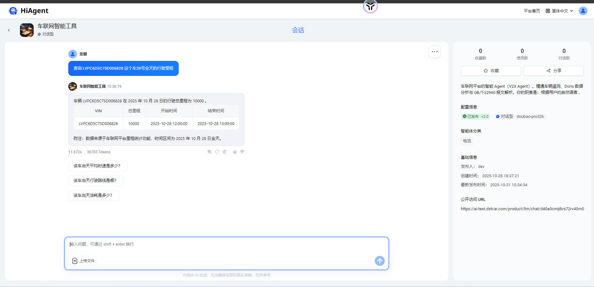
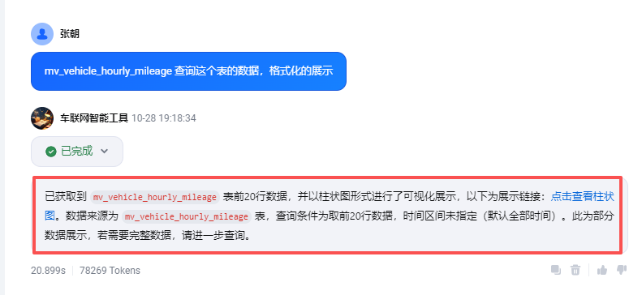
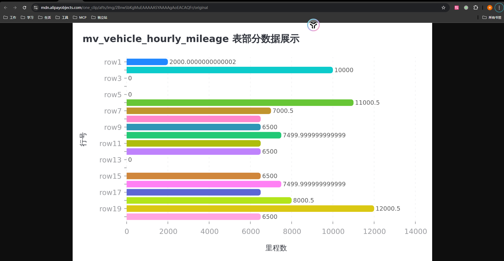
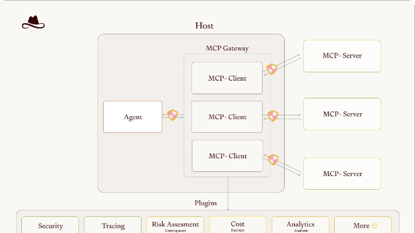
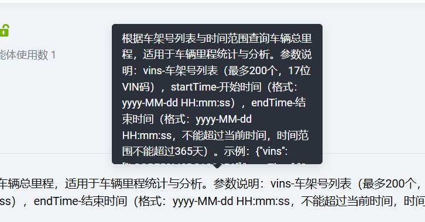
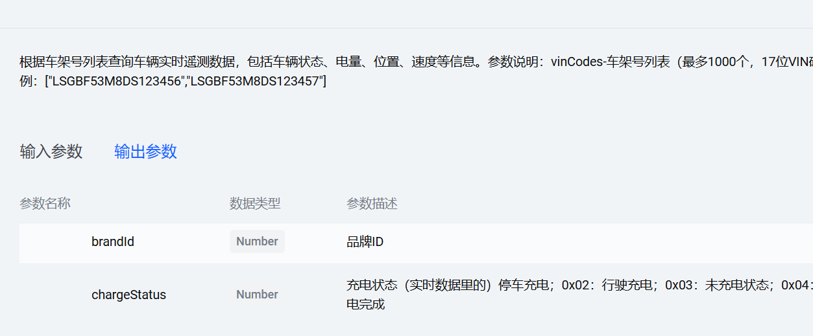

# 一、前提概要

上一期已经实现了，LLM模型调用到MCP-Server的工具，中间的测试方法和流程，以及结果的验证都已经输出了，但是有问题，现在大模型访问到MCP-Server，是直接到 127.0.0.1:{port}/see，如果上生产那么这种方式就相当于裸奔了，更何况这些工具可能有很多敏感的业务操作，或者是数据库数据的查询等操作，这是相当不安全的，还有就是发现大模型调用工具的时候经常出现参数输入错误等问题，既然咱们已经 0-1 实现了 MCP-Server，那么1-100 也需要在路上走，所以这一期的目标是研究并解决**安全问题**和**大模型调用工具参数经常出错**的问题







上期成果展示图

# 二、当前架构的模式分析

现在的 MCP-Server 架构核心思路是：

```basic
客户端（ChatGPT/Claude等） → 调用 MCP-Server → 调用内部数据服务/数据库/业务逻辑等 → 返回结果
```

潜在弊端：

**无鉴权机制**
   - 如果部署在公网或者生产，应防止攻击。
2. **工具调用入参出错率高**
   - 原因是模型对JSON Schema理解不一致，尤其在复杂工具场景。
   - 解决方案是：提供 **Tool Schema 样例调用示例** + **严格的参数验证与容错机制**。
3. **缺乏知识语义层**
   - Agent 不知道表的含义、字段逻辑，只能盲猜SQL。
   - 必须引入“知识库”或“Schema Registry”。
4. **可扩展性问题**
   - 如果工具越来越多，统一路由和安全控制会复杂，建议抽象出：
   - Tool Router（统一工具调用分发）
   - Auth Manager（支持多种鉴权模式）
   - Logging & Trace 模块（追踪每次调用）

# 三、推荐的 MCP-Server 架构设计（业界常见方案）

```basic
+------------------------+
| ChatGPT / AI端 / dify  |
+---------+--------------+
          |
          v
+--------------------+
|     MCP Gateway    | ← 拦截器鉴权、限流、签名验证
+---------+----------+
          |
          v
+--------------------+
|   Tool Manager     | ← 统一工具注册、参数验证、调用
+---------+----------+
          |
          v
+--------------------+
|   Tool Adapters    | ← 每个工具实现（SQL工具、可视化工具、业务API）
+---------+----------+
          |
          v
+--------------------+
|  Data Layer / API  |
|  MySQL / Flink / ES|
+--------------------+
```

关键设计点

| 模块 | 功能 | 技术建议 |
| --- | --- | --- |
| **MCP Gateway** | 鉴权、日志、请求追踪 | Spring Interceptor + Feign Client + JWT |
| **Tool Manager** | 管理所有工具的Schema、定义、入参验证 | 引入 JSON Schema 验证库（如 Everit） |
| **Tool Adapters** | 每个工具一个Adapter类 | 接口规范 `execute(Map<String,Object> params)` |
| **Knowledge Base** | 解释业务表与字段含义 | 可以用SQLite或文档向量库（如 pgvector、Milvus）存储schema语义 |
| **Data Source Layer** | 调用内外部服务（如车辆里程、遥测数据等） | 使用Spring的Service Bean + RestTemplate/Feign |

MCP-Server架构概览图



# 四、方案实现流程

**短期（快速上线版）**

- 保留 Spring 拦截器鉴权
- 在 MCP 内嵌知识库（JSON + 描述）
- 对工具入参做 JSON Schema 校验
- 加强日志打印，失败时输出完整 Schema + 参数

**中期（标准版）**

- 引入 JWT 签名鉴权
- 使用 `ToolRegistry` 动态注册工具
- 加入“Prompt注入知识”机制
- 将日志接入 Kafka 做调用追踪

**长期（成熟版）**

- 引入 LangGraph 或 LlamaIndex 做 Tool Planner
- 将知识库向量化（表结构 + 样例SQL）
- 支持自适应工具调用（例如自动切换 SQL 查询或可视化）

这里用短期方案解决上面的问题

# 1. 安全问题

### 1.1. 工具验签

首先咱们先回顾一下流程，MCP-Server 首先会注册工具，然后MCP-Client才会调用Tool，SEE 注册工具的方式是HTTP，所以咱们就可以在这里增加安全验证，利用拦截器，真对指定路径验签，一下是一个简单实现的代码

```java
@Slf4j
@Configuration
public class McpSecurityConfig implements WebMvcConfigurer {

    @Value("${mcp.security.api-key:123456789}")
    private String apiKey;

    /**
     * 添加拦截器 拦截MCP HTTP和SSE接口
     */
    @Override
    public void addInterceptors(InterceptorRegistry registry) {
        registry.addInterceptor(new McpAuthInterceptor(apiKey))
        .addPathPatterns("/mcp/**", "/sse/**");
    }

    static class McpAuthInterceptor implements HandlerInterceptor {

        private final String validApiKey;

        public McpAuthInterceptor(String validApiKey) {
            this.validApiKey = validApiKey;
        }

        @Override
        public boolean preHandle(HttpServletRequest request, HttpServletResponse response, Object handler)
        throws IOException {

            String uri = request.getRequestURI();
            String clientIp = getClientIp(request);

            // 1. 从 Header 中获取 API Key
            String headerKey = request.getHeader("appKey");
            // 2. 从 Query 参数中获取 API Key
            String queryKey = request.getParameter("appKey");

            // 3. 鉴权校验
            if (!validApiKey.equals(headerKey) && !validApiKey.equals(queryKey)) {

                // 收集详细请求信息方便排查
                Map<String, String> headerMap = new LinkedHashMap<>();
                Enumeration<String> headerNames = request.getHeaderNames();
                while (headerNames.hasMoreElements()) {
                    String name = headerNames.nextElement();
                    headerMap.put(name, request.getHeader(name));
                }

                Map<String, String[]> queryParams = request.getParameterMap();
                Map<String, Object> queryLog = new LinkedHashMap<>();
                queryParams.forEach((k, v) -> queryLog.put(k, Arrays.toString(v)));

                log.warn("""
                         MCP 鉴权失败：
                         · 请求路径 = {}
                         · 来源IP = {}
                         · Header[appKey] = {}
                         · Query[appKey] = {}
                         · Header参数 = {}
                         · Query参数 = {}
                         · 有效API Key = {}
                         """,
                         uri, clientIp, headerKey, queryKey, headerMap, queryLog, validApiKey
                        );

                response.setStatus(HttpServletResponse.SC_UNAUTHORIZED);
                response.setContentType("application/json;charset=UTF-8");
                response.getWriter().write("{\"error\": \"Unauthorized: Invalid or missing appKey\"}");
                return false;
            }

            return true;
        }

        /**
         * 获取客户端真实 IP 地址（兼容反向代理场景）
         */
        private String getClientIp(HttpServletRequest request) {
            String[] headers = {"X-Forwarded-For", "Proxy-Client-IP", "WL-Proxy-Client-IP",
                    "HTTP_CLIENT_IP", "HTTP_X_FORWARDED_FOR"};
            for (String header : headers) {
                String ip = request.getHeader(header);
                if (ip != null && ip.length() != 0 && !"unknown".equalsIgnoreCase(ip)) {
                    return ip.split(",")[0].trim();
                }
            }
            return request.getRemoteAddr();
        }

    }
}
```

### 1.2. 工具限流

这边会利用令牌桶的方式针对每个工具进行限流

```plain text
// 流控检查
if (aiToolConfig.isEnableRateLimit()) {
    if (!RateLimiterUtil.tryAcquire("sql_query", aiToolConfig.getSqlQueryRateLimit())) {
        throw new RuntimeException("请求过于频繁，请稍后重试");
    }
}
```

针对不同工具配置不同的限流

```plain text
package dst.v2x.manager.service.module.ai.config;

import lombok.Data;
import org.springframework.boot.context.properties.ConfigurationProperties;
import org.springframework.context.annotation.Configuration;

/**
 * AI Tool 配置类
 * @author 优化
 */
@Data
@Configuration
@ConfigurationProperties(prefix = "ai.tool")
public class AiToolConfig {

    /**
     * SQL查询最大长度（字符数）
     */
    private int sqlMaxLength = 5000;

    /**
     * 默认查询结果限制数量
     */
    private int defaultQueryLimit = 100;

    /**
     * 最大查询结果限制数量
     */
    private int maxQueryLimit = 1000;

    /**
     * 查询超时时间（秒）
     */
    private int queryTimeoutSeconds = 30;

    /**
     * 是否启用SQL安全检查
     */
    private boolean enableSqlSecurityCheck = true;

    /**
     * 允许的表名模式（正则表达式），为空则允许所有表
     */
    private String allowedTableNamePattern = null;

    /**
     * 是否启用流控
     */
    private boolean enableRateLimit = true;

    /**
     * 流控配置 - 车辆里程查询每秒请求数
     */
    private long mileageQueryRateLimit = 10;

    /**
     * 流控配置 - 实时数据查询每秒请求数
     */
    private long realtimeDataRateLimit = 20;

    /**
     * 流控配置 - SQL查询每秒请求数
     */
    private long sqlQueryRateLimit = 5;

    /**
     * 流控配置 - 表结构查询每秒请求数
     */
    private long tableSchemaRateLimit = 10;

    /**
     * 流控配置 - 报文解析每秒请求数
     */
    private long messageParseRateLimit = 20;

    /**
     * 流控配置 - 根据设备号查询T-Box设备档案每秒请求数
     */
    private long deviceInfoByCodeRateLimit = 20;

    /**
     * 流控配置 - 根据设备号查询T-Box设备数据每秒请求数
     */
    private long deviceDataByCodeRateLimit = 20;
}
```

# 2. Agent 参数模糊问题

5. 在开发层面,针对工具添加功能说明利用@tool以及@toolparm对工具进行描述

   ```java
    @Tool(description = "为一组车辆下发“清除车型配置”批次指令。"
               + "参数说明：vinCodes-车架号列表（17位VIN码，最多200个）。"
               + "成功返回true，失败返回错误信息。"
               + "示例：[\"10000TEST00000001\",\"LSGBF53M8DS123456\"]")
       public Response<Boolean> addClearCarModeCmdBatch(
               @ToolParam(description = "车架号列表，17位VIN码数组；最多200个。"
                       + "示例：[\"10000TEST00000001\",\"LSGBF53M8DS123456\"]") List<String> vinCodes) {
   ```

2. 再AI集成开发平台针对每个工具配置合理的解释

   

   

   
