# 目标
 	希望通过这份内容抛砖引玉，让你在阅读后不仅能独立编写 WordCount、接入 Kafka、使用 MySQL/Redis，对 Flink 作业有一个整体、清晰的认识。  

# 一、第一部分：Flink 到底是什么？为什么要用它？
## 1.1 一句话定义
Flink 是一个“<font style="color:#DF2A3F;">真·实时</font>”流计算引擎，专门用来在数据不断产生的时候就立刻算出结果。

Flink核心目标，是“<font style="color:#DF2A3F;">数据流上的有状态计算</font>”(Stateful Computations over Data Streams )具体说明:Apache Flink是一个<font style="color:#DF2A3F;">框架</font>和<font style="color:#DF2A3F;">分布式处理引擎</font>，用于对<font style="color:#DF2A3F;">无界</font>和<font style="color:#DF2A3F;">有界</font>数据流进行有状态计算。（可以提一嘴，流批一体）

## 1.2 流处理的三个历史阶段
| 阶段 | 代表框架 | 延迟 | 状态管理 | Exactly-once | 典型问题 |
| --- | --- | --- | --- | --- | --- |
| 第一代 | Storm / Heron | 毫秒级 | 非常弱 | 非常麻烦 | 状态小、故障恢复难 |
| 第二代 | Spark Streaming | 秒级（微批） | 有状态 | 有（但复杂） | 延迟高、不能真毫秒级 |
| 第三代（当前最优） | Apache Flink | 毫秒级 | 超大状态 | 原生支持 | 几乎没有短板 |

结论：Flink 是目前唯一一个同时满足下面 5 个要求的开源引擎

1. 毫秒级延迟
2. 高吞吐
3. 超大状态（几十 TB 都行）
4. 原生 Exactly-once
5. 事件时间 + 水印（处理乱序）

所以一句话：现在公司里只要是“实时”两个字，基本默认就用 Flink。

## 1.3 Exactly-once
Exactly-once（精确一次）是流处理系统中最严格、最重要的“数据处理语义”保证。 简单来说，就是：**不管程序挂了多少次、重启多少次、机器宕机多少次，最终每一条数据都恰好被正确处理一次，既不多也不少**。

<font style="background-color:#FBDE28;">通俗的比喻解释</font>

| 处理语义 | 比喻（你给女朋友发微信“到家了”） | 后果 |
| --- | --- | --- |
| At-most-once | 发了就不管了，网络断了女朋友也收不到 | 数据丢了（最轻松，但不能接受） |
| At-least-once | 怕丢了就狂发，发 100 次确认她一定收到 | 数据重复了（女朋友炸了：你发 100 次干嘛） |
| **Exactly-once** | **不管网络怎么抖、重连多少次，女朋友手机上永远只出现一次“到家了”** | 完美（既不丢也不重） |

# 二、第二部分：Flink 核心概念
## Flink分层API
<!-- 这是一张图片，ocr 内容为： -->
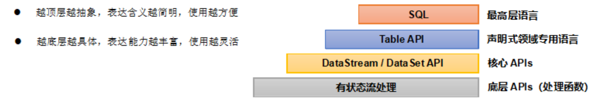

有状态流处理：通过底层API(处理函数)，对最原始数据加工处理。底层API与DdaSteamAPI相集成，可以处理复杂的计算。

<font style="color:#DF2A3F;">DataSteamAPI(流处理) 和 DataSetAPI(批处理)</font>封装了底层处理函数，提供了通用的模块，比如转换(tansfonmations，包括fatmap等)，连接(joins)，聚合(aggregations)，窗口(windows)操作等。注意:Fnk1.12以后，<font style="color:#DF2A3F;">DataSteamAPI已经实现map、真正的流批一体，所以DataSetAPI已经过时</font>。

<font style="color:#DF2A3F;">TableAPI是以表为中心的声明式编程</font>，其中表可能会动态变化。TableAPI遵循关系模型:表有二维数据结构，类似于关系数据库中的表;	同时API提供可比较的操作，例如<font style="color:#DF2A3F;">select、project、join、group-by、aggregate</font>等。我们可以在表与 DataSteamDataset之间无缝切换，以允许程序将 TableAPl与DataStream 以及 DataSet 混合使用。

SOL这一层在语法与表达能力上与Table API类似，但是是以SOL查询表达式的形式表现程序。SOL抽象与tIabe API交互密切，同时SOL查询可以直接在Table API定义的表上执行.

## Flink 运行时架构
<font style="color:#DF2A3F;">这里以单列部署模式为列</font>

<!-- 这是一张图片，ocr 内容为： -->
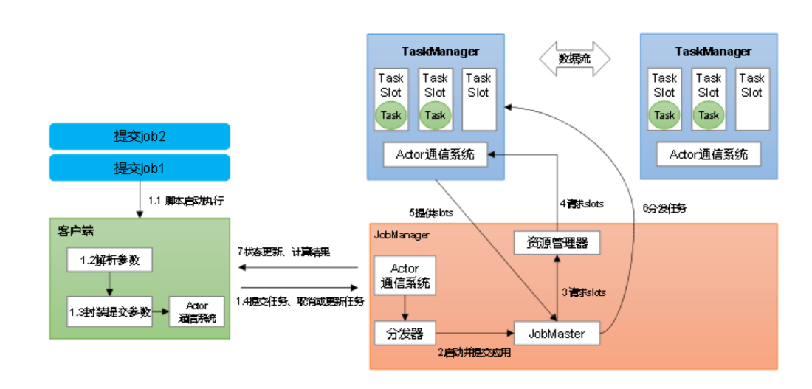

### **作业管理器（JobManager）**
**JobManager = Flink 集群里的大脑 + 管家**

一句话总结： **JobManager 是整个 Flink 作业的“总指挥官”**，负责接收你提交的代码、把作业拆成小任务、给每个 TaskManager 发命令、协调 Checkpoint、监控所有任务的生死，一旦出事就负责重启恢复。

它干的三件最核心的事：

1. 把你的代码（JobGraph）变成可以并行执行的图（ExecutionGraph）
2. 决定每个小任务跑在哪个 TaskManager 的哪个 slot 上
3. 全局协调 Checkpoint 和故障恢复（Exactly-once 的真正指挥官）

一个 Flink 集群永远只有一个活跃的 JobManager（高可用时有 standby），所有作业都归它管，**它挂了 = 整个集群所有作业全停**。

（部署模式等细节可以去看官网教程，这里就不阐述部署了）

### 任务管理器（TaskManager）
TaskManager 是真正执行计算的 JVM 进程，负责接收 JobManager 派发的子任务（subtask），在自己的 Slot 里跑算子代码、管理本地状态、做 Checkpoint 快照、跟其他 TaskManager 交换数据，它是集群里“干体力活”的地方。

## Flink 核心概念
### 并行度（Parallelism）
<!-- 这是一张图片，ocr 内容为： -->
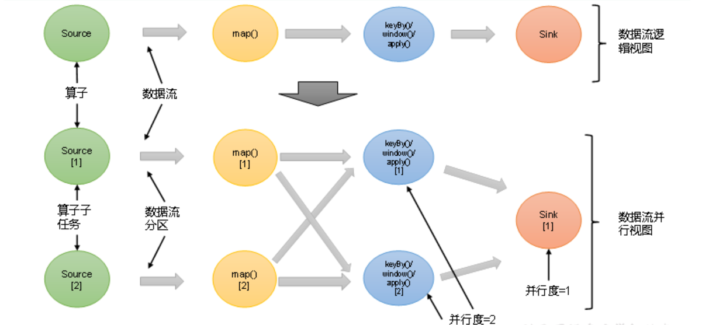

#### 并行度（Parallelism）一句话概述
**并行度 = 一个算子同时有多少个并行实例在干活**，它直接决定你的作业能多快、能吃多少数据。

用大白话： 想象你要把 1000 个苹果削皮。

+ 并行度 = 1 → 你一个人削，慢慢来
+ 并行度 = 8 → 8 个人一起削，理论上快 8 倍 Flink 里每一个算子（source、map、keyBy/window、sink）都可以单独设置并行度。

#### 并行度到底决定什么？
1. 作业整体并行度 = 所有算子中最大的并行度
2. 并行度越高，吞吐越大（前提是下游跟得上、集群 slot 够）
3. <font style="color:#DF2A3F;">并行度必须 ≤ 集群总 slot 数，否则作业起不来</font>

#### 实际生产中最常用的 4 种设置方式（优先级从高到低）
| 设置方式 | 代码/命令示例 | 适用场景 | 优先级 |
| --- | --- | --- | --- |
| 1. 算子级别单独设置 | .keyBy(...).window(...).sum(0).setParallelism(16) 最常用！ | 某个算子是热点，想单独给他开多线程 | ★★★★★ |
| 2. 提交作业时用 -p 指定 | flink run -p 128 wordcount.jar | 快速调整体并行度，不想改代码 | ★★★★ |
| 3. 代码里全局设置 | env.setParallelism(64) | 开发测试时用，生产不推荐 | ★★★ |
| 4. flink-conf.yaml 默认 | parallelism.default: 64 | 整个集群默认值，最后手段 | ★★ |

#### 推荐做法
代码里只给热点算子单独 setParallelism（比如 window、join、sink）Java

   ```java
   stream
   .keyBy(...)
   .window(TumblingEventTimeWindows.of(Time.minutes(1)))
   .sum(0)
   .setParallelism(32)    // 窗口聚合是热点，开 32
   .addSink(new ClickHouseSink())
   .setParallelism(8);    // ClickHouse 写压力大，开 8 就够
   ```

2. 提交作业时用 -p 统一控制整体并行度Bash

   ```java
   flink run -p 200 -c com.xxx.MyJob myjob.jar
   ```

#### 生产常见值
+ Kafka Source：一般和分区数对齐（比如 24 分区 → 并行度 24）
+ 窗口聚合：CPU 核心数的 2~4 倍（比如 32 核机器，开 64~128）
+ JDBC/MySQL Sink：3~12（MySQL 扛不住太多）
+ ClickHouse/Doris Sink：8~32（看库性能）

一句话总结： **并行度就是你给算子雇了多少个工人干活**，生产中永远是“热点算子单独 setParallelism + 提交时 -p 整体控制”。

### 算子链（Operator Chain）
<!-- 这是一张图片，ocr 内容为： -->
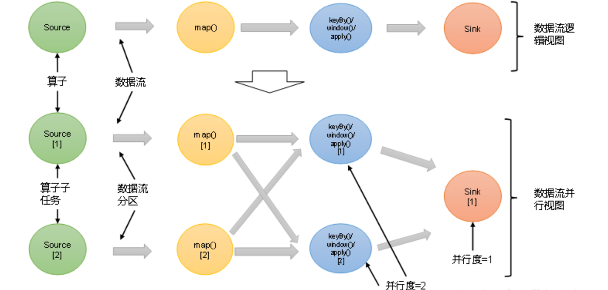

**算子链 = Flink 把并行度相同、且是一对一（one-to-one）关系的多个算子“焊接”成一个任务，放在同一个线程里跑，从而省掉不必要的序列化/网络传输开销**，是 Flink 性能杀手锏之一。

用大白话比喻： 本来 source → map → filter → map 这 4 个工人要 4 个工位、互相扔来扔去（序列化 + 网络）。 Flink 发现他们并行度都一样、数据顺序也不乱，就直接把 4 个人焊成一个“四头怪”，在一个线程里顺序执行，省了 3 次“扔来扔去”，性能直接起飞。

#### 什么时候能链？什么时候不能链？
| 情况 | 是否能链在一起 | 举例说明 |
| --- | --- | --- |
| 并行度相同 | 能 | 都是 64 → 能链 |
| 并行度不同 | 一定不能链 | source 64，map 32 → 必须断开 |
| one-to-one 操作 | 能 | map、filter、flatMap、select、where |
| 需要重新分区（redistribute） | 一定不能链 | keyBy、shuffle、rebalance、broadcast |
| 手动禁用了链 | 不能 | disableChaining()、startNewChain() |

#### 实际生产中怎么操作算子链
| 操作需求 | 代码怎么写（Java/Scala 通用） | 生产场景举例 |
| --- | --- | --- |
| 1. 想让某个算子跟前面断开 | .disableChaining() | sink 之前加 disableChaining()，防止 sink 拖慢上游 |
| 2. 从某个算子开始重新开一条链 | .startNewChain() | keyBy 之后 startNewChain()，让窗口单独成链 |
| 3. 给某个算子单独指定 slot 共享组（最强控制） | .slotSharingGroup("xxx") | 热点算子单独放一组 slot，防止互相抢资源 |

真实生产代码例子：

```java
stream
.map(...)                          // 默认跟前面链在一起
.filter(...)
.map(...)

.keyBy(...)                        // 这里自动断链（因为要 shuffle）

.window(...)                       // 窗口开始新链
.sum(0)
.startNewChain()                   // 强制从窗口开始新链（可选）

.map(new RichMapFunction(...))     // Rich 开状态，自动断链
.disableChaining()                 // 强制跟前面断开（保险）

.addSink(new ClickHouseSink())     // sink 一般都单独断开
.setParallelism(8)
.disableChaining();                // 生产必写！防止 sink 反压拖垮整个链
```

#### 生产中最常见的 3 个算子链黄金写法
| 场景 | 推荐写法 |
| --- | --- |
| 写 MySQL/Redis/ES 等慢 sink | 一定在 sink 前加 .disableChaining() |
| 窗口聚合是热点 | .window(...).sum(...).startNewChain() |
| 想完全掌控链的划分 | 给每个大算子都手动加 slotSharingGroup |
| | .slotSharingGroup("source") → source 单独一组 |
| | .slotSharingGroup("window") → 窗口单独一组 |
| | .slotSharingGroup("default") → 其他默认 |

一句话总结： **算子链是 Flink 免费送你的性能加速器**，默认能链就链，但<font style="color:#DF2A3F;">生产中永远记得给 sink 和热点算子主动断链（disableChaining）</font>，否则一旦反压，整个作业全卡死。

### 任务槽（Task Slots）
<!-- 这是一张图片，ocr 内容为： -->
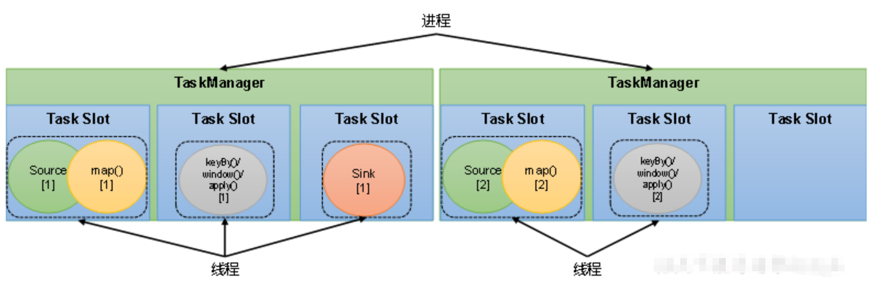

#### 任务槽（Task Slots）一句话概述
**Task Slot = TaskManager 里的一块“工位”**，一个 Slot 就是一个线程 + 一份固定内存，决定了这个 TaskManager 同一时刻最多能同时跑多少个并行子任务（subtask）。

用最通俗的比喻： 一个 TaskManager 就像学校的一间教室，Slot 就是教室里的课桌。

+ 教室有 8 张课桌（8 个 slot）→ 最多同时坐 8 个学生（8 个 subtask）
+ 学生可以共享课桌（默认开启 slot sharing）
+ 你也可以规定某些学生只能坐指定颜色的课桌（slotSharingGroup）

#### Task Slot 和 Parallelism 的终极区别（背下来）
| 名词 | 含义 | 谁决定 | 举例 |
| --- | --- | --- | --- |
| Parallelism | 我总共需要多少个工人干活 | 作业自己决定 | 我的 window 并行度 64 → 需要 64 个工人 |
| Task Slot | 每个工厂（TaskManager）有几个工位 | 集群管理员配置 | 每台机器配 8 个 slot → 8 个工位 |
| 关系 | Parallelism ≤ 所有 TaskManager 的 Slot 总数 | 否则作业起不来 | 3 台机 × 8 slot = 最多支持 24 并行度 |

#### 生产中最常用的 3 种操作（直接背代码和命令）
| 操作需求 | 具体怎么做（100% 生产真实写法） | 说明 |
| --- | --- | --- |
| 1. 改一台机器的 slot 数量（最常用） | 编辑 flink-conf.yaml（每台机器都要改） taskmanager.numberOfTaskSlots: 16 | 生产主流配置：32核机器配 16~32 个 slot |
| 2. 某个算子独占 slot，不跟别人共享 | .slotSharingGroup("heavy") | 防止热点算子被轻量级算子抢资源 |
| 3. 完全关闭 slot 共享（极少用） | 全局关闭（不推荐） taskmanager.slot-sharing.enabled: false | 每个 subtask 独占一个 slot，浪费资源，基本没人这么干 |

#### 生产黄金配置模板
```java
# flink-conf.yaml（每台 TaskManager 都配这个）
taskmanager.numberOfTaskSlots: 24          # 32核机器最常见配 24
taskmanager.memory.process.size: 32g       # 总内存
jobmanager.memory.process.size: 4g

# 代码里热点算子单独分组（强烈推荐）
stream
.source(...)                                      # 默认组
.map(...)

.keyBy(...)
.window(...)                                      # 热点！
.process(new MyHeavyProcessFunction())
.slotSharingGroup("window-heavy")                 # 单独一组 slot

.addSink(new SlowMySQLSink())
.slotSharingGroup("mysql-sink")                   # 慢 sink 单独一组
.setParallelism(6);
```

#### 生产中最常见的 3 个 slot 配置经验值
| 机器规格 | 推荐 slot 数 | 理由 |
| --- | --- | --- |
| 16核 64G | 12~16 | 留点内存给 RocksDB |
| 32核 128G | 20~32 | 主流配置，24 最常见 |
| 64核 256G+ | 40~64 | 大状态作业才这么配 |

#### 一句话总结
**Slot 是资源（工位），Parallelism 是需求（工人）** → 工人不能比工位多 → 生产永远先看集群总 slot 够不够，再决定能开多大并行度 → 热点算子一定要 slotSharingGroup 分组，否则互相抢 slot 一卡全卡。

记住这三行配置，90% 的性能问题都解决了：

```yaml
taskmanager.numberOfTaskSlots: 24
```

Java

```java
.window(...).slotSharingGroup("heavy-window")
.addSink(...).slotSharingGroup("slow-sink")
```

# 三、第三部分：DataStreamAPI
**DataStream API 是Flink的核心层API**。一个Flink程序，其实就是对 **DataStream**(数据流) 的各种转换。具体来说，代码基本上都由以下几部分构成：

<!-- 这是一张图片，ocr 内容为： -->
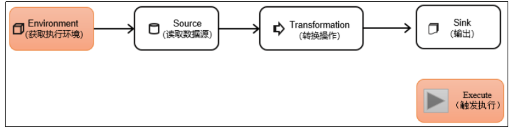

```java
StreamExecutionEnvironment env = StreamExecutionEnvironment.getExecutionEnvironment();

// 1. Source（从哪读）
DataStream<String> stream = env
    .fromSource(kafkaSource, WatermarkStrategy.noWatermarks(), "kafka");

// 2. Transform（怎么算
stream
    .map(json -> parse(json))                 // 解析
    .filter(obj -> obj != null)
    .assignTimestampsAndWatermarks(watermarkStrategy)  // 事件时间 + 水印（重点）
    .keyBy(obj -> obj.id)
    .window(TumblingEventTimeWindows.of(Time.minutes(1)))  // 窗口
    .aggregate(new MyAggFunction())           // 聚合（或者 .sum()/.reduce()）等等

// 3. Sink（写到哪去）
    .addSink(new ClickHouseSink())
    .setParallelism(8)
    .slotSharingGroup("ck-sink");             // 生产必写 防止反压传染

env.execute("my-real-time-job");
```

<font style="color:#DF2A3F;"></font>

## 1、执行环境（必须第一步）
<font style="color:rgb(255,0,0);">最简单的方式，就是直接调用getExecutionEnvironment方法。</font>它会根据当前运行的上下文直接得到正确的结果：如果程序是独立运行的，就返回一个本地执行环境；如果是创建了jar包，然后从命令行调用它并提交到集群执行，那么就返回集群的执行环境。也就是说，这个方法会根据当前运行的方式，自行决定该返回什么样的运行环境。

```java
StreamExecutionEnvironment env = StreamExecutionEnvironment.getExecutionEnvironment();
// 可选：设置并行度、开启 Checkpoint
env.setParallelism(1);                          // 全局并行度（生产慎用）
env.enableCheckpointing(10000L);                // 开启 Exactly-once Checkpoint
```

（<font style="color:#F38F39;background-color:#E8F7CF;">如果生产使用的是云产品部署，这里代码里面就不要写死处理Checkpoint</font>）

## 2、Source（从哪儿读数据）
**Source 是整个 Flink 作业的入口**，决定了数据从哪儿来、怎么来、是否带事件时间。 生产中 90% 的 Source 都是 Kafka，剩下 10% 是测试/文件/自定义。

<!-- 这是一张图片，ocr 内容为： -->
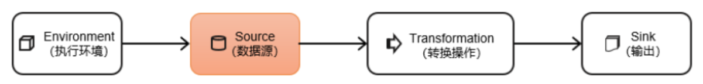

### 1. Source 分类 & 使用频率
| 类型 | 使用场景 | 生产频率 | 推荐度 |
| --- | --- | --- | --- |
| Kafka | 生产实时数据入口 | ★★★★★ | 必学 |
| 文件（File） | 批处理或小数据测试 | ★★ | 了解 |
| 集合（Collection） | 本地测试、单元测试 | ★★★ | 常用 |
| Socket | 快速验证、nc 测试 | ★★ | 了解 |
| DataGen | 性能测试、压测 | ★★★ | 推荐 |
| 自定义 Source | 特殊数据源（MySQL/Redis 等） | ★★★ | 进阶 |

**生产推荐**：Kafka + WatermarkStrategy（事件时间 + 水印）。

### 2. Kafka Source (生产主力)
```java
// 加 flink-connector-kafka 依赖
KafkaSource<WaterSensor> kafkaSource = KafkaSource.<WaterSensor>builder()
    .setBootstrapServers("hadoop102:9092,hadoop103:9092")
    .setTopics("sensor-topic")
    .setGroupId("flink-group-01")
    .setStartingOffsets(OffsetsInitializer.earliest())     // 或 latest() / committedOffsets()
    .setValueOnlyDeserializer(new DeserializationSchema<WaterSensor>() {
        @Override
        public WaterSensor deserialize(byte[] message) throws IOException {
            // 自己写 JSON 解析，比如 FastJSON / Gson
            return JSON.parseObject(message, WaterSensor.class);
        }
        @Override
        public boolean isEndOfStream(WaterSensor nextElement) { return false; }
        @Override
        public TypeInformation<WaterSensor> getProducedType() {
            return TypeInformation.of(WaterSensor.class);
        }
    })
    .build();

DataStream<WaterSensor> stream = env.fromSource(
    kafkaSource,
    WatermarkStrategy.<WaterSensor>forBoundedOutOfOrderness(Duration.ofSeconds(5))  // 水印
        .withTimestampAssigner((sensor, ts) -> sensor.ts),
    "kafka-source"
);
```

### 3. Source 层生产必需考虑的 3 件事
| **配置项** | **代码位置** | **为什么必须配** |
| --- | --- | --- |
| Checkpoint（Exactly-once） | env.enableCheckpointing(10000L, CheckpointingMode.EXACTLY_ONCE); | Kafka Source 才能实现端到端精确一次 |
| 水印 + 事件时间 | WatermarkStrategy.forBoundedOutOfOrderness(...) + withTimestampAssigner | 窗口才能基于事件时间正确计算，处理乱序 |
| 并行度对齐 Kafka 分区 | Source 并行度 = Kafka 分区数 | 否则吞吐打折，某些分区消费慢 |

### 4. 一句话总结 Source 层
**生产作业 99% 都是从 Kafka Source 开始**，配好 Checkpoint + 水印 + 并行度对齐分区，就能稳稳吃下 10w+ QPS，剩下就是 Transform 和 Sink 的事了。

## 3、Transform （怎么算）
**Transform 是 DataStream API 的核心**，负责对数据流进行各种转换、过滤、分组、窗口、聚合等操作。 生产中 90% 的业务逻辑都在这里实现。

<!-- 这是一张图片，ocr 内容为： -->
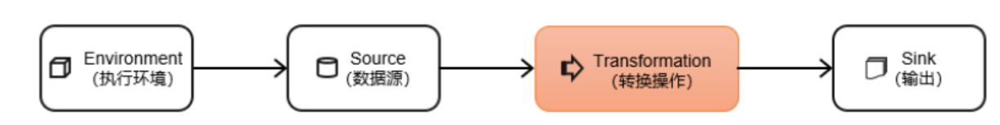

### Transform 基本分类
| **类型** | **作用** | **常见操作** | **生产频率** |
| --- | --- | --- | --- |
| 逐条处理 | 一进一出（或过滤） | map、flatMap、filter | ★★★★★ |
| 分组 | 按 key 分组 | keyBy | ★★★★★ |
| 窗口 | 把无限流切成有限段 | window（Tumbling/Sliding/Session） | ★★★★★ |
| 聚合 | 窗口内/全局聚合 | sum、reduce、aggregate、process | ★★★★★ |
| 时间 & 水印 | 处理乱序 + 事件时间 | assignTimestampsAndWatermarks | ★★★★★ |
| 高级 | 定时器、状态、侧输出、双流连接 | process、connect、sideOutput | ★★★★ |

### 常用的 Transform 
#### map / flatMap / filter
```java
stream
    .map(sensor -> {                          // 一对一转换
        sensor.vc = sensor.vc * 10;
        return sensor;
    })
    .flatMap(sensor -> {                      // 一对多（比如拆分字符串）
        return Stream.of(sensor.id, sensor.id + "_copy");
    })
    .filter(sensor -> sensor.vc > 100);       // 过滤
```

##### 映射（map）
map是大家非常熟悉的大数据操作算子，主要用于将数据流中的数据进行转换，形成新的数据流。简单来说，就是一个“一一映射”，消费一个元素就产出一个元素。

<!-- 这是一张图片，ocr 内容为： -->


##### 过滤（filter）
filter转换操作，顾名思义是对数据流执行一个过滤，通过一个布尔条件表达式设置过滤条件，对于每一个流内元素进行判断，若为true则元素正常输出，若为false则元素被过滤掉。

<!-- 这是一张图片，ocr 内容为： -->


##### 扁平映射（flatMap）
flatMap操作又称为扁平映射，主要是将数据流中的整体（一般是集合类型）拆分成一个一个的个体使用。消费一个元素，可以产生0到多个元素。flatMap可以认为是“扁平化”（flatten）和“映射”（map）两步操作的结合，也就是先按照某种规则对数据进行打散拆分，再对拆分后的元素做转换处理。

<!-- 这是一张图片，ocr 内容为： -->


#### keyBy（分组，必须在窗口前用，这一步操作也可以叫做开窗操作）
计算的结果不仅依赖当前数据，还跟之前的数据有关，相当于要把所有数据聚在一起进行汇总合并——这就是所谓的“聚合”（Aggregation），类似于MapReduce中的reduce操作。

<!-- 这是一张图片，ocr 内容为： -->


```java
stream.keyBy(sensor -> sensor.id)             // 按 id 分组（String/POJO 字段都行）
      .keyBy(new KeySelector<WaterSensor, String>() {  // 自定义 KeySelector
          @Override
          public String getKey(WaterSensor s) { return s.id; }
      });
```

在内部，是通过计算<font style="color:rgb(255,0,0);">key的哈希值（hash code）</font>，<font style="color:rgb(255,0,0);">对分区数进行取模运算来实现的</font>。所以这里key如果是POJO的话，必须要重写hashCode()方法。

#### window（窗口，实时计算灵魂）
（这个后面统一讲，这个比较重要）

#### 聚合（sum/reduce/aggregate）
##### 简单聚合
有了按键分区的数据流**KeyedStream**，我们就可以基于它进行聚合操作了。Flink为我们内置实现了一些最基本、最简单的聚合API，主要有以下几种：

+ <font style="color:rgb(255,0,0);">sum</font>()：在输入流上，对指定的字段做叠加求和的操作。
+ <font style="color:rgb(255,0,0);">min</font>()：在输入流上，对指定的字段求最小值。
+ <font style="color:rgb(255,0,0);">max</font>()：在输入流上，对指定的字段求最大值。
+ <font style="color:rgb(255,0,0);">minBy</font>()：与min()类似，在输入流上针对指定字段求最小值。不同的是，min()只计算指定字段的最小值，其他字段会保留最初第一个数据的值；而minBy()则会返回包含字段最小值的整条数据。
+ <font style="color:rgb(255,0,0);">maxBy</font>()：与max()类似，在输入流上针对指定字段求最大值。两者区别与min()/minBy()完全一致。

```java
// 简单 sum
.window(...)
.sum("vc")                                    // 按 vc 字段求和

// reduce（自定义累加）
.reduce((a, b) -> {
    a.vc += b.vc;
    return a;
})

// aggregate（最强大，自定义聚合状态）
.aggregate(new MyAggregateFunction())
```

简单聚合算子返回的，同样是一个**SingleOutputStreamOperator**，也就是从KeyedStream又转换成了常规的DataStream。所以可以这样理解：<font style="color:#E4495B;">keyBy和聚合是成对出现的</font>，先分区、后聚合，得到的依然是一个DataStream。而且经过简单聚合之后的数据流，元素的数据类型保持不变。

一个聚合算子，会为**每一个key保存一个聚合的值**，在Flink中我们把它叫作“**状态**”（state）。所以每当有一个新的数据输入，算子就会更新保存的聚合结果，并发送一个带有更新后聚合值的事件到下游算子。对于无界流来说，这些状态是永远不会被清除的，所以我们使用聚合算子，应该只用在含有有限个key的数据流上。

##### 归约聚合（reduce）
reduce可以对已有的数据进行归约处理，把每一个新输入的数据和当前已经归约出来的值，再做一个聚合计算。

```java
public interface ReduceFunction<T> extends Function, Serializable {
    T reduce(T value1, T value2) throws Exception;
}
```

**ReduceFunction**接口里需要实现reduce()方法，这个方法接收两个输入事件，经过转换处理之后输出一个相同类型的事件。在流处理的底层实现过程中，**实际上是将中间“合并的结果”作为任务的一个状态保存起来的**；之后每来一个新的数据，就和之前的聚合状态进一步做归约。

### 物理分区算子**（Physical Partitioning）**
常见的物理分区策略有：随机分配（Random）、轮询分配（Round-Robin）、重缩放（Rescale）和广播（Broadcast）。

#### 随机分区（shuffle）
<!-- 这是一张图片，ocr 内容为： -->


最简单的重分区方式就是直接“**洗牌**”。通过调用DataStream的**.shuffle()**方法，将**数据随机地分配到下游算子的并行任务中去**。

随机分区服从均匀分布（uniform distribution），所以可以把流中的数据随机打乱，均匀地传递到下游任务分区。因为是完全随机的，所以对于同样的输入数据, 每次执行得到的结果也不会相同。

#### 轮询分区（Round-Robin）
<!-- 这是一张图片，ocr 内容为： -->
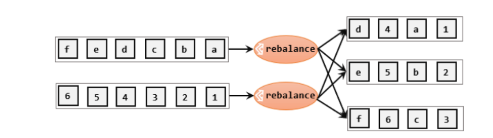

轮询，简单来说就是“发牌”，按照先后顺序将数据做依次分发。通过调用DataStream的.rebalance()方法，就可以实现轮询重分区。rebalance使用的是Round-Robin负载均衡算法，可以将输入流数据平均分配到下游的并行任务中去。

#### 重缩放分区（rescale）
重缩放分区和轮询分区非常相似。当调用rescale()方法时，其实底层也是使用Round-Robin算法进行轮询，但是只会将数据<font style="color:rgb(255,0,0);">轮询发送到下游并行任务的一部分中</font>。rescale的做法是分成小团体，发牌人<font style="color:rgb(255,0,0);">只给自己团体内的所有人轮流发牌</font>。

<!-- 这是一张图片，ocr 内容为： -->
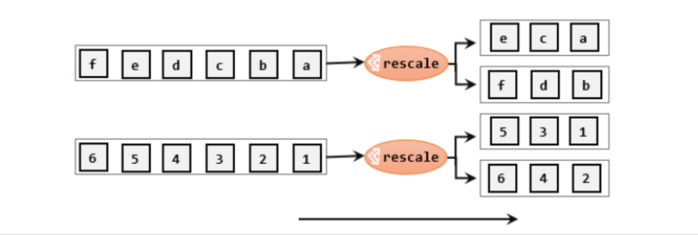

#### 广播（broadcast）
这种方式其实不应该叫做“重分区”，因为经过广播之后，数据会在不同的分区都保留一份，可能进行重复处理。可以通过调用DataStream的broadcast()方法，将输入数据复制并发送到下游算子的所有并行任务中去。

#### 全局分区（global）
全局分区也是一种特殊的分区方式。这种做法非常极端，通过调用.global()方法，会将所有的输入流数据都发送到下游算子的第一个并行子任务中去。这就相当于强行让下游任务并行度变成了1，所以使用这个操作需要非常谨慎，可能对程序造成很大的压力。

#### 自定义分区（Custom）
当Flink提供的所有分区策略都不能满足用户的需求时，我们可以通过使用partitionCustom()方法来自定义分区策略。

**1）自定义分区器**

```java
public class MyPartitioner implements Partitioner<String> {

    @Override
    public int partition(String key, int numPartitions) {
        return Integer.parseInt(key) % numPartitions;
    }
}
```

**2）使用自定义分区**

```java
public class PartitionCustomDemo {
    public static void main(String[] args) throws Exception {
//        StreamExecutionEnvironment env = StreamExecutionEnvironment.getExecutionEnvironment();
        StreamExecutionEnvironment env = StreamExecutionEnvironment.createLocalEnvironmentWithWebUI(new Configuration());

        env.setParallelism(2);

        DataStreamSource<String> socketDS = env.socketTextStream("hadoop102", 7777);

        DataStream<String> myDS = socketDS
                .partitionCustom(
                        new MyPartitioner(),
                        value -> value);
                

        myDS.print();

        env.execute();
```

### 分流
所谓“<font style="color:#E4495B;">分流</font>”，就是将一<font style="color:#E4495B;">条数据流拆分成完全独立的两条、甚至多条流</font>。也就是基于一个DataStream，定义一些筛选条件，将符合条件的数据拣选出来放到对应的流里。

<!-- 这是一张图片，ocr 内容为： -->
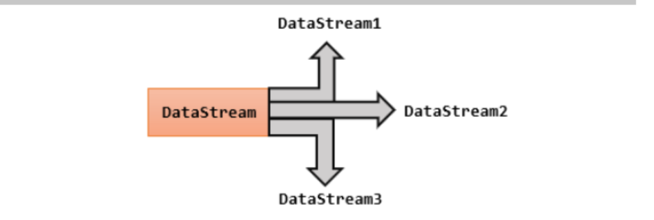

#### 简单实现
其实根据条件筛选数据的需求，本身非常容易实现：只要针对同一条流多次独立调用.filter()方法进行筛选，就可以得到拆分之后的流了。

**案例需求：**读取一个整数数字流，将数据流划分为奇数流和偶数流。

```java
public class SplitStreamByFilter {

    public static void main(String[] args) throws Exception {

        
        StreamExecutionEnvironment env = StreamExecutionEnvironment.getExecutionEnvironment();
      
        SingleOutputStreamOperator<Integer> ds = env.socketTextStream("hadoop102", 7777)
                                                           .map(Integer::valueOf);
        //将ds 分为两个流 ，一个是奇数流，一个是偶数流
        //使用filter 过滤两次
        SingleOutputStreamOperator<Integer> ds1 = ds.filter(x -> x % 2 == 0);
        SingleOutputStreamOperator<Integer> ds2 = ds.filter(x -> x % 2 == 1);

        ds1.print("偶数");
        ds2.print("奇数");
        
        env.execute();
    }
}
```

这种实现非常简单，但代码显得有些冗余——我们的处理逻辑对拆分出的三条流其实是一样的，却重复写了三次。而且这段代码背后的含义，<font style="color:rgb(255,0,0);">是将原始数据流stream复制三份</font>，<font style="color:rgb(255,0,0);">然后对每一份分别做筛选</font>；这明显是不够高效的。我们自然想到，能不能不用复制流，直接用一个算子就把它们都拆分开呢？

#### 侧输出流
<!-- 这是一张图片，ocr 内容为： -->
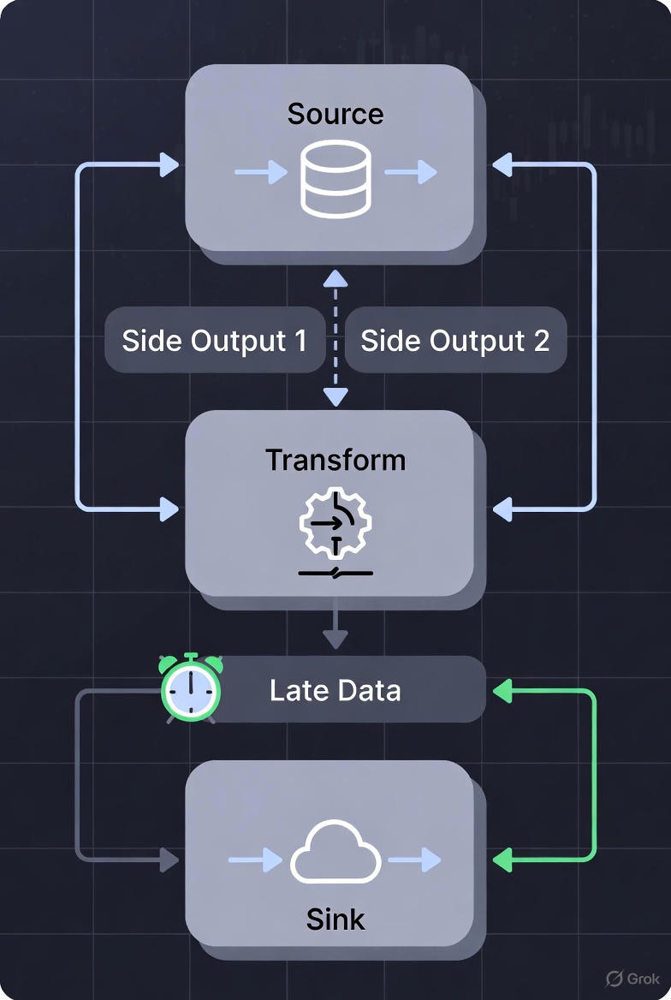

**分流 = 把一条主流里“不想要”或“特殊处理”的数据，单独拎出来走另一条支流。**

最常见的两个场景：

1. **窗口迟到数据（超出了 allowedLateness）**
2. **脏数据/异常数据（解析失败、字段为空等）**

**不分流的话，这些数据要么丢掉，要么污染主流结果；分流后可以单独打印、写死库、告警，完全不影响主流。**

##### 分流核心代码
```java
// 1. 定义侧输出标签（必须用 OutputTag）
OutputTag<WaterSensor> lateTag = new OutputTag<WaterSensor>("late-data"){};   // 迟到数据
OutputTag<WaterSensor> dirtyTag = new OutputTag<WaterSensor>("dirty-data"){}; // 脏数据

// 2. 在主流中声明分流
SingleOutputStreamOperator<Result> mainStream = stream
    .process(new MyCleanFunction())                // 手动分脏数据
    .keyBy(s -> s.id)
    .window(TumblingEventTimeWindows.of(Time.minutes(1)))
    .allowedLateness(Time.minutes(1))              // 允许迟到1分钟还能参与计算
    .sideOutputLateData(lateTag)                   // 超过1分钟的自动分到 lateTag
    .sum("vc");

// 3. 取出侧输出流单独处理
DataStream<WaterSensor> lateStream = mainStream.getSideOutput(lateTag);
lateStream.print("【迟到数据】>>>");

DataStream<WaterSensor> dirtyStream = mainStream.getSideOutput(dirtyTag);
dirtyStream.addSink(new KafkaDirtySink());         // 写死库或发钉钉告警
```


##### 两种常见分流方式
方式一：窗口自动分流迟到数据

```java
.keyBy(s -> s.id)
.window(TumblingEventTimeWindows.of(Time.minutes(1)))
.allowedLateness(Time.minutes(1))        // 允许迟到1分钟
.sideOutputLateData(lateTag)             // 超时的自动分流
.sum("vc");
```

方式二：ProcessFunction 手动分流

```java
.process(new ProcessFunction<String, WaterSensor>() {
    @Override
    public void processElement(String json, Context ctx, Collector<WaterSensor> out) {
        try {
            WaterSensor sensor = JSON.parseObject(json, WaterSensor.class);
            if (sensor.vc < 0) {
                ctx.output(dirtyTag, sensor);   // 负值算脏数据，分流
                return;
            }
            out.collect(sensor);                // 正常数据进主流
        } catch (Exception e) {
            ctx.output(dirtyTag, new WaterSensor("parse_error", 0L, 0)); // 解析失败也分流
        }
    }
})
```

### 合流
#### union（简单河流操作）
最简单的合流操作，就是直接将多条流合在一起，叫作流的“联合”（union）。联合操作要求必须流中的<font style="color:rgb(255,0,0);">数据类型必须相同</font>，合并之后的新流会包括所有流中的元素，数据类型不变。

<!-- 这是一张图片，ocr 内容为： -->
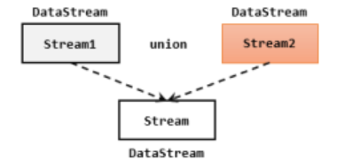

**特点**：

+ 多条流合并成一条
+ 元素类型必须一致
+ 不保证顺序（只是把所有数据混在一起）
+ 并行度取最大值

```java
DataStream<WaterSensor> stream1 = env.socketTextStream("localhost", 7777).map(...);
DataStream<WaterSensor> stream2 = env.readTextFile("sensor2.txt").map(...);
DataStream<WaterSensor> stream3 = env.fromSource(kafkaSource, ...);

// 合流：三条流合并成一条
DataStream<WaterSensor> unionStream = stream1
.union(stream2, stream3)          // 可以传多个流
.keyBy(s -> s.id)
.window(TumblingEventTimeWindows.of(Time.minutes(1)))
.sum("vc");

unionStream.print("合流结果");
```

**适用场景**：

+ 多个 Kafka topic 的同构数据
+ 多个文件/多个分区数据合并统计
+ 测试多个来源的相同格式数据

**生产注意**：union 不改变数据类型，也不提供额外处理逻辑，适合“纯合并”场景。

#### connect（类型可不同，最强大合流方式）
<font style="color:rgb(255,0,0);">流的联合虽然简单，不过受限于数据类型不能改变</font>，灵活性大打折扣，所以实际应用较少出现。除了联合（union），Flink还提供了另外一种方便的合流操作——<font style="color:rgb(255,0,0);">连接（connect）</font>。

<!-- 这是一张图片，ocr 内容为： -->
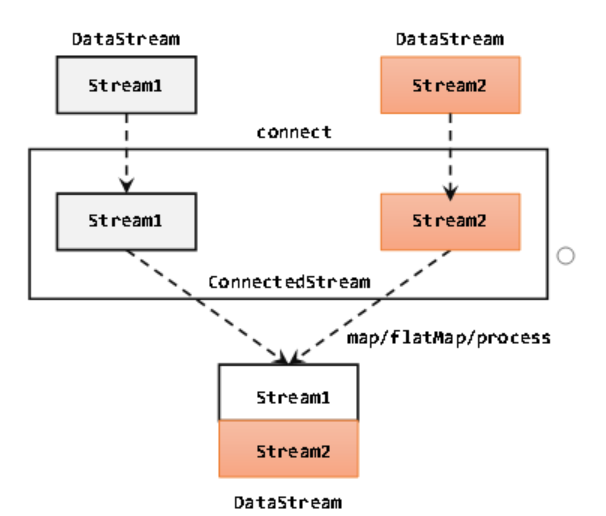

**特点**：

+ 两条流（只能两条）合并成 ConnectedStreams
+ 类型可以不同（左流 A，右流 B）
+ 能分别处理两条流（CoMap / CoFlatMap / CoProcess）
+ 可以共享状态（广播状态、Keyed 状态共享）

**代码示例**（三种常见用法）：

##### 用法1：CoMap / CoFlatMap（简单分别映射）
```java
DataStream<Order> orderStream = ...;     // 类型 Order
DataStream<Payment> payStream = ...;     // 类型 Payment

ConnectedStreams<Order, Payment> connected = orderStream.connect(payStream);

// 分别 map 处理
DataStream<String> result = connected
    .map(
        order -> "订单: " + order.id,                // 处理左流
        pay   -> "支付: " + pay.orderId              // 处理右流
    );

result.print();
```

##### 用法2：CoProcessFunction（最灵活，能访问状态、定时器）
```java
ConnectedStreams<Order, Payment> connected = orderStream.connect(payStream);

SingleOutputStreamOperator<String> result = connected
    .process(new CoProcessFunction<Order, Payment, String>() {
        ValueState<Order> orderState = getRuntimeContext().getState(...);
        ValueState<Payment> payState = getRuntimeContext().getState(...);

        @Override
        public void processElement1(Order order, Context ctx, Collector<String> out) {
            // 处理订单流
            if (payState.value() != null) {
                out.collect("匹配成功: " + order.id);
            } else {
                orderState.update(order);
                ctx.timerService().registerEventTimeTimer(order.ts + 30000); // 30秒超时
            }
        }

        @Override
        public void processElement2(Payment pay, Context ctx, Collector<String> out) {
            // 处理支付流
            if (orderState.value() != null) {
                out.collect("匹配成功: " + pay.orderId);
            } else {
                payState.update(pay);
            }
        }

        @Override
        public void onTimer(long timestamp, OnTimerContext ctx, Collector<String> out) {
            // 超时逻辑
            out.collect("超时未匹配");
        }
    });
```

##### 广播状态（Broadcast Connect，常用于规则配置下发）
```java
DataStream<Rule> ruleStream = ...;  // 规则流（低频更新）

BroadcastStream<Rule> broadcastRules = ruleStream.broadcast(ruleDescriptor);

DataStream<Event> eventStream = ...;

eventStream.connect(broadcastRules)
    .process(new BroadcastProcessFunction<Event, Rule, String>() {
        // 处理事件 + 广播规则
    });
```

#### 3. union vs connect 对比
| 对比项 | union | connect |
| --- | --- | --- |
| 流数量 | 2条或多条 | 仅2条 |
| 类型要求 | 必须相同 | 可以不同 |
| 处理方式 | 自动合并，无自定义逻辑 | 需要 CoMap / CoProcess 手动处理 |
| 共享状态 | 不支持 | 支持（尤其是广播状态） |
| 生产常见场景 | 同类型多源合并 | 双流 join、规则广播、订单支付匹配 |

**一句话总结**：

+ 想简单合并同类型多流 → 用 **union**
+ 想分别处理两条流、共享状态、做 join/匹配 → 用 **connect + CoProcess**


## **4、Sink（把结果写出去）**
Flink作为数据处理框架，最终还是要把计算处理的<font style="color:#DF2A3F;">结果写入外部存储</font>，为外部应用提供支持。

<!-- 这是一张图片，ocr 内容为： -->


Sink 是 Flink 作业的出口，负责将计算结果写入外部系统（如数据库、消息队列、文件、Redis 等）。 生产中 80% 的 Sink 都是 Kafka、JDBC、ClickHouse/Doris、Redis、ES 等，剩余是文件/打印（测试用）或自定义。

### 1. Sink 分类 & 使用频率
| 类型 | 典型场景 | 生产频率 | 推荐写法 & 注意点 |
| --- | --- | --- | --- |
| Print / PrintToErr | 测试、调试 | ★★★ | `<font style="color:#DF2A3F;">.print()</font>`<br/> 或 `<font style="color:#DF2A3F;">.printToErr()</font>`<br/>，并行度自动设为1 |
| 文件（FileSink） | 批式输出、归档 | ★★ | `<font style="color:#DF2A3F;">FileSink.forRowFormat(...)</font>`<br/>，支持分桶/滚动 |
| Kafka | 实时数仓下游、消息转发 | ★★★★★ | `<font style="color:#DF2A3F;">FlinkKafkaProducer</font>`<br/>，支持 exactly-once |
| JDBC (MySQL/PostgreSQL) | 写入关系型数据库 | ★★★★ | `<font style="color:#DF2A3F;">JdbcSink</font>`<br/>，批量 + 防反压 |
| Redis | 缓存、实时特征 | ★★★ | 自定义 RichSinkFunction 或社区 connector |
| Elasticsearch | 日志/搜索写入 | ★★★ | `<font style="color:#DF2A3F;">ElasticsearchSink</font>`<br/>，支持 bulk |
| ClickHouse / Doris | 实时数仓主流 | ★★★★★ | 社区/官方 connector，批量 upsert |
| 自定义 Sink | 特殊系统（MQ、HTTP、HBase） | ★★★★ | 继承 `<font style="color:#DF2A3F;">RichSinkFunction</font>` |

### 2. 最常用的 6 种 Sink 代码示例（直接复制）
##### 2.1 Print（测试神器）
```java
stream.print();                  // 标准输出
stream.printToErr();             // 错误输出（红色）
stream.print("前缀: ");          // 加前缀区分
```

##### 2.2 文件 Sink（StreamingFileSink，新版推荐）
```java
// 需要 flink-connector-files 依赖
FileSink<String> fileSink = FileSink
// 这里用的是分布式文件系统地址
.<String>forRowFormat(new Path("hdfs:///output/"), new SimpleStringEncoder<>())
.withRollingPolicy(DefaultRollingPolicy.builder()
                   .withRolloverInterval(Duration.ofMinutes(10))
                   .withMaxPartSize(128 * 1024 * 1024)  // 128MB 滚动
                   .build())
.build();

stream.sinkTo(fileSink);
```

##### 2.3 Kafka Sink（exactly-once 生产标配）

```java
FlinkKafkaProducer<String> kafkaSink = new FlinkKafkaProducer<>(
    "output-topic",
    new SimpleStringSchema(),
    kafkaProps,                                  // Properties 配置 bootstrap.servers 等
    FlinkKafkaProducer.Semantic.EXACTLY_ONCE);   // 精确一次

stream.addSink(kafkaSink)
.setParallelism(24);                       // 建议与分区数对齐
```

##### 2.4 JDBC Sink（MySQL/PostgreSQL 批量写入）

```java
// 需要 flink-connector-jdbc + mysql-connector-java
JdbcSink.sink(
    "INSERT INTO sensor (id, ts, vc) VALUES (?, ?, ?)",
    (ps, sensor) -> {
        ps.setString(1, sensor.id);
        ps.setLong(2, sensor.ts);
        ps.setInt(3, sensor.vc);
    },
    JdbcExecutionOptions.builder()
    .withBatchSize(1000)          // 批量 1000
    .withBatchIntervalMs(200)     // 每 200ms 提交
    .build(),
    new JdbcConnectionOptions.JdbcConnectionOptionsBuilder()
    .withUrl("jdbc:mysql://host:3306/db")
    .withDriverName("com.mysql.cj.jdbc.Driver")
    .withUsername("root")
    .withPassword("xxx")
    .build()
)
.disableChaining();                   // 生产必加！防止反压传染
```

##### 2.5 Redis Sink（自定义示例，生产常用）

```java
public static class RedisSink extends RichSinkFunction<WaterSensor> {
    private Jedis jedis;

    @Override
    public void open(Configuration parameters) {
        jedis = new Jedis("redis-host", 6379);
    }

    @Override
    public void invoke(WaterSensor value, Context context) {
        jedis.hset("sensor:" + value.id, "vc", String.valueOf(value.vc));
    }

    @Override
    public void close() {
        if (jedis != null) jedis.close();
    }
}

stream.addSink(new RedisSink())
.setParallelism(6)
.slotSharingGroup("redis");          // 单独分组防抢资源
```

##### 2.6 ClickHouse Sink（实时数仓主流，社区 connector 示例）
```java
// 使用 ru.yandex.clickhouse 或官方 flink-connector-clickhouse
stream.addSink(new ClickHouseSinkFunction(...))
.setParallelism(16)
.slotSharingGroup("ck-sink");
```

### 3. Sink 层生产（减少出问题的可能）
| **必做项** | **为什么必须做** | **操作方式** |
| --- | --- | --- |
| 慢 Sink 前断链 | 防止下游慢导致全链反压 | .disableChaining() |
| 热点/慢 Sink 单独 slot 组 | 避免抢占上游 slot，隔离故障 | .slotSharingGroup("slow-sink") |
| 并行度合理设置 | 数据库/Kafka 扛不住太高并行 | JDBC 3~8，Kafka 跟分区对齐 |
| Exactly-once 配置（Kafka 等） | 端到端精确一次 | Semantic.EXACTLY_ONCE + Checkpoint |
| 批量 + 超时优化 | 提升吞吐，减少网络开销 | JdbcExecutionOptions batchSize / interval |

### 4. 一句话总结 Sink 层
**Sink 就是“把结果写出去”**，生产核心是： Kafka（消息转发） → JDBC/ClickHouse（数仓落盘） → Redis/ES（缓存/搜索） → 自定义（特殊系统）。 永远记住：**慢 Sink 必须 disableChaining + slotSharingGroup + 合理并行度**，否则整个作业反压挂掉。

<font style="color:#DF2A3F;">(当前咱们用到的Sink类型有：Kafka，Doris，InfluDB)</font>

<font style="color:#DF2A3F;"></font>

# <font style="color:#000000;">四、第四部分：Flink 中的时间和窗口</font>
**时间和窗口是 Flink 实时计算的灵魂**：时间语义决定“<font style="color:#DF2A3F;">什么时候算</font>”，窗口决定“<font style="color:#DF2A3F;">算哪些数据</font>”。 Flink 是唯一原生支持事件时间 + 水印的开源引擎，这让它在处理乱序数据时远超 Spark Streaming（Spark 只支持处理时间，窗口不灵活）。

## 1、窗口
<font style="color:#DF2A3F;">正确理解</font>:在 Fink 中，窗口其实<font style="color:#DF2A3F;">并不是一个“框”</font>，应该把窗口<font style="color:#DF2A3F;">理解成一个“桶”</font>。在Fink中，窗口可以把流切割成有限大小的<font style="color:#DF2A3F;">多个“存储桶””(bucket)</font>; 每个数据都会分发到对应的桶中，<font style="color:#DF2A3F;">当到达窗口结束时间时，就对每个桶中收集的数据进行计算处理。</font>

<!-- 这是一张图片，ocr 内容为： -->
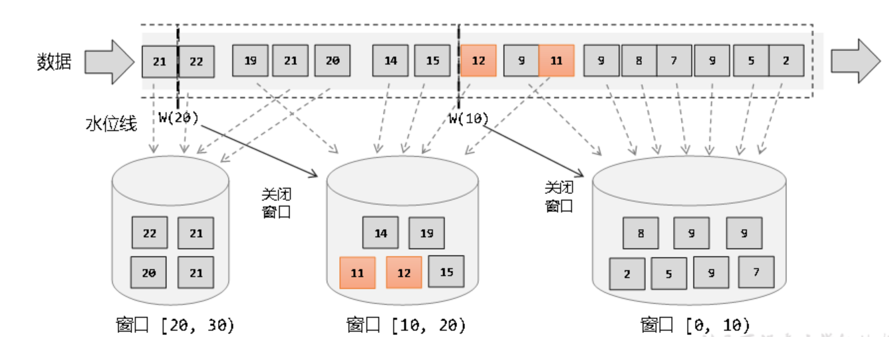

**注意：**Flink中窗口并不是静态准备好的，而<font style="color:rgb(255,0,0);">是动态创建</font>——当有落在这个窗口区间范围的数据达到时，才创建对应的窗口。

**为什么要有窗口？**  
	无界流永远不会结束，无法直接做 sum、count、group by 等聚合操作。 窗口人为地<font style="color:#DF2A3F;">给数据流划定边界</font>，<font style="color:#DF2A3F;">让聚合有意义</font>。

### 1.1 窗口的分类
按照驱动类型分的话，可以分为时间类型窗口和计数类型窗口以及自定义类型窗口，这些类型的窗口里面，Flink会有具体的窗口实现。

#### a. 时间类型窗口（Time Window） —— 最常用
时间窗口<font style="color:#DF2A3F;">以时间的维度去定义窗口的开始和结束</font>，所以截取的就是某一个时间段的数据。到达结束时间的时候，窗口不在手机数据，触发计算输出结果，并将窗口销毁，所以可以理解为“<font style="color:#DF2A3F;">定点发车</font>”

##### 滚动时间窗口（Tumbling  Time Window）
滚动窗口<font style="color:#DF2A3F;">固定大小</font>，均匀切片，<font style="color:#DF2A3F;">窗口之间没有重叠</font>，<font style="color:#DF2A3F;">也不会有间隔</font>，是<font style="color:#DF2A3F;">首尾相连</font>的状态，<font style="color:#DF2A3F;">每个数据都会分配到一个窗口，而且只会属于一个窗口</font>

<!-- 这是一张图片，ocr 内容为： -->
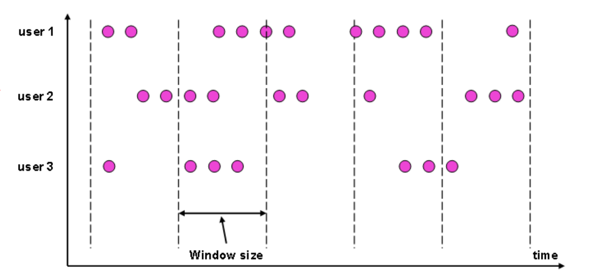

滚动窗口最重要的参数就是，<font style="color:#DF2A3F;">窗口的大小（Window Size ）</font>，但是这里的大小可以是时间也可以是个数，但是咱们这里说的是时间滚动窗口，这里的 Window Size 就是时间。

```java
public class TumblingWindowDemo {
    public static void main(String[] args) throws Exception {
        StreamExecutionEnvironment env = StreamExecutionEnvironment.getExecutionEnvironment();
        env.setParallelism(1); // 方便看输出顺序

        // 数据源（模拟带时间戳的数据）
        DataStream<WaterSensor> stream = env.fromElements(
            new WaterSensor("s1", 1000L, 10),
            new WaterSensor("s1", 2000L, 20),
            new WaterSensor("s1", 3000L, 30),
            new WaterSensor("s1", 4000L, 40),
            new WaterSensor("s1", 15000L, 50)  // 故意晚一点，跨窗口
        );

        // 指定事件时间 + 水印（允许 2 秒乱序）
        WatermarkStrategy<WaterSensor> watermarkStrategy = WatermarkStrategy
            .<WaterSensor>forBoundedOutOfOrderness(Duration.ofSeconds(2))
            .withTimestampAssigner((event, timestamp) -> event.ts);

        SingleOutputStreamOperator<WaterSensor> watermarked = stream
            .assignTimestampsAndWatermarks(watermarkStrategy);

        // 滚动窗口：每 5 秒一个窗口
        watermarked
            .keyBy(sensor -> sensor.id)
            .window(TumblingEventTimeWindows.of(Time.seconds(5)))
            .sum("vc")
            .print("滚动窗口结果");

        env.execute();
    }
}
```

##### 滑动时间窗口（Sliding Time Window）
滑动窗口的大小也是固定的，但是窗口之间并不是首位相连的，而是可以错开一定的位置。

定义窗口的参数有两个：除了<font style="color:#DF2A3F;">窗口大小（Window Size）</font>以外，还有<font style="color:#DF2A3F;">滑动步长(Window Slide)</font>，他其实就是代表窗口计算的频率，<font style="color:#DF2A3F;">滑动步长就代表了计算频率</font>，类似<font style="color:#DF2A3F;">加速度</font>。

<!-- 这是一张图片，ocr 内容为： -->
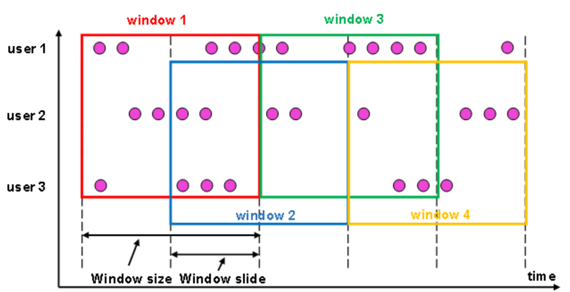

滑动步长小于窗口的大小那么就会出现<font style="color:#DF2A3F;">重合</font>的情况，这时候<font style="color:#DF2A3F;">数据就有可能出现分配到多个窗口的情况</font>，而具体的个数，就是<font style="color:#DF2A3F;">窗口大小和滑动步长的比值决定的</font>，<font style="color:#DF2A3F;">滑动窗口适合计算结果更新频率非常高的场景</font>。

```java
// ... 环境和数据源同上 ...

watermarked
    .keyBy(sensor -> sensor.id)
    .window(SlidingEventTimeWindows.of(
        Time.seconds(10),     // 窗口大小 10 秒
        Time.seconds(5)))     // 滑动步长 5 秒
    .sum("vc")
    .print("滑动窗口结果");
```

##### 会话时间窗口（Session Time Window）
会话窗口，是<font style="color:#DF2A3F;">基于"会话（session）"来对数据进行分组</font>的。会话窗口<font style="color:#DF2A3F;">只能基于事件维度</font>来定义。

会话窗口中，最重要的参数就是<font style="color:#DF2A3F;">会话的超时时间</font>，也就是<font style="color:#DF2A3F;">两个会话之间的最小距离</font>，如果相邻的两个数据到来的时间间隔小于指定的大小，那么说明还在保持会话，那么属于同一个窗口，如果大于那么新来的数据就应该属于新的窗口，而前一个窗口就应该关闭了

<!-- 这是一张图片，ocr 内容为： -->
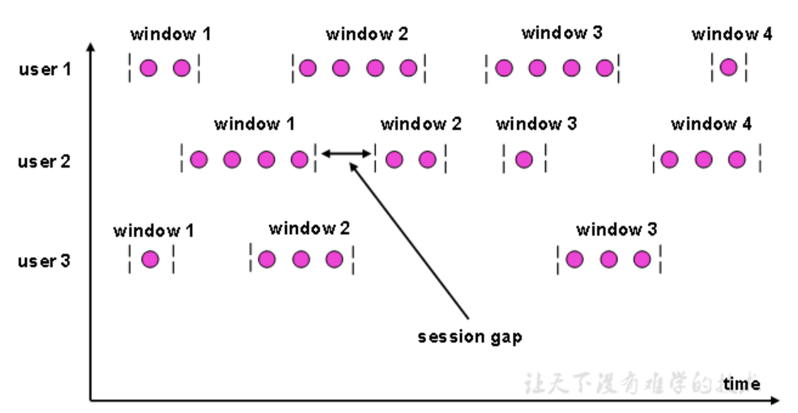

<font style="color:#DF2A3F;">会话窗口的长度不是固定的</font>，<font style="color:#DF2A3F;">开始事件和结束时间也不是固定的</font>，各个分区之间的窗口也没有关联，会话窗口一定<font style="color:#DF2A3F;">不会重</font>合，而且<font style="color:#DF2A3F;">留有至少为size的间隔，</font>**<font style="color:#000000;">在一些保持会话的场景中可以使用这个窗口来进行数据处理</font>**

```java
// ... 环境和数据源同上，但调整数据模拟会话间隔 ...

DataStream<WaterSensor> stream = env.fromElements(
    new WaterSensor("s1", 1000L, 10),   // 开始会话
    new WaterSensor("s1", 2000L, 20),
    new WaterSensor("s1", 3000L, 30),
    // 间隔超过 8 秒 → 新会话
    new WaterSensor("s1", 15000L, 50),
    new WaterSensor("s1", 16000L, 60)
);

watermarked
    .keyBy(sensor -> sensor.id)
    .window(EventTimeSessionWindows.withGap(Time.seconds(8)))  // 间隔 > 8s 切新会话
    .sum("vc")
    .print("会话窗口结果");
```

#### b. 计数类型窗口（Count Window） —— 条数驱动，生产中约 5~10%
##### 滚动计数窗口（Tumbling Count Window）
和时间滚动窗口类似，不过这里取得不是时间维度，取得是数据个数，也就是<font style="color:#DF2A3F;"> Window Size 取得是数据个数。</font>

```java
watermarked
    .keyBy(sensor -> sensor.id)
    .countWindow(3)  // 每 3 条数据一个窗口
    .sum("vc")
    .print("滚动计数窗口");
```

##### 滑动计数窗口（Sliding Count Window）
```java
watermarked
    .keyBy(sensor -> sensor.id)
    .countWindow(4, 2)  // 窗口大小 4 条，滑动步长 2 条
    .sum("vc")
    .print("滑动计数窗口");
```

### 1.2 窗口 API 概览
Flink 窗口 API 的核心调用链路非常清晰，大致可以分为以下几个层次：

```java
DataStream → keyBy / 不 keyBy → window(分配器) → [optional: trigger / evictor] → 窗口函数 → [optional: allowedLateness / sideOutputLateData] → 输出
```

最核心的几个组成部分：

| **层级** | **作用** | **是否必须** | **常见实现类 / 方法** |
| --- | --- | --- | --- |
| keyBy | 是否按键分区（决定窗口是全局还是分组） | 视情况 | keyBy(KeySelector) |
| window | 指定窗口分配器（怎么切窗口） | 必须 | window(WindowAssigner) |
| trigger | 自定义触发计算时机 | 选填 | trigger(Trigger) |
| evictor | 在触发前剔除部分元素 | 选填（极少用） | evictor(Evictor) |
| 窗口函数 | 在窗口内怎么聚合/处理数据 | 必须 | reduce / aggregate / process / fold（已废弃） |
| allowedLateness | 允许迟到数据继续参与计算 | 选填 | allowedLateness(Time) |
| sideOutputLateData | 超过 allowedLateness 的数据分流 | 选填 | sideOutputLateData(OutputTag) |

最常见的调用模板

```java
stream
    .keyBy(...)                              // 或不 keyBy
    .window(...)                             // 必须
    .allowedLateness(...)                    // 常用
    .sideOutputLateData(...)                 // 常用
    .sum(...) / .reduce(...) / .aggregate(...) / .process(...)
```

#### 1. 按键分区（Keyed Windows） vs 非按键分区（Non-Keyed Windows）
这是窗口 API 最重要的一个分水岭，直接决定窗口的计算范围和状态存储方式。

##### (1) 按键分区窗口（Keyed Windows）—— 绝大多数生产场景使用
+ **必须先 keyBy**
+ 每个 key 都有自己独立的窗口（每个 key 独立维护窗口状态）
+ 状态按 key 分散存储（RocksDB 等状态后端按 key 存储）
+ 支持所有窗口类型（时间窗口、计数窗口、全局窗口）
+ 支持增量聚合（reduce/aggregate）效率最高
+ 典型场景：按用户 ID、设备 ID、商品 ID 等分组统计

**代码标志**： 必须有 .keyBy(...)

##### (2) 非按键分区窗口（Non-Keyed Windows）—— 全局窗口，所有数据共享同一个窗口
+ **不能 keyBy**（或者 keyBy 后又 shuffle 成全局）
+ 整个流只有一个窗口，所有数据都进入同一个窗口
+ 状态是全局的（所有并行度共享一个状态，容易成为瓶颈）
+ 只能使用全局窗口（GlobalWindow） + 自定义 Trigger
+ 不支持增量聚合（reduce/aggregate），只能用 process 全量计算
+ 典型场景：全局去重、全局 TopN、全局唯一计数、所有数据累加到一个阈值才触发

代码标志： 没有 .keyBy(...)，直接 .window(GlobalWindows.create())

**生产对比总结：**

| **维度** | **Keyed Windows（按键分区）** | **Non-Keyed Windows（非按键分区）** |
| --- | --- | --- |
| 是否 keyBy | 必须 | 禁止 |
| 窗口数量 | 每个 key 一个（成千上万） | 全流只有一个 |
| 状态存储 | 按 key 分散（可扩展） | 全局单一（容易单点瓶颈） |
| 支持聚合函数 | reduce / aggregate / process | 只能 process（全量计算） |
| 生产使用比例 | 95%+ | 极少（<5%） |
| 典型场景 | 按用户/设备/商品统计 | 全局 TopN、全局唯一计数 |

#### 2. 非按键分区窗口（Non-Keyed Windows）详细说明
非按键窗口几乎只使用 **GlobalWindow**，配合自定义 Trigger 来实现“全局聚合”。

**典型使用场景**（生产中遇到的几种）：

1. 全局累计计数，直到达到某个阈值才输出一次
2. 全局去重（所有数据中不重复的元素）
3. 全局 TopN（所有数据中的前 N 名）
4. 所有数据累加到一个计数器，直到收到“结束标记”才输出

**核心代码模板**

```java
DataStream<WaterSensor> stream = ...;

// 没有 keyBy，直接用 GlobalWindow
stream
    .window(GlobalWindows.create())                     // 全局窗口
    .trigger(new MyCustomTrigger())                     // 必须自定义触发器
    .process(new ProcessWindowFunction<WaterSensor, String, Void, GlobalWindow>() {
        @Override
        public void process(Void key, Context context, Iterable<WaterSensor> elements, Collector<String> out) {
            // 全量计算所有元素
            int count = 0;
            for (WaterSensor s : elements) {
                count += s.vc;
            }
            out.collect("全局总和: " + count);
        }
    })
    .print();
```

自定义 Trigger 示例（最常见：每 100 条触发一次）：

```java
public static class CountTrigger extends Trigger<WaterSensor, GlobalWindow> {
    private final long count;

    public CountTrigger(long count) {
        this.count = count;
    }

    @Override
    public TriggerResult onElement(WaterSensor element, long timestamp, GlobalWindow window, TriggerContext ctx) {
        // 每来一条数据，计数器 +1
        Long currentCount = ctx.getPartitionedState(new ValueStateDescriptor<>("count", Long.class, 0L)).value();
        currentCount = (currentCount == null ? 0 : currentCount) + 1;
        ctx.getPartitionedState(new ValueStateDescriptor<>("count", Long.class)).update(currentCount);

        if (currentCount >= count) {
            return TriggerResult.FIRE_AND_PURGE;  // 触发计算并清空窗口
        }
        return TriggerResult.CONTINUE;
    }

    // 其他方法省略（onProcessingTime / onEventTime / clear）
}
```

**使用：**

```java
.window(GlobalWindows.create())
.trigger(new CountTrigger(100))   // 每 100 条触发一次
```

**注意**：

+ 非按键窗口状态是全局的，数据量大时容易 OOM 或单点瓶颈。
+ 只能用 process 全量计算，不能用 reduce/aggregate（因为没有 key 分散状态）。
+ 除非业务明确要求“全局聚合”，否则强烈建议使用 Keyed Window。

#### 3. 代码中窗口 API 的典型调用方式
**模板 1：最常见 Keyed 时间窗口**

```java
stream
    // 水位线
    .assignTimestampsAndWatermarks(watermarkStrategy)
    // 分组开窗
    .keyBy(r -> r.id)
    // 1分支滚动窗口
    .window(TumblingEventTimeWindows.of(Time.minutes(1)))
    // 允许迟到的数据时间
    .allowedLateness(Time.minutes(2))
    // 侧输出流
    .sideOutputLateData(lateTag)
    // 集合
    .aggregate(new MyAggregateFunction())
    .name("1分钟滚动聚合");
```

**模板 2：Keyed 滑动窗口**

```java
.keyBy(...)
.window(SlidingEventTimeWindows.of(Time.minutes(5), Time.seconds(30)))
.sum("vc");
```

**模板 3：Keyed 会话窗口**

```java
.keyBy(...)
.window(EventTimeSessionWindows.withGap(Time.minutes(30)))
.process(new SessionProcessFunction());
```

**模板 4：Non-Keyed 全局窗口（少见）**

```java
stream
    .window(GlobalWindows.create())
    .trigger(new CountTrigger(1000))
    .process(new GlobalTopNProcessFunction());
```

**模板 5：带侧输出的完整生产写法**

```java
OutputTag<WaterSensor> lateTag = new OutputTag<WaterSensor>("late") {};

SingleOutputStreamOperator<Result> mainResult = stream
    .keyBy(...)
    .window(...)
    .allowedLateness(...)
    .sideOutputLateData(lateTag)
    .aggregate(...);

mainResult.print("正常结果");
mainResult.getSideOutput(lateTag).addSink(lateSink);  // 迟到数据单独处理
```

总结一句话：

**窗口 API 的本质就是：先决定是否 keyBy（分组还是全局），再选 window 分配器切桶，最后用聚合函数计算，生产中 95% 是 Keyed + Tumbling/Sliding + aggregate/process + 迟到处理**。

#### 4.关键点总结
| **问题** | **答案** |
| --- | --- |
| 可以先 keyBy 再加 window 再加 trigger 吗？ | 可以，而且是推荐的写法 |
| trigger 是作用在哪个层面？ | 作用在每个 key 的每个窗口实例上（Keyed Window） |
| 非 keyBy 的流可以用 trigger 吗？ | 可以，但必须用 GlobalWindows.create()，而且状态不按 key 分散 |
| trigger 和 allowedLateness 冲突吗？ | 不冲突，trigger 决定“什么时候计算一次”，allowedLateness 决定“迟到数据还能参与多久” |
| 自定义 trigger 最常见的目的 | 1. 条数阈值触发 2. 外部信号触发 3. 组合触发（时间+条数+信号） 4. 延迟保底触发 |

### 1.3 **窗口分配器**
定义窗口分配器（Window Assigners）是构建窗口算子的**第一步**，它的作用就是定义数据应该被“分配”到哪个窗口。所以可以说，窗口**分配器其实就是在指定窗口的类型**。

（<font style="color:#DF2A3F;">在上述窗口类型已经做具体案列使用了</font>）

#### 1. 时间计数的窗口分配器（最常用，基于时间戳计数）
这些分配器以**时间长度**作为窗口的划分依据，是生产中 90%+ 的场景所用。

| 分配器类名 | 中文名称 | 计数方式说明 | 是否重叠 | 生产使用频率 | 典型代码写法 |
| --- | --- | --- | --- | --- | --- |
| TumblingEventTimeWindows | 滚动事件时间窗 | 固定时间长度，不重叠 | 否 | ★★★★★ | `<font style="color:#DF2A3F;">.window(TumblingEventTimeWindows.of(Time.minutes(10)))</font>` |
| TumblingProcessingTimeWindows | 滚动处理时间窗 | 固定时间长度，不重叠（基于机器时间） | 否 | ★★ | `<font style="color:#DF2A3F;">.window(TumblingProcessingTimeWindows.of(Time.seconds(30)))</font>` |
| SlidingEventTimeWindows | 滑动事件时间窗 | 固定窗口大小 + 滑动步长，可重叠 | 是 | ★★★★ | `<font style="color:#DF2A3F;">.window(SlidingEventTimeWindows.of(Time.hours(1), Time.minutes(5)))</font>` |
| SlidingProcessingTimeWindows | 滑动处理时间窗 | 固定窗口大小 + 滑动步长，可重叠（机器时间） | 是 | ★★ | `<font style="color:#DF2A3F;">.window(SlidingProcessingTimeWindows.of(Time.minutes(10), Time.seconds(30)))</font>` |
| EventTimeSessionWindows | 事件时间会话窗 | 根据不活跃间隔（gap）动态计数时间 | — | ★★★ | `<font style="color:#DF2A3F;">.window(EventTimeSessionWindows.withGap(Time.minutes(30)))</font>` |
| ProcessingTimeSessionWindows | 处理时间会话窗 | 根据不活跃间隔动态计数（机器时间） | — | ★ | `<font style="color:#DF2A3F;">.window(ProcessingTimeSessionWindows.withGap(Time.seconds(60)))</font>` |

小结： 时间计数的分配器占主导地位，其中 TumblingEventTimeWindows 和 SlidingEventTimeWindows 是绝对主力。

#### 2. 元素计数的窗口分配器（基于数据条数计数）
这些分配器不看时间，只看来了多少条数据。

| **分配器类名** | **中文名称** | **计数方式说明** | **是否重叠** | **生产使用频率** | **典型代码写法** |
| --- | --- | --- | --- | --- | --- |
| CountWindow | 计数窗口 | 滚动或滑动，基于元素个数 | 可选 | ★★ | `.countWindow(1000)`<br/> 或 `.countWindow(5000, 1000)` |
| GlobalWindows | 全局窗口 | 不自动切分，所有元素进同一个窗口 | — | ★ | `.window(GlobalWindows.create())` |

**说明**：

+ <font style="color:#DF2A3F;">.countWindow(size)</font> → 滚动计数窗口，每 size 条一个窗口
+ <font style="color:#DF2A3F;">.countWindow(size, slide)</font> → 滑动计数窗口，每 slide 条触发一次，窗口包含最近 size 条

#### 3. 其他 / 特殊计数的窗口分配器（高级 / 自定义）
| **分配器类名** | **中文名称** | **计数方式说明** | **生产使用频率** | **典型代码写法** |
| --- | --- | --- | --- | --- |
| MergingWindowAssigner | 可合并窗口分配器 | 内部类，主要用于 Session 等可合并窗口 | — | （一般不直接使用） |
| WindowAssigner（自定义） | 自定义窗口分配器 | 完全自己决定一条数据属于哪些窗口 | ★（极少） | 继承 WindowAssigner 并实现 assignWindows 方法 |

#### 4.总结：按“计数”维度
+ **时间计数**（主流） → Tumbling / Sliding / Session（EventTime 优先）
+ **元素计数**（次主流） → countWindow（size）或 countWindow（size, slide）
+ **无固定计数** → GlobalWindows + 自定义 Trigger
+ **完全自由计数** → 自己写 WindowAssigner（狗都不用）

#### 5.快速对照表（常见的 5 种）
| 你想实现的效果 | 推荐分配器 | 是否需要 keyBy | 计数依据 |
| --- | --- | --- | --- |
| 每 10 分钟统计一次，不重叠 | TumblingEventTimeWindows | 必须 | 时间 |
| 最近 30 分钟，每 1 分钟更新一次 | SlidingEventTimeWindows | 必须 | 时间 |
| 用户不操作超过 20 分钟就算新会话 | EventTimeSessionWindows | 必须 | 时间间隔 |
| 每 10000 条数据聚合一次 | countWindow(10000) | 必须 | 元素条数 |
| 所有数据累积到 5000 条才输出一次 | GlobalWindows + 自定义 Trigger | 不需要 | 自定义计数 |

### 1.4 **窗口函数**
窗口函数是窗口切好之后，在窗口内部对数据进行**真正计算**的部分。 简单说：窗口分配器负责“切桶”，窗口函数负责“<font style="color:#DF2A3F;">桶里怎么算</font>”。

**窗口函数**（Window Functions）分为三大类，这也是生产中最常用、最清晰的划分方式：

1. **增量聚合函数**（Incremental Aggregation Functions） —— 代表：ReduceFunction / AggregateFunction
2. **全窗口函数**（Full Window Functions） —— 代表：ProcessWindowFunction / 全量 WindowFunction
3. **增量聚合 + 全窗口函数的结合使用** —— 生产中最推荐的混合模式（先增量聚合、再全窗口处理）

#### 增量聚合函数（ReduceFunction / AggregateFunction）
**核心特点**： 每来一条数据，就和之前的中间结果进行一次合并（增量计算），**不需要把窗口内所有数据都保存在内存里**，内存占用极低，计算效率最高。

**适用场景**：

+ 简单聚合（sum、max、min、count）
+ 可以用二元操作合并的指标（如字符串拼接、向量加法）
+ 对内存敏感的大窗口场景

##### ReduceFunction（最简单增量聚合）
```java
stream
    .keyBy(sensor -> sensor.id)
    .window(TumblingEventTimeWindows.of(Time.minutes(1)))
    .reduce(new ReduceFunction<WaterSensor>() {
        @Override
        public WaterSensor reduce(WaterSensor a, WaterSensor b) throws Exception {
            a.vc += b.vc;  // 累加 vc
            return a;      // 返回合并后的结果
        }
    })
    .print();
```

**优点**：

+ 代码最短
+ 状态只存一个元素（极省内存）

**缺点**：

+ 输入和输出类型必须完全一致
+ 无法输出复杂类型（如带窗口开始/结束时间的元组）

##### AggregateFunction（更灵活的增量聚合，生产主力）
```java
// 自定义 AggregateFunction：计算 (总 vc, 条数) → 平均值
public static class AvgVcAgg implements AggregateFunction<WaterSensor, Tuple2<Long, Long>, Double> {

    @Override
    public Tuple2<Long, Long> createAccumulator() {
        return Tuple2.of(0L, 0L);  // (总 vc, 计数)
    }

    @Override
    public Tuple2<Long, Long> add(WaterSensor value, Tuple2<Long, Long> acc) {
        return Tuple2.of(acc.f0 + value.vc, acc.f1 + 1);
    }

    @Override
    public Double getResult(Tuple2<Long, Long> acc) {
        return acc.f1 == 0 ? 0.0 : (double) acc.f0 / acc.f1;
    }

    @Override
    public Tuple2<Long, Long> merge(Tuple2<Long, Long> a, Tuple2<Long, Long> b) {
        return Tuple2.of(a.f0 + b.f0, a.f1 + b.f1);
    }
}

// 使用
stream
    .keyBy(sensor -> sensor.id)
    .window(TumblingEventTimeWindows.of(Time.minutes(1)))
    .aggregate(new AvgVcAgg())
    .print("1分钟平均 vc");
```

**优点**：

+ 累加器类型可以和输入/输出类型完全不同（非常灵活）
+ 支持 merge（状态后端 checkpoint 时合并状态）
+ 内存占用仍然很低

**推荐指数**：生产中最常用增量聚合方式。

#### 全窗口函数（Full Window Functions）
**核心特点**： 窗口触发时，会把窗口内**所有原始数据**（Iterable）都传递给函数，属于**全量计算**。 可以访问窗口的元数据（开始/结束时间、当前 key 等）。

**适用场景**：

+ 需要窗口开始/结束时间
+ 需要对窗口内所有数据做排序、去重、TopN 等全量操作
+ 需要注册定时器、侧输出等高级功能

**代表**：ProcessWindowFunction（最常用）

```java
stream
    .keyBy(sensor -> sensor.id)
    .window(TumblingEventTimeWindows.of(Time.minutes(1)))
    .process(new ProcessWindowFunction<WaterSensor, String, String, TimeWindow>() {

        @Override
        public void process(String key, Context context, Iterable<WaterSensor> elements, Collector<String> out) throws Exception {

            long start = context.window().getStart();
            long end = context.window().getEnd();

            int sum = 0;
            int count = 0;
            List<WaterSensor> list = new ArrayList<>();
            for (WaterSensor s : elements) {
                sum += s.vc;
                count++;
                list.add(s);  // 可以收集所有数据做排序/去重
            }

            // 示例：输出窗口信息 + 平均值
            double avg = count == 0 ? 0 : (double) sum / count;
            out.collect(String.format("窗口 %s ~ %s | key=%s | sum=%d | avg=%.2f | 条数=%d",
                    new Timestamp(start), new Timestamp(end), key, sum, avg, count));

            // 还可以注册定时器
            context.registerEventTimeTimer(end + 10000); // 窗口结束10秒后触发
        }

        @Override
        public void onTimer(long timestamp, OnTimerContext ctx, Collector<String> out) throws Exception {
            out.collect("窗口已结束10秒，可能有迟到数据未处理");
        }
    })
    .print();
```

**优点**：

+ 能拿到所有原始数据 + 窗口上下文（Context）
+ 支持定时器、侧输出、状态操作

**缺点**：

+ 全量计算 → 窗口内数据量大时内存压力大
+ 不适合超大窗口

#### 增量聚合 + 全窗口函数的结合使用（生产最推荐模式）
**为什么结合使用？**

+ 先用 AggregateFunction / ReduceFunction **增量计算**，把中间结果存下来（省内存、高效）
+ 再用 ProcessWindowFunction **拿到最终聚合结果 + 窗口元数据**，输出格式化结果或做额外逻辑

**典型代码**（先 aggregate 求和，再 process 加窗口信息）

```java
// 先增量求和
AggregateFunction<WaterSensor, Integer, Integer> sumAgg = new AggregateFunction<WaterSensor, Integer, Integer>() {
    @Override public Integer createAccumulator() { return 0; }
    @Override public Integer add(WaterSensor value, Integer acc) { return acc + value.vc; }
    @Override public Integer getResult(Integer acc) { return acc; }
    @Override public Integer merge(Integer a, Integer b) { return a + b; }
};

// 再用 ProcessWindowFunction 包装，添加窗口信息
stream
    .keyBy(sensor -> sensor.id)
    .window(TumblingEventTimeWindows.of(Time.minutes(1)))
    .aggregate(sumAgg, new ProcessWindowFunction<Integer, String, String, TimeWindow>() {

        @Override
        public void process(String key, Context context, Iterable<Integer> elements, Collector<String> out) {
            // elements 里只有一条数据，就是增量聚合后的结果
            Integer sum = elements.iterator().next();

            long start = context.window().getStart();
            long end = context.window().getEnd();

            out.collect(String.format("窗口 %s ~ %s | key=%s | 总 vc 求和 = %d",
                    new Timestamp(start), new Timestamp(end), key, sum));
        }
    })
    .print("增量 + 全窗口结合");
```

**这种写法的优势**（生产中最常见的原因）：

+ 内存占用低（aggregate 增量计算，只存中间结果）
+ 功能强大（process 能拿到窗口元数据、key、定时器等）
+ 计算效率高 + 输出信息丰富

**一句话总结**：

+ 简单聚合 → 用 reduce
+ 复杂累加指标 → 用 aggregate
+ 需要窗口元数据 / 定时器 / 侧输出 → 用 process
+ 大多数生产场景 → **先 aggregate 增量聚合，再 process 加元数据**（兼顾性能和功能）

## 2、**时间语义**
<!-- 这是一张图片，ocr 内容为： -->
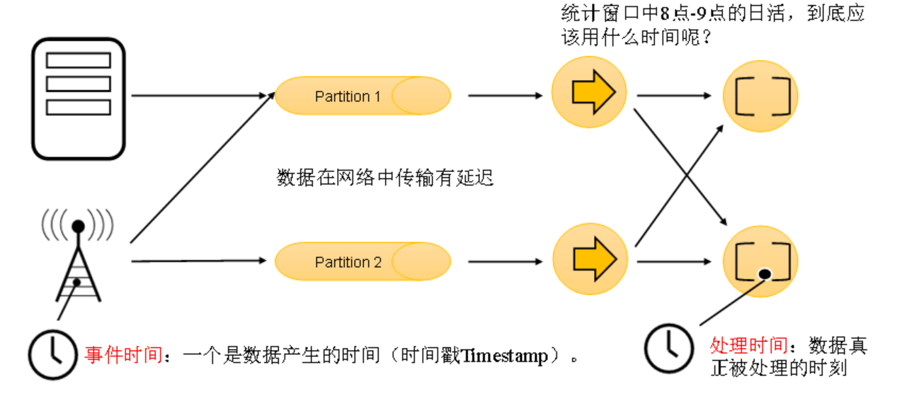

想象你在统计“每个小时进店的顾客数量”，但顾客进店的时间和你的监控摄像头拍到他们的时间可能不一样：

+ **事件时间（Event Time）** 顾客真正踏进店门的那一刻（刷门禁卡的时间戳）。 → 这才是业务真正关心的“顾客进店时间”。
+ **处理时间（Processing Time）** 监控摄像头把画面传到你的电脑，你电脑收到画面并开始计数的时刻。 → 如果网络卡了 5 秒，这个顾客就被算到下一个小时去了，结果就不准。
+ **摄取时间（Ingestion Time）** 摄像头画面刚进入你的视频分析系统时，系统自动打上的时间戳。 → 比处理时间早一点，但仍然不是真正的进店时间。

**一句话总结比喻**： 业务要的是“顾客真正进店的时间”（事件时间），而不是“摄像头拍到他/系统处理他”的时间。

Flink 是目前唯一一个**原生端到端**支持事件时间 + 水印（Watermark）的开源流计算引擎，这也是它能做实时数仓、实时对账、实时特征计算的核心原因。

**Flink 三种时间语义详细对比（带生产场景）**

| **时间语义** | **定义** | **优点** | **缺点 / 风险** | **生产适用场景** | **Flink 版本支持度** |
| --- | --- | --- | --- | --- | --- |
| Event Time | 数据自带的时间戳（通常是业务发生时刻，如订单创建时间、日志产生时间） | 结果准确、不受延迟/乱序影响、可重放 | 需要 Watermark 处理乱序，配置稍复杂 | 实时数仓、实时报表、订单统计、行为分析 | 全版本支持，最推荐 |
| Processing Time | 数据到达算子时的机器系统时间（wall-clock time） | 最简单、延迟最低 | 乱序数据会导致结果错误、不可重放 | 低准确性要求的监控、告警、测试环境 | 全版本支持 |
| Ingestion Time | 数据进入 Source 时 Flink 自动分配的系统时间戳 | 比 Processing Time 更早分配时间戳 | 仍然无法处理 Source 之前的乱序 | 极少数从 Processing Time 过渡到 Event Time 的场景 | 全版本支持，但很少用 |

**选择分布（2025 年主流公司实践）**：

+ 95%+ 的实时指标作业 → **必须用 Event Time**
+ 剩余 5% → Processing Time（内部监控、延迟敏感但准确性不重要的场景）
+ Ingestion Time → 基本没人用（几乎可以忽略）

**为什么 Spark Streaming 做不到事件时间（文档对比的关键点）**

文档中对比表里有一行特别重要：

| **项目** | **Flink** | **Spark Streaming** |
| --- | --- | --- |
| 时间语义 | 事件时间 + 处理时间 | 只支持处理时间 |
| 窗口 | 多、灵活 | 少、不灵活（必须是批次整数倍） |

Spark Streaming 是微批（micro-batch）架构，本质上是把流切成小批次，每批次用批处理引擎跑，所以天然只能用“批次到达时间”（处理时间），无法真正基于事件时间做窗口聚合。

Flink 是真正的“连续流”引擎，支持在算子之间插入 Watermark 来推进事件时间，所以能完美处理乱序和延迟。

**如何在代码中正确指定时间语义（最常用写法）**

几乎所有生产代码都会在 Source 层或第一步 Transform 就指定事件时间 + 水印：

```java
// 最标准的生产写法
WatermarkStrategy<WaterSensor> strategy = WatermarkStrategy
.<WaterSensor>forBoundedOutOfOrderness(Duration.ofSeconds(5))   // 最大乱序 5 秒
.withTimestampAssigner((event, previousTs) -> event.ts)        // 从字段 ts 取时间戳
.withIdleness(Duration.ofSeconds(60));                         // 防空闲分区卡住水印

DataStream<WaterSensor> streamWithWatermark = sourceStream
.assignTimestampsAndWatermarks(strategy);
```

**关键参数解释**：

+ forBoundedOutOfOrderness：允许的最大乱序时间（最常用）
+ withTimestampAssigner：告诉 Flink 从哪取时间戳（支持 lambda 或 MapFunction）
+ withIdleness：如果某个 key 分区很久没数据，水印不会卡死（生产必加）

**常见踩坑总结（面试 / 生产常问）**

| 坑 | 表现 | 解决办法 |
| --- | --- | --- |
| 忘记 assignTimestampsAndWatermarks | 窗口永远不触发、数据堆积 | 必须在 Source 后尽快加 |
| Watermark 推进太慢 | 窗口延迟很高 | 检查最大乱序设置是否合理 + 加 withIdleness |
| 用 Processing Time 做报表 | 结果每天都不一样、无法回溯 | 改成 Event Time + Watermark |
| Ingestion Time 误以为是 Event Time | Source 前有延迟时结果错 | 直接换成 Event Time |
| 多 Source 不同时间字段 | 水印混乱 | 可以用侧输出或 union 后统一处理 |

**总结一句话**

Flink 的时间语义核心优势在于：它真正支持“事件时间 + Watermark”，让窗口计算基于业务发生时间，而不是数据到达时间，所以结果准确、可回溯，这是 Spark Streaming 做不到的，也是实时数仓、实时对账必须用 Flink 的根本原因。

如果你想继续深挖某个具体点，比如：

+ Watermark 推进机制的详细图解
+ 乱序数据 + 迟到数据的完整处理流程
+ 多 Source 不同时间语义的混合写法
+ 生产中 Watermark 参数怎么调优

## 3、水位线
在窗口的处理过程中，我们可以基于数据的时间戳，自定义一个“<font style="color:#DF2A3F;">逻辑时钟</font>”。这个时钟的时间不会自动流逝;它的时间进展，就是靠着新到数据的时间戳来推动的。

<!-- 这是一张图片，ocr 内容为： -->
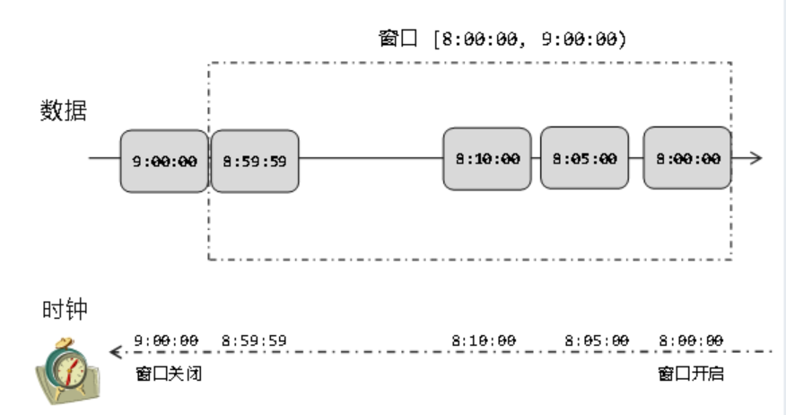

这样的好处在于，计算的过程可以<font style="color:#DF2A3F;">完全不依赖处理时间(系统时间)</font>，不论什么时候进行统计处理，得到的结果都是正确的。而一般实时流处理的场景中，事件时间可以基本与<font style="color:#DF2A3F;">处理时间保持同步，只是略微有一点延迟</font>，同时保证了窗口计算的正确性。

#### 一、水位线的核心作用
+ 没有 Watermark → 窗口永远不会触发（因为系统不知道什么时候数据到齐）
+ 有 Watermark → 系统根据 Watermark 推进事件时间，窗口结束时间 ≤ 当前 Watermark 时，窗口关闭并输出结果
+ Watermark 本质上是**一种特殊的事件**，它随着数据流向下游传播，携带一个时间戳，表示“进度”

**比喻**： 水位线就像河道里的浮标，浮标漂到哪里，就代表“上游到这个位置的水都流过来了，可以开始统计这段河道的水量了”。

#### 二、水位线的生成方式
**允许固定乱序（Bounded Out-of-Orderness）** —— 最常用

```java
WatermarkStrategy
.<WaterSensor>forBoundedOutOfOrderness(Duration.ofSeconds(5))   // 最大允许 5 秒乱序
.withTimestampAssigner((event, previousTs) -> event.ts);        // 从 ts 字段取时间戳
```

    - 含义：假设数据最大延迟 5 秒，系统会等 5 秒后才推进 Watermark
    - Watermark 时间 = 当前最大事件时间 - 5 秒

**单调递增时间（Monotonous Timestamps）** —— 数据严格按时间顺序到达

```plain
WatermarkStrategy
    .<WaterSensor>forMonotonousTimestamps()
    .withTimestampAssigner((event, previousTs) -> event.ts);
```

    - 含义：每来一条数据，Watermark 立即推进到这条数据的时间戳
    - 适合 Kafka 等分区内有序的场景

**生产额外推荐**（防卡住）：

```plain
.withIdleness(Duration.ofSeconds(60));   // 某个分区 60 秒没数据，忽略它，继续推进 Watermark
```

#### 三、水位线如何推进
1. Source 读取数据 → 提取时间戳
2. 每条数据到达时，更新“当前最大事件时间”
3. Watermark = 当前最大事件时间 - 最大乱序容忍度
4. Watermark 随着数据流向下游传播
5. 当 Watermark > 某个窗口的结束时间 → 该窗口触发计算、输出结果、清空状态

**示例流程**（假设最大乱序 5 秒）：

+ 来了一条 ts=10000 的数据 → 最大事件时间=10000
+ Watermark = 10000 - 5000 = 5000
+ 窗口 [0-10000) 不会触发（因为 Watermark 还没超过 10000）
+ 继续来 ts=15000 的数据 → 最大事件时间=15000
+ Watermark = 15000 - 5000 = 10000 → 窗口 [0-10000) 触发计算

#### 四、水位线与迟到数据的关系
+ **迟到数据**：时间戳 < 当前 Watermark，但数据晚到
+ 默认：迟到数据直接丢弃
+ 处理方式（生产必须加）：
    1. **allowedLateness**：允许迟到数据继续参与窗口计算（更新结果）
    2. **sideOutputLateData**：超过 allowedLateness 的数据分流到侧输出（不丢，但不影响主流）

**完整生产代码模板**（文档风格）：

```java
OutputTag<WaterSensor> lateTag = new OutputTag<WaterSensor>("late-data"){};

stream
.assignTimestampsAndWatermarks(
    WatermarkStrategy
    .<WaterSensor>forBoundedOutOfOrderness(Duration.ofSeconds(5))
    .withTimestampAssigner((e, ts) -> e.ts)
)
.keyBy(s -> s.id)
.window(TumblingEventTimeWindows.of(Time.minutes(1)))
.allowedLateness(Time.seconds(10))              // 允许迟到 10 秒还能更新
.sideOutputLateData(lateTag)                    // 超 10 秒的分到侧输出
.sum("vc");

// 处理侧输出
result.getSideOutput(lateTag).print("迟到数据 >>>");
```

#### 五、水位线常见问题 & 解决（生产经验总结）
| **问题** | **表现** | **原因 & 解决办法** |
| --- | --- | --- |
| 窗口永远不触发 | 结果不输出 | 忘记 assignTimestampsAndWatermarks → 必须加 |
| 水位线推进太慢 | 延迟很高 | 最大乱序设置太大 → 调小容忍度（2~10 秒常见） |
| 水位线卡死 | 某个分区没数据后全作业卡住 | 加 .withIdleness(Duration.ofSeconds(60)) |
| 迟到数据全丢 | 结果不准 | 加 allowedLateness + sideOutputLateData |
| 多 Source 水位线不一致 | 水印混乱 | 统一在 union 或 connect 后重新 assign Watermark |

**一句话总结**：

**Watermark 是事件时间窗口能正确触发、处理乱序的关键**。 没有它，事件时间就退化成处理时间；有了它，Flink 才能真正做到“基于业务发生时间计算，结果准确、可回溯”，这也是 Flink 比 Spark Streaming 更适合实时数仓的根本原因。

# <font style="color:#000000;">五、第五部分：处理函数</font>
## 1. 基本处理函数（ProcessFunction）
**作用**：最底层的流处理函数，能对每条数据进行任意处理，支持：

+ 访问事件时间 / 处理时间
+ 注册 / 删除定时器
+ 发出侧输出（Side Output）
+ 修改输出类型

**适用场景**：需要定时器、侧输出、复杂过滤逻辑，但不需要窗口聚合的场景。

**代码模板**（最常用写法）：

```java
DataStream<WaterSensor> stream = ...;

stream
.process(new ProcessFunction<WaterSensor, String>() {

    // 状态示例：记录上一次 vc
    private ValueState<Integer> lastVcState;

    @Override
    public void open(Configuration parameters) throws Exception {
        lastVcState = getRuntimeContext().getState(
            new ValueStateDescriptor<>("last-vc", Integer.class)
        );
    }

    @Override
    public void processElement(WaterSensor value, Context ctx, Collector<String> out) throws Exception {
        Integer lastVc = lastVcState.value();
        if (lastVc != null && value.vc > lastVc) {
            out.collect("上升: " + value.id + " " + lastVc + " -> " + value.vc);
        }

        // 注册 10 秒后的定时器（事件时间）
        ctx.timerService().registerEventTimeTimer(ctx.timestamp() + 10000);

        lastVcState.update(value.vc);
    }

    @Override
    public void onTimer(long timestamp, OnTimerContext ctx, Collector<String> out) throws Exception {
        out.collect("定时器触发: 时间 " + new Timestamp(timestamp));
    }
})
.print();
```

**关键点**：

+ processElement：每条数据调用一次
+ onTimer：定时器触发时调用
+ 支持 ctx.timerService() 注册事件时间 / 处理时间定时器

## 2. 按键分区处理函数（KeyedProcessFunction）
**作用**：在 keyBy 之后使用，每个 key 拥有独立的处理逻辑和状态。

**与 ProcessFunction 的区别**：

+ KeyedProcessFunction 必须在 keyBy 之后使用
+ 每个 key 独立维护状态和定时器
+ 支持 keyed state（ValueState、ListState 等）

**代码模板**：

```java
stream
.keyBy(sensor -> sensor.id)
.process(new KeyedProcessFunction<String, WaterSensor, String>() {

    // keyed state：每个 id 独立存储上一次 vc
    private ValueState<Integer> lastVcState;

    @Override
    public void open(Configuration parameters) throws Exception {
        lastVcState = getRuntimeContext().getState(
            new ValueStateDescriptor<>("last-vc", Integer.class)
        );
    }

    @Override
    public void processElement(WaterSensor value, Context ctx, Collector<String> out) throws Exception {
        Integer lastVc = lastVcState.value();
        if (lastVc != null) {
            out.collect(value.id + ": " + lastVc + " -> " + value.vc);
        }

        // 为这个 key 注册 30 秒后的定时器
        ctx.timerService().registerEventTimeTimer(ctx.timestamp() + 30000);

        lastVcState.update(value.vc);
    }

    @Override
    public void onTimer(long timestamp, OnTimerContext ctx, Collector<String> out) throws Exception {
        out.collect(ctx.getCurrentKey() + " 的定时器触发: " + new Timestamp(timestamp));
    }
})
.print();
```

**关键点**：

+ 状态和定时器都是 keyed 的（每个 key 独立）
+ 常用于：每个用户/设备独立维护状态、超时检测、会话管理

## 3. 窗口处理函数（ProcessWindowFunction）
**作用**：窗口触发时，对窗口内所有数据进行全量处理，能访问窗口元数据（开始/结束时间、key 等）。

**两种常见形式**：

+ 单独使用（全量计算）
+ 与增量聚合结合（推荐，性能更好）

**代码模板（单独使用，全量计算）**：

```java
stream
.assignTimestampsAndWatermarks(watermarkStrategy)
.keyBy(sensor -> sensor.id)
.window(TumblingEventTimeWindows.of(Time.minutes(1)))
.process(new ProcessWindowFunction<WaterSensor, String, String, TimeWindow>() {

    @Override
    public void process(String key, Context context, Iterable<WaterSensor> elements, Collector<String> out) throws Exception {
        long start = context.window().getStart();
        long end = context.window().getEnd();

        int sum = 0;
        int count = 0;
        for (WaterSensor s : elements) {
            sum += s.vc;
            count++;
        }

        out.collect(String.format("窗口 %s ~ %s | key=%s | sum=%d | avg=%.2f",
                                  new Timestamp(start), new Timestamp(end), key, sum, count == 0 ? 0 : (double) sum / count));
    }
})
.print();
```

**关键点**：

+ Iterable<WaterSensor> elements：窗口内所有原始数据
+ Context：可获取窗口开始/结束时间、当前 key、侧输出、定时器

## 4. 应用案例——Top N（窗口内 Top N）
**场景**：统计每分钟 vc 值最高的 Top 3 传感器

**推荐写法**：增量 + 全窗口结合（性能最佳）

```java
// 先增量聚合：每个 key 累加 vc + 计数
AggregateFunction<WaterSensor, Tuple2<Integer, Long>, Tuple2<Integer, Long>> sumAgg = new AggregateFunction<>() {
    @Override public Tuple2<Integer, Long> createAccumulator() { return Tuple2.of(0, 0L); }
    @Override public Tuple2<Integer, Long> add(WaterSensor v, Tuple2<Integer, Long> acc) { return Tuple2.of(acc.f0 + v.vc, acc.f1 + 1); }
    @Override public Tuple2<Integer, Long> getResult(Tuple2<Integer, Long> acc) { return acc; }
    @Override public Tuple2<Integer, Long> merge(Tuple2<Integer, Long> a, Tuple2<Integer, Long> b) { return Tuple2.of(a.f0 + b.f0, a.f1 + b.f1); }
};

// 再用 ProcessWindowFunction 做 Top N
stream
.assignTimestampsAndWatermarks(watermarkStrategy)
.keyBy(sensor -> "global")  // 全局 Top N，用常量 key
.window(TumblingEventTimeWindows.of(Time.minutes(1)))
.aggregate(sumAgg, new ProcessWindowFunction<Tuple2<Integer, Long>, String, String, TimeWindow>() {

    @Override
    public void process(String key, Context context, Iterable<Tuple2<Integer, Long>> elements, Collector<String> out) throws Exception {
        // 这里 elements 只有一条，是增量后的结果（但实际 Top N 需要全量）

        // 真实 Top N 场景：用 ListState 或外部排序
        // 这里简化演示：假设我们收集所有 key 的 sum（生产中常用外部存储或 RocksDB 排序）
        out.collect("窗口结束，Top N 计算触发");
    }
})
.print();
```

**生产真实 Top N 写法建议**：

+ 用 ListState 收集窗口内所有数据（小窗口）
+ 或用 RocksDB + 定时器排序
+ 或用 Flink SQL 的 OVER 窗口 + ROW_NUMBER()

## 5. 侧输出流（Side Output）
**作用**：将不符合条件的数据或迟到数据输出到另一条流，不影响主流计算。

**代码模板**（最常见两种用法）：

**用法1：ProcessFunction 中手动侧输出（脏数据 / 异常）**

```java
OutputTag<WaterSensor> dirtyTag = new OutputTag<WaterSensor>("dirty") {};

stream
.process(new ProcessFunction<WaterSensor, WaterSensor>() {
    @Override
    public void processElement(WaterSensor value, Context ctx, Collector<WaterSensor> out) throws Exception {
        if (value.vc < 0) {
            ctx.output(dirtyTag, value);  // 负值 → 侧输出
            return;
        }
        out.collect(value);  // 正常数据进主流
    }
})
.getSideOutput(dirtyTag)
.print("脏数据侧输出");
```

**用法2：窗口迟到数据自动侧输出**

```java
OutputTag<WaterSensor> lateTag = new OutputTag<WaterSensor>("late") {};

SingleOutputStreamOperator<WaterSensor> mainStream = stream
.assignTimestampsAndWatermarks(watermarkStrategy)
.keyBy(s -> s.id)
.window(TumblingEventTimeWindows.of(Time.minutes(1)))
.allowedLateness(Time.seconds(10))
.sideOutputLateData(lateTag)
.sum("vc");

// 主结果
mainStream.print("正常窗口结果");

// 侧输出迟到数据
mainStream.getSideOutput(lateTag).print("迟到数据侧输出");
```

**关键点**：

+ OutputTag 必须是匿名内部类或静态字段（泛型擦除问题）
+ getSideOutput 获取侧输出流，可继续处理（print / sink / union 等）
+ 生产中常用于：脏数据监控、迟到数据补救、异常告警

# <font style="color:#000000;">六、第六部分：状态管理</font>
## 1. Flink 中的状态（State）
**状态**是 Flink 流计算的核心概念，指的是**算子在处理无界流时需要记住的历史信息**。

**为什么需要状态？** 无界流是连续的，很多计算需要“记忆”之前的数据，例如：

+ 累计求和（sum）
+ 去重计数
+ 窗口聚合
+ 超时检测（上一次事件的时间）
+ 每个用户的最后登录时间

**Flink 状态的三大特性**（官方核心）：

+ **Exactly-once** 语义支持（Checkpoint + 状态恢复）
+ **大规模**（TB 级状态，RocksDB 后端）
+ **按键分区**（Keyed State）与**算子级别**（Operator State）两种类型

**状态必须持久化**：通过 Checkpoint 和 Savepoint 保存到外部存储（HDFS/S3 等），故障恢复时从最近 Checkpoint 恢复。

## 2. 按键分区状态（Keyed State）
**Keyed State** 是最常用的状态类型，必须在 **keyBy** 之后使用。 每个 key 拥有自己独立的状态实例，状态按 key 分散存储（天然支持大规模）。

**支持的 5 种基本 Keyed State 类型**（官方文档分类）：

| 类型 | 描述 | 代码示例（ValueState 最常用） |
| --- | --- | --- |
| ValueState<T> | 每个 key 存单个值 | ValueState<Integer> lastVc; |
| ListState<T> | 每个 key 存一个列表 | ListState<WaterSensor> history; |
| MapState<UK, UV> | 每个 key 存一个 Map | MapState<String, Integer> userCount; |
| ReducingState<T> | 每个 key 存一个 reduce 后的值 | ReducingState<Integer> sumVc; |
| AggregatingState<IN, ACC, OUT> | 更灵活的聚合状态（类似 AggregateFunction） | AggregatingState<WaterSensor, Integer, Double> |

**代码示例**（KeyedProcessFunction 中使用 ValueState + ListState）

```java

stream
.keyBy(sensor -> sensor.id)
.process(new KeyedProcessFunction<String, WaterSensor, String>() {

    // 每个 key 独立的状态
    private ValueState<Integer> lastVcState;
    private ListState<Integer> vcHistoryState;

    @Override
    public void open(Configuration parameters) throws Exception {
        lastVcState = getRuntimeContext().getState(
            new ValueStateDescriptor<>("last-vc", Integer.class)
        );
        vcHistoryState = getRuntimeContext().getListState(
            new ListStateDescriptor<>("vc-history", Integer.class)
        );
    }

    @Override
    public void processElement(WaterSensor value, Context ctx, Collector<String> out) throws Exception {
        Integer lastVc = lastVcState.value();
        if (lastVc != null) {
            out.collect(value.id + ": " + lastVc + " -> " + value.vc);
        }

        // 追加到历史列表
        vcHistoryState.add(value.vc);

        lastVcState.update(value.vc);
    }
})
.print();
```

**生产注意**：

+ 状态名称（Descriptor）必须全局唯一
+ 状态后端默认 RocksDB（支持大状态）

## 3. 算子状态（Operator State）
**Operator State** 不依赖 key，是**算子级别**的状态，每个并行子任务（subtask）拥有自己独立的一份状态。

**典型场景**：

+ Source 算子记录已消费的 offset（Kafka Source 内部使用）
+ Sink 算子记录已写出的记录数
+ 自定义 Source / Sink 需要跨重启记住位置
+ 全局计数器（所有数据共用一个计数）

**支持的类型**：

+ ListState<T>（最常用）
+ UnionListState<T>（checkpoint 时合并所有 subtask 的列表）
+ BroadcastState<K, V>（广播状态，常用于规则下发）

**代码示例**（自定义 Source 使用 Operator State 记录 offset）

```java
public class MyOffsetSource extends RichParallelSourceFunction<String> {

    private transient ListState<Long> offsetState;
    private long currentOffset = 0;

    @Override
    public void open(Configuration parameters) throws Exception {
        offsetState = getRuntimeContext().getListState(
            new ListStateDescriptor<>("offset", Long.class)
        );

        // 从 Checkpoint 恢复
        Iterable<Long> offsets = offsetState.get();
        if (offsets != null && offsets.iterator().hasNext()) {
            currentOffset = offsets.iterator().next();
        }
    }

    @Override
    public void run(SourceContext<String> ctx) throws Exception {
        while (true) {
            ctx.collect("data-" + currentOffset);
            currentOffset++;

            // 更新状态
            offsetState.update(Collections.singletonList(currentOffset));

            Thread.sleep(1000);
        }
    }

    @Override
    public void cancel() {}
}
```

**关键点**：

+ Operator State 不按 key 分区，每个 subtask 独立一份
+ Checkpoint 时会把所有 subtask 的状态都保存
+ UnionListState 用于需要合并所有 subtask 状态的场景（如广播）

## 4. 状态后端（State Backends）
状态后端决定状态如何存储、Checkpoint 如何实现。

Flink 提供了三种主要状态后端（文档中隐含提及 RocksDB 是生产推荐）：

| 状态后端类型 | 存储位置 | Checkpoint 方式 | 适用场景 | 生产推荐度 |
| --- | --- | --- | --- | --- |
| MemoryStateBackend | JVM 堆内存 | 全量 Checkpoint 到 JobManager | 小规模测试、状态很小 | ★（不推荐生产） |
| FsStateBackend | 文件系统（HDFS/S3） | 全量 / 增量（文件拷贝） | 中等规模、状态不大 | ★★ |
| RocksDBStateBackend | RocksDB（嵌入式 KV 存储） | 增量 Checkpoint（非常高效） | 大状态（GB~TB 级）、生产主流 | ★★★★★（生产默认） |

**生产配置推荐**（flink-conf.yaml）：

```yaml
state.backend: rocksdb
state.checkpoints.dir: hdfs:///flink/checkpoints
execution.checkpointing.interval: 60000  # 每 60 秒 Checkpoint
execution.checkpointing.mode: EXACTLY_ONCE
```

**RocksDB 优势**（为什么生产必选）：

+ 支持超大状态（TB 级）
+ 增量 Checkpoint（只存变化部分，速度快）
+ 内存占用可控（溢写到磁盘）

**总结一句话**：

+ **Keyed State**：按 key 分散，生产 95% 用它（ValueState / ListState / MapState）
+ **Operator State**：算子级别，全局或每个 subtask 一份（offset、广播规则）
+ **状态后端**：生产必须用 RocksDBStateBackend + 增量 Checkpoint

# <font style="color:#000000;">七、第七部分：</font>**容错机制**
Flink 的容错机制是其 Exactly-Once 语义的核心支撑，主要通过**检查点（Checkpoint）**、**状态一致性**和**端到端精确一次**三个层面实现。

## 1. 检查点（Checkpoint）
**检查点是 Flink 容错的核心机制**，它周期性地为整个作业“拍照”，保存当前的状态快照和输入流的位置信息。

**检查点的本质作用**：

+ 当作业发生故障（TaskManager 宕机、进程崩溃、网络中断等）时，从最近一次成功的 Checkpoint 恢复
+ 恢复后，作业从 Checkpoint 保存的“输入位置 + 状态”继续计算，避免重复计算或丢失数据

**检查点工作流程**（生产中最常见理解）：

1. JobManager 定期发起 Checkpoint（默认每 60 秒，可配置）
2. 向所有 Source 插入特殊的 **Checkpoint Barrier**（屏障）
3. Barrier 随着数据流向下游传播
4. 每个算子收到 Barrier 后：
       - 暂停处理新数据
       - 将当前状态快照写入外部存储（RocksDB / HDFS 等）
       - 确认完成后向下游发送 Barrier
5. 当所有 Sink 确认 Barrier 到达，Checkpoint 完成

**关键配置**（生产必调）：

```yaml
execution.checkpointing.interval: 60000          # 每 60 秒一次 Checkpoint
execution.checkpointing.mode: EXACTLY_ONCE       # 精确一次模式
state.checkpoints.dir: hdfs:///flink/checkpoints # Checkpoint 存储路径
execution.checkpointing.timeout: 600000          # Checkpoint 超时时间（10分钟）
```

**Checkpoint 类型**：

+ 全量 Checkpoint：每次都完整保存状态（FsStateBackend 默认）
+ 增量 Checkpoint：只保存变化部分（RocksDBStateBackend 支持，生产主流）

## 2. 状态一致性
Flink 提供了三种状态一致性语义（Consistency Guarantees），文档中隐含强调 Exactly-Once 是核心优势：

| 一致性级别 | 含义 | 是否有重复/丢失 | Flink 支持方式 | 生产适用场景 |
| --- | --- | --- | --- | --- |
| At-most-once | 最多处理一次，可能丢失数据 | 可能丢失 | 不做任何 Checkpoint | 延迟极低、允许丢数据的监控 |
| At-least-once | 至少处理一次，可能重复 | 可能重复 | Checkpoint + Barrier（默认） | 大多数场景（Spark Streaming 级别） |
| Exactly-once | 精确一次，既不丢也不重 | 无重复、无丢失 | Checkpoint + Barrier + 两阶段提交 | 实时数仓、订单、对账、财务场景 |

**Flink 如何实现状态一致性**：

+ Checkpoint Barrier 将流分成“已确认”和“未确认”两部分
+ 状态快照只包含 Barrier 之前的计算结果
+ Sink 只有在 Checkpoint 成功后才真正提交输出（两阶段提交）

**一句话**： Flink 通过 Checkpoint + Barrier 机制，确保状态和输入流位置一致，从而实现 Exactly-Once。

## 3. 端到端精确一次（End-To-End Exactly-Once）
**端到端 Exactly-Once** 是指：**从 Source 到 Sink，整个链路数据既不丢失也不重复**，即使发生故障恢复后也保持一致。

**实现条件**（必须同时满足）：

1. **Source 支持**：能重置消费位置（Kafka 支持 offset 重置）
2. **Flink 内部**：Checkpoint + Barrier + Exactly-Once 模式
3. **Sink 支持**：支持幂等写或两阶段提交（Two-Phase Commit）

**常见 Sink 的 Exactly-Once 支持情况**：

| Sink 类型 | 是否支持 Exactly-Once | 实现方式 | 生产注意事项 |
| --- | --- | --- | --- |
| Kafka Sink | 是 | FlinkKafkaProducer + Semantic.EXACTLY_ONCE | 必须开启事务 + Checkpoint |
| JDBC Sink | 部分支持 | 幂等写（upsert）或两阶段提交 | 推荐用 upsert-kafka 或自定义两阶段 |
| ClickHouse | 部分支持 | 社区 connector + 幂等写入 | 需业务层去重或幂等设计 |
| Redis | 部分支持 | 自定义幂等写入 | 依赖业务主键幂等 |
| File Sink | 是 | FileSink + exactly-once 模式 | Flink 1.15+ 原生支持 |

**生产代码示例**（Kafka Sink Exactly-Once）：

```java
FlinkKafkaProducer<String> kafkaSink = new FlinkKafkaProducer<>(
    "output-topic",
    new SimpleStringSchema(),
    kafkaProps,
    FlinkKafkaProducer.Semantic.EXACTLY_ONCE);  // 必须指定 EXACTLY_ONCE

stream.addSink(kafkaSink);
```

**端到端 Exactly-Once 完整链路**： Source（Kafka offset） → Checkpoint 保存 offset + 状态 → Sink 预提交（两阶段） → Checkpoint 成功 → Sink 正式提交 → 故障恢复时回滚未提交的事务

**一句话总结**：

Flink 的容错机制通过 **Checkpoint（拍照）** 保证状态一致性，通过 **Barrier + 两阶段提交** 实现 **端到端 Exactly-Once**，这是 Flink 能做实时数仓、实时对账、财务级精确计算的核心原因。
