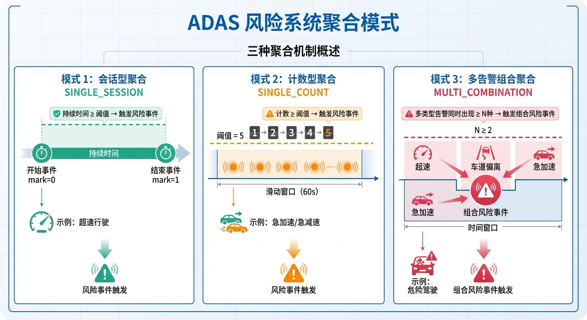
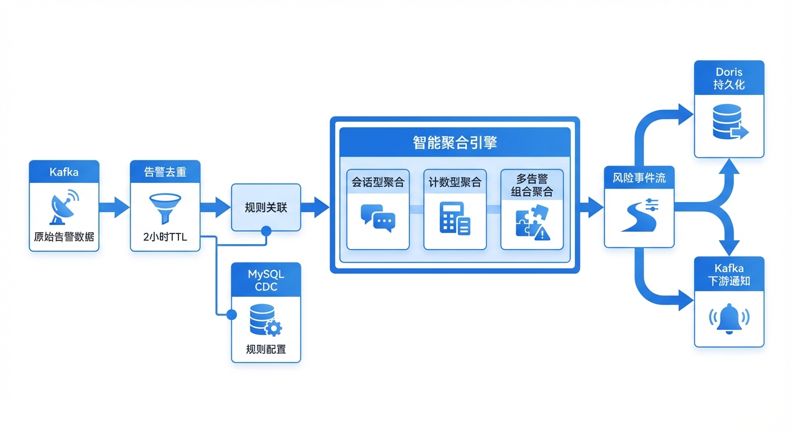
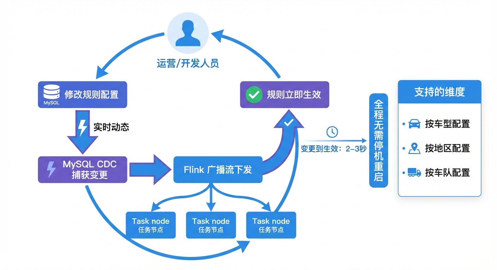
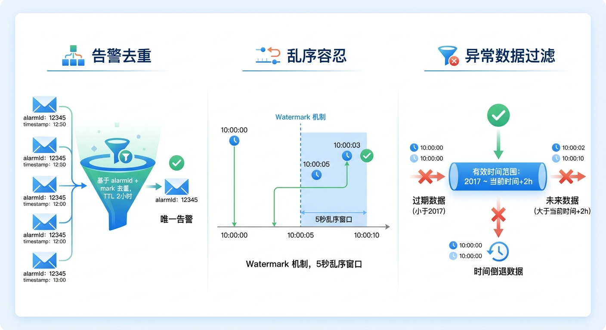

## 一、项目概述

**项目名称**：主动安全设备风险聚合任务（dst-iot-adas-risk-aggregation-job）

**项目背景**：该项目最初源于对安全风控平台"智能聚合"能力的迁移需求，因此现有规则实现沿用了安全风控的原始逻辑。

**项目定位**：基于 Apache Flink 构建的实时流处理作业，负责从 ADAS（高级驾驶辅助系统）产生的告警数据中，按照预设规则聚合出高风险事件，供车队安全运营团队进行实时监控与干预。

**核心能力**：

- **实时处理**：告警产生到风险事件输出的端到端延迟控制在秒级
- **多模式聚合**：提供三种聚合模式，覆盖不同类型的告警场景
- **规则动态更新**：规则配置变更后实时生效，无需停机重启
- **数据可靠性**：具备去重、乱序容忍等机制，降低数据丢失风险

---

## 二、业务背景与问题分析

### 现有问题

1. 旧项目存在技术债务严重、代码和业务逻辑耦合度高、迭代和维护成本较大的问题
2. 原有方案基于定时任务等离线处理方式，实时性不高
3. 风险聚合规则变更需要重新发布代码,无法根据页面配置动态生效

### 解决思路

通过构建智能聚合引擎，将大量原始告警按规则归并为结构化的风险事件，大幅减少运营端需要关注的事件数量，同时提高事件的信息含量和可操作性。

```javascript
原始告警流 → 智能聚合引擎 → 风险事件流 → 运营平台预警
```

**预期效果**：

- 运营端需关注的事件量大幅下降（实际降幅取决于车辆类型和告警规则配置）
- 风险识别的有效性明显提升，减少无效告警对运营资源的占用
- 从小时级响应缩短至秒级响应

---

## 三、三种聚合模式



### 1. 会话型聚合（SINGLE_SESSION）

**适用场景**：国标告警，如超速、超时行驶、疲劳驾驶等存在"开始—结束"状态的告警。

**核心逻辑**：通过匹配同一告警 ID 的"开始"事件（mark=0）与"结束"事件（mark=1），计算告警的持续时间。当持续时间达到预设阈值时，判定为一次风险事件。

**示例**：

| 驾驶行为 | 开始时间 | 结束时间 | 持续时间 | 阈值 | 判定结果 |
| --- | --- | --- | --- | --- | --- |
| 超速行驶 | 10:00:00 | 10:05:30 | 5分30秒 | 5分钟 | 触发风险事件 |
| 瞬时超速 | 14:20:10 | 14:20:15 | 5秒 | 5分钟 | 不触发 |

**技术要点**：

- 同一告警 ID 的开始/结束事件自动配对
- 支持 5 秒乱序容忍窗口，适应网络延迟导致的事件乱序
- 根据持续时间自动划分风险等级

---

### 2. 计数型聚合（SINGLE_COUNT）

**适用场景**：苏标告警，如急加速、急减速、车道偏离等无明确"开始—结束"状态、以单次触发为主的告警。

**核心逻辑**：在配置的滑动时间窗口内统计告警次数，当计数达到阈值时触发风险事件。

**示例**：

| 驾驶行为 | 窗口大小 | 实际告警次数 | 阈值 | 判定结果 |
| --- | --- | --- | --- | --- |
| 频繁变道 | 60秒 | 7次 | 5次 | 触发风险事件 |
| 正常变道 | 60秒 | 2次 | 5次 | 不触发 |

**技术要点**：

- 窗口大小可按规则动态配置
- 达到最小触发值时即时生成风险事件，无需等待窗口结束
- 一级告警和二级告警分开统计，避免混合计数

---

### 3. 多告警组合聚合（MULTI_COMBINATION）

**适用场景**：复杂驾驶场景，多种不同类型的告警在短时间内同时出现，需要综合判断风险。

**核心逻辑**：在时间窗口内收集不同类型的告警，当满足组合条件（如同时出现的告警类型数量达到阈值）时，生成组合风险事件。

**示例**：

| 场景 | 组合告警类型 | 判断逻辑 | 判定结果 |
| --- | --- | --- | --- |
| 危险驾驶 | 急加速 + 车道偏离 + 超速 | 同时出现 ≥ 3 种告警 | 触发高风险事件 |
| 疲劳驾驶 | 闭眼 + 打哈欠 + 烟感 + 分心 | 同时出现 ≥ 4 种告警 | 触发高风险事件 |

**技术要点**：

- 采用滑动窗口 + 冷却期机制，避免短时间内重复触发同一风险事件
- 告警类型组合可灵活配置
- 支持不同告警类型设置不同权重

---

## 四、技术架构

### 系统流程



### 核心技术选型

| 组件 | 技术选型 | 用途说明 |
| --- | --- | --- |
| 流处理引擎 | Apache Flink 1.15 | 承担核心的实时计算与状态管理 |
| 消息队列 | Kafka | 告警数据接入、风险事件下发 |
| 规则存储 | MySQL + CDC | 存储规则配置，通过 CDC 实现变更的实时同步 |
| 数据仓库 | Doris | 告警记录和风险事件的持久化存储与查询 |
| 配置中心 | Nacos | 作业运行参数的动态配置管理 |

---

## 五、动态规则管理

### 规则配置示例

```json
{
  "ruleId": "RULE_001",
  "ruleName": "超速行驶风险聚合",
  "aggregationMode": "SINGLE_SESSION",
  "alarmTypes": [1001, 1002],
  "highRisk": {
    "threshold": 300,
    "windowSize": 600
  },
  "mediumRisk": {
    "threshold": 180,
    "windowSize": 600
  }
}
```

### 规则更新流程



4. 运营或开发人员在 MySQL 中修改规则配置
5. MySQL CDC 组件捕获数据变更
6. 变更通过 Flink 广播流下发到所有计算节点
7. 新规则在数秒内应用到后续的告警处理中

这一机制的主要优势在于：规则调整无需停机重启作业，变更可快速验证，且支持按车型、地区、车队等维度配置差异化规则。

---

## 六、数据可靠性保障



### 1. 告警去重

**问题**：网络重传、数据回放等情况可能导致同一条告警被重复消费。

**方案**：基于 `alarmId + mark` 组合作为唯一标识进行去重，去重状态保持 2 小时（TTL）。在此时间窗口内，相同标识的告警只保留首条，后续重复数据丢弃。

### 2. 乱序容忍

**问题**：网络延迟、设备时钟不同步等原因可能导致事件到达顺序与实际发生顺序不一致。

**方案**：采用 Flink Watermark 机制，设置 5 秒乱序容忍窗口。在该窗口范围内到达的乱序事件仍可被正常处理。

### 3. 异常数据过滤

为防止问题数据影响聚合结果，系统对以下数据进行过滤：

- 时间戳早于 2017 年的过期数据
- 时间戳超过当前时间 2 小时以上的未来数据
- 可能导致 Watermark 停滞的时间倒退数据

---

## 七、业务效果

### 关键指标对比

| 指标 | 聚合前 | 聚合后 | 变化 |
| --- | --- | --- | --- |
| 运营端需处理事件量（每车每天） | 数百条原始告警 | 数十条风险事件 | 大幅下降 |
| 风险识别有效性 | 大量无效告警混杂 | 聚合后事件信息含量高 | 明显提升 |
| 运营响应时效 | 依赖离线分析，小时级 | 实时处理，秒级 | 显著缩短 |
| 单人可监控车辆规模 | 受限于告警量，覆盖范围有限 | 事件量下降后，覆盖范围扩大 | 运营人效提升 |

> 说明：以上为聚合前后的定性对比，具体数值因车辆类型、设备型号、规则配置等因素存在差异。

### 典型应用场景

**场景一：疲劳驾驶预警**

某司机在连续行驶过程中，ADAS 设备短时间内上报了大量闭眼、打哈欠、分心等告警。聚合引擎将这些分散的告警归并为一条"疲劳驾驶风险事件"，包含持续时间、涉及的告警类型等关键信息，运营人员据此可快速判断并进行电话干预。

**场景二：危险驾驶行为识别**

某司机在短时间内频繁出现急加速、急减速、车道偏离等行为，单独看每条告警可能不构成严重问题，但组合聚合后生成"危险驾驶行为风险事件"，帮助运营团队识别出需要重点关注的司机，安排后续的安全培训。

---

## 八、技术特性

### 性能

- 单作业可支持较高吞吐量的告警处理（具体取决于集群资源配置）
- 端到端延迟控制在秒级
- 支持通过增加 Flink 并行度实现水平扩展

### 可用性

- 基于 Flink Checkpoint 机制实现状态持久化与故障恢复
- Kafka 持久化 + Flink Exactly-Once 语义，降低数据丢失风险
- 规则服务异常时，可使用缓存规则继续运行

### 可维护性

- 通过 Flink Web UI 监控作业运行状态
- 运行参数通过 Nacos 动态调整
- 结构化日志，便于问题定位

---

## 九、方案可扩展性

当前架构在设计上预留了较好的扩展空间，主要体现在以下几个方向：

### 1. 聚合模式扩展

现有三种聚合模式是基础能力，后续可以在不改变整体架构的前提下新增聚合模式：

| 扩展方向 | 说明 | 价值 |
| --- | --- | --- |
| **时序模式聚合** | 识别告警的时间序列规律，如“分心 → 车道偏离 → 碰撞”的因果链 | 提前识别风险演变趋势 |
| **地理围栏聚合** | 结合 GPS 数据，在特定路段或区域内聚合告警 | 识别高危路段，辅助路线规划 |
| **跨车聚合** | 同一车队多辆车在相近时空内的告警关联分析 | 识别车队级别的共性风险（如恶劣天气、路况异常） |

### 2. 数据源扩展

当前系统仅消费 ADAS 告警数据，架构设计支持接入更多数据源：

- **GPS 轨迹数据**：结合位置信息，判断告警发生的地理环境（如弯道、下坡、高速入口）
- **路况与天气数据**：为风险判断提供环境上下文，避免在恶劣天气下误判
- **车辆工况数据**：如车速、转向角、制动踏板等，丰富风险事件的判断维度

扩展方式：新增 Kafka Topic 接入 + Flink 多流 Join，不影响现有告警处理逻辑。

### 3. 下游能力扩展

风险事件生成后，当前仅写入 Doris 和 Kafka。后续可扩展的下游能力包括：

- **驾驶员风险画像**：基于历史风险事件，给每位司机建立风险评分和行为标签
- **智能干预触发**：对接运营平台，根据风险等级自动触发不同的干预动作（语音提醒、电话干预、强制停车）
- **保险业务对接**：风险数据输出给保险公司，用于 UBI（基于用户行为的保险）定价

### 4. 规则配置能力扩展

- **可视化规则配置界面**：让运营人员通过前端界面自主配置和调整聚合规则，降低对开发人员的依赖
- **规则版本管理**：支持规则的版本记录、回滚和对比分析
- **A/B 测试支持**：支持同一场景下配置多套规则进行效果对比

### 5. 处理能力扩展

Flink 架构天然支持水平扩展：

- **车辆规模增长**：通过增加 Flink TaskManager 和并行度，线性提升处理能力
- **多租户支持**：可按车队/客户维度隔离状态，支持多租户 SaaS 化部署
- **多地域部署**：架构支持按地域独立部署，满足数据合规要求

---

---

## 十、领导可能关注的问题（Q&A 预案）

<div class="callout callout-note" markdown="1">

**📝 Q1：这个项目和旧的安全风控聚合相比，核心区别是什么？**

主要区别在三个方面：

8. **实时性**：旧系统基于定时任务，分钟级延迟；新系统基于 Flink 流处理，秒级延迟
9. **规则灵活性**：旧系统规则硬编码在代码中，修改需重新发布；新系统规则存储在 MySQL，通过 CDC 实时生效
10. **可维护性**：旧系统代码和业务逻辑耦合严重，迭代成本高；新系统聚合模式和规则配置解耦，新增规则无需改代码

**Q2：如果 Flink 作业崩溃了，数据会丢吗？恢复需要多久？**
Flink 配置了 Checkpoint 机制，定期将状态快照持久化。作业崩溃后会从最近一次 Checkpoint 自动恢复，配合 Kafka 的消息回溯能力，可以重新消费崩溃期间的数据。正常情况下，恢复时间在分钟级别。

另外，生产环境配置了自动重启策略，常见的瞬时故障可以自动恢复，无需人工介入。

**Q3：当前系统能支撑多大的车辆规模？如果业务量翻倍增长怎么办？**
Flink 架构支持水平扩展，处理能力与集群资源成正比。当车辆规模增长时，主要通过以下方式应对：

11. 增加 Flink TaskManager 节点和并行度
12. 扩展 Kafka 分区数以提升消费吞吐
13. Doris 写入端可独立扩容

扩容过程不需要修改代码，主要是资源配置的调整。

**Q4：规则谁来配置？配错了怎么办？**
目前规则由开发人员在 MySQL 中配置。后续计划提供可视化配置界面，让运营人员也能自主操作。

对于配置错误的风控：

- 规则通过 CDC 实时生效，发现问题后可立即修改，数秒内生效
- 后续可加入规则版本管理，支持一键回滚
- 可以先在小范围车队试运行新规则，验证效果后再全量推广

**Q5：聚合后的风险事件准确率怎么样？有没有误报或漏报？**
聚合的准确率取决于规则配置的合理性，而非算法本身。系统在准确性方面做了以下保障：

- **降低误报**：通过时间窗口和阈值过滤瞬时干扰，只有持续性或高频告警才会触发风险事件
- **降低漏报**：多类型组合聚合可以识别单一规则无法覆盖的复合风险场景
- **持续优化**：规则可动态调整，根据实际运营反馈不断优化阈值和窗口参数

具体的准确率需要结合上线后的实际数据进行评估和调优。

**Q6：为什么选 Flink 而不是其他流处理框架（如 Spark Streaming、Storm）？**
选择 Flink 的主要原因：

14. **事件时间语义**：Flink 原生支持事件时间和 Watermark，适合设备告警这类对时间精度要求较高的场景
15. **状态管理**：Flink 提供强大的 Keyed State 和广播状态，正好满足聚合计算和动态规则下发的需求
16. **精确一次语义**：保证数据不重复、不丢失，满足风控场景对数据准确性的要求
17. **团队技术储备**：团队已有 Flink 开发和运维经验，降低了学习和运维成本

**Q7：这个项目的投入产出比怎么样？上线后能带来什么结果？**
**投入方面**：

- 开发资源：主要是后端开发和测试的人力投入
- 基础设施：Flink 集群、Kafka、Doris 等组件的服务器资源

**产出方面**：

- 运营人效提升：告警量大幅下降后，单人可监控的车辆规模明显扩大
- 响应时效：从小时级进入秒级，为安全干预争取了时间窗口
- 技术债务清理：替换旧系统后，后续的维护和迭代成本显著降低
- 平台化能力：聚合引擎作为基础能力，可复用于其他类似的 IoT 告警聚合场景

**Q8：这套架构能复用到其他业务线吗？**
可以。聚合引擎的核心逻辑（会话型、计数型、组合型）是通用的，不仅限于 ADAS 场景。潜在的复用方向包括：

- **OBD 设备告警聚合**：车辆故障码、异常工况的实时聚合
- **电子围栏告警**：进出区域事件的智能归并
- **其他 IoT 设备监控**：任何需要将高频低价值事件聚合为低频高价值事件的场景

复用时主要需要调整的是数据接入层和规则配置，聚合引擎本身无需修改。
</div>

---

## 十一、总结

ADAS 风险智能聚合作业通过会话型聚合、计数型聚合、多告警组合聚合三种模式，将大量原始告警归并为可操作的风险事件，解决了传统告警处理中告警量过大、有效信息密度低、响应时效不足等问题。

结合动态规则管理和数据可靠性保障机制，系统为车队安全运营提供了一个实时、可配置、可扩展的风险预警基础能力。

---

**技术栈**：Apache Flink + Kafka + Doris + MySQL CDC

**代码仓库**：`dst-iot-adas-risk-aggregation-job`
