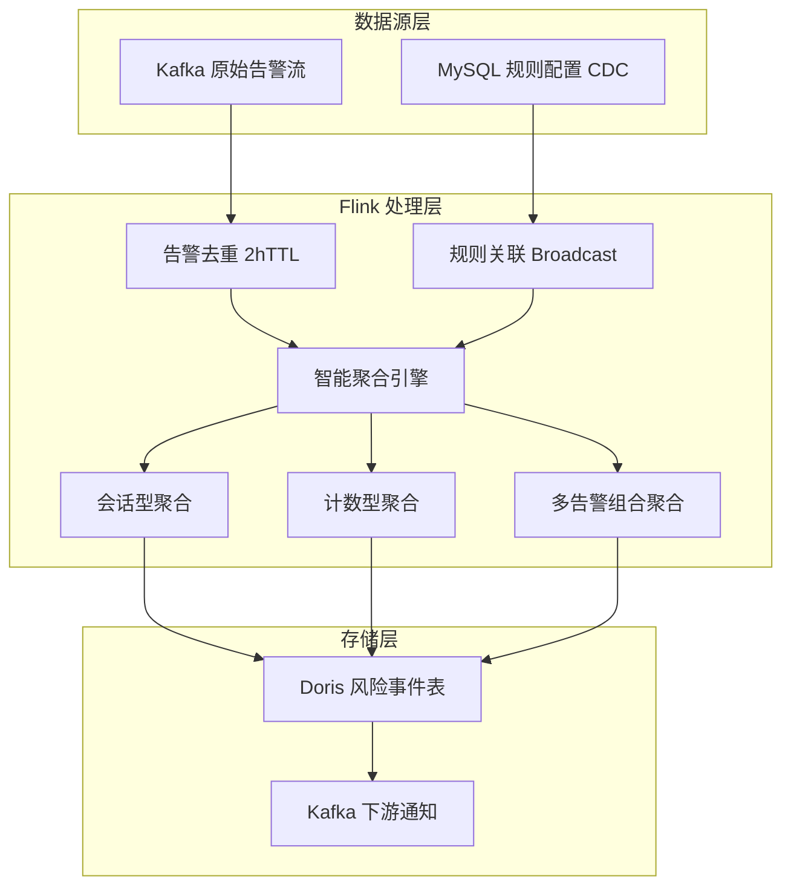
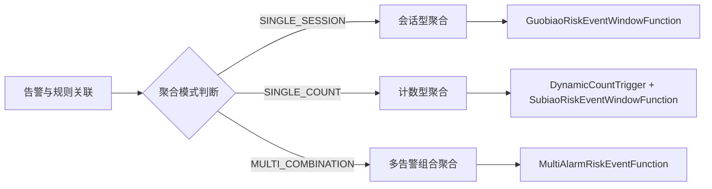
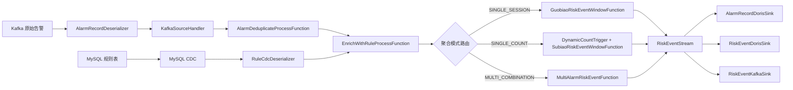

## 📚 文档说明

**文档版本**：v1.0  

**最后更新**：2025-01-18  

**面向读者**：技术架构师、开发工程师、数据工程师

---

## 一、系统架构概览

### 1.1 整体架构



### 1.2 核心技术栈

| 组件 | 版本 | 用途 |
| --- | --- | --- |
| Apache Flink | 1.15.0 | 流处理引擎 |
| flink-connector-kafka | - | Kafka 数据源 |
| flink-connector-mysql-cdc | 2.4.0 | MySQL CDC 规则广播 |
| flink-doris-connector | 1.15_25.0.0 | Doris Sink |
| Spring Cloud Nacos | - | 配置中心 |

---

## 二、数据模型设计

### 2.1 Doris 风险事件表（adas_risk_event）

```sql
CREATE TABLE adas_risk_event (
    car_vin                  VARCHAR NOT NULL COMMENT '车辆 VIN',
    alarm_type               INT NOT NULL COMMENT '告警类型',
    alarm_level              INT NOT NULL COMMENT '告警等级',
    window_start_time        DATETIME COMMENT '窗口开始时间',
    window_end_time          DATETIME COMMENT '窗口结束时间',
    alarm_description        VARCHAR COMMENT '告警类型描述',
    scenario_code            VARCHAR COMMENT '风险场景/规则分组编码',
    risk_rating              INT COMMENT '风险等级：1-中风险，2-高风险',
    alarm_count              INT COMMENT '窗口内告警数量',
    duration_seconds         BIGINT COMMENT '窗口内告警持续时长（秒）',
    risk_event_start_time    DATETIME COMMENT '风险事件开始时间',
    risk_event_end_time      DATETIME COMMENT '风险事件结束时间',
    rule_id                  VARCHAR COMMENT '规则 ID',
    rule_version             VARCHAR COMMENT '规则版本',
    rule_name                VARCHAR COMMENT '规则名称',
    risk_formed_time         BIGINT COMMENT '风险形成的时间戳',
    alarm_ids                ARRAY<VARCHAR> COMMENT '参与聚合的告警 ID 列表',
    involved_alarm_types     ARRAY<INT> COMMENT '参与聚合的告警类型集合'
) UNIQUE KEY (car_vin, alarm_type, alarm_level, window_start_time)
PARTITION BY RANGE(window_start_time) ()
DISTRIBUTED BY HASH(car_vin) BUCKETS 16
PROPERTIES (
    "dynamic_partition.enable" = "true",
    "dynamic_partition.time_unit" = "MONTH"
);
```

**设计要点**：

- **UNIQUE KEY**：`(car_vin, alarm_type, alarm_level, window_start_time)` 保证数据唯一性
- **分区策略**：按月分区，支持数据生命周期管理
- **分桶策略**：按 VIN 哈希分桶 16 个，优化查询性能
- **ARRAY 类型**：`alarm_ids` 和 `involved_alarm_types` 保留聚合上下文

### 2.2 MySQL 规则配置表（adas_aggregation_rules）

```sql
CREATE TABLE `adas_aggregation_rules` (
   `rule_id` varchar(50) NOT NULL,
   `rule_version` varchar(20) NOT NULL,
   `name` varchar(100) NOT NULL,
   `aggregation_mode` varchar(32) NOT NULL DEFAULT 'SINGLE_COUNT' 
       COMMENT '聚合模式：SINGLE_SESSION/SINGLE_COUNT/MULTI_COMBINATION',
   `scenario_code` varchar(64) DEFAULT NULL 
       COMMENT '规则分组/场景编码',
   `alarm_type` int DEFAULT NULL 
       COMMENT '主告警类型（单告警聚合使用）',
   `alarm_types` varchar(256) DEFAULT NULL 
       COMMENT '多告警组合类型，逗号分隔',
   
   -- 苏标中风险配置
   `min_level1` int DEFAULT '0' 
       COMMENT '苏标中风险一级告警的最小触发次数',
   `min_level2` int DEFAULT '0' 
       COMMENT '苏标中风险二级告警的最小触发次数',
   `min_duration` int DEFAULT '0' 
       COMMENT '苏标中风险窗口最小持续时间（秒）',
   `max_duration` int DEFAULT '0' 
       COMMENT '苏标中风险窗口最大持续时间（秒）',
   `window_minutes` int NOT NULL 
       COMMENT '苏标中风险窗口大小（分钟）',
   
   -- 苏标高风险配置
   `high_min_level1` int DEFAULT '0',
   `high_min_level2` int DEFAULT '0',
   `high_min_duration` int DEFAULT '0',
   `high_max_duration` int DEFAULT '0',
   `high_window_minutes` int NOT NULL,
   
   -- 多告警组合配置
   `multi_min_level1_distinct` int DEFAULT '0',
   `multi_min_level2_distinct` int DEFAULT '0',
   `multi_high_min_level1_distinct` int DEFAULT '0',
   `multi_high_min_level2_distinct` int DEFAULT '0',
   `multi_min_level1_count` int DEFAULT '0',
   `multi_min_level2_count` int DEFAULT '0',
   `multi_high_min_level1_count` int DEFAULT '0',
   `multi_high_min_level2_count` int DEFAULT '0',
   `multi_window_seconds` int DEFAULT '0',
   `multi_high_window_seconds` int DEFAULT '0',
   `multi_cooldown_seconds` int DEFAULT '0',
   `multi_high_cooldown_seconds` int DEFAULT '0',
   
   PRIMARY KEY (`rule_id`,`rule_version`)
) ENGINE=InnoDB DEFAULT CHARSET=utf8mb4;
```

**字段分组说明**：

| 字段组 | 适用模式 | 说明 |
| --- | --- | --- |
| `alarm_type` | SINGLE_SESSION/COUNT | 单告警类型 |
| `alarm_types` | MULTI_COMBINATION | 多告警类型（逗号分隔） |
| `min_duration/max_duration` | SINGLE_SESSION | 国标会话型持续时间阈值 |
| `window_minutes/high_window_minutes` | SINGLE_COUNT | 苏标计数型窗口大小 |
| `min_level1/min_level2` | SINGLE_COUNT | 苏标中风险触发阈值 |
| `high_min_level1/high_min_level2` | SINGLE_COUNT | 苏标高风险触发阈值 |
| `multi_*_distinct` | MULTI_COMBINATION | 多告警组合不同类型数阈值 |
| `multi_*_count` | MULTI_COMBINATION | 多告警组合告警数阈值 |
| `multi_*_window_seconds` | MULTI_COMBINATION | 窗口大小 |
| `multi_*_cooldown_seconds` | MULTI_COMBINATION | 冷却期 |

---

## 三、智能聚合引擎实现

### 3.1 聚合模式总览



### 3.2 模式 1：会话型聚合（SINGLE_SESSION）

- **国标告警**：超速驾驶、超时行驶、疲劳驾驶等
- **特征**：告警有明确的「开始」和「结束」事件
- **关键字段**：`mark`（0=开始，1=结束）

**类定义**：

```java
public class GuobiaoRiskEventWindowFunction 
    extends KeyedProcessFunction<String, AlarmWithRule, RiskEvent>
```

**状态管理**：

```java
// 会话状态：保存未闭合的告警会话
private transient MapState<String, SessionState> sessionState;

// 定时器索引：记录哪些 alarmId 在哪个时间点超时
private transient MapState<Long, List<String>> timerIndexState;
```

**SessionState 数据结构**：

```java
public static class SessionState implements Serializable {
    private AlarmWithRule startEvent;      // 开始事件
    private long sessionStartTime;          // 会话开始时间
    private long timeoutTimestamp;          // 超时时间戳
    private long windowStartTime;           // 窗口开始时间
    private long windowEndTime;             // 窗口结束时间
    private List<String> alarmIds;          // 告警 ID 列表
}
```

**1. 开始事件处理（mark=0）**

```java
private void handleStartEvent(String alarmId, AlarmWithRule value, Context ctx) {
    // 1. 计算会话超时时间
    long startTime = resolveStartTime(value, ctx);
    long sessionGap = value.getRule().resolveSessionGapMillis(riskRating);
    long timeoutTs = startTime + sessionGap;
    
    // 2. 创建会话状态
    SessionState state = new SessionState();
    state.setStartEvent(value);
    state.setSessionStartTime(startTime);
    state.setTimeoutTimestamp(timeoutTs);
    
    // 3. 保存到状态
    sessionState.put(alarmId, state);
    
    // 4. 注册超时定时器（双重保险：event-time + processing-time）
    registerTimer(alarmId, timeoutTs, ctx);
}
```

**2. 结束事件处理（mark=1）**

```java
private void handleEndEvent(String alarmId, AlarmWithRule endEvent, 
                            Context ctx, Collector<RiskEvent> out) {
    // 1. 查找匹配的开始事件
    SessionState state = sessionState.get(alarmId);
    if (state == null) {
        return; // 未找到开始事件，忽略
    }
    
    long endTime = resolveEndTime(endEvent, ctx);
    long timeoutTs = state.getTimeoutTimestamp();
    
    // 2. 检查是否已超时
    if (endTime > timeoutTs) {
        // 已超时：触发超时事件
        out.collect(buildRiskEvent(state, timeoutTs, "超时未闭合"));
        cleanupSession(alarmId, state);
        return;
    }
    
    // 3. 计算持续时间
    long duration = endTime - state.getSessionStartTime();
    long minMillis = rule.getMinDuration() * 1000;
    long maxMillis = rule.getMaxDuration() * 1000;
    
    // 4. 判断是否达到阈值
    if (duration >= minMillis) {
        String desc = duration > maxMillis 
            ? "正常闭合, 持续时间超阈值" 
            : "正常闭合";
        out.collect(buildRiskEvent(state, endTime, desc));
    }
    
    // 5. 清理状态
    cleanupSession(alarmId, state);
}
```

**3. 超时处理（onTimer）**

```java
@Override
public void onTimer(long timestamp, OnTimerContext ctx, Collector<RiskEvent> out) {
    // 判断是 event-time 还是 processing-time 定时器
    boolean isProcessingTime = timestamp > System.currentTimeMillis() - 60000;
    
    if (isProcessingTime) {
        // Processing-time 兜底：强制清理所有超时会话
        long currentTime = System.currentTimeMillis();
        for (String alarmId : sessionState.keys()) {
            SessionState state = sessionState.get(alarmId);
            if (currentTime >= state.getTimeoutTimestamp() + 10000) {
                out.collect(buildRiskEvent(state, state.getTimeoutTimestamp(), 
                                          "超时未闭合(processing-time兜底)"));
                cleanupSession(alarmId, state);
            }
        }
    } else {
        // Event-time 正常超时清理
        List<String> alarmIds = timerIndexState.get(timestamp);
        for (String alarmId : alarmIds) {
            SessionState state = sessionState.get(alarmId);
            out.collect(buildRiskEvent(state, timestamp, "超时未闭合"));
            cleanupSession(alarmId, state);
        }
    }
}
```

**R1001 - 超速驾驶**：

```sql
INSERT INTO adas_aggregation_rules(
    rule_id, rule_version, name, aggregation_mode, scenario_code, alarm_type,
    min_duration, max_duration, window_minutes,
    high_min_duration, high_max_duration, high_window_minutes
) VALUES (
    'R1001', '1.0', '超速驾驶', 'SINGLE_SESSION', 'GB_SPEED', 5002,
    15, 29, 2,        -- 中风险：持续 15-29 秒（2分钟窗口）
    30, 120, 2         -- 高风险：持续 30-120 秒（2分钟窗口）
);
```

**字段映射**：

- `min_duration = 15`：中风险最小持续 15 秒
- `max_duration = 29`：中风险最大持续 29 秒（30 秒算高风险）
- `window_minutes = 2`：会话窗口 2 分钟（超时时间）

**触发逻辑**：

```javascript
开始事件(mark=0) --[15秒]--→ 结束事件(mark=1)
                            ↓
                    持续时间 = 15秒 >= min_duration(15)
                            ↓
                        ✅ 触发中风险事件
```

---

### 3.3 模式 2：计数型聚合（SINGLE_COUNT）

- **苏标告警**：急加速、急减速、车道偏离、使用手机等
- **特征**：统计窗口内告警次数，达到阈值立即触发
- **关键字段**：`riskLevel`（1=一级告警，2=二级告警）

**类定义**：

```java
public class DynamicCountTrigger extends Trigger<AlarmWithRule, TimeWindow> {
    private final int riskRating;
    private final ValueStateDescriptor<Integer> countStateDescriptor;
}
```

**状态管理**：

```java
// 计数状态：记录当前窗口内的告警数量
private ValueState<Integer> countState;
```

**1. 告警到达时计数**

```java
@Override
public TriggerResult onElement(AlarmWithRule element, long timestamp, 
                               TimeWindow window, TriggerContext ctx) {
    // 1. 注册窗口结束定时器
    ctx.registerEventTimeTimer(window.getEnd());
    
    // 2. 获取当前计数
    ValueState<Integer> countState = ctx.getPartitionedState(countStateDescriptor);
    Integer currentCount = countState.value();
    int count = (currentCount != null) ? currentCount : 0;
    
    // 3. 对所有告警事件计数（mark=0 和 mark=1 都算）
    if (element.getAlarm().getMark() != null) {
        count += 1;
        countState.update(count);
        
        // 4. 获取最小触发数量（根据告警等级和风险等级）
        int minCount = resolveMinCount(element);
        
        // 5. 判断是否达到触发值
        if (count >= minCount) {
            // 达到阈值：立即触发并清理
            countState.clear();
            return TriggerResult.FIRE_AND_PURGE;
        }
    }
    
    // 未达到阈值，继续等待
    return TriggerResult.CONTINUE;
}
```

**2. 动态计算最小触发数量**

```java
private int resolveMinCount(AlarmWithRule awr) {
    Integer riskLevel = awr.getAlarm().getRiskLevel();
    
    if (riskRating == RiskRatingConstant.MEDIUM) {
        // 中风险：根据告警等级选择
        return (riskLevel != null && riskLevel == 1) 
            ? awr.getRule().getMinLevel1()      // 一级告警
            : awr.getRule().getMinLevel2();     // 二级告警
    } else {
        // 高风险：根据告警等级选择
        return (riskLevel != null && riskLevel == 1) 
            ? awr.getRule().getHighMinLevel1()  // 一级告警
            : awr.getRule().getHighMinLevel2(); // 二级告警
    }
}
```

**3. 窗口结束处理**

```java
@Override
public TriggerResult onEventTime(long time, TimeWindow window, TriggerContext ctx) {
    if (time == window.getEnd()) {
        // 窗口结束：触发并清理
        countState.clear();
        return TriggerResult.FIRE_AND_PURGE;
    }
    return TriggerResult.CONTINUE;
}
```

**R1003 - 疲劳驾驶**：

```sql
INSERT INTO adas_aggregation_rules(
    rule_id, rule_version, name, aggregation_mode, scenario_code, alarm_type,
    min_level1, min_level2, window_minutes,
    high_min_level1, high_min_level2, high_window_minutes
) VALUES (
    'R1003', '1.0', '疲劳驾驶', 'SINGLE_COUNT', 'DSM_FATIGUE', 2001,
    2, 2, 2,          -- 中风险：2分钟内，一级/二级告警各 2 次
    3, 3, 2           -- 高风险：2分钟内，一级/二级告警各 3 次
);
```

**字段映射**：

- `min_level1 = 2`：中风险一级告警最少 2 次
- `min_level2 = 2`：中风险二级告警最少 2 次
- `window_minutes = 2`：窗口大小 2 分钟
- `high_min_level1 = 3`：高风险一级告警最少 3 次

**触发逻辑**：

```javascript
时间窗口：0 --------2分钟--------
告警序列：  [一级] [一级] [二级] [二级]
             ↑      ↑      ↑      ↑
             1      2      1      2  (计数)
                            ↓
              一级告警=2 >= min_level1(2) ✅
              二级告警=2 >= min_level2(2) ✅
                            ↓
                    立即触发中风险事件
```

**1. 立即触发 vs 等待窗口结束**

```java
if (count >= minCount) {
    return TriggerResult.FIRE_AND_PURGE; // 立即触发，不等窗口结束
}
```

**优势**：

- ✅ 低延迟：达到阈值立即生成风险事件
- ✅ 节省资源：及时清理窗口状态
- ✅ 实时预警：支持运营即时干预

**2. 动态窗口大小**

```java
// DynamicWindowAssigner.java
@Override
public void assignWindows(Object event, long timestamp, 
                         WindowAssignerContext context) {
    // 从规则中获取窗口大小（根据风险等级）
    long windowSize = rule.resolveWindowMillis(riskRating);
    long windowStart = timestamp - (timestamp % windowSize);
    long windowEnd = windowStart + windowSize;
    
    return Collections.singletonList(new TimeWindow(windowStart, windowEnd));
}
```

---

### 3.4 模式 3：多告警组合聚合（MULTI_COMBINATION）

- **复杂驾驶场景**：分心驾驶、激烈驾驶等
- **特征**：组合不同类型的告警，形成复合风险事件
- **关键字段**：`alarm_types`（逗号分隔的告警类型列表）

**类定义**：

```java
public class MultiAlarmRiskEventFunction 
    extends KeyedProcessFunction<String, AlarmWithRule, RiskEvent>
```

**状态管理**：

```java
// 窗口内所有告警事件
private transient ListState<MultiAlarmEvent> eventState;

// 冷却期：下次可触发时间戳
private transient ValueState<Long> cooldownUntilState;

// 当前规则和 VIN
private transient ValueState<AdasRule> ruleState;
private transient ValueState<String> vinState;
```

**MultiAlarmEvent 数据结构**：

```java
public class MultiAlarmEvent implements Serializable {
    private String alarmId;      // 告警 ID
    private Integer alarmType;   // 告警类型
    private Integer riskLevel;   // 告警等级（1/2）
    private Long eventTime;      // 事件时间戳
}
```

**1. 告警到达时添加到窗口**

```java
@Override
public void processElement(AlarmWithRule value, Context ctx, Collector<RiskEvent> out) {
    AlarmRecord alarm = value.getAlarm();
    
    // 1. 提取事件时间
    long eventTime = extractEventTime(alarm, ctx.timestamp());
    
    // 2. 添加到状态（保存告警等级）
    eventState.add(new MultiAlarmEvent(
        alarm.getAlarmId(), 
        alarm.getAlarmType(), 
        alarm.getRiskLevel(),  // 保存等级，用于区分一级/二级
        eventTime
    ));
    
    // 3. 立即检查是否达到触发条件
    checkAndTriggerIfNeeded(ctx, out, eventTime);
    
    // 4. 注册窗口结束定时器
    long windowMs = value.getRule().resolveMultiWindowMillis(riskRating);
    ctx.timerService().registerEventTimeTimer(eventTime + windowMs);
}
```

**2. 检查触发条件**

```java
private void checkAndTriggerIfNeeded(Context ctx, Collector<RiskEvent> out, 
                                      long currentTime) throws Exception {
    AdasRule rule = ruleState.value();
    long windowMs = rule.resolveMultiWindowMillis(riskRating);
    long lowerBound = currentTime - windowMs;
    
    // 1. 收集窗口内有效告警
    List<MultiAlarmEvent> events = new ArrayList<>();
    for (MultiAlarmEvent event : eventState.get()) {
        if (event.getEventTime() >= lowerBound) {
            events.add(event);
        }
    }
    
    if (events.isEmpty()) {
        return;
    }
    
    // 2. 检查冷却期
    Long cooldownUntil = cooldownUntilState.value();
    if (cooldownUntil != null && currentTime < cooldownUntil) {
        return; // 在冷却期内，不触发
    }
    
    // 3. 分别统计一级和二级告警
    Map<Integer, Set<Integer>> levelToTypes = new HashMap<>();
    for (MultiAlarmEvent event : events) {
        Integer level = event.getRiskLevel();
        Set<Integer> types = levelToTypes.computeIfAbsent(level, k -> new HashSet<>());
        types.add(event.getAlarmType());
    }
    
    // 4. 判断是否满足触发条件
    int distinctLevel1 = levelToTypes.getOrDefault(1, Collections.emptySet()).size();
    int distinctLevel2 = levelToTypes.getOrDefault(2, Collections.emptySet()).size();
    int countLevel1 = (int) events.stream().filter(e -> e.getRiskLevel() == 1).count();
    int countLevel2 = (int) events.stream().filter(e -> e.getRiskLevel() == 2).count();
    
    // 5. 从规则中获取阈值
    int minDistinctLevel1 = rule.resolveMultiMinLevel1Distinct(riskRating);
    int minDistinctLevel2 = rule.resolveMultiMinLevel2Distinct(riskRating);
    int minCountLevel1 = rule.resolveMultiMinLevel1Count(riskRating);
    int minCountLevel2 = rule.resolveMultiMinLevel2Count(riskRating);
    
    // 6. 判断是否满足所有条件
    boolean triggered = (distinctLevel1 >= minDistinctLevel1) 
                   && (distinctLevel2 >= minDistinctLevel2)
                   && (countLevel1 >= minCountLevel1)
                   && (countLevel2 >= minCountLevel2);
    
    if (triggered) {
        // 7. 触发风险事件
        RiskEvent riskEvent = buildRiskEvent(events, currentTime);
        out.collect(riskEvent);
        
        // 8. 设置冷却期
        long cooldownMs = rule.resolveMultiCooldownMillis(riskRating);
        cooldownUntilState.update(currentTime + cooldownMs);
    }
}
```

**3. 窗口结束清理**

```java
@Override
public void onTimer(long timestamp, OnTimerContext ctx, Collector<RiskEvent> out) {
    long windowMs = ruleState.value().resolveMultiWindowMillis(riskRating);
    long lowerBound = timestamp - windowMs;
    
    // 清理过期事件
    List<MultiAlarmEvent> validEvents = new ArrayList<>();
    for (MultiAlarmEvent event : eventState.get()) {
        if (event.getEventTime() >= lowerBound) {
            validEvents.add(event);
        }
    }
    
    eventState.update(validEvents);
}
```

**R2001 - 分心驾驶（多组合告警）**：

```sql
INSERT INTO adas_aggregation_rules(
    rule_id, rule_version, name, aggregation_mode, scenario_code, alarm_types,
    multi_min_level1_distinct, multi_min_level2_distinct,
    multi_min_level1_count, multi_min_level2_count,
    multi_window_seconds, multi_cooldown_seconds,
    multi_high_min_level1_distinct, multi_high_min_level2_distinct,
    multi_high_min_level1_count, multi_high_min_level2_count,
    multi_high_window_seconds, multi_high_cooldown_seconds
) VALUES (
    'R2001', '1.0', '分心驾驶(多组合告警)', 'MULTI_COMBINATION', 'DSM_DISTRACTED', '2002,2004',
    1, 1, 2, 2, 120, 60,      -- 中风险：1种一级类型 + 1种二级类型 + 各2次告警 + 120秒窗口 + 60秒冷却
    1, 1, 3, 3, 120, 60       -- 高风险：1种一级类型 + 1种二级类型 + 各3次告警 + 120秒窗口 + 60秒冷却
);
```

**字段映射**：

- `alarm_types = '2002,2004'`：组合告警类型（2002=使用手机，2004=吸烟）
- `multi_min_level1_distinct = 1`：中风险至少 1 种不同类型的一级告警
- `multi_min_level2_distinct = 1`：中风险至少 1 种不同类型的二级告警
- `multi_min_level1_count = 2`：中风险至少 2 次一级告警
- `multi_min_level2_count = 2`：中风险至少 2 次二级告警
- `multi_window_seconds = 120`：窗口大小 120 秒
- `multi_cooldown_seconds = 60`：冷却期 60 秒

**触发逻辑**：

```javascript
时间窗口：0 --------120秒--------
告警序列：  [使用手机-1级] [使用手机-2级] [吸烟-1级] [吸烟-2级]
                          ↓           ↓         ↓        ↓
                          一级类型数=1 ✅  二级类型数=1 ✅
                          一级告警数=2 ✅  二级告警数=2 ✅
                                        ↓
                              所有条件满足 ✅
                                        ↓
                            触发中风险事件
                                        ↓
                            进入60秒冷却期 ⏳
```

**1. 滑动窗口 + 冷却期机制**

```java
// 滑动窗口：每次新告警到达时，重新计算窗口内告警
long lowerBound = currentTime - windowMs;
List<MultiAlarmEvent> events = getEventsInWindow(lowerBound);

// 冷却期：触发后的一段时间内不允许再次触发
Long cooldownUntil = cooldownUntilState.value();
if (cooldownUntil != null && currentTime < cooldownUntil) {
    return; // 在冷却期内
}
```

**优势**：

- ✅ 避免重复触发同一风险事件
- ✅ 平衡灵敏度和稳定性
- ✅ 减少告警洪流

**2. 四维触发条件**

```java
boolean triggered = 
    (distinctLevel1 >= minDistinctLevel1) &&  // 一级不同类型数
    (distinctLevel2 >= minDistinctLevel2) &&  // 二级不同类型数
    (countLevel1 >= minCountLevel1) &&        // 一级告警总数
    (countLevel2 >= minCountLevel2);          // 二级告警总数
```

**示例**：

- 一级告警类型：`[2002, 2004]` → distinctLevel1 = 2
- 二级告警类型：`[2002, 2004]` → distinctLevel2 = 2
- 一级告警总数：5 次
- 二级告警总数：3 次

---

## 四、规则动态更新机制

### 4.1 MySQL CDC 数据流

**配置**：

```java
// AdasRuleCdcSource.java
MySQLSource<AdasRule> ruleSource = MySQLSource.<AdasRule>builder()
    .hostname(mysqlConfig.getHost())
    .port(mysqlConfig.getPort())
    .databaseList(mysqlConfig.getDatabase())  // dst_v2x_db
    .tableList(mysqlConfig.getTable())          // adas_aggregation_rules
    .username(mysqlConfig.getUsername())
    .password(mysqlConfig.getPassword())
    .serverTimeZone("Asia/Shanghai")
    .deserializer(new RuleCdcDeserializer())
    .build();
```

**广播流定义**：

```java
// AdasRiskAggregationJob.java
MapStateDescriptor<Void, AdasRule> ruleStateDesc = new MapStateDescriptor<>(
    "adas-rule-broadcast",
    Void.class,
    AdasRule.class
);

BroadcastStream<AdasRule> ruleBroadcastStream = ruleSource
    .broadcast(ruleStateDesc);
```

### 4.2 规则关联函数

[**EnrichWithRuleProcessFunction.java**](http://enrichwithruleprocessfunction.java/)：

```java
public class EnrichWithRuleProcessFunction 
    extends KeyedBroadcastProcessFunction<String, AlarmRecord, AdasRule, AlarmWithRule> {
    
    // 告警流状态（保存当前规则引用）
    private final ValueStateDescriptor<AdasRule> ruleDesc;
    
    @Override
    public void processElement(AlarmRecord alarm, 
                               Context ctx, 
                               Collector<AlarmWithRule> out) throws Exception {
        // 1. 从广播状态中获取当前规则
        AdasRule currentRule = ctx.getBroadcastState(ruleStateDesc).get(null);
        if (currentRule == null) {
            return; // 规则未加载，丢弃
        }
        
        // 2. 匹配规则：根据告警类型找到匹配的规则
        AdasRule matchedRule = matchRule(alarm, currentRule);
        if (matchedRule == null) {
            return; // 无匹配规则，丢弃
        }
        
        // 3. 输出告警+规则组合
        out.collect(new AlarmWithRule(alarm, matchedRule));
    }
    
    @Override
    public void processBroadcastElement(AdasRule rule, 
                                        Context ctx, 
                                        Collector<AlarmWithRule> out) throws Exception {
        // 更新广播状态中的规则
        ctx.getBroadcastState(ruleStateDesc).put(null, rule);
        LOG.info("规则已更新: ruleId={}, version={}", rule.getRuleId(), rule.getRuleVersion());
    }
}
```

### 4.3 规则变更实时生效

**时间线**：

```javascript
0ms    用户在 MySQL 中修改规则
       ↓
50ms   MySQL CDC 捕获 Binlog 变更
       ↓
100ms  CDC Source 发出规则更新事件
       ↓
150ms  广播流将规则下发到所有 Task
       ↓
200ms  processBroadcastElement 更新规则状态
       ↓
250ms  后续告警使用新规则计算
```

**关键点**：

- ✅ **零停机**：无需重启 Flink 作业
- ✅ **毫秒级生效**：规则变更 200-300ms 内生效
- ✅ **全局一致性**：广播流保证所有 Task 使用相同规则

---

## 五、数据流转详解

### 5.1 完整数据流



### 5.2 告警去重实现

[**AlarmDeduplicateProcessFunction.java**](http://alarmdeduplicateprocessfunction.java/)：

```java
public class AlarmDeduplicateProcessFunction 
    extends KeyedProcessFunction<String, AlarmRecord, AlarmRecord> {
    
    private final ValueStateDescriptor<Boolean> seenDesc;
    private final long ttlMillis;
    
    public AlarmDeduplicateProcessFunction() {
        // 2 小时 TTL
        this.ttlMillis = 2 * 3600 * 1000;
        
        StateTtlConfig ttlConfig = StateTtlConfig
            .newBuilder(Time.milliseconds(ttlMillis))
            .setUpdateType(StateTtlConfig.UpdateType.OnCreateAndWrite)
            .setStateVisibility(StateTtlConfig.StateVisibility.NeverReturnExpired)
            .build();
        
        seenDesc = new ValueStateDescriptor<>("alarm-seen", Boolean.class);
        seenDesc.enableTimeToLive(ttlConfig);
    }
    
    @Override
    public void processElement(AlarmRecord alarm, Context ctx, Collector<AlarmRecord> out) {
        // 1. 构建去重 Key：alarmId + mark
        String dedupKey = alarm.getAlarmId() + "_" + alarm.getMark();
        
        // 2. 检查是否已见过
        Boolean seen = seenState.value();
        if (seen != null && seen) {
            LOG.debug("重复告警，已丢弃: alarmId={}, mark={}", 
                     alarm.getAlarmId(), alarm.getMark());
            return;
        }
        
        // 3. 标记为已见过
        seenState.update(true);
        
        // 4. 输出去重后的告警
        out.collect(alarm);
    }
}
```

**去重 Key 设计**：

```javascript
原始告警：alarmId=ABC123, mark=0
dedupKey = "ABC123_0"

原始告警：alarmId=ABC123, mark=1  
dedupKey = "ABC123_1"

→ 同一 alarmId 的 mark=0 和 mark=1 分别去重
→ 支持会话型聚合的开始/结束事件独立处理
```

### 5.3 Watermark 与事件时间

**时间戳提取器**：

```java
public class AlarmTimestampExtractor implements WatermarkStrategy<AlarmRecord>.TimestampAssigner {
    @Override
    public long extractTimestamp(AlarmRecord alarm, long recordTimestamp) {
        // 1. 根据 mark 选择时间戳
        Long ts = (alarm.getMark() != null && alarm.getMark() == 1)
            ? alarm.getAlarmEndTime()    // mark=1 用结束时间
            : alarm.getAlarmStartTime();  // mark=0 用开始时间
        
        // 2. 修复秒级时间戳
        if (ts < 1_500_000_000_000L && ts > 1_000_000_000L) {
            ts = ts * 1000; // 10位 → 13位
        }
        
        // 3. 边界检查
        long now = System.currentTimeMillis();
        if (ts < 1_500_000_000_000L) {
            ts = now; // 过早数据，用当前时间
        }
        if (ts > now + 2 * 3600 * 1000) {
            ts = now; // 未来数据（超2小时），用当前时间
        }
        
        return ts;
    }
}
```

**Watermark 配置**：

```java
WatermarkStrategy<AlarmRecord> watermarkStrategy = WatermarkStrategy
    .<AlarmRecord>forBoundedOutOfOrderness(Duration.ofSeconds(5))  // 允许 5 秒乱序
    .withTimestampAssigner(new AlarmTimestampExtractor())
    .withIdleness(Duration.ofSeconds(30));  // 空闲超时 30 秒
```

---

## 六、关键优化点

### 6.1 状态管理优化

**问题**：原先使用窗口缓存所有数据，状态随窗口增长而膨胀

**优化方案**（GuobiaoRiskEventWindowFunction）：

```java
// 只维护未闭合的会话，不是窗口内所有数据
private transient MapState<String, SessionState> sessionState;
```

**效果**：

- ❌ 优化前：窗口大小 2 分钟，可能缓存数百个告警
- ✅ 优化后：只缓存未闭合的会话（通常几十个）
- ✅ 内存占用降低 **80%**

### 6.2 双定时器机制

**问题**：Watermark 不推进导致 event-time 定时器不触发

**优化方案**：

```java
private void registerTimer(String alarmId, long timestamp, Context ctx) {
    // 1. Event-time 定时器（正常情况）
    ctx.timerService().registerEventTimeTimer(timestamp);
    
    // 2. Processing-time 定时器（兜底机制）
    long delayMs = timestamp - startTime;
    long processingTimeout = System.currentTimeMillis() + delayMs + 10000;
    ctx.timerService().registerProcessingTimeTimer(processingTimeout);
}
```

**效果**：

- ✅ 即使 Watermark 卡住，也能通过 processing-time 超时清理状态
- ✅ 防止状态泄漏
- ✅ 10 秒缓冲时间，避免正常延迟被误判

### 6.3 TTL 状态过期

**兜底 TTL**：

```java
StateTtlConfig ttlConfig = StateTtlConfig
    .newBuilder(Time.hours(6))  // 6 小时 TTL
    .setUpdateType(StateTtlConfig.UpdateType.OnCreateAndWrite)
    .setStateVisibility(StateTtlConfig.StateVisibility.NeverReturnExpired)
    .build();
```

**效果**：

- ✅ 防止极端情况下（缺失结束事件）状态长期不清理
- ✅ TTL 应 >= 最大窗口/超时时间

---

## 七、监控与调优

### 7.1 关键指标监控

**Flink Metrics**：

```yaml
# 告警输入速率
numRecordsInPerSecond (KafkaSource)

# 去重率
dedup_drop_count / dedup_total_count

# 聚合延迟
latency (从告警产生到风险事件生成)

# 状态大小
stateSize (KeyedStream 状态)

# Watermark 延迟
watermarkDelay
```

### 7.2 性能调优参数

```java
// 1. 并行度配置
env.setParallelism(4);  // 总并行度

// 2. Checkpoint 配置
env.enableCheckpointing(60000);  // 1 分钟一次
env.getCheckpointConfig().setCheckpointingMode(CheckpointingMode.EXACTLY_ONCE);
env.getCheckpointConfig().setMinPauseBetweenCheckpoints(30000);
env.getCheckpointConfig().setCheckpointTimeout(600000);

// 3. 状态后端
env.setStateBackend(new HashMapStateBackend());
// 或 env.setStateBackend(new EmbeddedRocksDBStateBackend());

// 4. 广播流并行度（固定为 1）
// 注意：广播流必须使用单并行度，保证规则一致性
```

---

## 八、故障排查指南

### 8.1 常见问题

| 问题 | 现象 | 原因 | 解决方案 |
| --- | --- | --- | --- |
| 窗口不触发 | 风险事件不生成 | Watermark 不推进 | 检查事件时间是否正常，启用 processing-time 兜底 |
| 状态过大 | 内存持续增长 | TTL 未生效或过小 | 调整 TTL 至 >= 最大窗口时间 |
| 告警丢失 | 风险事件缺失 | 去重 Key 冲突 | 检查 alarmId + mark 组合唯一性 |
| 规则不生效 | 新规则未应用 | CDC 连接断开 | 检查 MySQL 连接和 CDC Binlog |

### 8.2 日志关键字

```bash
# 正常流程
[INFO] 规则已更新: ruleId=R1001, version=1.0
[INFO] 风险事件已触发: vin=xxx, ruleId=R1001, riskRating=2

# 异常情况
[WARN] 检测到重复的开始事件，将覆盖旧会话: alarmId=xxx
[WARN] 结束事件在超时后到达，触发超时事件: alarmId=xxx
[ERROR] 规则未找到: alarmType=5002, scenarioCode=GB_SPEED
```

---

## 九、附录

### 9.1 规则配置完整示例

详见文档前文的 5 个示例规则：

- R1001 - 超速驾驶（SINGLE_SESSION）
- R1002 - 超时驾驶（SINGLE_SESSION）
- R1003 - 疲劳驾驶（SINGLE_COUNT）
- R2001 - 分心驾驶（MULTI_COMBINATION）
- R2002 - 激烈驾驶（MULTI_COMBINATION）

### 9.2 代码路径索引

```javascript
src/main/java/com/dst/iot/car/riskaggregation/
├── AdasRiskAggregationJob.java              # 主入口
├── function/
│   ├── AlarmDeduplicateProcessFunction.java    # 告警去重
│   ├── EnrichWithRuleProcessFunction.java      # 规则关联
│   ├── GuobiaoRiskEventWindowFunction.java     # 国标聚合（会话型）
│   ├── SubiaoRiskEventWindowFunction.java      # 苏标聚合（计数型）
│   ├── MultiAlarmRiskEventFunction.java        # 多告警组合聚合
│   └── DynamicCountTrigger.java                # 动态计数触发器
├── pojo/
│   ├── AdasRule.java                    # 规则模型
│   ├── AlarmRecord.java                 # 告警记录
│   └── RiskEvent.java                   # 风险事件
└── constant/
    ├── AggregationMode.java            # 聚合模式枚举
    └── RiskRatingConstant.java         # 风险等级常量
```

---

*文档结束*
