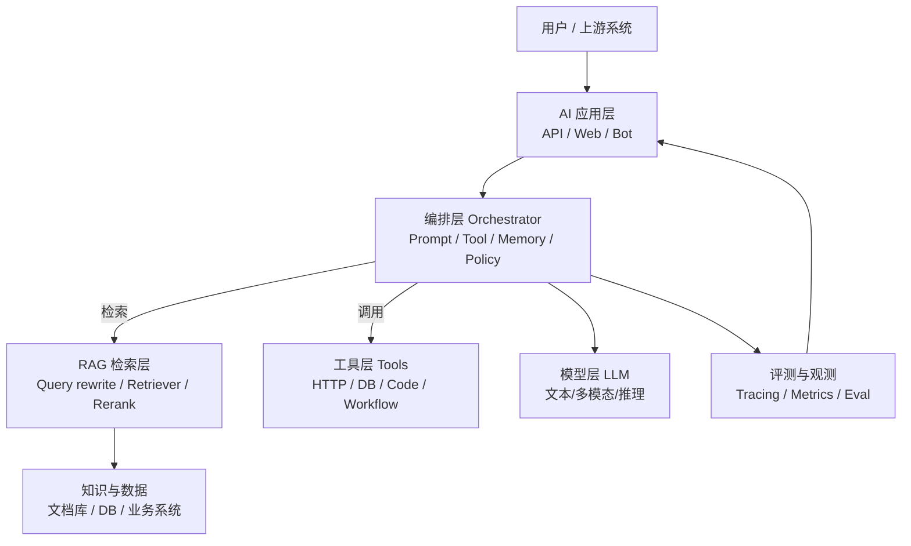
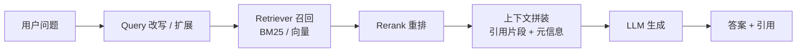
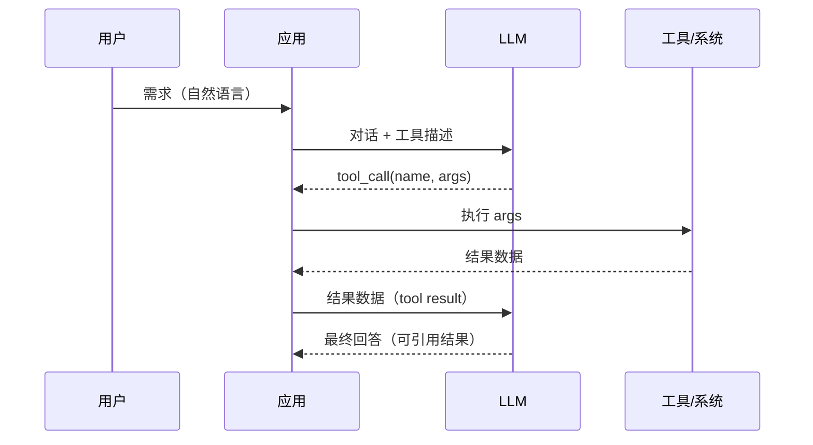
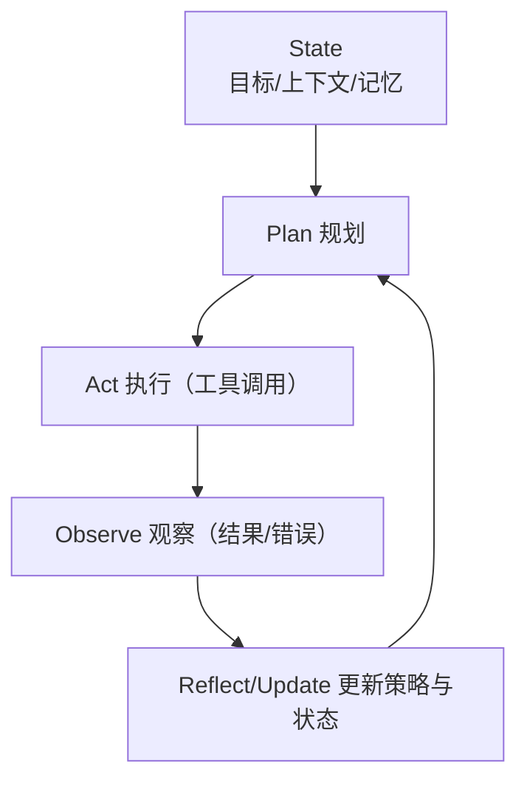
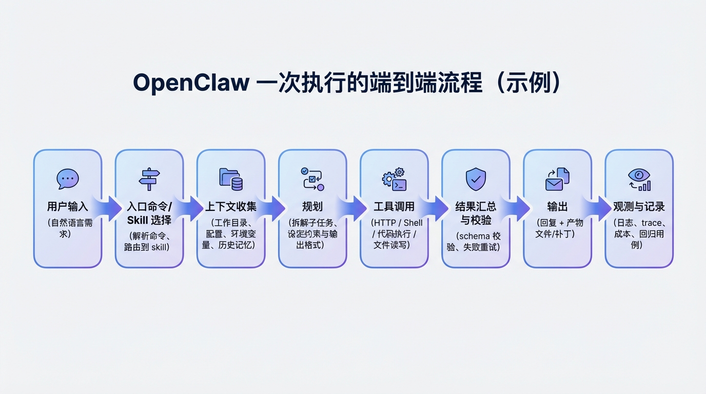

<div class="callout callout-note" markdown="1">
本页目标：把 **AI 应用开发工程师** 必备的“底层概念 + 工程视角”一次讲清楚。后续每一节都会在 RAG / Agent / 工程化模块里反复用到。
</div>

### 1. 你在做什么：从“模型”到“可交付应用”

AI 应用开发不是“会调模型”就够了。更准确地说，你在交付一个 **可用、可控、可迭代** 的系统：

- **可用**：在真实数据、真实流程里能稳定工作
- **可控**：成本、延迟、权限、安全、质量都有边界
- **可迭代**：能做版本管理、评测回归、灰度上线、持续优化



### 2. LLM 基础：你必须掌握的“输入输出学”

- Token 是模型处理文本的最小单位，不一定等于一个字或一个单词。
- **成本**通常与输入 token + 输出 token 成正比。
- **延迟**也与 token 数、模型复杂度、并发有关。

模型一次能“看到”的 token 上限。它决定：

- 你能塞进去多少历史对话、文档片段、工具结果
- 你必须做什么工程策略：摘要、裁剪、检索、分段、缓存

模型每一步预测“下一个 token”的概率分布，然后采样。

- **temperature**：越大越发散，越小越稳定
- **top_p**：从概率累积到 p 的候选里采样
- **seed（如支持）**：一定程度可复现

<div class="callout callout-warning" markdown="1">
**工程经验**：生产环境优先追求可控与一致性。默认把 temperature 控制在较低区间，并通过“检索、结构化约束、评测回归”提升质量，而不是靠更“随机”的生成。
</div>

### 3. Prompt 基础：不是“写句子”，是“写规格说明”

Prompt 可以理解为：对模型行为的 **协议（Protocol）**。

- **Role / System**：整体身份、边界、风格、禁止事项
- **Task**：要做什么
- **Context**：业务背景、输入数据
- **Constraints**：输出格式、长度、必须引用的信息、禁止编造
- **Examples**：少量示例（few-shot）

- **版本管理**：Prompt 像代码一样需要版本号与变更记录
- **参数化**：把可变部分抽成变量（语言、受众、领域、格式）
- **可测试**：每次改 Prompt 都要跑一组固定用例做回归

让模型输出结构化结果，方便程序消费。

- 价值：降低解析成本，提升一致性
- 风险：模型可能输出非法 JSON，需做校验与重试

```mermaid
sequenceDiagram
	autonomous
	participant App as 应用
	participant LLM as LLM
	App->>LLM: 约束输出为 JSON（含字段/枚举/示例）
	LLM-->>App: JSON 候选（可能不合法）
	App->>App: 校验（schema / parser）
	alt 合法
		App-->>App: 进入业务处理
	else 不合法
		App->>LLM: 反馈错误并要求修复（repair）
		LLM-->>App: 修复后的 JSON
	end
```

### 4. Embedding 与向量检索：RAG 的地基

Embedding 把文本（或图像、代码）映射成向量，语义相近的内容向量距离更近。

- 适合做：相似搜索、语义检索、聚类、去重

它存：

- 向量（embedding）
- 元数据（来源、时间、权限、标签、段落位置）
- 索引结构（ANN：近似最近邻）

把长文切成片段再做 embedding。

常见策略：

- 固定长度 + 重叠（overlap）
- 按标题层级 / 段落 / 语义边界切分

<div class="callout callout-note" markdown="1">
**关键点**：Chunking 的好坏直接决定 RAG 上限。切得太大，召回噪声高；切得太小，语义不完整。
</div>

### 5. RAG（检索增强生成）：把“知识”接到模型上



- Retriever：快，负责“广撒网”
- Rerank：慢一些但更准，负责“挑最好”

- **召回不到**：切分不对、索引不全、查询词不匹配
- **召回到但没用上**：Prompt 没要求引用、上下文太长被截断
- **引用混乱**：缺少来源标识与段落边界
- **权限泄露**：检索没做 ACL 过滤

### 6. Tool / Function Calling：让 AI “能做事”

Tool calling 的目标：让模型把意图变成结构化调用，由程序去执行。

- 模型输出：工具名 + 参数（结构化）
- 应用执行：HTTP/DB/脚本/工作流
- 把结果回填：再交给模型生成最终答案



- **幂等**：同一次请求重试不应产生重复副作用
- **参数校验**：不要相信模型，必须做 schema 校验
- **权限**：工具调用必须在用户权限范围内
- **审计与可追踪**：每次调用要能定位输入、输出与链路

### 7. Agent 基础：从“回答”到“规划 + 执行 + 反思”

Agent 可以理解为：LLM + 状态 + 策略 + 工具 + 记忆。



- 多步骤任务（查资料→对比→生成→校验→落库）
- 需要工具链（数据库、代码执行、调用内部 API）
- 需要“失败重试与纠错”

### 8. 评测（Eval）与可观测性（Observability）：决定你能不能上线

你需要回答：

- 改了 Prompt 或检索策略后，质量是上升还是下降
- 不同模型、不同温度、不同工具策略的性价比

- **正确性**：是否满足事实与业务规则
- **引用一致性**：答案是否来自检索片段
- **覆盖率**：召回是否包含关键证据
- **鲁棒性**：面对噪声、歧义、反问能否稳定
- **成本与延迟**：平均与 P95

- 每次请求的 trace（prompt、检索结果、模型输出、工具调用链）
- 关键指标：token、latency、tool error rate、cache hit
- 线上抽检：坏例收集（用于回归集）

### 9. 安全与合规（必须前置）

- **提示注入（Prompt Injection）**：文档里藏指令诱导模型越权
- **数据泄露**：检索/工具返回了不该给的内容
- **越权操作**：模型调用工具执行了用户无权限的动作
- **幻觉**：无依据编造，导致错误决策

- 检索与工具层做 **强权限校验（ACL）**
- 结果做 **输出过滤**（敏感信息、PII）
- 对外部内容做 **指令隔离**：把“内容”与“指令”分区
- 关键动作加 **二次确认** 或“只读模式”

### 案例：OpenClaw 的一次端到端执行流程（接口复核 → 生成测试 → 执行 → 报告）

> 目标：用一个可复用的“工程闭环”案例，把 **Skill 路由 / 上下文收集 / 规划 / 工具调用 / 校验 / 产物 / 观测** 讲清楚。



你在做接口迁移或联调时，常见诉求是：

- 快速复核接口设计是否符合规范（字段、幂等、鉴权、错误码等）
- 自动生成一份可运行的测试脚本（curl 或 Node/JS）
- 真正执行一遍，产出结果与问题清单，便于提 PR 或同步给相关同学

示例输入：

- “帮我复核 `POST /api/order/create`，按团队规范检查，给问题清单与修改建议。”
- “基于接口文档和示例入参，生成可运行测试脚本，覆盖正常/缺参/越权/幂等重试。”
- “执行脚本，把结果整理成 Markdown 报告，标出失败用例和可能原因。”

发生了什么：

- 系统解析意图与任务类型，把请求路由到合适的 Skill（可以理解为“命令分发器”）
- 示例映射：
    - `api-review-check`：规范检查与问题清单
    - `api-review-params`：入参与用例矩阵生成
    - `api-review-test`：脚本执行与结果汇总

你要强调的点：

- **Skill 选择决定能力边界**：能用哪些工具、产出什么格式、怎么兜底
- **把“自然语言”收敛成“任务协议”**：后续每一步才可控、可复现

典型收集项（按工程落地划分）：

- 代码与文档：OpenAPI/Swagger、DTO、错误码约定、鉴权中间件说明
- 运行配置：环境地址、token、租户、超时、重试、限流阈值
- 历史信息：是否跑过同一接口、是否已有报告、已知问题与变更点

你要强调的点：

- **没有上下文，就只能给泛化建议**；上下文越完整，结论越“可落地”
- 上下文也是安全边界的一部分：哪些内容可读、哪些系统可调用

一个可讲清楚的最小计划（示例）：

1. 读取接口定义与请求/响应结构
2. 对照规范检查：命名、幂等、鉴权、错误码、字段兼容
3. 生成测试用例矩阵：正常/异常/边界/权限
4. 生成脚本（curl/JS）并落盘
5. 执行脚本，收集响应、耗时与失败原因
6. 汇总报告：问题清单 + 证据 + 修改建议

你要强调的点：

- Agent 的关键不是“更聪明”，而是把隐性思考变成 **显式步骤**
- 规划阶段就明确：**输出格式** 与 **质量门槛**（例如必须给证据、必须可复现）

可能发生的真实动作：

- 文件读写：读取接口文档、生成并写入测试脚本
- HTTP 调用：按用例矩阵调用接口
- Shell/Node 执行：批量运行、采集日志
- （可选）静态检查：扫代码中的鉴权/幂等实现位置（用于定位修改点）

你要强调的点：

- Tool calling 的本质：模型只产出 **结构化调用**，由系统执行
- 工具层必须有工程保障：超时、重试、限流、错误码、审计

常见校验项：

- schema 校验：字段缺失、类型不匹配、枚举不合法
- 错误码校验：是否符合约定、是否可定位、是否有统一 message
- 幂等校验：同一请求重试是否重复创建
- 权限校验：无 token / 低权限 token 是否正确拒绝

你要强调的点：

- 从 Demo 到上线，靠的是 **校验与回归**，而不是“这次看起来对了”
- 允许一次“修复性重试”（repair），但要有上限与降级策略

建议你展示 3 类产物（最容易让听众“信服”）：

7. **问题清单**（按严重程度分级：P0/P1/P2）
8. **可运行脚本**（落盘文件，可直接进 CI）
9. **Markdown 报告**（可贴 PR 或群里）：用例列表、失败证据、建议修改点

建议记录的关键数据：

- token、LLM latency、工具耗时、HTTP 成功率、失败分布
- 本次产物路径与版本号
- 将失败用例（badcase）沉淀为回归集，支持后续“改动不回退”

---

### 10. 基础技能清单（学完本页你应该能做到）

- 能解释 token、上下文窗口、采样与稳定性之间的关系
- 能写出可维护的 Prompt（结构化、可版本化、可回归）
- 能讲清 RAG 的全流程、关键参数与常见坑
- 能设计工具调用的 schema、幂等与权限校验
- 能搭一套最小评测与 trace 记录方式

<div class="callout callout-note" markdown="1">
下一步建议：在本页内容基础上，去 **02 · RAG 与知识库** 把检索工程做成“可跑的最小系统”；再去 **03 · Agent 与工具调用** 把工具链串起来。
</div>
