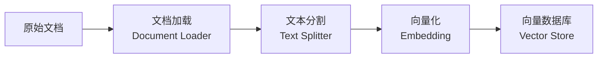
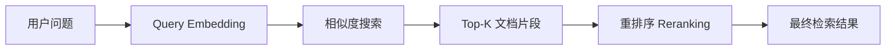
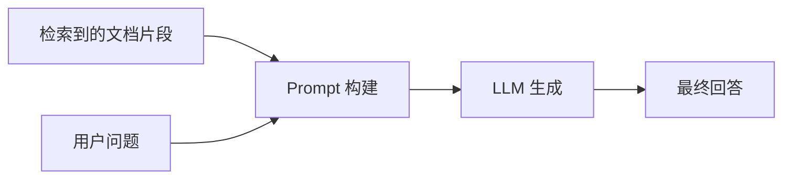
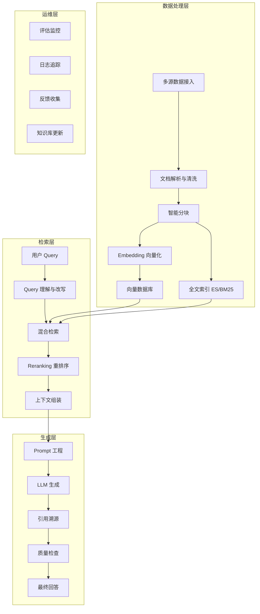
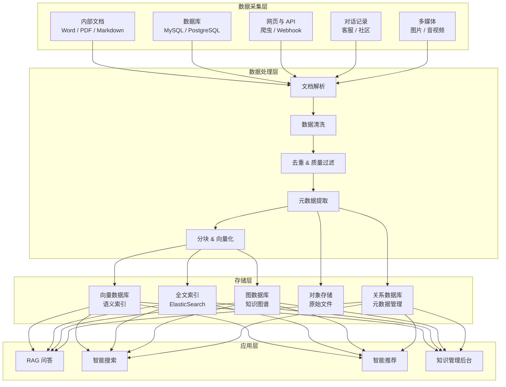
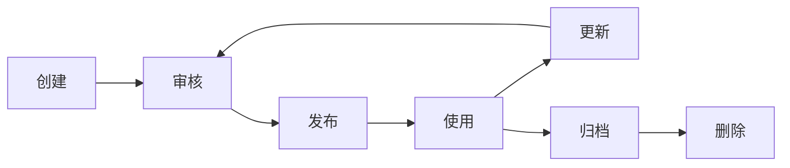
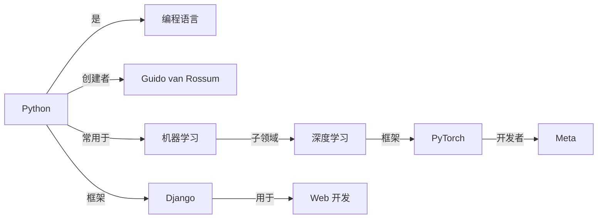
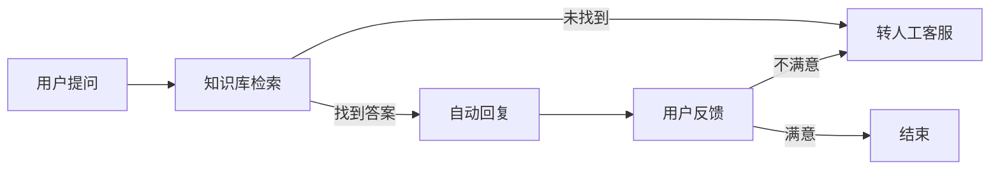

## 什么是 RAG？

**RAG（Retrieval-Augmented Generation，检索增强生成）** 是一种将 **信息检索** 与 **大语言模型（LLM）生成** 相结合的技术架构。其核心思想是：在 LLM 生成回答之前，先从外部知识库中检索相关文档片段，将其作为上下文注入 Prompt，从而让模型基于真实、最新的数据生成更准确的回答。

<div class="callout callout-tip" markdown="1">
**一句话理解 RAG：** 先搜再答——让大模型"开卷考试"，而非纯靠记忆。
</div>

---

## 为什么需要 RAG？

LLM 虽然强大，但存在以下天然短板，RAG 正是为了弥补这些不足：

| 问题 | 说明 | RAG 如何解决 |
| --- | --- | --- |
| **知识截止** | 模型训练数据有截止日期，无法获取最新信息 | 实时检索外部知识库，获取最新数据 |
| **幻觉（Hallucination）** | 模型可能编造不存在的事实 | 基于检索到的真实文档生成，降低幻觉风险 |
| **领域知识不足** | 通用模型对专业/私有数据了解有限 | 接入企业内部知识库，注入领域专属信息 |
| **上下文窗口有限** | 无法将全部文档塞进 Prompt | 精准检索最相关片段，高效利用上下文窗口 |
| **数据隐私** | 私有数据不适合用于模型微调 | 数据留在本地知识库，仅检索片段，不泄露全量数据 |

---

## RAG 核心架构

RAG 的工作流程可以拆解为三大阶段：

### 阶段一：索引（Indexing）— 构建知识库



**1. 文档加载（Document Loading）**

从各种来源加载原始数据：

- **文件类型：** PDF、Word、Markdown、TXT、HTML、CSV、Excel
- **数据源：** 本地文件、网页爬取、数据库、API、Notion、Confluence、飞书文档
- **常用工具：** LangChain DocumentLoaders、LlamaIndex Readers、[Unstructured.io](http://unstructured.io/)

**2. 文本分割（Text Splitting / Chunking）**

将长文档切分为合适大小的文本块（Chunk），这是 RAG 效果的 **关键环节**：

| 分割策略 | 说明 | 适用场景 |
| --- | --- | --- |
| **固定长度分割** | 按字符数 / Token 数切分，设定重叠区（overlap） | 通用文本，快速实现 |
| **递归字符分割** | 按 `\n\n` → `\n` → `.` → ` ` 层级递归分割 | 默认推荐，LangChain 默认策略 |
| **语义分割** | 基于 Embedding 相似度判断语义边界 | 内容主题变化频繁的文档 |
| **结构化分割** | 按 Markdown 标题、HTML 标签等结构切分 | 格式化文档（技术文档、Wiki） |
| **Agentic Chunking** | 用 LLM 智能判断最佳切分点 | 高质量要求场景 |

<div class="callout callout-note" markdown="1">
**Chunk 大小经验值：**
- 通用场景：256–512 tokens
- 精确问答：128–256 tokens
- 长文摘要：512–1024 tokens
- Overlap（重叠）：通常为 chunk 大小的 10%–20%
</div>

**3. 向量化（Embedding）**

将文本块转换为高维向量，用于语义相似度计算：

向量化（Embedding）需要使用模型是因为需要将文本转换为高维向量表示，这个转换过程本身就是一个复杂的机器学习任务。

具体原因包括：

- **语义理解：**Embedding 模型经过大量文本训练，能够理解词语、句子的语义含义，将语义相近的文本映射到向量空间中相近的位置
- **数学表示：**文本本身是离散的符号，无法直接进行相似度计算。Embedding 模型将文本转换为连续的数值向量（通常是几百到几千维），使得可以用数学方法（如余弦相似度）计算文本之间的相似程度
- **语义检索基础：**在 RAG 系统中，用户问题和知识库文档都需要转换为向量，才能在向量空间中进行语义相似度搜索，找到最相关的文档片段

常用的 Embedding 模型包括 OpenAI 的 `text-embedding-3-small`、开源的 `bge-large-zh-v1.5`（中文优秀）等。这些模型都是经过专门训练的神经网络，专门用于将文本转换为高质量的向量表示。

- **OpenAI：** `text-embedding-3-small`（性价比高）、`text-embedding-3-large`（精度高）
- **开源模型：** `bge-large-zh-v1.5`（中文优秀）、`e5-mistral-7b-instruct`、`GTE-Qwen2`
- **本地部署：** 通过 Ollama、HuggingFace 等运行开源 Embedding 模型

**4. 向量存储（Vector Store）**

| 向量数据库 | 特点 | 适用场景 |
| --- | --- | --- |
| **Chroma** | 轻量、易上手、Python 原生 | 本地开发、原型验证 |
| **FAISS** | Meta 开源，高性能，纯内存 | 大规模向量检索 |
| **Milvus / Zilliz** | 分布式、云原生、功能丰富 | 生产级部署 |
| **Pinecone** | 全托管 SaaS，开箱即用 | 快速上线、免运维 |
| **Weaviate** | 支持混合搜索、GraphQL 接口 | 多模态检索 |
| **Qdrant** | Rust 编写，高性能，过滤灵活 | 对性能敏感的场景 |
| **PGVector** | PostgreSQL 插件，SQL + 向量混合查询 | 已有 PG 技术栈的团队 |

---

### 阶段二：检索（Retrieval）— 找到相关内容



**检索策略：**

<div class="callout callout-note" markdown="1">

**📝 1. 基础向量检索（Dense Retrieval）**

通过 Embedding 向量的相似度（余弦相似度 / 内积）检索最相关的文档片段。

```python
# 伪代码示例
query_vector = embedding_model.encode("什么是 RAG？")
results = vector_store.similarity_search(query_vector, top_k=5)
```

- **优点：** 语义理解能力强，能匹配同义词和近义表达
- **缺点：** 对精确关键词匹配较弱

**2. 关键词检索（Sparse Retrieval）**
基于 BM25 / TF-IDF 等传统信息检索算法：

- **优点：** 精确匹配能力强，对专有名词、编号等效果好
- **缺点：** 无法理解语义，同义词匹配差

**3. 混合检索（Hybrid Search）⭐ 推荐**
结合向量检索 + 关键词检索，取长补短：

```javascript
最终得分 = α × 向量检索得分 + (1-α) × 关键词检索得分
```

- **RRF（Reciprocal Rank Fusion）** 是最常用的融合算法
- 多数生产级系统（如 Weaviate、Qdrant）原生支持混合检索

**4. 重排序（Reranking）⭐ 效果显著**
对初步检索的 Top-K 结果用更精细的模型重新打分排序：

- **Cohere Rerank：** 商业 API，效果优秀
- **bge-reranker-v2-m3：** 开源模型，中英文均表现良好
- **Cross-Encoder：** 将 Query + Document 拼接后用 BERT 类模型打分

重排序虽然增加延迟，但通常能 **显著提升最终回答质量**。

**5. 多路召回 + 融合（Ensemble Retrieval）**
使用多种检索方式并行召回，再融合结果：

- 向量检索（语义）
- BM25（关键词）
- 知识图谱（结构化关系）
- 元数据过滤（时间、标签、来源）
</div>

---

### 阶段三：生成（Generation）— 组装并回答



**Prompt 模板示例：**

```javascript
你是一个专业的知识助手。请根据以下参考资料回答用户问题。
如果参考资料中没有相关信息，请明确说明"我没有找到相关信息"。

## 参考资料
{context}

## 用户问题
{question}

## 回答要求
1. 基于参考资料回答，不要编造信息
2. 引用来源时标注出处
3. 如果信息不足，如实说明
```

---

## RAG 高级优化策略

### 1. Query 优化

| 技术 | 说明 |
| --- | --- |
| **Query Rewriting** | 用 LLM 重写用户问题，使其更清晰、更适合检索 |
| **HyDE** | 让 LLM 先生成一个假设性答案，用该答案去检索（效果常优于直接用 Query） |
| **Multi-Query** | 从不同角度生成多个查询，分别检索后合并结果 |
| **Query Decomposition** | 将复杂问题拆分为多个子问题，分别检索后综合回答 |
| **Step-back Prompting** | 将具体问题泛化为更高层次的问题，获取更全面的背景信息 |

### 2. 索引优化

| 技术 | 说明 |
| --- | --- |
| **多级索引** | 先用摘要索引粗筛，再用原文索引精排 |
| **父子文档** | 检索小 chunk，返回其所在的大 chunk（保留上下文） |
| **句子窗口** | 检索单句，返回前后 N 句作为上下文 |
| **元数据增强** | 为 chunk 添加标题、来源、日期等元数据，支持过滤 |
| **文档摘要索引** | 为每个文档生成摘要，先检索摘要再定位原文 |
| **知识图谱增强** | 抽取实体关系构建图谱，结合图检索提升关联信息召回 |

### 3. 检索后处理

| 技术 | 说明 |
| --- | --- |
| **上下文压缩** | 用 LLM 从检索片段中提取与 Query 最相关的部分 |
| **去重与合并** | 去除重复或高度相似的检索结果 |
| **Lost in the Middle** | 将最相关的文档放在上下文的开头和结尾（模型对中间内容关注较弱） |

### 4. 生成优化

| 技术 | 说明 |
| --- | --- |
| **引用溯源** | 要求模型标注信息来自哪个文档片段 |
| **自我反思** | 让模型检查回答是否完全基于检索内容 |
| **置信度评估** | 模型自评回答的确信程度，低置信度时提示用户 |

---

## RAG 评估指标

<div class="callout callout-note" markdown="1">
评估 RAG 系统需要从 **检索质量** 和 **生成质量** 两个维度来衡量。
</div>

### 检索质量指标

- **Hit Rate / Recall@K：** Top-K 结果中是否包含正确答案
- **MRR（Mean Reciprocal Rank）：** 正确答案首次出现的排名倒数的平均值
- **NDCG：** 考虑排名位置的综合评分
- **Context Precision：** 检索片段中相关内容的占比
- **Context Recall：** 所有相关内容被检索到的比例

### 生成质量指标

- **Faithfulness（忠实度）：** 回答是否忠于检索到的上下文，无编造
- **Answer Relevancy（回答相关性）：** 回答与问题的匹配程度
- **Correctness（正确性）：** 与标准答案的一致性

### 常用评估框架

- **RAGAS：** 最流行的 RAG 评估框架，提供 Faithfulness、Answer Relevancy 等指标
- **LlamaIndex Evaluators：** 内置多种评估器
- **DeepEval：** 支持多维度评估
- **TruLens：** 提供可视化的评估与追踪

---

## RAG vs. 微调 vs. 长上下文

| 维度 | **RAG** | **微调（Fine-tuning）** | **长上下文（Long Context）** |
| --- | --- | --- | --- |
| 知识更新 | ✅ 实时更新知识库即可 | ❌ 需要重新训练 | ✅ 每次传入最新文档 |
| 成本 | 中等（向量库 + 检索） | 高（训练 GPU 成本） | 高（长上下文 Token 费用） |
| 可解释性 | ✅ 可追溯检索来源 | ❌ 黑盒 | ⚠️ 部分可追溯 |
| 延迟 | 中等（检索 + 生成） | 低（直接生成） | 高（处理长文本慢） |
| 适用场景 | 知识密集型问答、企业知识库 | 特定风格/格式输出、专业领域 | 单次大文档分析 |
| 数据规模 | ✅ 支持海量文档 | ⚠️ 受训练数据量限制 | ❌ 受上下文窗口限制 |

<div class="callout callout-note" markdown="1">
**最佳实践：** RAG 和微调并不互斥。可以先用 RAG 快速上线，再根据需要微调模型以提升特定任务表现。两者结合效果最佳。
</div>

---

## 主流 RAG 开发框架

### LangChain

最流行的 LLM 应用开发框架，RAG 生态最完善：

```python
from langchain_community.document_loaders import PyPDFLoader
from langchain.text_splitter import RecursiveCharacterTextSplitter
from langchain_openai import OpenAIEmbeddings, ChatOpenAI
from langchain_community.vectorstores import Chroma
from langchain.chains import RetrievalQA

# 1. 加载文档
loader = PyPDFLoader("knowledge.pdf")
docs = loader.load()

# 2. 文本分割
splitter = RecursiveCharacterTextSplitter(
    chunk_size=500, chunk_overlap=50
)
chunks = splitter.split_documents(docs)

# 3. 向量化 & 存储
vectorstore = Chroma.from_documents(
    chunks, OpenAIEmbeddings()
)

# 4. 构建 RAG Chain
qa_chain = RetrievalQA.from_chain_type(
    llm=ChatOpenAI(model="gpt-4o"),
    retriever=vectorstore.as_retriever(
        search_kwargs={"k": 5}
    )
)

# 5. 提问
answer = qa_chain.invoke("什么是向量数据库？")
```

### LlamaIndex

### LlamaIndex 详解

**LlamaIndex** 是一个专注于数据索引和检索的框架，旨在帮助开发者将各种数据源（文档、数据库、API等）连接到大语言模型（LLM）。它的核心目标是简化 RAG 应用的开发流程。

### LlamaIndex 解决的核心问题

- **数据接入复杂：** 企业数据分散在不同格式（PDF、数据库、API等），需要统一的接入方式
- **索引构建困难：** 如何高效地将海量数据转化为可被 LLM 理解和检索的索引
- **检索策略单一：** 简单的向量检索往往不够，需要更灵活的检索策略组合
- **上下文管理：** 如何从检索结果中选择最相关的信息，并组织成有效的上下文
- **开发效率低：** 从零搭建 RAG 系统需要处理大量底层细节

### LlamaIndex 的核心优势

| 优势 | 说明 |
| --- | --- |
| **数据连接器丰富** | 支持 100+ 数据源，包括文档、数据库、网页、API、云存储等 |
| **索引类型多样** | 提供向量索引、树形索引、列表索引、知识图谱等多种索引结构 |
| **检索策略灵活** | 支持语义检索、关键词检索、混合检索、多跳检索等 |
| **专注 RAG 场景** | 相比 LangChain 更聚焦于数据索引和检索，API 设计更直观 |
| **可观测性强** | 内置详细的日志和追踪，便于调试和优化 |
| **高级功能** | 支持查询路由、子问题分解、自动 Reranking 等高级特性 |

### 为什么会出现 LlamaIndex？

LlamaIndex（原名 GPT Index）诞生于 2022 年底，正值 ChatGPT 引爆 LLM 应用热潮。创始人发现：

- **LLM 的瓶颈在数据：** 模型很强大，但如何让它访问私有数据是难题
- **现有工具不够专精：** 当时的工具（如早期 LangChain）更偏向链式编排，对数据索引和检索的支持较弱
- **开发者需要专业工具：** RAG 需要深入处理数据的语义理解、分块策略、检索优化等，需要更专业的框架

<div class="callout callout-note" markdown="1">
**设计理念：** LlamaIndex 的核心是 "Data Framework for LLM Applications"——将各种数据转化为 LLM 可理解的形式，并提供强大的检索能力。它把复杂的数据处理封装成简单的 API，让开发者专注于业务逻辑。
</div>

### LlamaIndex vs LangChain

| 维度 | **LlamaIndex** | **LangChain** |
| --- | --- | --- |
| 核心定位 | 数据索引与检索专家 | LLM 应用全栈框架 |
| 适用场景 | RAG、知识库问答、文档分析 | Agent、复杂链式调用、工具集成 |
| 学习曲线 | 相对平缓，API 简洁 | 较陡峭，概念更多 |
| 数据连接 | ✅ 更丰富的数据 Loader | ⚠️ 支持但不如 LlamaIndex 全面 |
| 索引能力 | ✅ 多种索引结构，专为检索优化 | ⚠️ 基础向量检索为主 |
| Agent 支持 | ⚠️ 有但相对简单 | ✅ 强大的 Agent 框架 |
| 生态 | 专注但精深 | 庞大且全面 |

### LlamaIndex 核心组件

- **Data Loaders：** 从各种数据源加载数据（PDF、数据库、API 等）
- **Node Parser：** 将文档解析为节点（Node），每个节点是可索引的最小单元
- **Index：** 构建索引结构（向量索引、树形索引等）
- **Retrievers：** 检索器，根据查询从索引中找出相关节点
- **Query Engines：** 查询引擎，整合检索和生成流程
- **Response Synthesizers：** 将检索结果合成最终回答

### 使用场景示例

- **企业知识库问答：** 索引公司内部文档，员工可以通过自然语言查询
- **技术文档助手：** 将技术手册向量化，快速定位相关章节
- **客服智能问答：** 基于历史工单和 FAQ 构建知识库
- **研究论文分析：** 索引大量学术论文，进行文献综述
- **代码库理解：** 索引代码仓库，辅助代码理解和生成

<div class="callout callout-note" markdown="1">
**总结：** LlamaIndex 是为 RAG 而生的专业框架。如果你的核心需求是"让 LLM 基于私有数据生成答案"，LlamaIndex 是比 LangChain 更聚焦、更高效的选择。而如果需要构建复杂的 Agent 或工作流，LangChain 可能更合适。实践中，两者也常结合使用。
</div>

专注数据索引与检索，RAG 场景更专精：

```python
from llama_index.core import (
    VectorStoreIndex,
    SimpleDirectoryReader
)

# 加载 & 索引
documents = SimpleDirectoryReader("./data").load_data()
index = VectorStoreIndex.from_documents(documents)

# 查询
query_engine = index.as_query_engine(similarity_top_k=5)
response = query_engine.query("什么是 RAG？")
```

### 其它框架 & 工具

- **Haystack（deepset）：** 工业级 NLP 框架，Pipeline 设计灵活
- **Dify：** 可视化 RAG 应用搭建平台，适合快速原型
- **RAGFlow：** 专注 RAG 的开源引擎，支持深度文档解析
- **FastGPT：** 国产开源，知识库问答一站式方案
- **MaxKB：** 基于 LLM 的开源知识库问答系统

---

## 生产级 RAG 系统架构



---

## RAG 常见问题与排查

<div class="callout callout-note" markdown="1">

**📝 ❓ 检索结果不相关**

- 检查 Chunk 大小是否合适（太大导致噪声，太小丢失上下文）
- 尝试混合检索（向量 + BM25）
- 添加 Reranking 步骤
- 检查 Embedding 模型是否适合你的语言和领域
- 增加元数据过滤

**❓ 模型回答出现幻觉**
- 强化 Prompt 中"仅基于上下文回答"的指令
- 增加引用溯源要求
- 降低 temperature 参数
- 检查检索到的文档是否真的包含答案

**❓ 回答不够完整**
- 增加 Top-K 数量
- 使用 Multi-Query 多角度检索
- 尝试父子文档或句子窗口策略
- 检查文档是否被正确解析和分块

**❓ 延迟过高**
- 优化向量数据库索引（如 HNSW 参数调优）
- 减少 Top-K 或上下文长度
- 使用流式输出（Streaming）提升用户体验
- 考虑缓存常见查询的结果
</div>

---

---

# 知识库（Knowledge Base）

---

## 什么是知识库？

**知识库（Knowledge Base, KB）** 是一个结构化或半结构化的信息存储系统，用于收集、组织、管理和检索知识。在 AI 应用场景下，知识库是 RAG 系统的核心数据层，为大语言模型提供外部事实依据。

<div class="callout callout-note" markdown="1">
**知识库 = 数据 + 组织方式 + 检索能力**
它不仅是文档的堆积，更是经过清洗、结构化、索引后可被高效检索的知识资产。
</div>

---

## 知识库的类型

| 类型 | 说明 | 典型例子 |
| --- | --- | --- |
| **文档型知识库** | 以非结构化文档为主体，通过向量化实现语义检索 | 企业内部文档、技术手册、FAQ |
| **结构化知识库** | 以数据库、表格等结构化数据为主体 | 产品目录、价格表、配置参数 |
| **知识图谱** | 以实体和关系构建的图结构，表达复杂语义关联 | 医学知识图谱、人物关系网络 |
| **多模态知识库** | 包含文本、图片、音视频等多种形式的知识 | 产品图文手册、教学视频库 |
| **对话型知识库** | 从历史对话、工单中提取的问答知识 | 客服历史记录、社区问答 |

---

## 知识库系统架构



---

## 知识库构建流程

### 第一步：数据采集与汇聚

**数据来源梳理：**

- **内部文档：** 技术文档、产品手册、规章制度、会议纪要、邮件
- **业务系统：** CRM、ERP、工单系统、项目管理工具
- **在线平台：** 企业 Wiki（Confluence、Notion、飞书）、SharePoint
- **对话数据：** 客服记录、IM 聊天、社区论坛
- **外部来源：** 行业报告、法规文件、公开数据集

<div class="callout callout-warning" markdown="1">
**数据质量决定知识库上限。** 垃圾进，垃圾出（Garbage In, Garbage Out）。采集阶段就要做好质量把控。
</div>

### 第二步：文档解析（Document Parsing）

不同格式的文档需要不同的解析策略：

| 文档格式 | 解析工具 | 注意事项 |
| --- | --- | --- |
| **PDF** | PyMuPDF、pdfplumber、Unstructured、Marker | 注意扫描件需 OCR；表格和图片需特殊处理 |
| **Word / DOCX** | python-docx、Unstructured | 保留标题层级结构 |
| **Markdown** | 直接解析，按标题分块 | 天然适合知识库，结构清晰 |
| **HTML** | BeautifulSoup、Trafilatura | 去除导航栏、广告等噪声 |
| **表格类（CSV/Excel）** | Pandas、Tabulate | 每行可作为一条记录，添加列名作为上下文 |
| **图片中的文字** | Tesseract OCR、PaddleOCR、Azure Document Intelligence | OCR 结果需后处理校正 |
| **PPT / Slides** | python-pptx、Unstructured | 提取文字 + 备注（Speaker Notes） |

<div class="callout callout-note" markdown="1">

**📝 🔧 推荐工具：**[**Unstructured.io**](http://unstructured.io/)**

Unstructured 是一个统一的文档解析框架，支持 PDF、Word、HTML、图片等多种格式，能自动识别标题、段落、表格、列表等元素，是构建知识库的利器。

```python
from unstructured.partition.auto import partition

elements = partition(filename="report.pdf")
for el in elements:
    print(f"[{el.category}] {el.text[:100]}")
```
</div>

### 第三步：数据清洗与质量控制

数据清洗直接影响检索质量，需要处理以下问题：

- **去除噪声：** 页眉页脚、水印、广告、导航元素
- **去重：** 基于哈希或语义相似度去除重复文档和片段
- **格式标准化：** 统一编码、日期格式、度量单位
- **内容校验：** 检测并修正 OCR 错误、乱码
- **时效性处理：** 标记文档的创建/更新时间，过期文档降权或归档
- **敏感信息脱敏：** 去除或替换个人隐私信息（PII）

### 第四步：元数据设计

好的元数据设计能显著提升检索精度：

```python
metadata = {
    "source": "技术部/架构设计/微服务规范.pdf",
    "title": "微服务架构设计规范 v3.2",
    "author": "张工",
    "department": "技术部",
    "doc_type": "规范文档",
    "created_at": "2025-06-15",
    "updated_at": "2025-11-20",
    "version": "3.2",
    "tags": ["微服务", "架构", "规范"],
    "access_level": "internal",
    "chunk_index": 5,
    "total_chunks": 23,
    "heading_path": "第三章 > 3.2 服务拆分原则"
}
```

<div class="callout callout-note" markdown="1">
**元数据的价值：**
- 支持按来源、部门、时间等维度过滤
- 帮助权限控制（不同角色看到不同知识）
- 辅助检索结果排序（新文档优先）
- 支持引用溯源（告诉用户答案来自哪里）
</div>

### 第五步：分块与索引

这一步与 RAG 的索引阶段一致，详见前文「阶段一：索引」部分。核心要点回顾：

1. 选择合适的 **Chunking 策略**（推荐递归字符分割或语义分割）
2. 设定合理的 **Chunk 大小与重叠**
3. 选择适合语言和领域的 **Embedding 模型**
4. 存入 **向量数据库** 并建立 **全文索引**（混合检索）

---

## 知识库管理与运维

### 知识生命周期管理



### 关键运维事项

<div class="callout callout-note" markdown="1">

**📝 📥 增量更新策略**

知识库不是一次性构建的，需要持续更新：

- **定时同步：** 定期从数据源拉取新增/修改的文档
- **Webhook 触发：** 当数据源有变更时自动触发更新
- **变更检测：** 通过文件哈希或修改时间判断是否需要重新索引
- **增量索引：** 只对新增/修改的文档重新分块和向量化，避免全量重建

```python
# 增量更新伪代码
for doc in get_updated_docs(since=last_sync_time):
    old_chunks = db.get_chunks_by_source(doc.id)
    db.delete(old_chunks)
    new_chunks = split_and_embed(doc)
    db.upsert(new_chunks)
```

**🔐 权限与安全控制**
企业知识库通常需要细粒度的权限管理：

- **文档级权限：** 不同部门只能访问本部门文档
- **字段级脱敏：** 敏感字段在检索结果中脱敏显示
- **审计日志：** 记录谁在什么时间访问了哪些知识
- **数据隔离：** 多租户场景下确保数据物理或逻辑隔离
- **检索过滤：** 在向量检索时注入权限 metadata filter

```python
# 带权限过滤的检索
results = vectorstore.similarity_search(
    query="公司薪资结构",
    filter={"department": user.department, "access_level": {"$lte": user.level}],
    k=5
)
```

**📊 知识库质量监控**
建立持续监控机制，确保知识库健康运转：

- **覆盖率指标：** 用户提问中有多少比例能在知识库中找到答案
- **检索命中率：** 检索返回的文档片段中相关内容的比例
- **用户反馈：** 收集「回答有帮助 👍」/「回答无帮助 👎」
- **空回答率：** 系统回答"未找到相关信息"的频率
- **过期检测：** 定期扫描超过保质期的文档并提醒更新

**🔄 知识冲突处理**
当知识库中存在矛盾信息时：

- **版本优先：** 新版本文档优先于旧版本
- **权威优先：** 官方文档优先于非正式文档
- **标注冲突：** 在回答中标注"存在多个版本，以 XX 为准"
- **人工审核：** 将冲突知识推送给知识管理员处理
</div>

---

## 知识图谱（Knowledge Graph）

知识图谱是一种特殊形式的知识库，通过 **实体-关系-实体（三元组）** 的方式表达结构化知识。

### 基本概念



- **实体（Entity）：** 现实世界中的对象，如"Python"、"Meta"
- **关系（Relation）：** 实体之间的语义连接，如"创建者"、"常用于"
- **属性（Attribute）：** 实体的特征描述，如"发布年份: 1991"

### 知识图谱 + RAG = GraphRAG

**GraphRAG** 将知识图谱与 RAG 结合，弥补纯向量检索在 **关联推理** 上的不足：

| 维度 | **纯向量 RAG** | **GraphRAG** |
| --- | --- | --- |
| 擅长 | 语义相似的文本匹配 | 多跳推理、关系追溯 |
| 弱点 | 难以发现跨文档的隐含关联 | 构建成本高，图谱需要维护 |
| 适用问题 | "什么是 X？""X 的特点是什么？" | "X 和 Y 有什么关系？""谁影响了 X？" |
| 代表工具 | LangChain、LlamaIndex | Microsoft GraphRAG、Neo4j + LLM |

**GraphRAG 构建流程：**

5. **实体抽取：** 用 LLM 从文档中提取实体和关系
6. **图谱构建：** 将三元组存入图数据库（Neo4j、ArangoDB）
7. **社区检测：** 对图谱进行社区划分，生成每个社区的摘要
8. **混合检索：** 同时查询向量库（语义）和图数据库（关系）
9. **上下文融合：** 将两种检索结果合并后送入 LLM 生成

---

## 企业知识库典型应用场景

### 1. 智能客服 / 帮助中心



- **场景：** 产品使用问题、售后咨询、常见问题解答
- **知识来源：** 产品文档、FAQ、历史工单
- **关键指标：** 自动解决率、用户满意度、首次响应时间

### 2. 企业内部知识助手

- **场景：** 新员工入职、制度查询、流程指引、技术方案查找
- **知识来源：** 规章制度、技术文档、Wiki、OA 审批流程
- **特点：** 需要严格的权限控制，不同角色看到不同信息

### 3. 专业领域问答

- **场景：** 法律咨询、医学问诊辅助、金融分析
- **知识来源：** 法律法规、医学文献、行业研报
- **特点：** 对准确性要求极高，需要引用溯源和人工复核

### 4. 代码知识库

- **场景：** 代码搜索、API 文档问答、Bug 排查辅助
- **知识来源：** 代码仓库、技术文档、StackOverflow、Issue 记录
- **特点：** 需要理解代码结构，支持代码片段检索

### 5. 个人知识管理（PKM）

- **场景：** 笔记检索、学习资料整理、读书笔记问答
- **知识来源：** Notion、Obsidian、Logseq 等笔记工具
- **特点：** 数据量较小，注重个人隐私和本地化部署

---

## 知识库搭建工具与平台

### 开源方案

| 工具 | 特点 | 适合场景 |
| --- | --- | --- |
| **Dify** | 可视化搭建，支持知识库管理 + RAG Pipeline + Agent，中文友好 | 快速原型，中小团队 |
| **RAGFlow** | 专注文档解析与 RAG，支持深度 PDF/表格解析，"质量优先" | 文档密集型知识库 |
| **FastGPT** | 开箱即用的知识库问答，支持手动标注 QA 对 | 客服/帮助中心 |
| **MaxKB** | 一站式知识库管理 + LLM 问答，支持多模型切换 | 企业内部知识库 |
| **Quivr** | 个人 AI 第二大脑，支持多种文件格式 | 个人知识管理 |
| **AnythingLLM** | 桌面端 + Web，支持多种向量库和 LLM | 本地化部署 |

### 商业方案

| 平台 | 特点 |
| --- | --- |
| **Coze（扣子）** | 字节跳动出品，零代码搭建 AI Bot，内置知识库功能 |
| **百度智能云 AppBuilder** | 企业级 RAG 平台，支持文档审核和权限管理 |
| **阿里云百炼** | 一站式大模型应用开发，内置知识检索增强 |
| **AWS Bedrock Knowledge Bases** | 全托管 RAG 服务，深度集成 AWS 生态 |
| **Azure AI Search + OpenAI** | 微软企业级方案，集成 Office 365 数据源 |

---

## 知识库最佳实践

<div class="callout callout-success" markdown="1">
### 构建阶段

- 先从 **高频使用、高价值** 的文档开始，不要试图一次性导入所有资料
- 投入足够精力做 **数据清洗**，数据质量 > 数据数量
- 设计好 **元数据体系**，方便后续过滤和管理
- 用 **真实用户问题** 测试分块效果，而非凭直觉

### 运维阶段

- 建立 **知识更新 SOP**：谁负责更新、多久更新一次、如何审核
- 收集 **用户反馈** 闭环：差评的回答要追溯到知识缺失并补充
- 定期 **质量评估**：用 RAGAS 等工具跑评估，持续优化
- 监控 **空回答率和幻觉率**：发现知识库的盲区

### 架构阶段

- 优先使用 **混合检索（向量 + 关键词）** + **Reranking**
- 对复杂领域考虑引入 **知识图谱**（GraphRAG）
- 预留 **权限系统** 接口，即使初期不需要
- 设计 **可观测性**：日志、指标、Tracing（如 LangSmith、Phoenix）
</div>

---

## 知识库常见踩坑与解决方案

<div class="callout callout-note" markdown="1">

**📝 🕳️ 踩坑 1：PDF 解析质量差**

**现象：** 表格错位、公式乱码、图片中文字丢失

**解决方案：**

- 使用专业解析工具（Marker、Unstructured、Azure Document Intelligence）
- 对扫描件单独走 OCR 管线
- 表格用专门的表格提取工具（Camelot、Tabula）
- 复杂 PDF 可以先转 Markdown 再处理

**🕳️ 踩坑 2：分块不当导致语义割裂**
**现象：** 一段完整的知识被切到两个 chunk 中，检索只返回一半

**解决方案：**

- 增大 overlap（重叠区）
- 使用语义分割而非固定长度分割
- 采用父子文档策略：检索小 chunk，返回大 chunk
- 为 chunk 附加上下文信息（如所在章节标题）

**🕳️ 踩坑 3：知识库越大效果越差**
**现象：** 文档量增大后，检索噪声增多，回答质量下降

**解决方案：**

- 引入 **元数据过滤**，缩小检索范围
- 使用 **Reranking** 二次排序
- 对知识库进行 **分类/分域**，按问题类型路由到对应子库
- 定期清理过时和低质量文档

**🕳️ 踩坑 4：多语言支持不佳**
**现象：** 中英文混合文档检索效果差

**解决方案：**

- 使用多语言 Embedding 模型（如 `bge-m3`、`multilingual-e5-large`）
- 对不同语言的文档分别建立索引
- Query 翻译：将用户问题翻译为文档的主要语言后再检索

**🕳️ 踩坑 5：实时性要求无法满足**
**现象：** 文档更新后知识库未同步，给出过时答案

**解决方案：**

- 建立 **自动同步机制**（Webhook / 定时任务）
- 对时效性强的内容设置短 TTL，定期重新索引
- 在回答中标注信息的时间戳，让用户自行判断
</div>

---

## 学习路线建议（RAG + 知识库）

- [ ] **第一步：** 用 LangChain / LlamaIndex 搭建一个最简 RAG（PDF 问答）
- [ ] **第二步：** 理解并实验不同 Chunking 策略和 Embedding 模型
- [ ] **第三步：** 引入混合检索 + Reranking，对比效果提升
- [ ] **第四步：** 使用 RAGAS 等工具建立评估体系
- [ ] **第五步：** 尝试高级策略：HyDE、Multi-Query、知识图谱增强
- [ ] **第六步：** 搭建生产级 RAG 系统，关注监控、更新与运维
- [ ] **第七步：** 用 Dify / RAGFlow 搭建一个完整的知识库问答应用
- [ ] **第八步：** 实践知识库运维：增量更新、权限控制、质量监控
- [ ] **第九步：** 探索 GraphRAG，为知识库引入知识图谱能力
- [ ] **第十步：** 构建企业级知识库平台，支持多团队、多数据源、多场景
