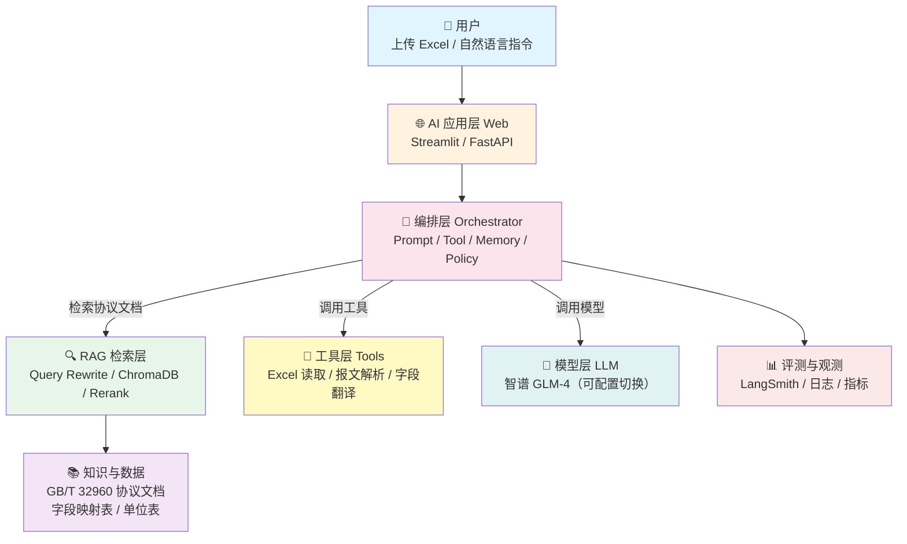

<div class="callout callout-note" markdown="1">
**📝 🚀**

**你的第一个 Hello Agent 项目** — 从 Java GB/T 32960 报文解析出发，用 Python 重新实现协议解析，并构建一个完整的 AI Agent 应用。用户上传 Excel 原始报文 → Agent 智能解析 → 输出中文可读字段。边干边学，每一层都有文档。
</div>

---

## 一、项目概览

### 1.1 项目定位

| **项目名称** | protocol-32960-agent |
| --- | --- |
| **项目路径** | `D:\code\my-agent\protocol-32960-agent` |
| **核心能力** | 读取用户上传的 Excel（含 GB/T 32960 原始十六进制报文），通过 AI Agent 智能解析，输出用户指定的 **中文可读字段** |
| **技术栈** | Python 3.11+ / FastAPI / LangChain / 智谱 GLM（可切换） / ChromaDB / Streamlit |
| **学习目标** | 走通 AI 应用全链路：Web → 编排 → RAG → LLM → 工具 → 评测 → 知识库 |

### 1.2 核心用户场景

> **"我有一份 Excel，里面是车辆上报的 GB/T 32960 原始报文（十六进制），我想让 Agent 帮我解析出 **`**车速**`**、**`**SOC**`**、**`**总电压**`** 等字段，用中文显示、带单位。"**

**Before（Java MCP-Server 方式）**：

```json
{"speed": 60, "soc": 85, "totalVoltage": 3840}
```

**After（Agent 方式）**：

```javascript
车速: 60 km/h
SOC: 85%
总电压: 384.0 V
总电流: 15.2 A
车辆状态: 启动
充电状态: 未充电
运行模式: 纯电
```

### 1.3 架构全景图



---

## 二、思路评审与扩展建议

### 2.1 ✅ 你的思路没有问题

你的架构分层（Web → 编排 → RAG → LLM → 工具 → 评测 → 知识库）**完全正确**，与业界主流 AI 应用架构一致。

### 2.2 🔧 扩展建议

| **层级** | **你的想法** | **扩展建议** |
| --- | --- | --- |
| Web 层 | 有 Web | 先用 **Streamlit** 快速出 MVP，后期可换 React + FastAPI |
| 编排层 | Prompt/Tool/Memory/Policy | 加入 **多轮对话 Memory**  • **策略降级**（LLM 挂了走规则兜底） |
| RAG 层 | 有 RAG | 把 GB/T 32960 协议文档 PDF 切片入库，支持 **"这个字段什么意思？"** 类问答 |
| LLM 层 | 智谱 API | 抽象 LLM 接口，支持 **智谱 / DeepSeek / OpenAI** 一键切换 |
| 工具层 | 解析报文 | 加入 **Excel 批量解析**  • **结果导出 Excel**  • **字段筛选** |
| 评测 | 有评测 | 准备 **10 条标准报文 + 预期结果** 作为回归测试集 |
| 知识库 | 有知识 | 加入 **字段中文映射表**  • **单位转换表**  • **枚举值中文表** |

### 2.3 ⚠️ 关键决策点

<div class="callout callout-tip" markdown="1">
**💡 💡**

**核心解析用"确定性工具"，不用 LLM**：报文解析是 **二进制协议按位取值**，100% 确定性逻辑，不应交给 LLM。LLM 的角色是"理解用户意图 + 组织输出格式 + 回答协议知识问题"。
</div>

---

## 三、项目目录结构

```javascript
D:\code\my-agent\protocol-32960-agent\
│
├── README.md                          # 项目说明
├── requirements.txt                   # Python 依赖
├── .env.example                       # 环境变量模板
├── config.yaml                        # 全局配置（LLM / RAG / 路径等）
│
├── app/                               # 🌐 AI 应用层（Web）
│   ├── main.py                        # FastAPI 入口
│   ├── streamlit_app.py               # Streamlit 前端
│   └── api/
│       ├── routes.py                  # REST API 路由
│       └── schemas.py                 # 请求/响应模型
│
├── orchestrator/                      # 🧠 编排层
│   ├── agent.py                       # Agent 主循环（Plan → Act → Observe）
│   ├── prompts/
│   │   ├── system_prompt.md           # 系统 Prompt
│   │   ├── parse_prompt.md            # 解析任务 Prompt
│   │   └── qa_prompt.md              # 协议问答 Prompt
│   ├── memory.py                      # 会话记忆（短期 + 长期）
│   ├── policy.py                      # 策略与降级（LLM 挂了走规则）
│   └── tool_registry.py              # 工具注册表
│
├── rag/                               # 🔍 RAG 检索层
│   ├── indexer.py                     # 文档切片 & 入库
│   ├── retriever.py                   # 检索（向量 + BM25 混合）
│   ├── reranker.py                    # 重排序
│   └── query_rewriter.py             # 查询改写
│
├── llm/                               # 🤖 模型层
│   ├── base.py                        # LLM 抽象接口
│   ├── zhipu_client.py               # 智谱 GLM 实现
│   ├── deepseek_client.py            # DeepSeek 实现（备选）
│   └── openai_client.py              # OpenAI 兼容实现
│
├── tools/                             # 🔧 工具层
│   ├── excel_reader.py               # Excel 读取与预处理
│   ├── protocol_parser.py            # GB/T 32960 协议解析（核心）
│   ├── field_translator.py           # 字段中文翻译 + 单位转换
│   ├── export_tool.py                # 结果导出（Excel / CSV / JSON）
│   └── validators.py                 # 报文校验工具
│
├── knowledge/                         # 📚 知识与数据
│   ├── docs/
│   │   └── GBT_32960.3-2016.pdf      # 协议文档原文
│   ├── field_mapping.json             # 字段英文→中文映射
│   ├── unit_mapping.json              # 字段→单位映射
│   ├── enum_mapping.json              # 枚举值→中文映射
│   └── sample_data/
│       └── sample_report.xlsx         # 示例 Excel 报文文件
│
├── eval/                              # 📊 评测与观测
│   ├── test_cases.json                # 标准测试用例（报文 + 预期）
│   ├── evaluator.py                   # 自动评测脚本
│   ├── tracing.py                     # 链路追踪
│   └── metrics.py                     # 指标采集（token / 延迟 / 准确率）
│
└── tests/                             # 单元测试
    ├── test_parser.py
    ├── test_field_translator.py
    └── test_agent.py
```

---

## 四、各层详细设计

### 4.1 🔧 工具层：协议解析（核心）

这是整个项目的 **基座**，Python 复现你 Java 项目的 `Analysis32960` 能力。

```javascript
| 起始符 | 命令标识 | 应答标志 | VIN(17B) | 加密方式 | 数据长度 | 数据单元 | 校验码 |
| 2323  | 1 byte  | 1 byte  | 17 bytes | 1 byte  | 2 bytes | N bytes | 1 byte |
```

```python
# tools/protocol_parser.py 核心结构

class GB32960Parser:
    """GB/T 32960 协议解析器（Python 复现 Java Analysis32960）"""
    
    def parse_header(self, hex_str: str) -> dict:
        """解析报文头"""
        # 起始符校验 → 命令标识 → 应答标志 → VIN → 加密方式 → 数据长度
        ...
    
    def parse_realtime_data(self, hex_str: str) -> dict:
        """解析 0x02 实时信息上报"""
        # 整车数据(0x01) → 驱动电机(0x02) → 燃料电池(0x03) 
        # → 发动机(0x04) → 位置(0x05) → 极值(0x06) → 报警(0x07)
        ...
    
    def parse_vehicle_data(self, buf, offset) -> dict:
        """解析 0x01 整车数据"""
        return {
            "vehicle_status": buf[offset],      # 车辆状态
            "charge_status": buf[offset+1],      # 充电状态
            "run_mode": buf[offset+2],           # 运行模式
            "speed": int.from_bytes(...) * 0.1,  # 车速 (km/h)
            "mileage": int.from_bytes(...) * 0.1,# 累计里程 (km)
            "total_voltage": int.from_bytes(...) * 0.1,  # 总电压 (V)
            "total_current": int.from_bytes(...) * 0.1 - 1000,  # 总电流 (A)
            "soc": buf[offset+12],               # SOC (%)
            ...
        }
```

```python
# knowledge/field_mapping.json
{
    "vehicle_status": {"cn": "车辆状态", "unit": "", "enum": {
        "1": "启动", "2": "熄火", "3": "其他", "254": "异常", "255": "无效"
    }},
    "speed": {"cn": "车速", "unit": "km/h", "precision": 1},
    "soc": {"cn": "SOC", "unit": "%", "precision": 0},
    "total_voltage": {"cn": "总电压", "unit": "V", "precision": 1},
    "total_current": {"cn": "总电流", "unit": "A", "precision": 1},
    "mileage": {"cn": "累计里程", "unit": "km", "precision": 1},
    "charge_status": {"cn": "充电状态", "unit": "", "enum": {
        "1": "停车充电", "2": "行驶充电", "3": "未充电", "4": "充电完成", "254": "异常", "255": "无效"
    }},
    "run_mode": {"cn": "运行模式", "unit": "", "enum": {
        "1": "纯电", "2": "混动", "3": "燃油", "254": "异常", "255": "无效"
    }}
}
```

### 4.2 🌐 应用层：Web 界面

```python
# app/streamlit_app.py
import streamlit as st

st.set_page_config(page_title="🚗 32960 智能解析 Agent", layout="wide")
st.title("🚗 GB/T 32960 智能协议解析 Agent")

# 侧边栏：配置
with st.sidebar:
    st.header("⚙️ 配置")
    llm_provider = st.selectbox("模型提供商", ["智谱GLM-4", "DeepSeek", "OpenAI"])
    api_key = st.text_input("API Key", type="password")

# 主区域
tab1, tab2, tab3 = st.tabs(["📂 Excel 解析", "💬 协议问答", "📊 批量分析"])

with tab1:
    uploaded = st.file_uploader("上传包含报文的 Excel 文件", type=["xlsx", "xls"])
    user_fields = st.text_input("你想看哪些字段？", placeholder="车速, SOC, 总电压, 充电状态")
    if st.button("🔍 开始解析"):
        # 调用 Agent 编排层
        ...

with tab2:
    question = st.chat_input("问我关于 GB/T 32960 协议的任何问题...")
    # RAG 问答
    ...
```

### 4.3 🧠 编排层：Agent 主循环

```python
# orchestrator/agent.py

class ProtocolAgent:
    """32960 智能解析 Agent — 核心编排"""
    
    def __init__(self, llm, tools, memory, rag, policy):
        self.llm = llm          # 模型层
        self.tools = tools      # 工具注册表
        self.memory = memory    # 会话记忆
        self.rag = rag          # RAG 检索
        self.policy = policy    # 策略与降级
    
    async def run(self, user_input: str, excel_data=None) -> str:
        """Agent 主循环：理解意图 → 规划 → 执行 → 汇总"""
        
        # 1. 意图识别
        intent = await self.classify_intent(user_input)
        # → "parse_excel" | "field_query" | "protocol_qa" | "batch_export"
        
        # 2. 根据意图选择执行路径
        if intent == "parse_excel":
            return await self._handle_parse(user_input, excel_data)
        elif intent == "protocol_qa":
            return await self._handle_qa(user_input)
        elif intent == "batch_export":
            return await self._handle_batch(user_input, excel_data)
        
    async def _handle_parse(self, user_input, excel_data):
        """解析流程：Excel → 提取报文 → 解析 → 字段筛选 → 中文格式化"""
        
        # Step 1: 读取 Excel，提取报文列
        raw_messages = self.tools["excel_reader"].read(excel_data)
        
        # Step 2: 用 LLM 理解用户想要哪些字段
        wanted_fields = await self.llm.extract_fields(user_input)
        
        # Step 3: 工具解析（确定性，不走 LLM）
        parsed_results = []
        for msg in raw_messages:
            parsed = self.tools["parser"].parse_realtime_data(msg)
            translated = self.tools["translator"].translate(parsed, wanted_fields)
            parsed_results.append(translated)
        
        # Step 4: LLM 组织最终输出（自然语言 + 表格）
        response = await self.llm.format_output(parsed_results, user_input)
        
        # Step 5: 记录到 Memory
        self.memory.save(user_input, response)
        
        return response
```

### 4.4 🔍 RAG 检索层

**用途**：当用户问 *"总电压这个字段的偏移量是多少？"*、*"报警标志位怎么解读？"* 时，从 GB/T 32960 协议文档中检索。

```python
# rag/indexer.py

class ProtocolDocIndexer:
    """将 GB/T 32960 协议 PDF 切片并入库"""
    
    def index(self, pdf_path: str):
        # 1. PDF → 文本（PyMuPDF）
        # 2. 按章节 + 表格切分（保留表头）
        # 3. Embedding（智谱 embedding-3 或本地模型）
        # 4. 存入 ChromaDB（带元数据：章节号、页码、表名）
        ...
```

<div class="callout callout-note" markdown="1">
**📝 📌**

**切分策略**：协议文档的 **表格**（字段定义表、枚举值表）是最重要的知识单元，切分时必须 **保留完整表格 + 表头 + 所属章节标题**，不能按固定长度粗暴切断。
</div>

### 4.5 🤖 模型层（可配置切换）

```python
# llm/base.py

from abc import ABC, abstractmethod

class BaseLLM(ABC):
    """LLM 抽象接口 — 所有模型实现此接口"""
    
    @abstractmethod
    async def chat(self, messages: list[dict], **kwargs) -> str: ...
    
    @abstractmethod
    async def extract_fields(self, user_input: str) -> list[str]: ...

# config.yaml
llm:
  provider: "zhipu"           # 可选: zhipu / deepseek / openai
  zhipu:
    api_key: "${ZHIPU_API_KEY}"
    model: "glm-4-flash"
  deepseek:
    api_key: "${DEEPSEEK_API_KEY}"
    model: "deepseek-chat"
  openai:
    api_key: "${OPENAI_API_KEY}"
    model: "gpt-4o-mini"
    base_url: "https://api.openai.com/v1"
```

### 4.6 📊 评测与观测

```python
# eval/test_cases.json（部分示例）
[
  {
    "name": "整车数据-正常报文",
    "hex": "232302FE4C53...(完整十六进制)",
    "expected": {
      "车速": "60.0 km/h",
      "SOC": "85%",
      "总电压": "384.0 V",
      "车辆状态": "启动"
    }
  }
]
```

```python
# eval/evaluator.py
class AgentEvaluator:
    """自动评测：跑测试集 → 对比预期 → 输出准确率"""
    
    def run_eval(self):
        for case in test_cases:
            actual = parser.parse_and_translate(case["hex"])
            score = self.compare(actual, case["expected"])
            self.log(case["name"], score)
        # 输出：准确率、失败用例、平均延迟
```

---

## 五、开发路线图（边干边学，4 个阶段）

### 阶段 1：基座搭建（Day 1-3）🟢 先跑通

- [ ] 项目初始化：目录结构、`requirements.txt`、`.env`
- [ ] **Python 复现 GB/T 32960 解析器**（从你的 Java `Analysis32960` 翻译）
- [ ] 字段映射表 + 单位表 + 枚举表（JSON）
- [ ] 字段翻译器：英文字段 → `车速: 60.0 km/h`
- [ ] 单元测试：用已知报文验证解析正确性

**学习重点**：Python struct / ByteBuffer 操作、协议二进制解析

### 阶段 2：Agent 编排 + LLM 接入（Day 4-7）🟡 核心能力

- [ ] LLM 抽象层 + 智谱 GLM 接入
- [ ] Agent 编排层：意图识别 → 工具调用 → 结果格式化
- [ ] Excel 读取工具（openpyxl）
- [ ] Prompt 工程：编写 system_prompt、parse_prompt
- [ ] Memory：基于 SQLite 的简单会话记录

**学习重点**：LangChain Agent / Tool Calling / Prompt 设计

### 阶段 3：RAG + Web 界面（Day 8-12）🟠 体验提升

- [ ] 协议文档 PDF 切片入 ChromaDB
- [ ] RAG 检索 + 问答链路
- [ ] Streamlit Web 界面（上传 Excel + 对话 + 结果展示）
- [ ] 结果导出（Excel / CSV）

**学习重点**：向量数据库、Embedding、RAG 流程

### 阶段 4：评测 + 优化 + 生产化（Day 13-16）🔴 上线质量

- [ ] 构建 10+ 条标准测试集
- [ ] 自动评测脚本 + 准确率报告
- [ ] 链路追踪（每次请求记录 prompt → tool → response）
- [ ] 策略降级：LLM 不可用时走纯规则解析
- [ ] Docker 打包

**学习重点**：评测体系、可观测性、降级策略

---

## 六、关键技术决策

### 6.1 LLM vs 规则：各司其职

| **任务** | **谁来做** | **原因** |
| --- | --- | --- |
| 报文解析（按位取值） | 🔧 **工具（规则）** | 100% 确定性逻辑，LLM 反而会出错 |
| 理解用户想要哪些字段 | 🤖 **LLM** | "帮我看下电池相关的" → 提取 SOC、总电压、总电流等 |
| 组织输出格式 | 🤖 **LLM** | 根据用户偏好生成表格 / 摘要 / 报告 |
| 协议知识问答 | 🔍 **RAG + LLM** | "报警标志位怎么解读？" → 检索协议文档 → LLM 组织回答 |
| 异常报文分析 | 🤖 **LLM + 工具** | 工具解析 → LLM 分析异常原因并给出建议 |

### 6.2 为什么选这些技术

| **选型** | **理由** |
| --- | --- |
| **FastAPI** | Python 生态最优 async Web 框架，适合 Agent API |
| **Streamlit** | MVP 阶段最快出界面，0 前端代码 |
| **LangChain** | Agent / Tool / Memory / RAG 全家桶，学习资料最多 |
| **ChromaDB** | 本地向量库，免部署，适合单人项目起步 |
| **智谱 GLM** | 国内可直连、中文能力强、有免费额度 |

---

## 七、核心 Prompt 设计（参考）

### 系统 Prompt

```markdown
你是 GB/T 32960 协议智能解析助手。你的职责：

1. 帮助用户解析新能源汽车上报的 GB/T 32960 协议报文
2. 将解析结果以 **中文字段名 + 单位** 的方式呈现
3. 回答用户关于 GB/T 32960 协议的技术问题

## 你的能力
- 读取用户上传的 Excel 文件，提取十六进制报文
- 调用协议解析工具，解析报文中的各类数据
- 根据用户需求筛选并格式化输出字段
- 检索协议文档回答技术问题

## 约束
- 报文解析必须使用工具，不要自己猜测字段值
- 输出字段必须使用中文名称并带单位
- 如果报文校验失败，明确告知用户原因
- 不确定的内容要说明，不要编造
```

---

## 八、从 Java 到 Python 的关键映射

| **Java（你现有的）** | **Python（要实现的）** |
| --- | --- |
| `ByteBuffer` | `struct.unpack()` / `int.from_bytes()` |
| `HexUtils.fromHexString(hex)` | `bytes.fromhex(hex)` |
| `buffer.get()` (1 byte) | `data[offset]` |
| `buffer.getShort()` (2 bytes) | `struct.unpack('>H', data[o:o+2])[0]` |
| `buffer.getInt()` (4 bytes) | `struct.unpack('>I', data[o:o+4])[0]` |
| `Analysis32960.checkCode(origin)` | BCC 异或校验：`reduce(xor, data[2:-1]) == data[-1]` |
| `Analysis32960.extractHeader(buffer)` | `GB32960Parser.parse_header(hex_str)` |
| `Analysis32960.analysis02(buffer, ...)` | `GB32960Parser.parse_realtime_data(hex_str)` |
| `Response.succeed(data)` → JSON | `FieldTranslator.translate(data)` → 中文可读 |

---

## 九、dependencies（requirements.txt）

```javascript
# Web
fastapi>=0.104.0
uvicorn>=0.24.0
streamlit>=1.29.0

# LLM
langchain>=0.2.0
langchain-community>=0.2.0
zhipuai>=2.1.0           # 智谱 SDK
openai>=1.12.0            # OpenAI 兼容（DeepSeek 等）

# RAG
chromadb>=0.4.22
pymupdf>=1.23.0           # PDF 解析
sentence-transformers>=2.2.0

# Tools
openpyxl>=3.1.2           # Excel 读写
pandas>=2.1.0

# Eval & Observability
langsmith>=0.1.0           # 链路追踪（可选）

# Utils
pyyaml>=6.0
python-dotenv>=1.0.0
pydantic>=2.5.0
```

---

## 十、下一步 Action

<div class="callout callout-success" markdown="1">
**✅ ✅**

**立即开始**：按阶段 1 执行，先搞定 Python 协议解析器 + 字段翻译器。这是整个项目的地基，跑通后再往上垒 Agent 层。
</div>

1. **创建项目目录** → `D:\code\my-agent\protocol-32960-agent\`
2. **翻译 Java 解析器** → 从你现有的 `Analysis32960.java` 开始，用 Python `struct` 逐字段复现
3. **写字段映射表** → `field_mapping.json`（字段名 + 中文 + 单位 + 枚举）
4. **跑第一条报文** → 用你 MCP-Server 已测试过的报文，验证 Python 解析结果一致
