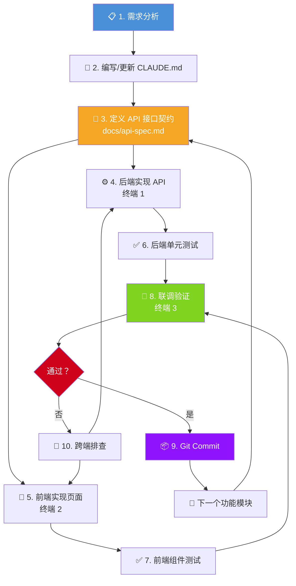

本笔记整合市面成熟经验（Anthropic 官方最佳实践、社区实战总结、多 Agent 协作模式），为你梳理一套**用 Claude Code 同时开发前后端**的标准执行流程。目标：减少上下文切换、避免前后端不一致、最大化 Claude 的代码生成质量。

---

## 一、核心原则：先想清楚，再让 Claude 动手

<div class="callout callout-tip" markdown="1">
**黄金法则**：花 15 分钟做规划，能省下几小时的返工。Claude Code 不是「边想边写」的工具，而是「想好了让它执行」的工具。
</div>

前后端同步开发的最大风险是**接口不一致**和**上下文丢失**。以下流程围绕这两个痛点设计。

---

## 二、项目启动阶段（PSB 系统 · Plan）

### 2.1 编写 [CLAUDE.md](http://claude.md/) — 项目的「大脑」

`CLAUDE.md` 是 Claude Code 自动读取的项目记忆文件，是最重要的效率杠杆。

**推荐结构**：

```markdown
# 项目名称

## 项目概述
- 一句话描述项目目标
- 技术栈：前端 (React/Vue/...) + 后端 (Spring Boot/FastAPI/...)
- 数据库：MySQL/PostgreSQL/...

## 目录结构
- frontend/  → 前端代码
- backend/   → 后端代码
- docs/      → API 文档、设计文档
- shared/    → 共享类型定义（如有 monorepo）

## 开发规范
- 后端 API 统一返回格式：{ code, msg, data }
- 前端统一使用 axios 封装，错误统一处理
- 命名：后端 camelCase，前端 camelCase，数据库 snake_case
- Git commit 使用英文，遵循 Conventional Commits

## 接口契约
- 所有 API 先在 docs/api-spec.md 中定义，前后端共同遵守
- 接口变更必须同步更新文档

## 常用命令
- 后端启动：cd backend && mvn spring-boot:run
- 前端启动：cd frontend && npm run dev
- 运行测试：cd backend && mvn test
```

<div class="callout callout-warning" markdown="1">
**关键**：`CLAUDE.md` 放在项目根目录。Claude Code 每次启动都会自动读取，确保上下文连贯。
</div>

### 2.2 先写接口契约文档（API-First）

这是前后端同步开发的**核心纪律**。

在写任何代码之前，先让 Claude 帮你生成接口定义：

```plain text
# 给 Claude 的 Prompt 示例
请根据以下需求，在 docs/api-spec.md 中定义 RESTful API 接口：

需求：用户管理模块，包含注册、登录、获取用户信息、修改密码

要求：
1. 列出每个接口的 URL、Method、请求参数、响应格式
2. 遵循项目统一返回格式 { code, msg, data }
3. 包含错误码定义
```

这份文档将成为前端和后端同时开发的**唯一真相源（Single Source of Truth）**。

---

## 三、开发阶段：多终端并行模式

### 3.1 终端布局（推荐 tmux 分屏）

同时开发前后端时，推荐打开 **3 个 Claude Code 实例**：

| **终端** | **职责** | **工作目录** | **角色定位** |
| --- | --- | --- | --- |
| 终端 1 | 后端开发 | `./backend` | 专注 API 实现、数据库、业务逻辑 |
| 终端 2 | 前端开发 | `./frontend` | 专注 UI 组件、页面、接口调用 |
| 终端 3 | 总控/集成 | `./`（项目根目录） | 跨端联调、文档更新、Git 管理 |

**tmux 快速分屏命令**：

```bash
# 创建三窗格布局
tmux new-session -s dev
tmux split-window -h
tmux split-window -v
# 分别 cd 到对应目录，启动 claude
```

### 3.2 标准开发循环（单个功能的完整流程）

每开发一个功能模块，按以下 **6 步循环** 执行：

<div class="callout callout-note" markdown="1">
**Step 1 → 定义接口** → Step 2 → 后端实现 → Step 3 → 后端测试 → Step 4 → 前端实现 → Step 5 → 联调验证 → Step 6 → 提交代码
</div>

---

**Step 1：定义/确认接口契约**

在总控终端（终端 3）中操作：

```plain text
请在 docs/api-spec.md 中新增「订单模块」的接口定义：
- 创建订单 POST /api/orders
- 查询订单列表 GET /api/orders
- 查询订单详情 GET /api/orders/:id
遵循项目统一返回格式。
```

**Step 2：后端实现 API**

在后端终端（终端 1）中操作：

```plain text
请参考 @docs/api-spec.md 中订单模块的接口定义，
实现以下内容：
1. OrderController（REST 接口）
2. OrderService（业务逻辑）
3. OrderRepository（数据访问）
4. Order 实体和 DTO
遵循项目已有的代码风格和分层架构。
```

**Step 3：后端自测**

```plain text
为订单模块编写单元测试和接口测试：
1. Service 层单元测试
2. Controller 层 MockMvc 测试
3. 运行 mvn test 验证全部通过
```

**Step 4：前端实现页面**

在前端终端（终端 2）中操作：

```plain text
请参考 @docs/api-spec.md 中订单模块的接口定义，
实现以下内容：
1. 订单列表页面组件
2. 订单详情页面组件
3. 创建订单表单组件
4. 对应的 API 调用函数（使用项目封装的 axios）
遵循项目已有的组件风格。
```

**Step 5：联调验证**

在总控终端（终端 3）中操作：

```plain text
请检查前后端接口对接是否一致：
1. 对比 frontend/src/api/order.ts 和 backend 的 OrderController
2. 检查请求参数名、响应字段名是否完全匹配
3. 如有不一致，告诉我哪些地方需要修改
```

**Step 6：提交代码**

```plain text
请为本次订单模块的开发创建一个 Git commit：
- 检查所有变更文件
- 生成规范的 commit message
- 确保没有遗漏的文件
```

---

## 四、进阶技巧

### 4.1 使用 Subagent 做专项检查

Claude Code 支持 Subagent（子代理），可以委派专项任务而不干扰主流程：

```plain text
使用 subagent 完成以下任务：
分析 frontend/src/api/ 下所有接口调用文件，
与 docs/api-spec.md 对比，
生成一份「前端接口调用 vs API 文档」的一致性检查报告。
```

### 4.2 跨项目文件引用（@语法）

当后端终端需要参考前端的类型定义时：

```plain text
请参考 @../frontend/src/types/order.ts 的类型定义，
确保后端返回的 JSON 字段与前端类型完全一致。
```

### 4.3 用 Plan Mode 做复杂决策

当遇到架构级别的决策时，先用 Plan Mode（`shift+tab` 切换）让 Claude 只分析不执行：

```plain text
[Plan Mode]
我需要在订单模块中加入 WebSocket 实时推送功能。
请分析：
1. 后端需要改动哪些文件？
2. 前端需要改动哪些文件？
3. 推荐的实现方案是什么？
4. 有哪些潜在风险？

不要执行任何修改，只输出分析报告。
```

### 4.4 验证驱动开发（TDD 风格）

让 Claude 先写测试，再写实现：

```plain text
为用户注册接口实现 TDD 流程：
1. 先编写测试用例（成功注册、重复邮箱、密码太短等场景）
2. 运行测试确认全部失败（红）
3. 编写实现代码
4. 运行测试确认全部通过（绿）
5. 运行 lint 和类型检查
6. 所有通过后告诉我结果
```

### 4.5 使用 Agent Teams（实验性功能）

Claude Code 支持多 Agent 协作的团队模式（需启用实验功能）：

```bash
# 在 settings.json 中启用
CLAUDE_CODE_EXPERIMENTAL_AGENT_TEAMS=true
```

可以让一个 Lead Agent 协调前端和后端两个 Worker Agent 并行开发。

---

## 五、常见陷阱与避坑指南

| **陷阱** | **表现** | **解决方案** |
| --- | --- | --- |
| 上下文丢失 | Claude 忘了之前的约定 | 关键约定写入 `CLAUDE.md`，不依赖对话记忆 |
| 前后端字段不一致 | 前端 `userName`，后端 `username` | 强制 API-First，双方共用 `api-spec.md` |
| 一次改动太多 | 同时改了 10 个文件，出错难定位 | 每次只做一个功能模块的一个步骤 |
| 不验证就继续 | 积累错误越来越多 | 每个 Step 完成后必须运行测试/检查 |
| Token 浪费 | 把整个项目丢给 Claude | 用 `@文件路径` 精确引用，用 `.claudeignore` 排除无关文件 |
| Git 混乱 | 前后端代码混在一个 commit | 功能完成后统一提交，或用 worktree 分支并行 |

---

## 六、推荐的 Prompt 模板库

### 🚀 项目初始化

```plain text
请帮我初始化一个全栈项目，结构如下：
- frontend/ 使用 [框架] + TypeScript
- backend/ 使用 [框架] + [语言]
- docs/ 用于存放 API 文档
- 根目录创建 CLAUDE.md 项目记忆文件
- 创建 .claudeignore 排除 node_modules、.git、build 等
```

### 🔗 接口同步检查

```plain text
请对比以下文件，检查接口一致性：
- API 文档：docs/api-spec.md
- 后端实现：backend/src/main/java/.../controller/
- 前端调用：frontend/src/api/

输出不一致的地方，并给出修复建议。
```

### 🐛 跨端 Bug 排查

```plain text
前端调用 POST /api/orders 返回 400 错误。
请按以下步骤排查：
1. 检查前端发送的请求参数格式
2. 检查后端接收参数的 DTO 定义
3. 检查后端参数校验注解
4. 对比两端的字段命名和类型
5. 给出修复方案
```

### 📦 功能模块生成

```plain text
请按照项目规范，为「[模块名]」生成完整的前后端代码：

后端：
- Entity + DTO
- Repository
- Service + ServiceImpl
- Controller
- 单元测试

前端：
- API 调用函数
- 页面组件
- 路由配置

严格遵循 docs/api-spec.md 中的接口定义。
```

---

## 七、完整工作流速查表



---

## 八、推荐工具与插件

- **tmux** — 终端分屏，多 Claude 实例并行
- **Claude Code Chrome 扩展** — 前端 UI 验证利器，自动截图对比
- **Superpowers Skills** — 社区维护的 14 个开发技能包（TDD、Code Review 等）
- **.claudeignore** — 排除大文件和无关目录，节省 Token
- **Git Worktree** — 让多个 Claude 实例在不同分支并行工作，互不冲突

---

<div class="callout callout-note" markdown="1">
**总结**：Claude Code 前后端同步开发的核心就是三个字——**约、分、验**。
- **约**：API 契约先行，双方共守
- **分**：多终端分工，各司其职
- **验**：每步必验，及时纠偏

按这套流程执行，你会发现 Claude Code 不只是代码生成器，更像是一个能同时管理前后端的技术 PM。
</div>
