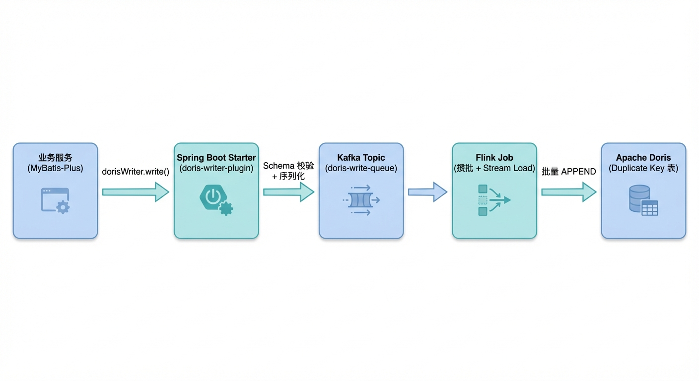
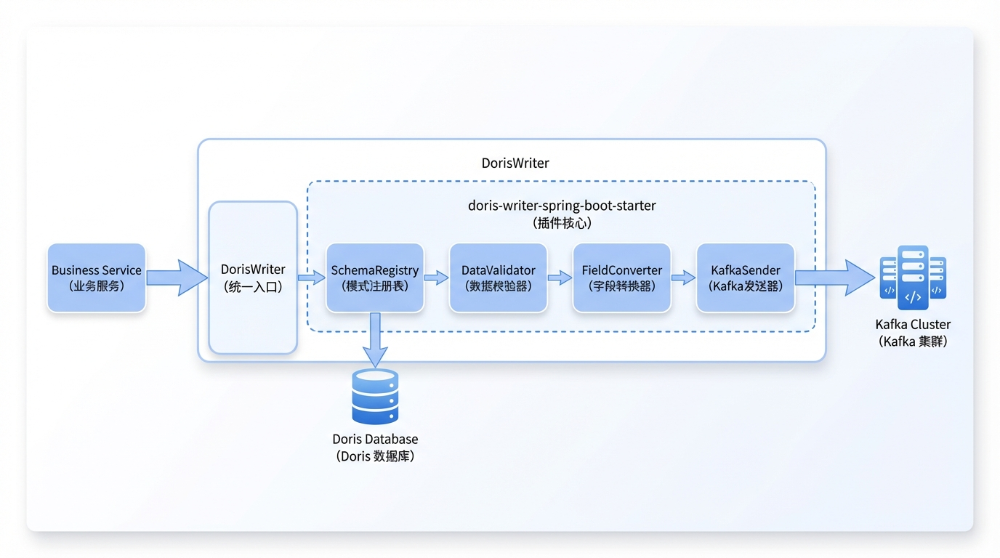
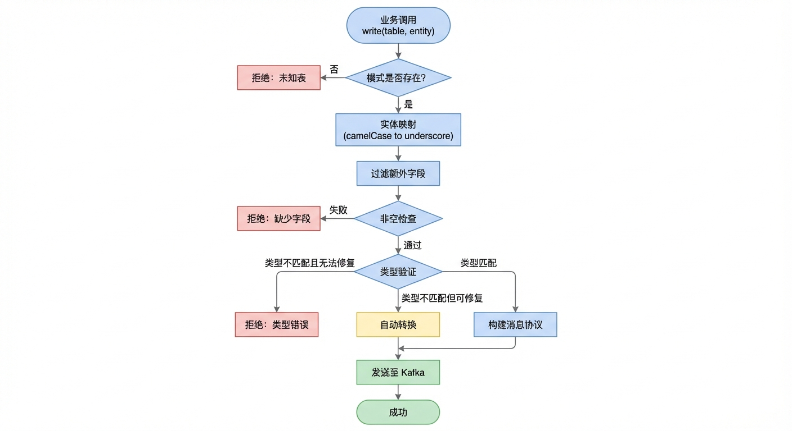
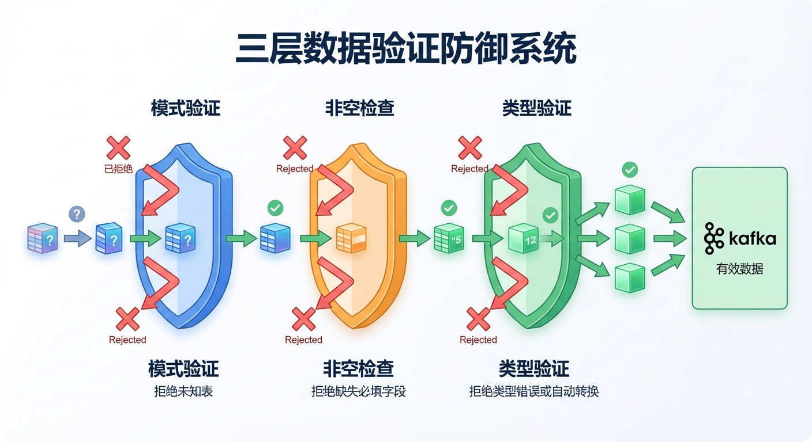
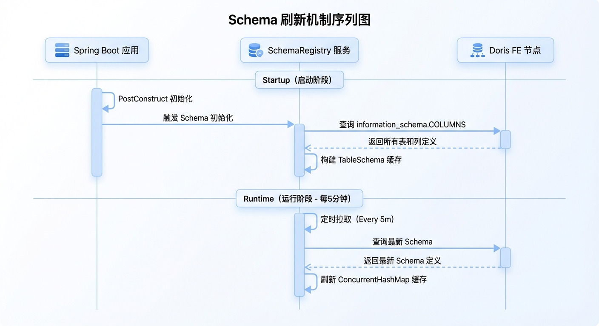
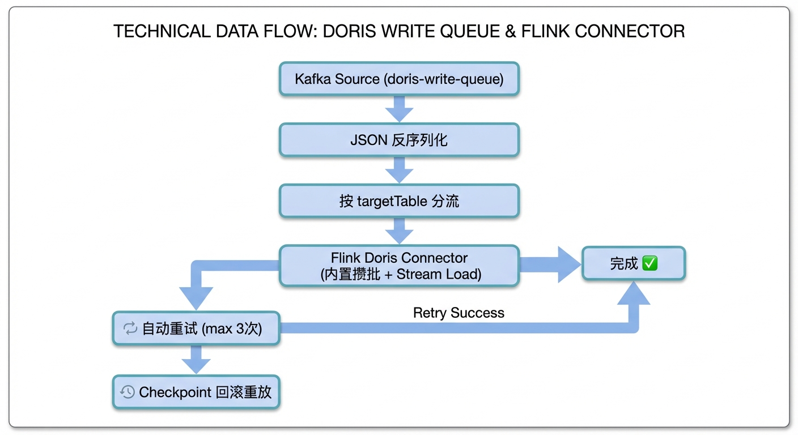

## 背景

业务服务通过 MyBatis-Plus 对 Doris（Duplicate Key 明细表）执行逐条 INSERT，性能开销大。需要将写入链路改造为 **异步攒批 + Stream Load** 模式，大幅提升写入吞吐量。

---

## 整体架构

---

## 核心设计原则

| 原则 | 说明 |
| --- | --- |
| **只有 INSERT** | Doris 表为 Duplicate Key 模型，纯追加写入，无更新/删除 |
| **业务无感** | 业务方只需引入 Starter，调用一行代码即可 |
| **完全解耦** | 业务进程只负责发 Kafka，攒批和 Stream Load 由独立 Flink Job 完成 |
| **数据可靠** | Kafka 持久化保证不丢数据，Flink Checkpoint 保证 at-least-once |
| **故障隔离** | 按表隔离，一张表的脏数据不影响其他表写入 |

---

## 数据流

1. **业务层** — 调用 `dorisWriter.write("表名", entity)` 发送数据
2. **插件层** — Schema 校验 → 过滤多余字段 → 类型自动修正 → 序列化为 JSON → 发送到 Kafka
3. **Kafka** — 按表名做 Partition Key，同表数据落同 Partition
4. **Flink** — 按表 keyBy → 窗口攒批（条数/时间双触发）→ 调用 Stream Load 批量写入
5. **Doris** — Stream Load APPEND 追加写入，Duplicate Key 表自动存储

---

## 统一消息协议

| 字段 | 类型 | 说明 |
| --- | --- | --- |
| **targetTable** | String | 目标 Doris 表名，同时作为 Kafka Partition Key |
| **database** | String | Doris 库名（可选，默认从配置读） |
| **timestamp** | Long | 写入时间戳 |
| **traceId** | String | 链路追踪 ID（来自 MDC） |
| **data** | Map<String, Object> | 经过校验和转换后的行数据（字段名 → 值） |

---

## Kafka Topic 设计

| 设计项 | 配置 |
| --- | --- |
| **Topic 名称** | doris-write-queue（统一一个 Topic） |
| **Partition Key** | 目标表名（同表数据集中，提升攒批效率） |
| **Partition 数** | 6~12（根据目标表数量和吞吐量调整） |
| **消息格式** | JSON |
| **保留时间** | 3 天（预留回溯重放空间） |
| **DLQ Topic** | doris-write-dlq（失败数据死信队列） |

---

# 🔌 Spring Boot Starter 插件设计

## 模块定位

插件是业务服务与 Kafka 之间的桥梁，职责是：**校验 → 过滤 → 转换 → 发送**。保证进入 Kafka 的数据一定是合法的，将脏数据拦截在源头。

## 插件整体架构

## 核心处理流程

## 组件职责

| 组件 | 职责 | 关键行为 |
| --- | --- | --- |
| **DorisWriter** | 统一写入入口 | 编排校验→过滤→转换→发送全流程，对外暴露唯一 `write(table, entity)` 方法 |
| **SchemaRegistry** | 表结构注册中心 | 启动时从 Doris information_schema 拉取全部表结构并缓存；每 5 分钟自动刷新 |
| **DataValidator** | 数据校验器 | NOT NULL 校验、类型校验、可修正类型自动转换、超长字符串截断 |
| **FieldConverter** | 字段名转换 | Java 驼峰字段 → Doris 下划线列名；支持 @DorisColumn 注解显式映射 |
| **KafkaSender** | Kafka 发送封装 | 构建统一消息协议（表名 + 库名 + traceId + 数据），以表名为 Partition Key 发送 |

## 三层防御体系

## 类型校验与自动转换规则

| Doris 类型 | 校验规则 | 自动转换 |
| --- | --- | --- |
| INT / BIGINT / TINYINT / SMALLINT | 必须为数值或可解析的数字字符串 | String → Long |
| FLOAT / DOUBLE | 必须为数值或可解析的数字字符串 | String → Double |
| DECIMAL / DECIMALV3 | 必须为数值或可解析的 BigDecimal 字符串 | String → BigDecimal |
| DATETIME / DATETIMEV2 | 支持 yyyy-MM-dd HH:mm:ss 等 4 种格式 | 不转换，格式非法直接拒绝 |
| VARCHAR / CHAR / STRING | 最大 65533 字符 | 超长自动截断 + 告警 |

## Schema 刷新机制

## 模块目录结构

| 目录 / 文件 | 说明 |
| --- | --- |
| **AutoConfiguration** | Spring Boot 自动装配入口 |
| **Properties** | 配置属性绑定 |
| **DorisWriter** | 对外统一写入入口 |
| **KafkaSender** | Kafka 消息发送封装 |
| **schema/** | SchemaRegistry、TableSchema、ColumnDef — 表结构管理 |
| **validate/** | DataValidator、ValidationResult — 数据校验 |
| **convert/** | FieldConverter、TypeConverter — 字段名与类型转换 |
| **model/** | DorisWriteMessage、WriteResult — 消息与结果模型 |

## 配置项一览

| 配置项 | 默认值 | 说明 |
| --- | --- | --- |
| doris.writer.kafka.bootstrap-servers | — | Kafka 地址（必填） |
| doris.writer.kafka.topic | doris-write-queue | 目标 Topic |
| doris.writer.database | — | 默认 Doris 库名（必填） |
| doris.writer.fe-host | — | Doris FE 地址，用于拉取表结构（必填） |
| doris.writer.fe-query-port | 9030 | Doris FE 查询端口 |
| doris.writer.user | — | Doris 账号（必填） |
| doris.writer.password | — | Doris 密码（必填） |
| doris.writer.schema-refresh-interval | 300000 | 表结构刷新间隔（ms） |

---

# ⚡ Flink Job 设计

## 模块定位

Flink Job 是整个方案的核心引擎，职责是：**消费 Kafka → 按表分流 → 攒批写入 Doris**。基于 Apache 官方 flink-doris-connector，无需手写 HTTP Stream Load，开箱即用。

## 整体流程

## Job 核心逻辑说明

| 步骤 | 说明 |
| --- | --- |
| **1. Kafka Source** | 消费 doris-write-queue Topic，Consumer Group 为 doris-stream-load-group，从已提交 offset 开始消费 |
| **2. 反序列化 + 过滤** | 将 JSON 字符串反序列化，过滤掉缺少 targetTable 或 data 字段的无效消息 |
| **3. 按表分流** | 根据 targetTable 字段将数据路由到对应的 Doris Sink（支持固定表列表或动态分表两种方式） |
| **4. Doris Sink 写入** | 通过 flink-doris-connector 内置的攒批和 Stream Load 机制批量写入 Doris |

## Doris Sink 关键配置

| 配置项 | 值 | 说明 |
| --- | --- | --- |
| **batchSize** | 1000 | 攒批条数 |
| **batchIntervalMs** | 5000 | 攒批时间间隔（ms），低 QPS 时兜底 |
| **maxRetries** | 3 | Stream Load 失败自动重试次数 |
| **enable2PC** | true | 开启两阶段提交，配合 Checkpoint 实现 Exactly-Once |
| **deletable** | false | Duplicate Key 表只追加，不删除 |

## Connector 内置能力 vs 手写逻辑对比

| 能力 | flink-doris-connector（内置） | 原方案（手写） |
| --- | --- | --- |
| **攒批** | ✅ batchSize + batchIntervalMs 自动攒批 | ❌ 手写窗口 + 自定义 Trigger |
| **重试** | ✅ maxRetries 自动重试 | ❌ 手写 for 循环重试 |
| **脏数据过滤** | ✅ Stream Load max_filter_ratio 自动过滤 | ❌ 多余的二分法递归查找 |
| **Exactly-Once** | ✅ 两阶段提交（2PC）+ Checkpoint | ❌ 仅 AT_LEAST_ONCE |
| **BE 负载均衡** | ✅ 自动选择 BE 节点 | ❌ 固定连 FE 转发 |
| **连接管理** | ✅ 内置连接池和超时处理 | ❌ 裸 HttpURLConnection |
| **代码量** | ~50 行配置 | ~300 行业务代码 |

## Stream Load 参数说明

| 参数 | 值 | 作用 |
| --- | --- | --- |
| format | json | 数据格式为 JSON |
| strip_outer_array | true | 去掉外层数组括号，每个 JSON 对象作为一行 |
| max_filter_ratio | 0.05 | 允许 5% 的行被过滤（自动处理脏数据） |
| strict_mode | false | 类型不匹配时用 NULL 代替而非报错 |

## Flink 参数调优建议

| 参数 | 建议值 | 说明 |
| --- | --- | --- |
| Checkpoint 间隔 | 10s | 配合 2PC，平衡延迟与一致性 |
| Checkpoint 模式 | EXACTLY_ONCE | 配合 Connector 2PC 保证精确一次 |
| 并行度 | 与 Kafka Partition 数一致 | 充分利用 Kafka 分区 |
| sink.batch.size | 1000 | 单次 Stream Load 批次大小 |
| sink.batch.interval | 5000ms | 低 QPS 时兜底，控制最大写入延迟 |
| sink.max-retries | 3 | Stream Load 失败自动重试 |
| Task Manager 内存 | 2~4 GB | 根据表数量和 QPS 调整 |

## 脏数据处理策略

不需要手写二分法！Stream Load 的 max_filter_ratio 已自动过滤脏数据。

**正确的脏数据治理思路**：

6. **上游校验** — 在 Kafka 生产端做数据格式校验，从源头减少脏数据
7. **反序列化过滤** — Flink 反序列化阶段过滤掉格式异常的消息（如缺少必要字段）
8. **Stream Load 兜底** — max_filter_ratio=0.05 允许 5% 容错，自动跳过类型不匹配等问题
9. **监控告警** — 通过 Stream Load 返回的 NumberFilteredRows 监控被过滤行数，超阈值告警
10. **审计追踪** — 开启 Doris Audit Log 或从 Stream Load Response 中提取被过滤的行信息

## 监控指标

| 指标 | 来源 | 说明 |
| --- | --- | --- |
| flink_doris_sink_success_total | Connector 内置 | Stream Load 成功批次数 |
| flink_doris_sink_fail_total | Connector 内置 | Stream Load 失败批次数 |
| flink_doris_sink_rows_total | Connector 内置 | 成功写入总行数 |
| flink_doris_sink_latency_ms | Connector 内置 | 单次 Stream Load 耗时 |
| NumberFilteredRows | Stream Load Response | 被过滤的脏数据行数（关键！需告警） |
| kafka_consumer_lag | Flink 内置 | Kafka 消费延迟 |
| checkpoint_duration | Flink 内置 | Checkpoint 耗时（影响 2PC 提交频率） |

---

# 📦 业务层使用指南

## 接入方式

业务方只需两步即可接入：

### 1. 引入 Maven 依赖

在项目 pom.xml 中添加 `com.dst:doris-writer-spring-boot-starter:1.0.0` 依赖。

### 2. 添加配置

| 配置项 | 示例值 | 说明 |
| --- | --- | --- |
| doris.writer.kafka.bootstrap-servers | kafka-host:9092 | Kafka 集群地址 |
| doris.writer.kafka.topic | doris-write-queue | 目标 Topic |
| doris.writer.database | your_doris_db | 默认目标 Doris 库 |
| doris.writer.fe-host | doris-fe-host | Doris FE 地址（启动时拉取表结构用） |
| doris.writer.fe-query-port | 9030 | Doris FE 查询端口 |
| doris.writer.user | doris_user | Doris 账号 |
| doris.writer.password | doris_pass | Doris 密码 |

## 使用方式

### 基本写入

注入 `DorisWriter`，调用 `dorisWriter.write("表名", entity)` 即可，一行代码替代原来的 MyBatis insert。写入结果通过 `WriteResult` 返回，可检查 `isSuccess()` 和 `getErrors()`。

### 批量写入

直接在循环中逐条调用 `dorisWriter.write()`，每条独立校验、独立发 Kafka。攒批由下游 Flink 负责，业务方不用关心。

### 跨库写入

调用三参数重载方法 `dorisWriter.write("目标库", "表名", entity)` 即可写入非默认库。

## 改造前后对比

| 场景 | 改造前（MyBatis-Plus） | 改造后（Doris Writer） |
| --- | --- | --- |
| 单条写入 | trackMapper.insert(entity) | dorisWriter.write("vehicle_track", entity) |
| 批量写入 | trackMapper.insertBatchSomeColumn(list) | 循环调用 dorisWriter.write() |
| 写入耗时 | 每条 50~200ms（Doris 单条 INSERT 开销） | 每条 < 5ms（只是发 Kafka） |
| 写入方式 | 同步阻塞 | 异步非阻塞 |

## 注意事项

**异步写入 = 最终一致性**

调用 dorisWriter.write() 成功只意味着数据已进入 Kafka，不代表已写入 Doris。数据从发送到可查询的延迟约 3~5 秒。如果业务要求写入后立刻能查到，该场景不适用此方案，仍需走同步 INSERT。

### 适用场景

- ✅ 车辆轨迹数据写入
- ✅ 设备状态上报
- ✅ 日志/事件流写入
- ✅ 所有"写完不需要立刻读"的明细数据

### 不适用场景

- ❌ 写入后需要立刻查询验证的业务流程
- ❌ 需要事务保证的写入（如扣款后查余额）

## Entity 编写规范

业务方传入的 Entity 字段名需要与 Doris 表的列名对应。插件会自动处理以下情况：

| 情况 | 插件行为 |
| --- | --- |
| Entity 有字段但 Doris 表没有 | 自动过滤，不会导致错误 |
| Doris 表 NOT NULL 字段缺失 | 拒绝写入，返回错误 |
| 类型不匹配（如 String → Long） | 尝试自动转换，转换失败则拒绝 |
| 日期格式不标准 | 尝试兼容多种格式，都失败则拒绝 |

**字段名映射**：如果 Entity 字段名是驼峰命名（如 reportTime），而 Doris 列名是下划线命名（如 report_time），插件默认支持自动转换。也可以通过 @DorisColumn("report_time") 注解显式指定映射。

