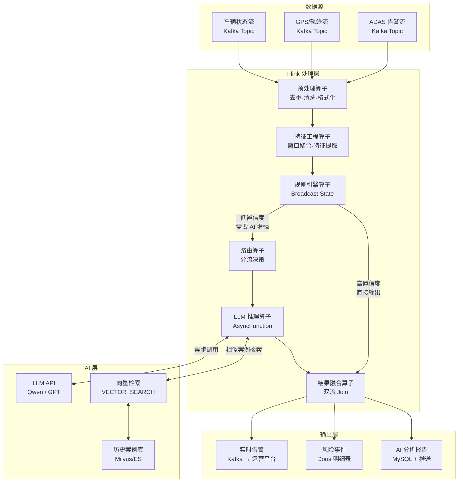

## 设计目标

> **核心思想**：规则引擎处理"已知的已知"，LLM 处理"已知的未知"——两者互补，而非替代。

- **低延迟**：简单告警 < 100ms 决策，复杂场景 < 3s
- **高吞吐**：支持万级 TPS 的 ADAS 告警流
- **混合决策**：规则引擎兜底 + LLM 增强，避免 LLM 单点故障
- **可观测**：每次决策可溯源，LLM 推理结果可审计

---

## 整体架构



---

## 分层设计详解

### 第一层：预处理与特征工程

这一层完全在 Flink 内完成，不涉及 LLM，保证极低延迟。

```java
// 示例：ADAS 告警特征提取算子
public class AlertFeatureExtractor
        extends KeyedProcessFunction<String, AdasAlert, AlertFeature> {

    // 车辆级别的历史窗口状态
    private MapState<Long, AdasAlert> alertHistory;

    @Override
    public void processElement(AdasAlert alert, Context ctx, Collector<AlertFeature> out) {
        // 1. 提取特征
        AlertFeature feature = AlertFeature.builder()
            .vehicleId(alert.getVehicleId())
            .alertType(alert.getType())
            .frequency(calcFrequency(alertHistory, alert))     // 近 5 分钟频率
            .severity(calcSeverity(alert))                      // 严重度评分
            .locationRisk(getLocationRisk(alert.getLng(), alert.getLat())) // 地点风险
            .driverProfile(loadDriverProfile(alert.getDriverId()))        // 驾驶员画像
            .build();

        out.collect(feature);
    }
}
```

### 第二层：混合决策路由（核心）

<div class="callout callout-note" markdown="1">
**📝 🎯**

**关键设计**：通过置信度评分决定走规则引擎还是 LLM，避免每条消息都调 LLM（成本和延迟不可接受）。
</div>

路由策略如下：

| **场景** | **路由策略** | **典型示例** | **延迟目标** |
| --- | --- | --- | --- |
| 多维度复合告警 | 规则初判 + LLM 增强 | 急刹车 + 偏离 + 疲劳同时出现 | < 2s |
| 规则冲突 | LLM 仲裁 | 两条规则给出相反结论 | < 3s |

```java
// 路由算子：计算置信度并分流
public class RoutingOperator extends ProcessFunction<AlertFeature, TaggedAlert> {

    @Override
    public void processElement(AlertFeature feature, Context ctx, Collector<TaggedAlert> out) {
        double confidence = calcRuleConfidence(feature);

        if (confidence >= 0.85) {
            // 高置信度 → 规则引擎直接输出
            out.collect(TaggedAlert.of(feature, RouteType.RULE_ONLY, confidence));
        } else if (confidence >= 0.50) {
            // 中置信度 → 规则初判 + LLM 增强
            out.collect(TaggedAlert.of(feature, RouteType.HYBRID, confidence));
        } else {
            // 低置信度 → LLM 主导决策
            out.collect(TaggedAlert.of(feature, RouteType.LLM_LEAD, confidence));
        }
    }

    private double calcRuleConfidence(AlertFeature f) {
        // 考虑因素：告警类型是否在规则库、历史准确率、特征完整度等
        return ruleEngine.evaluate(f).getConfidence();
    }
}
```

### 第三层：LLM 异步推理算子

**使用 Flink **`**AsyncFunction**` 是关键，避免 LLM 调用阻塞整个流处理管道。

```java
// 异步 LLM 推理算子（核心）
public class LlmRiskAnalysisFunction
        extends RichAsyncFunction<TaggedAlert, LlmEnrichedAlert> {

    private LlmClient llmClient;
    private VectorSearchClient vectorClient;

    @Override
    public void asyncInvoke(TaggedAlert alert, ResultFuture<LlmEnrichedAlert> resultFuture) {
        // 1. 异步检索相似历史风险案例（RAG）
        CompletableFuture<List<RiskCase>> similarCases =
            vectorClient.searchAsync(alert.toEmbeddingQuery(), 5);

        // 2. 构建 Prompt（结合规则引擎结论 + 相似案例 + 实时特征）
        similarCases.thenCompose(cases -> {
            String prompt = buildRiskPrompt(alert, cases);
            return llmClient.callAsync(prompt);
        }).thenAccept(llmResult -> {
            // 3. 解析 LLM 输出，融合规则引擎结论
            LlmEnrichedAlert enriched = LlmEnrichedAlert.builder()
                .originalAlert(alert)
                .llmRiskLevel(llmResult.getRiskLevel())
                .llmReason(llmResult.getReason())
                .suggestedAction(llmResult.getAction())
                .finalRiskLevel(mergeDecision(alert.getRuleRiskLevel(), llmResult.getRiskLevel()))
                .build();
            resultFuture.complete(Collections.singletonList(enriched));
        }).exceptionally(ex -> {
            // 4. LLM 失败时降级到规则引擎结论（兜底）
            resultFuture.complete(Collections.singletonList(
                LlmEnrichedAlert.fallback(alert)
            ));
            return null;
        });
    }
}

// 在 Job Graph 中配置异步算子
DataStream<LlmEnrichedAlert> enrichedStream = AsyncDataStream
    .unorderedWait(
        routedStream,
        new LlmRiskAnalysisFunction(),
        3000,                     // 超时 3s，超时后触发兜底
        TimeUnit.MILLISECONDS,
        100                       // 最大并发 LLM 请求数
    );
```

### 第四层：Prompt 工程（车联网专用）

```javascript
你是一个车联网安全风险分析专家。请基于以下信息评估驾驶风险等级。

## 当前告警信息
- 车辆 ID：{vehicleId}
- 告警类型：{alertTypes}  （急刹车 x3, 车道偏离 x2, 疲劳驾驶 x1）
- 发生时间段：过去 10 分钟内
- 当前车速：{speed} km/h
- 路况：{roadCondition}（高速公路，雨天，夜间）
- 驾驶员画像：{driverProfile}（连续驾驶 6 小时，历史风险评分 72）

## 规则引擎初判
- 风险等级：中风险（置信度 0.62）
- 触发规则：急刹车频率超阈值

## 相似历史案例（Top 3）
{similarCases}

## 输出要求（JSON 格式）
{
  "riskLevel": "HIGH | MEDIUM | LOW",
  "confidence": 0.0-1.0,
  "primaryReason": "主要风险原因（50字以内）",
  "suggestedAction": "建议处置动作",
  "keyFactors": ["关键因素1", "关键因素2"]
}
```

---

## Flink 2.1+ 原生 SQL 方案（更简洁）

如果升级到 **Flink 2.1+**，可以直接用 SQL 调用 LLM，无需编写 Java 算子：

```sql
-- 第一步：注册 LLM 模型
CREATE MODEL adas_risk_model
INPUT (alert_summary STRING)
OUTPUT (risk_level STRING, reason STRING)
WITH (
    'provider' = 'openai',
    'openai.endpoint' = 'https://your-llm-endpoint/v1',
    'openai.model_name' = 'qwen-plus',
    'openai.api_key' = '${LLM_API_KEY}'
);

-- 第二步：在流处理 SQL 中直接调用
SELECT
    a.vehicle_id,
    a.alert_type,
    a.rule_risk_level,
    m.risk_level AS llm_risk_level,
    m.reason AS llm_reason,
    CURRENT_TIMESTAMP AS analysis_time
FROM adas_alerts a,
LATERAL TABLE(
    ML_PREDICT(
        'adas_risk_model',
        CONCAT(
            '告警类型:', a.alert_type,
            ' 频率:', CAST(a.alert_count AS STRING),
            ' 规则判定:', a.rule_risk_level
        )
    )
) AS m
WHERE a.rule_confidence < 0.85;  -- 只对低置信度告警调用 LLM
```

---

## 与 MiroFish 思想的对应

| **MiroFish 概念** | **车联网 Flink+LLM 对应实现** | 多 Agent 群体涌现 | 多维度告警流并行处理，多个 LLM 调用结果融合 |
| --- | --- | --- | --- |
| 种子信息 → 平行世界 | 历史风险案例库 → RAG 检索增强推理 | 变量注入（上帝视角） | Flink Broadcast State 动态下发新规则，实时生效 |
| ReportAgent 分析 | Flink 周期性触发 LLM 生成车队安全周报 | 社交平台双轨仿真 | 规则引擎轨道 + LLM 推理轨道，双流 Join 融合 |

---

## 工程落地优先级建议

### Phase 1（1-2 周）：异步 LLM 推理接入

- [ ] 在现有 ADAS Flink 作业中增加异步 LLM 调用算子
- [ ] 实现降级兜底逻辑（LLM 超时/失败时回退规则引擎）
- [ ] 接入阿里云通义千问 API（兼容 OpenAI 格式，国内稳定）

### Phase 2（2-4 周）：RAG 增强

- [ ] 建立历史风险案例向量库（Milvus 或 ES 的向量能力）
- [ ] Flink 算子中集成 RAG 检索，丰富 Prompt 上下文
- [ ] 验证 RAG 对判断准确率的提升效果

### Phase 3（4-8 周）：MiroFish 思想落地

- [ ] 实现多 Agent 并行分析（速度 Agent、行为 Agent、环境 Agent）
- [ ] Flink 聚合多 Agent 判断，做最终风险裁决
- [ ] 接入 MCP Server，支持运营人员自然语言查询风险状态

---

## 注意事项

<div class="callout callout-warning" markdown="1">
**⚠️ ⚠️**

**成本控制是关键**：LLM 调用费用不可忽视。建议：
1. **严格过滤**：只有规则置信度 < 0.85 的告警才进入 LLM 路径（预估仅 10-20% 流量）
2. **结果缓存**：相同车辆 + 相同告警模式，5 分钟内命中缓存直接复用
3. **模型分级**：低复杂度场景用轻量模型（Qwen-turbo），高复杂度场景用强模型（Qwen-plus）
4. **批量调用**：将短时间窗口内同一车辆的多个低置信度告警合并为一次 LLM 调用
</div>
