### 一、背景
系统目前支持47个第三方数据平台，但存在协议多样性、数据流量不均衡（从数万台到几十台不等）以及第三方平台接收能力不一的问题。为了提升车联网平台的运营效率，我们计划对现有的第三方数据转发机制进行优化和重构。优化后的目标特性如下：

1. **参数灵活性**：实现转发参数的可配置性、可管理性和可运营性。
2. **通道控制**：能够根据业务需求灵活开启或关闭转发通道。
3. **数据转发定制**：支持自定义转发数据范围和频率。
4. **服务可扩展性**：转发服务能够水平扩展，以适应不同规模的需求。
5. **监控与追溯**：转发过程将具备监控能力，数据可追溯，且支持消息的即时重推功能。

### 二、旧平台能力梳理
（一）、32960-std

32960标准数据转发

<!-- 这是一张图片，ocr 内容为： -->
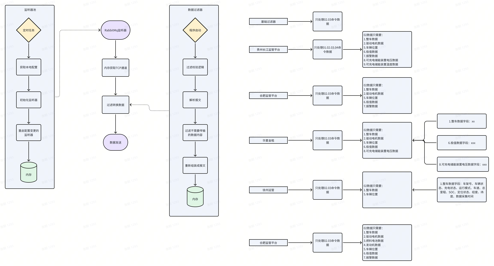

（二）、http-std-jd

http数据转发

<!-- 这是一张图片，ocr 内容为： -->
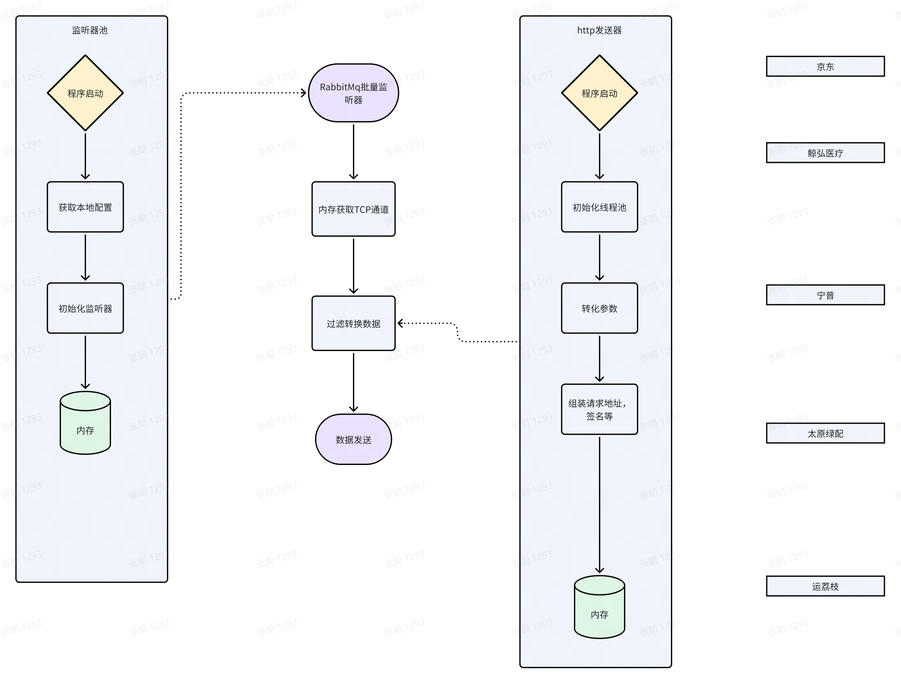

（三）、32960-->jtt809

...

### 三、新转发功能
1. 获取维特讯转发配置，加载到服务内存，定时刷新
2. 获取配置，初始化RocketMq监听器，定时刷新
3. 初始化过滤器，根据第三方转发id 获取转发规则
4. 支持配变更监听重启
5. RocketMq 为拉取模式，消费端控制拉取数据
6. 可配置是否单节点转发通道
7. 可配置是否需要应答
8. 支持TCP通道断开重试

<!-- 这是一张图片，ocr 内容为： -->
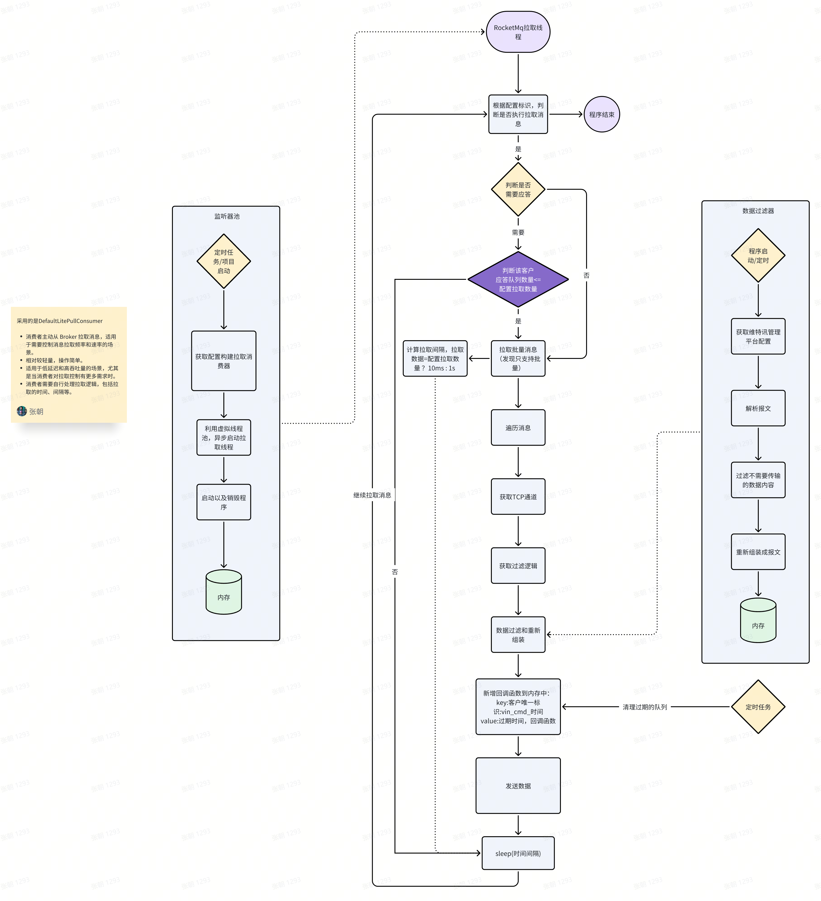

（1）32960 标准转发流程图

### 四、转发功能性能测试
Mq:http://mqdashboard.dev.dstcar.com/#/topic 开发环境 单节点broker 接收服务：开发环境单节点 转发服务机器：开发自己的电脑

<!-- 这是一张图片，ocr 内容为： -->
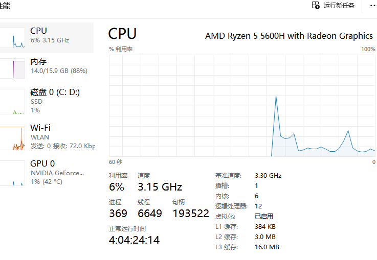

#### 本地测试情况1：
transpond.sockets[0].pullThreadNums=1

transpond.sockets[0].ch-nums=1

transpond.sockets[0].isSingle=false

transpond.sockets[0].isNeedAck=false

单线程，tcp通道 1，单节点，不需要ack: 压测前数据准备 

<!-- 这是一张图片，ocr 内容为： -->
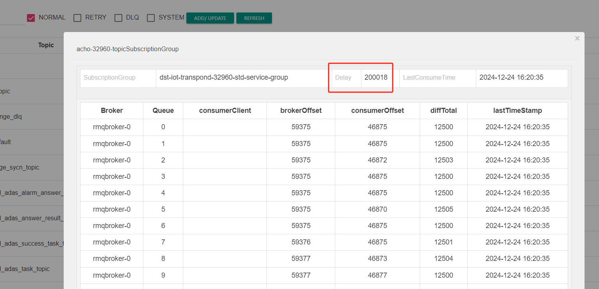

<!-- 这是一张图片，ocr 内容为： -->
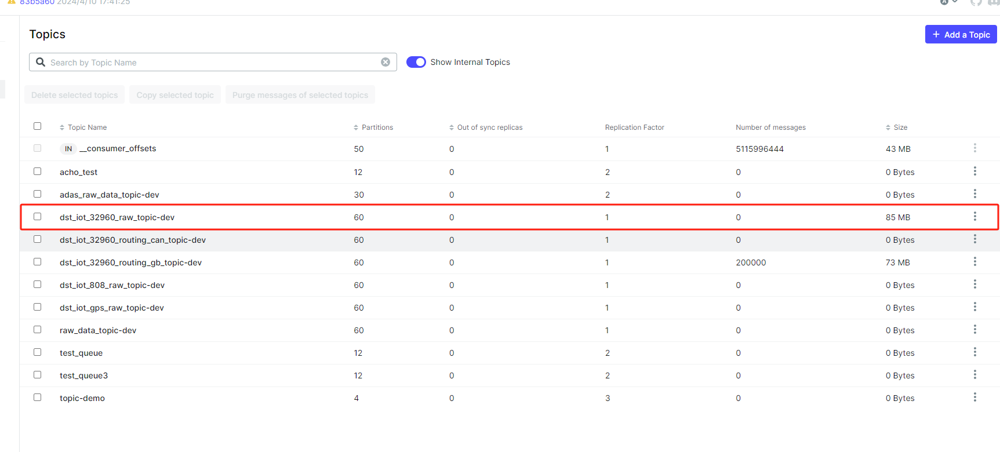

执行结果 12月24日 17:20:54.912 [] [pool-6-thread-1] INFO c.d.i.t.s.s.i.mq.consumer.MessageLitePullConsumer:176 - 客户名: 阿朝测试, 客户队列: acho-32960-topic:test，当前成功计数: 1 12月24日 17:21:04.917 [] [pool-6-thread-1] INFO c.d.i.t.s.s.i.mq.consumer.MessageLitePullConsumer:176 - 客户名: 阿朝测试, 客户队列: acho-32960-topic:test，当前成功计数: 84601

12月24日 17:21:14.918 [] [pool-6-thread-1] INFO c.d.i.t.s.s.i.mq.consumer.MessageLitePullConsumer:176 - 客户名: 阿朝测试, 客户队列: acho-32960-topic:test，当前成功计数: 174693 

<!-- 这是一张图片，ocr 内容为： -->
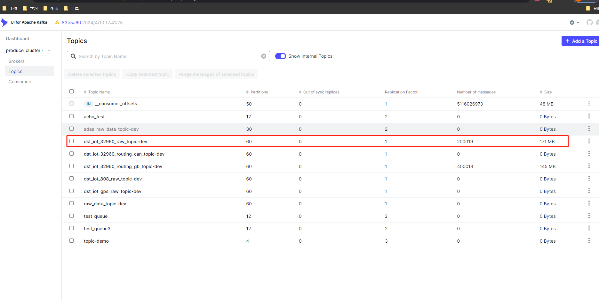

**准确度：数据发送正常20018 + 1（tcp登录包） = 20019 数据发送正确率：100%；**

**速度：耗时25s左右，速度在 8400/s**

#### 本地测试情况2：
transpond.sockets[0].pullBatchSize=100

transpond.sockets[0].pullThreadNums=2

transpond.sockets[0].ch-nums=1

transpond.sockets[0].isSingle=false

transpond.sockets[0].isNeedAck=false 双线程，tcp通道 1，单节点，不需要ack: 压测前数据准备

<!-- 这是一张图片，ocr 内容为： -->
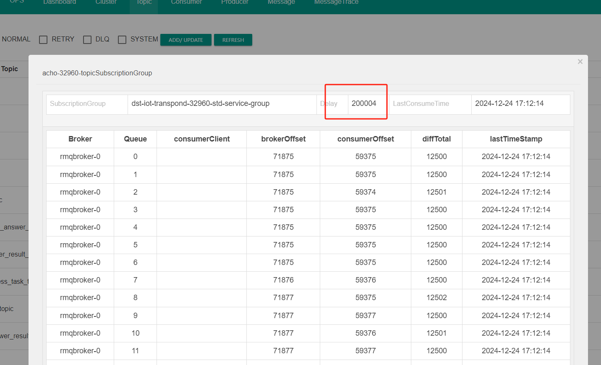

<!-- 这是一张图片，ocr 内容为： -->
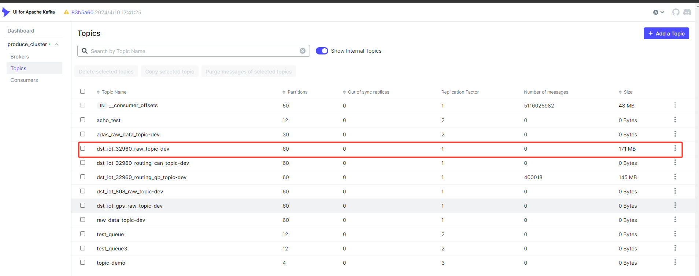

执行结果： 转发数据

<!-- 这是一张图片，ocr 内容为： -->
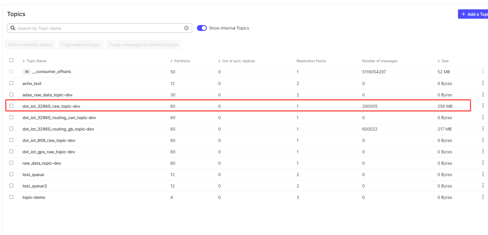

转发日志： 12月24日 17:42:11.435 [] [] INFO c.d.i.t.s.s.i.mq.consumer.MessageLitePullConsumer:176 - 客户名: 阿朝测试, 客户队列: acho-32960-topic:test，当前成功计数: 1

12月24日 17:42:21.450 [] [] INFO c.d.i.t.s.s.i.mq.consumer.MessageLitePullConsumer:176 - 客户名: 阿朝测试, 客户队列: acho-32960-topic:test，当前成功计数: 96601

12月24日 17:42:31.456 [] [] INFO c.d.i.t.s.s.i.mq.consumer.MessageLitePullConsumer:176 - 客户名: 阿朝测试, 客户队列: acho-32960-topic:test，当前成功计数: 194602 **准确度：数据发送正常20004 + 1（tcp登录包） = 20005 数据发送正确率：100%；**

**速度：耗时25s左右，速度在 9400/s**

#### 本地测试情况3：
transpond.sockets[0].pullBatchSize=200

transpond.sockets[0].pullThreadNums=4

transpond.sockets[0].ch-nums=1

transpond.sockets[0].isSingle=false

transpond.sockets[0].isNeedAck=false

单次拉取数量 100->200 4个线程，tcp通道 1，单节点，不需要ack:

<!-- 这是一张图片，ocr 内容为： -->
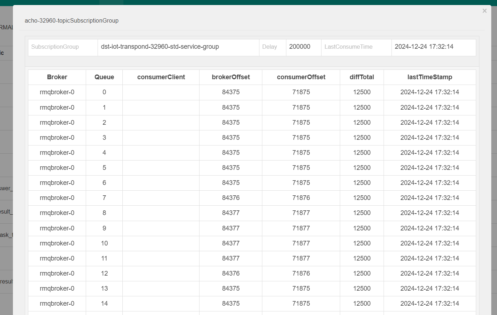

<!-- 这是一张图片，ocr 内容为： -->
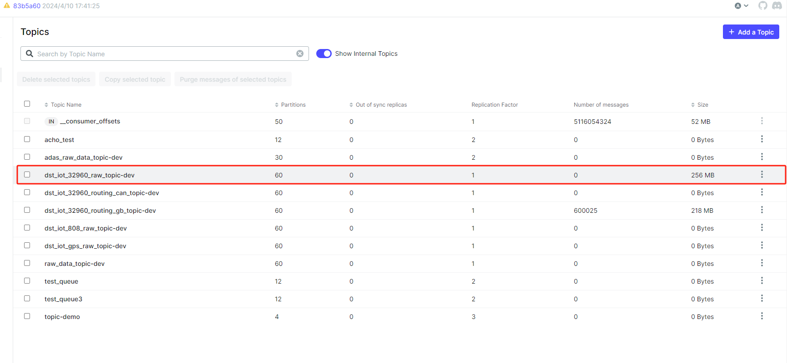

执行结果： 转发数据 

<!-- 这是一张图片，ocr 内容为： -->
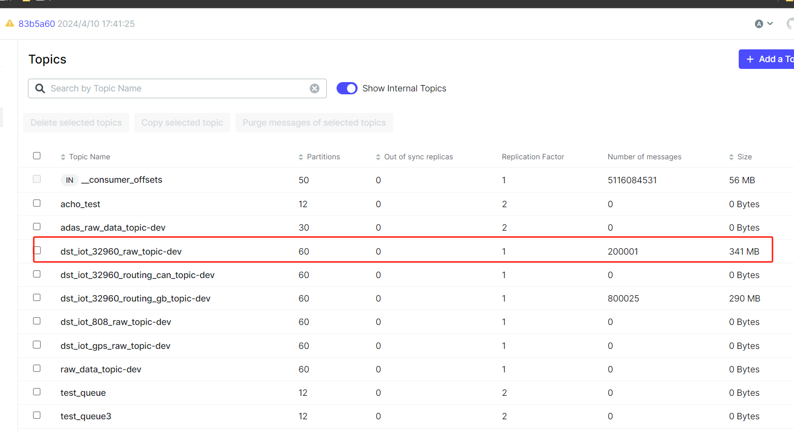

12月24日 17:56:35.704 [] [] INFO c.d.i.t.s.s.i.mq.consumer.MessageLitePullConsumer:176 - 客户名: 阿朝测试, 客户队列: acho-32960-topic:test，当前成功计数: 3

12月24日 17:56:45.714 [] [] INFO c.d.i.t.s.s.i.mq.consumer.MessageLitePullConsumer:176 - 客户名: 阿朝测试, 客户队列: acho-32960-topic:test，当前成功计数: 85639

12月24日 17:56:55.715 [] [] INFO c.d.i.t.s.s.i.mq.consumer.MessageLitePullConsumer:176 - 客户名: 阿朝测试, 客户队列: acho-32960-topic:test，当前成功计数: 180638 **准确度：数据发送正常20000 + 1（tcp登录包） = 20001 数据发送正确率：100%；**

**速度：耗时25s左右，速度在 9000/s**

#### 开发机器测试情况1：
transpond.sockets[0].pullBatchSize=100

transpond.sockets[0].pullThreadNums=2

transpond.sockets[0].ch-nums=1

transpond.sockets[0].isSingle=false

transpond.sockets[0].isNeedAck=false 双线程，tcp通道 1，单节点，不需要ack: 压测前数据准备: 200000 2024-12-24 18:11:02.146 [] [] INFO com.dst.iot.transpond.std32960.service.infrastructure.mq.consumer.MessageLitePullConsumer:176 - 客户名: 阿朝测试, 客户队列: acho-32960-topic:test，当前成功计数: 2 2024-12-24 18:11:12.819 [] [] INFO com.dst.iot.transpond.std32960.service.infrastructure.mq.consumer.MessageLitePullConsumer:176 - 客户名: 阿朝测试, 客户队列: acho-32960-topic:test，当前成功计数: 198631 **准确度：数据发送正常20000 + 1（tcp登录包） = 20001 数据发送正确率：100%；**

**速度：耗时10s左右，速度在 20000/s**

#### 开发机器测试情况2： 
transpond.sockets[0].pullBatchSize=150

transpond.sockets[0].pullThreadNums=2

transpond.sockets[0].ch-nums=1

transpond.sockets[0].isSingle=true

transpond.sockets[0].isNeedAck=true

<!-- 这是一张图片，ocr 内容为： -->
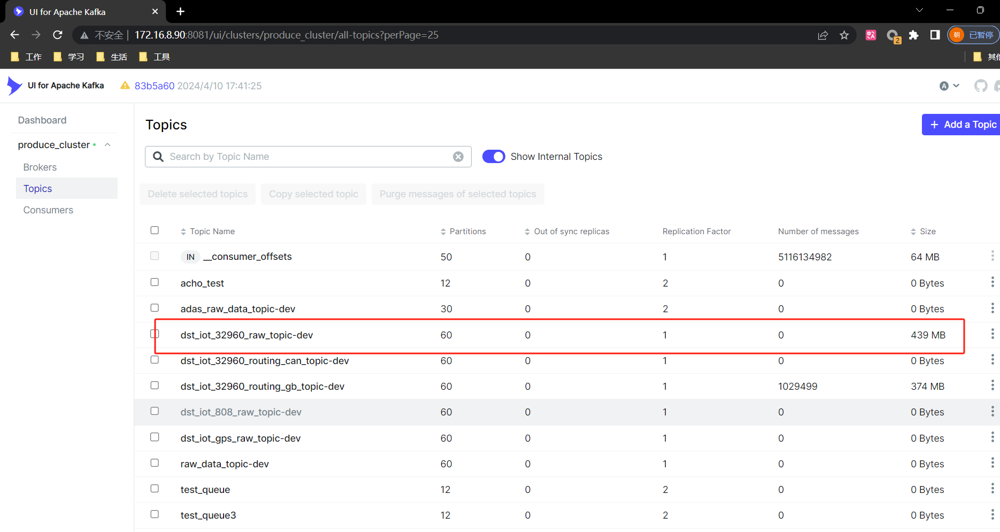

<!-- 这是一张图片，ocr 内容为： -->
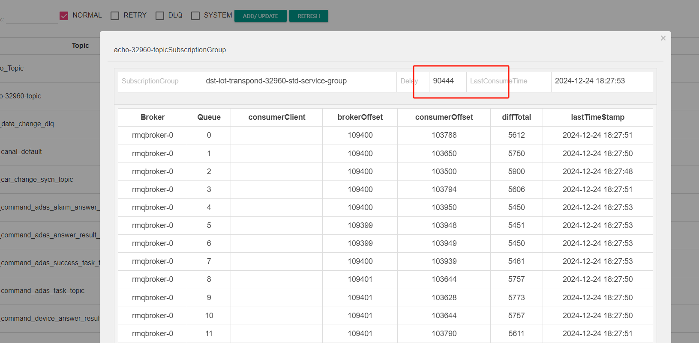

执行结果： 转发数据

**准确度：数据发送正常90444+ 1（tcp登录包） = 90445 数据发送正确率：100%；**

**速度：速度在 300/s ****严重问题**

#### 开发机器测试情况3：
transpond.sockets[0].pullBatchSize=200

transpond.sockets[0].pullThreadNums=20

transpond.sockets[0].ch-nums=10

transpond.sockets[0].isSingle=false

transpond.sockets[0].isNeedAck=true 多通道，20个拉取线程，每次拉取 200

数据准备情况：

<!-- 这是一张图片，ocr 内容为： -->
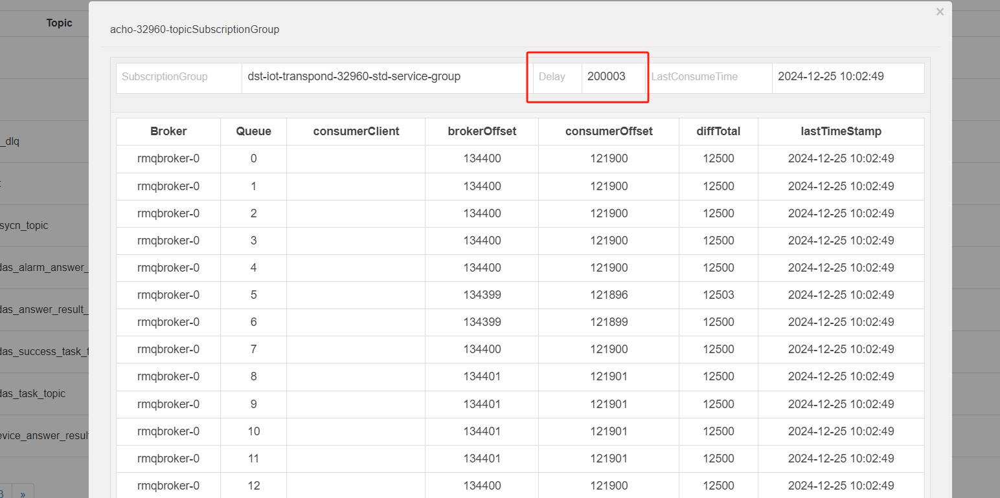

<!-- 这是一张图片，ocr 内容为： -->
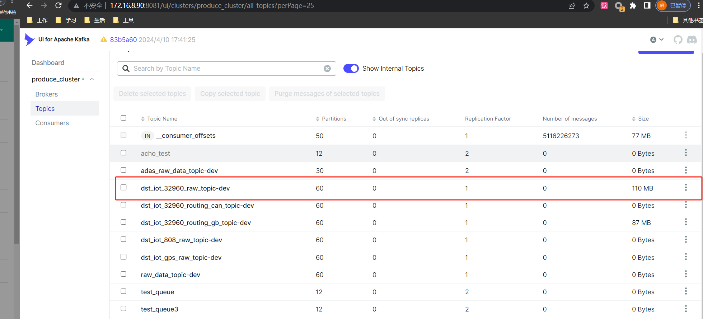

执行结果： 转发数据

2024-12-25 09:46:32.617 [] [] INFO com.dst.iot.transpond.std32960.service.infrastructure.mq.consumer.MessageLitePullConsumer:172 - 客户名: 阿朝测试, 客户队列: acho-32960-topic:test，当前成功计数: 4100 2024-12-25 09:46:42.770 [] [] INFO com.dst.iot.transpond.std32960.service.infrastructure.mq.consumer.MessageLitePullConsumer:172 - 客户名: 阿朝测试, 客户队列: acho-32960-topic:test，当前成功计数: 8094

**速度：速度在 400/s ****严重问题**

#### 开发机器测试情况4：
transpond.sockets[0].pullBatchSize=30

transpond.sockets[0].pullThreadNums=2

transpond.sockets[0].ch-nums=10

transpond.sockets[0].isSingle=false

transpond.sockets[0].isNeedAck=true

多通道，2个拉取线程，每次拉取 30

<!-- 这是一张图片，ocr 内容为： -->
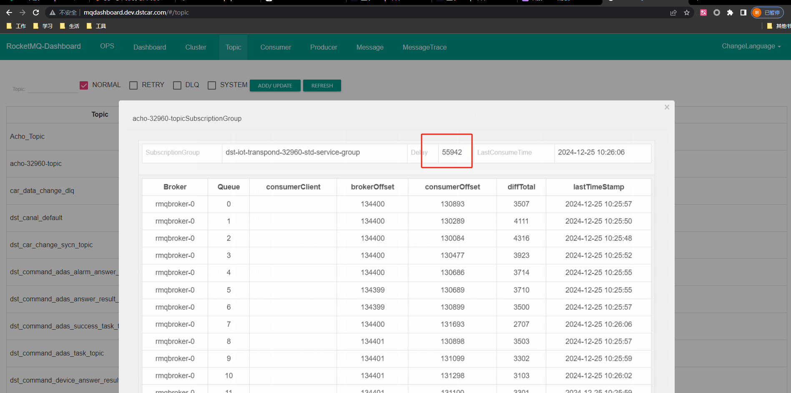

<!-- 这是一张图片，ocr 内容为： -->
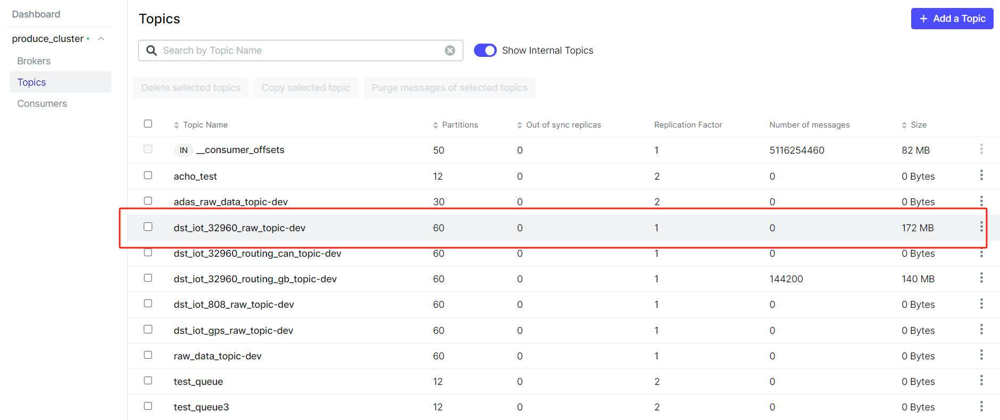

执行结果： 转发数据 2024-12-25 10:59:40.895 [] [] INFO com.dst.iot.transpond.std32960.service.infrastructure.mq.consumer.MessageLitePullConsumer:172 - 客户名: 阿朝测试, 客户队列: acho-32960-topic:test，当前成功计数: 0 2024-12-25 10:59:52.230 [] [] INFO com.dst.iot.transpond.std32960.service.infrastructure.mq.consumer.MessageLitePullConsumer:172 - 客户名: 阿朝测试, 客户队列: acho-32960-topic:test，当前成功计数: 11757 2024-12-25 11:00:02.486 [] [] INFO com.dst.iot.transpond.std32960.service.infrastructure.mq.consumer.MessageLitePullConsumer:172 - 客户名: 阿朝测试, 客户队列: acho-32960-topic:test，当前成功计数: 27444 2024-12-25 11:00:13.781 [] [] INFO com.dst.iot.transpond.std32960.service.infrastructure.mq.consumer.MessageLitePullConsumer:172 - 客户名: 阿朝测试, 客户队列: acho-32960-topic:test，当前成功计数: 39600 2024-12-25 11:00:24.763 [] [] INFO com.dst.iot.transpond.std32960.service.infrastructure.mq.consumer.MessageLitePullConsumer:172 - 客户名: 阿朝测试, 客户队列: acho-32960-topic:test，当前成功计数: 52970

<!-- 这是一张图片，ocr 内容为： -->

**准确度：数据发送有重复数据，暂没发现丢失数据**

**速度：速度在 1200/s ****严重问题**

#### 开发机器测试情况5：
transpond.sockets[0].pullBatchSize=100

transpond.sockets[0].pullThreadNums=4

transpond.sockets[0].ch-nums=10

transpond.sockets[0].isSingle=false

transpond.sockets[0].isNeedAck=true

<!-- 这是一张图片，ocr 内容为： -->
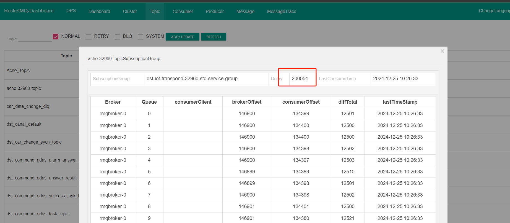

<!-- 这是一张图片，ocr 内容为： -->
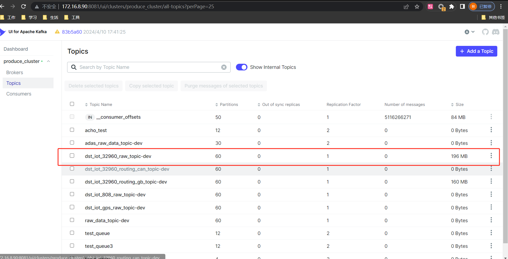

执行结果： 转发数据

2024-12-25 11:17:29.405 [] [] INFO com.dst.iot.transpond.std32960.service.infrastructure.mq.consumer.MessageLitePullConsumer:172 - 客户名: 阿朝测试, 客户队列: acho-32960-topic:test，当前成功计数: 0 2024-12-25 11:17:39.408 [] [] INFO com.dst.iot.transpond.std32960.service.infrastructure.mq.consumer.MessageLitePullConsumer:172 - 客户名: 阿朝测试, 客户队列: acho-32960-topic:test，当前成功计数: 44572 2024-12-25 11:17:49.884 [] [] INFO com.dst.iot.transpond.std32960.service.infrastructure.mq.consumer.MessageLitePullConsumer:172 - 客户名: 阿朝测试, 客户队列: acho-32960-topic:test，当前成功计数: 75669

2024-12-25 11:18:00.252 [] [] INFO com.dst.iot.transpond.std32960.service.infrastructure.mq.consumer.MessageLitePullConsumer:172 - 客户名: 阿朝测试, 客户队列: acho-32960-topic:test，当前成功计数: 104400

2024-12-25 11:18:10.515 [] [] INFO com.dst.iot.transpond.std32960.service.infrastructure.mq.consumer.MessageLitePullConsumer:172 - 客户名: 阿朝测试, 客户队列: acho-32960-topic:test，当前成功计数: 117457

2024-12-25 11:18:20.808 [] [] INFO com.dst.iot.transpond.std32960.service.infrastructure.mq.consumer.MessageLitePullConsumer:172 - 客户名: 阿朝测试, 客户队列: acho-32960-topic:test，当前成功计数: 147204

2024-12-25 11:18:30.974 [] [] INFO com.dst.iot.transpond.std32960.service.infrastructure.mq.consumer.MessageLitePullConsumer:172 - 客户名: 阿朝测试, 客户队列: acho-32960-topic:test，当前成功计数: 167900

2024-12-25 11:18:41.170 [] [] INFO com.dst.iot.transpond.std32960.service.infrastructure.mq.consumer.MessageLitePullConsumer:172 - 客户名: 阿朝测试, 客户队列: acho-32960-topic:test，当前成功计数: 189702 

<!-- 这是一张图片，ocr 内容为： -->
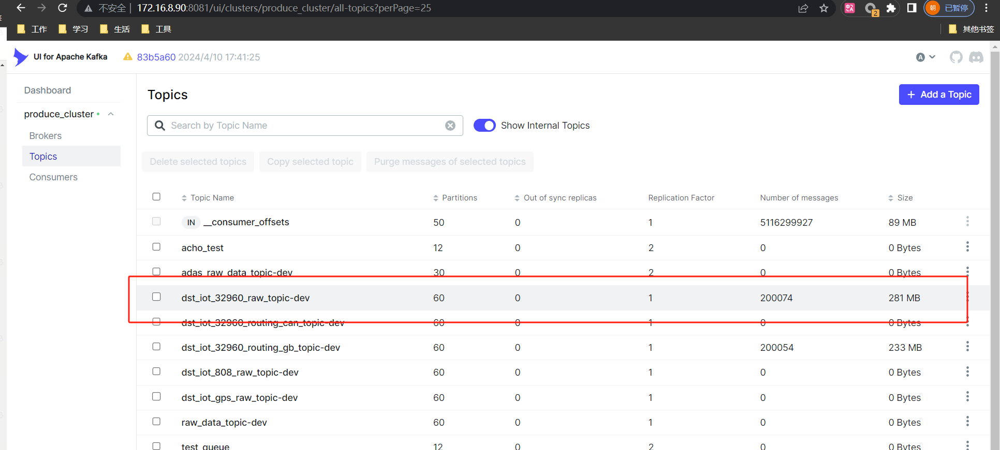

**准确度：数据发送有重复数据，暂没发现丢失数据**

**速度：速度在 2500/s ****严重问题**

#### 开发机器测试情况6：
transpond.sockets[0].pullBatchSize=50

transpond.sockets[0].pullThreadNums=20

transpond.sockets[0].ch-nums=10

transpond.sockets[0].isSingle=false

transpond.sockets[0].isNeedAck=true

<!-- 这是一张图片，ocr 内容为： -->
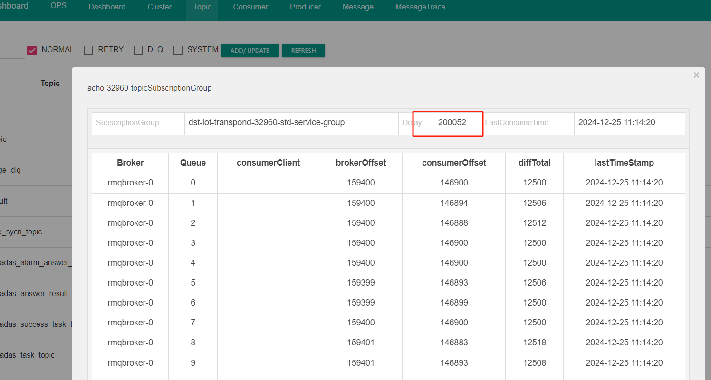

<!-- 这是一张图片，ocr 内容为： -->
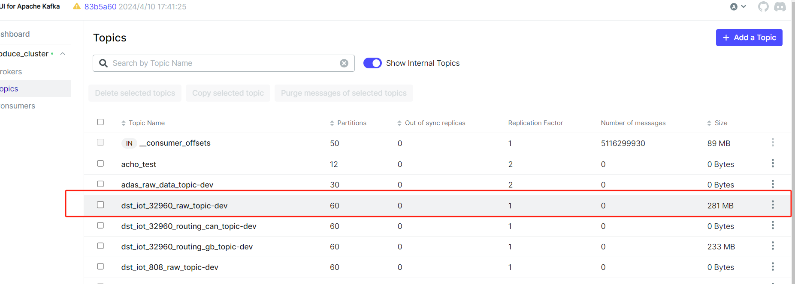

执行结果： 转发数据

2024-12-25 11:28:46.505 [] [] INFO com.dst.iot.transpond.std32960.service.infrastructure.mq.consumer.MessageLitePullConsumer:172 - 客户名: 阿朝测试, 客户队列: acho-32960-topic:test，当前成功计数: 0 2024-12-25 11:29:36.851 [] [] INFO com.dst.iot.transpond.std32960.service.infrastructure.mq.consumer.MessageLitePullConsumer:172 - 客户名: 阿朝测试, 客户队列: acho-32960-topic:test，当前成功计数: 169099

**准确度:100%**

**速度：速度在 3380/s **

#### 开发机器测试情况7：
transpond.sockets[0].pullBatchSize=50

transpond.sockets[0].pullThreadNums=20

transpond.sockets[0].ch-nums=10

transpond.sockets[0].isSingle=false

transpond.sockets[0].isNeedAck=true

transpond.sockets[0].isCancel=true

缩短了阈值时间 1s -> 0.5s

2024-12-25 11:41:42.441 [] [] INFO com.dst.iot.transpond.std32960.service.infrastructure.mq.consumer.MessageLitePullConsumer:172 - 客户名: 阿朝测试, 客户队列: acho-32960-topic:test，当前成功计数: 0

2024-12-25 11:42:13.050 [] [] INFO com.dst.iot.transpond.std32960.service.infrastructure.mq.consumer.MessageLitePullConsumer:172 - 客户名: 阿朝测试, 客户队列: acho-32960-topic:test，当前成功计数: 171009

**准确度:100%**

**速度：速度在 8400/s **
