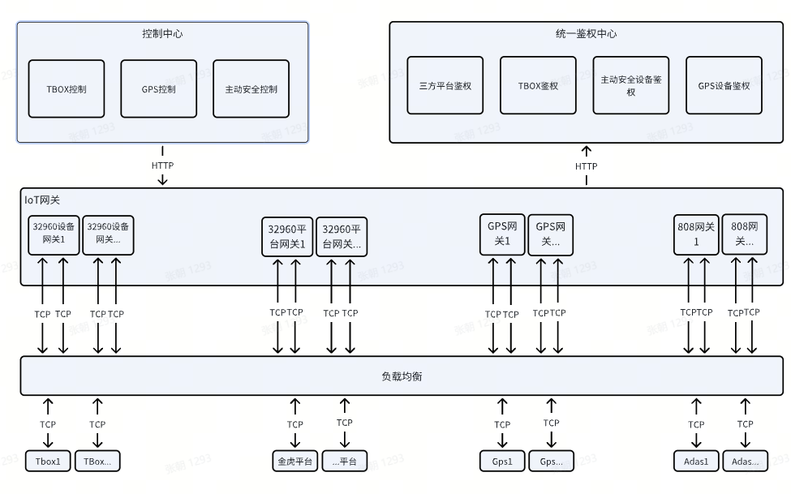
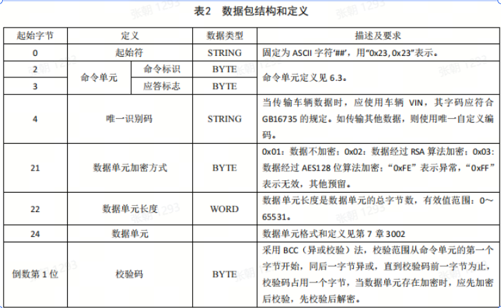
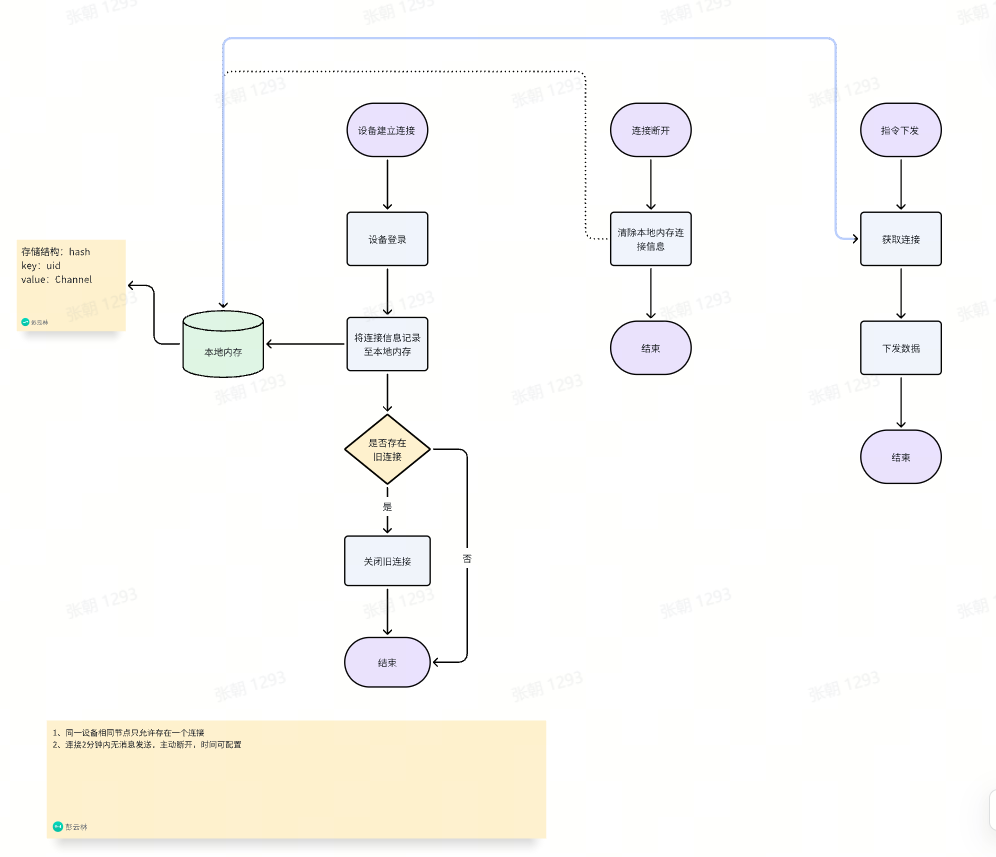
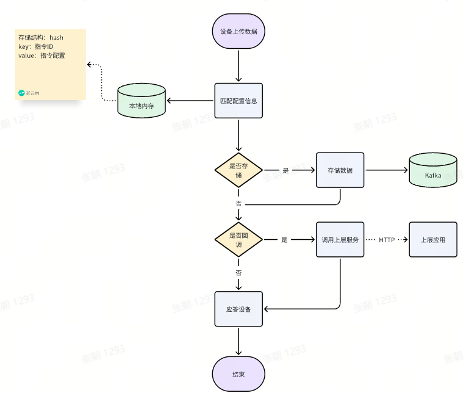
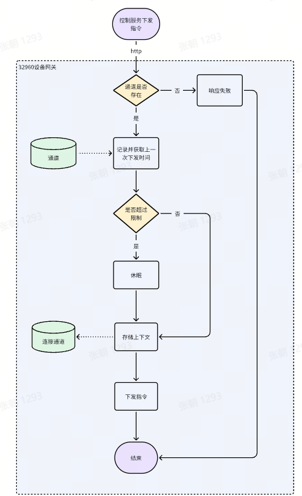
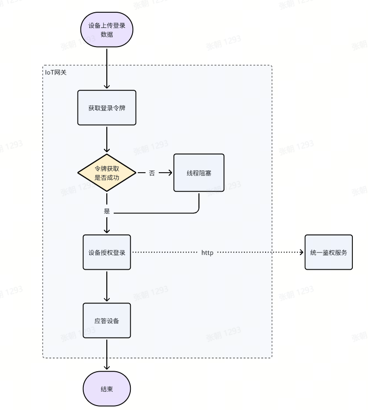

一、概述

负责与各设备及平台通过国标32960、GPS个人类超长待机类、JTT808通讯协议，进行上下行通信，具备连接管理能力

  1. 协议解析：按照协议解析报文，需要处理粘包错包，拦截不符合协议规范的数据包，确保数据传输的准确无误；

  2. 数据处理：基于预设的指令配置规则，网关智能识别并分发不同数据包，实现数据的精准分发与处理，为系统提供高效、有序的数据支持；

  3. 连接管理：确保设备之间的稳定连接和通信，包括设备的发现、注册、认证、连接状态的监控以及连接的断开等；

  4. 指令下发：接收业务系统http接口调用，通过TCP连接将指令发送至设备，频繁请求时延迟下发，防止设备过载；

  5. 设备登录：采用虚拟线程技术，通过HTTP请求统一鉴权服务进行高效认证，针对大量并发登录请求，实施了令牌桶限流策略，有效防止服务器过载，保障服务的稳定运行；

<!-- 这是一张图片，ocr 内容为： -->


二、协议解析

按照协议解析报文，需要处理粘包错包，拦截不符合协议规范的数据包，确保数据传输的准确无误，以国标32960协议为例

1. 协议包结构

<!-- 这是一张图片，ocr 内容为： -->


2. 示例代码

```java
public class VdsByteArrayDecoder extends ByteToMessageDecoder {
    //最小包大小
    private static final int MIN_LEN = 25;
    private static final int MAX_LEN = 4096;

    @Override
    protected final void decode(ChannelHandlerContext ctx, ByteBuf in, List<Object> out) {
        // 剩余字节数
        int len = in.readableBytes();

        // 数据包数据未到齐，继续等待
        if(len < MIN_LEN){
            return;
        }

        // 查找0x2323起始位置
        int start = indexOf(in);
        if (start == -1) {
            //未找到0x2323，跳过剩余字节（保留最后一个字节，防止最后一个字节是0x23）
            in.skipBytes(len - 1);
            return;
        }

        // 跳过无效数据
        if (start > 0) {
            in.skipBytes(start);
            // 再次检查剩余字节数，数据包数据未到齐，继续等待
            len = in.readableBytes();
            if(len < MIN_LEN){
                return;
            }
        }

        // 读取数据体长度
        int dataLen = in.getShort(in.readerIndex() + 22);
        int totalLen = MIN_LEN + dataLen;

        // 数据长度超过最大长度，跳过无效数据
        if(dataLen > MAX_LEN){
            in.skipBytes(len);
            log.warn("数据长度超过最大长度, dataLen:{}, channelId:{}", dataLen, ctx.channel().id());
            return;
        }

        // 数据包数据未到齐，继续等待
        if (len < totalLen) {
            return;
        }

        ByteBuf buf = in.readRetainedSlice(totalLen);
        byte[] bytes = ByteBufUtil.getBytes(buf);
        buf.release();
        out.add(bytes);
    }

    /**
     * 在ByteBuf haystack中查找由两个字节0x23组成的子序列的起始位置。
     */
    public static int indexOf(ByteBuf haystack) {
        int haystackIndex = haystack.readerIndex(); // haystack的当前读取索引
        int writerIndex = haystack.writerIndex(); // 只计算一次writerIndex

        while (haystackIndex < writerIndex - 1) { // 只需要检查到writerIndex - 1，因为需要两个字节
            if (haystack.getByte(haystackIndex) == 0x23 && haystack.getByte(haystackIndex + 1) == 0x23) {
                // 在haystack中找到了子序列！
                return haystackIndex - haystack.readerIndex(); // 返回子序列在haystack中的起始位置
            }
            haystackIndex++; // 移动到下一个位置检查
        }
        return -1; // 如果没有找到子序列，则返回-1
    }
}
```

三、连接管理

1. 利用本地内存中的HashMap高效存储所有设备的TCP连接，实现快速的查找、插入及删除操作；

2. 每台设备仅维持一个活跃连接，以避免因频繁创建连接而对服务器造成过大压力；

1. 流程图

<!-- 这是一张图片，ocr 内容为： -->


2. 示例代码

```java
/**
 * 将识别码与通道关联信息存在map中
 */
private final Map<String, Channel> channelMap = new ConcurrentHashMap<>();

/**
 * 设备登录成功
 */
public void login(Channel channel, String uid) {
    //将channel存储至内存
    Channel oldChannel = channelMap.put(uid, channel);
    //内存已存在连接，关闭旧连接，同一设备只允许建立一个连接
    if (oldChannel != null) {
        log.warn("{}重复登录，关闭旧连接", uid);
        oldChannel.close();
    }
    //连接关闭时清除内存信息
    channel.closeFuture().addListener(future -> {
        Channel currChannel = channelMap.get(uid);
        if(currChannel != null && !currChannel.isActive()){
            log.warn("{}连接关闭，删除内存通道, channelId:{}", uid, channel.id());
            channelMap.remove(uid);

            //异步处理设备退出
            Thread.ofVirtual().start(() -> deviceAuthService.logout(uid, SessionUtils.logSwitch(currChannel)));
        }
    });
}
```

四、数据处理

基于预设的指令配置规则，网关智能识别并分发不同数据包，实现数据的精准分发与处理，为系统提供高效、有序的数据支持

1. 流程图

<!-- 这是一张图片，ocr 内容为： -->


2.示例代码

```java
/**
 * 处理客户端发送的数据
 */
private void process(Channel channel, P32960Header header, byte[] bytes, boolean logSwitch, String payload){
    //未登录，直接关闭连接
    if (!SessionUtils.isLogined(channel)) {
        channel.close();
        return;
    }

    //获取指令配置，如果没有配置，则忽略该数据
    CmdConfig cmdConfig = cmdConfigCacheService.getCmdConfig(header.getCmd());
    if(cmdConfig == null){
        log.warn("指令配置为空！uid:{}, cmd:{}", header.getUid(), header.getCmd());
        return;
    }

    //无效数据，直接忽略
    if (SessionUtils.isInvalid(channel)) {
        SessionUtils.sendResp(channel, header.getUid(), header.getCmd(), RespFlagConstants.SUCCESS, logSwitch, payload, null);
        return;
    }

    //判断是否需要将数据发送到Kafka
    if(cmdConfig.getKafka() != null && cmdConfig.getKafka()){
        //匹配上下文
        Object context = matchContext(channel, header.getCmd(), cmdConfig.getDown());

        //发送数据到Kafka
        sendToKafka(header, bytes, channel, context);
    }

    //是否需要回调服务
    if(StringUtils.isNotBlank(cmdConfig.getCallbackAddress())){
        CallbackReq req = new CallbackReq();
        req.setUid(header.getUid());
        req.setCmd(header.getCmd());
        req.setRespFlag(header.getAck());
        req.setPayload(payload);

        //异步处理回调
        Thread.ofVirtual().start(() ->{
            CallbackRes callbackRes = shadowService.callbackApi(cmdConfig.getCallbackAddress(), req, logSwitch);

            //根据回调服务的响应，发送应答数据
            if(callbackRes != null){
                SessionUtils.sendResp(channel, header.getUid(), callbackRes.getCmd(), callbackRes.getRespFlag(), logSwitch, payload, callbackRes.getPayload());
            }
        });
        return;
    }

    //成功响应非下行指令
    if(cmdConfig.getDown() == null || !cmdConfig.getDown()){
        SessionUtils.sendResp(channel, header.getUid(), header.getCmd(), RespFlagConstants.SUCCESS, logSwitch, payload, null);
    }
}
```

五、指令下发

接收业务系统http接口调用，通过TCP连接将指令发送至设备，频繁请求时延迟下发，防止设备过载

1. 流程图

<!-- 这是一张图片，ocr 内容为： -->


2. 示例代码

```java
/**
 * 下发指令
 */
public Response push(PushReq req){
if (StringUtils.isBlank(req.getUid())) {
    return Response.error("识别码不能为空");
}

if (req.getCmd() == null) {
    return Response.error("指令不能为空");
}

//根据设备uid获取通道
Channel channel = channelMap.get(req.getUid());

//设备不在线，直接返回
if(channel == null || !channel.isActive()){
    return Response.error("设备不在线");
}

//延迟推送，防止设备过载
SessionUtils.delayPush(channel, delayTime);

//日志开关为true，记录日志
boolean logEnabled = SessionUtils.logSwitch(channel);
logEnabled = enableAllLog || logEnabled;

//记录context，设备上报应答需要匹配
ConcurrentHashMap<Integer, Object> contextMap = channel.attr(Attributes.CONTEXT).get();
if (req.getContext() != null) {
    contextMap.put(req.getCmd(), req.getContext());
}else {
    contextMap.remove(req.getCmd());
}

//给设备发送指令
SessionUtils.sendResp(channel, req.getUid(), req.getCmd(), req.getRespFlag(), logEnabled, null, req.getPayload());
return Response.succeed("指令已下发");
}

/**
 * 延迟下发，防止设备过载
 * @param delayTime 延迟时间，单位：ms
 */
public static void delayPush(Channel channel, int delayTime) {
    Long latestPushTime = channel.attr(Attributes.LATEST_PUSH_TIME).get();
    channel.attr(Attributes.LATEST_PUSH_TIME).set(System.currentTimeMillis());
    if (latestPushTime == null) {
        return;
    }

    //上次发送时间距当前时间小于延迟时间，则等待
    long timeDiff = System.currentTimeMillis() - latestPushTime;
    log.debug("delayPush timeDiff:{}", timeDiff);
    if(timeDiff < delayTime){
        try {
            Thread.sleep(delayTime);
        } catch (InterruptedException e) {
            throw new RuntimeException(e);
        }
    }
}
```

六、设备登录

采用虚拟线程技术，通过HTTP请求统一鉴权服务进行高效认证，针对大量并发登录请求，实施了令牌桶限流策略，有效防止服务器过载，保障服务的稳定运行

1. 流程图

<!-- 这是一张图片，ocr 内容为： -->


2. 示例代码

```java
//异步处理登录
Thread.ofVirtual().start(() ->{
    Response<TboxLoginRes> loginResponse = deviceAuthService.login(header.getUid(), logSwitch);
});

/**
 * 设备登录
 */
public Response<TboxLoginRes> login(String uid, boolean logSwitch) {
    //登录速度限制，如果没有可用的许可，当前线程会等待
    double limitTime = rateLimiter.acquire();
    if(limitTime > 0){
        log.info("uid：{},登录速度限制已等待{}秒", uid, limitTime);
    }

    //登录鉴权
    TboxLoginReq loginReq = new TboxLoginReq();
    loginReq.setUid(uid);
    loginReq.setGatewayIp(serverIp);
    loginReq.setGatewayPort(serverPort);
    if(logSwitch){
        log.info("====调用统计鉴权接口-设备登录begin===========, 入参：{}", JSONObject.toJSONString(loginReq));
    }
    Response<TboxLoginRes> response = deviceAuthApi.tboxLogin(loginReq);
    if(logSwitch){
        log.info("====调用统计鉴权接口-设备登录end===========, 出参：{}", JSONObject.toJSONString(response));
    }
    return response;
}
```
