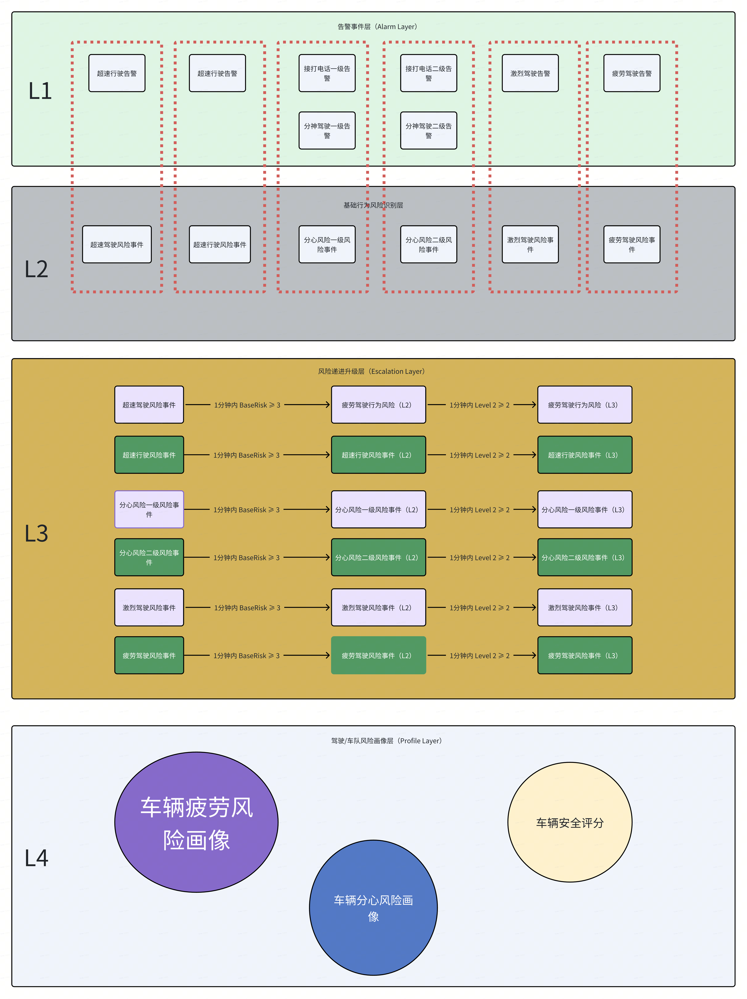
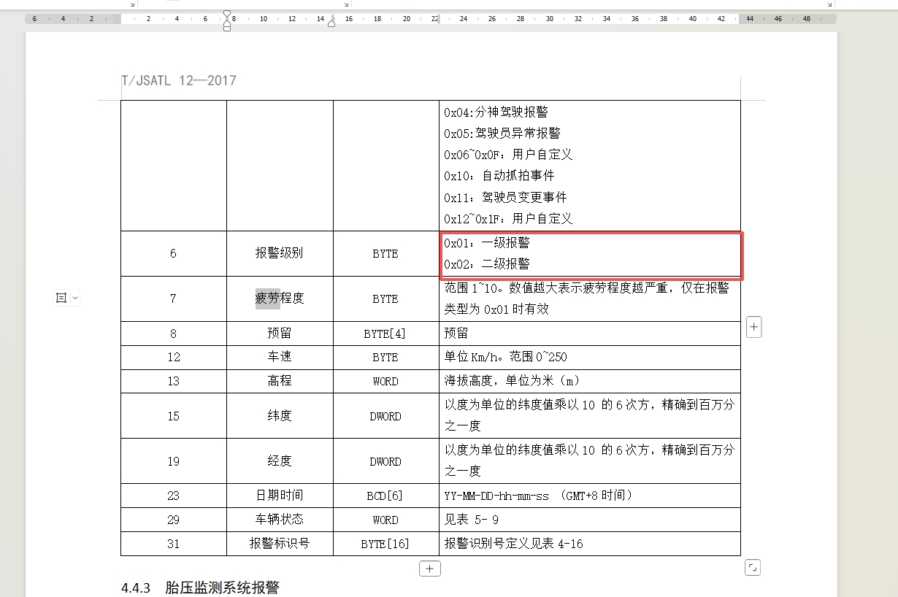
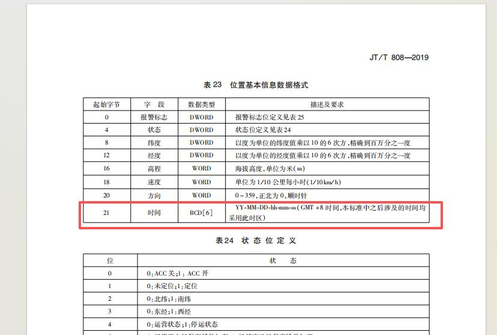

## 一、设计理念：从单层聚合 → 多层风险模型
传统的风险聚合方案只是 “**告警 → 风险事件**”， 但在复杂车联网与物联网场景中，**单层规则往往不足以表达业务逻辑的复杂性**。

例如：

+ 一辆车可能在短时间内触发多个低级风险（疲劳驾驶、超速驾驶）
+ 这些风险如果在一个更大窗口内反复出现，就意味着“高风险驾驶行为”
+ 再进一步，某个驾驶员若长期在不同车辆中都有风险行为，就属于“危险驾驶员风险”

于是就形成了：

`告警（Alarm）→ 基础风险事件（RiskEvent） → 风险递进升级层（AggregatedRisk） → 终极风险画像（RiskProfile）`

这就是要构建的 **分层风险聚合架构**。

## 二、架构总览：多层风险聚合体系
整体上可以抽象为四层：

| **<font style="color:rgb(0, 0, 0);">层级</font>** | **<font style="color:rgb(0, 0, 0);">层名</font>** | **<font style="color:rgb(0, 0, 0);">输入</font>** | **<font style="color:rgb(0, 0, 0);">输出</font>** | **<font style="color:rgb(0, 0, 0);">目标</font>** |
| --- | --- | --- | --- | --- |
| <font style="color:rgb(0, 0, 0);">L1</font> | <font style="color:rgb(0, 0, 0);">告警事件层（Alarm Layer）</font> | <font style="color:rgb(0, 0, 0);">各种告警数据流</font> | <font style="color:rgb(0, 0, 0);">标准化告警事件</font> | <font style="color:rgb(0, 0, 0);">数据清洗与统一</font> |
| <font style="color:rgb(0, 0, 0);">L2</font> | <font style="color:rgb(0, 0, 0);">基础风险设别层（Risk Event Layer）</font> | <font style="color:rgb(0, 0, 0);">告警事件流</font> | <font style="color:rgb(0, 0, 0);">风险事件（如“疲劳驾驶风险”）</font> | <font style="color:rgb(0, 0, 0);">时间/空间维度聚合</font> |
| <font style="color:rgb(0, 0, 0);">L3</font> | <font style="color:rgb(0, 0, 0);">风险递进升级层（Meta Risk Layer）</font> | <font style="color:rgb(0, 0, 0);">风险事件流</font> | <font style="color:rgb(0, 0, 0);">聚合风险（如“高危驾驶风险”）</font> | <font style="color:rgb(0, 0, 0);">跨时间、跨场景聚合</font> |
| <font style="color:rgb(0, 0, 0);">L4</font> | <font style="color:rgb(0, 0, 0);">风险画像层（Risk Profile Layer）</font> | <font style="color:rgb(0, 0, 0);">风险事件历史</font> | <font style="color:rgb(0, 0, 0);">驾驶员/车辆风险画像</font> | <font style="color:rgb(0, 0, 0);">长期风险趋势建模</font> |

**架构图示（逻辑流）**：

`告警流（Kafka）  
`` ↓``[ L1 ] 告警标准化 → 清洗、分类、补齐元数据  
`` ↓``[ L2 ] 风险事件聚合（短窗口）→ 生成车辆风险事件  
`` ↓``[ L3 ] 多风险融合（长窗口）→ 生成高等级风险事件  
`` ↓``[ L4 ] 风险画像计算（离线/流式）→ 驾驶员/车队风险画像  
`` ↓  
``Doris / RocketMQ / 告警中心`

（**ThingsBoard、Splunk、Azure IoT Central、AWS IoT Events、Tuya IoT** 等）都采用了类似架构。

架构层级图

<!-- 这是一张图片，ocr 内容为： -->


## 三、告警事件层（Alarm Layer）-上游已提供
**上游会将设备上报的原始数据，经过解析，包装，过滤，然后将消息传递到Kafka中，供本聚合服务使用/其他业务服务使用。**

### 上游告警事件模型
```java
/**
 * 告警推送模型
 */
@ProducerTopic(value = "dst_v2x_adas_business_data_report_topic", tag = "adas_alarm_data")
public class AlarmRecordMqttModel extends SinkModel {

    /**
     * 告警id
     */
    private String alarmId;

    /**
     * 车辆vin
     */
    private String carVin;

    /**
     * 摄像id
     */
    private Long driverPhotoId = 0L;

    /**
     * 风险等级
     */
    private Integer riskLevel;

    /**
     * 告警来源
     */
    private Integer alarmSouce;

    /**
     * 告警类型
     */
    private Integer alarmType;

    /**
     * 告警开始时间
     */
    private Long alarmStartTime;

    /**
     * 有证据？  那个报警时间的=？
     */
    private Integer hasEvidence;

    /**
     * 告警结束时间
     */
    private Long alarmEndTime;

    /**
     * 经纬度
     */
    private String startLongitude;
    private String startLatitude;
    private String endLongitude;
    private String endLatitude;

    /**
     *
     */
    private Integer mark;

}
```

### 告警事件模型解释
#### 告警事件id(alarmId): 该字段有上游生产，并非数据包自带告警事件流水ID,md5（vin+报警类型+报警时间）
#### 风险等级(riskLevel): 默认取的是协议的告警等级，如果为空就默认为2（比如国标告警超时或超速）
<!-- 这是一张图片，ocr 内容为： -->


#### **告警的开始时间和结束时间（alarmStartTime/alarmEndTime）:国标报文的时间**
<!-- 这是一张图片，ocr 内容为： -->


#### **标志状态（mark）**
国标协议告警：比如超时和超速，这种是基于持续状态的，比如开始超速的时候发一条开始告警事件，到结束超速的时候在发一条结束告警事件

苏标协议告警：比如疲劳驾驶，这是是基于次数的，疲劳状态出来了就一直报开始告警事件，没有疲劳状态就发一条结束告警事件

mark字段的取值定义：0：开始告警，1：结束告警

<font style="background-color:rgba(254,212,164,0.8);">（最后不管是什么告警事件、都会产生开始和结束两条告警、mark也必然有值、mark的值 和 告警开始时间和结束时间联动有值）</font>

#### **告警类型**
##### 一、ADAS（高级驾驶辅助系统）风险类型
| 风险编号 | 风险名称 | 说明 |
| :--- | :--- | :--- |
| 1001 | 前向碰撞报警 | 检测前方存在潜在碰撞风险时触发 |
| 1002 | 车道偏离报警 | 车辆偏离当前车道时触发 |
| 1003 | 车距过近报警 | 与前车距离过近时触发 |
| 1004 | 行人碰撞报警 | 检测到与行人碰撞风险时触发 |
| 1005 | 频繁变道报警 | 车辆频繁变换车道时触发 |
| 1006 | 道路标识超限报警 | 检测到车辆违反道路限速或限高标识 |
| 1007 | 障碍物报警 | 检测到前方存在障碍物时触发 |
| 1012 | 斑马线识别报警 | 识别到斑马线相关风险时触发 |
| 1013 | 实线变道报警 | 检测到车辆在实线上变道时触发 |
| 1016 | 道路标志识别事件 | 识别到道路标志变化事件 |
| 1017 | 主动抓拍事件 | 触发主动拍摄驾驶场景的事件 |
| 6002 | ADAS摄像头遮挡 | 摄像头被遮挡或异常时触发 |
| 9001 | G-sensor碰撞报警 | 检测到车辆碰撞冲击时触发 |

---

##### 二、DMS（驾驶员状态监测）风险类型
| 风险编号 | 风险名称 | 说明 |
| :--- | :--- | :--- |
| 2001 | 疲劳驾驶报警 | 检测到驾驶员出现疲劳迹象 |
| 2002 | 接打电话报警 | 驾驶过程中检测到接打电话行为 |
| 2003 | 抽烟报警 | 驾驶过程中检测到吸烟行为 |
| 2004 | 驾驶员分神报警 | 驾驶员注意力分散时触发 |
| 2005 | 驾驶员异常报警 | 检测到驾驶员状态异常（如昏厥等） |
| 2006 | 玩手机报警 | 驾驶过程中检测到使用手机 |
| 2016 | 自动抓拍事件 | 系统自动拍摄事件（如异常行为） |
| 2017 | 驾驶员变更事件 | 检测到驾驶员身份变化 |
| 2018 | DMS摄像头遮挡 | 驾驶员监控摄像头被遮挡 |
| 2019 | 安全带报警 | 驾驶员未系安全带时触发 |
| 6001 | DSM摄像头遮挡 | 驾驶行为监控摄像头被遮挡 |

---

##### 三、倒车辅助风险类型
| 风险编号 | 风险名称 | 说明 |
| :--- | :--- | :--- |
| 4001 | 后方接近报警 | 倒车过程中检测到后方物体接近 |
| 4002 | 左侧后方接近报警 | 倒车过程中检测到左后方障碍物接近 |
| 4003 | 右侧后方接近报警 | 倒车过程中检测到右后方障碍物接近 |

---

##### 四、驾驶行为风险（国标类）
| 风险编号 | 风险名称 | 说明 |
| :--- | :--- | :--- |
| 5002 | 超速行驶 | 车辆超出道路限速 |
| 5019 | 超时行驶 | 驾驶时间超过规定时长 |

---

### 聚合需要的告警事件模型
```java
/**
 * 告警推送模型
 */
@Data
public class AlarmRecord {

    /**
     * 告警id
     */
    public String alarmId;

    /**
     * 车辆vin
     */
    public String carVin;

    /**
     * 风险等级 1.为一级告警事件；2。为二级告警事件  默认取的是协议的告警等级，如果为空就默认为2（比如国标告警超时或超速）
     */
    public Integer riskLevel;

    /**
     * 告警类型
     */
    public Integer alarmType;

    /**
     * 告警开始时间
     */
    public Long alarmStartTime;

    /**
     * 告警结束时间
     */
    public Long alarmEndTime;

    /**
     * 0：开始事件  1：结束事件
     * 按苏标【标志状态】
     * 苏标0就发完0 再发1
     * 苏标1就发0
     * 苏标2就发1
     * 国标以及视频遮挡报警（状态变更触发）
     * 判断状态报警就发0  状态正常就发1
     */
    public Integer mark;

}
```
