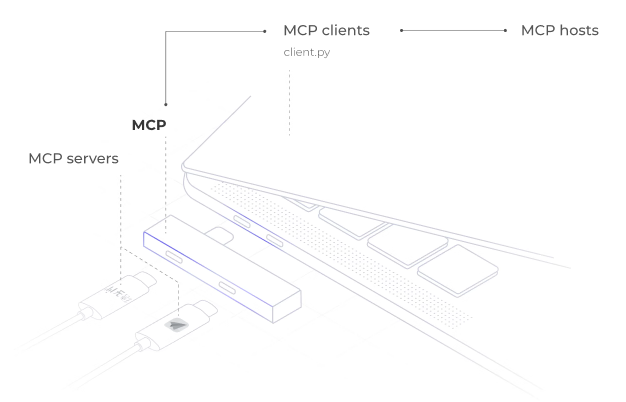

# 一、什么是 MCP？

MCP 全称 **Model Context Protocol**，直译就是 **模型上下文协议**。它是一个 **标准协议**，用于让 **大模型（LLM）和外部应用/工具** 能够方便、安全地交互。

可以简单理解为：👉 MCP 就像是 **“大模型的 USB 接口”**，通过统一的方式，把模型和各种系统（数据库、业务系统、工具）接起来。

---

# 二、MCP 解决了什么问题？

**大模型接入复杂**
   - 不同系统、工具、数据库接口不统一，开发人员需要反复写适配代码。
   - MCP 定义了统一规范，让模型调用外部能力更容易。
2. **安全和权限控制**
   - 模型调用外部工具时，需要明确控制权限，避免越权访问。
   - MCP 在协议层面规定了调用范围和权限声明。
3. **上下文一致性**
   - 大模型需要在对话时记住状态和上下文。
   - MCP 提供了结构化方式来携带上下文，让模型更稳定地调用工具。

---

# 三、 MCP 的优势

- **统一标准**：像 USB 一样，大模型和工具只要支持 MCP，就能快速互通。
- **降低成本**：开发者不用重复写适配代码，直接按协议接入。
- **安全合规**：支持权限声明和调用隔离，更适合在企业环境落地。
- **扩展灵活**：可以随时增加新工具/数据源，而不用改模型本身。

---

👉 总结一句：**MCP 让大模型更容易、安全地接入外部业务系统，就像给模型装上了“标准化接口”。**

# 四、 MCP server

**MCP Server** 就是 MCP  协议的 **具体实现端**，负责把企业的 **业务系统、数据库、工具** 暴露出来，供大模型调用。

**MCP Server = 把内部系统包装成标准接口的“翻译官”**。

模型通过 MCP Client 发送请求，MCP Server 把请求转化为业务系统能理解的操作，再把结果返回给模型。

- **标准化**：不管后端是什么系统（MySQL、Redis、车联网平台 API），只要包装成 MCP Server，就能被大模型统一调用。
- **解耦**：业务系统不用直接暴露给模型，先通过 MCP Server 做一层隔离。
- **可控**：可以控制模型能用哪些工具、查哪些数据，降低风险。

其实这里就会发现，mcp-server其实很类似java中的微服务，而且公司中真正需要调有mcp-server的能力时，大部分其实是业务上需求，而不是工具能力，利用AI智能的去控制业务，所以个人推测，如果以后mcp会大幅度流行，那个mcp-server这里java会是未来的开发大头。

# 五、MCP clients

- **连接大模型和 MCP Server**
- Client 知道 MCP Server 提供了哪些功能（工具/数据）。
- 它帮模型把“自然语言需求”翻译成 MCP 请求，再发给 Server。
- **调用外部工具/系统**
- 比如：
- 查数据库
- 读取知识库
- 调用车联网的接口
- Client 会把调用结果再传回给模型。
- **对话上下文结合**
- Client 还能把 MCP Server 返回的数据和用户对话结合，让结果更自然地呈现给业务人员。

很多 AI 应用开发平台，本身集成了 MCP clients 的能力，比如Cursor,Dify等

# 六、MCP host

### 📌 MCPHost 是什么？

- **MCPHost = 大模型运行的环境/宿主**。
- 它的作用是：
- 托管大模型本身（比如 Claude、GPT 等）。
- 同时管理 MCP Client 和 MCP Server 的交互。

可以把它理解成：👉 **MCPHost 就是“大脑所在的房子”，里面住着模型，还连着插座（MCP Client）去用电器（MCP Server 提供的工具）。**

---

### 📌 MCPHost 的作用

4. **承载大模型**
   - MCPHost 提供运行环境，让大模型可以在其中工作。
5. **连接 Client 和 Server**
   - MCPHost 知道有哪些 MCP Client（比如 Cursor、Dify）。
   - MCPHost 会帮这些 Client 通过协议调用 MCP Server。
6. **权限 & 安全**
   - MCPHost 控制模型能不能访问某个 MCP Server，保证调用安全。

---

### 📌 举个例子

假设我们用 **Claude 桌面版**（它就是一个 MCPHost）：

7. Claude 作为大模型，运行在 MCPHost（Claude App）。
8. MCPHost 里加载了 MCP Client（Claude 支持的工具调用）。
9. MCP Client 通过 MCP 协议，调用外部 MCP Server（比如数据库服务、车联网接口）。
10. 结果返回到 Claude，再呈现给用户。

---

### 📌 总结

- **MCPHost = 宿主环境**，负责托管模型并协调 Client/Server。
- **MCP Client = 调用端**，是模型用来“伸手”的工具（如 Cursor、Dify）。
- **MCP Server = 能力端**，把企业系统/工具暴露出来（如车辆数据库、指令下发接口）。

---

👉 一句话：**MCPHost = 装大模型的房子，里面的模型通过 MCP Client 去调用外部 MCP Server 提供的能力。**

# **七、MCP 的通信机制**

根据 MCP 的规范，当前支持两种通信机制（传输方式）：

- stdio(标准输入输出)：主要用在本地服务上，操作你本地的软件或者本地的文

件。比如 Blender 这种就只能用 Stdio 因为他没有在线服务。 MCP默认通信方式

- SSE(Server-Sent Events)：主要用在远程通信服务上，这个服务本身就有在线

的 API，比如访问你的谷歌邮件，天气情况等。

### （一）MCP的通信机制：Stdio方式

**优点**

- 这种方式适用于客户端和服务器在同一台机器上运行的场景，简单。
- stdio模式无需外部网络依赖，通信速度快，适合快速响应的本地应用。
- 可靠性高，且易于调试

**缺点**

- Stdio 的配置比较复杂，我们需要做些准备工作，你需要提前安装需要的命令行工具。
- stdio模式为单进程通信，无法并行处理多个客户端请求，同时由于进程资源开销较大，不适合

在本地运行大量服务。（限制了其在更复杂分布式场景中的使用）

（stdio的本地环境有两种：一种是Python 编写的服务，一种用TypeScript 编写的服务。分别对应着uvx 和 npx 两种指令）

**uvx**：对应的就是python写的mcp-server，然后本地运行，那么当然需要前置安装python的运行环境，pip install uv，这个是轻量级的

**npx**：对应的就是nodejs

### **（二）**MCP的通信机制：**SSE方式**

**场景**

- SSE方式适用于客户端和服务器位于不同物理位置的场景。
- 适用于实时数据更新、消息推送、轻量级监控和实时日志流等场景
- 对于分布式或远程部署的场景，基于 HTTP 和 SSE 的传输方式则更为合适。
- 配置方式非常简单，基本上就一个链接就行，直接复制他的链接填上就行

目前分为了两种，一种是标准SSE,一种就是基于WebSocket SSE。
