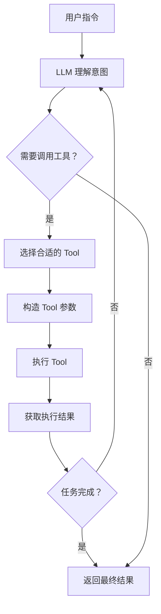
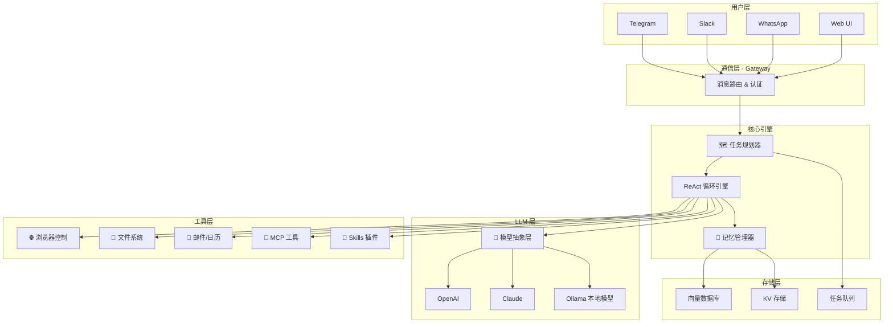

本页面以当前最火的开源 AI Agent 框架 **OpenClaw**（小龙虾）为案例，系统拆解 AI Agent 的核心原理与实现机制，帮助你「边干边学」掌握 Agent 开发。

---

## 一、什么是 AI Agent？从聊天到执行的跨越

### 1.1 传统 LLM vs AI Agent

| **维度** | **传统 LLM（ChatGPT/Claude）** | **AI Agent（OpenClaw）** |
| --- | --- | --- |
| 交互模式 | 一问一答，用户驱动 | 目标驱动，自主规划+执行 |
| 执行能力 | 只输出文本/代码 | 直接操作电脑、调用 API、读写文件 |
| 记忆 | 上下文窗口内，会话结束即丢失 | 长期持久记忆，跨会话保留 |
| 通信 | 网页/API 界面 | Slack、Telegram、WhatsApp 等多渠道 |
| 运行方式 | 被动响应 | 心跳机制，主动执行定时任务 |

### 1.2 一句话定义

<div class="callout callout-tip" markdown="1">
**AI Agent = LLM（大脑）+ Tools（手脚）+ Memory（记忆）+ Planning（规划）+ Communication（通道）**
</div>

OpenClaw 的本质不是聊天机器人，而是一个**可编排流程的 AI 执行引擎**——它让 AI 从「出主意」进化到「亲自动手做事」。

---

## 二、OpenClaw 的前世今生

### 2.1 发展时间线

- **2025.11** — 奥地利工程师 Peter Steinberger 发布开源项目 **Clawdbot**（名字谐音 Claude + Claw 🦞）
- **2026.01** — 因商标原因更名为 **Moltbot**，随后定名 **OpenClaw**，GitHub Star 爆发式增长
- **2026.02** — Peter Steinberger 加入 OpenAI，OpenClaw 转型为**独立开源基金会**，获 OpenAI 持续赞助
- **2026.03** — GitHub Star 突破 27 万+，登顶全球开源项目历史第一；黄仁勋在 GTC 2026 称其为「有史以来最重要的软件发布」
- **2026.03** — 国内巨头纷纷入局：腾讯 WorkBuddy（QClaw）、阿里 CoPaw、字节火山引擎等

### 2.2 为什么叫「小龙虾」？

名字里藏着 **Claw（螯）** 这个字，作者的设计意图是「a playful pun on Claude with a claw」——既与 Claude 谐音，又用螯的意象让人联想到龙虾。社区亲切地称其为「小龙虾」，安装配置的过程被戏称为「养虾」🦞。

---

## 三、核心架构：六大能力模块

这是学习 AI Agent 最重要的部分。OpenClaw 的架构可以拆解为 **6 个关键能力模块**，每个模块都对应着 AI Agent 开发的核心概念。

### 3.1 🧠 LLM 推理核心（大脑）

<div class="callout callout-note" markdown="1">
**对应概念：Model Provider / LLM Backbone**
</div>

OpenClaw 不绑定单一模型，而是**模型无关（Model-Agnostic）** 的设计：

- 支持 OpenAI（GPT-4o）、Anthropic（Claude）、Google（Gemini）
- 支持本地开源模型（通过 Ollama 接入 Qwen、DeepSeek 等）
- 通过统一的 API 接口层抽象，切换模型只需改配置

**学习要点：**

1. Agent 的「智能」来源于 LLM，但 Agent ≠ LLM
2. 模型选择影响推理质量、速度和成本（Token 计费）
3. 架构上要做好 **Provider 抽象层**，便于切换模型

```python
# 简化示例：模型抽象层
class LLMProvider:
    def chat(self, messages: list, tools: list = None) -> Response:
        """统一接口，底层可切换 OpenAI / Claude / Ollama"""
        pass
```

### 3.2 🔧 工具调用系统（手脚）

<div class="callout callout-note" markdown="1">
**对应概念：Tool Use / Function Calling / MCP**
</div>

这是 Agent 区别于普通 LLM 的**最关键能力**。OpenClaw 通过工具让 AI 真正「动手」：

- **浏览器控制**：像真人一样浏览网页、填写表单、提取数据
- **文件系统**：读写文件、执行 Shell 指令、运行脚本
- **API 调用**：调用外部服务（邮件、日历、数据库等）
- **MCP 协议**：Model Context Protocol，统一的工具接口标准

**工具调用流程（核心循环）：**



**学习要点：**

4. 工具定义 = **名称 + 描述 + 参数 Schema + 执行函数**
5. LLM 通过 Function Calling 决定调用哪个工具、传什么参数
6. MCP 是新兴的工具接口标准，你之前做的 [SpringAI开发MCP-Server（一）：0-1的搭建与实现](/2025/10/27/springai-mcp-server-01/) 就是这个思路
7. **沙箱隔离**很重要——工具权限需要精细控制

### 3.3 📝 持久记忆系统（记忆）

<div class="callout callout-note" markdown="1">
**对应概念：Memory / Context Management / RAG**
</div>

OpenClaw 拥有跨会话的长期记忆机制：

- **短期记忆**：当前对话的上下文（Context Window）
- **长期记忆**：持久化存储用户偏好、历史任务、学习到的模式
- **工作记忆**：当前任务的中间状态和执行进度

**记忆实现方式：**

| **记忆类型** | **存储方式** | **生命周期** | **典型技术** |
| --- | --- | --- | --- |
| 短期记忆 | 消息数组 | 单次会话 | Prompt 拼接 |
| 长期记忆 | 向量数据库 + KV 存储 | 永久 | RAG / Embedding |
| 工作记忆 | 任务状态机 | 单次任务 | JSON/DB 持久化 |

**学习要点：**

8. 记忆让 Agent 越用越「懂你」，是个性化的关键
9. 你之前学的 [02 · RAG 与知识库](/2026/05/20/ai-learning-02-rag/) 就是长期记忆的核心实现方式
10. 如何在 Token 有限的情况下**检索最相关的记忆**，是工程难点

### 3.4 🗺️ 任务规划与推理（规划）

<div class="callout callout-note" markdown="1">
**对应概念：Planning / ReAct / Chain-of-Thought**
</div>

Agent 接收到一个复杂任务后，不是一步到位，而是**自主拆解 → 逐步执行 → 动态调整**：

**以「帮我整理本季竞品分析报告」为例：**

11. **接收指令** → 理解任务目标
12. **规划执行步骤** → 拆解：搜集竞品信息 → 整理大纲 → 生成报告
13. **调用工具逐步执行** →
    - 调用浏览器工具，搜索竞品官网、新闻
    - 整理并摘要关键信息
    - 调用 Google Slides API 生成报告
14. **遇到分歧主动确认** → 「XX 公司定价找不到，要跳过还是用估算值？」
15. **完成后回报** → 返回链接 + 执行摘要

**核心模式：ReAct（Reasoning + Acting）**

```javascript
Thought: 我需要先搜索竞品 A 的最新产品信息
Action: browser.search("竞品A 2026 新产品发布")
Observation: 找到 3 篇相关文章...
Thought: 信息已够，现在搜索竞品 B
Action: browser.search("竞品B 2026 产品线")
...
Thought: 所有信息收集完毕，开始整理报告
Action: slides.create(title="Q1 竞品分析", content=...)
```

**学习要点：**

16. **ReAct 模式**（Thought → Action → Observation 循环）是当前 Agent 主流架构
17. 规划能力直接取决于 LLM 的推理质量
18. 好的 Agent 会在不确定时**主动询问**而不是瞎猜

### 3.5 💬 多渠道通信（通道）

<div class="callout callout-note" markdown="1">
**对应概念：Communication Channel / Gateway**
</div>

OpenClaw 深度集成多种通信渠道：

- **即时通讯**：Telegram、WhatsApp、Slack、Discord、iMessage
- **Web UI**：本地 Gateway 提供的管理界面
- **API**：RESTful API 供外部系统调用

用户不需要打开专门的界面，直接在常用的聊天工具里给 Agent 发消息即可。这是 OpenClaw「养虾」体验的核心——它像一个真正的远程助理。

**学习要点：**

19. 多渠道接入需要一个**统一的消息路由层**
20. 每个渠道有不同的消息格式、限制、能力（图片/文件/按钮等）
21. Gateway 组件负责：消息收发、认证、会话管理

### 3.6 💓 心跳机制（自主性）

<div class="callout callout-note" markdown="1">
**对应概念：Heartbeat / Scheduled Task / Proactive Agent**
</div>

OpenClaw 最具特色的功能之一——**Heartbeat 心跳机制**：

- Agent 每隔一段时间（默认 30 分钟）自动「醒来」
- 检查是否有新任务、新消息、新数据
- 根据预设指令主动执行操作（如：检查邮件、整理新闻、监控数据）
- 执行完毕后回到「休眠」状态

这让 Agent 从「被动响应」变为「主动服务」，是 AI Agent 区别于传统工具的重要特征。

---

## 四、整体架构图



---

## 五、Skills 技能插件系统

OpenClaw 的扩展能力来自其**技能插件系统（Skills）**，这是一个非常值得学习的架构设计：

### 5.1 什么是 Skill？

每个 Skill 就是一个**可插拔的能力包**，包含：

- 工具定义（Tool Definition）
- 执行逻辑（Implementation）
- 依赖声明（Dependencies）
- 权限要求（Permissions）

### 5.2 Skill 生态

- **内置技能**：文档处理、数据分析、海报绘制、视频生成等 16+ 核心技能
- **社区技能**：5000+ 社区开发的技能，通过 GitHub 安装
- **自定义技能**：用户可以编写自己的 Skill
- **自我进化**：Agent 甚至能自己编写代码来解决新问题

### 5.3 安装方式

```bash
# 从社区安装技能
openclaw skills install <skill-name>

# 搜索可用技能
openclaw skills search <keyword>
```

**学习要点：**

22. 插件系统是 Agent 扩展性的核心——对比你熟悉的 [Agent Skills：从“提示词驱动”到“能力驱动”的智能体架构演进](/2026/05/20/agent-skills-evolution/)
23. 好的 Skill 设计 = 清晰的接口 + 完善的描述（LLM 靠描述决定何时调用）
24. MCP 协议正在成为工具/技能的**统一标准**

---

## 六、安全与风险：Agent 开发必修课

能力越大，风险越大。OpenClaw 的安全问题是学习 Agent 开发**绕不过去的课题**：

### 6.1 核心风险

- [ ] **Prompt Injection**：恶意用户在文档中埋入隐藏指令，劫持 Agent 行为
- [ ] **权限越界**：Agent 以自身凭证访问用户无权查看的数据
- [ ] **会话隔离不足**：多用户共享 Agent 时，上下文互相泄露
- [ ] **网络暴露**：Gateway 绑定 `0.0.0.0` 导致公网可访问
- [ ] **高权限运行**：以 root 身份运行 Agent，被入侵等于丢掉整台机器

### 6.2 防御最佳实践

25. Gateway 绑定 `127.0.0.1`，远程访问用 VPN（如 Tailscale）
26. 以**低权限专用账户**运行，搭配容器沙箱隔离
27. Token 放在 HTTP Header 而非 URL 参数
28. 高风险操作（删除文件、发送邮件）加入**人工确认**流程
29. 定期执行 `openclaw security audit` 检查配置
30. 仅安装经过审查的技能，避免来源不明的插件

---

## 七、与你已有知识的映射

将 OpenClaw 的架构与你已经掌握的技术做对照：

| **OpenClaw 模块** | **你的已有经验** | **深化方向** |
| --- | --- | --- |
| 工具调用 / MCP | SpringAI MCP-Server 开发 | 扩展更多 Tool，理解 Function Calling 协议 |
| 记忆系统 / RAG | RAG 与知识库学习 | 向量检索优化、记忆压缩策略 |
| Skills 技能系统 | DST AI Coding 技能系统 | 设计可复用的 Skill 包，理解 Skill 描述工程 |
| 任务规划 | Agent 与工具调用学习 | ReAct / Plan-and-Execute 等模式 |
| 多 Agent 协作 | skills / spec / 多-Agent 笔记 | Agent 间通信、任务委托、Clawith 团队版 |
| 实时数据处理 | Flink + Kafka 流处理经验 | Agent 事件驱动架构、实时数据 Pipeline |

---

## 八、动手实践路线图

<div class="callout callout-note" markdown="1">
**边干边学：从简单到复杂的 Agent 开发路径**
</div>

### Phase 1：体验与理解（1-2 天）

- [ ] 安装 OpenClaw，完成基础配置
- [ ] 接入一个 LLM（推荐先用 Ollama + Qwen）
- [ ] 通过 Telegram/Slack 与 Agent 交互，体验完整流程
- [ ] 观察 Agent 的 ReAct 日志，理解 Thought → Action → Observation 循环

### Phase 2：开发自定义 Skill（3-5 天）

- [ ] 阅读 OpenClaw Skill 开发文档
- [ ] 开发一个简单的自定义 Skill（比如：查询 GB/T 32960 协议字段）
- [ ] 理解 Tool 描述如何影响 LLM 的调用决策
- [ ] 尝试用 MCP 协议封装你的 Spring Boot 服务为 Agent 工具

### Phase 3：从零构建一个 Mini Agent（1-2 周）

- [ ] 用 Python（LangChain/LlamaIndex）或 Java（Spring AI）搭建最小 Agent
- [ ] 实现核心循环：接收指令 → LLM 推理 → 工具调用 → 返回结果
- [ ] 加入 RAG 记忆模块
- [ ] 加入心跳定时任务
- [ ] 参考你的 [06 · 项目实战：Protocol-32960-Agent（智能协议解析 Agent）](/2026/05/20/ai-learning-06-protocol-32960-agent/) 扩展功能

### Phase 4：进阶——多 Agent 协作（2-4 周）

- [ ] 研究 Clawith（团队版 OpenClaw）的 Multi-Agent 协作模式
- [ ] 实现 Lead Agent + Worker Agent 的任务委托架构
- [ ] 集成到你的车联网/ADAS 工作场景中

---

## 九、推荐学习资源

- **官方文档**：[OpenClaw 官网](https://openclaw.ai/) / [GitHub](https://github.com/openclaw/openclaw)
- **视频教程**：「解剖小龙虾 — 以 OpenClaw 为例介绍 AI Agent 的运作原理」（YouTube 李老师频道，60 万+ 播放）
- **深度文章**：「从写程式到养 Agent：黄仁勋口中『下一个 ChatGPT』，小龙虾凭什么？」
- **你的学习笔记**：
    - **OpenClaw 安装与使用教程**
    - **OpenClaw 高阶使用教程**
    - **03 · Agent 与工具调用**
    - **skills - spec - 多-Agent**

[AI Agent 开发启发录：从 OpenClaw 到自研 Agent](/2026/05/20/openclaw-01-inspiration/)
