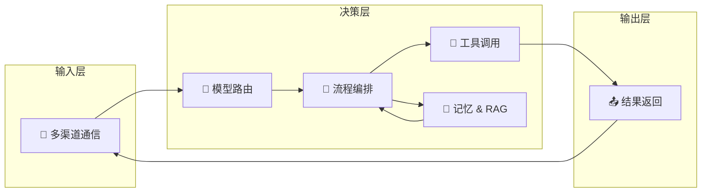

基于 OpenClaw（小龙虾）项目的深度拆解，提炼出 AI Agent 开发的核心启发与可复用模式，为后续自研 Agent 提供系统化的参考框架。

**目标**：不止于理解 OpenClaw，更要将其架构思想转化为可落地的开发能力，构建属于自己的 AI Agent 工具箱。

---

## 核心模块导航

以下子页面按 AI Agent 的关键能力维度组织，每个模块包含：原理解析 → 设计模式 → Python 代码演示 → 实战案例。

[🔄 流程编排：ReAct、Plan-and-Execute 与任务调度](/2026/05/20/openclaw-04-orchestration/)

[🧠 记忆系统与 RAG：让 Agent 越用越聪明](/2026/05/20/openclaw-02-memory-rag/)

[🔧 工具调用与 MCP：让 Agent 真正动手做事](/2026/05/20/openclaw-03-tools-mcp/)

[💬 多渠道通信与 Gateway：统一消息路由](/2026/05/20/openclaw-06-gateway/)

[🔀 模型路由与 Provider 抽象：智能选择最优模型](/2026/05/20/openclaw-05-model-routing/)

---

## 模块关系总览

---

## 技术栈建议

| **层次** | **推荐技术** | **备注** |
| --- | --- | --- |
| Agent 框架 | LangChain / LangGraph / LlamaIndex | Python 生态首选，LangGraph 适合复杂流程编排 |
| 模型接入 | OpenAI API / Ollama / LiteLLM | LiteLLM 做模型路由统一层 |
| 向量数据库 | ChromaDB / Milvus / Qdrant | ChromaDB 本地开发快速上手 |
| 工具协议 | MCP / Function Calling | MCP 是趋势，结合已有 Spring AI 经验 |
| 通信网关 | FastAPI / WebSocket | 轻量且易扩展 |
| Java 方向 | Spring AI / Spring Boot | 与已有车联网项目整合 |

---

## 学习路径建议

1. **先跑通流程编排**——理解 ReAct 循环是一切的基础
2. **加入工具调用**——让 Agent 能执行真实操作
3. **接入 RAG 记忆**——赋予 Agent 长期记忆能力
4. **实现模型路由**——优化成本与性能
5. **搭建通信网关**——让 Agent 服务化，多渠道可达

**Protocol-32960-Agent V2 详细设计方案（AI Code 实现版）**
