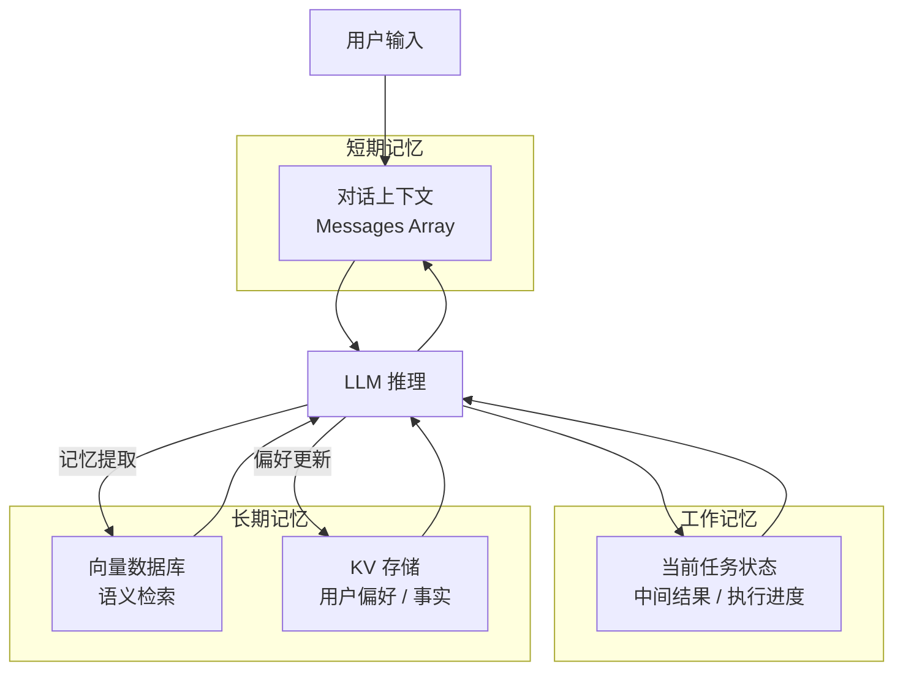
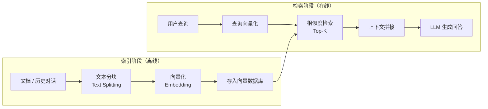

记忆是 Agent 从「一次性对话工具」进化为「长期私人助理」的关键。OpenClaw 的三层记忆架构（短期 / 长期 / 工作记忆）为我们提供了清晰的设计范式。

---

## 一、记忆系统三层架构



| **类型** | **存储介质** | **生命周期** | **容量** | **检索方式** |
| --- | --- | --- | --- | --- |
| 短期记忆 | 消息数组（内存） | 单次会话 | 受 Token 窗口限制 | 全量传入 Prompt |
| 工作记忆 | JSON / 数据库 | 单次任务 | 中等 | 按任务 ID 查询 |
| 长期记忆 | 向量数据库 + KV | 永久 | 无限 | 语义相似度 / Key 查询 |

---

## 二、短期记忆：对话上下文管理

### 2.1 问题：Token 窗口有限

LLM 的上下文窗口是有限的（GPT-4o 约 128K tokens），长对话会超出限制。

### 2.2 策略对比

| **策略** | **原理** | **优点** | **缺点** |
| --- | --- | --- | --- |
| 滑动窗口 | 只保留最近 N 条消息 | 简单高效 | 丢失早期重要信息 |
| 摘要压缩 | 用 LLM 将历史对话压缩为摘要 | 保留关键信息 | 额外 LLM 调用成本 |
| Token 预算 | 设定 Token 上限，超出时裁剪 | 精确控制 | 可能截断不完整 |

### 2.3 Python 代码：对话记忆管理器

```python
from openai import OpenAI
import tiktoken

client = OpenAI()
encoder = tiktoken.encoding_for_model("gpt-4o")

class ConversationMemory:
    """对话记忆管理器：滑动窗口 + 摘要压缩"""

    def __init__(self, max_tokens: int = 4000, summary_threshold: int = 3000):
        self.messages: list[dict] = []
        self.summary: str = ""
        self.max_tokens = max_tokens
        self.summary_threshold = summary_threshold

    def _count_tokens(self, messages: list[dict]) -> int:
        return sum(len(encoder.encode(m["content"])) for m in messages)

    def add_message(self, role: str, content: str):
        self.messages.append({"role": role, "content": content})
        # 超过阈值时触发压缩
        if self._count_tokens(self.messages) > self.summary_threshold:
            self._compress()

    def _compress(self):
        """将前半部分对话压缩为摘要"""
        mid = len(self.messages) // 2
        old_messages = self.messages[:mid]

        # 用 LLM 生成摘要
        response = client.chat.completions.create(
            model="gpt-4o-mini",  # 用小模型压缩，节省成本
            messages=[
                {"role": "system", "content": "请将以下对话压缩为简洁摘要，保留关键信息。"},
                {"role": "user", "content": str(old_messages)},
            ],
        )
        self.summary = response.choices[0].message.content
        self.messages = self.messages[mid:]  # 只保留后半部分
        print(f"  💾 记忆压缩完成，摘要: {self.summary[:80]}...")

    def get_messages(self) -> list[dict]:
        """构建发送给 LLM 的消息列表"""
        result = []
        if self.summary:
            result.append({
                "role": "system",
                "content": f"之前的对话摘要：{self.summary}"
            })
        result.extend(self.messages)
        return result

# ---- 使用示例 ----
memory = ConversationMemory(max_tokens=4000)

memory.add_message("user", "我在做一个车联网项目，用的是 Flink + Kafka")
memory.add_message("assistant", "了解，Flink + Kafka 是实时流处理的经典组合...")
memory.add_message("user", "现在想加入 AI Agent 来自动分析告警")
# ... 随着对话进行，记忆会自动压缩
```

---

## 三、长期记忆：RAG 实现

### 3.1 RAG 核心流程

RAG（Retrieval-Augmented Generation）是实现长期记忆的核心技术：



### 3.2 Python 代码：完整 RAG 实现

```python
import chromadb
from openai import OpenAI

client = OpenAI()
chroma = chromadb.PersistentClient(path="./agent_memory")

class RAGMemory:
    """基于 ChromaDB 的 RAG 长期记忆"""

    def __init__(self, collection_name: str = "agent_knowledge"):
        self.collection = chroma.get_or_create_collection(
            name=collection_name,
            metadata={"hnsw:space": "cosine"},
        )

    # ---- 1. 索引：存储知识 ----
    def store(self, texts: list[str], metadatas: list[dict] = None):
        """将文本块存入向量数据库"""
        # 生成 Embedding
        response = client.embeddings.create(
            model="text-embedding-3-small",
            input=texts,
        )
        embeddings = [item.embedding for item in response.data]

        # 存入 ChromaDB
        ids = [f"doc_{self.collection.count() + i}" for i in range(len(texts))]
        self.collection.add(
            ids=ids,
            embeddings=embeddings,
            documents=texts,
            metadatas=metadatas or [{}] * len(texts),
        )
        print(f"  📚 已存储 {len(texts)} 条知识，总计 {self.collection.count()} 条")

    # ---- 2. 检索：语义搜索 ----
    def retrieve(self, query: str, top_k: int = 5) -> list[str]:
        """语义检索最相关的知识"""
        response = client.embeddings.create(
            model="text-embedding-3-small",
            input=[query],
        )
        query_embedding = response.data[0].embedding

        results = self.collection.query(
            query_embeddings=[query_embedding],
            n_results=top_k,
        )
        return results["documents"][0]

    # ---- 3. RAG 问答 ----
    def ask(self, question: str) -> str:
        """RAG 问答：检索 + 生成"""
        # Step 1: 检索相关知识
        contexts = self.retrieve(question)
        context_str = "\n---\n".join(contexts)
        print(f"  🔍 检索到 {len(contexts)} 条相关知识")

        # Step 2: 构造增强 Prompt
        response = client.chat.completions.create(
            model="gpt-4o",
            messages=[
                {"role": "system", "content": (
                    "基于以下参考资料回答用户问题。如果资料不足以回答，请明确说明。\n\n"
                    f"参考资料：\n{context_str}"
                )},
                {"role": "user", "content": question},
            ],
        )
        return response.choices[0].message.content

# ---- 使用示例 ----
rag = RAGMemory("vehicle_knowledge")

# 存储车联网知识
rag.store([
    "GB/T 32960 协议定义了电动汽车远程服务与管理系统的数据格式",
    "ADAS 告警分为三级：一般告警、严重告警、紧急告警",
    "Flink 窗口聚合可用于实时统计告警频次",
    "OpenClaw 的心跳机制默认每 30 分钟触发一次",
])

# RAG 问答
answer = rag.ask("ADAS 告警有哪几个级别？")
print(answer)
```

---

## 四、高级 RAG 优化策略

### 4.1 文本分块策略

```python
from langchain.text_splitter import RecursiveCharacterTextSplitter

# 递归分块：按段落 → 句子 → 字符逐级切分
splitter = RecursiveCharacterTextSplitter(
    chunk_size=500,          # 每块最大 500 字符
    chunk_overlap=50,        # 块间重叠 50 字符，避免信息断裂
    separators=["\n\n", "\n", "。", "，", " "],
)

chunks = splitter.split_text(long_document)
```

### 4.2 混合检索（Hybrid Search）

```python
class HybridRAG:
    """向量检索 + 关键词检索 的混合策略"""

    def retrieve(self, query: str, top_k: int = 5) -> list[str]:
        # 1. 向量语义检索
        semantic_results = self.vector_search(query, top_k=top_k)

        # 2. BM25 关键词检索
        keyword_results = self.bm25_search(query, top_k=top_k)

        # 3. RRF (Reciprocal Rank Fusion) 融合排序
        fused = self.rrf_merge(semantic_results, keyword_results)
        return fused[:top_k]

    def rrf_merge(self, *result_lists, k=60):
        """RRF 融合算法：综合多路检索结果"""
        scores = {}
        for results in result_lists:
            for rank, doc in enumerate(results):
                doc_id = hash(doc)
                scores[doc_id] = scores.get(doc_id, 0) + 1 / (k + rank + 1)
        sorted_docs = sorted(scores.items(), key=lambda x: x[1], reverse=True)
        return [doc_id for doc_id, _ in sorted_docs]
```

### 4.3 记忆自动提取与更新

```python
class AdaptiveMemory:
    """Agent 自动从对话中提取值得记住的信息"""

    def __init__(self, rag: RAGMemory):
        self.rag = rag

    def extract_and_store(self, conversation: list[dict]):
        """从对话中自动提取值得记忆的信息"""
        response = client.chat.completions.create(
            model="gpt-4o-mini",
            messages=[
                {"role": "system", "content": (
                    "从对话中提取值得长期记住的信息，如：\n"
                    "- 用户偏好和习惯\n"
                    "- 重要事实和决策\n"
                    "- 项目上下文和技术选型\n"
                    "返回 JSON 数组，每个元素是一条要记住的信息。"
                )},
                {"role": "user", "content": str(conversation)},
            ],
            response_format={"type": "json_object"},
        )
        memories = json.loads(response.choices[0].message.content).get("memories", [])

        if memories:
            self.rag.store(
                texts=memories,
                metadatas=[{"type": "auto_extracted", "timestamp": time.time()}] * len(memories),
            )
            print(f"  🧠 自动提取并存储了 {len(memories)} 条记忆")
```

---

## 五、实战案例：车联网知识库 Agent

```python
"""
车联网协议知识库 Agent
- 将 GB/T 32960 协议文档索引为长期记忆
- 用户可以自然语言查询协议字段含义
- Agent 记住用户之前查询过的字段，提供关联建议
"""

class VehicleProtocolAgent:
    def __init__(self):
        self.conversation = ConversationMemory(max_tokens=4000)
        self.knowledge = RAGMemory("gbt32960_knowledge")
        self.adaptive = AdaptiveMemory(self.knowledge)

    def chat(self, user_input: str) -> str:
        # 1. 记录对话
        self.conversation.add_message("user", user_input)

        # 2. 从知识库检索相关协议信息
        contexts = self.knowledge.retrieve(user_input, top_k=3)

        # 3. 构建增强 Prompt
        messages = self.conversation.get_messages()
        messages.insert(0, {
            "role": "system",
            "content": (
                "你是 GB/T 32960 协议专家。基于以下知识回答问题：\n"
                + "\n".join(contexts)
            ),
        })

        # 4. LLM 生成回答
        response = client.chat.completions.create(
            model="gpt-4o",
            messages=messages,
        )
        answer = response.choices[0].message.content

        # 5. 记录回答 & 自动提取记忆
        self.conversation.add_message("assistant", answer)
        self.adaptive.extract_and_store(
            self.conversation.messages[-4:]  # 最近 2 轮对话
        )

        return answer
```

---

## 六、设计启发总结

<div class="callout callout-note" markdown="1">
### 记忆系统的 5 条设计原则

1. **分层设计**——短期（对话）、工作（任务）、长期（知识）各司其职
2. **Token 节省**——对话压缩 + RAG 检索，不要把所有记忆塞进 Prompt
3. **主动记忆**——Agent 应该自动从对话中提取有价值的信息存储
4. **混合检索**——向量语义 + 关键词 BM25 融合，提升召回率
5. **记忆衰减**——旧记忆可以降权或清理，保持记忆库的新鲜度
</div>
