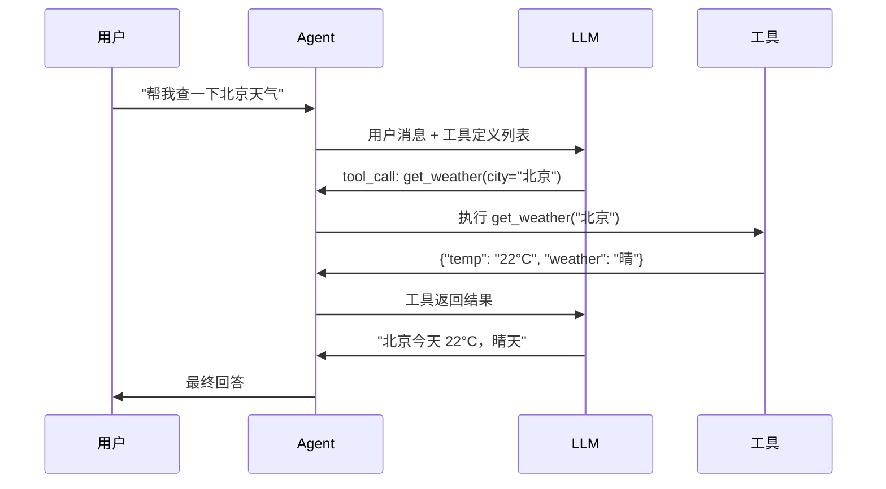
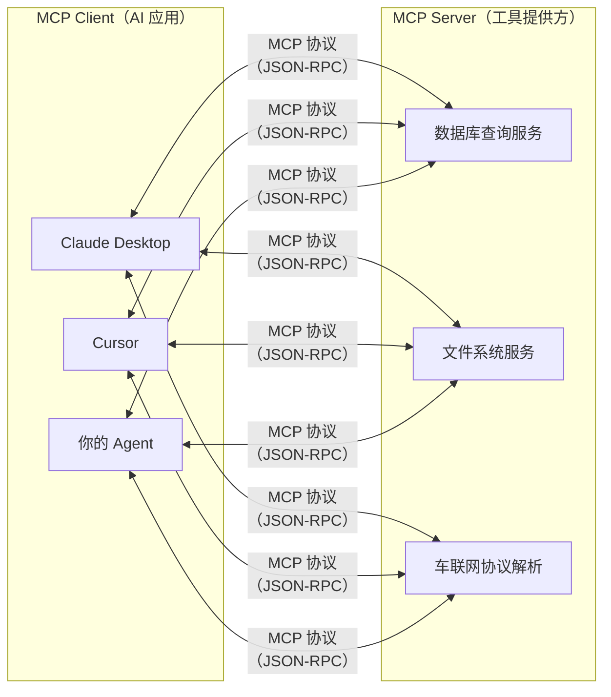

工具调用是 Agent 区别于普通 LLM 的**最关键能力**——没有工具的 Agent 只是一个会聊天的 AI，有了工具它才能真正「动手做事」。

---

## 一、工具调用的核心机制

### 1.1 Function Calling 原理

LLM 并不直接执行工具，而是通过 **Function Calling** 告诉外部系统「我想调用哪个工具、传什么参数」：



### 1.2 工具的四要素

| **要素** | **作用** | **影响** |
| --- | --- | --- |
| **名称** (name) | 唯一标识 | LLM 通过名称选择工具 |
| **描述** (description) | 告诉 LLM 这个工具能做什么 | **最关键**——描述质量直接决定 LLM 是否正确调用 |
| **参数** (parameters) | JSON Schema 定义输入 | LLM 据此构造参数 |
| **执行函数** (handler) | 实际业务逻辑 | 真正干活的代码 |

<div class="callout callout-warning" markdown="1">
**⚠️ ⚠️**

**关键启发**：工具描述的质量比代码实现更重要！LLM 靠描述决定「何时调用」和「如何传参」。一个描述模糊的工具，再好的代码也白搭。
</div>

---

## 二、Python 代码：构建工具系统

### 2.1 工具注册框架

```python
import json
import inspect
from typing import Callable, Any
from openai import OpenAI

client = OpenAI()

class Tool:
    """工具定义"""
    def __init__(self, name: str, description: str, parameters: dict, handler: Callable):
        self.name = name
        self.description = description
        self.parameters = parameters
        self.handler = handler

    def to_openai_schema(self) -> dict:
        """转换为 OpenAI Function Calling 格式"""
        return {
            "type": "function",
            "function": {
                "name": self.name,
                "description": self.description,
                "parameters": self.parameters,
            }
        }

    def execute(self, **kwargs) -> str:
        """执行工具"""
        result = self.handler(**kwargs)
        return json.dumps(result, ensure_ascii=False) if isinstance(result, dict) else str(result)

class ToolRegistry:
    """工具注册中心"""

    def __init__(self):
        self.tools: dict[str, Tool] = {}

    def register(self, name: str, description: str, parameters: dict):
        """装饰器：注册工具"""
        def decorator(func: Callable):
            self.tools[name] = Tool(name, description, parameters, func)
            return func
        return decorator

    def get_schemas(self) -> list[dict]:
        """获取所有工具的 Schema"""
        return [tool.to_openai_schema() for tool in self.tools.values()]

    def execute(self, name: str, arguments: str) -> str:
        """执行指定工具"""
        if name not in self.tools:
            return f"错误：工具 '{name}' 不存在"
        args = json.loads(arguments)
        return self.tools[name].execute(**args)

# ---- 创建工具注册中心 ----
registry = ToolRegistry()
```

### 2.2 注册具体工具

```python
# ---- 工具 1：数据库查询 ----
@registry.register(
    name="query_database",
    description="查询 MySQL 数据库，获取车辆信息、告警记录等结构化数据",
    parameters={
        "type": "object",
        "properties": {
            "sql": {
                "type": "string",
                "description": "要执行的 SQL 查询语句（只读 SELECT）"
            },
            "database": {
                "type": "string",
                "enum": ["vehicle_db", "alert_db"],
                "description": "目标数据库名称"
            }
        },
        "required": ["sql", "database"]
    }
)
def query_database(sql: str, database: str) -> dict:
    """执行数据库查询（安全版：仅允许 SELECT）"""
    if not sql.strip().upper().startswith("SELECT"):
        return {"error": "仅允许 SELECT 查询"}
    # 实际连接数据库执行
    # connection = get_connection(database)
    # result = connection.execute(sql)
    return {"status": "success", "rows": [{"id": 1, "vin": "LSVAU2A..."}]}

# ---- 工具 2：发送通知 ----
@registry.register(
    name="send_notification",
    description="向指定渠道发送通知消息，支持 Slack、邮件、企业微信",
    parameters={
        "type": "object",
        "properties": {
            "channel": {
                "type": "string",
                "enum": ["slack", "email", "wecom"],
                "description": "通知渠道"
            },
            "recipient": {"type": "string", "description": "接收者（邮箱/频道名/用户ID）"},
            "message": {"type": "string", "description": "通知内容"},
            "priority": {
                "type": "string",
                "enum": ["low", "normal", "high", "urgent"],
                "description": "优先级，默认 normal"
            }
        },
        "required": ["channel", "recipient", "message"]
    }
)
def send_notification(channel: str, recipient: str, message: str, priority: str = "normal") -> dict:
    print(f"  📨 [{channel}] -> {recipient}: {message} (优先级: {priority})")
    return {"status": "sent", "channel": channel, "recipient": recipient}

# ---- 工具 3：文件读写 ----
@registry.register(
    name="read_file",
    description="读取服务器上的文件内容，支持 txt、json、csv 格式",
    parameters={
        "type": "object",
        "properties": {
            "file_path": {"type": "string", "description": "文件路径"},
            "encoding": {"type": "string", "description": "编码格式，默认 utf-8"}
        },
        "required": ["file_path"]
    }
)
def read_file(file_path: str, encoding: str = "utf-8") -> dict:
    # 安全检查：限制可访问的目录
    import os
    allowed_dirs = ["/data/reports/", "/data/configs/"]
    if not any(file_path.startswith(d) for d in allowed_dirs):
        return {"error": "访问被拒绝：路径不在允许范围内"}
    with open(file_path, "r", encoding=encoding) as f:
        return {"content": f.read()[:5000]}  # 限制返回长度
```

### 2.3 带工具的 Agent 完整实现

```python
def tool_agent(user_input: str, max_iterations: int = 8) -> str:
    """带工具调用的完整 Agent"""
    messages = [
        {"role": "system", "content": (
            "你是一个车联网智能助手，可以查询数据库、发送通知、读取文件。\n"
            "在调用工具前，先思考是否需要调用、调用哪个工具最合适。\n"
            "高风险操作（如发送通知）前请先确认。"
        )},
        {"role": "user", "content": user_input}
    ]

    for i in range(max_iterations):
        response = client.chat.completions.create(
            model="gpt-4o",
            messages=messages,
            tools=registry.get_schemas(),
            tool_choice="auto",
        )
        msg = response.choices[0].message
        messages.append(msg)

        if not msg.tool_calls:
            return msg.content

        # 执行所有工具调用（支持并行调用）
        for tool_call in msg.tool_calls:
            name = tool_call.function.name
            args = tool_call.function.arguments
            print(f"  🔧 调用工具: {name}({args})")

            result = registry.execute(name, args)
            print(f"  📋 结果: {result[:200]}")

            messages.append({
                "role": "tool",
                "tool_call_id": tool_call.id,
                "content": result,
            })

    return "达到最大迭代次数"

# ---- 运行示例 ----
answer = tool_agent("查询 vehicle_db 中 VIN 为 LSVAU2A 开头的车辆最近 10 条告警记录")
print(answer)
```

---

## 三、MCP（Model Context Protocol）

### 3.1 MCP 是什么？

MCP 是 Anthropic 提出的**统一工具接口标准**，让任何应用都能以标准化的方式向 LLM 暴露工具能力：



### 3.2 Python 实现 MCP Server

```python
"""
MCP Server 示例：将车联网协议解析封装为 MCP 工具
配合你已有的 Spring AI MCP-Server 经验，这里展示 Python 版本
"""
from mcp.server import Server
from mcp.types import Tool, TextContent
import json

app = Server("vehicle-protocol-server")

# ---- 注册 MCP 工具 ----
@app.tool()
async def parse_32960_frame(hex_data: str) -> list[TextContent]:
    """
    解析 GB/T 32960 协议帧数据
    
    Args:
        hex_data: 十六进制格式的协议帧数据
    """
    # 协议解析逻辑
    result = {
        "command": "实时信息上报",
        "vin": hex_data[8:42],
        "encrypt_type": "不加密",
        "data_length": int(hex_data[42:46], 16),
        "payload": "...",
    }
    return [TextContent(type="text", text=json.dumps(result, ensure_ascii=False))]

@app.tool()
async def query_vehicle_alerts(
    vin: str,
    start_date: str = None,
    end_date: str = None,
    alert_level: str = None,
) -> list[TextContent]:
    """
    查询车辆 ADAS 告警记录
    
    Args:
        vin: 车辆识别号
        start_date: 开始日期（YYYY-MM-DD）
        end_date: 结束日期（YYYY-MM-DD）
        alert_level: 告警级别（一般/严重/紧急）
    """
    # 查询 Doris 数据库
    alerts = [
        {"time": "2026-03-25 10:00", "type": "前碰撞预警", "level": "严重"},
        {"time": "2026-03-25 10:05", "type": "车道偏离", "level": "一般"},
    ]
    return [TextContent(type="text", text=json.dumps(alerts, ensure_ascii=False))]

@app.tool()
async def get_risk_aggregation(vehicle_id: str, window_minutes: int = 30) -> list[TextContent]:
    """
    获取车辆实时风险聚合结果
    
    Args:
        vehicle_id: 车辆 ID
        window_minutes: 聚合时间窗口（分钟）
    """
    result = {
        "vehicle_id": vehicle_id,
        "window": f"最近 {window_minutes} 分钟",
        "risk_score": 78,
        "alert_count": 5,
        "risk_level": "高",
        "top_risks": ["频繁急刹", "车道偏离"],
    }
    return [TextContent(type="text", text=json.dumps(result, ensure_ascii=False))]

# ---- 启动 MCP Server ----
if __name__ == "__main__":
    import asyncio
    from mcp.server.stdio import stdio_server

    async def main():
        async with stdio_server() as (read, write):
            await app.run(read, write)

    asyncio.run(main())
```

### 3.3 MCP Client：Agent 调用 MCP 工具

```python
from mcp import ClientSession, StdioServerParameters
from mcp.client.stdio import stdio_client

async def use_mcp_tools():
    """Agent 通过 MCP 调用工具"""
    server_params = StdioServerParameters(
        command="python",
        args=["vehicle_mcp_server.py"],
    )

    async with stdio_client(server_params) as (read, write):
        async with ClientSession(read, write) as session:
            await session.initialize()

            # 1. 列出可用工具
            tools = await session.list_tools()
            print("可用工具:", [t.name for t in tools.tools])

            # 2. 调用工具
            result = await session.call_tool(
                "parse_32960_frame",
                arguments={"hex_data": "232301FE..."},
            )
            print("解析结果:", result.content[0].text)

            # 3. 将工具列表转换为 OpenAI 格式，供 Agent 使用
            openai_tools = [
                {
                    "type": "function",
                    "function": {
                        "name": tool.name,
                        "description": tool.description,
                        "parameters": tool.inputSchema,
                    }
                }
                for tool in tools.tools
            ]
            return openai_tools
```

---

## 四、工具安全：沙箱与权限控制

### 4.1 权限分层设计

```python
from enum import Enum
from functools import wraps

class Permission(Enum):
    READ = "read"          # 只读操作
    WRITE = "write"        # 写入操作
    EXECUTE = "execute"    # 执行命令
    NOTIFY = "notify"      # 发送通知
    ADMIN = "admin"        # 管理员操作

class SecureToolRegistry(ToolRegistry):
    """带权限控制的工具注册中心"""

    def __init__(self, allowed_permissions: set[Permission]):
        super().__init__()
        self.allowed = allowed_permissions
        self.tool_permissions: dict[str, Permission] = {}

    def register(self, name: str, description: str, parameters: dict,
                 permission: Permission = Permission.READ):
        """注册工具时指定权限级别"""
        self.tool_permissions[name] = permission

        def decorator(func):
            # 包装安全检查
            @wraps(func)
            def safe_func(**kwargs):
                if permission not in self.allowed:
                    return {"error": f"权限不足：需要 {permission.value} 权限"}
                return func(**kwargs)

            self.tools[name] = Tool(name, description, parameters, safe_func)
            return func
        return decorator

# ---- 创建受限 Agent（只有读和通知权限）----
secure_registry = SecureToolRegistry(
    allowed_permissions={Permission.READ, Permission.NOTIFY}
)
```

### 4.2 人工确认机制

```python
class HumanInTheLoop:
    """高风险操作的人工确认"""

    HIGH_RISK_TOOLS = {"send_notification", "delete_record", "execute_command"}

    @staticmethod
    def needs_approval(tool_name: str) -> bool:
        return tool_name in HumanInTheLoop.HIGH_RISK_TOOLS

    @staticmethod
    async def request_approval(tool_name: str, args: dict) -> bool:
        """请求人工确认（实际场景可通过 Slack/Web UI 实现）"""
        print(f"\n⚠️ 高风险操作需要确认:")
        print(f"   工具: {tool_name}")
        print(f"   参数: {json.dumps(args, ensure_ascii=False)}")
        approval = input("   是否允许? (y/n): ")
        return approval.lower() == "y"
```

---

## 五、设计启发总结

<div class="callout callout-note" markdown="1">
**📝 ✨**

### 工具系统的 6 条设计原则

1. **描述即接口**——工具的 description 是 LLM 调用决策的唯一依据，务必清晰、准确
2. **参数 Schema 要严谨**——用 JSON Schema 约束类型和枚举值，减少 LLM 传参错误
3. **MCP 是标准化方向**——将内部服务包装为 MCP Server，一次开发多端复用
4. **权限分层**——READ / WRITE / EXECUTE / ADMIN 分级，最小权限原则
5. **高风险加确认**——删除、发送、执行等操作必须有 Human-in-the-Loop
6. **返回值要结构化**——JSON 格式返回，方便 LLM 解析和后续推理
</div>
