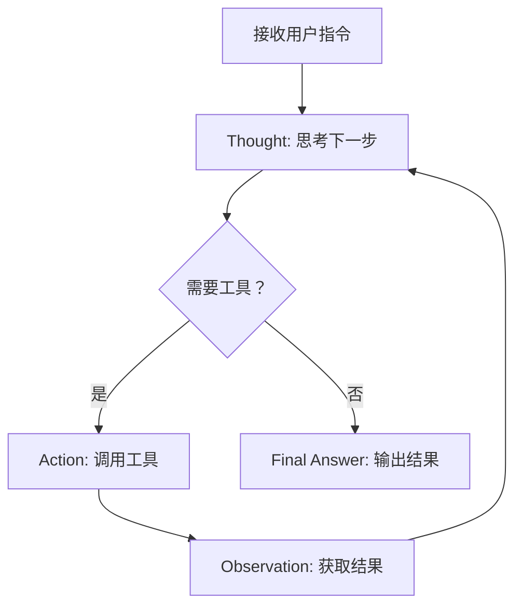
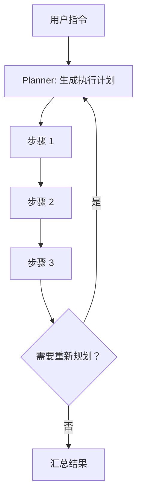
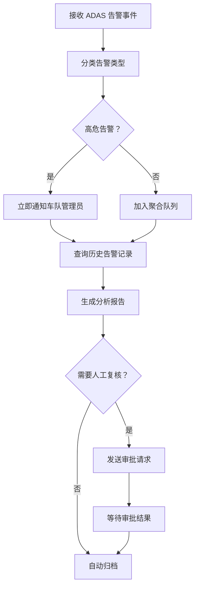

流程编排是 AI Agent 的**大脑中枢**——决定了 Agent 如何将一个复杂目标拆解为可执行的步骤序列，并在执行过程中动态调整策略。

---

## 一、核心模式对比

| **模式** | **思路** | **适用场景** | **复杂度** |
| --- | --- | --- | --- |
| ReAct | 思考 → 行动 → 观察，逐步推进 | 任务步骤不确定、需要动态决策 | ⭐⭐ |
| Plan-and-Execute | 先制定完整计划，再逐步执行 | 任务步骤较明确、可预规划 | ⭐⭐⭐ |
| LangGraph 状态机 | 用有向图定义状态和转移 | 多分支、条件跳转、循环流程 | ⭐⭐⭐⭐ |
| Multi-Agent 委托 | 主 Agent 拆解任务分配给子 Agent | 任务可并行、需要不同专长 | ⭐⭐⭐⭐⭐ |

---

## 二、模式一：ReAct（Reasoning + Acting）

### 2.1 原理

ReAct 是当前最主流的 Agent 架构，核心是一个 **Thought → Action → Observation** 的闭环循环：



### 2.2 Python 代码：从零实现 ReAct 循环

```python
import json
from openai import OpenAI

client = OpenAI()

# ---- 1. 定义工具 ----
def search_web(query: str) -> str:
    """模拟网页搜索"""
    return f"搜索结果：找到关于「{query}」的 3 篇文章..."

def calculate(expression: str) -> str:
    """安全计算器"""
    try:
        return str(eval(expression, {"__builtins__": {}}, {}))
    except Exception as e:
        return f"计算错误: {e}"

TOOLS = {
    "search_web": search_web,
    "calculate": calculate,
}

TOOL_SCHEMAS = [
    {
        "type": "function",
        "function": {
            "name": "search_web",
            "description": "搜索互联网获取信息",
            "parameters": {
                "type": "object",
                "properties": {
                    "query": {"type": "string", "description": "搜索关键词"}
                },
                "required": ["query"]
            }
        }
    },
    {
        "type": "function",
        "function": {
            "name": "calculate",
            "description": "执行数学计算",
            "parameters": {
                "type": "object",
                "properties": {
                    "expression": {"type": "string", "description": "数学表达式"}
                },
                "required": ["expression"]
            }
        }
    }
]

# ---- 2. ReAct 核心循环 ----
def react_agent(user_input: str, max_iterations: int = 10) -> str:
    """ReAct Agent 核心循环"""
    messages = [
        {"role": "system", "content": (
            "你是一个智能助手。遇到需要搜索或计算的问题时，"
            "请调用工具获取信息，再综合回答。"
        )},
        {"role": "user", "content": user_input}
    ]

    for i in range(max_iterations):
        # Thought + Action: LLM 决策
        response = client.chat.completions.create(
            model="gpt-4o",
            messages=messages,
            tools=TOOL_SCHEMAS,
            tool_choice="auto",
        )
        msg = response.choices[0].message
        messages.append(msg)

        # 没有工具调用 → 任务完成
        if not msg.tool_calls:
            return msg.content

        # Observation: 执行工具并获取结果
        for tool_call in msg.tool_calls:
            func_name = tool_call.function.name
            args = json.loads(tool_call.function.arguments)
            print(f"  [Step {i+1}] Action: {func_name}({args})")

            result = TOOLS[func_name](**args)
            print(f"  [Step {i+1}] Observation: {result}")

            messages.append({
                "role": "tool",
                "tool_call_id": tool_call.id,
                "content": result,
            })

    return "达到最大迭代次数，任务未完成。"

# ---- 3. 运行 ----
answer = react_agent("帮我搜索 OpenClaw 最新版本，并计算 27 万 star 平均每月增长多少")
print(answer)
```

<div class="callout callout-tip" markdown="1">
**💡 💡**

**启发**：ReAct 的精髓在于 **LLM 自主决定何时调用工具、调用哪个工具**。你不需要硬编码流程，只需定义好工具和 System Prompt。
</div>

---

## 三、模式二：Plan-and-Execute

### 3.1 原理

与 ReAct 的「边想边做」不同，Plan-and-Execute 先做**全局规划**，再逐步执行：



### 3.2 Python 代码：Plan-and-Execute 实现

```python
from openai import OpenAI
import json

client = OpenAI()

# ---- 1. Planner：任务规划器 ----
def plan_task(user_input: str) -> list[str]:
    """将用户目标拆解为执行步骤"""
    response = client.chat.completions.create(
        model="gpt-4o",
        messages=[
            {"role": "system", "content": (
                "你是一个任务规划器。将用户目标拆解为 3-7 个具体执行步骤。"
                "返回 JSON 数组格式，每个元素是一个步骤描述字符串。"
            )},
            {"role": "user", "content": user_input}
        ],
        response_format={"type": "json_object"},
    )
    result = json.loads(response.choices[0].message.content)
    return result.get("steps", [])

# ---- 2. Executor：步骤执行器 ----
def execute_step(step: str, context: str) -> str:
    """执行单个步骤，可调用工具"""
    response = client.chat.completions.create(
        model="gpt-4o",
        messages=[
            {"role": "system", "content": (
                "你是一个执行器。根据当前步骤和已有上下文完成任务。\n"
                f"已有上下文:\n{context}"
            )},
            {"role": "user", "content": f"请执行: {step}"}
        ],
    )
    return response.choices[0].message.content

# ---- 3. Plan-and-Execute 主循环 ----
def plan_and_execute(user_input: str) -> str:
    # Phase 1: 规划
    steps = plan_task(user_input)
    print("📋 执行计划:")
    for i, step in enumerate(steps, 1):
        print(f"  {i}. {step}")

    # Phase 2: 逐步执行
    context = ""
    for i, step in enumerate(steps, 1):
        print(f"\n▶️ 执行步骤 {i}: {step}")
        result = execute_step(step, context)
        context += f"\n步骤{i}结果: {result}"
        print(f"  ✅ 完成")

    # Phase 3: 汇总
    response = client.chat.completions.create(
        model="gpt-4o",
        messages=[
            {"role": "system", "content": "根据所有步骤的执行结果，生成最终汇总报告。"},
            {"role": "user", "content": context}
        ],
    )
    return response.choices[0].message.content

# ---- 运行 ----
result = plan_and_execute("帮我整理一份 AI Agent 框架的竞品分析，包括 OpenClaw、AutoGPT、CrewAI")
print(result)
```

---

## 四、模式三：LangGraph 状态机编排

### 4.1 适用场景

当流程存在**条件分支、循环、并行**时，简单的线性编排不够用，需要用**有向图**来描述流程。

### 4.2 Python 代码：LangGraph 实现带审批的 Agent

```python
from langgraph.graph import StateGraph, END
from typing import TypedDict, Literal

# ---- 1. 定义状态 ----
class AgentState(TypedDict):
    task: str
    plan: str
    result: str
    approved: bool
    iteration: int

# ---- 2. 定义节点函数 ----
def planner(state: AgentState) -> AgentState:
    """规划节点：分析任务生成计划"""
    print(f"📋 规划任务: {state['task']}")
    state["plan"] = f"针对「{state['task']}」的执行计划：步骤1→步骤2→步骤3"
    return state

def executor(state: AgentState) -> AgentState:
    """执行节点：根据计划执行"""
    print(f"⚙️ 执行计划: {state['plan']}")
    state["result"] = f"执行结果：已完成「{state['task']}」"
    state["iteration"] = state.get("iteration", 0) + 1
    return state

def reviewer(state: AgentState) -> AgentState:
    """审核节点：检查执行结果"""
    print(f"🔍 审核结果: {state['result']}")
    # 模拟审核逻辑：第 2 次迭代后通过
    state["approved"] = state["iteration"] >= 2
    return state

# ---- 3. 定义路由 ----
def should_continue(state: AgentState) -> Literal["executor", "end"]:
    if state["approved"]:
        return "end"
    return "executor"

# ---- 4. 构建流程图 ----
workflow = StateGraph(AgentState)

workflow.add_node("planner", planner)
workflow.add_node("executor", executor)
workflow.add_node("reviewer", reviewer)

workflow.set_entry_point("planner")
workflow.add_edge("planner", "executor")
workflow.add_edge("executor", "reviewer")
workflow.add_conditional_edges("reviewer", should_continue, {
    "executor": "executor",
    "end": END,
})

app = workflow.compile()

# ---- 5. 运行 ----
result = app.invoke({
    "task": "生成竞品分析报告",
    "plan": "",
    "result": "",
    "approved": False,
    "iteration": 0,
})
print(f"\n✅ 最终结果: {result['result']}")
```

---

## 五、实战案例：车联网告警智能分析 Agent

结合你的车联网背景，设计一个 ADAS 告警分析 Agent 的流程编排：



```python
# 车联网 Agent 流程编排伪代码
from langgraph.graph import StateGraph, END

class AlertState(TypedDict):
    alert_data: dict          # 原始告警数据
    alert_type: str           # 告警分类
    is_critical: bool         # 是否高危
    history: list             # 历史记录
    report: str               # 分析报告
    needs_review: bool        # 是否需要人工复核

def classify_alert(state):
    """用 LLM 对告警进行智能分类"""
    # 调用 LLM 分析 GB/T 32960 协议字段
    # 判断告警类型和严重程度
    ...

def query_history(state):
    """查询 Doris 中的历史告警记录"""
    # SELECT * FROM adas_alerts WHERE vehicle_id = ?
    ...

def generate_report(state):
    """LLM 生成分析报告"""
    # 结合当前告警 + 历史记录 + RAG 知识库
    ...

# 构建流程图
workflow = StateGraph(AlertState)
workflow.add_node("classify", classify_alert)
workflow.add_node("notify", notify_manager)
workflow.add_node("query_history", query_history)
workflow.add_node("generate_report", generate_report)
# ... 添加边和条件路由
```

---

## 六、设计启发总结

<div class="callout callout-note" markdown="1">
**📝 ✨**

### 流程编排的 5 条黄金法则

1. **简单任务用 ReAct**——不要过度设计，让 LLM 自主决策
2. **明确任务用 Plan-and-Execute**——先规划再执行，减少无效探索
3. **复杂流程用状态机**——LangGraph 处理分支、循环、并行
4. **高风险操作加人工确认**——Agent 的自主性需要边界
5. **始终设置最大迭代次数**——防止 Agent 陷入死循环
</div>
