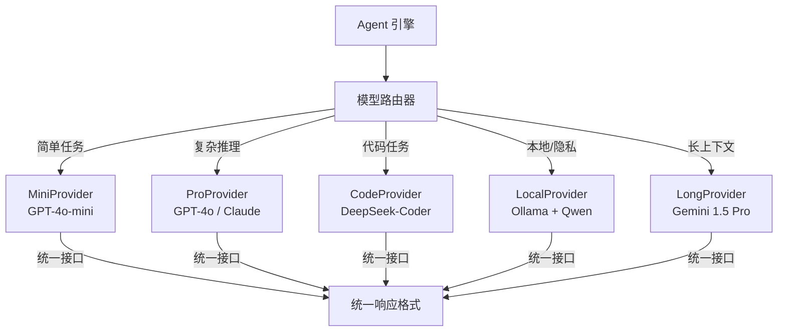
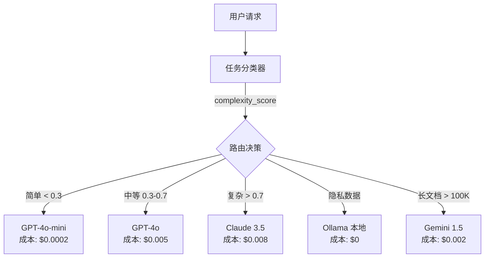

模型路由是 Agent 系统的**成本与性能优化核心**——不同任务用不同模型，既省钱又高效。OpenClaw 的「模型无关」设计为我们提供了清晰的 Provider 抽象范式。

---

## 一、为什么需要模型路由？

### 1.1 问题场景

| **任务类型** | **需求** | **最佳模型** | **GPT-4o 成本** | **路由后成本** |
| --- | --- | --- | --- | --- |
| 简单问答 / 分类 | 速度快、成本低 | GPT-4o-mini / Qwen-7B | $0.005/次 | $0.0002/次 ↓96% |
| 复杂推理 / 规划 | 推理质量高 | Claude 3.5 / GPT-4o | $0.005/次 | $0.005/次 |
| 代码生成 | 代码质量好 | Claude 3.5 / DeepSeek-Coder | $0.005/次 | $0.003/次 ↓40% |
| 长文档处理 | 上下文窗口大 | Gemini 1.5 Pro (1M tokens) | 超出窗口 | $0.002/次 |
| 隐私敏感数据 | 数据不出本地 | Ollama 本地模型 | 隐私风险 | $0（本地） |

<div class="callout callout-tip" markdown="1">
**核心思想**：用 10% 的成本覆盖 80% 的简单任务，把预算留给真正需要强模型的复杂任务。
</div>

---

## 二、Provider 抽象层

### 2.1 设计模式



### 2.2 Python 代码：Provider 抽象层

```python
from abc import ABC, abstractmethod
from dataclasses import dataclass
from typing import Optional
import json
import time

@dataclass
class LLMResponse:
    """统一的 LLM 响应格式"""
    content: str
    model: str
    provider: str
    usage: dict                    # {"prompt_tokens": N, "completion_tokens": N}
    cost: float                    # 预估成本（美元）
    latency_ms: int                # 响应耗时
    tool_calls: list[dict] = None  # Function Calling 结果

class LLMProvider(ABC):
    """LLM Provider 抽象基类"""

    def __init__(self, model: str, api_key: str = None):
        self.model = model
        self.api_key = api_key

    @abstractmethod
    async def chat(
        self,
        messages: list[dict],
        tools: list[dict] = None,
        temperature: float = 0.7,
        max_tokens: int = 4096,
    ) -> LLMResponse:
        """统一聊天接口"""
        pass

    @abstractmethod
    def estimate_cost(self, prompt_tokens: int, completion_tokens: int) -> float:
        """预估成本"""
        pass

    @property
    @abstractmethod
    def max_context_length(self) -> int:
        """最大上下文长度"""
        pass

# ---- OpenAI Provider ----
class OpenAIProvider(LLMProvider):

    PRICING = {
        "gpt-4o": {"input": 2.50, "output": 10.00},           # per 1M tokens
        "gpt-4o-mini": {"input": 0.15, "output": 0.60},
        "o1": {"input": 15.00, "output": 60.00},
    }

    async def chat(self, messages, tools=None, temperature=0.7, max_tokens=4096) -> LLMResponse:
        from openai import AsyncOpenAI
        client = AsyncOpenAI(api_key=self.api_key)

        start = time.time()
        kwargs = {
            "model": self.model,
            "messages": messages,
            "temperature": temperature,
            "max_tokens": max_tokens,
        }
        if tools:
            kwargs["tools"] = tools

        response = await client.chat.completions.create(**kwargs)
        latency = int((time.time() - start) * 1000)

        msg = response.choices[0].message
        usage = response.usage

        return LLMResponse(
            content=msg.content or "",
            model=self.model,
            provider="openai",
            usage={"prompt_tokens": usage.prompt_tokens, "completion_tokens": usage.completion_tokens},
            cost=self.estimate_cost(usage.prompt_tokens, usage.completion_tokens),
            latency_ms=latency,
            tool_calls=[
                {"name": tc.function.name, "arguments": tc.function.arguments, "id": tc.id}
                for tc in (msg.tool_calls or [])
            ],
        )

    def estimate_cost(self, prompt_tokens, completion_tokens):
        pricing = self.PRICING.get(self.model, {"input": 5.0, "output": 15.0})
        return (prompt_tokens * pricing["input"] + completion_tokens * pricing["output"]) / 1_000_000

    @property
    def max_context_length(self):
        return {"gpt-4o": 128000, "gpt-4o-mini": 128000, "o1": 200000}.get(self.model, 128000)

# ---- Anthropic Provider ----
class AnthropicProvider(LLMProvider):

    async def chat(self, messages, tools=None, temperature=0.7, max_tokens=4096) -> LLMResponse:
        import anthropic
        client = anthropic.AsyncAnthropic(api_key=self.api_key)

        start = time.time()
        # 转换消息格式（Anthropic 的 system 放在单独参数里）
        system_msg = ""
        chat_messages = []
        for m in messages:
            if m["role"] == "system":
                system_msg += m["content"] + "\n"
            else:
                chat_messages.append(m)

        response = await client.messages.create(
            model=self.model,
            system=system_msg,
            messages=chat_messages,
            max_tokens=max_tokens,
            temperature=temperature,
        )
        latency = int((time.time() - start) * 1000)

        return LLMResponse(
            content=response.content[0].text,
            model=self.model,
            provider="anthropic",
            usage={
                "prompt_tokens": response.usage.input_tokens,
                "completion_tokens": response.usage.output_tokens,
            },
            cost=self.estimate_cost(response.usage.input_tokens, response.usage.output_tokens),
            latency_ms=latency,
        )

    def estimate_cost(self, prompt_tokens, completion_tokens):
        return (prompt_tokens * 3.0 + completion_tokens * 15.0) / 1_000_000

    @property
    def max_context_length(self):
        return 200000

# ---- Ollama 本地模型 Provider ----
class OllamaProvider(LLMProvider):

    def __init__(self, model: str, base_url: str = "http://localhost:11434"):
        super().__init__(model)
        self.base_url = base_url

    async def chat(self, messages, tools=None, temperature=0.7, max_tokens=4096) -> LLMResponse:
        import httpx
        start = time.time()

        async with httpx.AsyncClient() as client:
            response = await client.post(
                f"{self.base_url}/api/chat",
                json={
                    "model": self.model,
                    "messages": messages,
                    "stream": False,
                    "options": {"temperature": temperature, "num_predict": max_tokens},
                },
                timeout=120,
            )
        data = response.json()
        latency = int((time.time() - start) * 1000)

        return LLMResponse(
            content=data["message"]["content"],
            model=self.model,
            provider="ollama",
            usage={
                "prompt_tokens": data.get("prompt_eval_count", 0),
                "completion_tokens": data.get("eval_count", 0),
            },
            cost=0.0,  # 本地模型无费用
            latency_ms=latency,
        )

    def estimate_cost(self, prompt_tokens, completion_tokens):
        return 0.0  # 本地免费

    @property
    def max_context_length(self):
        return {"qwen2.5:72b": 131072, "deepseek-coder-v2": 128000}.get(self.model, 32768)
```

---

## 三、智能模型路由器

### 3.1 路由策略



### 3.2 Python 代码：智能路由器

```python
from enum import Enum
from dataclasses import dataclass

class TaskComplexity(Enum):
    SIMPLE = "simple"           # 简单分类、格式化、翻译
    MODERATE = "moderate"       # 多步推理、摘要生成
    COMPLEX = "complex"         # 复杂规划、创作、代码架构
    CODE = "code"               # 代码生成与调试
    LONG_CONTEXT = "long"       # 超长文档处理
    PRIVATE = "private"         # 隐私敏感数据

@dataclass
class RoutingDecision:
    provider: LLMProvider
    reason: str
    estimated_cost: float

class ModelRouter:
    """智能模型路由器"""

    def __init__(self):
        self.providers: dict[str, LLMProvider] = {}
        self.usage_stats: list[dict] = []  # 用量统计

    def register_provider(self, name: str, provider: LLMProvider):
        self.providers[name] = provider

    async def classify_task(self, messages: list[dict]) -> TaskComplexity:
        """用轻量模型对任务进行分类"""
        classifier = self.providers.get("mini")
        if not classifier:
            return TaskComplexity.MODERATE

        response = await classifier.chat(
            messages=[
                {"role": "system", "content": (
                    "分析用户请求的复杂度，返回以下类别之一：\n"
                    "- simple: 简单问答、分类、格式化\n"
                    "- moderate: 多步推理、摘要、一般对话\n"
                    "- complex: 复杂规划、深度分析、创作\n"
                    "- code: 代码生成、调试、重构\n"
                    "- long: 超长文档处理（用户明确提到长文档）\n"
                    "- private: 涉及敏感数据（个人信息、密码等）\n"
                    "只返回类别名称，不要解释。"
                )},
                messages[-1],  # 只传最后一条用户消息
            ],
            temperature=0,
            max_tokens=20,
        )
        category = response.content.strip().lower()
        try:
            return TaskComplexity(category)
        except ValueError:
            return TaskComplexity.MODERATE

    def route(self, complexity: TaskComplexity, token_count: int = 0) -> RoutingDecision:
        """根据任务复杂度选择最佳模型"""
        routing_rules = {
            TaskComplexity.SIMPLE: ("mini", "简单任务 → 小模型省成本"),
            TaskComplexity.MODERATE: ("pro", "中等任务 → 标准模型"),
            TaskComplexity.COMPLEX: ("premium", "复杂任务 → 最强模型"),
            TaskComplexity.CODE: ("code", "代码任务 → 代码专用模型"),
            TaskComplexity.LONG_CONTEXT: ("long", "长文档 → 大窗口模型"),
            TaskComplexity.PRIVATE: ("local", "隐私数据 → 本地模型"),
        }

        name, reason = routing_rules.get(complexity, ("pro", "默认路由"))
        provider = self.providers.get(name)

        # 上下文长度检查：如果 token 超过当前模型上限，自动升级
        if provider and token_count > provider.max_context_length:
            provider = self.providers.get("long", provider)
            reason += f"（上下文 {token_count} tokens 超限，自动升级）"

        # 容错：如果首选 provider 不可用，回退到默认
        if not provider:
            provider = self.providers.get("pro") or list(self.providers.values())[0]
            reason += "（首选不可用，已回退）"

        return RoutingDecision(
            provider=provider,
            reason=reason,
            estimated_cost=provider.estimate_cost(token_count, 500),
        )

    async def chat(self, messages: list[dict], tools: list[dict] = None, **kwargs) -> LLMResponse:
        """统一入口：自动路由 + 调用"""
        # 1. 分类
        complexity = await self.classify_task(messages)

        # 2. 路由
        decision = self.route(complexity)
        print(f"  🔀 路由决策: {complexity.value} → {decision.provider.model} ({decision.reason})")

        # 3. 调用
        response = await decision.provider.chat(messages, tools=tools, **kwargs)

        # 4. 记录统计
        self.usage_stats.append({
            "timestamp": time.time(),
            "complexity": complexity.value,
            "model": response.model,
            "cost": response.cost,
            "latency_ms": response.latency_ms,
        })

        return response

    def get_cost_summary(self) -> dict:
        """获取成本统计摘要"""
        total_cost = sum(s["cost"] for s in self.usage_stats)
        by_model = {}
        for s in self.usage_stats:
            model = s["model"]
            by_model[model] = by_model.get(model, 0) + s["cost"]
        return {
            "total_cost": round(total_cost, 6),
            "total_requests": len(self.usage_stats),
            "by_model": by_model,
            "avg_latency_ms": (
                sum(s["latency_ms"] for s in self.usage_stats) / len(self.usage_stats)
                if self.usage_stats else 0
            ),
        }

# ---- 初始化路由器 ----
router = ModelRouter()
router.register_provider("mini", OpenAIProvider("gpt-4o-mini"))
router.register_provider("pro", OpenAIProvider("gpt-4o"))
router.register_provider("premium", AnthropicProvider("claude-3-5-sonnet-20241022"))
router.register_provider("local", OllamaProvider("qwen2.5:14b"))
# router.register_provider("code", OpenAIProvider("gpt-4o"))  # 或 DeepSeek
# router.register_provider("long", GoogleProvider("gemini-1.5-pro"))
```

---

## 四、高级策略：LiteLLM 统一网关

### 4.1 使用 LiteLLM 简化多模型管理

[LiteLLM](https://github.com/BerriAI/litellm) 是一个开源的模型网关，用**统一的 OpenAI 格式**调用 100+ 模型：

```python
import litellm

# ---- 统一接口调用不同模型 ----
# OpenAI
response = await litellm.acompletion(
    model="gpt-4o-mini",
    messages=[{"role": "user", "content": "你好"}],
)

# Anthropic（自动转换格式）
response = await litellm.acompletion(
    model="claude-3-5-sonnet-20241022",
    messages=[{"role": "user", "content": "你好"}],
)

# Ollama 本地模型
response = await litellm.acompletion(
    model="ollama/qwen2.5:14b",
    messages=[{"role": "user", "content": "你好"}],
    api_base="http://localhost:11434",
)

# ---- 自动 Fallback ----
response = await litellm.acompletion(
    model="gpt-4o",
    messages=messages,
    fallbacks=["claude-3-5-sonnet-20241022", "ollama/qwen2.5:72b"],
    # 如果 GPT-4o 失败，自动切换到 Claude，再失败切 Ollama
)
```

### 4.2 LiteLLM Router：生产级路由

```python
from litellm import Router

# ---- 生产级模型路由配置 ----
model_list = [
    {
        "model_name": "agent-default",    # 统一别名
        "litellm_params": {
            "model": "gpt-4o-mini",
            "api_key": "sk-xxx",
        },
        "model_info": {"max_tokens": 128000},
    },
    {
        "model_name": "agent-default",    # 同名 = 负载均衡
        "litellm_params": {
            "model": "claude-3-5-haiku-20241022",
            "api_key": "sk-ant-xxx",
        },
    },
    {
        "model_name": "agent-premium",
        "litellm_params": {
            "model": "claude-3-5-sonnet-20241022",
            "api_key": "sk-ant-xxx",
        },
    },
]

router = Router(
    model_list=model_list,
    routing_strategy="least-busy",         # 负载均衡策略
    num_retries=2,                          # 失败重试
    timeout=30,                             # 超时秒数
    fallbacks=[
        {"agent-default": ["agent-premium"]},  # 默认模型失败 → 升级
    ],
)

# 使用时只需指定别名
response = await router.acompletion(
    model="agent-default",
    messages=[{"role": "user", "content": "分析这份告警数据"}],
)
```

---

## 五、成本监控与优化

```python
class CostMonitor:
    """成本监控与预警"""

    def __init__(self, daily_budget: float = 10.0):
        self.daily_budget = daily_budget
        self.daily_cost = 0.0
        self.alerts_sent = False

    def record(self, cost: float, model: str):
        self.daily_cost += cost
        if self.daily_cost > self.daily_budget * 0.8 and not self.alerts_sent:
            print(f"⚠️ 成本预警：今日已消费 ${self.daily_cost:.4f}，"
                  f"达到预算 {self.daily_budget} 的 80%")
            self.alerts_sent = True

    def should_downgrade(self) -> bool:
        """是否应该降级模型以节省成本"""
        return self.daily_cost > self.daily_budget * 0.9

    def get_report(self) -> str:
        return (
            f"📊 今日成本: ${self.daily_cost:.4f} / ${self.daily_budget}\n"
            f"   使用率: {self.daily_cost / self.daily_budget * 100:.1f}%"
        )
```

---

## 六、实战案例：车联网 Agent 模型路由配置

```python
"""
车联网 Agent 模型路由实战配置
- 告警分类 → 小模型（高频低成本）
- 报告生成 → 标准模型（质量保证）
- 协议解析辅助 → 本地模型（数据不出内网）
- 长协议文档分析 → 大窗口模型
"""

vehicle_router = ModelRouter()

# 告警分类：每天处理数千条，用最便宜的模型
vehicle_router.register_provider("mini", OpenAIProvider("gpt-4o-mini"))

# 报告生成：面向管理层，需要高质量输出
vehicle_router.register_provider("pro", OpenAIProvider("gpt-4o"))

# 协议解析：涉及内部车辆数据，必须本地处理
vehicle_router.register_provider("local", OllamaProvider("qwen2.5:14b"))

# 自定义路由规则
def vehicle_route(task_type: str) -> str:
    rules = {
        "alert_classify": "mini",       # 告警分类 → $0.0002/次
        "alert_summary": "pro",         # 告警汇总 → $0.005/次
        "report_generate": "pro",       # 报告生成 → $0.005/次
        "protocol_parse": "local",      # 协议解析 → $0 本地
        "chat": "mini",                 # 日常对话 → $0.0002/次
    }
    return rules.get(task_type, "mini")
```

---

## 七、设计启发总结

<div class="callout callout-note" markdown="1">
### 模型路由的 6 条设计原则

1. **Provider 抽象是基础**——统一接口层让切换模型只改配置，不改代码
2. **任务分类驱动路由**——用轻量模型先分类，再分发到最佳模型
3. **成本意识前置**——80% 的请求用 mini 模型，成本可降 90%+
4. **隐私数据走本地**——Ollama + 开源模型处理敏感数据，零泄露风险
5. **容错与降级**——设置 Fallback 链，一个模型挂了自动切换
6. **监控与预算**——实时跟踪成本，接近预算自动降级模型
</div>
