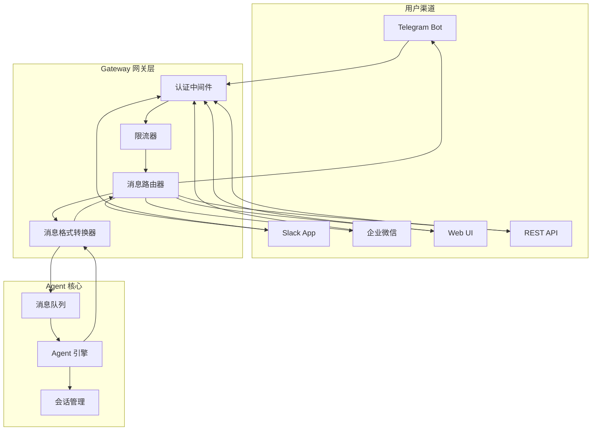
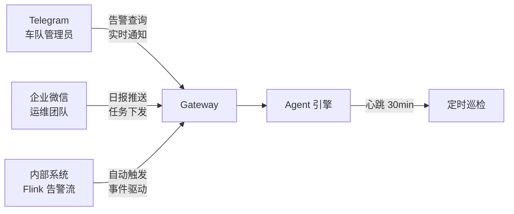

多渠道通信是 OpenClaw「养虾」体验的核心——用户不需要打开专门的界面，直接在 Telegram、Slack、微信里给 Agent 发消息。这背后是一个**统一的消息路由与网关架构**。

---

## 一、通信架构概览



---

## 二、核心设计：消息抽象层

### 2.1 为什么需要消息抽象？

每个渠道有完全不同的消息格式和能力：

| **渠道** | **消息格式** | **支持图片** | **支持按钮** | **消息长度限制** |
| --- | --- | --- | --- | --- |
| Telegram | Markdown / HTML | ✅ | ✅ Inline Keyboard | 4096 字符 |
| Slack | Block Kit JSON | ✅ | ✅ Actions | 40000 字符 |
| 企业微信 | Markdown / 卡片 | ✅ | ✅ 卡片按钮 | 2048 字符 |
| Web UI | HTML / Markdown | ✅ | ✅ 自定义 | 无限制 |

### 2.2 Python 代码：统一消息模型

```python
from dataclasses import dataclass, field
from enum import Enum
from typing import Optional
from datetime import datetime

class ChannelType(Enum):
    TELEGRAM = "telegram"
    SLACK = "slack"
    WECOM = "wecom"
    WEB = "web"
    API = "api"

class MessageType(Enum):
    TEXT = "text"
    IMAGE = "image"
    FILE = "file"
    ACTION = "action"       # 按钮点击等交互

@dataclass
class UnifiedMessage:
    """统一消息模型：屏蔽渠道差异"""
    channel: ChannelType
    user_id: str
    session_id: str
    content: str
    message_type: MessageType = MessageType.TEXT
    attachments: list[dict] = field(default_factory=list)
    metadata: dict = field(default_factory=dict)
    timestamp: datetime = field(default_factory=datetime.now)

    @property
    def is_command(self) -> bool:
        """是否为命令消息"""
        return self.content.startswith("/")

@dataclass
class UnifiedResponse:
    """统一响应模型"""
    content: str
    attachments: list[dict] = field(default_factory=list)
    actions: list[dict] = field(default_factory=list)  # 交互按钮
    split_long: bool = True  # 是否自动拆分长消息
```

---

## 三、Gateway 实现

### 3.1 Python 代码：FastAPI 网关

```python
from fastapi import FastAPI, Request, HTTPException
from abc import ABC, abstractmethod
import asyncio
import hashlib
import hmac
import time

app = FastAPI(title="Agent Gateway")

# ---- 1. 渠道适配器接口 ----
class ChannelAdapter(ABC):
    """渠道适配器基类"""

    @abstractmethod
    async def parse_message(self, request: Request) -> UnifiedMessage:
        """将渠道原始消息转为统一格式"""
        pass

    @abstractmethod
    async def send_response(self, user_id: str, response: UnifiedResponse):
        """将统一响应转为渠道格式并发送"""
        pass

    @abstractmethod
    async def verify_signature(self, request: Request) -> bool:
        """验证请求签名（安全）"""
        pass

# ---- 2. Telegram 适配器 ----
class TelegramAdapter(ChannelAdapter):

    def __init__(self, bot_token: str):
        self.bot_token = bot_token
        self.api_base = f"https://api.telegram.org/bot{bot_token}"

    async def parse_message(self, request: Request) -> UnifiedMessage:
        data = await request.json()
        message = data.get("message", {})
        return UnifiedMessage(
            channel=ChannelType.TELEGRAM,
            user_id=str(message["from"]["id"]),
            session_id=str(message["chat"]["id"]),
            content=message.get("text", ""),
            metadata={"chat_type": message["chat"]["type"]},
        )

    async def send_response(self, chat_id: str, response: UnifiedResponse):
        import httpx
        # 自动拆分超长消息（Telegram 限制 4096 字符）
        chunks = self._split_message(response.content, max_len=4000)
        async with httpx.AsyncClient() as client:
            for chunk in chunks:
                await client.post(
                    f"{self.api_base}/sendMessage",
                    json={"chat_id": chat_id, "text": chunk, "parse_mode": "Markdown"},
                )

    def _split_message(self, text: str, max_len: int) -> list[str]:
        if len(text) <= max_len:
            return [text]
        # 按段落拆分
        chunks, current = [], ""
        for para in text.split("\n\n"):
            if len(current) + len(para) > max_len:
                chunks.append(current)
                current = para
            else:
                current += "\n\n" + para if current else para
        if current:
            chunks.append(current)
        return chunks

    async def verify_signature(self, request: Request) -> bool:
        # Telegram 使用 Secret Token 验证
        return True  # 简化处理

# ---- 3. Slack 适配器 ----
class SlackAdapter(ChannelAdapter):

    def __init__(self, bot_token: str, signing_secret: str):
        self.bot_token = bot_token
        self.signing_secret = signing_secret

    async def parse_message(self, request: Request) -> UnifiedMessage:
        data = await request.json()
        event = data.get("event", {})
        return UnifiedMessage(
            channel=ChannelType.SLACK,
            user_id=event.get("user", ""),
            session_id=event.get("channel", ""),
            content=event.get("text", ""),
            metadata={"thread_ts": event.get("thread_ts")},
        )

    async def send_response(self, channel_id: str, response: UnifiedResponse):
        import httpx
        # Slack 使用 Block Kit 格式
        blocks = [{"type": "section", "text": {"type": "mrkdwn", "text": response.content}}]
        # 添加交互按钮
        if response.actions:
            blocks.append({
                "type": "actions",
                "elements": [
                    {"type": "button", "text": {"type": "plain_text", "text": a["label"]},
                     "action_id": a["id"]}
                    for a in response.actions
                ]
            })
        async with httpx.AsyncClient() as client:
            await client.post(
                "https://slack.com/api/chat.postMessage",
                headers={"Authorization": f"Bearer {self.bot_token}"},
                json={"channel": channel_id, "blocks": blocks},
            )

    async def verify_signature(self, request: Request) -> bool:
        timestamp = request.headers.get("X-Slack-Request-Timestamp", "")
        signature = request.headers.get("X-Slack-Signature", "")
        body = await request.body()
        sig_basestring = f"v0:{timestamp}:{body.decode()}"
        my_signature = "v0=" + hmac.new(
            self.signing_secret.encode(), sig_basestring.encode(), hashlib.sha256
        ).hexdigest()
        return hmac.compare_digest(my_signature, signature)

# ---- 4. 消息路由器 ----
class MessageRouter:
    """统一消息路由"""

    def __init__(self):
        self.adapters: dict[ChannelType, ChannelAdapter] = {}
        self.agent = None  # Agent 引擎实例

    def register_channel(self, channel_type: ChannelType, adapter: ChannelAdapter):
        self.adapters[channel_type] = adapter

    async def handle(self, channel_type: ChannelType, request: Request):
        adapter = self.adapters[channel_type]

        # 1. 验证签名
        if not await adapter.verify_signature(request):
            raise HTTPException(status_code=401, detail="Invalid signature")

        # 2. 解析为统一消息
        message = await adapter.parse_message(request)

        # 3. 交给 Agent 处理
        result = await self.agent.process(message)

        # 4. 转换并发送响应
        response = UnifiedResponse(content=result)
        await adapter.send_response(message.session_id, response)

# ---- 5. 注册路由 ----
router = MessageRouter()

@app.post("/webhook/telegram")
async def telegram_webhook(request: Request):
    await router.handle(ChannelType.TELEGRAM, request)
    return {"ok": True}

@app.post("/webhook/slack")
async def slack_webhook(request: Request):
    await router.handle(ChannelType.SLACK, request)
    return {"ok": True}
```

---

## 四、会话管理

### 4.1 跨渠道会话统一

```python
import redis.asyncio as redis
import json

class SessionManager:
    """跨渠道会话管理器"""

    def __init__(self, redis_url: str = "redis://localhost:6379"):
        self.redis = redis.from_url(redis_url)

    def _session_key(self, user_id: str) -> str:
        """统一 Session Key：同一用户不同渠道共享会话"""
        return f"agent:session:{user_id}"

    async def get_context(self, user_id: str) -> dict:
        """获取用户会话上下文"""
        data = await self.redis.get(self._session_key(user_id))
        if data:
            return json.loads(data)
        return {"messages": [], "preferences": {}, "active_task": None}

    async def update_context(self, user_id: str, context: dict):
        """更新会话上下文（TTL 24 小时）"""
        await self.redis.set(
            self._session_key(user_id),
            json.dumps(context, ensure_ascii=False),
            ex=86400,
        )

    async def clear_session(self, user_id: str):
        """清除会话"""
        await self.redis.delete(self._session_key(user_id))
```

### 4.2 消息队列解耦

```python
import asyncio
from collections import deque

class MessageQueue:
    """异步消息队列：解耦接收与处理"""

    def __init__(self, max_concurrent: int = 5):
        self.queue: asyncio.Queue = asyncio.Queue()
        self.semaphore = asyncio.Semaphore(max_concurrent)

    async def enqueue(self, message: UnifiedMessage):
        """入队"""
        await self.queue.put(message)

    async def worker(self, agent, router: MessageRouter):
        """消费者：处理消息"""
        while True:
            message = await self.queue.get()
            async with self.semaphore:  # 控制并发
                try:
                    result = await agent.process(message)
                    response = UnifiedResponse(content=result)
                    adapter = router.adapters[message.channel]
                    await adapter.send_response(message.session_id, response)
                except Exception as e:
                    print(f"处理失败: {e}")
                finally:
                    self.queue.task_done()
```

---

## 五、心跳机制：主动服务

```python
import asyncio
from datetime import datetime

class Heartbeat:
    """心跳机制：Agent 定时主动执行任务"""

    def __init__(self, interval_minutes: int = 30):
        self.interval = interval_minutes * 60
        self.tasks: list[dict] = []
        self.running = False

    def register_task(self, name: str, handler, cron: str = None):
        """注册定时任务"""
        self.tasks.append({"name": name, "handler": handler, "cron": cron})

    async def start(self):
        """启动心跳循环"""
        self.running = True
        print(f"💓 心跳启动，间隔 {self.interval // 60} 分钟")
        while self.running:
            await asyncio.sleep(self.interval)
            print(f"\n💓 心跳触发 @ {datetime.now().strftime('%H:%M')}")
            for task in self.tasks:
                try:
                    await task["handler"]()
                    print(f"  ✅ {task['name']} 执行完毕")
                except Exception as e:
                    print(f"  ❌ {task['name']} 失败: {e}")

    def stop(self):
        self.running = False

# ---- 使用示例 ----
heartbeat = Heartbeat(interval_minutes=30)

async def check_alerts():
    """定时检查新告警"""
    # 查询数据库是否有未处理的高危告警
    # 如果有，主动推送给车队管理员
    pass

async def daily_report():
    """每日汇总报告"""
    # 统计当天告警数据，生成报告推送到 Slack
    pass

heartbeat.register_task("告警检查", check_alerts)
heartbeat.register_task("日报生成", daily_report)
```

---

## 六、实战案例：车联网 Agent 多渠道部署



---

## 七、设计启发总结

<div class="callout callout-note" markdown="1">
**📝 ✨**

### 通信网关的 5 条设计原则

1. **消息抽象是核心**——定义 UnifiedMessage / UnifiedResponse，屏蔽渠道差异
2. **适配器模式**——每个渠道一个 Adapter，新增渠道只需实现接口
3. **安全第一**——签名验证、限流、绑定 127.0.0.1，远程走 VPN
4. **异步解耦**——用消息队列将接收和处理解耦，控制并发
5. **心跳赋能**——定时任务让 Agent 从「被动响应」变为「主动服务」
</div>
