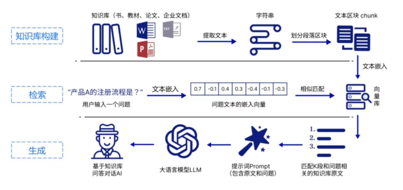

# 第一部分：RAG 是什么？解决了什么问题？有什么优势？



# 1.1 RAG 是什么

RAG 全称 **Retrieval-Augmented Generation**，中文常译为 **检索增强生成**。

它的核心思想是：

在大模型生成回答之前，先去外部知识库/数据库中检索相关资料，然后把检索结果作为上下文输入给大模型，让模型基于“真实资料”生成回答。

也就是说：

- LLM（大模型）负责“语言组织、推理和生成”
- Retriever（检索模块）负责“查资料”
- 知识库（文档库、向量库）负责“存资料”

RAG 可以看成：

**大模型 + 搜索引擎 + 企业知识库**

---

# 1.2 RAG 为什么会出现（背景）

传统大模型虽然强，但存在明显缺陷：

- 模型的知识是“训练时刻”固化的
- 训练数据不可能包含企业内部私有文档
- 模型不会自动知道你们最新产品、最新制度、最新代码结构
- 模型容易产生幻觉（hallucination）

RAG 的提出可以追溯到 FAIR 在 2020 年提出的经典论文《Retrieval-Augmented Generation for Knowledge-Intensive NLP Tasks》，其目的是解决知识密集型任务（Knowledge-Intensive Tasks）中模型准确性问题。

# 1.3 RAG 解决了什么问题？

### （1）解决 LLM 的幻觉（Hallucination）

大模型经常会“看起来很对”，但实际上是瞎编。

例如：

“某某政策是什么？”模型可能会编造一套“很像真的”的制度。

RAG 的方式是：

- 先检索制度文档
- 把制度文档相关段落给模型
- 让模型基于段落回答

这样可以大幅降低胡编概率。

---

### （2）解决“企业私有知识无法使用”

企业内部知识包括：

- 产品 PRD
- 技术设计文档
- SOP 流程
- 会议纪要
- API 文档
- 代码仓库说明
- 合同条款

这些知识一般不可能放到公开数据集中训练。

RAG 的价值是：

不用训练模型，也能让模型“懂公司”。

---

### （3）解决知识更新慢的问题

大模型更新依赖重新训练或微调，但成本极高。

而 RAG 是“外挂知识”：

- 文档更新 → 向量库更新
- 模型立刻可回答最新信息

**知识更新周期从“几周/几个月”缩短到“分钟级”。**

---

### （4）解决上下文窗口限制

LLM 有上下文限制（比如 128k token 也仍然有限）。

你不可能把整个 wiki 或几十份 PDF 都塞进去。

RAG 通过检索机制：

- 只取 TopK 最相关 chunks
- 把相关部分作为上下文输入

做到 **低成本、高相关**。

# 1.4 RAG 的优势总结

### 优势 1：准确率提升

因为回答来自真实资料，不再完全依赖模型参数记忆。

---

### 优势 2：可解释、可追溯

RAG 可以输出：

- 参考文档
- 引用段落
- 来源链接

这在企业场景非常关键（尤其金融、法律、医疗、审计场景）。

---

### 优势 3：成本低、易落地

相比训练模型，RAG 只需要：

- embedding 模型
- 向量数据库
- 检索 pipeline
- prompt 拼接

无需训练 GPU 集群。

---

### 优势 4：扩展性强

知识库越大、越完善，系统能力越强。

RAG 是典型的“越用越强”的体系。

---

### 优势 5：通用性强

任何有文档的领域都能用：

- 企业知识库
- 法律条文
- 技术手册
- 教育题库
- 产品 FAQ

# 第二部分：怎么开发？开发路径？主流方案是什么？

这一部分属于 RAG 的核心工程实现。

---

# 2.1 RAG 的标准流程架构（UISDC 文档核心）

RAG 系统一般分为两条链路

### A. 离线链路：构建知识库（Indexing Pipeline）

### Step 1：数据采集（Data Ingestion）

数据源可能包括：

- PDF 文档
- Word/Excel
- Notion/Confluence
- 网页内容
- 代码仓库 README
- Slack/飞书消息

---

### Step 2：文档解析（Parsing）

不同格式需要不同解析器：

- PDF：需要提取正文 + 表格 + 标题层级
- 图片 PDF：需要 OCR
- PPT：需要提取每页文字、标题结构
- HTML：需要提取正文并去除噪声

解析的目标是把原始文档转成结构化文本。

---

### Step 3：Chunking（文档切片）

这是 RAG 质量的关键。

UISDC 文档提到 chunk 太大太小都会影响效果：

- 太大：检索会把无关内容也带进来，导致模型混乱
- 太小：语义断裂，检索命中但信息不足

常见 chunk 策略：

- 固定长度切分（比如 300~800 中文字符）
- 段落切分（按标题/段落/章节）
- 带 overlap 的切分（例如重叠 10%~20%）

overlap 的意义是：避免切割导致关键信息被截断。

---

### Step 4：Embedding（向量化）

把每个 chunk 转成向量表示。

embedding 的作用：

- 把语义相近的文本映射到向量空间邻近位置
- 支持“语义检索”

---

### Step 5：写入向量数据库（Vector Index）

存储内容包括：

- chunk 文本
- embedding 向量
- metadata（文档名、来源、时间、权限、标签）

metadata 在企业落地里非常重要（后面会提）。

---

---

### B. 在线链路：问答推理（Query Pipeline）

### Step 1：用户输入 Query

例如：

“RAG 和 Fine-tuning 的区别是什么？”

---

### Step 2：Query Embedding

把问题也 embedding 成向量。

---

### Step 3：检索召回（Retrieval TopK）

从向量库检索出最相似的 chunk。

一般取 Top 3 ~ Top 10。

---

### Step 4：重排序（Rerank，可选但强烈推荐）

UISDC 文档提到 rerank 是提升效果的重要策略。

为什么需要 rerank？

向量检索属于“粗召回”，可能混入噪声。

rerank 会用更强模型（通常是 cross-encoder）重新计算 query 与 chunk 的相关性。

效果：

- 去掉无关 chunk
- 让最相关 chunk 排在最前面

---

### Step 5：Prompt 构建（Prompt Engineering）

将检索结果拼成提示词：

Prompt 里通常包含：

- system role（你是知识库助手）
- context（检索到的 chunks）
- question（用户问题）
- output format（要求输出格式）

并且要加约束：

如果资料中没有答案，请明确说明“未找到”。

这一步决定了回答是否“稳”。

---

### Step 6：LLM 生成答案

LLM 基于 context 生成最终回答。

---

### Step 7：输出引用来源（可选）

企业级一般会输出：

- 引用文档名
- 页码/段落
- 原文片段

# 第三部分：落地 Demo（一个可直接实现的例子）

下面我给你一个**企业级最常见 demo**。

---

# 3.1 Demo 场景：企业知识库问答机器人

### 功能目标

用户可以问：

- “公司报销流程是什么？”
- “研发上线流程有哪些步骤？”
- “API 鉴权方式是什么？”
- “某产品模块的设计原则是什么？”

系统输出：

- 标准答案（条列化）
- 引用资料来源

---

# 3.2 Demo 的最小架构（可跑通）

组件：

- 文档库：本地 docs/ 文件夹
- embedding：bge-large-zh / OpenAI
- 向量库：FAISS
- LLM：GPT/Qwen
- Web UI：Streamlit 或 FastAPI

---

# 3.3 Demo 实现步骤（详细版）

### Step 1：准备数据

准备 10-50 份文档（越多效果越明显）：

- 公司制度 PDF
- 技术文档 Markdown
- 产品说明 Word

---

### Step 2：文档解析

把 PDF/Word 转成纯文本（txt 或 markdown）。

---

### Step 3：Chunking

策略：

- chunk_size = 500 中文字左右
- overlap = 50 字
- 保留标题信息（很重要）

chunk 最终结构建议：

```plain text
{
  "chunk_id": "doc1_003",
  "text": "……",
  "metadata": {
    "doc_name": "报销制度.pdf",
    "page": 3,
    "section": "费用报销流程"
  }
}
```

---

### Step 4：Embedding + Index

把每个 chunk embedding 后写入向量库。

---

### Step 5：Query 检索

用户问题 embedding，然后 TopK=5 召回。

---

### Step 6：Rerank（增强效果）

对 TopK chunks 做 rerank，选最相关 Top3。

---

### Step 7：Prompt 拼接

推荐 prompt 模板：

```plain text
你是企业知识库助手，请严格根据提供的资料回答问题。
如果资料中找不到答案，请回答：未在资料中找到相关信息。

资料如下：
{context}

问题：
{question}

请用条列方式回答，并在最后列出引用来源。
```

---

### Step 8：输出答案 + 引用

输出格式示例：

**回答：**

1. ...
2. ...
3. ...

**引用：**

- 报销制度.pdf 第3页
- 财务流程说明.md 第2段

---

# 3.4 Demo 升级点（让你看起来像真生产）

如果你要做演示，强烈建议加上：

### （1）多轮对话记忆

例如用户追问：

“那超过 5000 怎么办？”

系统要带着上下文继续检索。

---

### （2）引用高亮

把引用片段展示出来，效果非常专业。

---

### （3）混合检索

关键词检索（BM25）+ 向量检索融合。

---

### （4）缓存与成本控制

相同问题不重复调用 LLM。

---

# 第四部分：未来发展与趋势（RAG 下一步会怎么演进）

这一部分是你分享的“高级感”来源。

---

# 4.1 趋势一：从 Basic RAG → Hybrid RAG（行业标准）

未来企业 RAG 基本都会采用：

- BM25（关键词检索）
- Embedding（语义检索）
- Rerank（重排序）

三段式结构。

原因：

- 关键词检索对专有名词、编号、代码更强
- 向量检索对语义表达更强
- rerank 解决噪声排序问题

---

# 4.2 趋势二：Multi-hop RAG（多跳检索）

UISDC 文档提到 Multi-hop RAG。

适用场景：

- 一个问题需要跨多个文档才能回答

例子：

“A产品的退款规则和B产品有什么差异？”

系统需要：

- 先检索 A
- 再检索 B
- 对比总结

未来 RAG 会更像“推理链”。

---

# 4.3 趋势三：GraphRAG（知识图谱增强）

传统 RAG 召回的是 chunk（文本片段），但 chunk 是碎片化的。

GraphRAG 会构建：

- 实体（人、产品、模块）
- 关系（依赖、流程、归属）

优势：

- 支持跨文档关系推理
- 支持“谁负责哪个模块”这种查询
- 支持复杂业务链路问题

---

# 4.4 趋势四：多模态 RAG（PDF、表格、图片成为主战场）

企业资料很多不是纯文本：

- PPT 里的架构图
- PDF 扫描件
- Excel 表格
- 流程图

未来 RAG 重点会变成：

- layout parsing（版面理解）
- OCR + 图文理解
- 多模态 embedding
- VLM（视觉语言模型）检索

---

# 4.5 趋势五：RAG 评估体系标准化

未来企业关心的不只是能不能回答，而是：

- recall（召回率）
- precision（准确率）
- hallucination rate（幻觉率）
- cost per query（成本）
- latency（延迟）

会出现越来越成熟的 RAG evaluation 工具。

---

# 4.6 趋势六：RAG + Agent 成为企业核心架构

RAG 只是“查资料”，下一步是“办事”。

未来的企业 AI 系统形态：

RAG（知识） + Tools（工具） + Agent（决策与执行）

例如：

- 查资料（RAG）
- 写方案（LLM）
- 调用 Jira API 创建任务（Tool）
- 调用 GitHub 提交 PR（Tool）
- 自动测试与部署（Tool）

这才是 AI Native Framework 的终极方向。

---

# 4.7 趋势七：安全、权限、合规是竞争壁垒

未来企业落地最大难点不是技术，而是：

- 权限控制（谁能查哪些文档）
- 数据隔离（多租户）
- 审计日志（可追踪）
- 数据脱敏（敏感信息）
- 私有部署（不出域）

谁能解决这些，谁就能把 RAG 真正变成产品。

---

# 最终总结（可作为结尾）

RAG 是目前企业落地大模型最成熟、最实用的方案之一。

它的价值在于：

让 LLM 从“凭记忆回答”升级为“基于真实资料回答”，并且可以持续更新、可追溯、可控。

未来的发展路径：

**Basic RAG → Hybrid RAG → Multi-hop RAG → GraphRAG → MultiModalRAG → RAG + Agent**

# 项目落地

[https://github.com/Leon-Acco/acho-assistant.git](https://github.com/Leon-Acco/acho-assistant.git)
