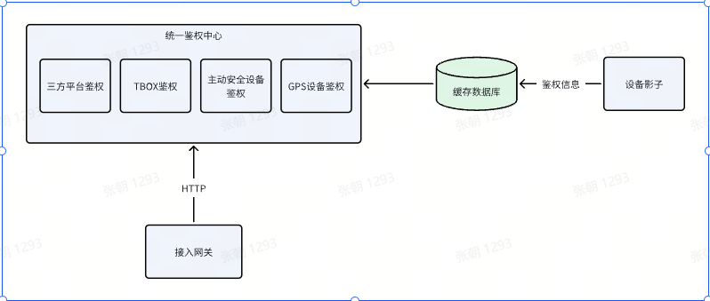
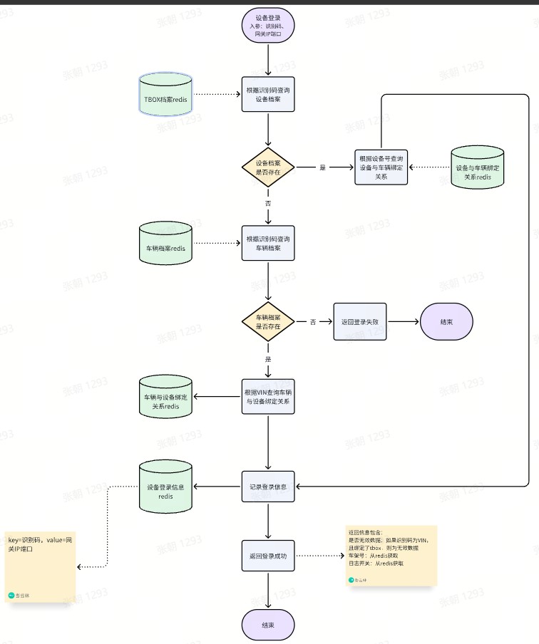
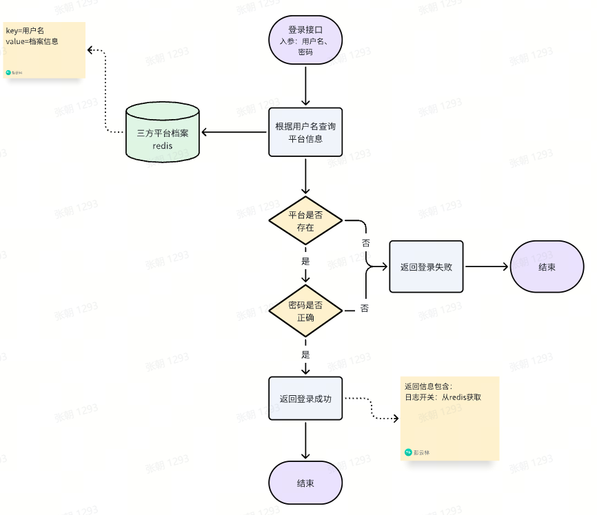
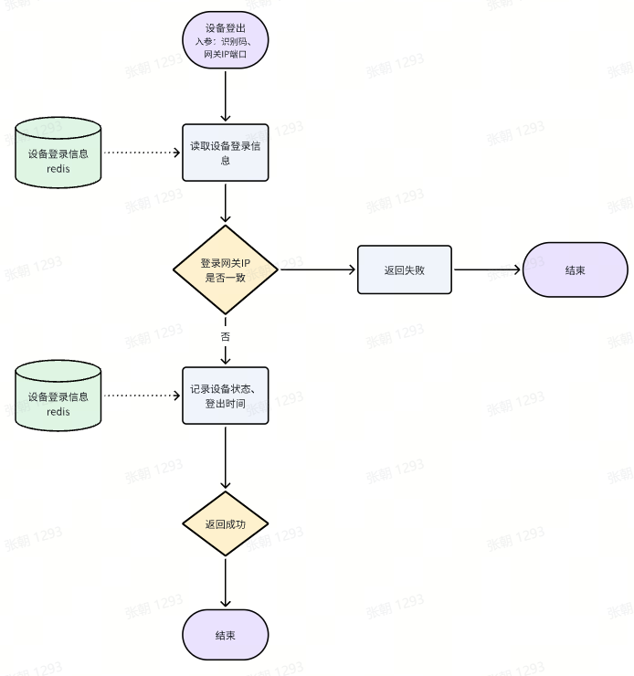
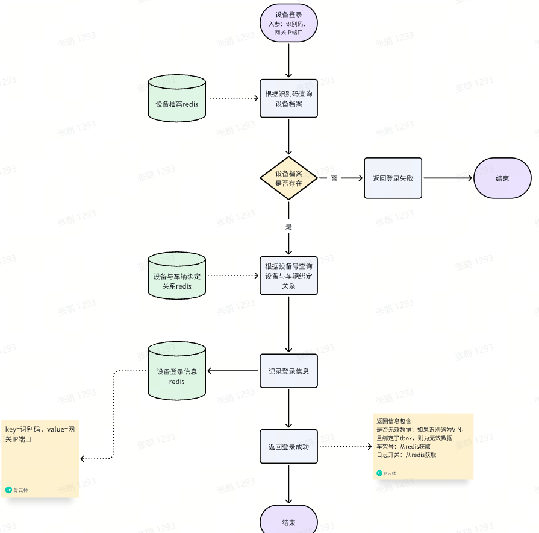
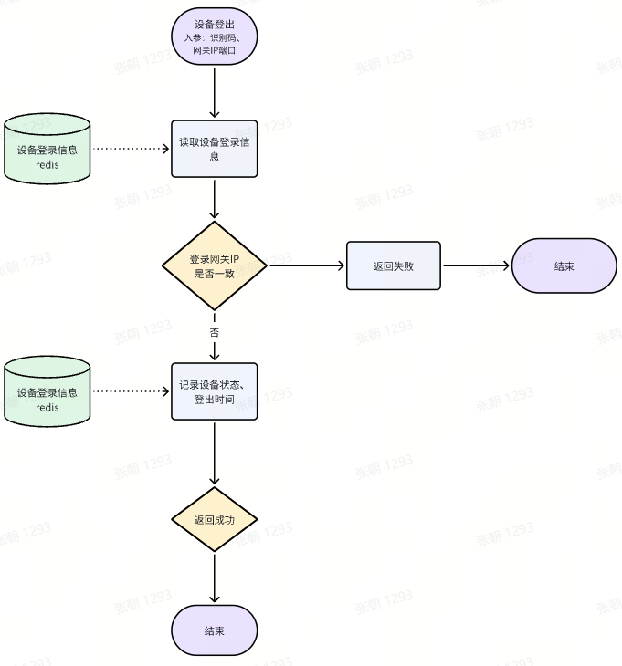
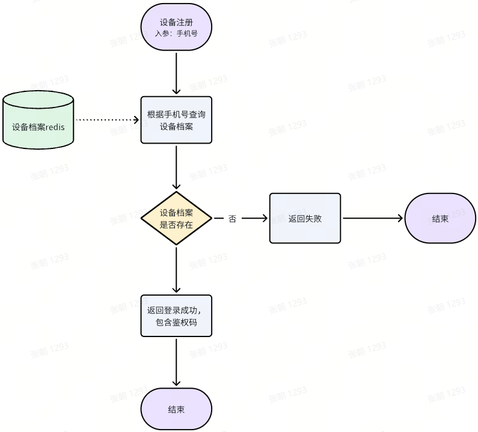
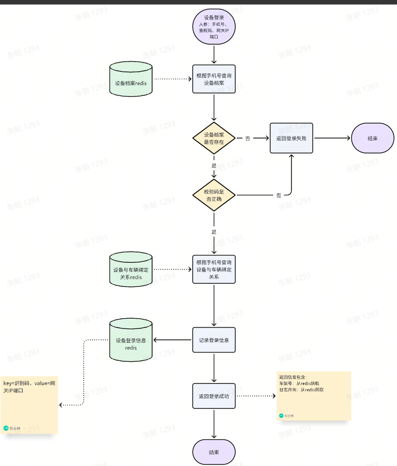
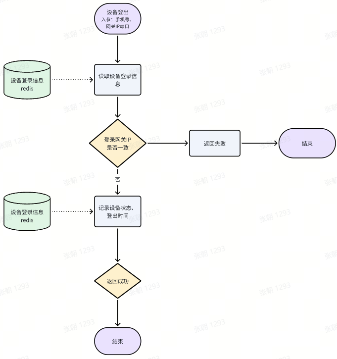

# 一、概述
负责执行设备与第三方平台的全面登录认证流程，以强化系统安全性与效率

1. 智能拦截未知设备：系统自动甄别并拦截任何无法识别的设备，确保仅授权设备接入。同时，针对成功登录的车辆，精准记录其对应关系，为后续指令的精准下发奠定坚实基础；
2. 严格审查第三方平台：实施严格的平台验证机制，拦截并拒绝任何未经认证或系统无法识别的第三方平台接入，维护系统生态的纯净与安全；
3. 精准追踪设备登入登出状态：细致记录每一台设备的登出状态，确保系统资源的合理分配与及时释放，同时也为后续的安全审计与性能优化提供宝贵数据支持；

<!-- 这是一张图片，ocr 内容为： -->

# 二、功能模块
## 32960协议
### 与其它服务交互逻辑
#### 32960设备网关
        设备登录网关时，网关会通过http调用设备登录接口进行鉴权

#### 32960平台网关
        平台登录网关时，网关会通过http调用平台登录接口进行鉴权

#### 影子服务
            1. 设备登录接口或平台登录接口会读取设备与车辆绑定关系redis、设备档案redis、车辆档案redis、三方平台档案redis进行鉴权，redis信息通过影子服务维护

### 32960设备登录接口
#### 接口说明
    1. 调用方：设备网关
    2. 调用方式：http

#### 流程图
<!-- 这是一张图片，ocr 内容为： -->

#### 接口明细
    **请求路径**：/tboxLogin

    **请求方式：**http post

    **请求参数**

| **名称** | **类型** | **是否必须** | **默认值** | **备注** |
| --- | --- | --- | --- | --- |
| uid | String | 必需 | | 识别码 |
| gatewayIp | String | 必需 | | 网关IP地址 |
| gatewayPort | integer | 必需 | | 网关端口 |

      **返回信息**

| **名称** | **类型** | **是否必须** | **默认值** | **备注** |
| --- | --- | --- | --- | --- |
| status | boolean | 必须 | false | 返回状态 true成功 false失败 |
| code | string | 必须 | | 状态码 |
| msg | string | 必须 | | 返回消息 |
| data | object | 必须 | | 返回数据 |
|  |-vin | string | 非必须 | | 车架号 |
|  |-logSwitch | boolean | 必须 | false | 日志开关 true开启 false关闭 |
|  |-invalid | boolean | 必须 | false | 无效数据 true是 false否 |

### 32960平台登录接口
#### 接口说明
            1. 调用方：平台网关
            2. 调用方式：http

#### 流程图
<!-- 这是一张图片，ocr 内容为： -->

#### 接口明细
        **请求路径：**/platformLogin

        **请求方式：**http post

        **请求参数**

| **名称** | **类型** | **是否必须** | **默认值** | **备注** |
| --- | --- | --- | --- | --- |
| username | String | 必需 | | 用户名 |
| md5Password | String | 必需 | | 密码，需要MD5加密 |

      **返回信息**

| **名称** | **类型** | **是否必须** | **默认值** | **备注** |
| --- | --- | --- | --- | --- |
| status | boolean | 必须 | false | 返回状态 true成功 false失败 |
| code | string | 必须 | | 状态码 |
| msg | string | 必须 | | 返回消息 |
| data | object | 必须 | | 返回数据 |
|  |-logSwitch | boolean | 必须 | false | 日志开关 true开启 false关闭 |

### 32960设备登出接口
#### 接口说明
            1. 调用方：设备网关
            2. 调用方式：http

#### 流程图
<!-- 这是一张图片，ocr 内容为： -->

#### 接口明细
        **请求路径：**/tboxLogout

        **请求方式：**http post

        **请求参数**

| **名称** | **类型** | **是否必须** | **默认值** | **备注** |
| --- | --- | --- | --- | --- |
| uid | String | 必需 | | 识别码 |
| gatewayIp | String | 必需 | | 网关IP地址 |
| gatewayPort | integer | 必需 | | 网关端口 |

      **返回信息**

| **名称** | **类型** | **是否必须** | **默认值** | **备注** |
| --- | --- | --- | :--- | --- |
| status | boolean | 必须 | false | 返回状态 true成功 false失败 |
| code | string | 必须 | | 状态码 |
| msg | string | 必须 | | 返回消息 |

### redis结构
#### 车辆与Tbox绑定关系
键=tbox:bind:设备号，类型=hash

| **key** | **value** | **是否必填** | **备注** |
| --- | --- | --- | --- |
| vin | Lxxxxxxx1 | 是 | 车架号 |

#### 设备档案-TBOX
键=tbox:info:识别码，类型=hash

| **key** | **value** | **是否必填** | **备注** |
| --- | --- | --- | --- |
| logSwitch | TRUE | 是 | 日志开关，true打开;false关闭 |

#### 车辆档案
键=car:info:车架号，类型=hash

| **key** | **value** | **是否必填** | **备注** |
| --- | --- | --- | --- |
| logSwitch | TRUE | 是 | 日志开关，true打开;false关闭 |

#### 三方平台档案
键=platform:info:平台登录名，类型=hash

| **key** | **value** | **是否必填** | **备注** |
| --- | --- | --- | --- |
| logSwitch | TRUE | 是 | 日志开关，true打开;false关闭 |
| password | ???? | 是 | 密码,需要MD5加密存储，示例：DigestUtils.md5DigestAsHex(req.getPassword().getBytes()) |

#### 设备登录信息
      键=tbox:login:识别码，类型=hash

| **key** | **value** | **是否必填** | **备注** |
| --- | --- | --- | --- |
| ip | 127.0.0.1 | 是 | IP |
| port | 8080 | 是 | 端口 |
| onlineStatus | TRUE | 是 | 在线状态，true在线;false离线 |
| loginTime | 1725528903872 | 是 | 登录时间 |
| logoutTime | 1725528903872 | 否 | 退出时间 |

## GPS协议
### 与其它服务交互逻辑
#### GPS设备网关
        设备登录网关时，网关会通过http调用设备登录接口进行鉴权

#### 影子服务
            1. 设备登录接口会读取设备与车辆绑定关系redis、设备档案redis、车辆档案redis，redis信息通过影子服务维护

### GPS设备登录接口
#### 接口说明
            1. 调用方：设备网关
            2. 调用方式：http

#### 流程图
<!-- 这是一张图片，ocr 内容为： -->

#### 接口明细
        **请求路径**：/gpsLogin

        **请求方式：**http post

        **请求参数**

| **名称** | **类型** | **是否必须** | **默认值** | **备注** |
| --- | --- | --- | --- | --- |
| uid | String | 必需 | | 识别码 |
| gatewayIp | String | 必需 | | 网关IP地址 |
| gatewayPort | integer | 必需 | | 网关端口 |

      **返回信息**

| **名称** | **类型** | **是否必须** | **默认值** | **备注** |
| --- | --- | --- | --- | --- |
| status | boolean | 必须 | false | 返回状态 true成功 false失败 |
| code | string | 必须 | | 状态码 |
| msg | string | 必须 | | 返回消息 |
| data | object | 必须 | | 返回数据 |
|  |-vin | string | 非必须 | | 车架号 |
|  |-logSwitch | boolean | 必须 | false | 日志开关 true开启 false关闭 |

### GPS设备登出接口
#### 接口说明
            1. 调用方：设备网关
            2. 调用方式：http

#### 流程图
<!-- 这是一张图片，ocr 内容为： -->

#### 接口明细
        **请求路径：**/tboxLogout

        **请求方式：**http post

        **请求参数**

| **名称** | **类型** | **是否必须** | **默认值** | **备注** |
| --- | --- | --- | --- | --- |
| uid | String | 必需 | | 识别码 |
| gatewayIp | String | 必需 | | 网关IP地址 |
| gatewayPort | integer | 必需 | | 网关端口 |

      **返回信息**

| **名称** | **类型** | **是否必须** | **默认值** | **备注** |
| --- | --- | --- | :--- | --- |
| status | boolean | 必须 | false | 返回状态 true成功 false失败 |
| code | string | 必须 | | 状态码 |
| msg | string | 必须 | | 返回消息 |

### redis结构
#### 车辆与GPS绑定关系
      键=gps:bind:设备号，类型=hash

| **key** | **value** | **是否必填** | **备注** |
| --- | --- | --- | --- |
| vin | Lxxxxxxx1 | 是 | 车架号 |

#### 设备档案-GPS
      键=gps:info:识别码，类型=hash

| **key** | **value** | **是否必填** | **备注** |
| --- | --- | --- | --- |
| logSwitch | TRUE | 是 | 日志开关，true打开;false关闭 |

#### 车辆档案
      键=car:info:车架号，类型=hash

| **key** | **value** | **是否必填** | **备注** |
| --- | --- | --- | --- |
| logSwitch | TRUE | 是 | 日志开关，true打开;false关闭 |

#### 设备登录信息
      键=gps:login:识别码，类型=hash

| **key** | **value** | **是否必填** | **备注** |
| --- | --- | --- | --- |
| ip | 127.0.0.1 | 是 | IP |
| port | 5510 | 是 | 端口 |
| onlineStatus | TRUE | 是 | 在线状态，true在线;false离线 |
| loginTime | 1725528903872 | 是 | 登录时间 |
| logoutTime | 1725528903872 | 否 | 退出时间 |

## 808协议
### 与其它服务交互逻辑
#### 主动安全设备网关
        设备登录网关时，网关会通过http调用设备登录接口进行鉴权

#### 影子服务
    1. 设备登录接口会读取设备与车辆绑定关系redis、设备档案redis、车辆档案redis，redis信息通过影子服务维护

### 主动安全设备注册接口
#### 接口说明
    1. 调用方：设备网关
    2. 调用方式：http

#### 流程图
<!-- 这是一张图片，ocr 内容为： -->

#### 接口明细
        **请求路径**：/adasRegister

        **请求方式：**http post

        **请求参数**

| **名称** | **类型** | **是否必须** | **默认值** | **备注** |
| --- | --- | --- | --- | --- |
| mobile | String | 必需 | | 手机号 |

      **返回信息**

| **名称** | **类型** | **是否必须** | **默认值** | **备注** |
| --- | --- | --- | :--- | --- |
| status | boolean | 必须 | false | 返回状态 true成功 false失败 |
| code | string | 必须 | | 状态码 |
| msg | string | 必须 | | 返回消息 |
| data | object | 必须 | | 返回数据 |
|  |-authCode | string | 非必须 | | 鉴权码 |

### 主动安全设备登录接口
#### 接口说明
    1. 调用方：设备网关
    2. 调用方式：http

#### 流程图
<!-- 这是一张图片，ocr 内容为： -->

#### 接口明细
        **请求路径**：/adasLogin

        **请求方式：**http post

        **请求参数**

| **名称** | **类型** | **是否必须** | **默认值** | **备注** |
| --- | --- | --- | --- | --- |
| mobile | String | 必需 | | 手机号 |
| authCode | String | 必需 | | _鉴权码_ |
| gatewayIp | String | 必需 | | _网关IP地址_ |
| gatewayPort | integer | 必需 | | _网关端口_ |

      **返回信息**

| **名称** | **类型** | **是否必须** | **默认值** | **备注** |
| --- | --- | --- | --- | --- |
| status | boolean | 必须 | false | 返回状态 true成功 false失败 |
| code | string | 必须 | | 状态码 |
| msg | string | 必须 | | 返回消息 |
| data | object | 必须 | | 返回数据 |
|  |-vin | string | 非必须 | | 车架号 |
|  |-logSwitch | boolean | 必须 | false | 日志开关 true开启 false关闭 |

### 主动安全设备登出接口
#### 接口说明
    1. 调用方：设备网关
    2. 调用方式：http

#### 流程图
<!-- 这是一张图片，ocr 内容为： -->

#### 接口明细
        **请求路径：**/adasLogout

        **请求方式：**http post

        **请求参数**

| **名称** | **类型** | **是否必须** | **默认值** | **备注** |
| --- | --- | --- | --- | --- |
| mobile | String | 必需 | | 手机号 |
| gatewayIp | String | 必需 | | 网关IP地址 |
| gatewayPort | integer | 必需 | | 网关端口 |

      **返回信息**

| **名称** | **类型** | **是否必须** | **默认值** | **备注** |
| --- | --- | --- | :--- | --- |
| status | boolean | 必须 | false | 返回状态 true成功 false失败 |
| code | string | 必须 | | 状态码 |
| msg | string | 必须 | | 返回消息 |

### redis结构
#### 车辆与ADAS绑定关系
      键=adas:bind:识别码，类型=hash

| **key** | **value** | **是否必填** | **备注** |
| --- | --- | --- | --- |
| vinCode | Lxxxxxxx1 | 是 | 车架号 |

#### 设备档案-ADAS
      键=adas:info:识别码，类型=hash

| **key** | **value** | **是否必填** | **备注** |
| --- | --- | --- | --- |
| logSwitch | TRUE | 是 | 日志开关，true打开;false关闭 |
| authCode | 111 | 是 | 鉴权码 |

#### 车辆档案
      键=car:info:车架号，类型=hash

| **key** | **value** | **是否必填** | **备注** |
| --- | --- | --- | --- |
| logSwitch | TRUE | 是 | 日志开关，true打开;false关闭 |

#### 设备登录信息
     键=adas:login:识别码，类型=hash

| **key** | **value** | **是否必填** | **备注** |
| --- | --- | --- | --- |
| ip | 127.0.0.1 | 是 | IP |
| port | 5514 | 是 | 端口 |
| onlineStatus | TRUE | 是 | 在线状态，true在线;false离线 |
| loginTime | 1725528903872 | 是 | 登录时间 |
| logoutTime | 1725528903872 | 否 | 退出时间 |
