<div class="callout callout-abstract" markdown="1">
**📋 🛡️ ADAS 风险聚合任务 v2.0**

**涉及项目**：`dst-v2x-manager-service`（规则配置管理） + `dst-iot-adas-risk-aggregation-job`（Flink 实时聚合）

**版本**：10.0-SNAPSHOT  ·  **更新日期**：2026-06-02

**技术栈**：Spring Boot · Apache Flink 1.15 · MySQL CDC 2.4 · Doris · Kafka
</div>

---

## 📑 目录

```toc
```

---

# 一、项目概述

## 1.1 业务背景

车联网主动安全设备（ADAS / DMS）持续产生大量告警事件，**单条告警本身不直接代表驾驶员风险等级**。本任务的核心目标是：

<div class="callout callout-abstract" markdown="1">
**📋 🎯 核心目标**

**将零散的告警事件，通过可配置的聚合规则，实时计算出中风险 / 高风险事件**，为后续的风险预警、锁车决策、安全评分提供数据支撑。
</div>

## 1.2 核心能力

<div class="callout callout-info" markdown="1">
**ℹ️ ⚙️ 规则配置管理**

后台 REST API 管理聚合规则与车辆绑定，含严格业务校验

[!info] 📡 实时告警消费
从 Kafka 消费 ADAS / DMS 原始告警数据

[!info] 🔄 规则动态同步
通过 MySQL CDC 实时同步规则变更，秒级生效

[!info] 🚗 车辆级精细控制
按 VIN 码绑定规则生效范围

[!info] 🧩 三种聚合模式
会话型（国标）·  计数型（苏标）·  多告警组合

[!info] ⚖️ 双风险等级
每种模式独立计算中风险 / 高风险

[!info] ❄️ 冷却防抖
防止同一车辆短时间内重复触发

[!info] 📤 双通道输出
风险事件同时写入 Doris（分析）+ Kafka（下游消费）
</div>

## 1.3 输入输出全景

<div class="callout callout-example" markdown="1">
**🧪 Excalidraw 手绘风格架构图**

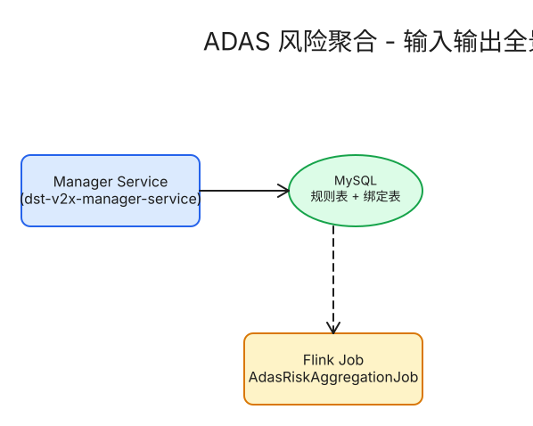
</div>

<details>
<summary>Mermaid 原始图表（点击展开）</summary>

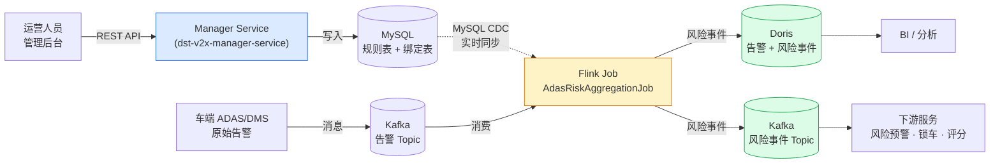

</details>

---

# 二、系统架构

## 2.1 整体架构图

<div class="callout callout-example" markdown="1">
**🧪 Excalidraw 手绘风格架构图**

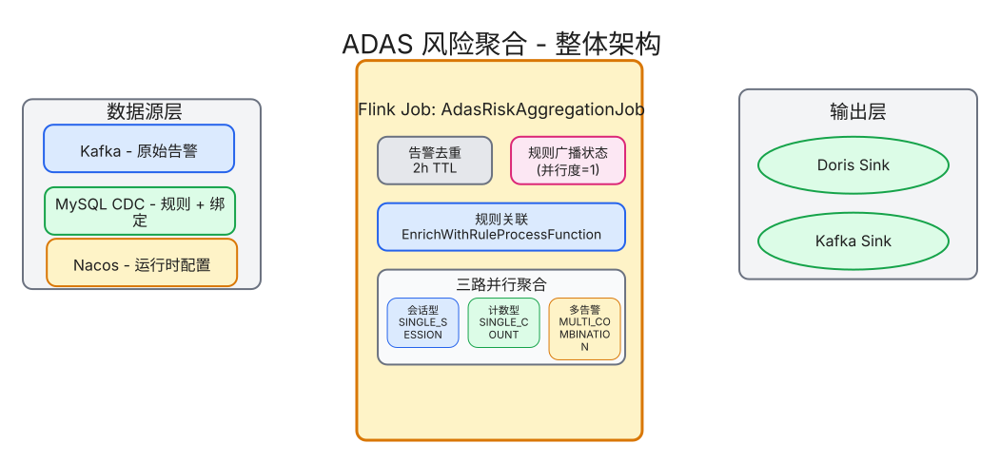
</div>

<details>
<summary>Mermaid 原始图表（点击展开）</summary>

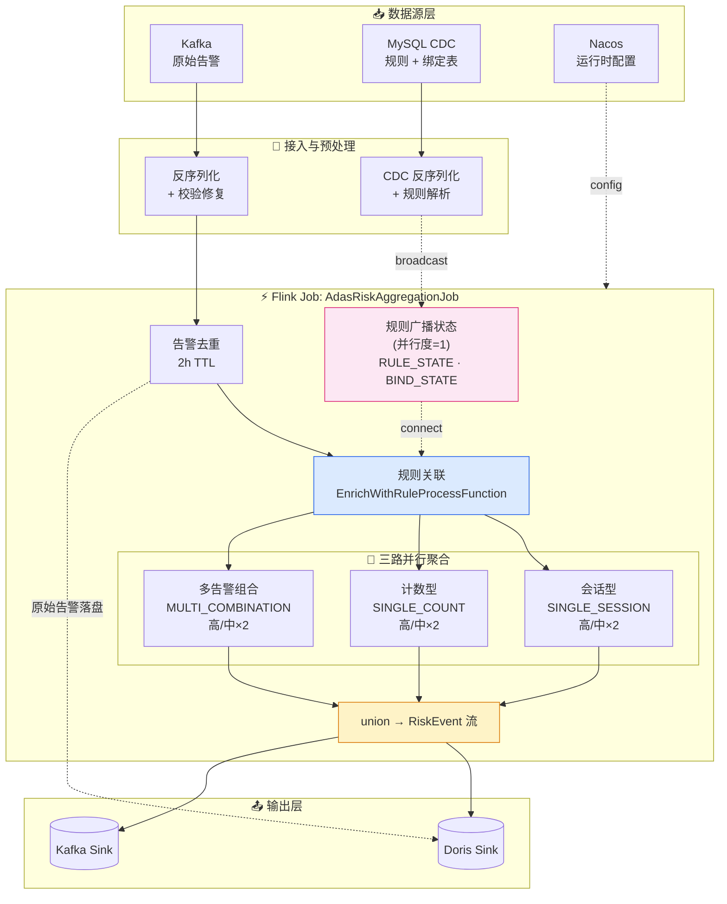

</details>

## 2.2 技术选型

| **组件** | **版本** | **用途** |
| --- | --- | --- |
| Spring Boot | 由 parent 3.0.0 管理 | 后台服务框架 |
| MyBatis-Plus | — | 数据库 ORM |
| Apache Flink | 1.15.0 | 流处理引擎 |
| Flink Kafka Connector | 1.15.0 | 告警数据消费 |
| Flink MySQL CDC | 2.4.0 | 规则表实时变更捕获 |
| Flink Doris Connector | 25.0.0 | 风险事件写入 Doris |
| RocksDB State Backend | 1.15.0 | 大规模状态存储 |
| Nacos | 2022.0.0.0 | 运行时配置管理 |
| Jackson | — | JSON 序列化 / 反序列化 |

## 2.3 配置管理架构

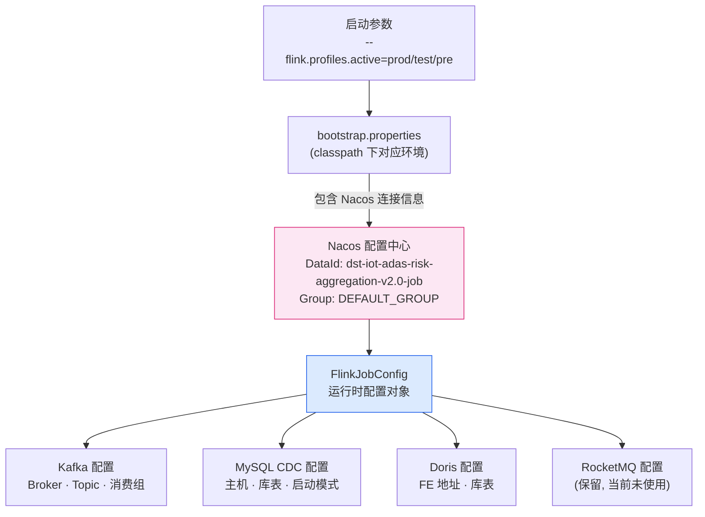

### 三环境配置

| **环境** | **Nacos 地址** | **特殊说明** |
| --- | --- | --- |
| test | `172.16.8.227:8848` | REST 端口 9090 |
| pre | `172.16.35.110:8848` | 用户名 `iot` |
| prod | 华为云 CSE 托管 Nacos | 用户名 `flink-iot` |

---

# 三、规则配置管理模块（dst-v2x-manager-service）

## 3.1 模块定位

规则配置管理模块位于 `dst-v2x-manager-service` 后台服务中，提供 ADAS 风险聚合规则和车辆绑定的 CRUD 管理能力。运营人员通过 REST API 配置规则后，数据写入 MySQL，**Flink 作业通过 CDC 实时捕获变更并生效**。

### 端到端数据流

<div class="callout callout-example" markdown="1">
**🧪 Excalidraw 手绘风格架构图**

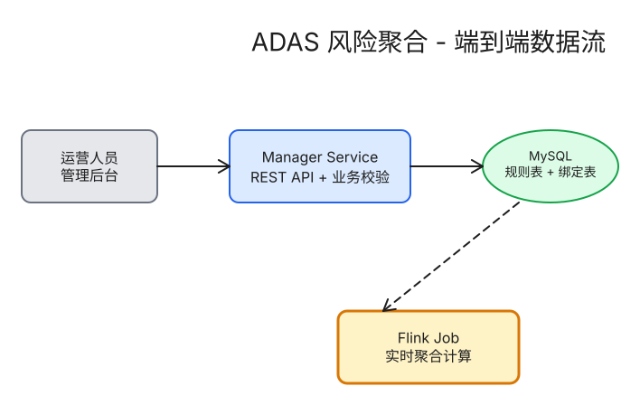
</div>

<details>
<summary>Mermaid 原始图表（点击展开）</summary>


</details>

## 3.2 API 接口清单

### 3.2.1 规则管理接口（`RiskOperationRuleController`）

| **接口** | **方法** | **路径** | **说明** |
| --- | --- | --- | --- |
| 分页查询 | POST | `/riskOperationRule/page` | 支持按 ruleId、name、aggregationMode、scenarioCode、status 筛选 |
| 详情查询 | GET | `/riskOperationRule/detail` | 按 ruleId + ruleVersion 查询完整规则 |
| 新增规则 | POST | `/riskOperationRule/add` | 创建规则，含严格业务校验 |
| 修改规则 | POST | `/riskOperationRule/update` | 按复合主键更新，含严格业务校验 |
| 删除规则 | GET | `/riskOperationRule/remove` | 物理删除，事务性级联删除绑定关系 |
| 启停规则 | POST | `/riskOperationRule/updateStatus` | 修改规则启用 / 停用状态 |

### 3.2.2 车辆绑定接口（`RiskOperationRuleVehicleController`）

| **接口** | **方法** | **路径** | **说明** |
| --- | --- | --- | --- |
| 分页查询 | POST | `/riskOperationRuleVehicle/page` | 查询绑定关系，关联显示规则名称 |
| 批量绑定 | POST | `/riskOperationRuleVehicle/bind` | 批量绑定 VIN 到规则，自动去重 |
| 批量解绑 | POST | `/riskOperationRuleVehicle/unbind` | 支持按 ID 或按 VIN 解绑 |
| 启停绑定 | POST | `/riskOperationRuleVehicle/updateStatus` | 修改绑定启用 / 停用状态 |
| 按规则查车 | GET | `/riskOperationRuleVehicle/listByRuleId` | 查询规则绑定的所有 VIN |
| 按车查规则 | GET | `/riskOperationRuleVehicle/listByVin` | 查询 VIN 绑定的所有规则 |

## 3.3 业务校验规则

`RiskOperationRuleCoreService` 在新增和修改规则时执行严格的字段校验：

| **聚合模式** | **适用告警类型** | **允许的阈值字段** | **约束** |
| --- | --- | --- | --- |
| **SINGLE_SESSION** | 国标：5002 (超速) / 5019 (超时) | 仅时长字段（minDuration、maxDuration、highMinDuration、highMaxDuration） | 不允许配置次数字段 |
| **SINGLE_COUNT** | 苏标：2002 (接打电话) / 2004 (分神) / 1001 (前向碰撞) / 9001 (G-sensor) | 仅次数字段（minLevel1、minLevel2、highMinLevel1、highMinLevel2） | 不允许配置时长字段 |
| **MULTI_COMBINATION** | 苏标告警类型组合 | 多告警专用字段（multiMin*、multiHighMin*） | alarmTypes 只能包含苏标类型，至少 2 种不同类型 |

<div class="callout callout-warning" markdown="1">
**⚠️ 📋 其他通用校验**

- `ruleId`、`ruleVersion`、`name`、`aggregationMode`、`windowMinutes`、`highWindowMinutes` 为必填
- `status` 只允许 0 或 1
</div>

## 3.4 规则管理完整流程

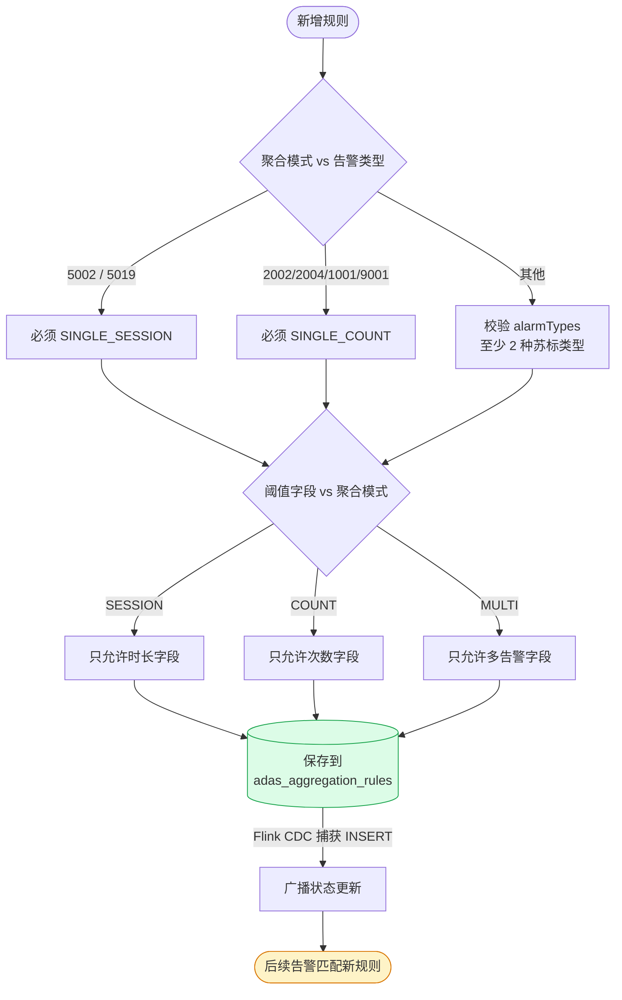

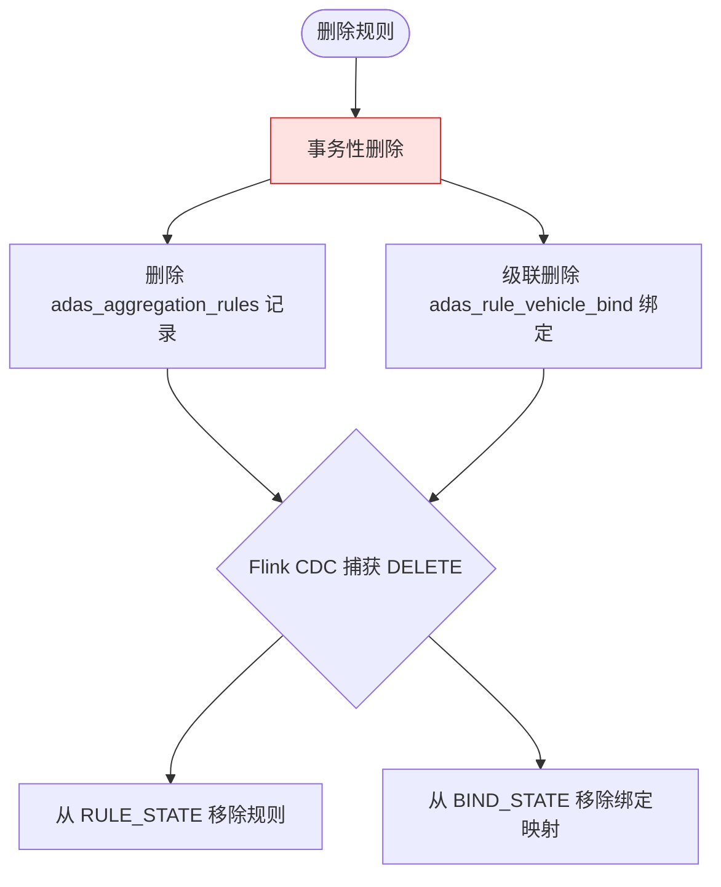

## 3.5 车辆绑定管理流程

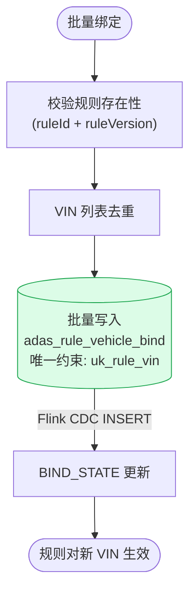

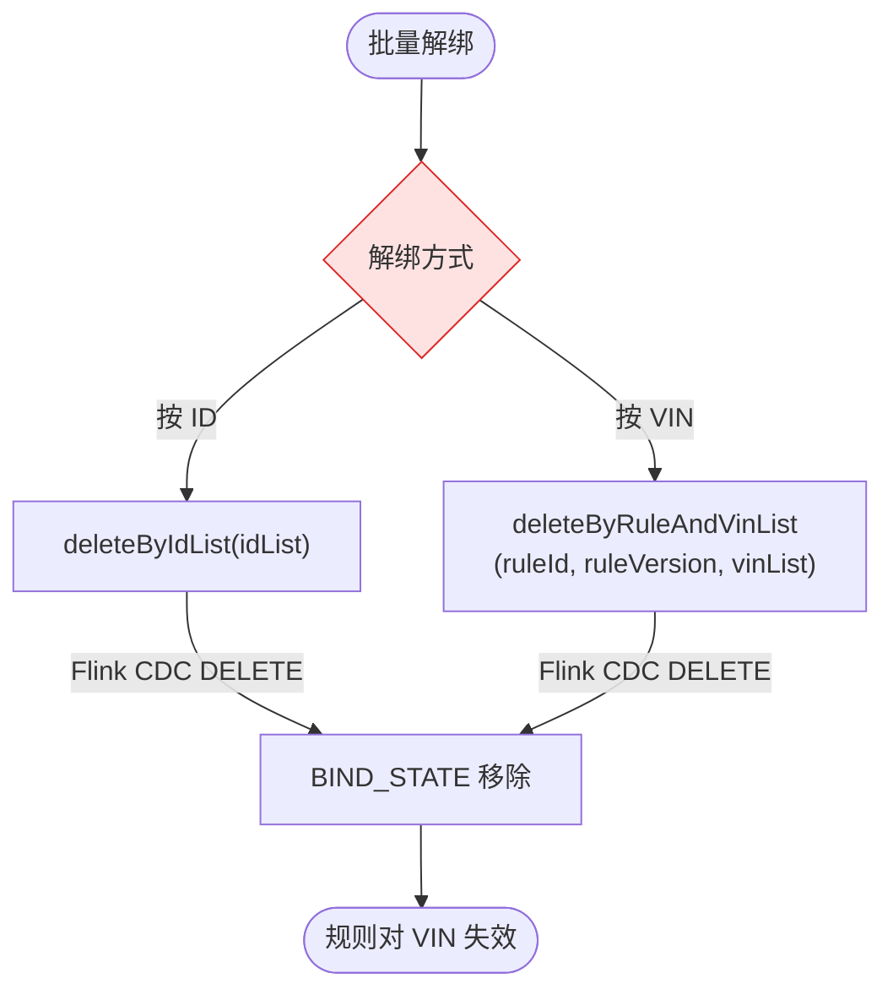

## 3.6 分层架构

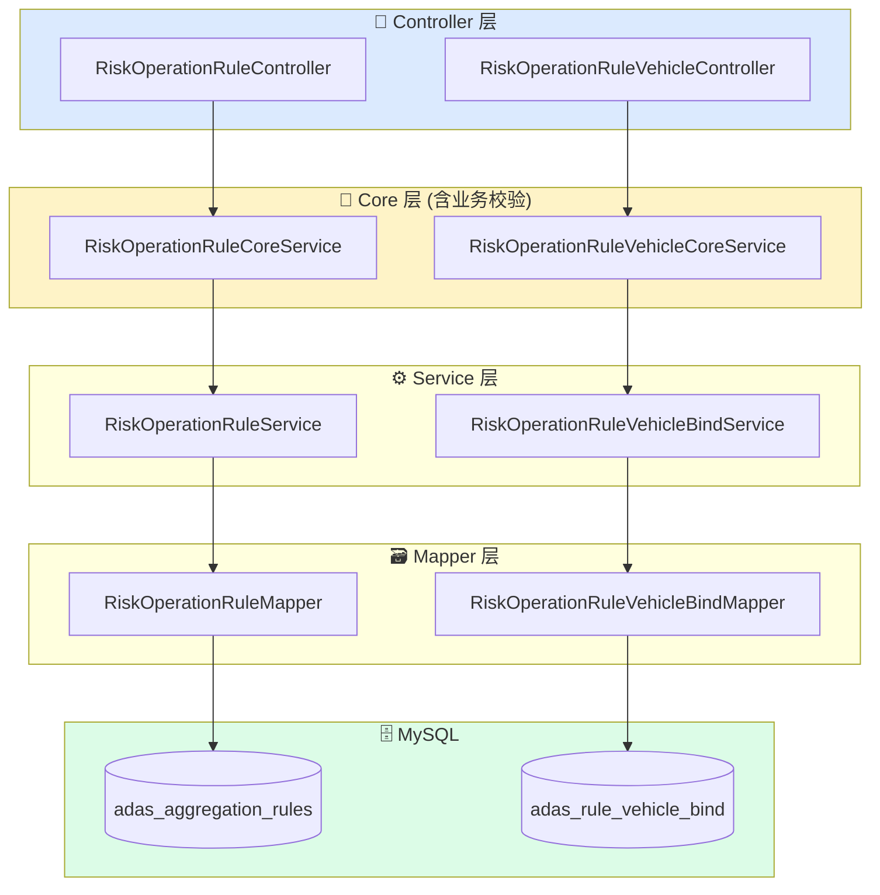

<div class="callout callout-note" markdown="1">
**📝 + 📁 完整包结构**

```javascript
module/business/riskoperationrule/controller/
├── RiskOperationRuleController.java           # 规则 REST 控制器
└── RiskOperationRuleVehicleController.java     # 车辆绑定 REST 控制器

infrastructure/core/riskoperationrule/
├── RiskOperationRuleCoreService.java           # 规则核心编排（含业务校验）
└── RiskOperationRuleVehicleCoreService.java    # 车辆绑定核心编排

infrastructure/biz/mysql/riskoperationrule/
├── entity/
│   ├── RiskOperationRule.java                  # 规则实体（adas_aggregation_rules）
│   └── RiskOperationRuleVehicleBind.java       # 绑定实体（adas_rule_vehicle_bind）
├── mapper/
│   ├── RiskOperationRuleMapper.java
│   └── RiskOperationRuleVehicleBindMapper.java
└── service/
    ├── RiskOperationRuleService.java
    └── RiskOperationRuleVehicleBindService.java

common/pojo/biz/riskoperationrule/              # DTO / VO
common/pojo/query/riskoperationrule/            # 查询条件
```
</div>

## 3.7 数据库表结构

<div class="callout callout-note" markdown="1">
**📝 + 📊 `adas_aggregation_rules` — 聚合规则表**

```sql
CREATE TABLE `adas_aggregation_rules` (
    `rule_id`              varchar(50)  NOT NULL COMMENT '规则业务ID',
    `rule_version`         varchar(20)  NOT NULL COMMENT '规则版本号',
    `name`                 varchar(100) NOT NULL COMMENT '规则名称',
    `aggregation_mode`     varchar(32)  NOT NULL DEFAULT 'SINGLE_COUNT' COMMENT '聚合模式',
    `scenario_code`        varchar(64)  DEFAULT NULL COMMENT '场景编码',
    `alarm_type`           int          DEFAULT NULL COMMENT '主告警类型编码',
    `alarm_types`          varchar(256) DEFAULT NULL COMMENT '多告警组合类型(逗号分隔)',
    -- 中风险阈值
    `min_level1`           int DEFAULT '0' COMMENT '中风险一级告警最小数量',
    `min_level2`           int DEFAULT '0' COMMENT '中风险二级告警最小数量',
    `min_duration`         int DEFAULT '0' COMMENT '中风险最短持续时长(秒)',
    `max_duration`         int DEFAULT '0' COMMENT '中风险最长持续时长(秒)',
    `window_minutes`       int NOT NULL        COMMENT '中风险检测窗口(分钟)',
    -- 高风险阈值
    `high_min_level1`      int DEFAULT '0' COMMENT '高风险一级告警最小数量',
    `high_min_level2`      int DEFAULT '0' COMMENT '高风险二级告警最小数量',
    `high_min_duration`    int DEFAULT '0' COMMENT '高风险最短持续时长(秒)',
    `high_max_duration`    int DEFAULT '0' COMMENT '高风险最长持续时长(秒)',
    `high_window_minutes`  int NOT NULL        COMMENT '高风险检测窗口(分钟)',
    -- 多告警组合阈值
    `multi_min_level1_distinct`       int DEFAULT '0',
    `multi_min_level2_distinct`       int DEFAULT '0',
    `multi_high_min_level1_distinct`  int DEFAULT '0',
    `multi_high_min_level2_distinct`  int DEFAULT '0',
    `multi_min_level1_count`          int DEFAULT '0',
    `multi_min_level2_count`          int DEFAULT '0',
    `multi_high_min_level1_count`     int DEFAULT '0',
    `multi_high_min_level2_count`     int DEFAULT '0',
    `multi_window_seconds`            int DEFAULT '0',
    `multi_high_window_seconds`       int DEFAULT '0',
    -- 冷却配置
    `cooldown_seconds`            int DEFAULT '0',
    `high_cooldown_seconds`       int DEFAULT '0',
    `multi_cooldown_seconds`      int DEFAULT '0',
    `multi_high_cooldown_seconds` int DEFAULT '0',
    -- 状态与审计
    `status`         tinyint unsigned NOT NULL DEFAULT '1' COMMENT '1=启用,0=停用',
    `creator_id`     bigint DEFAULT NULL,
    `creator_name`   varchar(32) DEFAULT NULL,
    `create_time`    datetime DEFAULT CURRENT_TIMESTAMP,
    `modifier_id`    bigint DEFAULT NULL,
    `modifier_name`  varchar(32) DEFAULT NULL,
    `modify_time`    datetime DEFAULT NULL ON UPDATE CURRENT_TIMESTAMP,
    PRIMARY KEY (`rule_id`, `rule_version`)
) ENGINE=InnoDB DEFAULT CHARSET=utf8mb4 COMMENT='ADAS 告警风险聚合规则';
```

[!note]+ 📊 `adas_rule_vehicle_bind` — 规则车辆绑定表
```sql
CREATE TABLE `adas_rule_vehicle_bind` (
    `id`            bigint unsigned NOT NULL AUTO_INCREMENT COMMENT '主键ID',
    `rule_id`       varchar(50) NOT NULL COMMENT '规则业务ID',
    `rule_version`  varchar(20) NOT NULL COMMENT '规则版本',
    `vin_code`      varchar(32) NOT NULL COMMENT '车架号',
    `status`        tinyint unsigned NOT NULL DEFAULT '1' COMMENT '1=启用,0=停用',
    `creator_id`    bigint DEFAULT NULL,
    `creator_name`  varchar(32) DEFAULT NULL,
    `create_time`   datetime DEFAULT CURRENT_TIMESTAMP,
    `modifier_id`   bigint DEFAULT NULL,
    `modifier_name` varchar(32) DEFAULT NULL,
    `modify_time`   datetime DEFAULT NULL ON UPDATE CURRENT_TIMESTAMP,
    PRIMARY KEY (`id`),
    UNIQUE KEY `uk_rule_vin` (`rule_id`, `rule_version`, `vin_code`),
    KEY `idx_vin_status` (`vin_code`, `status`),
    KEY `idx_rule_status` (`rule_id`, `status`),
    KEY `idx_modify_time` (`modify_time`)
) ENGINE=InnoDB DEFAULT CHARSET=utf8mb4 COMMENT='ADAS风险运营规则车辆绑定表';
```
</div>

## 3.8 管理端与 Flink 联动时序

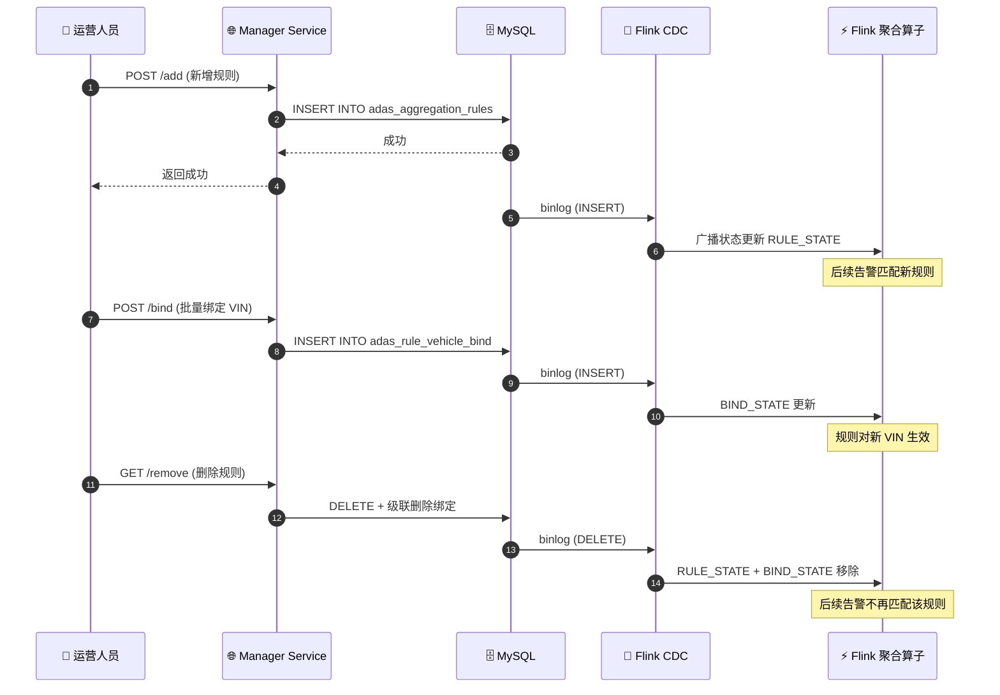

---

# 四、数据模型

## 4.1 核心实体关系

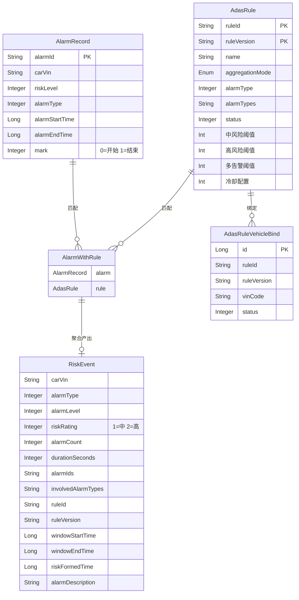

## 4.2 `AlarmRecord` — 原始告警

从 Kafka 消费的 ADAS / DMS 告警事件。

| **字段** | **类型** | **说明** |
| --- | --- | --- |
| `alarmId` | String | 告警唯一 ID |
| `carVin` | String | 车辆 VIN 码（17 位） |
| `riskLevel` | Integer | 告警等级：1=一级（严重），2=二级（一般），默认 2 |
| `alarmType` | Integer | 告警类型编码（见附录 A） |
| `alarmStartTime` | Long | 告警开始时间（毫秒时间戳） |
| `alarmEndTime` | Long | 告警结束时间（毫秒时间戳） |
| `mark` | Integer | 事件标记：0=开始事件，1=结束事件 |

<div class="callout callout-tip" markdown="1">
**💡 💡**

**mark 字段业务语义**
- **苏标告警**：先发 `mark=0`（开始），再发 `mark=1`（结束）
- **国标告警（超速 / 超时）**：状态报警发 `mark=0`，状态正常发 `mark=1`
</div>

## 4.3 `AdasRule` — 聚合规则

对应 MySQL 表 `adas_aggregation_rules`，通过 CDC 实时同步到 Flink 广播状态。

### 基础字段

| **字段** | **类型** | **说明** |
| --- | --- | --- |
| `ruleId` | String | 规则唯一 ID |
| `ruleVersion` | String | 规则版本号（用于规则更新时的版本切换） |
| `name` | String | 规则名称 |
| `alarmType` | Integer | 单告警类型编码 |
| `scenarioCode` | String | 场景编码（多告警组合用） |
| `aggregationMode` | Enum | 聚合策略：SINGLE_SESSION / SINGLE_COUNT / MULTI_COMBINATION |
| `alarmTypes` | String | 多告警组合类型列表（逗号分隔，如 `"1001,1002,1003"`） |
| `status` | Integer | 规则状态：1=启用，0=停用 |

### 风险阈值（中风险 / 高风险各一套）

| **中风险字段** | **高风险字段** | **说明** |
| --- | --- | --- |
| `minLevel1` | `highMinLevel1` | 一级告警最小数量 |
| `minLevel2` | `highMinLevel2` | 二级告警最小数量 |
| `minDuration` | `highMinDuration` | 最短持续时长（秒） |
| `maxDuration` | `highMaxDuration` | 最长持续时长（秒） |
| `windowMinutes` | `highWindowMinutes` | 检测窗口大小（分钟） |

### 多告警组合阈值

| **中风险字段** | **高风险字段** | **说明** |
| --- | --- | --- |
| `multiMinLevel1Distinct` | `multiHighMinLevel1Distinct` | 一级告警最小不同类型数 |
| `multiMinLevel2Distinct` | `multiHighMinLevel2Distinct` | 二级告警最小不同类型数 |
| `multiMinLevel1Count` | `multiHighMinLevel1Count` | 一级告警最小告警数 |
| `multiMinLevel2Count` | `multiHighMinLevel2Count` | 二级告警最小告警数 |
| `multiWindowSeconds` | `multiHighWindowSeconds` | 检测窗口大小（秒） |

### 冷却配置

| **中风险字段** | **高风险字段** | **说明** |
| --- | --- | --- |
| `cooldownSeconds` | `highCooldownSeconds` | 通用冷却时间（秒） |
| `multiCooldownSeconds` | `multiHighCooldownSeconds` | 多告警专用冷却（通用为空时回退） |

### 关键方法

| **方法** | **说明** |
| --- | --- |
| `getAggregationModeOrDefault()` | 获取聚合模式；超速(5002) / 超时(5019) 默认 SINGLE_SESSION，其他默认 SINGLE_COUNT |
| `resolveSessionGapMillis(riskRating)` | 会话窗口间隔（高风险默认 2min，中风险默认 1min） |
| `resolveMultiWindowMillis(riskRating)` | 多告警组合窗口大小（毫秒） |
| `resolveCooldownMillis(riskRating)` | 冷却时间，优先通用冷却，多告警回退专用冷却 |
| `resolveMultiMinDistinct(riskRating, alarmLevel)` | 多告警最小不同类型数 |
| `resolveMultiMinCount(riskRating, alarmLevel)` | 多告警最小告警数 |
| `buildRuleKey()` | 构建 `"ruleId#ruleVersion"` 格式 Key |

## 4.4 `AdasRuleVehicleBind` — 规则车辆绑定

对应 MySQL 表 `adas_rule_vehicle_bind`，控制规则对特定车辆的生效范围。

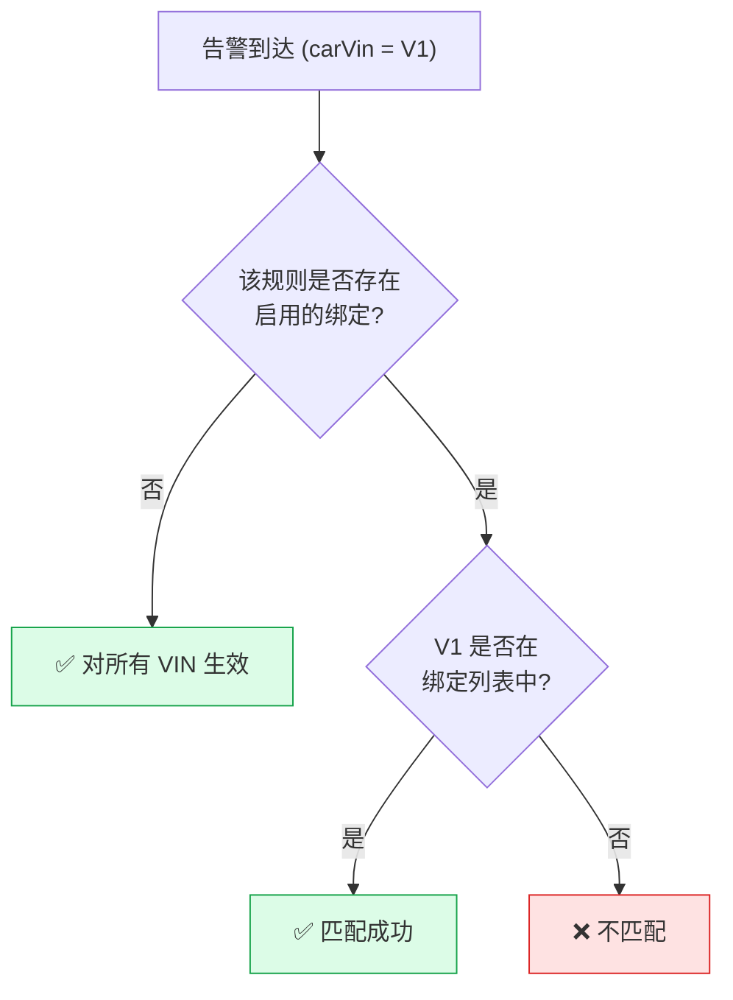

## 4.5 风险等级常量

| **常量** | **值** | **说明** |
| --- | --- | --- |
| `RiskRatingConstant.MEDIUM` | 1 | 中风险 |
| `RiskRatingConstant.HIGH` | 2 | 高风险 |

---

# 五、数据处理流程详解

## 5.1 阶段一：告警数据接入

**类**：`KafkaSourceHandler` + `VehicleRecordDeserializer`


### 反序列化与校验流程

1. null / 空消息 → 跳过
2. JSON 反序列化为 `AlarmRecord`（忽略未知字段）
3. **必填校验**：`carVin`、`alarmId`、`alarmType`、`mark` 非空
4. `mark=0` 时必须有 `alarmStartTime`；`mark=1` 时必须有 `alarmEndTime`
5. 结束时间 ≥ 开始时间校验
6. **时间戳范围校验**：过滤 3 天前和 2 小时后的异常数据
7. **秒级时间戳自动修复为毫秒级**（< 10¹² 则乘以 1000）

### Kafka Source 配置

| **参数** | **值** | **说明** |
| --- | --- | --- |
| 分区发现间隔 | 30s | 动态感知新分区 |
| 起始 offset | 已提交位置 | 无提交则从 latest 开始 |
| 最大拉取间隔 | 300s | 低流量时的拉取频率 |

## 5.2 阶段二：Watermark 与时间语义

```java
WatermarkStrategy
    .<AlarmRecord>forBoundedOutOfOrderness(Duration.ofSeconds(5))
    .withTimestampAssigner((record, ts) -> extractEventTs(record))
    .withIdleness(Duration.ofSeconds(30))
```

<div class="callout callout-info" markdown="1">
**ℹ️ ⏱️ extractEventTs 时间戳提取优先级**

1. `mark=0` → 使用 `alarmStartTime`
2. `mark=1` → 使用 `alarmEndTime`
3. 都为空 → 使用当前系统时间

**额外处理**

- 秒级时间戳自动转毫秒（< 10¹²）
- 过滤 2017-01-01 之前和未来 2 小时外的时间戳
- 维护 `lastEmittedTs` 全局变量，保证时间戳单调不减
</div>

## 5.3 阶段三：告警去重

**类**：`AlarmDeduplicateProcessFunction`

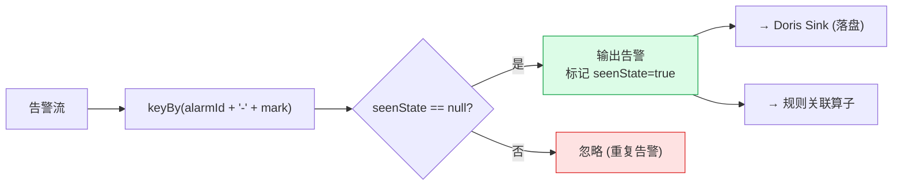

| **属性** | **值** |
| --- | --- |
| Key | `alarmId + "-" + mark`（如 `"ALM001-0"`） |
| 状态类型 | `ValueState<Boolean>` |
| TTL | 2 小时 |
| 更新策略 | OnCreateAndWrite |
| 可见性 | NeverReturnExpired |

<div class="callout callout-tip" markdown="1">
**💡 💡**

同一 `alarmId` 的 `mark=0` 和 `mark=1` 因 key 不同，**各自独立去重**。
</div>

## 5.4 阶段四：规则关联

**类**：`EnrichWithRuleProcessFunction`

### 5.4.1 广播流构建

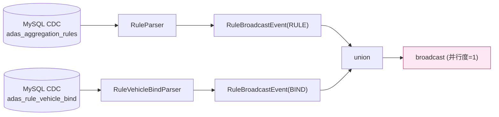

### 广播状态结构

| **状态名** | **Key 类型** | **Value 类型** | **说明** |
| --- | --- | --- | --- |
| `RULE_STATE` | Integer (alarmType) | `List<AdasRule>` | 告警类型 → 规则列表 |
| `BIND_STATE` | String (`ruleId#ruleVersion`) | `Map<String, AdasRuleVehicleBind>` | 规则 Key → VIN 绑定映射 |

### 5.4.2 告警匹配规则（`processElement`）

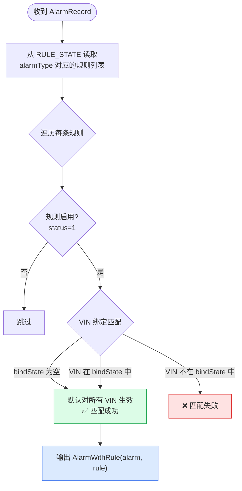

### 5.4.3 规则更新处理（`processBroadcastElement`）

<!-- Column 1 -->
<div class="callout callout-note" markdown="1">
**📝 📝**

**RULE 事件**
11. 从所有 alarmType 的规则列表中移除旧版本（按 `ruleId+ruleVersion` 匹配）
12. 按规则的 `effectiveAlarmTypes` 插入新版本
13. 删除事件（op=d）只移除不插入
</div>

<!-- Column 2 -->
<div class="callout callout-note" markdown="1">
**📝 🔗**

**BIND 事件**
14. 按 `ruleId#ruleVersion` 查找绑定映射
15. 启用 → 更新 / 插入 VIN 映射
16. 停用 / 删除 → 移除对应 VIN
</div>

## 5.5 阶段五：分流聚合

规则关联后的 `AlarmWithRule` 流按 `aggregationMode` 分为**三条支流**，每条支流再按风险等级（HIGH / MEDIUM）拆分为**两条并行流**，共 **6 条风险事件流**。

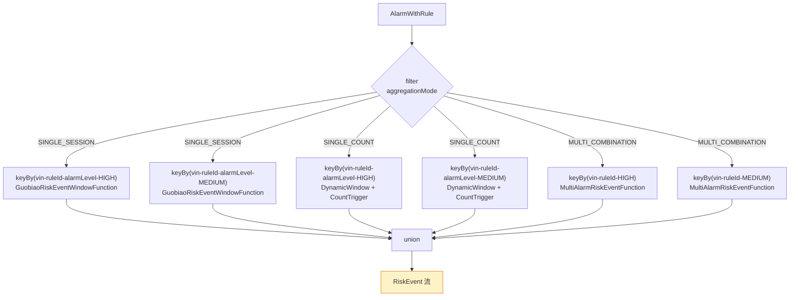

### 聚合 Key 设计

| **聚合模式** | **Key 格式** | **说明** |
| --- | --- | --- |
| 单告警（会话 / 计数） | `vin + ruleId + alarmLevel + riskRating` | 同一车辆、同一规则、同一告警等级、同一风险等级 |
| 多告警组合 | `vin + ruleId + riskRating` | 不区分告警等级（组合多种类型） |

## 5.6 阶段六：输出

### 5.6.1 告警记录写 Doris（`AlarmRecordDorisSink`）

| **属性** | **值** |
| --- | --- |
| 目标表 | `adas_aggregation_simple_alarm_record` |
| 写入方式 | Stream Load (JSON) |
| 批量大小 | 最多 10,000 条 |
| 刷新间隔 | 3 秒 |

<div class="callout callout-note" markdown="1">
**📝 + 字段映射**

| **Doris 字段** | **Java 字段** | **类型** |
| --- | --- | --- |
| `car_vin` | `carVin` | String |
| `create_time` | — | 当前时间 |
| `alarm_id` | `alarmId` | String |
| `risk_level` | `riskLevel` | Integer |
| `alarm_type` | `alarmType` | Integer |
| `alarm_start_time` | `alarmStartTime` | Long |
| `alarm_end_time` | `alarmEndTime` | Long |
| `mark` | `mark` | Integer |
</div>

### 5.6.2 风险事件写 Doris（`RiskEventDorisSink`）

| **属性** | **值** |
| --- | --- |
| 目标表 | 从配置读取 |
| 写入方式 | Stream Load (JSON) |

### 5.6.3 风险事件写 Kafka（`RiskEventKafkaSink`）

| **属性** | **值** |
| --- | --- |
| 目标 Topic | 从配置 `kafkaRiskTopic` 读取 |
| 语义 | AT_LEAST_ONCE |
| 序列化 | JSON |
| 额外 Header | `scenario_code`（场景编码） |

---

# 六、三种聚合模式详解

## 6.1 会话型聚合（SINGLE_SESSION）

<div class="callout callout-abstract" markdown="1">
**📋 🎯 会话型聚合（SINGLE_SESSION）**

**适用告警**：国标告警 — 超速行驶 (5002)、超时行驶 (5019)
**核心类**：`GuobiaoRiskEventWindowFunction`

**设计思路**：国标告警具有成对的开始 / 结束事件（`mark=0/1`），需要计算持续时长来判断风险等级。采用 `KeyedProcessFunction + MapState` 手动管理会话状态，而非 Flink 原生窗口 API，以获得更灵活的超时控制。
</div>

### 状态设计

| **状态** | **类型** | **说明** |
| --- | --- | --- |
| `sessionState` | `MapState<String, SessionState>` | alarmId → 会话状态 |
| `timerIndexState` | `MapState<Long, List<String>>` | 超时时间戳 → alarmId 列表 |
| `cooldownUntilState` | `ValueState<Long>` | 冷却截止时间戳 |

所有状态 **TTL 为 6 小时**（兜底清理）。

### 处理流程

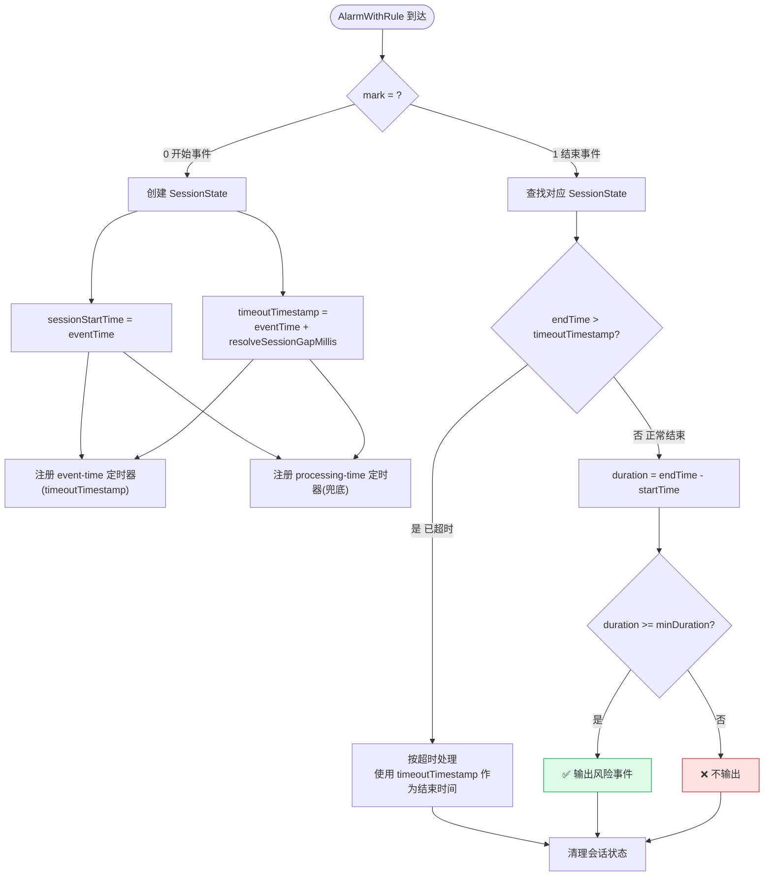

### 双定时器机制

| **定时器类型** | **触发时间** | **作用** |
| --- | --- | --- |
| event-time | `timeoutTimestamp` | 正常超时处理 |
| processing-time | 当前时间 + sessionGap | 兜底清理（防止 watermark 卡住） |

processing-time 定时器触发时遍历所有会话，强制清理超时 10 秒以上的会话。

### 风险事件输出

| **字段** | **取值** |
| --- | --- |
| `durationSeconds` | 持续时长（秒） |
| `alarmCount` | 关联的告警 ID 数量 |
| `riskEventStartTime` | 会话开始时间 |
| `riskEventEndTime` | 会话结束时间（或超时时间） |

## 6.2 计数型聚合（SINGLE_COUNT）

<div class="callout callout-abstract" markdown="1">
**📋 🎯 计数型聚合（SINGLE_COUNT）**

**适用告警**：苏标告警（绝大多数 ADAS / DMS 告警类型）
**核心类**：`DynamicWindowAssigner` + `DynamicCountTrigger` + `SubiaoRiskEventWindowFunction`

**设计思路**：苏标告警没有明确的开始 / 结束配对，而是通过窗口内告警数量触发风险事件。采用 Flink 窗口 API + 动态窗口大小 + 动态计数触发器实现。
</div>

### 处理流程

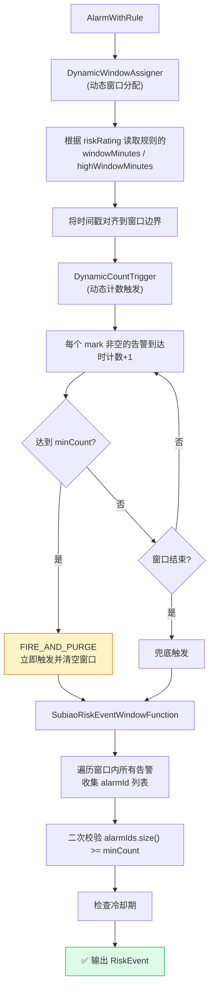

### `DynamicCountTrigger` 计数逻辑

| **告警等级** | **中风险 minCount** | **高风险 minCount** |
| --- | --- | --- |
| 一级 (riskLevel=1) | `rule.minLevel1` | `rule.highMinLevel1` |
| 二级 (riskLevel=2) | `rule.minLevel2` | `rule.highMinLevel2` |

## 6.3 多告警组合聚合（MULTI_COMBINATION）

<div class="callout callout-abstract" markdown="1">
**📋 🎯 多告警组合聚合（MULTI_COMBINATION）**

**适用场景**：需要多种不同类型告警共同出现才触发风险事件（如同时出现疲劳驾驶 + 车道偏离 + 车距过近）
**核心类**：`MultiAlarmRiskEventFunction`

**设计思路**：使用 `KeyedProcessFunction + ListState` 管理滑动窗口，每个告警到达时**立即检查触发条件**（不等窗口结束），实现近实时的风险事件触发。
</div>

### 状态设计

| **状态** | **类型** | **TTL** | **说明** |
| --- | --- | --- | --- |
| `eventState` | `ListState<MultiAlarmEvent>` | 6h | 窗口内所有告警事件 |
| `cooldownUntilState` | `ValueState<Long>` | 6h | 冷却截止时间 |
| `ruleState` | `ValueState<AdasRule>` | 6h | 当前规则快照 |
| `vinState` | `ValueState<String>` | 6h | 车辆 VIN |

### 处理流程

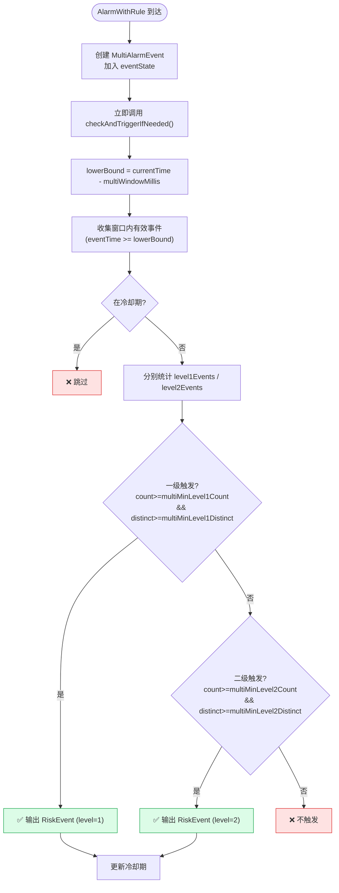

### 触发条件矩阵

| **风险等级** | **告警等级** | **告警数量条件** | **类型多样性条件** |
| --- | --- | --- | --- |
| 中风险 | 一级 | count ≥ `multiMinLevel1Count` | distinctTypes ≥ `multiMinLevel1Distinct` |
| 中风险 | 二级 | count ≥ `multiMinLevel2Count` | distinctTypes ≥ `multiMinLevel2Distinct` |
| 高风险 | 一级 | count ≥ `multiHighMinLevel1Count` | distinctTypes ≥ `multiHighMinLevel1Distinct` |
| 高风险 | 二级 | count ≥ `multiHighMinLevel2Count` | distinctTypes ≥ `multiHighMinLevel2Distinct` |

<div class="callout callout-tip" markdown="1">
**💡 ⚡**

**优先级**：一级告警条件优先判断，一级未触发时才判断二级。
**过期清理**：注册 event-time 定时器（`eventTime + windowMs`），触发时清理窗口外的过期事件。
</div>

---

# 七、冷却防抖机制

## 7.1 设计目的

防止同一车辆在同一规则下短时间内重复触发风险事件（例如：一辆车在 10 秒内触发了两次疲劳驾驶中风险，**只应输出一次**）。

## 7.2 实现方式

所有聚合算子共享统一的冷却逻辑：

```java
// 伪代码
long now = System.currentTimeMillis();
if (now < cooldownUntilState.value()) {
    return; // 冷却期内, 不输出
}
// 输出风险事件
cooldownUntilState.update(now + rule.resolveCooldownMillis(riskRating));
```

## 7.3 冷却维度

| **聚合模式** | **冷却 Key 维度** | **说明** |
| --- | --- | --- |
| 会话型 | `vin + ruleId + ruleVersion + alarmLevel + riskRating` | 最细粒度 |
| 计数型 | `vin + ruleId + ruleVersion + alarmLevel + riskRating` | 最细粒度 |
| 多告警组合 | `vin + ruleId + ruleVersion + riskRating` | 不区分告警等级 |

## 7.4 冷却时间取值优先级

```mermaid
flowchart TD
	A["resolveCooldownMillis(riskRating)"] --> B{"riskRating?"}
	B -->|中风险| M1["cooldownSeconds<br/>(通用冷却)"]
	B -->|高风险| H1["highCooldownSeconds<br/>(通用冷却)"]
	M1 -->|为空| M2["multiCooldownSeconds<br/>(多告警专用回退)"]
	H1 -->|为空| H2["multiHighCooldownSeconds<br/>(多告警专用回退)"]

	style M1 fill:#fef3c7
	style H1 fill:#fee2e2
```

---

# 八、关键设计决策

## 8.1 时间戳三层修复

```mermaid
flowchart LR
	A["原始数据"] --> L1["L1: VehicleRecordDeserializer<br/>反序列化时<br/>秒→毫秒, 过滤异常"]
	L1 --> L2["L2: extractEventTs<br/>Watermark 分配时<br/>过滤 2017前/未来2h, 单调递增"]
	L2 --> L3["L3: GuobiaoRiskEventWindowFunction<br/>会话处理时<br/>使用修复后时间戳"]
	L3 --> Out["可靠时间戳"]

	style L1 fill:#dbeafe
	style L2 fill:#fef3c7
	style L3 fill:#dcfce7
```

<div class="callout callout-tip" markdown="1">
**💡 🛡️ 为什么需要三层**

原始数据来源复杂（不同设备厂商、不同协议版本），时间戳质量参差不齐。**逐层防御**确保即使某一层漏过，后续层仍能兜底。
</div>

## 8.2 广播流并行度 = 1

<div class="callout callout-info" markdown="1">
**ℹ️ 📡 广播流并行度 = 1 的原因**

- 保证规则变更的**全局一致性**
- 避免多并行度下规则更新的乱序问题
- 规则变更频率低（分钟级），1 的并行度完全足够
</div>

## 8.3 状态 TTL 策略

| **状态类型** | **TTL** | **原因** |
| --- | --- | --- |
| 去重状态 | 2 小时 | 告警去重窗口，超过 2 小时的重复告警不再有意义 |
| 会话 / 计数 / 多告警状态 | 6 小时 | 兜底清理，防止异常情况下状态无限膨胀 |

## 8.4 双定时器机制（会话型）

会话型聚合同时注册 event-time 和 processing-time 定时器：

- **event-time 定时器**：正常超时处理
- **processing-time 定时器**：兜底机制，防止 watermark 因数据源空闲而不推进，导致超时会话永远不被清理

## 8.5 FIRE_AND_PURGE（计数型）

`DynamicCountTrigger` 在达到触发条件后返回 `FIRE_AND_PURGE`：

- **FIRE**：触发窗口计算
- **PURGE**：清空窗口数据

避免窗口数据持续累积导致内存溢出。

---

# 九、告警类型编码表（附录 A）

## ADAS 告警

| **编码** | **名称** | **说明** |
| --- | --- | --- |
| 1001 | FORWARD_COLLISION_WARNING | 前向碰撞报警 |
| 1002 | LANE_DEPARTURE_WARNING | 车道偏离报警 |
| 1003 | CAR_PROXIMITY_ALARM | 车距过近报警 |
| 1004 | PEDESTRIAN_COLLISION_ALARM | 行人碰撞报警 |
| 1005 | FREQUENT_LANE_CHANGE_ALARM | 频繁变道报警 |
| 1006 | ROAD_OVER_LIMIT_ALARM | 道路标识超限报警 |
| 1007 | OBSTACLE_ALARM | 障碍物报警 |
| 1012 | PEDESTRIAN_CROSSWALK_RECOGNITION_ALARM | 斑马线识别报警 |
| 1013 | SOLID_LINE_LANE_CHANGE_ALARM | 实线变道报警 |
| 1016 | ROAD_SIGN_RECOGNITION_ALARM | 道路标志识别事件 |
| 1017 | ACTIVE_SNAPSHOT_EVENT_ALARM | 主动抓拍事件 |
| 6002 | CAMERE_OBSTRUCTION_ALARM | ADAS 摄像头遮挡 |
| 9001 | G_SENSOR_ALARM | G-sensor 碰撞报警 |

## DMS 告警

| **编码** | **名称** | **说明** |
| --- | --- | --- |
| 2001 | FATIGUE_DRIVING_ALARM | 疲劳驾驶报警 |
| 2002 | PHONE_CALL_ALARM | 接打电话报警 |
| 2003 | SMOKING_ALARM | 抽烟报警 |
| 2004 | DRIVER_DISTRACTION_ALARM | 驾驶员分神报警 |
| 2005 | DRIVER_ABNORMALITY_ALARM | 驾驶员异常报警 |
| 2006 | PLAY_MOBILE_ALARM | 玩手机报警 |
| 2016 | AUTO_SNAPSHOT_EVENT_ALARM | 自动抓拍事件 |
| 2017 | DRIVER_CHANGE_EVENT | 驾驶员变更事件 |
| 2018 | DMS_CAMERA_BLOCKED | DMS 摄像头遮挡 |
| 2019 | SAFETY_BELT_ALARM | 安全带报警 |
| 6001 | DSM_CAMERA_BLOCKED | DSM 摄像头遮挡 |

## 倒车障碍物告警

| **编码** | **名称** | **说明** |
| --- | --- | --- |
| 4001 | REAR_APPROACH_ALARM | 后方接近报警 |
| 4002 | LEFT_REAR_APPROACH_WARNING | 左侧后方接近报警 |
| 4003 | RIGHT_REAR_APPROACH_WARNING | 右侧后方接近报警 |

## 国标驾驶行为告警

| **编码** | **名称** | **说明** |
| --- | --- | --- |
| 5002 | SPEEDING_ALARM | 超速行驶 |
| 5019 | OVERDRIVING_ALARM | 超时行驶 |

---

# 十、部署与运维

## 10.1 构建与打包

```bash
cd dst-iot-adas-risk-aggregation-job
mvn -s D:/tool/apache-maven-3.9.6/conf/settings-dst.xml clean package -DskipTests
```

产物为 shaded fat jar，主类：`com.dst.iot.car.riskaggregation.AdasRiskAggregationJob`

## 10.2 提交到 Flink 集群

```bash
flink run \
  -c com.dst.iot.car.riskaggregation.AdasRiskAggregationJob \
  dst-iot-adas-risk-aggregation-job-10.0-SNAPSHOT.jar \
  --flink.profiles.active=prod
```

## 10.3 环境参数

| **参数** | **说明** | **默认值** |
| --- | --- | --- |
| `--flink.profiles.active` | 环境标识 | test |

## 10.4 监控要点

| **监控项** | **关注指标** | **异常表现** |
| --- | --- | --- |
| Kafka Consumer Lag | 消费延迟 | 告警处理延迟增大 |
| Watermark 进度 | 事件时间推进 | 定时器不触发、状态堆积 |
| 状态大小 | RocksDB 状态体积 | 内存溢出、Checkpoint 超时 |
| Doris Stream Load | 写入延迟 / 失败率 | 数据丢失、下游数据不完整 |
| CDC 同步延迟 | 规则更新延迟 | 新规则不能及时生效 |
| 风险事件 QPS | 输出速率 | 业务侧反馈数据缺失 |

---

# 十一、项目包结构

```mermaid
flowchart TB
	root["com.dst.iot.car.riskaggregation"]
	root --> entry["AdasRiskAggregationJob<br/>入口类"]
	root --> config["config/<br/>FlinkJobConfig<br/>NacosConfigUtils"]
	root --> cdc["cdc/<br/>AdasRuleCdcSource<br/>RuleCdcDeserializer<br/>RuleParser<br/>RuleVehicleBindParser"]
	root --> source["source/<br/>KafkaSourceHandler<br/>VehicleRecordDeserializer"]
	root --> func["function/<br/>AlarmDeduplicateProcessFunction<br/>EnrichWithRuleProcessFunction<br/>GuobiaoRiskEventWindowFunction<br/>SubiaoRiskEventWindowFunction<br/>MultiAlarmRiskEventFunction<br/>DynamicCountTrigger"]
	root --> window["window/<br/>DynamicWindowAssigner"]
	root --> sink["sink/<br/>AlarmRecordDorisSink<br/>RiskEventDorisSink<br/>RiskEventKafkaSink"]
	root --> pojo["pojo/<br/>AlarmRecord · AdasRule<br/>AdasRuleVehicleBind<br/>RuleBroadcastEvent<br/>AlarmWithRule · RiskEvent<br/>MultiAlarmEvent"]
	root --> constant["constant/<br/>AggregationMode<br/>AlarmTypeEnum<br/>RiskRatingConstant"]
	root --> utils["utils/<br/>RuleValueParser"]

	style entry fill:#fef3c7,stroke:#d97706
	style func fill:#dbeafe,stroke:#2563eb
	style sink fill:#dcfce7,stroke:#16a34a
```

<div class="callout callout-note" markdown="1">
**📝 + 📁 详细包结构清单**

```javascript
com.dst.iot.car.riskaggregation
├── AdasRiskAggregationJob.java          # 入口类, 定义完整数据流管道
├── config/
│   ├── FlinkJobConfig.java              # 作业配置 POJO
│   └── NacosConfigUtils.java            # Nacos 配置加载工具
├── cdc/
│   ├── AdasRuleCdcSource.java           # CDC 数据源构建（规则表+绑定表）
│   ├── RuleCdcDeserializer.java         # Debezium 反序列化器
│   ├── RuleParser.java                  # 规则表 JSON 解析器
│   └── RuleVehicleBindParser.java       # 绑定表 JSON 解析器
├── source/
│   ├── KafkaSourceHandler.java          # Kafka Source 构建器
│   └── VehicleRecordDeserializer.java   # 告警消息反序列化器
├── function/
│   ├── AlarmDeduplicateProcessFunction.java    # 告警去重
│   ├── EnrichWithRuleProcessFunction.java      # 规则关联
│   ├── GuobiaoRiskEventWindowFunction.java     # 国标会话聚合
│   ├── SubiaoRiskEventWindowFunction.java      # 苏标计数聚合
│   ├── MultiAlarmRiskEventFunction.java        # 多告警组合聚合
│   └── DynamicCountTrigger.java                # 动态计数触发器
├── window/
│   ├── DynamicWindowAssigner.java              # 动态窗口分配器
│   └── RuleAwareSessionWindowGapExtractor.java # 会话间隔提取器（未使用）
├── sink/
│   ├── AlarmRecordDorisSink.java        # 告警记录写 Doris
│   ├── RiskEventDorisSink.java          # 风险事件写 Doris
│   └── RiskEventKafkaSink.java          # 风险事件写 Kafka
├── pojo/
│   ├── AlarmRecord.java                 # 原始告警模型
│   ├── AdasRule.java                    # 聚合规则模型
│   ├── AdasRuleVehicleBind.java         # 规则车辆绑定模型
│   ├── RuleBroadcastEvent.java          # 规则广播事件模型
│   ├── AlarmWithRule.java               # 告警+规则组合模型
│   ├── RiskEvent.java                   # 风险事件模型（输出）
│   ├── MultiAlarmEvent.java             # 多告警事件快照
│   └── LowRiskRule.java                 # 低风险规则（未使用）
├── constant/
│   ├── AggregationMode.java             # 聚合模式枚举
│   ├── AlarmTypeEnum.java               # 告警类型枚举
│   └── RiskRatingConstant.java          # 风险等级常量
└── utils/
    └── RuleValueParser.java             # 规则值解析工具
```
</div>

---

<div class="callout callout-warning" markdown="1">
**⚠️ 📌 文档维护**

本文档为 v2.0 设计文档，对应 dst-iot-adas-risk-aggregation-job `10.0-SNAPSHOT` 版本。如有变更请同步更新版本号与更新日期。
</div>
