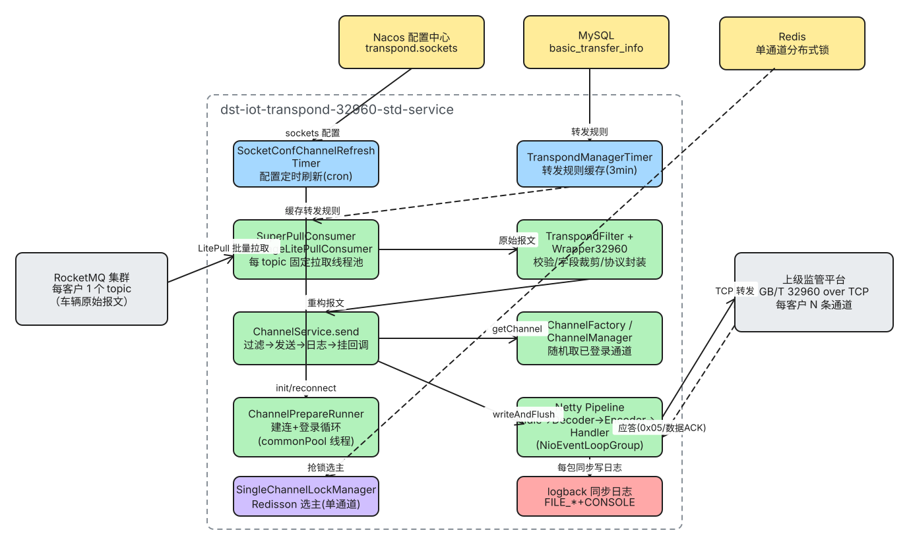
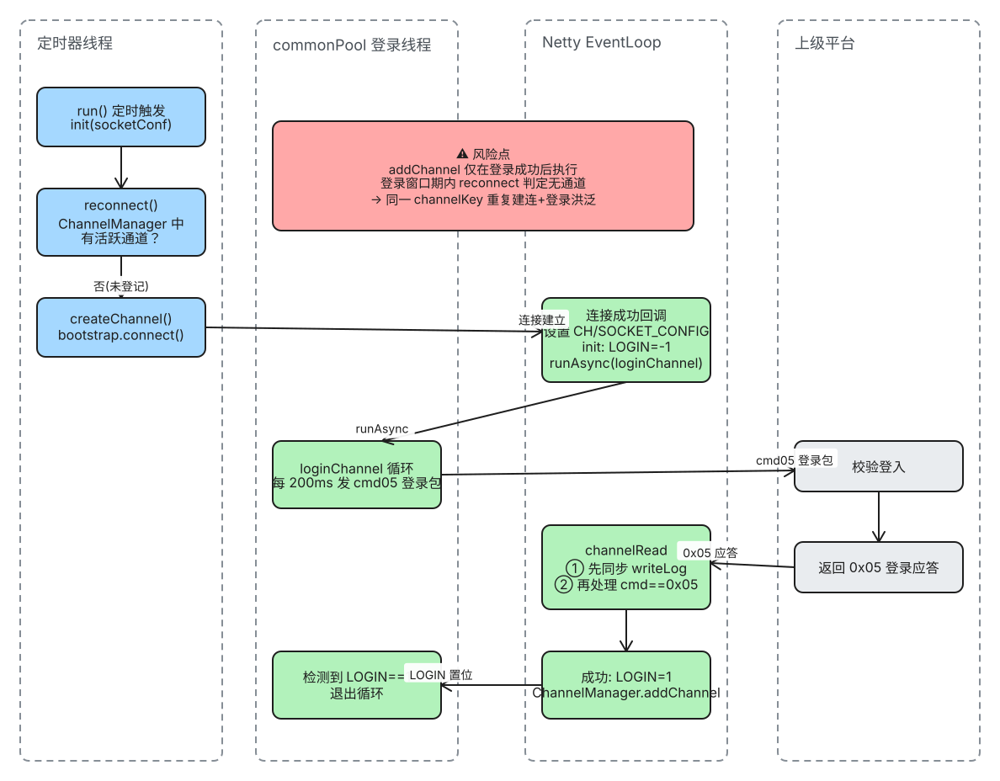
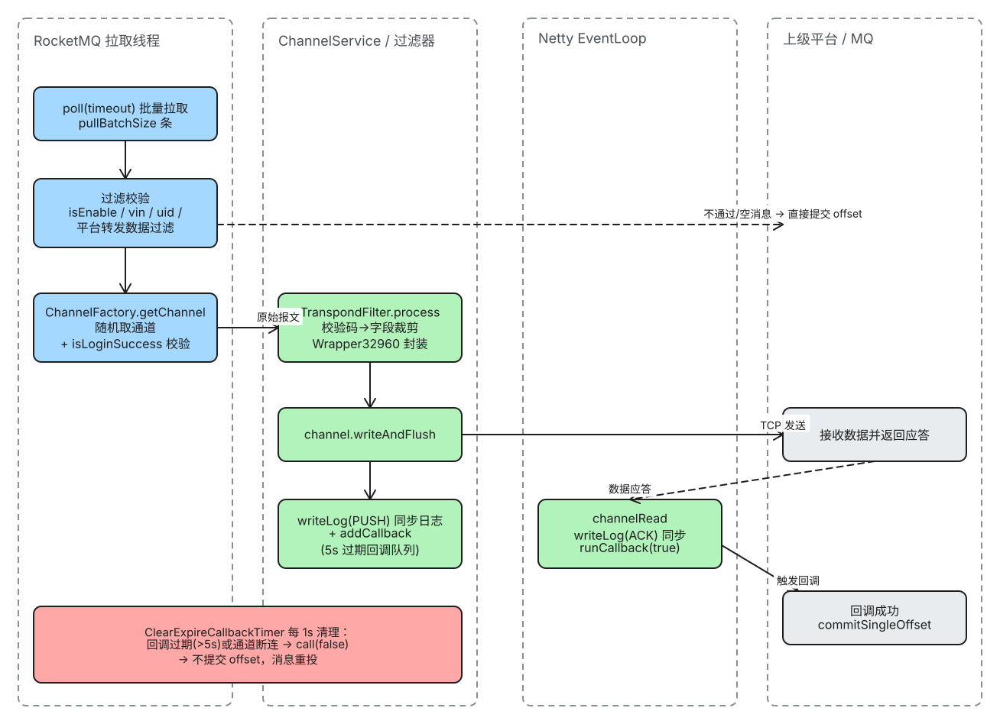
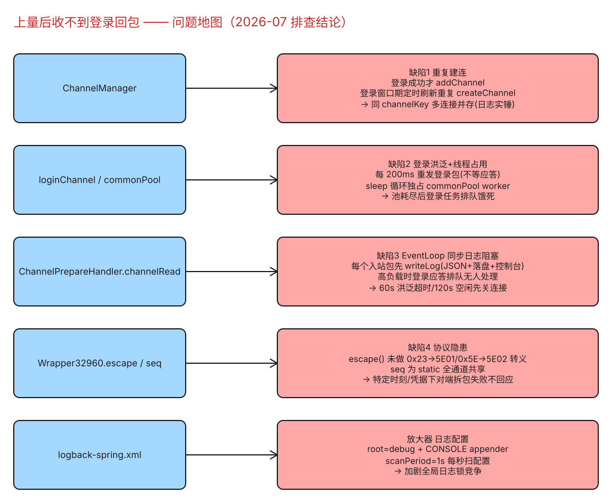

# 32960 标准转发服务 — 设计文档

> **服务名**：`dst-iot-transpond-32960-std-service`
> **定位**：GB/T 32960-2016 标准协议 **下行转发** 服务 —— 从 RocketMQ 消费车辆原始报文，按客户配置过滤/裁剪/重新组包后，通过 TCP 长连接转发给上级监管平台，并处理平台应答、按应答结果提交 MQ 消费位点。
> **端口**：18521　**配置中心**：Nacos（`transpond.*`，开启 refresh）　**仓库**：`D:\code\vds-new\dst-iot-transpond-32960-std-service`
> **文档日期**：2026-07-31（含 2026-07 生产问题"上量后收不到登录回包"排查结论）
> **相关文档**：**32960设备网关**、**32960平台网关**、[32960三方数据转发](/2026/05/20/gb32960-third-party-forward/)、**32960三方数据分发**、[IoT网关设计文档](/2026/05/20/iot-gateway-design/)

---

## 1. 服务概述

### 1.1 业务定位

本服务是 32960 数据链路中的**出口网关**：

```
车辆/TBOX → 设备网关 → RocketMQ(原始报文 topic) → 【本服务】 → 上级监管平台(GB/T 32960 over TCP)
```

- **一个客户（topic）一条转发链路**：每个客户在 RocketMQ 有一个原始报文 topic，服务为该 topic 建立 1~N 条到上级平台的 TCP 长连接（`chNums`），循环消费并转发。
- **协议一致性**：出口报文仍是标准 GB/T 32960 帧，但会按客户维度做**命令字过滤**（`cmds`）、**字段裁剪**（`fields`，策略化）、**平台转发数据过滤**（`isFilterPlatformData`）。
- **可靠投递语义**：消息只有在**收到上级平台应用层应答**（或无需应答配置下发送成功）后才提交 MQ offset；超时/断连 → 不提交 → 等待重投，保证 at-least-once。

### 1.2 关键能力清单

| 能力 | 说明 |
|---|---|
| 多客户并行转发 | `transpond.sockets` 列表，每项一个客户链路（topic → 目标平台） |
| 多通道负载 | 每客户 `chNums` 条 TCP 通道，发送时随机选取已登录通道 |
| 登录保活 | 每条通道建连后循环发送平台登入包（cmd=0x05）直至登录成功 |
| 应用层 ACK | 发送后挂 5s 过期回调，收到平台应答才提交 offset |
| 背压 | 待应答回调数超过阈值时暂停拉取 |
| 配置热刷新 | Nacos 变更 → 定时器比对 → 增量重建消费者/通道 |
| 单通道选主 | `isSingle` 模式下用 Redisson 分布式锁保证全集群单实例转发 |
| 全链路报文日志 | 每个入站/出站包同步写转发日志（PUSH/ACK） |

---

## 2. 整体架构



**五大外部依赖**：

| 依赖       | 用途                                                          |
| -------- | ----------------------------------------------------------- |
| RocketMQ | 原始报文来源，每客户一个 topic，LitePull 模式消费                            |
| Nacos    | `transpond.sockets` 客户链路配置，支持热刷新                            |
| MySQL    | `basic_transfer_info` 表：每 topic 的转发规则（cmds/fields/isEnable） |
| Redis    | 单通道模式分布式锁（Redisson）                                         |
| 上级监管平台   | GB/T 32960 TCP 服务端，接收转发并返回应答                                |

**内部主线**：

1. `SocketConfChannelRefreshTimer`（cron 定时）读取 Nacos 配置 → 驱动 `ChannelPrepareRunner` 建连/登录、驱动 `SuperPullConsumer` 建/拆消费者；
2. `MessageLitePullConsumer` 拉取线程循环 poll → 过滤校验 → 取通道 → `ChannelService.send`；
3. `ChannelService` 调 `TranspondFilter`（校验码 → 命令字过滤 → 字段裁剪策略 → `Wrapper32960` 重新组包）→ `writeAndFlush` → 同步写日志 → 挂 5s 过期回调；
4. 平台应答由 Netty EventLoop 的 `ChannelPrepareHandler.channelRead` 处理 → 触发回调 → 提交 offset；
5. `ClearExpireCallbackTimer`（1s）清理过期/断连回调（不提交 offset，等重投）。

---

## 3. 配置体系

### 3.1 配置来源与刷新

```properties
# bootstrap.properties（节选）
server.port=18521
spring.application.name=dst-iot-transpond-32960-std-service
spring.cloud.nacos.config.refresh-enabled=true
```

```java
// TranspondConf.java —— Nacos 配置根，@RefreshScope 支持热更新
@ConfigurationProperties("transpond")
@RefreshScope
public class TranspondConf {
    private Integer socketTimeOut = 120;   // TCP 读空闲超时(秒)，超时关连接
    private List<SocketConf> sockets;      // 客户链路列表
}
```

配置变更**不靠 @RefreshScope 直接生效**，而是由 `SocketConfChannelRefreshTimer` 定时拉到新配置后逐项比对、增量重建（见 §4.1）。

### 3.2 SocketConf 字段表（每客户一条）

| 字段 | 默认值 | 说明 |
|---|---|---|
| `consumerGroup` / `namesrvAddr` / `accessKey` / `secretKey` | — | RocketMQ 连接与 ACL |
| `topic` | — | 原始报文 topic，同时是链路唯一标识（channelKey 前缀） |
| `customerName` | — | 客户名（日志/缓存标识） |
| `host` / `port` | — | 上级平台地址 |
| `identifyCode` / `username` / `password` | — | 平台登入（cmd=0x05）凭据，identifyCode 为 17 位唯一识别码 |
| `pullBatchSize` | 32 | 单次 poll 批量 |
| `pullThreadNums` | 1 | 每 topic 拉取线程数（固定线程池） |
| `chNums` | 1 | TCP 通道数 |
| `isNeedAck` | TRUE | 是否需要平台应用层应答（决定回调队列与背压是否启用） |
| `isCancel` | — | 置 true 则拆除该链路的消费者与通道 |
| `isSingle` | — | 单通道模式：强制 chNums=1，全集群 Redisson 选主后才转发 |
| `isFilterPlatformData` | — | 过滤"平台转发/双链路"数据（vin==uid 且为自有车辆时丢弃） |

`SocketConf.isValid()` 内含约束：`!isSingle || chNums==1`（单通道模式必须单通道）。

---

## 4. 核心模块设计

### 4.1 配置刷新与链路生命周期 —— SocketConfChannelRefreshTimer

定时任务（cron 由 `timer.refresh-socket-config` 配置），`@DependsOn("transpondManagerTimer")` 保证转发规则先就绪：

```
run():
  1. SingleChannelLockManager.ensureLockHolders(sockets)   // 单通道锁守护线程增删
  2. 遍历 sockets:
       validateSocketConf(conf)
       shouldInitializeChannel(conf)  → channelPrepareRunner.init(conf)   // 建连/重连
       shouldInitializeConfig(conf)   → superPullConsumer.init(conf)      // 建/拆消费者
```

`shouldInitializeChannel`：未撤销且（非单通道 或 本实例持锁是 master）。
`SuperPullConsumer.init`：`config.equals` 比对，配置未变则不动；变了则**先 remove 再 doInit**（重建消费者与拉取线程池）。

### 4.2 通道管理三件套

**ChannelManager** —— 单例注册表，`static ConcurrentHashMap`：

```java
// key 规则：topic_chNum，如 "DST-002582_3"
private static final String CACHE_KEY_FORMAT = "%s_%d";
addChannel(key, channel) / getChannel(key) / removeChannel(key) / getChannelMap()
```

**ChannelFactory** —— 发送侧取通道：

```java
// getChannel: 随机选一个通道号，未登录/不活跃返回 null（调用方视为发送失败，不提交 offset）
int index = RANDOM.nextInt(chNums) + 1;
Channel ch = ChannelManager.getInstance().getChannel(String.format(CACHE_KEY_FORMAT, topic, index));
return (ch == null || !ch.isActive()) ? null : ch;
```

**ChannelPrepareRunner** —— 建连与登录执行器：

```java
// init(): 全服务共享一个 EventLoopGroup
group = new NioEventLoopGroup(Runtime.getRuntime().availableProcessors() * 2);
bootstrap.option(ChannelOption.TCP_NODELAY, true);

// reconnect(): 【注意】只认 ChannelManager 里的活跃通道
Channel channel = ChannelManager.getInstance().getChannel(channelKey);
if (channel == null || !channel.isActive()) {
    createChannel(...);   // ← 登录窗口期内 map 里还没登记，会重复走到这里
}
```

连接成功回调里设置通道属性并异步发起登录：

```java
channel.attr(Attributes.CH).set(chNum);
channel.attr(Attributes.SOCKET_CONFIG).set(config);
callbackHandler.init(channel);                       // CALLBACK_QUEUE + LOGIN=-1
CompletableFuture.runAsync(() -> loginChannel(channel));   // ← 跑在 ForkJoinPool.commonPool
```

**Pipeline**（ChannelPrepareInitializer）：

```
IdleStateHandler(socketTimeOut=120s, READER_IDLE)   // 读空闲 120s → userEventTriggered 关连接
→ P32960ByteArrayDecoder                          // 粘拆包
→ P32960ByteArrayEncoder
→ ChannelPrepareHandler                           // 业务处理
```

### 4.3 登录流程（cmd = 0x05）



**发送侧**（commonPool 线程，ChannelPrepareRunner.loginChannel）：

```java
while (channel.isActive()) {
    Integer login = channel.attr(Attributes.LOGIN).get();
    if (login != Attributes.LOGIN_SUCCESS) {
        byte[] loginPacket = Wrapper32960.cmd05(config);   // 组平台登入包
        channel.writeAndFlush(loginPacket);
        Thread.sleep(200);                                 // 每 200ms 重发，不等应答
    } else {
        return;                                            // 登录成功退出
    }
    if (++count > 300) {                                   // 约 60s 未成功
        log.warn("登录请求1分钟内未返回，连接关闭，重新登录");
        channel.close();
        count = 0;                                         // 继续 while，靠外层 reconnect 重建
    }
}
```

**应答侧**（EventLoop，ChannelPrepareHandler.channelRead）：

```java
// —— 任何入站包，先同步写日志，再处理业务（本次生产问题的关键点，见 §8）
writeLog(config, LOG_TYPE_ACK, BIZ_TYPE_32960, bytes);

byte cmd = bytes[2];
boolean isSucceed = bytes[3] == 0x01;
if (cmd == 0x05) {
    if (isSucceed) {
        ctx.channel().attr(Attributes.LOGIN).set(Attributes.LOGIN_SUCCESS);
        ChannelManager.getInstance().addChannel(key, ctx.channel());   // 登录成功才入注册表
    } else {
        ctx.channel().attr(Attributes.LOGIN).set(Attributes.LOGIN_NOT_LOGIN);
    }
    return;
}
if (config.getIsNeedAck()) {
    callbackHandler.runCallback(ctx.channel(), true);      // 数据应答 → 触发回调提交 offset
}
```

**登入报文结构**（Wrapper32960.cmd05，数据单元固定 41 字节）：

| 段 | 长度 | 内容 |
|---|---|---|
| 时间 | 6 | `yyMMddHHmmss` 逐位 BCD（**可能产生 0x23/0x5E 字节**，见 §8 缺陷4） |
| 流水号 | 2 | `static int seq`，全服务全通道共享，`seq = seq % 65530 + 1` |
| 用户名 | 12 | config.username |
| 密码 | 20 | config.password |
| 加密方式 | 1 | 0x01 不加密 |

帧头：`0x23 0x23 | cmd=0x05 | 应答标志=0xFE | 17字节identifyCode | 加密=0x01 | 数据长度(2B)`，帧尾 1 字节 XOR 校验码。

### 4.4 协议编解码

**帧格式**（GB/T 32960-2016）：

```
0x23 0x23 │ 命令标识(1) │ 应答标志(1) │ 唯一识别码(17) │ 加密方式(1) │ 数据单元长度(2) │ 数据单元 │ 校验码(1)
```

- 应答标志：0x01 成功 / 0x02 错误 / 0x03 VIN 重复 / 0xFE 命令（上行）
- 标准转义规则：数据区 `0x23 → 0x5E 0x01`、`0x5E → 0x5E 0x02`（**本服务组包未实现**，见 §8 缺陷4）
- 校验码：帧头第 3 字节起到数据单元末尾逐字节 XOR

**Decoder**（P32960ByteArrayDecoder）：

```java
MIN_LEN = 25; MAX_LEN = 4096;
// 1. indexOf 找 0x2323 帧头；找不到 skipBytes(len-1) 保留最后一字节继续拼
// 2. dataLen = getShort(readerIndex + 22)
// 3. totalLen = 25 + dataLen；攒不够就等下一批
// 4. readRetainedSlice 零拷贝切出一帧
```

**Wrapper32960**：负责解析（`extractHeader`）与重构出口报文。注意其 `escape()` 实现：

```java
// 名为 escape，实际只做了：加 0x23 0x23 帧头 + 追加 XOR 校验码
// —— 没有对数据单元中的 0x23 / 0x5E 做标准转义
```

### 4.5 消息拉取与背压 —— SuperPullConsumer / MessageLitePullConsumer

- `SuperPullConsumer`：`consumerMap` / `executorMap` 按 topic 管理；`doInit` 建 `MessageLitePullConsumer`（`setPullBatchSize`、`setTimeout(3000)`、CLUSTERING、`setAutoCommit(false)`），`submitPullTasks` 按 `pullThreadNums` 建固定线程池（线程名 `rocketmq-pull-{topic}-*`，daemon）。
- 拉取主循环带**应用层背压**：

```java
// 待应答回调堆积超过 批量×线程数 时，暂停拉取 50ms
if (callbackHandler.getCustomerQueueSize() > pullBatchSize * pullThreadNums) {
    Thread.sleep(50);
}
```

- 消息处理（pullMessage 摘要）：

```
TranspondFilterCacheManager 取 transferInfo（转发规则）
→ poll(timeout)
→ 逐条过滤：
    isEnable=0      → 直接 commitSingleOffset（不转发）
    空消息 / 无 vin  → 直接 commitSingleOffset
    isFilterPlatformData 且 vin==uid 且 VehicleTboxCacheManager 判定自有车辆 → 过滤，commitSingleOffset
→ channelFactory.getChannel(config)      // 随机取已登录通道
→ isLoginSuccess(channel)
→ channelService.send(channel, vin, data, transferInfo,
       success -> { if (success) offsetManager.commitSingleOffset(message); })
```

**OffsetManager**：`recordOffset`（每队列取最大 offset）、`commitSingleOffset`（`consumer.commit(singleOffset, true)` 立即提交）、`commitOffsets` 批量。手动提交模式保证"未应答不前进"。

### 4.6 报文过滤与重构 —— TranspondFilter

```java
process(vin, data, transferInfo):
  1. Analysis32960.checkCode(data)          // 校验码不过 → 返回 null（调用方按失败回调）
  2. extractHeader                          // 解析命令字等
  3. isCommandValid(cmd, transferInfo.cmds) // cmds 逗号分隔白名单
  4. switch (cmd):
       0x01 → strainer01                        // 整车数据
       0x02/0x03 → strainer02                   // 驱动电机/燃料电池，走策略工厂
       0x04 → strainer04
  5. Wrapper32960 重新组包（换 identifyCode/校验码）
```

字段裁剪策略：`Data02ProcessStrategyFactory` 按 `customerKey` 路由，内置 `Default02ProcessStrategy` 及 `ChangJiang / Gy / Hxjz / G7` 等客户化策略，按 `transferInfo.fields` 决定保留哪些字段。转发规则实体 `BasicTransferInfo`（表 `basic_transfer_info`）：`id / queueName / cmds / fields / isEnable`。

### 4.7 发送与 ACK 回调 —— ChannelService / CallbackHandler



**ChannelService.send**：

```java
byte[] out = transpondFilter.process(vin, data, transferInfo);
if (out == null) { callback.call(true); return; }   // 被过滤/校验失败：按成功提交，不重投
channel.writeAndFlush(out);
writeLog(config, LOG_TYPE_PUSH, BIZ_TYPE_32960, out);      // ← 同步日志，拉取线程上执行
if (config.getIsNeedAck()) {
    callbackHandler.addCallback(channel, callback);        // 挂 5s 过期回调，等应答
} else {
    callback.call(true);                                   // 无需应答：发完即提交
}
```

**CallbackHandler**：

```java
EXPIRING_TIME = 5000;
init(channel):      CALLBACK_QUEUE = new ExpiringConcurrentLinkedQueue<>(); LOGIN = -1;
addCallback:        offer(Entry(callback, now+5s))
runCallback(true):  循环 poll：未过期 → call(result) break；已过期 → call(false)
clear():            synchronized，断连时把队列里所有回调 call(false)
```

**ExpiringConcurrentLinkedQueue**：Entry 带过期时间；`removeExpiredEntries` 从头迭代、遇未过期即停；`clearData` 用 `removeIf(entry -> entry.call(false))` —— **回调失败（返回 false）不移除**，防止 MQ 因不 ACK 卡死。

**ClearExpireCallbackTimer**（1s 一次）：

```java
遍历 ChannelManager:
  active   → queue.removeExpiredEntries()            // 过期回调按失败处理（不提交 offset）
  inactive → callbackHandler.clear(channel) 成功后 removeChannel
             // 注释原话：回调未清空就删通道会导致数据不能 ACK
```

### 4.8 单通道模式 —— SingleChannelLockManager（Redisson 选主）

`isSingle=true` 时，要求全集群只有持锁实例转发（典型场景：上级平台只允许单连接登入）：

```java
LOCK_KEY_PREFIX = "IOT:TRANSPOND:P32960:SINGLE_LOCK:" + topic;
HOLD_INTERVAL_MS = 5000;  RETRY_BACKOFF_MS = 3000;

ensureLockHolders(sockets): 按配置增删守护"持锁线程"
startHolder(topic):
    Thread.ofVirtual().start(() -> holdLoop(topic));   // 虚拟线程，因为锁绑定持有线程
holdLoop:
    lock.lockInterruptibly();        // 阻塞持锁（看门狗自动续期）
    master.set(true);                // → SocketConfChannelRefreshTimer 判定可初始化通道/消费者
    // 丢锁/中断 → master.set(false) → 下一轮定时刷新拆除链路，backoff 后重抢
```

设计要点：**锁必须用专用线程持有**（Redisson 锁记录持有线程，看门狗按线程续期）；**不要在定时任务线程里 tryLock**（会污染定时线程且续期语义错乱）。

### 4.9 转发规则缓存 —— TranspondManagerTimer

`@PostConstruct` 立即执行 + `@Scheduled(cron = "0 0/3 * * * ?")` 每 3 分钟：按 topic 查 `basicTransferInfoService.getByQueueName` 写入 `TranspondFilterCacheManager`（拉取线程和过滤器实时读取）。

### 4.10 日志体系 —— logback-spring.xml

```xml
<configuration scan="true" scanPeriod="1 seconds">
  <root level="debug">
    <appender-ref ref="FILE_INFO"/>   <!-- 同步 RollingFileAppender，200MB/30天/1GB -->
    <appender-ref ref="FILE_WARN"/>
    <appender-ref ref="FILE_ERROR"/>
    <appender-ref ref="CONSOLE"/>
  </root>
</configuration>
```

每个入站/出站报文都会经 `TranspondLogWriter.write`：JSON 序列化（`TranspondLogEntry`）→ logback 同步落盘 + 控制台。**这是吞吐的关键路径**，详见 §8。

---

## 5. 线程模型总览

| 线程 | 数量 | 职责 | 风险点 |
|---|---|---|---|
| `nioEventLoopGroup-5-*` | CPU×2（全服务共享） | 所有连接的读写、Decoder、`channelRead`（含**同步 writeLog**） | 高负载下被日志锁堵住（§8 缺陷3） |
| `rocketmq-pull-{topic}-*` | 每 topic × pullThreadNums | poll 消息、过滤、`ChannelService.send`（含**同步 writeLog(PUSH)**） | 同样抢日志锁 |
| `ForkJoinPool.commonPool-worker-*` | 默认 CPU-1 | `loginChannel` 登录循环（200ms sleep 重发） | 未登录连接每条独占 1 个 worker 最长 60s（§8 缺陷2） |
| 定时线程（Spring scheduler） | 共享 | SocketConfChannelRefreshTimer / TranspondManagerTimer / ClearExpireCallbackTimer | 勿在其中持 Redisson 锁 |
| `Thread.ofVirtual()` 守护 | 每 isSingle topic × 1 | Redisson 持锁选主 | — |
| Nacos/RocketMQ 客户端线程 | SDK 管理 | 配置监听、MQ 网络 | — |

---

## 6. 关键约定速查

| 约定 | 值 |
|---|---|
| channelKey | `{topic}_{chNum}`（1 起编），如 `DST-002582_3` |
| Channel Attributes | `CH`(通道号) / `SOCKET_CONFIG` / `LOGIN`(-1 未登录, 1 已登录) / `CALLBACK_QUEUE` |
| 回调过期 | 5s（CallbackHandler.EXPIRING_TIME） |
| 读空闲断开 | 120s（transpond.socketTimeOut） |
| 登录重发节奏 | 200ms/次，300 次（≈60s）未成功则 close |
| 背压阈值 | 待应答数 > pullBatchSize × pullThreadNums 时暂停拉取 50ms |
| 日志目录 | `logs/{topic}/{info,warn,error}`（按客户分目录） |

---

## 7. 部署与运行

- 打包：`mvn -s D:\tool\apache-maven-3.9.6\conf\settings-dst.xml clean package`
- Spring Boot 单体，端口 18521；profile 由 `bootstrap.properties` 指定（test/prod）
- 横向扩容注意：**多实例部署时普通模式无需协调**（RocketMQ 集群消费天然分摊）；**isSingle 链路依赖 Redisson 锁选主**，任一时刻仅一实例转发。

---

## 8. 已知问题与改进方向（2026-07 生产排查结论）



**生产现象**：服务上量后，日志里能看到"发起登录包"却没有"登录成功"应答日志，而抓包确认**平台实际回了应答**。用户怀疑"线程卡死用完"。

**结论先行**：不是线程用完，而是 **EventLoop 被同步日志堵死，登录应答来不及处理，连接被（60s 登录洪泛超时/120s 读空闲/对端）关闭时，滞留在 socket 缓冲区的回包随连接一起丢弃 —— 所以什么日志都没有**。

### 缺陷1：重复建连（竞态）

`ChannelPrepareRunner.reconnect` 只查 `ChannelManager`，而 `addChannel` 发生在**登录成功**（`ChannelPrepareHandler`）那一刻。登录窗口期内定时刷新再次触发 → 判定"无通道" → 同 channelKey 再次 `createChannel`，多连接并存互相挤登录（生产日志已实锤）。

### 缺陷2：登录洪泛 + commonPool 占用

`loginChannel` 每 200ms 重发登录包不等应答；每条未登录连接独占一个 commonPool worker 最长 60s。大量连接同时未登录时 commonPool（默认 CPU-1 个线程）被占满，新登录任务排队"饿死" —— 这是"连登录包都发不出"的另一条路径。

### 缺陷3：EventLoop 同步 writeLog 阻塞（本次主因）

`ChannelPrepareHandler.channelRead` **第一行就是同步 writeLog**（JSON 序列化 + logback FILE_INFO 全局锁 + 控制台），之后才判断 `cmd == 0x05`。上量后所有 EventLoop + MQ 拉取线程（`ChannelService.send` 里的 writeLog(PUSH)）+ 登录循环日志抢同一把 logback 锁 → 回包滞留 socket 缓冲区 → LOGIN 永远置不上 → 连接先被关掉 → 回包丢弃、无日志。

**生产验证手段**：`jstack` 连打 3 次 —— 若 `nioEventLoopGroup-5-*` 停在 logback `FileAppender.doAppend`/锁等待、`commonPool-worker-*` 停在 `loginChannel` 的 `Thread.sleep`，即坐实；日志出现"登录请求1分钟内未返回，连接关闭，重新登录"说明是"没来得及处理"而非"没收到"。

### 缺陷4：协议隐患

- `Wrapper32960.escape()` 只加帧头/校验码，**未做 `0x23→0x5E 0x01`、`0x5E→0x5E 0x02` 标准转义** —— 登入包时间 BCD、用户名/密码、数据单元一旦含 0x23/0x5E，对端拆包失败直接不应答（静默丢）。
- `Wrapper32960.seq` 为 `static int` 全服务全通道共享，多通道并发下流水号无隔离（对端若按 vin+seq 判重会误伤）。

### 放大器：日志配置

`root=debug` + `CONSOLE` appender + `scanPeriod="1 seconds"` 每秒扫配置，进一步加剧全局日志锁竞争。

### 修复方案（待拍板）

| 方案 | 内容 | 优点 | 缺点 |
|---|---|---|---|
| **A 最小止血** | `ChannelPrepareHandler` 中把 `cmd==0x05` 判断挪到 writeLog **之前**，登录应答先置 LOGIN 再写日志（约 3 行改动） | 改动极小、立即缓解"收不到登录回包" | 数据应答仍在日志后，高负载下 ACK 延迟仍在 |
| **B 治本** | writeLog 异步化：EventLoop/拉取线程只丢**有界内存队列**，独立线程批量落盘（或换 AsyncAppender + 丢弃策略） | 彻底解除 IO 线程上的同步锁 | 需要处理队列满的丢弃策略与日志完整性权衡 |
| **C 结构性** | ①登录退避（200ms→指数退避）②连接建立即在 ChannelManager 预登记（状态=登录中），杜绝重复建连 ③登录任务改用专用线程池，不占用 commonPool | 消除竞态与洪泛 | 改动面较大 |

**建议**：A + B 一起上（先止血再治本），C 随后排期；另单独修复缺陷4（转义 + seq 按通道隔离）。

---

## 附录 A：相关文档

- **32960设备网关** —— 上行入口（车端接入）
- **32960平台网关** —— 平台侧对接
- [32960三方数据转发](/2026/05/20/gb32960-third-party-forward/) / **32960三方数据分发** —— 同类转发链路
- [IoT网关设计文档](/2026/05/20/iot-gateway-design/) —— 网关总体设计

## 附录 B：排障速查

| 症状 | 先看哪里 |
|---|---|
| 发出登录包无应答日志 | jstack 看 EventLoop 是否堵在 logback；grep "登录请求1分钟内未返回" |
| 同一 channelKey 多条连接日志 | 缺陷1，登录窗口期重复建连 |
| MQ 消费不前进（offset 不动） | 回调全超时：看 ClearExpireCallbackTimer / 待应答数是否触发背压 |
| 对端偶发"不应答" | 检查登入/数据报文是否含 0x23/0x5E（缺陷4 未转义） |
| 某 topic 完全不转发 | basic_transfer_info.isEnable / TranspondFilterCacheManager 是否有该 topic / isSingle 是否抢到锁 |
