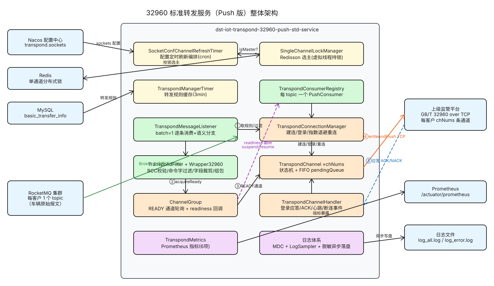
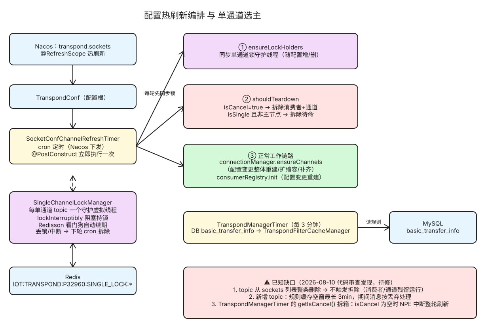
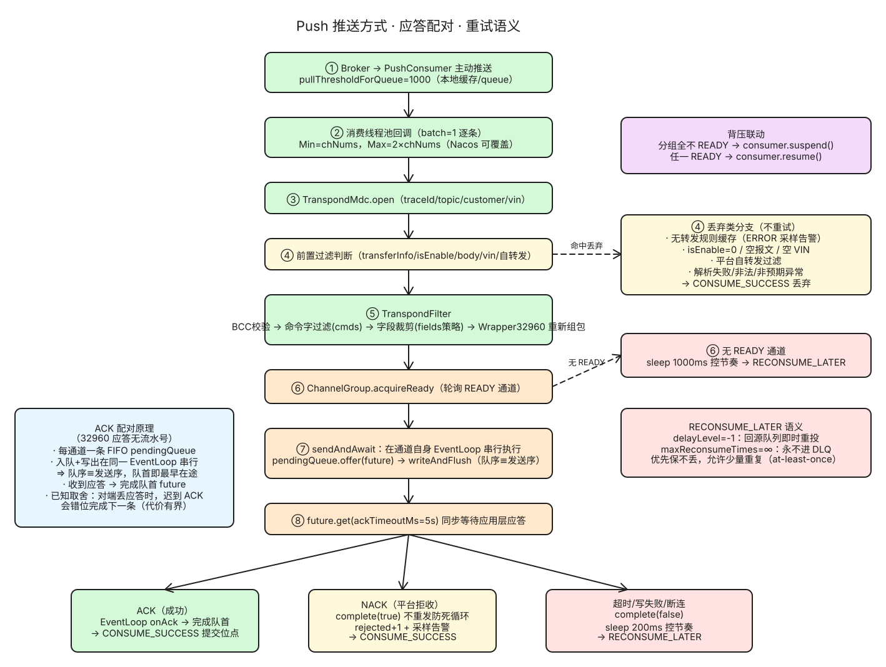
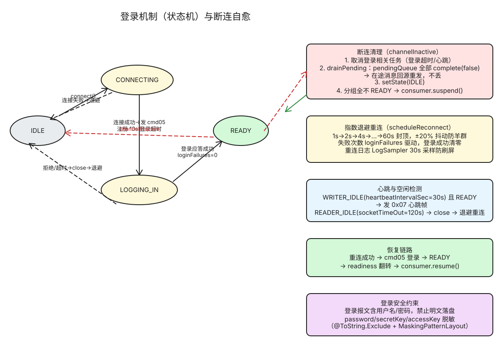

# 32960 标准转发服务（Push 版） — 设计文档

> **文档信息**
> - 服务：`dst-iot-transpond-32960-push-std-service`
> - 仓库：`D:\code\vds-new\dst-iot-transpond-32960-push-std-service`
> - 定位：从 RocketMQ 消费车辆原始报文，按 GB/T 32960 协议经 Netty TCP 通道推送到上级监管平台，并处理平台应用层应答（ACK/NACK）
> - 版本：Push 重构版（2026-08-10 完成重构 + 50 个单测通过）
> - 旧版（PULL 模式）文档：[32960标准转发服务 — 设计文档](/2026/08/03/gb32960-forward-service-design/)
> - 重构设计依据：**32960 转发服务（transpond-service）优化改造设计文档 —— Push 模式 + 线程托管 RocketMQ**

---

## 1. 概述与重构背景

### 1.1 服务职责

```
车辆/TBOX → 设备网关 → RocketMQ（每客户 1 个 topic）
                              │ Push 消费
                              ▼
                    本服务（过滤/裁剪/组包）
                              │ GB/T 32960 over TCP
                              ▼
                       上级监管平台 ──ACK/NACK──► 本服务
```

- 每个客户（topic）一组 Netty 通道（chNums 条），登录后进入 READY 状态参与转发
- 转发规则（`basic_transfer_info`）控制：命令字白名单（cmds）、字段裁剪策略（fields）、转发开关（isEnable）
- 消费语义：**at-least-once**——优先保证不丢，允许断连重发带来的少量重复

### 1.2 旧版（PULL）核心痛点与本次重构对策

| 旧版问题                                             | 后果               | 新版对策                                         |
| ------------------------------------------------ | ---------------- | -------------------------------------------- |
| 登录跑在 `ForkJoinPool.commonPool` 的 while+sleep 死循环 | 异常后永不登录，且阻塞公共线程池 | 事件驱动登录：connect 成功 → cmd05，状态机管理              |
| 4 处失效日志采样表达式（`/10000==0` 永假）                     | 故障静默，排查无据        | `LogSampler`（per-key CAS 时间戳限流）              |
| 登录报文（含密码）明文落盘                                    | 泄密风险             | 删明文日志 + 字段 `@ToString.Exclude` + 全局脱敏 Layout |
| 空轮询 WARN 刷屏                                      | 有效告警被淹没          | Push 模式无轮询；背压 suspend/resume                 |
| 逐条同步提交 offset                                    | 吞吐瓶颈             | Push 批量提交（batch=1 消费 + 客户端批量持久化）             |
| 无 WRITER_IDLE 心跳                                 | 长连接被中间设备静默断开     | 30s 心跳帧（0x07）                                |
| 无指标                                              | 不可观测             | Prometheus 6 项指标                             |

### 1.3 已拍板的关键决策（不可回退的设计前提）

1. **直接切 PUSH**，无 PULL|PUSH 双模并存期；回滚 = 回退发布版本（同 consumer group，位点在 broker 端，offset 连续）
2. **Wrapper32960 协议类一律不修改**（"不修协议，协议没有问题"）——包括其 `escape()` 未做 0x23 字节转义、`seq` 非线程安全等既有特征
3. **日志 pattern 冻结**：与日志采集系统约定，禁止改结构；唯一已确认例外是 traceId 后追加 `[%X{topic}][%X{customer}]` 两个 MDC 槽位
4. **不过 DLQ**：`maxReconsumeTimes=∞`，瞬时错误无限重试；解析/非法等不可自愈错误在监听器内直接丢弃（CONSUME_SUCCESS）

---

## 2. 整体架构



### 2.1 外部依赖

| 依赖                          | 用途                                | 故障影响                              |
| --------------------------- | --------------------------------- | --------------------------------- |
| RocketMQ                    | 消息源（每客户 1 topic）                  | 消费停滞，通道空闲（心跳保活）                   |
| Nacos                       | `transpond.sockets` 通道/登录/消费参数热刷新 | 沿用最后一次配置运行                        |
| MySQL `basic_transfer_info` | 转发规则（cmds/fields/isEnable）        | 用内存缓存；缓存无该 topic 时消息**丢弃**（见 §11） |
| Redis（Redisson）             | 单通道 topic 的分布式选主锁                 | 单通道 topic 无法持锁 → 不建连（其余不受影响）      |
| Prometheus                  | 指标拉取 `/actuator/prometheus`       | 仅观测缺失                             |

### 2.2 内部组件一览

| 组件 | 职责 |
|---|---|
| `SocketConfChannelRefreshTimer` | 配置刷新编排（cron，Nacos 下发；@PostConstruct 立即执行一次） |
| `TranspondManagerTimer` | 每 3 分钟从 DB 刷新转发规则缓存 |
| `SingleChannelLockManager` | 单通道 topic 的 Redisson 选主（守护虚拟线程持锁，看门狗续期） |
| `TranspondConsumerRegistry` | 每 topic 一个 `DefaultMQPushConsumer` 的生命周期管理 |
| `TranspondMessageListener` | 消费入口：MDC → 前置过滤 → Filter → 选通道 → 发送等应答 |
| `TranspondFilter` + 策略类 | BCC 校验、命令字过滤、字段裁剪（逻辑沿用旧版，零改动） |
| `Wrapper32960` | 32960 组包（**不可修改**） |
| `TranspondConnectionManager` | 建连、登录、指数退避重连 |
| `TranspondChannel` | 单通道状态机 + FIFO pendingQueue（ACK 配对） |
| `ChannelGroup` | topic 内通道轮询、READY 筛选、readiness 回调 |
| `TranspondChannelHandler` | 登录应答 / ACK / 心跳 / 断连事件 |
| `TranspondMetrics` | Prometheus 指标门面 |
| 日志体系 | `TranspondMdc` + `LogSampler` + `MaskingPatternLayout` + 异步双文件 |

---

## 3. 配置体系

### 3.1 SocketConf 关键字段（Nacos `transpond.sockets[]`）

| 字段                     | 默认                    | 说明                                |
| ---------------------- | --------------------- | --------------------------------- |
| `topic`                | —                     | 消费主题（客户标识，必填）                     |
| `host/port`            | —                     | 上级平台地址                            |
| `userName/password`    | —                     | 32960 登录凭据（脱敏处理）                  |
| `chNums`               | 1                     | 通道数；`isSingle=true` 时强制 1         |
| `isSingle`             | false                 | 单通道模式：多实例部署时经 Redis 选主，仅主节点建连     |
| `isCancel`             | false                 | 注销标记：true → 下轮刷新拆除消费者+通道          |
| `socketTimeOut`        | 120(s)                | TCP 读空闲超时（READER_IDLE → close 重连） |
| `ackTimeoutMs`         | 5000                  | 应用层 ACK 等待超时                      |
| `loginTimeoutMs`       | 10000                 | 登录应答超时（兜底，超时 close 走退避）           |
| `heartbeatIntervalSec` | 30                    | WRITER_IDLE 心跳间隔                  |
| `consumeThreadMin/Max` | 0=取 chNums / chNums×2 | 消费线程数（Nacos 可覆盖）                  |

### 3.2 热刷新链路



每轮 cron 编排顺序：

1. `ensureLockHolders` — 按当前配置同步单通道锁守护线程（新增补、删除杀）
2. 逐条 `validateSocketConf`（字段有效 + topic 去重）
3. `shouldTeardown` 判断：`isCancel=true` 或 `isSingle 且非主` → 拆除（consumerRegistry.remove + removeChannels）
4. 否则 `ensureChannels`（配置变更整体重建 / 扩缩容 / 补齐）+ `consumerRegistry.init`（配置 equals 跳过，否则重建）

> ⚠ **已知缺口**：编排只遍历"当前配置列表"，topic 从列表**整条删除**时无差集拆除（详见 §11 高危 1）。

---

## 4. 推送方式（消费模型）



### 4.1 PushConsumer 参数

| 参数 | 值 | 理由 |
|---|---|---|
| `ConsumeMessageBatchMaxSize` | **1** | 与旧 pull 循环单条提交语义对齐；每条消息独立决策（转发/丢弃/重试） |
| `consumeThreadMin / Max` | chNums / chNums×2 | 线程锚定通道数；批量=1 时吞吐由线程数决定而非批量大小 |
| `pullThresholdForQueue` | 1000 | 本地缓存队列深度上限，削峰 |
| `MessageModel` | CLUSTERING | 集群消费，多实例分担 |
| `ConsumeFromWhere` | CONSUME_FROM_LAST_OFFSET | 位点由 broker 端管理 |
| `AllocateMessageQueueStrategy` | AllocateMessageQueueAveragely | 队列平均分配 |
| `setMaxReconsumeTimes` | `Integer.MAX_VALUE` | **不过 DLQ**（见 §6） |
| `setDelayLevelWhenNextConsume` | -1 | 重试消息回源队列即时重投，不走延时等级 |

**batch=1 会不会慢？** 不会成为瓶颈：Push 模式下 broker→客户端是批量拉取、本地缓存的，`batch=1` 只影响"每次回调给监听器的条数"。吞吐 = 线程数 × 单条处理速率；单条处理主要是网络写 + 等 ACK（≤5s 超时但正常毫秒级），线程数锚定 chNums×2 足够打满通道。

### 4.2 背压联动（suspend/resume）

- 通道分组 readiness 翻转（`ChannelGroup.onChannelStateChanged`，仅变化时回调一次）：
  - **全不 READY** → `consumer.suspend()`：客户端停止向该 topic 拉取，消息留在 broker，不丢
  - **任一 READY** → `consumer.resume()`
- 这是"无 READY 通道 → RECONSUME_LATER"之外的第二道闸：避免断连期间消息在客户端本地空转重试

### 4.3 单条消息处理主线

```
TranspondMdc.open(conf, msg)            // traceId/topic/customer/vin 入 MDC
  → 前置过滤（§4.4 分支表）
  → TranspondFilter.process             // BCC 校验 → cmds 过滤 → fields 裁剪 → Wrapper32960 组包
  → ChannelGroup.acquireReady()         // 轮询 READY 通道
  → TranspondChannel.sendAndAwait()     // EventLoop 串行：入队 + 写出，等 ACK ≤5s
  → 结果映射为 CONSUME_SUCCESS / RECONSUME_LATER
finally: MDC.clear()
```

### 4.4 前置过滤分支表（权威语义映射）

| 分支 | 处理 | 语义 |
|---|---|---|
| `transferInfo == null`（无规则缓存） | ERROR 采样告警 | **丢弃** CONSUME_SUCCESS（有意修正：Push 下不提交会卡死队列） |
| `isEnable == "0"` | — | 丢弃 |
| body 空 / vin 空 | — | 丢弃 |
| 平台自转发（OWN_VIN 判断） | — | 丢弃 |
| 解析失败 / 报文非法 / 非预期异常 | ERROR 日志 | 丢弃（不会自愈的错误不重试） |
| 无 READY 通道 | LogSampler WARN + sleep 1000ms | **RECONSUME_LATER** |
| 发送失败 / ACK 超时 | sleep 200ms | **RECONSUME_LATER** |
| ACK 成功 | — | CONSUME_SUCCESS |
| NACK（平台拒收） | rejected+1 + 采样告警 | CONSUME_SUCCESS（**不重发**，防重发死循环） |

---

## 5. 登录机制



### 5.1 通道状态机

```
                 connect()
    IDLE ──────────────────► CONNECTING
    ▲                           │ 连接成功：发 cmd05 登录报文
    │ 连接失败/拒绝/超时/断连      │ 注册 loginTimeoutMs=10s 超时兜底
    │                           ▼
    │                       LOGGING_IN
    │                           │ 登录应答成功（loginFailures 清零）
    │                           ▼
    └──────── channelInactive ─ READY
```

| 状态 | 含义 | 可转发 |
|---|---|---|
| IDLE | 未连接 | ✗ |
| CONNECTING | TCP 建连中 | ✗ |
| LOGGING_IN | 已发 cmd05，等登录应答 | ✗ |
| READY | 登录成功 | ✓（仅 READY 参与 `acquireReady` 轮询） |

### 5.2 登录流程细节

1. `TranspondConnectionManager.connect()` 发起 TCP 连接
2. 连接成功 → CAS 到 `LOGGING_IN` → 发送 cmd05 登录帧（**不打报文内容**，含密码）→ 注册 10s 登录超时任务
3. 收到登录应答：
   - **成功** → 取消超时任务 → 置 READY → `loginFailures=0` → readiness 翻转触发 `consumer.resume()`
   - **拒绝** → WARN（含返回码）→ close → 走指数退避重连
   - **10s 超时兜底** → close → 走退避重连（防对端收到登录不回包的死等）

### 5.3 单通道选主（isSingle=true）

- 适用场景：平台侧只允许单连接的对接（同一 VIN 集多通道会互踢）
- 机制：`SingleChannelLockManager` 为每个单通道 topic 起一个**守护虚拟线程**，`lockInterruptibly()` 阻塞持 Redis 锁（key：`IOT:TRANSPOND:P32960:SINGLE_LOCK:{topic}`），Redisson 看门狗自动续期
- 持锁者 = 主节点：正常建连+消费；未持锁 = 备节点：`shouldTeardown` 拆除本地通道待命
- 主节点宕机 → 锁看门狗过期 → 备节点虚拟线程获锁 → 下轮 cron 建连接管
- **已知固有取舍**：选主切换存在秒级双主窗口（备已持锁建连、主侧 TCP 未完全断），平台侧若踢旧连新则无实际影响

### 5.4 心跳保活

- `WRITER_IDLE(heartbeatIntervalSec=30s)` 且 READY → 发 0x07 心跳帧（fillHeader + 空体 + BCC，25 字节合法帧）
- `READER_IDLE(socketTimeOut=120s)` → 判定对端假死 → close → 退避重连

---

## 6. 应答机制（ACK 配对）

### 6.1 协议约束与设计

32960 平台应答**无流水号**，协议层无法把 ACK 精确对应到某条消息。设计取舍：**每通道一条 FIFO `pendingQueue<CompletableFuture<Boolean>>`**，用"队首即最早在途"近似配对。

正确性关键：**入队 + 写出必须在通道自身 EventLoop 内串行执行**（`channel.eventLoop().execute(...)`），保证 `队序 ≡ 发送序`——这修复了旧版并发写导致的队序≠发送序错位。

### 6.2 完整时序

```
消费线程                     EventLoop(通道)                平台
   │  sendAndAwait(bytes)         │                          │
   │ ───────────────────────────► │ offer(future)→writeFlush │
   │                              │ ──────── 32960 帧 ──────►│
   │  future.get(5s) 阻塞等待      │                          │ 应用层处理
   │                              │ ◄──────── ACK ───────────│
   │ ◄── complete(true) ── onAck  │                          │
   ▼                               ▼                          ▼
CONSUME_SUCCESS
```

### 6.3 结果处理矩阵

| 事件 | future 结果 | 消费语义 | 说明 |
|---|---|---|---|
| ACK | complete(true) | CONSUME_SUCCESS | 正常路径 |
| NACK | complete(true) | CONSUME_SUCCESS | `rejected_total+1` + 采样告警；**不重发**，防"拒收→重发→再拒收"死循环 |
| 5s 超时 | complete(false) | RECONSUME_LATER | remove 出队，sleep 200ms 回源重投 |
| 写失败（listener 回调） | complete(false) | RECONSUME_LATER | 同上 |
| 断连 drainPending | 全部 complete(false) | RECONSUME_LATER | 在途消息批量回源，不丢 |
| `isNeedAck=false` | 写出即 true | CONSUME_SUCCESS | 无需应答的命令字 |

### 6.4 已知取舍（设计内接受）

对端**丢应答**时，迟到的下一条 ACK 会错位完成队首 future——即"任何 ACK 都提交"行为，与旧版等价。代价有界：错位导致的少数未确认消息经超时路径重发（at-least-once 允许重复）。不引入流水号映射/滑动窗口（协议不支持）。

---

## 7. 重试机制

### 7.1 两类错误的根本区分

| 类别 | 例子 | 策略 | 理由 |
|---|---|---|---|
| **丢弃类**（不自愈） | 解析失败、报文非法、无规则、被过滤 | CONSUME_SUCCESS | 重试一万次也是同样结果，重试=占队列 |
| **重试类**（可自愈） | 无 READY 通道、发送失败、ACK 超时 | RECONSUME_LATER | 对端恢复后自动成功 |

### 7.2 重试参数

| 参数 | 值 | 效果 |
|---|---|---|
| `delayLevelWhenNextConsume` | **-1** | 重试消息**回源队列**即时重投，不进 `%RETRY%` 队列、不走 1s/5s/... 延时等级 |
| `maxReconsumeTimes` | **Integer.MAX_VALUE** | 永不进 DLQ；配合 delayLevel=-1 形成"源队列内无限重试" |
| 无 READY 节奏 | sleep 1000ms | 避免断连期间重试风暴打满消费线程 |
| 发送失败/超时节奏 | sleep 200ms | 瞬时故障快速重试 |

### 7.3 为什么不过 DLQ

本服务是纯转发管道，消息价值随时间衰减但**不允许静默丢失**（监管合规场景）。进 DLQ 等于"丢给一个没人看的队列"，不如无限重试 + 指标/日志告警让人介入。代价：断连期间该 topic 位点停滞（积压），恢复后自动消化——这是 G5"优先不丢、允许重复"的有意选择。

### 7.4 单条卡队列头风险

RocketMQ 位点按最小 offset 推进，一条反复重试的消息会卡住该队列后续消息的位点提交（但**不影响后续消息的消费与转发**，仅影响位点持久化）。兜底：`ackTimeoutMs=5s` 上限 + lag 监控告警。

---

## 8. 断连自愈

### 8.1 channelInactive 全链路

```
channelInactive
 ├─ 1. cancelLoginRelatedTasks()   // 取消登录超时/心跳等通道级任务
 ├─ 2. drainPending()              // pendingQueue 全部 complete(false)
 │                                 //    → 在途消息走 RECONSUME_LATER 回源重发
 ├─ 3. setState(IDLE)              // 状态机复位
 ├─ 4. readiness 翻转               // 全不 READY → consumer.suspend() 停止拉取
 └─ 5. scheduleReconnect()         // 指数退避重连
```

### 8.2 指数退避

```
backoffMs = min(1000 << min(failures-1, 6), 60000) ± 20% 抖动
实际序列：1s → 2s → 4s → 8s → 16s → 32s → 60s → 60s → ...
```

- `loginFailures` 驱动，登录成功清零
- ±20% 抖动防多通道/多实例同时重连的羊群效应
- 重连日志 `LogSampler` 30s 采样，长断不刷屏、不静默

### 8.3 恢复链路

重连成功 → cmd05 登录 → READY → readiness 翻转 → `consumer.resume()` → 积压消息开始消费转发。

---

## 9. 异常情况处理矩阵

| # | 场景 | 检测点 | 处理动作 | 消息语义 |
|---|---|---|---|---|
| 1 | 平台 TCP 断连 | channelInactive | drainPending→重发；suspend；退避重连 | 不丢（回源） |
| 2 | 登录被拒 | 登录应答返回码≠成功 | WARN+close→退避重连 | 不涉及 |
| 3 | 登录无响应 | loginTimeoutMs=10s 兜底 | close→退避重连 | 不涉及 |
| 4 | ACK 超时 | future.get(5s) | complete(false)→sleep 200ms 重投 | 重试 |
| 5 | NACK 拒收 | onAck(false) | 计数+告警，**不重发** | 丢弃 |
| 6 | 无 READY 通道 | acquireReady=null | sleep 1s→RECONSUME_LATER | 重试 |
| 7 | 报文解析失败/非法 | Filter 异常 | ERROR 日志 | 丢弃 |
| 8 | 无转发规则缓存 | transferInfo=null | ERROR 采样告警 | 丢弃（见 §11 高危 2） |
| 9 | 平台假死（收不到任何数据） | READER_IDLE 120s | close→退避重连 | 不涉及 |
| 10 | 通道空闲保活 | WRITER_IDLE 30s | 发 0x07 心跳 | 不涉及 |
| 11 | 单通道主节点宕机 | Redis 锁看门狗过期 | 备节点获锁→下轮 cron 建连接管 | 秒级中断后恢复 |
| 12 | Nacos 配置删除/注销 | shouldTeardown | 拆除消费者+通道 | 停止消费该 topic |
| 13 | 消费端非预期异常 | listener catch | ERROR 日志 | 丢弃 |

---

## 10. 日志体系

### 10.1 pattern 冻结约定（与采集系统的契约）

```
%d{yyyy-MM-dd HH:mm:ss.SSS} [%X{traceId}][%X{topic}][%X{customer}] [%thread] %-5level %logger:%L - %msg%n
```

- **结构禁止改动**（含 `%L` 行号）；新标识只能以 `[%X{key}]` 槽位形式追加
- `[%X{topic}][%X{customer}]` 为 2026-08-10 确认的唯一追加例外
- 自定义 Layout 必须用 `LayoutWrappingEncoder` 包装（logback 1.4 下 `PatternLayoutEncoder.setLayout` 抛 UnsupportedOperationException）

### 10.2 组件

| 组件 | 职责 |
|---|---|
| `TranspondMdc` | `open(conf,msg)` 消费链路填 traceId/topic/customer/vin；`openChannel` Netty 链路；close 时 MDC.clear() |
| `LogSampler` | per-key CAS 时间戳限流（默认 1 条/30s），key 规范 `场景:topic[:ch]` |
| `MaskingPatternLayout` | 正则遮蔽 `password=/secretKey=/accessKey=` |
| 双文件异步 | `log_all.log`（INFO+，还原全过程）+ `log_error.log`（ERROR，告警采集）；AsyncAppender queueSize=8192、neverBlock |

### 10.3 安全约束

登录报文含用户名密码，**禁止明文落盘**：配置类 `password/secretKey/accessKey` 加 `@ToString.Exclude`，代码中不打印登录帧内容，Layout 层正则脱敏兜底。

---

## 11. 已知取舍与风险清单

### 11.1 设计内取舍（接受，不修）

| 项 | 说明 |
|---|---|
| ACK 错位配对 | 无流水号协议下的 FIFO 近似，代价有界（§6.4） |
| 不过 DLQ | 无限重试优先保不丢，位点停滞靠告警发现（§7.3） |
| 单通道双主窗口 | 选主切换秒级窗口，平台踢旧连新则无感（§5.3） |
| Wrapper32960 既有特征 | escape() 未做 0x23 转义、seq 非原子——**协议类约定不改** |

### 11.2 代码审查发现（2026-08-10，待修复授权）

| 级别 | 问题 | 位置 | 修复方向 |
|---|---|---|---|
| 🔴 高危 1 | topic 从 sockets **整条删除**后消费者+通道永不拆除（只遍历当前配置，无差集） | `SocketConfChannelRefreshTimer.run()` | 末尾对 consumerMap.keySet()/通道分组与当前有效 topic 做差集拆除，~15 行 |
| 🔴 高危 2 | 运行时**新增 topic** 的规则缓存空窗（3min 定时 vs 消费端 null→丢弃），最多丢 3 分钟消息 | `TranspondManagerTimer` × 消费端 | init 消费者前同步触发单 topic 缓存加载（推荐）；或 null 且配置存在时改 RECONSUME_LATER |
| 🟡 中危 3 | `getIsCancel()` 拆箱 NPE 在 try 块外，中断整轮刷新 | `TranspondManagerTimer.java:48` | `Boolean.TRUE.equals(...)` 一行 |
| 🟢 低危 4 | 转发规则缓存用普通 HashMap，定时线程写/消费线程读无同步 | `TranspondFilterCacheManager` | 换 ConcurrentHashMap |
| 🟢 低危 6 | consumerRegistry.init() 失败后每轮 cron 刷 ERROR 堆栈 | `TranspondConsumerRegistry` | LogSampler 限流 |

---

## 12. 指标体系（Prometheus）

| 指标 | 类型 | 标签 | 埋点 |
|---|---|---|---|
| `transpond_forward_total` | Counter | topic, result(success/timeout/skip/filtered) | TranspondMessageListener |
| `transpond_ack_latency` | Timer | topic | sendAndAwait |
| `transpond_channel_state` | Gauge | topic, ch（状态 ordinal） | TranspondChannel |
| `transpond_login_failures_total` | Counter | topic, ch | TranspondConnectionManager |
| `transpond_pending_ack` | Gauge | topic, ch（pendingQueue.size） | TranspondChannel |
| `transpond_rejected_total` | Counter | topic | onAck(false) |

> Nacos 需下发 `management.endpoints.web.exposure.include=prometheus,health`（不入仓库）；lag 监控建议 rocketmq-exporter。

---

## 13. 遗留运维事项

1. Nacos 下发 prometheus/health 端点暴露配置
2. lag 指标接入 rocketmq-exporter
3. test/dev 环境 Nacos 明文凭据轮换（P0 决策：不在代码侧动）
4. 确认日志采集端是否按固定文件名 tail（log_all.log / log_error.log 已冻结）
5. §11.2 高危 1/2、中危 3 的修复（约 30 行，**待授权**）

---

## 相关文档

- [32960标准转发服务 — 设计文档](/2026/08/03/gb32960-forward-service-design/)（旧 PULL 版）
- **32960 转发服务（transpond-service）优化改造设计文档 —— Push 模式 + 线程托管 RocketMQ**（本次重构的设计依据）
- **32960设备网关**、**32960平台网关**、[32960三方数据转发](/2026/05/20/gb32960-third-party-forward/)、**32960三方数据分发**、[IoT网关设计文档](/2026/05/20/iot-gateway-design/)
