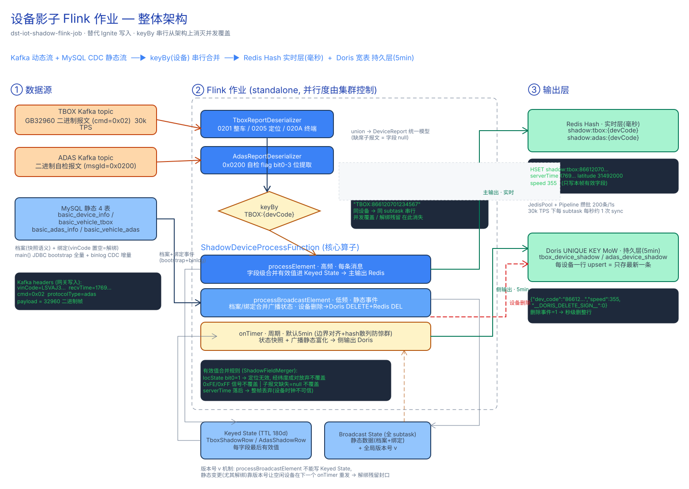
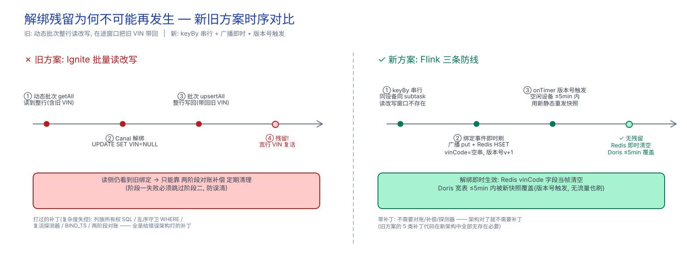

> **项目仓库**: `D:\code\flink_calculator\dst-iot-shadow-flink-job`
> **替代方案**: `dst-iot-shadow-write-service`（Ignite 3 写入链路，已放弃）
> **版本**: V1 (2026-09-08)
> **状态**: ✅ 已实现并编译打包通过（160MB shade fat jar），待 Nacos 配置 + 联调部署

## 0. 实现落地补充（2026-09-08 实现完成后追加）

**已实现的关键细节（实现时定稿，与设计的差异点）**：

1. **keyBy 复合键** = `TBOX:{devCode}` / `ADAS:{devCode}`（防两类设备编号撞号互踩状态）
2. **静态版本号机制是解绑正确性的必需品**而非优化：processBroadcastElement 不能写 Keyed State，解绑事件若不靠版本号触发 onTimer 重发，空闲设备的 Doris 行会永久残留旧 VIN
3. **绑定事件即时刷 Redis**：广播路径直接主输出 `{vinCode: 新值或空串}` 的 Hash 事件——设备无流量也能刷掉 Redis 旧 VIN，解绑残留彻底封口
4. **发射拷贝**（`toBuilder().build()`）：字段级合并是原地突变状态行，Doris Sink 异步攒批持有引用，不拷贝会读到中途态
5. **Debezium DATETIME 陷阱**：值为墙上时间 as-if-UTC 的 epoch ms，必须用 UTC 格式化还原（用 +08:00 会偏 8 小时）；JDBC Bootstrap 路径统一 `getString` 拿墙上时间字符串透传，不走 getTimestamp
6. **StaticDataParser 用 FlatMap 不用 Map**：Flink 1.15 MapFunction 返回 null 会 NPE
7. **Redis Hash 有意不写 dataHex**（每帧数百字节~KB 会放大 2~5 倍内存网络，调试诉求由 Doris data_hex 列承担）——如需在 `ShadowFieldMerger.mergeTboxDynamic` 加一行即可
8. **从未上报的设备不会出现在 Doris 宽表**（无 keyed state 即无定时器；影子语义 = "至少上报过一次"）。若设备清单需要全覆盖，后续可加静态种子路径或 xxl-job 直补 Doris
9. CDC `JsonCdcDeserializer` 从 Debezium source struct 提取 **table 字段**用于 4 表路由（参考工程单表不需要，这是差异点）

## 1. 项目定位与背景

**消费 Kafka TBOX(32960)/ADAS 原始二进制报文 + MySQL CDC 静态数据（档案+绑定），以"每设备一个 Keyed State"的模型，将动静合一的设备影子宽表按频率刷入 Doris（持久层，只存最新一条有效数据），同时实时写 Redis Hash（实时层）**。

### 为什么放弃 Ignite 3 写入方案

- Ignite 3 强制事务（MVCC + 2PL + WAIT_DIE），高频动态流与低频静态流锁域冲突实锤（详见 **dst-iot-shadow-service Ignite 3.1 双写改造实现方案**）
- 为规避并发问题引入的列族所有权、乱序守卫 WHERE、复活探测器等防御性设计，复杂度失控
- **Flink 方案的根本优势**：`keyBy(DEV_CODE)` 后同一设备消息路由到同一 subtask 串行处理，并发覆盖问题在架构层面消失——不需要乱序守卫、不需要列族所有权、不需要对账补偿

### 已确认的四个设计决策（2026-09-08）

| # | 决策点 | 结论 |
|---|--------|------|
| 1 | 静态数据接入 | **Flink MySQL CDC 直连 binlog**（JDBC 全量 bootstrap + MySqlSource 增量 → broadcast），不消费 Canal→RocketMQ |
| 2 | Doris 宽表 | **TBOX / ADAS 各一张**（字段集差异大，不合并） |
| 3 | Doris 刷库频率 | **默认 5 分钟**（可配置），Redis 承担实时查询 |
| 4 | Redis 结构 | **每设备一个全字段 Hash**，`shadow:tbox:{devCode}` / `shadow:adas:{devCode}`，只 HSET 有效字段 |

## 2. 核心拓扑



*图：整体架构（三区：数据源 → Flink 核心算子 → 输出层；黑底绿字为实际报文/命令样例）*

### 2.1 文字版拓扑

```
                    ┌──────────────────────────────────────────┐
                    │              main() 引导阶段               │
                    │  NacosConfigUtils.initFlinkJobConfig      │
                    │  MySQL JDBC bootstrap 4 张静态表全量        │
                    │  (fail-fast, JobManager JVM)              │
                    └───────────────┬──────────────────────────┘
                                    │ fromCollection (全量静态快照)
                                    │
  ┌──────────────────┐   ┌─────────▼──────────┐
  │ Kafka TBOX topic │──►│                    │   broadcast
  │ (32960 二进制)     │   │  CDC Source        ├──────────────┐
  └──────────────────┘   │  (binlog 增量, P=1) │              │
                         └────────────────────┘              │
  ┌──────────────────┐   ┌────────────────────┐              │
  │ Kafka ADAS topic │──►│ 反序列化            │              │
  │ (ADAS 二进制)     │   │ (协议解析+Header)   │              │
  └──────────────────┘   └─────────┬──────────┘              │
                                   │ union + keyBy(DEV_CODE) │
                                   ▼                         ▼
                    ┌──────────────────────────────────────────┐
                    │  ShadowDeviceProcessFunction             │
                    │  (KeyedBroadcastProcessFunction)         │
                    │                                          │
                    │  processElement:                          │
                    │    字段级合并有效动态值到 Keyed State       │
                    │    (serverTime 乱序守卫, 内存比较)          │
                    │    主输出 → Redis Hash Sink (实时)         │
                    │                                          │
                    │  processBroadcastElement:                 │
                    │    更新广播状态 (档案/绑定/解绑/删除)         │
                    │    删除事件 → 侧输出 DELETE 到 Doris        │
                    │                                          │
                    │  onTimer (5min, 边界对齐+hash散列):         │
                    │    Keyed State 最新快照 + 广播静态富化       │
                    │    侧输出 → Doris Sink (MoW upsert)       │
                    └───────────────┬───────────────┬──────────┘
                                    │               │
                     主输出(实时)     ▼               ▼ 侧输出(5min)
                    ┌──────────────────────┐  ┌────────────────────┐
                    │ Redis Hash Sink      │  │ Doris Sink         │
                    │ JedisPool+Pipeline   │  │ Stream Load json   │
                    │ 攒批 200条/1s         │  │ MoW UNIQUE KEY     │
                    └──────────────────────┘  └────────────────────┘
```

## 3. 字段模型（兼容 shadow-write-service 全部字段）

### 3.1 TBOX 宽表 `tbox_device_shadow`

**静态列族**（写入来源：CDC `basic_device_info` 档案 + `basic_vehicle_tbox` 绑定）：

| 列 | 类型 | 含义 | 来源 |
|----|------|------|------|
| dev_code | VARCHAR(64) NOT NULL | 设备编号（Unique Key） | 主键 |
| vin_code | VARCHAR(32) | 绑定的车辆 VIN | 绑定 CDC |
| bind_status | INT | 0-未绑定 1-已绑定 | 绑定 CDC |
| org_id / brand_id / type_id | BIGINT | 组织/品牌/型号 | 档案 CDC |
| iccid | VARCHAR(32) | ICCID | 档案 CDC |
| product_date | DATE | 出厂日期 | 档案 CDC |
| protocol_version | VARCHAR(32) | 协议版本 | 档案 CDC |
| creator_id / creator_name | BIGINT / VARCHAR(64) | 创建人 | 档案 CDC |
| create_time | DATETIME | 创建时间 | 档案 CDC |
| modifier_id / modifier_name | BIGINT / VARCHAR(64) | 更新人 | 档案 CDC |
| modify_time | DATETIME | 更新时间 | 档案 CDC |
| profile_recv_time | DATETIME | 档案同步接收时间 | 写入侧打点 |

**动态列族**（写入来源：Kafka 32960 报文，字段级合并有效值）：

| 列 | 类型 | 含义 | 子报文 |
|----|------|------|--------|
| data_vin_code | VARCHAR(32) | 报文当时上报车架号 | Header/报文体 |
| platform_vin_code | VARCHAR(32) | 平台识别码 | Kafka Header |
| firmware_version | VARCHAR(64) | 固件版本（hex→点分） | 020A |
| data_time | DATETIME | 数据采集时间（设备时钟） | 报文体 |
| server_time | DATETIME | 服务端接收时间（**乱序裁决基准**） | Kafka Header recvTime |
| vehicle_status | INT | 车辆状态 | 0201 |
| charge_status | INT | 充电状态 | 0201 |
| total_mileage | BIGINT | 总里程 0.1km | 0201 |
| speed | INT | 车速 0.1km/h | 0201 |
| electric_quantity | INT | 电量 SOC % | 0201 |
| total_voltage | INT | 总电压 0.1V | 0201 |
| total_current | INT | 总电流 0.1A（偏移1000A） | 0201 |
| latitude | BIGINT | 纬度 ×10⁶ | 0205 |
| longitude | BIGINT | 经度 ×10⁶ | 0205 |
| tbox_status | INT | TBOX 工作状态 | 020A |
| network_signal | INT | 网络信号 CSQ（0xFE异常/0xFF无效） | 020A |
| data_hex | VARCHAR | 最新原始报文 hex（调试用） | 报文体 |
| update_time | DATETIME | 本行入库时间 | 写入侧打点 |

### 3.2 ADAS 宽表 `adas_device_shadow`

静态列族同 TBOX（来源 `basic_adas_info` + `basic_vehicle_adas`），**无 bind_status**——绑定态由 vin_code 是否为空表达（沿用旧语义）。

**动态列族**（写入来源：Kafka ADAS 报文 msgId=0x0200 自检信息）：

| 列 | 类型 | 含义 |
|----|------|------|
| data_vin_code | VARCHAR(32) | 报文当时车架号（Header vinCode） |
| firmware_version | VARCHAR(64) | 固件版本（自检 version） |
| data_time | DATETIME | 数据上报时间（yyMMddHHmmss GMT+8） |
| server_time | DATETIME | 服务端接收时间（Header recvTime） |
| dms_connection_status | INT | DMS 连接 0/1（flag bit1） |
| adas_connection_status | INT | ADAS 连接 0/1（flag bit0） |
| rvc_connection_status | INT | 倒车影像连接 0/1（flag bit3） |
| s4g_signal_strength | INT | 4G 信号强度（自检 g4） |
| gps_signal_status | INT | GPS 信号 0无/1有（flag bit2） |
| data_hex / update_time | — | 同 TBOX |

### 3.3 有效值规则（从旧服务完整迁移）

这是旧服务靠字段级 UPDATE + Lua 守卫苦苦维护的语义，新方案通过 **Keyed State 字段级合并 + Redis Hash 部分字段 HSET** 免费获得：

1. **定位有效性**（最重要）：GB32960 0205 state 字节 **bit0=1 时定位无效**——设备无法定位时会重放"最后一次有效值"，数值再合法也不能覆盖旧值；`locState == null`（报文未带 0205）同样无效
2. **坐标对校验**：lat/lng 任一为 null 或 **0** 无效；`|lat| > 90×10⁶` 或 `|lng| > 180×10⁶` 无效；经纬度**成对生效成对放弃**
3. **协议无效值**：networkSignal 0xFE(异常)/0xFF(无效) 不写入
4. **子报文缺失**：整段子报文（0201/0205/020A）缺失时对应字段保持 null → 不覆盖状态旧值
5. **乱序裁决**：消息级守卫，`msgServerTime >= stateServerTime` 才应用（**用 serverTime 不用 dataTime**，设备时钟不可信——TBOX 全离线事故教训，见 **TBOX 全离线乱序守卫事故**）；单设备消息经 keyBy 串行后，内存比较即可，无需 SQL WHERE
6. **ADAS 自检位**：`(flag >> bit) & 0x01` 取位（SelfTestBitEnum 语义）

## 4. 静态数据 CDC 设计

### 4.1 数据源

**一个 MySqlSource 监听 4 张表**（tableList 逗号分隔，binlog 单并行度保序）：

```
dst_v2x_db.basic_device_info    -- TBOX 档案
dst_v2x_db.basic_vehicle_tbox   -- TBOX 绑定（devCode↔vinCode）
dst_v2x_db.basic_adas_info      -- ADAS 档案
dst_v2x_db.basic_vehicle_adas   -- ADAS 绑定
```

**Bootstrap**：main() 阶段 JDBC 全量拉取 4 张表 → `env.fromCollection`（P=1）→ union CDC 增量流 → broadcast。冷启动即有全量静态数据，无需等 CDC 事件。

### 4.2 绑定/解绑/删除语义

| CDC 事件 | 语义 | 动作 |
|----------|------|------|
| basic_vehicle_* INSERT/UPDATE（vinCode 非空） | 绑定/换绑 | 广播状态 put：vinCode + bind_status=1 |
| basic_vehicle_* UPDATE（**vinCode 空白**） | 解绑 | 广播状态 put：vinCode=NULL + bind_status=0（UPDATE data 是整行镜像，库里已置空=解绑语义） |
| basic_vehicle_* DELETE | 解绑 | 同上 |
| basic_device_info / basic_adas_info INSERT/UPDATE | 档案变更 | 广播状态 put 档案字段 |
| basic_device_info / basic_adas_info DELETE | **设备删除** | 广播状态 remove + **立即侧输出 `__DORIS_DELETE_SIGN__=1`** 到 Doris（秒级生效）+ Redis DEL |

> ⚠️ 删除信号坑位：`__DORIS_DELETE_SIGN__` 必须加入 Stream Load `columns` 参数且每行输出整数 0/1（不能 boolean），否则 MoW 删除失效。

### 4.3 广播状态

`MapStateDescriptor<String, ShadowStaticData>`，key = `TBOX:{devCode}` / `ADAS:{devCode}`。另存全局 `staticVersion`（每次广播更新 +1）——onTimer 对比 Keyed State 里记录的 lastEmittedStaticVersion，**静态数据变了但设备无流量时也能在下个周期刷出新行**（processBroadcastElement 不能写 Keyed State，靠版本号传递变更信号）。

### 4.4 解绑残留封口——新旧方案对比



*图：旧 Ignite 批量读改写在途窗口如何产生 VIN 残留（左），新方案三条防线如何封口（右）*

## 5. 定时器与 Doris 刷库设计

- **周期**：默认 5 分钟（`shadow.doris.flush.interval.ms=300000`）
- **边界对齐 + hash 散列防惊群**（照抄参考工程）：

```java
long offset = (devCode.hashCode() & 0x7FFFFFFF) % (flushIntervalMs / 2);
long nextBoundary = ((now / flushIntervalMs) + 1) * flushIntervalMs;
long fireTime = nextBoundary + Math.min(offset, flushIntervalMs - 1000);
```

- **onTimer 重注册必须用完全相同的边界对齐算法**（用 `ctx.getCurrentKey()`），否则定时器逐周期漂移分裂
- **触发条件**：dirty（本周期有新动态数据）或 staticVersion 变化；否则跳过本次输出但继续注册
- **不活跃退出**：连续 15 天无消息的设备不再注册定时器（防状态无限增长）
- **输出语义**：Doris UNIQUE KEY MoW 按 dev_code upsert 整行 = "只存最新一条"；at-least-once 重复 upsert 幂等无害

## 6. Redis 设计

| 项 | 设计 |
|----|------|
| Key | `shadow:tbox:{devCode}` / `shadow:adas:{devCode}`，Hash |
| Field | 动态字段全集（驼峰命名，与 POJO 一致）+ vinCode（广播富化的绑定 VIN）|
| 写入粒度 | **每消息只 HSET 有效字段**（无效定位不覆盖旧值，字段级原子性免费获得） |
| TTL | 不设（离线判定由读侧按 serverTime 年龄过滤，沿用旧约定） |
| 客户端 | JedisPool（maxTotal=32/maxIdle=16/minIdle=4, testOnBorrow） |
| 调用频率 | RichSinkFunction 攒批 + Pipeline：默认 **200 条或 1 秒**触发 flush（可配置），30k TPS 下每 subtask 每秒约 1 次 pipeline 同步 |
| 容错 | JedisException 只 warn + Flink Counter（writeFailCount），**不抛异常**防 restart storm / 阻塞 offset |

## 7. Doris DDL

> 工程内文件：`sql/2026-09-08-zhangchao-doris-device-shadow.sql`

```sql
-- =====================================================================
-- 设备影子宽表（TBOX）：动静合一，只存每设备最新一条有效数据
-- UNIQUE KEY MoW：按 dev_code upsert 覆盖；__DORIS_DELETE_SIGN__ 走隐藏列
-- =====================================================================
CREATE TABLE IF NOT EXISTS `tbox_device_shadow` (
    `dev_code`          VARCHAR(64) NOT NULL COMMENT '设备编号 (Unique Key)',
    -- 静态列族：绑定（basic_vehicle_tbox CDC）
    `vin_code`          VARCHAR(32) COMMENT '绑定的车辆VIN，NULL=未绑定',
    `bind_status`       INT COMMENT '绑定状态 0-未绑定 1-已绑定',
    -- 静态列族：档案（basic_device_info CDC）
    `org_id`            BIGINT COMMENT '组织ID',
    `brand_id`          BIGINT COMMENT '品牌ID',
    `type_id`           BIGINT COMMENT '型号ID',
    `iccid`             VARCHAR(32) COMMENT 'ICCID',
    `product_date`      DATE COMMENT '出厂日期',
    `protocol_version`  VARCHAR(32) COMMENT '协议版本',
    `creator_id`        BIGINT COMMENT '创建人ID',
    `creator_name`      VARCHAR(64) COMMENT '创建人',
    `create_time`       DATETIME COMMENT '创建时间',
    `modifier_id`       BIGINT COMMENT '更新人ID',
    `modifier_name`     VARCHAR(64) COMMENT '更新人',
    `modify_time`       DATETIME COMMENT '更新时间',
    `profile_recv_time` DATETIME COMMENT '档案同步接收时间',
    -- 动态列族：32960 报文字段级合并（只保留最后有效值）
    `data_vin_code`     VARCHAR(32) COMMENT '报文当时上报车架号',
    `platform_vin_code` VARCHAR(32) COMMENT '平台识别码',
    `firmware_version`  VARCHAR(64) COMMENT '固件版本(hex转点分)',
    `data_time`         DATETIME COMMENT '数据采集时间(设备时钟)',
    `server_time`       DATETIME COMMENT '服务端接收时间(乱序裁决基准)',
    `vehicle_status`    INT COMMENT '车辆状态(0201)',
    `charge_status`     INT COMMENT '充电状态(0201)',
    `total_mileage`     BIGINT COMMENT '总里程 0.1km(0201)',
    `speed`             INT COMMENT '车速 0.1km/h(0201)',
    `electric_quantity` INT COMMENT '电量SOC %(0201)',
    `total_voltage`     INT COMMENT '总电压 0.1V(0201)',
    `total_current`     INT COMMENT '总电流 0.1A 偏移1000A(0201)',
    `latitude`          BIGINT COMMENT '纬度×10^6(0205,定位有效才更新)',
    `longitude`         BIGINT COMMENT '经度×10^6(0205,定位有效才更新)',
    `tbox_status`       INT COMMENT 'TBOX工作状态(020A)',
    `network_signal`    INT COMMENT '网络信号CSQ 0xFE异常 0xFF无效(020A)',
    `data_hex`          VARCHAR COMMENT '最新原始报文hex(调试)',
    `update_time`       DATETIME COMMENT '本行入库时间'
) ENGINE=OLAP
UNIQUE KEY(`dev_code`)
DISTRIBUTED BY HASH(`dev_code`) BUCKETS 10
PROPERTIES (
    "replication_num" = "1",
    "enable_unique_key_merge_on_write" = "true",
    "storage_format" = "V2",
    "light_schema_change" = "true"
);

-- =====================================================================
-- 设备影子宽表（ADAS）：无 bind_status，绑定态由 vin_code 是否为空表达
-- =====================================================================
CREATE TABLE IF NOT EXISTS `adas_device_shadow` (
    `dev_code`               VARCHAR(64) NOT NULL COMMENT '设备编号 (Unique Key)',
    `vin_code`               VARCHAR(32) COMMENT '绑定的车辆VIN，NULL=未绑定',
    `org_id`                 BIGINT COMMENT '组织ID',
    `brand_id`               BIGINT COMMENT '品牌ID',
    `type_id`                BIGINT COMMENT '型号ID',
    `iccid`                  VARCHAR(32) COMMENT 'ICCID',
    `product_date`           DATE COMMENT '出厂日期',
    `protocol_version`       VARCHAR(32) COMMENT '协议版本',
    `creator_id`             BIGINT COMMENT '创建人ID',
    `creator_name`           VARCHAR(64) COMMENT '创建人',
    `create_time`            DATETIME COMMENT '创建时间',
    `modifier_id`            BIGINT COMMENT '更新人ID',
    `modifier_name`          VARCHAR(64) COMMENT '更新人',
    `modify_time`            DATETIME COMMENT '更新时间',
    `profile_recv_time`      DATETIME COMMENT '档案同步接收时间',
    `data_vin_code`          VARCHAR(32) COMMENT '报文当时车架号',
    `firmware_version`       VARCHAR(64) COMMENT '固件版本(自检version)',
    `data_time`              DATETIME COMMENT '数据上报时间',
    `server_time`            DATETIME COMMENT '服务端接收时间',
    `dms_connection_status`  INT COMMENT 'DMS连接 0-未连接 1-已连接(flag bit1)',
    `adas_connection_status` INT COMMENT 'ADAS连接 0/1(flag bit0)',
    `rvc_connection_status`  INT COMMENT '倒车影像连接 0/1(flag bit3)',
    `s4g_signal_strength`    INT COMMENT '4G信号强度(自检g4)',
    `gps_signal_status`      INT COMMENT 'GPS信号 0-无 1-有(flag bit2)',
    `data_hex`               VARCHAR COMMENT '最新原始报文hex(调试)',
    `update_time`            DATETIME COMMENT '本行入库时间'
) ENGINE=OLAP
UNIQUE KEY(`dev_code`)
DISTRIBUTED BY HASH(`dev_code`) BUCKETS 3
PROPERTIES (
    "replication_num" = "1",
    "enable_unique_key_merge_on_write" = "true",
    "storage_format" = "V2",
    "light_schema_change" = "true"
);
```

> 生产环境 `replication_num` 改 3。

## 8. 工程结构

```
dst-iot-shadow-flink-job/                # standalone 单模块，不依赖 flink-base
├── pom.xml                              # Flink 1.15.0 / doris-connector 25.0.0
│                                        # / jedis 4.4.3 / mysql-cdc 2.4.0 / nacos
├── sql/
│   └── 2026-09-08-zhangchao-doris-device-shadow.sql
└── src/main/
    ├── java/com/dst/iot/shadow/
    │   ├── ShadowFlinkJob.java          # 入口：bootstrap + 拓扑
    │   ├── config/
    │   │   ├── FlinkJobConfig.java      # Nacos 下发配置 POJO
    │   │   └── NacosConfigUtils.java    # 环境隔离 + Nacos 拉取
    │   ├── source/
    │   │   ├── ShadowKafkaSourceFactory.java
    │   │   ├── TboxReportDeserializer.java   # 32960 解析(0201/0205/020A+Header)
    │   │   └── AdasReportDeserializer.java   # ADAS 解析(0x0200 自检+Header)
    │   ├── cdc/
    │   │   ├── StaticDataCdcSource.java      # MySqlSource 4 表 + bootstrap union
    │   │   ├── StaticDataBootstrapLoader.java# JDBC 全量
    │   │   └── JsonCdcDeserializer.java      # 按表名路由
    │   ├── process/
    │   │   └── ShadowDeviceProcessFunction.java  # 核心：合并+守卫+定时器
    │   ├── sink/
    │   │   ├── ShadowDorisSink.java      # 两表 Stream Load（含 DELETE 信号）
    │   │   └── ShadowRedisHashSink.java  # JedisPool+Pipeline 攒批 HSET
    │   └── pojo/
    │       ├── TboxShadowRow.java        # TBOX 宽表行（动静合一）
    │       ├── AdasShadowRow.java        # ADAS 宽表行
    │       ├── DeviceReport.java         # 统一动态消息（设备类型+字段集）
    │       ├── ShadowStaticData.java     # 广播状态值（档案+绑定）
    │       └── RedisHashEvent.java       # Redis 写入事件（devCode+字段Map）
    └── resources/
        ├── logback.xml
        └── {test,pre,prod}/bootstrap.properties   # 仅 Nacos 连接信息
```

**依赖版本**（与参考工程 dst-iot-vehicle-realtime-flink-job 对齐）：

| 组件 | GAV | 版本 |
|------|-----|------|
| Flink | flink-streaming-java 等 | 1.15.0 (provided) |
| Kafka connector | org.apache.flink:flink-connector-kafka | 1.15.0 |
| Doris connector | org.apache.doris:flink-doris-connector-1.15 | 25.0.0 |
| MySQL CDC | com.ververica:flink-connector-mysql-cdc | 2.4.0 |
| Redis | redis.clients:jedis | 4.4.3 |
| Nacos | spring-cloud-starter-alibaba-nacos-config | 2022.0.0.0 |
| 32960 协议 | com.flybees.pass32960.protocol:protocol-32960-dst | 1.0.6-SNAPSHOT |
| ADAS 协议 | com.dst:dst-iot-protocol-adas | 与 IOT_DA 父工程对齐 |

## 9. 与旧服务的迁移关系

1. **旧 shadow-write-service 继续运行的范围**：GPS-KKS / GPS-808 链路 + `tbox:info:` / `tbox:bind:` / `car:info:` 等静态 Redis key 维护（其他服务的读侧依赖）+ Ignite 2.16 旧集群读侧
2. **本作业接管**：TBOX / ADAS 动态数据 → Doris 宽表 + `shadow:*` Redis Hash
3. **切换步骤**：新作业独立消费组上线（新 key 双轨并存）→ 读侧验证 → 旧服务关闭 TBOX/ADAS 动态写入开关（`shadow.writer.*`）→ 摘除旧链路
4. **Ignite 3 集群**：不再使用（三表方案 **dst-iot-shadow-service Ignite 3.1 升级与切换方案** 归档）

## 10. 风险与注意事项

| 风险 | 对策 |
|------|------|
| CDC 需 binlog 权限（REPLICATION SLAVE） | 复用参考工程已验证的账号；bootstrap 用普通 SELECT 账号即可 |
| Doris Stream Load label 冲突 | labelPrefix = 表名 + 启动时间戳（照抄参考工程） |
| 定时器漂移分裂 | onTimer 重注册严格用同一边界对齐算法（getCurrentKey 的 hash） |
| 30k TPS Redis 压力 | Pipeline 攒批（200条/1s）；HSET 只写有效字段减少包体 |
| 解绑后 VIN 残留（旧事故） | keyBy 串行 + 广播状态即时更新，架构上不存在整行读改写窗口；**解绑后Ignite3-VIN残留** 问题不复现 |
| 设备删除残留 | CDC DELETE → `__DORIS_DELETE_SIGN__=1` 秒级删行 + Redis DEL |
| 作业重启静态数据冷启动 | bootstrap 全量；binlog 位点由 CDC checkpoint 管理 |
