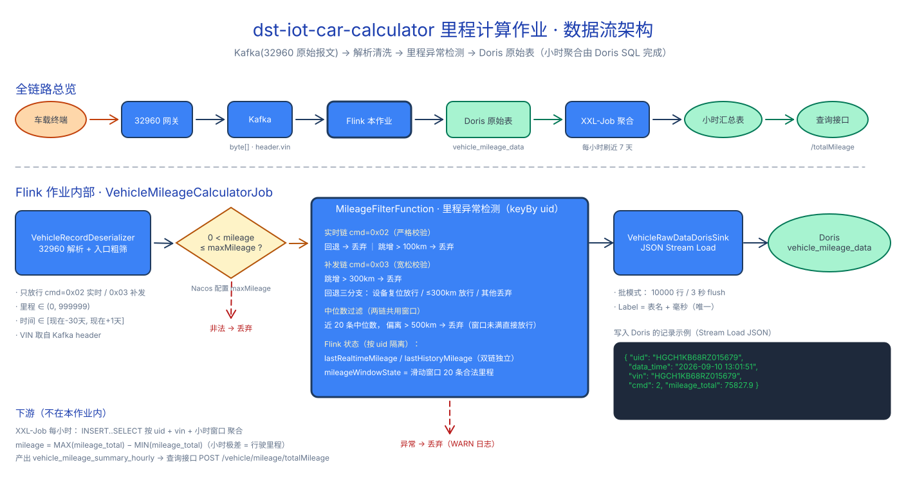

> **项目路径**：`D:\code\flink_calculator\dst-iot-car-calculator`
> **主类**：`com.dst.iot.car.dstiotcarcalculator.VehicleMileageCalculatorJob`
> **整理日期**：2026-09-10
> **定位**：消费 Kafka 中的 GB/T 32960 车载终端原始报文，解析、清洗累计里程数据，写入 Doris 原始表 `vehicle_mileage_data`；小时聚合由 Doris SQL（XXL-Job 定时刷新）完成。

## 1. 作业职责与边界

| 做 | 不做 |
|---|---|
| 解析 32960 二进制报文（0x02 实时 / 0x03 补发） | 不做小时窗口聚合（线上未启用，见 §8） |
| 里程异常检测与过滤（三层过滤） | 不提供查询接口（查询在 dst-v2x-manager-service） |
| 清洗后的原始数据写 Doris | 不做断点重算（补数走 Doris SQL 重刷） |

**上游**：32960 网关 → Kafka（VIN 塞在消息 header 的 `vin` 键）
**下游**：Doris `vehicle_mileage_data` 原始表 → XXL-Job 每小时聚合 → `vehicle_mileage_summary_hourly` 汇总表
**全链路上下文**：见 [车辆里程计算与查询接口 — 全链路分析](/2026/08/14/mileage-full-link-analysis/)

## 2. 整体数据流



```
Kafka (32960 原始二进制, value=byte[])
  │
  ▼ VehicleRecordDeserializer          ← 协议解析 + 入口粗筛
  │   · 只放行 cmd=0x02 / 0x03
  │   · 里程 ∈ (0, 999999)
  │   · 时间 ∈ [现在-30天, 现在+1天]
  │   · VIN 从 Kafka header 提取
  ▼
filter-illegal-mileage                 ← 单条阈值过滤
  │   · 0 < mileageTotal ≤ maxMileage（Nacos 配置）
  ▼
keyBy(uid)
  ▼
MileageFilterFunction                  ← 核心：里程异常检测（KeyedProcessFunction）
  │   · 实时链(0x02) 严格校验
  │   · 补发链(0x03) 宽松校验 + 设备复位识别
  │   · 中位数过滤器（滑动窗口 20 条，阈值 500km）
  ▼
VehicleRawDataDorisSink                ← JSON Stream Load
      · 批模式：1 万行 或 3 秒 flush
  ▼
Doris: vehicle_mileage_data
```

## 3. 配置体系（Nacos）

`NacosConfigUtils.initFlinkJobConfig(args)`：

1. 命令行参数 `--flink.profiles.active` 指定环境（默认 `test`）
2. 按环境读取 classpath 下 `/{env}/bootstrap.properties`（resources 下有 `test/`、`pre/`、`prod/` 三套）
3. 从 bootstrap 拿 Nacos 连接参数（address / namespace / group / username / password / dataId）
4. 拉取 Nacos 配置内容（Properties 格式），转换为 `FlinkJobConfig`

**FlinkJobConfig 配置项**：

| Key | 用途 |
|---|---|
| `kafka.bootstrapServers` / `kafka.topic` / `kafka.groupId` | Kafka 消费 |
| `maxMileage` | 单条上报累计里程的合理性上限（入口 filter 用） |
| `doris.host` / `doris.username` / `doris.password` / `doris.database` / `doris.table` | Doris Stream Load |

## 4. Source：Kafka + 32960 协议解析

### 4.1 Kafka Source（`KafkaSourceHandler`）

- `OffsetsInitializer.committedOffsets(EARLIEST)`：优先从已提交位点消费，无位点则从头
- `enable.auto.commit=true`，分区发现间隔 30s
- value 为**二进制报文**，反序列化走自定义 `VehicleRecordDeserializer`

### 4.2 报文解析（`VehicleRecordDeserializer`）

使用内部库 `protocol-32960-dst`（`Analysis32960`）解析：

1. 提取报文头 `P32960Header`（uid、cmd）
2. **只处理 `cmd=0x02`（实时上报）和 `cmd=0x03`（补发上报）**，其他指令（登录/登出/心跳等）直接丢弃
3. 解析整车数据包（02 子包）取累计里程 `translationKilometer()`
4. 入口粗筛：
      - 里程非法（null / ≤0 / ≥999999）→ 丢弃
      - 时间戳不在 `[now-30天, now+1天]` → 丢弃（防止设备时钟漂移污染）
5. VIN 从 **Kafka 消息 header 的 `vin` 键**提取（不在报文体内，是上游网关投递时塞入的）

**输出模型 `VehicleRecord`**：`uid`（设备编码）、`vin`、`cmd`、`dataTime`、`mileageTotal`（累计总里程 km）

## 5. 核心计算逻辑：里程异常检测（MileageFilterFunction）

这是整个作业的核心价值所在。按 `uid` 做 keyBy，用 KeyedProcessFunction 维护每车状态。

### 5.1 状态设计

| 状态 | 类型 | 用途 |
|---|---|---|
| `lastRealtimeMileage` | ValueState\<Double\> | 实时链（0x02）最近一次合法累计里程 |
| `lastHistoryMileage` | ValueState\<Double\> | 补发链（0x03）最近一次合法累计里程 |
| `mileageWindowState` | ListState\<Double\> | 中位数过滤器滑动窗口（最多 20 条合法里程） |

<div class="callout callout-note" markdown="1">
**📝 为什么实时/补发分两条状态**

补发数据是设备断网后补传的历史数据，时间上可能远早于实时流。若共用一条状态，补发的"老数据"会被误判为里程回退。代价是两条链互不知晓基准——这是后来"双里程链"问题的根源（见 §9）。
</div>

### 5.2 两层过滤策略

```
每条记录进入：
  ① 固定阈值过滤 → 快速排除明显异常（回退、跳增）
  ② 中位数过滤   → 捕捉 subtle 漂移（|新值 - 近20条中位数| > 500km）
```

### 5.3 实时数据（cmd=0x02）— 严格校验

| 场景 | 判定 | 处理 |
|---|---|---|
| 首次上报（状态为空） | — | 通过，初始化状态 |
| 回退（delta < 0） | 里程不可能变小 | **丢弃** |
| 跳增（delta > 100km） | 相邻上报不可能涨这么多 | **丢弃** |
| 中位数异常 | 偏离近 20 条中位数 > 500km | **丢弃** |
| 合法 | — | 更新状态 + 加入中位数窗口 + 下发 |

### 5.4 补发数据（cmd=0x03）— 宽松校验

跳增阈值放宽到 `100 × 3 = 300km`（补发数据时间跨度大）。

回退（delta < 0）时三分支处理：

| 分支 | 条件 | 处理 |
|---|---|---|
| **设备复位** | 回退幅度 > 上次值 90% **且** 当前值 < 3000 **且** 上次值 > 15000 | 判定设备里程清零/更换，**放行**并更新状态 |
| **合理回退** | 回退幅度 ≤ 300km | 认为是晚到的历史老数据，放行，状态取 `max(上次值, 当前值)` |
| **异常回退** | 其他 | **丢弃** |

### 5.5 中位数过滤器（`MedianMileageFilter`）

- 滑动窗口 **20 条**，绝对阈值 **500km**（与 Doris 物化视图 SQL 逻辑对齐：`ABS(mileage_total - med_mileage) < 500`）
- **窗口未满（<20 条）直接放行**——冷启动期不设防
- 实现细节：中位数带 `dirty` 缓存标记，避免每次重排序；每条数据到来时从 Flink ListState 重建过滤器、判断、再写回状态（见 §9 性能注意点）

## 6. Sink：Doris 写入（VehicleRawDataDorisSink）

- 方式：**JSON Stream Load**（`format=json`、`read_json_by_line=true`）
- 批量策略：`batchMode`，**buffer 满 10000 行或 3 秒**触发 flush
- Label 前缀：`<表名>-<当前毫秒>`，保证 Label 唯一
- 字段映射：`uid, data_time(yyyy-MM-dd HH:mm:ss), vin, cmd, mileage_total`
- 空值兜底：String → `""`，Integer → `0`，时间非法 → `1970-01-01 00:00:00`

## 7. Doris 表结构

### 7.1 `vehicle_mileage_data`（原始表，本作业写入）

- `DUPLICATE KEY(uid, data_time)`
- **按月动态分区**（保留近 11 个月历史 + 预建 12 个月），HASH(uid) 10 buckets，单副本

### 7.2 `vehicle_mileage_summary_hourly`（小时汇总，XXL-Job 产出）

```sql
mileage = MAX(mileage_total) - MIN(mileage_total)   -- 小时窗口内累计值的极差
```

<div class="callout callout-note" markdown="1">
**📌 为什么用"极差"表示行驶里程**

终端只上报累计里程（odometer），单点值不可信（会回退、会跳变）。用窗口内 `MAX - MIN` 才能还原该小时的真实行驶量。项目 sql 目录下的 `mv_vehicle_hourly_mileage` 视图就是这个口径。
</div>

## 8. 未启用的备选设计：窗口实时聚合

代码库中存在但**未接入主链路**的类（源码里保留了这套设计）：

- `MileageAggregator`（AggregateFunction）：窗口内维护 min/max，且 add 时校验"新值不会使极差 > 500km"才更新
- `MileageWindowFunction`（ProcessWindowFunction）：输出 `HourlyMileage(vin, windowStart, min, max, delta)`，delta > 500km 整窗丢弃
- `MileageAccumulator` / `MileageIntermediate`：聚合状态与中间结果

线上实际采用 **流批分治**：Flink 只做清洗落原始表，聚合交给 Doris SQL（XXL-Job 每小时刷过去 7 天）。牺牲实时性，换来历史可回溯、可重算。

<div class="callout callout-warning" markdown="1">
**⚠️ MileageAccumulator 的已知 bug**

无参构造器初始 `minMileage = 0.0`，而 `MileageAggregator.add()` 用 `acc.minMileage == -1` 判断"首次"。首次永远不会命中该分支，导致初始 0.0 参与 min 计算（若启用此路径会把 min 错算成 0）。当前未启用所以无影响，启用前必须修。
</div>

## 9. 阈值参数速查表

| 参数 | 值 | 位置 | 作用对象 |
|---|---|---|---|
| 里程合法区间 | (0, 999999) | Deserializer | 单条上报 |
| 时间合法区间 | [now-30d, now+1d] | Deserializer | 单条上报 |
| `maxMileage` | Nacos 配置 | 主 job filter | 单条上报 |
| `MAX_HOURLY_MILEAGE` | 100 km | MileageFilterFunction | 实时链相邻增量 |
| 补发跳增阈值 | 300 km（=100×3） | MileageFilterFunction | 补发链相邻增量 |
| 设备复位判定 | 回退>90% 且 当前<3000 且 上次>15000 | MileageFilterFunction | 补发链回退 |
| `MEDIAN_WINDOW_SIZE` | 20 条 | MileageFilterFunction | 中位数窗口 |
| `MEDIAN_THRESHOLD` | 500 km | MileageFilterFunction | 偏离中位数 |
| 窗口聚合上限 | 500 km | MileageWindowFunction（未启用） | 小时极差 |
| Sink flush | 10000 行 / 3s | VehicleRawDataDorisSink | 批量写入 |

## 10. 已知问题与风险

1. **跨 cmd 双里程链无防御**：实时链与补发链状态独立，若设备同时上报两条基准不同的累计里程链，两条链各自"链内合法"会全部放行，污染原始表 → 汇总极差爆炸。实测案例与修复方向详见 [车辆里程计算与查询接口 — 全链路分析](/2026/08/14/mileage-full-link-analysis/) §6。
2. **中位数过滤器冷启动不设防**：窗口未满 20 条时全部放行。
3. **中位数窗口性能**：每条数据都从 ListState 全量读出 → 重建过滤器 → 全量写回，单 key 高频上报时有状态 IO 开销（窗口仅 20 条，实际可控）。
4. **Watermark 未使用**：`WatermarkStrategy.noWatermarks()`，主链路不依赖事件时间（聚合不在 Flink 侧做，所以没问题）。
5. **空壳兄弟项目**：`dst-iot-vehicle-mileage-calculate-job` 只有启动类无逻辑，注意别部署错。

## 11. 相关笔记

- [车辆里程计算 — 业务科普版](/2026/09/17/mileage-business-explained/) — 面向产品/运营的业务说明（架构、流程、FAQ、新口径），本文档的非研发姊妹篇
- [车辆里程计算与查询接口 — 全链路分析](/2026/08/14/mileage-full-link-analysis/) — 下游聚合 SQL、查询接口、双里程链事故分析
- [车辆全图分布实时作业 — 设计文档](/2026/06/26/vehicle-distribution-flink-job/) — 同类的 32960→Kafka→Flink→Doris 实时作业
- **32960数据分发逻辑梳理** — 上游 32960 数据如何进 Kafka
- **车辆原始数据存储替换InfluxDB** — Doris 存储选型背景
