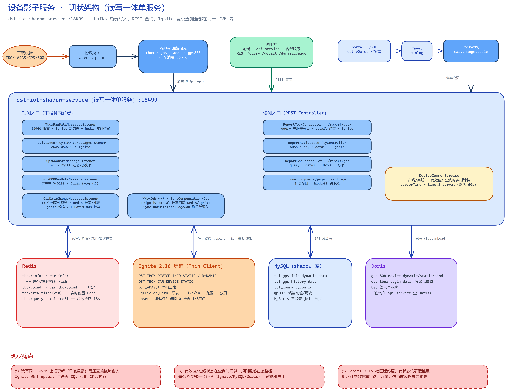
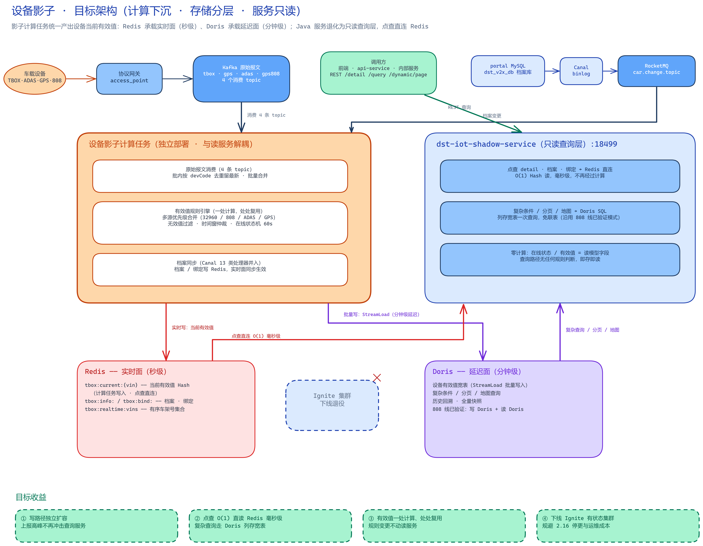

> 结论先行：现状是「读写一体单服务 + Ignite 承载一切」的三层架构；目标架构把**有效值计算下沉到独立的影子计算任务**，存储分层为 **Redis（实时面，秒级）+ Doris（延迟面，分钟级）**，Java 服务退化为**只读查询层**，点查直连 Redis，复杂查询走 Doris，Ignite 下线。

---

## 一、现状架构（prod 分支）

<div class="callout callout-note" markdown="1">
**📝 2026-09-23 修复**

原文件名「设备影子-现状**枆**构」含错别字（枆→构），wikilink 长期解析失败被误判为死链。已改名归位至 `80-Attachments/Excalidraw/`。
</div>



源文件：**设备影子-现状架构.excalidraw**

### 三层结构

| 层   | 组件                                                                          | 职责                                                                                              |
| --- | --------------------------------------------------------------------------- | ----------------------------------------------------------------------------------------------- |
| 接入层 | 协议网关 → Kafka（tbox/gps/adas/gps808 四条 topic）；portal MySQL → Canal → RocketMQ | 原始报文与档案变更入口                                                                                     |
| 服务层 | `dst-iot-shadow-service`（:18499，读写一体）                                       | 4 个 Kafka Listener 写动态数据；Canal 13 个档案处理器；XXL-Job 补偿；对外 REST（query/detail/dynamic-page/map-page） |
| 存储层 | Redis / Ignite 2.16 / MySQL / Doris                                         | Redis 存档案·绑定·实时位置；Ignite 存 TBOX/ADAS 静态+动态三表并承载复杂联表查询；MySQL 存老 GPS 线；Doris 存 808 线与 32960 登录包   |

### 关键事实（代码证据）

- 写入口：`TboxRawDataMessageListener`、`ActiveSecurityRawDataMessageListener`、`GpsRawDataMessageListener`、`Gps808RawDataMessageListener`、`CarDataChangeMessageListener`（Canal），全部在本服务内。
- 读入口：`ReportTboxController`（Ignite 三联表分页/点查）、`ReportActiveSecurityController`、`ReportGpsController`（MySQL 三联表）、Inner 的 `dynamic/page`、`map/page`。
- 在线/离线、有效值判定在**查询时**由 `DeviceCommonService` 现算（`serverTime + time.interval`，默认 60s）。
- Ignite 2.16 Thin Client，`SqlFieldsQuery` 拼 SQL，upsert 为「UPDATE 影响 0 行再 INSERT」。
- GPS808 线已经是「写 Doris + 读在 api-service 查 Doris」的分离模式（本服务只写不读）。

---

## 二、原架构劣势

**读写耦合在同一 JVM，互相影响**
   早晚上报高峰时，Kafka 消费 + Ignite 高频 upsert 与联表 SQL 查询争抢 CPU/内存/GC，查询抖动直接传导到前端；写侧故障（如回放积压）会拖死读服务，无法独立扩容、独立降级。

2. **核心规则在查询时现算，逻辑散落且不可复用**
   在线状态、有效值仲裁在读路径临时计算（`DeviceCommonService`），每条协议线各写一套；改规则要动读服务，告警/围栏等其他业务想要同一份「有效值」只能重复实现。

3. **Ignite 2.16 是最大单点风险**
   社区版停更；有状态集群运维重（扩容触发数据重平衡、故障恢复慢）；容量评估困难；SQL 拼接硬编码，宽表/加字段都要改代码。

4. **四条协议线四套存储，架构割裂**
   TBOX/ADAS 走 Ignite、老 GPS 走 MySQL、808 走 Doris、档案走 Redis——同一种「设备当前值」业务有四种实现，新人理解成本高，跨协议统一查询（如全车队在线数）做不了。

5. **连锁复杂度**
   分页总数要靠 `SyncTboxDataTotalPageJob` 预刷 Redis 缓存兜底；数据不准要靠三个补偿 Job + 补偿接口回填——这些都是读写耦合架构打的补丁。

---

## 三、目标架构



源文件：**设备影子-目标架构.excalidraw**

### 核心变化

| 变化点 | 说明 |
|---|---|
| **新增：设备影子计算任务** | 独立部署（与读服务解耦），消费 4 条原始 topic + Canal 档案变更；内置**有效值规则引擎**：多源优先级合并、无效值过滤、时间窗仲裁、在线状态机（60s）——一处计算，处处复用 |
| **Redis = 实时面** | 计算任务产出 `tbox:current:{vin}` 当前有效值 Hash（秒级）；档案/绑定沿用 `tbox:info:`/`tbox:bind:` 不变 |
| **Doris = 延迟面** | 有效值宽表 StreamLoad 批量写入（分钟级延迟），承载复杂条件/分页/地图/历史回溯——沿用 808 线已验证模式 |
| **Java 服务只读化** | 点查 detail/档案/绑定 → Redis 直连（O(1) 毫秒级）；复杂查询 → Doris 宽表 SQL（免联表）；查询路径零计算，读模型即所得 |
| **Ignite 下线** | 完成双写迁移后退役，少一套有状态中间件 |

### 数据流

```
设备 → 网关 → Kafka → 影子计算任务 ──实时写──> Redis（tbox:current:{vin}）
                        │                    └──> 读服务点查直连
                        └──批量写──> Doris（有效值宽表）
                                       └──> 读服务复杂查询/分页/地图
portal MySQL → Canal → RocketMQ → 计算任务档案同步 → Redis 档案/绑定
```

---

## 四、新旧对比与新架构好处

| 维度 | 现状（读写一体 + Ignite） | 目标（计算下沉 + Redis/Doris） |
|---|---|---|
| 读写隔离 | 同一 JVM，互相拖垮 | 计算任务与读服务物理隔离，独立扩容/降级 |
| 点查延迟 | Ignite 联表 SQL，10~100ms 级 | Redis Hash 直读，毫秒级 |
| 复杂查询 | Ignite 三表联查 + 总数缓存兜底 | Doris 列存宽表一次查询，免联表免兜底 |
| 有效值规则 | 查询时现算，散落各线 | 计算任务一处产出，全平台复用 |
| 存储种类 | Ignite + MySQL + Doris + Redis 四套 | Redis + Doris 两套（均为平台已有组件） |
| 运维成本 | Ignite 有状态集群 + 2.16 停更风险 | 下线 Ignite；Redis/Doris 有成熟运维体系 |
| 规则演进 | 改读服务，影响面大 | 改计算任务，读服务零改动 |

**新架构的四个本质收益**：

1. **抗峰**：写路径独立扩容，上报高峰不再冲击查询；
2. **快**：点查 O(1) 直读 Redis；复杂查询走 Doris 列存宽表；
3. **稳**：有效值一处计算、处处复用，规则变更不动读服务；
4. **省**：下线 Ignite，规避 2.16 停更与有状态集群运维成本。

---

## 五、业界怎么做

设备影子的业界共识：**影子是物化读模型（Materialized View），写路径与读路径天然分离，应用查询影子而不是触碰设备/接入链路**。

### 具体案例

| 厂商 | 产品 | 做法 |
|---|---|---|
| **AWS** | IoT Device Shadow | 影子是一份 JSON 文档（`desired`/`reported`/`delta`），设备离线时应用照常读写影子；读走 `GetThingShadow` REST/MQTT，写由设备上报触发影子服务内部更新——**应用与设备完全解耦**，影子服务自身只做状态存取，不做业务计算 |
| **Azure** | IoT Hub Device Twin | Twin 分 `tags`（云侧档案）/`desired`/`reported`；后端用类 SQL 查询语言直接查 Twin 存储，设备 D2C 与云侧 C2D 通道分离——**读写通道分离 + 查询直通存储** |
| **阿里云** | 物联网平台·设备影子 | 影子 JSON 缓存设备最新状态与待下发配置；应用通过云端 API 查影子，设备在线后再同步——强调**查询不依赖设备实时在线** |
| **华为云** | IoTDA 设备影子 | 同上模式：应用侧查询/配置全部落到影子，平台负责影子与设备间的状态同步 |

### 模式归纳

- 四大云的共同点：**影子 = 只读物化视图 + 独立的影子更新管线**，没有任何一家把「设备状态计算」放在查询接口里现算。
- 更广义的方法论：这是 **CQRS（命令查询职责分离）+ Lambda 架构**的经典组合——Redis 是 speed layer（实时、可能短暂不一致）、Doris 是 serving layer（延迟但完整可查）。
- **内部先例**：我们自己的 GPS808 线已经是这个模式（写 Doris、读由 api-service 查 Doris），目标架构相当于把 808 线验证过的模式推广到全部协议线，并补上 Redis 实时面解决「808 模式点查不够快」的问题。

---

## 六、影响点分析

### 1. 对调用方
- REST 接口契约不变（沿用 Ignite3 读切换已验证的「委派模式」：控制器零改动，底层实现切换），前端无感。
- 点查（detail）延迟从联表 SQL 降至 Redis O(1)，体验提升明显。
- 复杂查询结果从「实时」变为「分钟级延迟」，需要产品侧确认可接受（列表页、地图页通常可接受；点查详情仍走 Redis 保持实时）。

### 2. 数据一致性
- 新引入「实时面 vs 延迟面」双写一致性问题：需对账机制（可复用现有补偿 Job 模式，定期比对 Redis current 与 Doris 宽表）。
- 「有效值」仲裁规则收拢到计算任务后，必须先形成书面的规则定义（多源优先级、时间窗、无效值清单），这是本方案最重要的前置产出物。

### 3. 计算任务建设
- 形态选择：可基于已拆出的 `dst-iot-shadow-write-service` 演进，或新建 Flink 任务；消费组沿用现有 topic，**禁止 earliest 回放**（已有踩坑记录：回放会写入过期 serverTime + 拖垮存储）。
- 写入幂等：批内按 devCode 去重留最新 + 手动提交位点（已在 Ignite3 批量监听器验证）。
- 存量迁移：从 Ignite/MySQL 现网数据初始化 Redis current 与 Doris 宽表（可复用 `ShadowIgniteMigrateJob` 的迁移框架）。

### 4. 存储容量
- Redis 新增 `tbox:current:{vin}`：按 10 万车 × 每车 2KB 估算约 200MB + 索引开销，可控；需设置淘汰策略/归档策略（长期离线车转 Doris-only）。
- Doris 宽表字段变更走 ALTER（808 线已验证），但宽表 schema 需要先行设计评审。

### 5. 运维
- 下线一套 Ignite 有状态集群；Redis/Doris 均为平台已有组件，监控告警体系现成。
- 新增监控指标：计算任务消费延迟、实时面/延迟面数据偏差、Redis current 命中率。

### 6. 功能改造点
- `map/page`（PRIMARY_ID 游标翻页）：需基于 Doris 或 Redis ZSET 重新设计。
- `dynamic/page`（动态表单表分页）：直接映射为 Doris 宽表分页。
- `tbox:query_total` 总数缓存：Doris count 性能好，可评估去掉预刷 Job。
- 在线状态：从查询时现算改为读模型字段，所有依赖方（告警、围栏、监控页）自动获得一致口径。

### 7. 演进路径（与已完成的 Ignite3 改造衔接）

```
现状（prod：读写一体 Ignite 2.16）
  → ① Ignite3 双写 + 读写分离（write-service 已拆出，分支已完成）
  → ② 影子计算任务上线，双写 Redis current + Doris 宽表
  → ③ 读切换：点查→Redis、复杂查询→Doris（灰度开关，可回退）
  → ④ 停 Ignite 写 → 存量校验 → Ignite 下线
```

## 七、风险与缓解

| 风险 | 缓解 |
|---|---|
| Doris 延迟导致列表页数据偏旧 | 点查走 Redis 保持实时；列表页标注数据时间；延迟目标分钟级并监控 |
| Redis 故障导致点查不可用 | Redis 主从+哨兵现成；降级预案：点查临时回退 Doris（接受延迟） |
| 有效值规则收拢期的口径争议 | 先输出规则定义文档并评审；计算任务与旧读路径并行比对一段时间（沿用双写比对经验） |
| 计算任务回放/重启写乱序 | 消费组强制 latest + 位点手动提交 + 写侧时间戳仲裁（防旧数据覆盖，Lua 版本比较已有实现） |

---

## 附：现状关键文件索引

- 启动类：`IotShadowServiceApplication`（:18499）
- Kafka 消费：`infrastructure/kafka/consumer/`（4 个 Listener）
- Canal 档案：`infrastructure/mq/listener/CarDataChangeMessageListener` + `module/business/archive/processor/`（13 个处理器）
- Ignite 查询：`IgniteTboxUnionDataService`（三联表）、`IgniteTboxDeviceInfoDynamicService`（动态表分页）
- 在线状态现算：`infrastructure/biz/report/common/DeviceCommonService`
- Redis key 定义：`common/constant/RedisConstant`
- Ignite DDL：`SQL/01_zhangchao_202410291427_ignite.sql`；Doris DDL：`SQL/01_zhangchao_202601061140_doris.sql`
