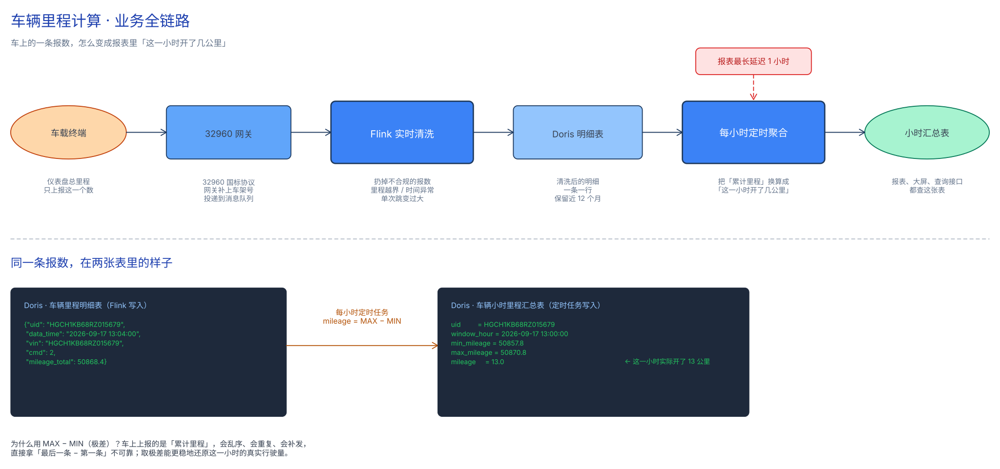
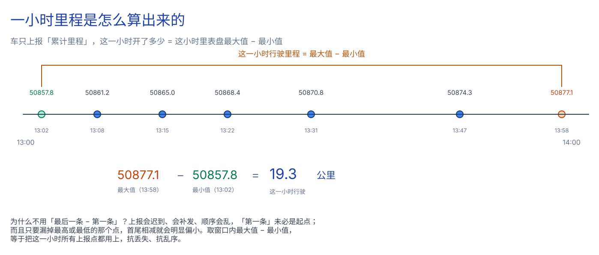

> **这篇给谁看**：产品、运营、业务同事。
> **讲什么**：车辆里程数据从哪来、怎么算、多久更新、为什么有时对不上。
> **不需要懂代码**。想看技术实现，跳到最后「相关文档」。

---

## 一句话讲清

> 车上的终端只上报「仪表盘累计里程」这一个数；平台把**每个小时内**这个数的 **最大值 − 最小值**，换算成「这一小时开了几公里」，**每小时定时算一次**，供报表和大屏查询。

三个关键点：

1. **里程不是传上来的，是算出来的** —— 车只给表盘读数，行驶里程是平台推导的；
2. **不是实时的** —— 报表数据每小时才更新一次，最长延迟约 1 小时；
3. **7 天内的数据会自动修正** —— 后到的补发数据、被纠正的异常，都会让近 7 天的历史数字持续微调。

---

## 1. 数据从哪来、到哪去



| 环节 | 做什么 | 业务含义 |
|---|---|---|
| 车载终端 | 按国标 32960 协议，定期上报累计里程 | 只报「表盘总里程」，不报增量 |
| 32960 网关 | 接收报文、补上车架号(VIN)、投进消息队列 | 承上启下 |
| Flink 实时清洗 | 扔掉不合规的报数（里程越界、时间异常、单次跳变过大） | 脏数据在入口拦截 |
| Doris 明细表 | 清洗后的原始报数，一条一行 | 保留近 12 个月 |
| 每小时定时聚合 | 把明细按「车 + 小时」分组，算 `最大值 − 最小值` | **行驶里程在这一步产生** |
| Doris 小时汇总表 | 聚合结果 | 报表、大屏、查询接口的数据源 |

<div class="callout callout-tip" markdown="1">
**💡 为什么清洗和聚合要分两步？**

Flink 只负责「把脏数据拦在门外」并原样落库；真正「算里程」的是每小时一次的定时任务。这样历史数据可以反复重算、补数，出问题也查得到原始凭证。
</div>

---

## 2. 一小时里程是怎么算出来的



核心公式：

```
某小时行驶里程 = 该小时内累计里程的最大值 − 最小值
```

**为什么用「极差」而不是「最后一条 − 第一条」？**

- 上报会迟到、会补发、顺序会乱，「第一条」未必是起点；
- 只要漏掉最高或最低的那个点，首尾相减就会明显偏小；
- 极差把这一小时**所有**上报点都用上，抗丢失、抗乱序。

---

## 3. 数据多久更新一次

| 数据 | 更新频率 | 说明 |
|---|---|---|
| 里程明细表 | 准实时（约 3 秒一批） | 车一上报、清洗通过，很快可查 |
| 小时汇总表 | **每小时一次** | 整点后重算，覆盖**过去 7 天** |
| 报表 / 大屏 | 读汇总表 | 所以**最长延迟约 1 小时** |

<div class="callout callout-warning" markdown="1">
**⚠️ 两个容易误解的点**

1. **刚结束的行程不会立刻出现在报表** —— 要等下一个整点的定时任务，最长 1 小时。
2. **7 天以前的数据不会被自动修正** —— 定时任务只重算过去 7 天。更早的历史如果发现错了，需要人工按新口径重建（联系数据/研发）。
</div>

---

## 4. 关键规则（口径速览）

以下是平台判定「这条报数可不可信」的完整规则，产品/运营了解即可：

| 规则 | 阈值 | 说明 |
|---|---|---|
| 里程合法区间 | 0 ~ 99 万公里 | 超出直接丢弃 |
| 上报时间合法区间 | 过去 30 天 ~ 未来 1 天 | 防设备时钟错乱 |
| 实时数据单次跳增 | ≤ 100 公里 | 相邻两次上报不可能涨这么多，超出丢弃 |
| 补发数据单次跳增 | ≤ 300 公里 | 补发时间跨度大，放宽 |
| 偏离近 20 次中位数 | ≤ 500 公里 | 捕捉缓慢漂移的异常 |
| 设备里程清零 | 自动识别「设备复位」 | 大幅回退且回到小值 → 判为换表/清零，放行不误杀 |
| 单小时里程封顶 | ≤ 500 公里 | 新口径兜底，超出削平（现实中一小时不可能开 500km） |

---

## 5. 常见问题（FAQ）

### Q1：报表里的里程，为什么和车机仪表盘对不上？

三个原因，都正常：

1. **口径不同**：平台算的是「每小时内 最大值−最小值」的累计，车机是实时表盘读数；
2. **上报有间隔**：终端几十秒~几分钟报一次，停车期间无上报；
3. **异常数据被清洗**：明显跳变的点被判定为异常丢弃了。

**结论**：看趋势和总量可以对齐到合理误差，但不要求和仪表盘逐公里一致。

### Q2：刚跑完的车，报表里怎么没有？

小时汇总表**每小时整点后才重算一次**，最长要等约 1 小时。明细表是准实时的，但报表读的是汇总表。

### Q3：同一辆车，今天的报表和昨天看的不一样？

这是**特性不是 bug**。定时任务每小时都会重算过去 7 天：

- 后到的补发数据进来了 → 历史小时数字变化；
- 异常数据被重新判定 → 历史小时数字变化。

**7 天内的数据会持续收敛**，昨天和今天有出入是正常的，且通常今天的更准。

### Q4：为什么某辆车某个小时显示 2 万多公里？

这是**已知问题：双里程链**。个别设备在同一小时里并行上报两条基准相差几万公里的里程链（详见第 6 节），旧口径会把两条链混在一起取极差，导致单小时虚增。新方案已写好、待上线。

### Q5：为什么有的车某个小时是 0 公里？

两种可能：

- 这个小时内车确实没动（累计里程没变化）；
- 这个小时的数据全部被过滤掉了，或根本没有上报。

### Q6：里程数据多久更新一次？

明细表准实时（约 3 秒）；报表每小时。具体见第 3 节。

### Q7：7 天以前的数据发现错了，会怎样？

**不会自动修**。定时任务只重算过去 7 天，更早的历史是「冻结」的。需要人工干预重建（联系数据/研发，按新口径重刷）。

### Q8：这个里程能不能当「车辆总里程 / 终身里程」用？

**不能**。这是「某时间段内行驶里程」的统计口径，受清洗规则、封顶、覆盖窗口影响。查询接口返回的是**查询时间窗口内**的行驶里程和范围，不是车辆终身累计。

### Q9：设备换表 / 里程清零了会怎样？

平台能识别「设备复位」（里程大幅回退且回到很小的值），会放行不误杀。但清零前后的里程会断档——小时里程按窗口极差计算，不受清零影响。

### Q10：发现数据异常，找谁？

提供 **车架号(VIN) + 时间段**，找数据/研发排查明细表原始报数即可定位。

---

## 6. 已知问题：双里程链 与 待上线新方案


**问题**：个别设备固件异常，同一辆车在同一小时里并行上报两条基准相差约 2.5 万公里的里程链（一条补发链、一条实时链）。两条链各自内部都「看起来合法」，入口清洗拦不住；旧口径聚合时又不区分链，跨链取极差 → 单小时虚增 2 万多公里。

**待上线新方案**（`sql/2026-09-11-zhangchao-doris.sql`，**尚未上线**）：

1. 每个「车 + 小时」先算中位数；
2. 差距不大（≤500km）→ 视为正常，照旧计算；
3. 差距大（如双链）→ 按中位数把点劈成高低两簇，**点数多的一簇胜出（多数派）**；
4. 只保留胜出那一簇，再滤掉偏离太远的点；
5. 最终结果封顶 500km。

**状态提醒**：

- 新方案目前只在**聚合层**防御，原始明细表仍会被双链污染；
- 若多数派恰好选错链（少数派才是真实数据），结果会偏到另一条链上，但不会再出现 2 万公里的荒谬值；
- 上线时间以研发排期为准。

---

## 7. 相关文档

- [dst-iot-car-calculator 车辆里程计算作业 — 详细设计文档](/2026/09/10/mileage-calculator-design/) — Flink 作业技术细节（研发向）
- [车辆里程计算与查询接口 — 全链路分析](/2026/08/14/mileage-full-link-analysis/) — 下游聚合 SQL、查询接口、双里程链事故完整分析（研发向）
- **车联网数仓架构蓝图.excalidraw** — 车联网数仓整体架构

> 本文配图：**车辆里程计算-业务全链路.excalidraw** · **车辆里程计算-一小时里程原理.excalidraw** · **车辆里程计算-新老口径对比.excalidraw**
